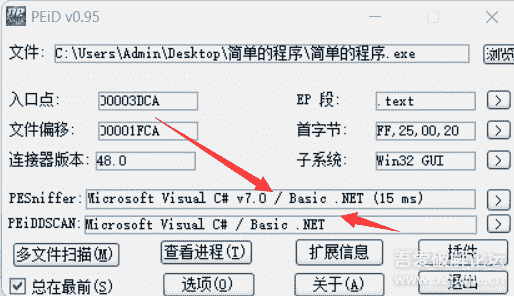
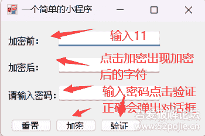
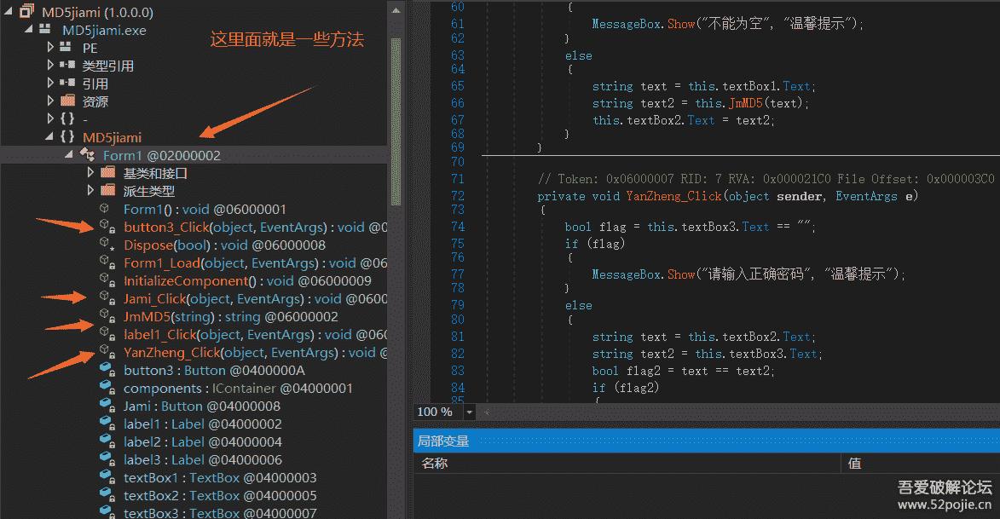
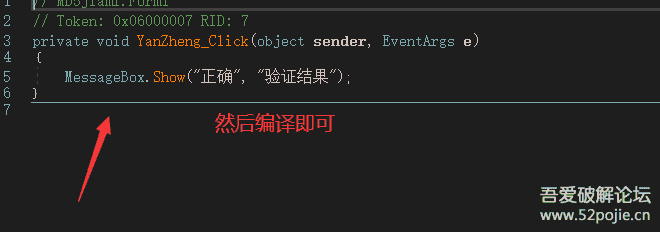
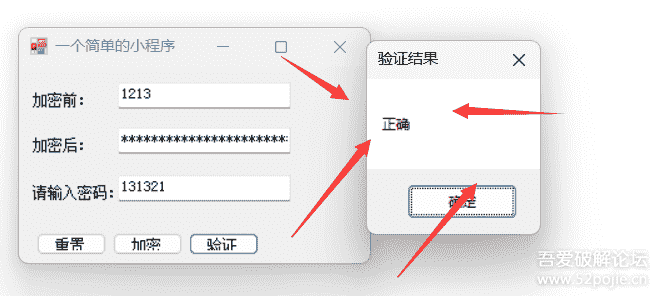
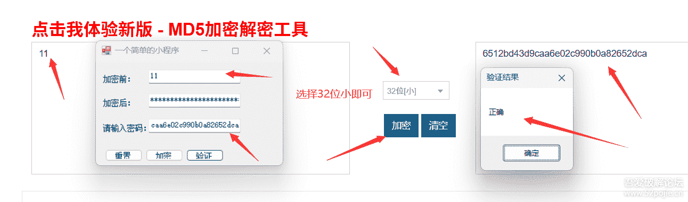
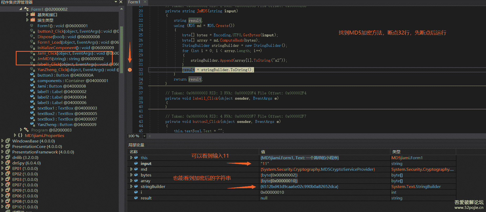

# [.NET逆向] 无壳C#做的简单程序的破解

- 原帖: https://www.52pojie.cn/forum.php?mod=viewthread&tid=2017844
- 抓取时间: 2026-11-01T22:11:42

大家好，我是wasdzjh，很久没有出教程了，我写的教程也是对于新人有用，希望新人可以看到我的教程，有一些启发，跟着我的教程可以做一遍。多总结，多实践。不会就问论坛的大佬，我感觉热心人还是挺多的，氛围还是可以的。好了不说太多废话了，开始今天的逆向之路。

## 工具
工具：`dnspy`
查壳工具：`peid0.95`
软件：我自己写的软件

## 第一步：查壳（没有壳子）



无壳.png (56.63 KB, 下载次数: 1)

[href="forum.php?mod=attachment&aid=Mjc2NTIzMXwyNGUwNWUzZXwxNzkzNTcxMDk5fDE2ODA4NnwyMDE3ODQ0&nothumb=yes" target="_blank"](https://www.52pojie.cn/forum.php?mod=attachment&aid=Mjc2NTIzMXwyNGUwNWUzZXwxNzkzNTcxMDk5fDE2ODA4NnwyMDE3ODQ0&nothumb=yes)

无壳
2025-3-23 15:47 上传

## 第二步：分析软件



分析软件.png (28.68 KB, 下载次数: 0)

[href="forum.php?mod=attachment&aid=Mjc2NTIzN3w2N2M1ZDE2ZnwxNzkzNTcxMDk5fDE2ODA4NnwyMDE3ODQ0&nothumb=yes" target="_blank"](https://www.52pojie.cn/forum.php?mod=attachment&aid=Mjc2NTIzN3w2N2M1ZDE2ZnwxNzkzNTcxMDk5fDE2ODA4NnwyMDE3ODQ0&nothumb=yes)

分析软件
2025-3-23 16:21 上传

输入加密前的字符，点击下面加密会出现加密后的字符，输入密码，然后点击验证如果加密后的字符和你输入的密码一样，会弹出正确的对话框。

## 第二步：开始破解

### 破解一

看到`C#`写的软件，首先想到的软件就是`dnspy`，这个软件可以清楚的看到里面的代码，除非是一些代码做了加密，会看不到。



方法.png (110.54 KB, 下载次数: 0)

[href="forum.php?mod=attachment&aid=Mjc2NTI0NnxmYjliMTJjM3wxNzkzNTcxMDk5fDE2ODA4NnwyMDE3ODQ0&nothumb=yes" target="_blank"](https://www.52pojie.cn/forum.php?mod=attachment&aid=Mjc2NTI0NnxmYjliMTJjM3wxNzkzNTcxMDk5fDE2ODA4NnwyMDE3ODQ0&nothumb=yes)

方法
2025-3-23 16:41 上传

看到里面的代码可以看到没有加密，接下来就是找关键的验证方法，我们一个一个排除。

`Jami_Click`

[C#] 纯文本查看 复制代码
```
private void Jami_Click(object sender, EventArgs e){
        bool flag = this.textBox1.Text == "" && this.textBox2.Text == "" && this.textBox3.Text == "";
        if (flag)
        {
                MessageBox.Show("不能为空", "温馨提示");
        }
        else
        {
                string text = this.textBox1.Text;
                string text2 = this.JmMD5(text);
                this.textBox2.Text = text2;
        }
}
```

代码的意思就是不能为空，然后`text2`就等于`MD5`加密后的字符，所以接下来就是找`JmMD5`这个方法

[C#] 纯文本查看 复制代码
```
private string JmMD5(string input)

{

        string result;

        using (MD5 md = MD5.Create())

        {

                byte[] bytes = Encoding.UTF8.GetBytes(input);

                byte[] array = md.ComputeHash(bytes);

                StringBuilder stringBuilder = new StringBuilder();

                for (int i = 0; i YanZheng_Click）
```

`YanZheng_Click`

[C#] 纯文本查看 复制代码
```
private void YanZheng_Click(object sender, EventArgs e)
{
        bool flag = this.textBox3.Text == "";
        if (flag)
        {
                MessageBox.Show("请输入正确密码", "温馨提示");
        }
        else
        {
                string text = this.textBox2.Text;
                string text2 = this.textBox3.Text;
                bool flag2 = text == text2;
                if (flag2)
                {
                        MessageBox.Show("正确", "验证结果");
                }
                else
                {
                        MessageBox.Show("错误", "验证结果");
                }
        }
}
```

可以看到正确的弹框，所以修改就在这个方法修改即可。我们的目的就是要一个正确的弹框，所以就让他直接输出一个正确的弹框即可。

选中任何一行----右键---编辑方法（`Ctrl+shift+E`）----将其他代码都删掉留下`MessageBox.Show("正确", "验证结果")`即可。如图：



编译.png (13 KB, 下载次数: 2)

[href="forum.php?mod=attachment&aid=Mjc2NTI3MnxjYTVmMTA4YXwxNzkzNTcxMDk5fDE2ODA4NnwyMDE3ODQ0&nothumb=yes" target="_blank"](https://www.52pojie.cn/forum.php?mod=attachment&aid=Mjc2NTI3MnxjYTVmMTA4YXwxNzkzNTcxMDk5fDE2ODA4NnwyMDE3ODQ0&nothumb=yes)

编译
2025-3-23 16:59 上传

然后点文件的保存模块即可。么有报错说明没有问题。接下来开始验证破解后的程序



破解后.png (46.6 KB, 下载次数: 1)

[href="forum.php?mod=attachment&aid=Mjc2NTI3OHxmNTZkOWVkZHwxNzkzNTcxMDk5fDE2ODA4NnwyMDE3ODQ0&nothumb=yes" target="_blank"](https://www.52pojie.cn/forum.php?mod=attachment&aid=Mjc2NTI3OHxmNTZkOWVkZHwxNzkzNTcxMDk5fDE2ODA4NnwyMDE3ODQ0&nothumb=yes)

破解
2025-3-23 17:02 上传

### 破解二（网页破解法）

大家知道是`MD5`的加密方法，所以网上的在线`MD5`加密也是可以的，找到一个加密网站试试



网页.png (82.58 KB, 下载次数: 1)

[href="forum.php?mod=attachment&aid=Mjc2NTI5NnwzZTJiZGM4NnwxNzkzNTcxMDk5fDE2ODA4NnwyMDE3ODQ0&nothumb=yes" target="_blank"](https://www.52pojie.cn/forum.php?mod=attachment&aid=Mjc2NTI5NnwzZTJiZGM4NnwxNzkzNTcxMDk5fDE2ODA4NnwyMDE3ODQ0&nothumb=yes)

网页
2025-3-23 17:11 上传

### 破解三（断点破解法）

找到程序`MD5`加密的方法，然后32行下断点，然后点击运行，断下来就能看到加密后的数值。大家自行验证，如图：



断点破解.png (175.24 KB, 下载次数: 1)

[href="forum.php?mod=attachment&aid=Mjc2NTMxOXxlNDdjMmFmYnwxNzkzNTcxMDk5fDE2ODA4NnwyMDE3ODQ0&nothumb=yes" target="_blank"](https://www.52pojie.cn/forum.php?mod=attachment&aid=Mjc2NTMxOXxlNDdjMmFmYnwxNzkzNTcxMDk5fDE2ODA4NnwyMDE3ODQ0&nothumb=yes)

断点
2025-3-23 17:25 上传

至此，破解方法都告诉大家了，大家有什么不懂的可以问我。大家有CB的评分一下，热心也给点，感谢大家了，希望你们可以从中有些收获。本文献给菜鸟萌新玩家，大佬就别看了。
