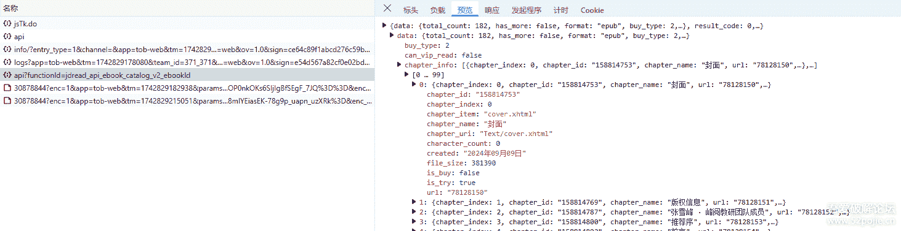
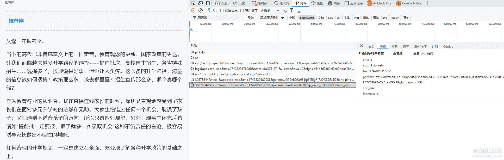
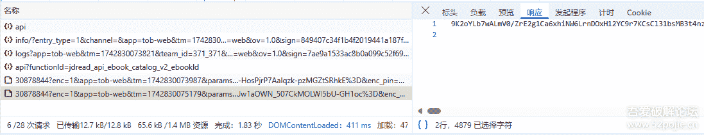
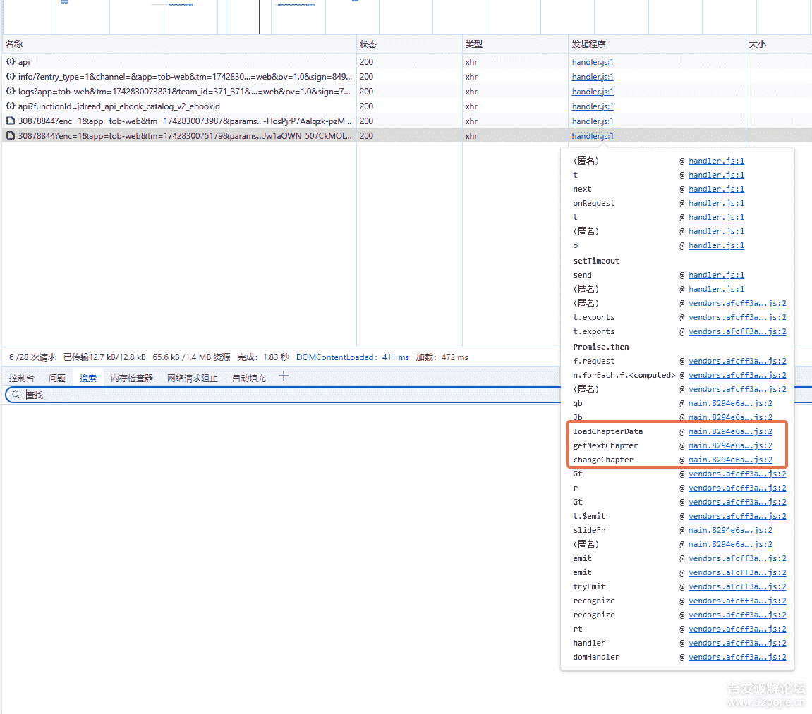
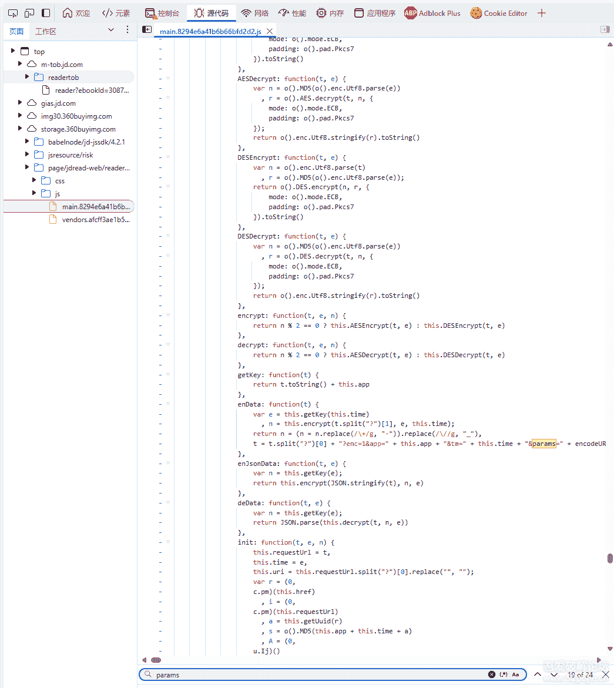
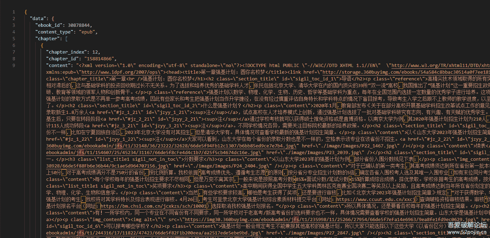

# [Web逆向] 某东读书专业版EPUB资源简单分析

- 原帖：`https://www.52pojie.cn/forum.php?mod=viewthread&tid=2018289`
- 抓取时间：`2026-11-01T22:11:35`

## 声明

本文章中所有内容仅供学习交流使用，不用于其他任何目的，不提供完整代码，抓包内容、敏感网址、数据接口等均已做脱敏处理，严禁用于商业用途和非法用途，否则由此产生的一切后果均与作者无关。本文章未经许可禁止转载，禁止任何修改后二次传播，擅自使用本文讲解的技术而导致的任何意外，作者均不负责。

## 需求

下载目标网站的书籍。

## 目标网址

```
aHR0cHM6Ly9tLXRvYi5qZC5jb20vZWJvb2svMzA4Nzg4NDQ=
```

## 前言

可能是因为发布了比较多的电子书网站解析逆向的帖子，好多有电子书下载需求的坛友收听了我。这次，应某位坛友的需求，简单做一下某东读书专业版的逆向。

## 逆向过程

### 抓包分析

老样子，还是先过一遍接口。



`20250324231902136.png` (73.37 KB, 下载次数: 0)

[附件链接](https://www.52pojie.cn/forum.php?mod=attachment&aid=Mjc2NTc0M3w2OGVmMWE0MnwxNzkzNTcxMDkzfDE2ODA4NnwyMDE4Mjg5&nothumb=yes)

`2136`

`2025-3-24 23:56` 上传

接口比较少，列表和详情两个主要接口其实一下子就能找到。

查看下载资源。



`20250324232201495.png` (161.35 KB, 下载次数: 1)

[附件链接](https://www.52pojie.cn/forum.php?mod=attachment&aid=Mjc2NTc0NHwyMDJmOWFlM3wxNzkzNTcxMDkzfDE2ODA4NnwyMDE4Mjg5&nothumb=yes)

`1495`

`2025-3-24 23:57` 上传

翻页的时候可以看到详情接口变化。



`20250324232935283.png` (45.38 KB, 下载次数: 0)

[附件链接](https://www.52pojie.cn/forum.php?mod=attachment&aid=Mjc2NTc0NXxmYWRkYWI3N3wxNzkzNTcxMDkzfDE2ODA4NnwyMDE4Mjg5&nothumb=yes)

`5283`

`2025-3-24 23:57` 上传

从字符数基本可以确定此接口返回的就是加密后的章节内容。

### 解密章节详情

#### 查看分析处理EPUB文件部分的代码



`20250324233151455.png` (122.14 KB, 下载次数: 1)

[附件链接](https://www.52pojie.cn/forum.php?mod=attachment&aid=Mjc2NTc0Nnw2NWI5NTg3NXwxNzkzNTcxMDkzfDE2ODA4NnwyMDE4Mjg5&nothumb=yes)

`1455`

`2025-3-24 23:57` 上传

这里有几个很可疑的函数，看名字意思应该是加载当前章节、获取下一章节、改变章节内容。理论上说，加密、解密函数应该在这几个函数前面运行。在搜索此接口`post`的参数名称时，惊喜地发现，加密解密函数都在这里。



`20250324234022727.png` (135.56 KB, 下载次数: 0)

[附件链接](https://www.52pojie.cn/forum.php?mod=attachment&aid=Mjc2NTc0N3w2ZjE4N2MxM3wxNzkzNTcxMDkzfDE2ODA4NnwyMDE4Mjg5&nothumb=yes)

`2727`

`2025-3-24 23:57` 上传

代码甚至没有混淆，比较好读懂。再次看到我们的老朋友`Pkcs7`，这里直接写一下代码，测试一下解密是否正确。

#### 验证解密方式

```js
const crypto = require('crypto');
const fs = require('fs');

class CryptoHandler {
  constructor(app, time) {
    this.app = app;
    this.time = time;
  }

  // 密钥生成函数
  getKey(t) {
    return t.toString() + this.app;
  }

  // AES解密（ECB模式）
  AESDecrypt(t, e) {
    const key = crypto.createHash('md5').update(e).digest().slice(0, 16);
    const decipher = crypto.createDecipheriv('aes-128-ecb', key, null);
    let decrypted = decipher.update(t, 'base64', 'utf8');
    decrypted += decipher.final('utf8');
    return decrypted;
  }

  // DES解密（ECB模式）
  DESDecrypt(t, e) {
    const key = crypto.createHash('md5').update(e).digest().slice(0, 8);
    const decipher = crypto.createDecipheriv('des-ecb', key, null);
    decipher.setAutoPadding(true);
    let decrypted = decipher.update(t, 'base64', 'utf8');
    decrypted += decipher.final('utf8');
    return decrypted;
  }

  // 解密路由
  decrypt(t, e, n) {
    return n % 2 === 0 ? this.AESDecrypt(t, e) : this.DESDecrypt(t, e);
  }

  // 数据解密
  deData(t, e) {
    const n = this.getKey(e);
    return JSON.parse(this.decrypt(t, n, e));
  }
}

const app = 'tob-web';
const t = '';
const encryptedData = '';

const handler = new CryptoHandler(app, t);

const decryptedData = handler.deData(encryptedData, t);
console.log('解密后的数据:', decryptedData);
// fs.writeFileSync('decrypted.json', decryptedData, 'binary');
fs.writeFileSync('decrypted.json', JSON.stringify(decryptedData, null, 2));
```

查看解密后文件：



`20250324234746409.png` (167.42 KB, 下载次数: 1)

[附件链接](https://www.52pojie.cn/forum.php?mod=attachment&aid=Mjc2NTc0OHwyOTU3ZjY0ZnwxNzkzNTcxMDkzfDE2ODA4NnwyMDE4Mjg5&nothumb=yes)

`6409`

`2025-3-24 23:57` 上传

发现可以正常得到解密后的数据。

### 获取加密参数

通过读代码发现，其实加密的参数`params`变量只有时间戳`tm`，所以偷个懒，固定`tm`也就固定了`params`。实际用其他章节验证也没有问题，感兴趣的小伙伴可以自行扣代码，补全参数加密过程。

### 后续处理

接口完整且加密部分使用的标准库，并没有魔改，可以直接改写`python`，只需要遍历目录、遍历接口解密后即可合并成书籍的完整`epub`文件。（本文只提供加密部分的逆向分析，不提供完整代码）

