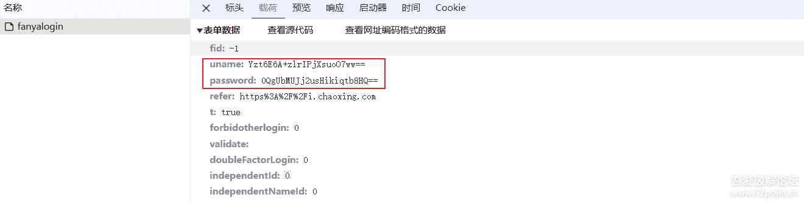
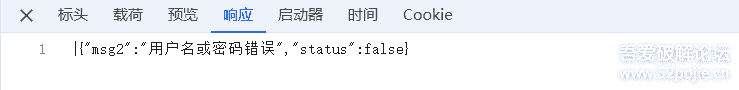
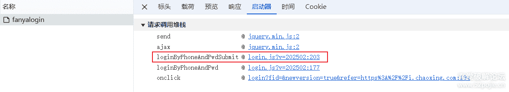
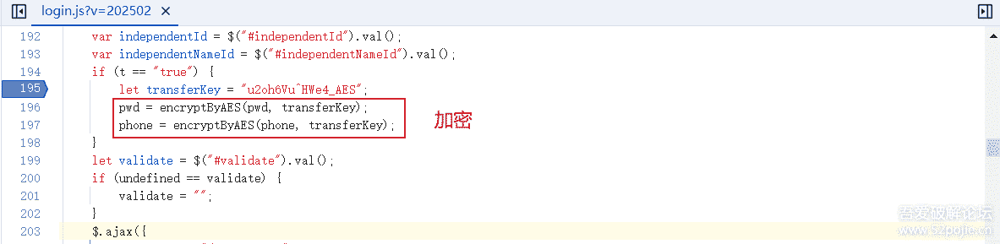
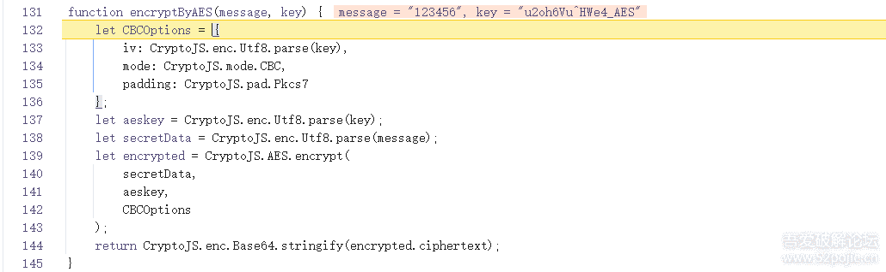
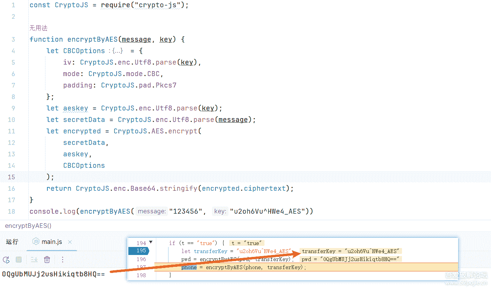
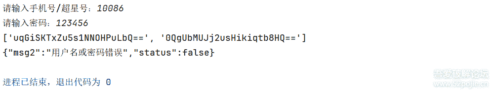

# [Web逆向] 【js逆向】学某通模拟登录

- 原帖: https://www.52pojie.cn/forum.php?mod=viewthread&tid=2018450
- 抓取时间: 2026-11-01T22:11:33

本文章中所有内容仅供学习交流使用，不用于其他任何目的，不提供完整代码，抓包内容、敏感网址、数据接口等均已做脱敏处理，严禁用于商业用途和非法用途，否则由此产生的一切后果均与作者无关。本文章未经许可禁止转载，禁止任何修改后二次传播，擅自使用本文讲解的技术而导致的任何意外，作者均不负责

## 目标网址

目标网址：aHR0cHM6Ly9wYXNzcG9ydDIuY2hhb3hpbmcuY29tL2xvZ2luP2ZpZD0mbmV3dmVyc2lvbj10cnVlJnJlZmVyPWh0dHBzJTNBJTJGJTJGaS5jaGFveGluZy5jb20=

感谢各位大佬的观看，我是菜鸟，新手上路，在某同学的忽悠下入坑js逆向，请多指教

## 分析过程

查看请求载荷，`uname`、`password` 均加密



`image.png` (28.15 KB, 下载次数: 0)

[href="forum.php?mod=attachment&aid=Mjc2NTg1NXw1ZWRlZDZiOXwxNzkzNTcxMDkxfDE2ODA4NnwyMDE4NDUw&nothumb=yes" target="_blank"](https://www.52pojie.cn/forum.php?mod=attachment&aid=Mjc2NTg1NXw1ZWRlZDZiOXwxNzkzNTcxMDkxfDE2ODA4NnwyMDE4NDUw&nothumb=yes)

2025-3-25 14:32 上传

查看响应数据



`image.png` (10.73 KB, 下载次数: 1)

[href="forum.php?mod=attachment&aid=Mjc2NTg1OHwyOGEyNWEzNXwxNzkzNTcxMDkxfDE2ODA4NnwyMDE4NDUw&nothumb=yes" target="_blank"](https://www.52pojie.cn/forum.php?mod=attachment&aid=Mjc2NTg1OHwyOGEyNWEzNXwxNzkzNTcxMDkxfDE2ODA4NnwyMDE4NDUw&nothumb=yes)

2025-3-25 14:33 上传

查看启动器，点击红框



`image.png` (19.7 KB, 下载次数: 0)

[href="forum.php?mod=attachment&aid=Mjc2NTg1OXw0NWM2YjBkMXwxNzkzNTcxMDkxfDE2ODA4NnwyMDE4NDUw&nothumb=yes" target="_blank"](https://www.52pojie.cn/forum.php?mod=attachment&aid=Mjc2NTg1OXw0NWM2YjBkMXwxNzkzNTcxMDkxfDE2ODA4NnwyMDE4NDUw&nothumb=yes)

2025-3-25 14:34 上传

进入，在上面找到加密的地方



`image.png` (21.38 KB, 下载次数: 0)

[href="forum.php?mod=attachment&aid=Mjc2NTg2MHxhN2YwZGZmY3wxNzkzNTcxMDkxfDE2ODA4NnwyMDE4NDUw&nothumb=yes" target="_blank"](https://www.52pojie.cn/forum.php?mod=attachment&aid=Mjc2NTg2MHxhN2YwZGZmY3wxNzkzNTcxMDkxfDE2ODA4NnwyMDE4NDUw&nothumb=yes)

2025-3-25 14:35 上传

断点，点击登录，触发断点，`F9`进入这个函数，一眼`AES`加密，把代码扣下来



`image.png` (17.99 KB, 下载次数: 1)

[href="forum.php?mod=attachment&aid=Mjc2NTg2MXwwODY5NjZmYXwxNzkzNTcxMDkxfDE2ODA4NnwyMDE4NDUw&nothumb=yes" target="_blank"](https://www.52pojie.cn/forum.php?mod=attachment&aid=Mjc2NTg2MXwwODY5NjZmYXwxNzkzNTcxMDkxfDE2ODA4NnwyMDE4NDUw&nothumb=yes)

2025-3-25 14:36 上传

测试成功



`image.png` (123.13 KB, 下载次数: 1)

[href="forum.php?mod=attachment&aid=Mjc2NTg2MnxkOTllNjYxY3wxNzkzNTcxMDkxfDE2ODA4NnwyMDE4NDUw&nothumb=yes" target="_blank"](https://www.52pojie.cn/forum.php?mod=attachment&aid=Mjc2NTg2MnxkOTllNjYxY3wxNzkzNTcxMDkxfDE2ODA4NnwyMDE4NDUw&nothumb=yes)

2025-3-25 14:38 上传

## js代码

[JavaScript] 纯文本查看 复制代码

```
const CryptoJS = require("crypto-js");

function encryptByAES(message, key) {
    let CBCOptions = {
        iv: CryptoJS.enc.Utf8.parse(key),
        mode: CryptoJS.mode.CBC,
        padding: CryptoJS.pad.Pkcs7
    };
    let aeskey = CryptoJS.enc.Utf8.parse(key);
    let secretData = CryptoJS.enc.Utf8.parse(message);
    let encrypted = CryptoJS.AES.encrypt(
        secretData,
        aeskey,
        CBCOptions
    );
    return CryptoJS.enc.Base64.stringify(encrypted.ciphertext);
}
function run(username, password) {
    uname = encryptByAES(username, "u2oh6Vu^HWe4_AES")
    pwd = encryptByAES(password, "u2oh6Vu^HWe4_AES")
    return [uname,pwd]
}
```

## 编写主函数

[Python] 纯文本查看 复制代码

```
import requests

import subprocess

from functools import partial

subprocess.Popen = partial(subprocess.Popen, encoding="utf-8")

import execjs

login_url = '#填写请求接口'

headers = {

    "accept": "application/json, text/javascript, */*; q=0.01",

    "accept-encoding": "gzip, deflate, br, zstd",

    "accept-language": "zh-CN,zh;q=0.9",

    "cache-control": "no-cache",

    "connection": "keep-alive",

    "content-length": "216",

    "content-type": "application/x-www-form-urlencoded; charset=UTF-8",

    "cookie": "你的cookie",

    "host": "",

    "origin": "",

    "pragma": "no-cache",

    "referer": "",

    "sec-ch-ua": "\"Google Chrome\";v=\"131\", \"Chromium\";v=\"131\", \"Not_A Brand\";v=\"24\"",

    "sec-ch-ua-mobile": "?0",

    "sec-ch-ua-platform": "\"Windows\"",

    "sec-fetch-dest": "empty",

    "sec-fetch-mode": "cors",

    "sec-fetch-site": "same-origin",

    "user-agent": "Mozilla/5.0 (Windows NT 10.0; Win64; x64) AppleWebKit/537.36 (KHTML, like Gecko) Chrome/131.0.0.0 Safari/537.36",

    "x-requested-with": "XMLHttpRequest",

}

username = input("请输入手机号/超星号：")

password = input("请输入密码：")

with open("main.js") as f:

    jscode = f.read()

js = execjs.compile(jscode)

result = js.call("run", username,password)

print(result)

payload = {

    "fid": -1,

    "uname": result[0],

    "password": result[1],

    "refer": '',

    "t": True,

    "forbidotherlogin": 0,

    "validate": "",

    "doubleFactorLogin": 0,

    "independentId": 0,

    "independentNameId": 0

}

res = requests.post(login_url, headers=headers, data=payload)

print(res.text)
```

## 运行截图

### 失败



`image.png` (38.17 KB, 下载次数: 0)

[href="forum.php?mod=attachment&aid=Mjc2NTg2M3w4ZTY0YTExZXwxNzkzNTcxMDkxfDE2ODA4NnwyMDE4NDUw&nothumb=yes" target="_blank"](https://www.52pojie.cn/forum.php?mod=attachment&aid=Mjc2NTg2M3w4ZTY0YTExZXwxNzkzNTcxMDkxfDE2ODA4NnwyMDE4NDUw&nothumb=yes)

2025-3-25 14:39 上传

### 成功


`image.png` (37.05 KB, 下载次数: 0)

[href="forum.php?mod=attachment&aid=Mjc2NTg2NHwxZmE4YzNiN3wxNzkzNTcxMDkxfDE2ODA4NnwyMDE4NDUw&nothumb=yes" target="_blank"](https://www.52pojie.cn/forum.php?mod=attachment&aid=Mjc2NTg2NHwxZmE4YzNiN3wxNzkzNTcxMDkxfDE2ODA4NnwyMDE4NDUw&nothumb=yes)

2025-3-25 14:40 上传

今天的分享就到这里，这个案例很简单，适合新手入门练习！
