# [Web逆向] 【js逆向】某云模拟登录

- 原帖: https://www.52pojie.cn/forum.php?mod=viewthread&tid=2019537
- 抓取时间: 2026-11-01T22:11:26

本文章中所有内容仅供学习交流使用，不用于其他任何目的，不提供完整代码，抓包内容、敏感网址、数据接口等均已做脱敏处理，严禁用于商业用途和非法用途，否则由此产生的一切后果均与作者无关.本文章未经许可禁止转载，禁止任何修改后二次传播，擅自使用本文讲解的技术而导致的任何意外，作者均不负责

------------------------------------------------------------------------------------------------------------------------------------------------------------------------------------------------------------------------------------

### 目标网址
`aHR0cHM6Ly9tLmN0eXVuLmNuL3dhcC9tYWluL2F1dGgvbG9naW4=`

--------------------------------------------------------------------------------------------------------------------------------------------------------------------------------------------------------------------------------------

感谢各位大佬的观看，我是菜鸟，新手上路，在某同学的忽悠下入坑js逆向，请多指教
`f12`，输入账号密码点击登录后找到数据接口
查看请求标头，经对比，需要求解的有：`Csm`、`Cst`
`cookie`和`x-riskdevicesign`是定值


image.png (32.57 KB, 下载次数: 0)
[href="forum.php?mod=attachment&aid=Mjc2Njc1Nnw5YTQ3ZmI5MHwxNzkzNTcxMDg0fDE2ODA4NnwyMDE5NTM3&nothumb=yes" target="_blank"](https://www.52pojie.cn/forum.php?mod=attachment&aid=Mjc2Njc1Nnw5YTQ3ZmI5MHwxNzkzNTcxMDg0fDE2ODA4NnwyMDE5NTM3&nothumb=yes)
2025-3-28 15:10 上传

查看请求载荷，表单数据中的`userName`是明文，`password`加密，`comParam_curTime`、`comParam_seqCode`、`comParam_signature`会变

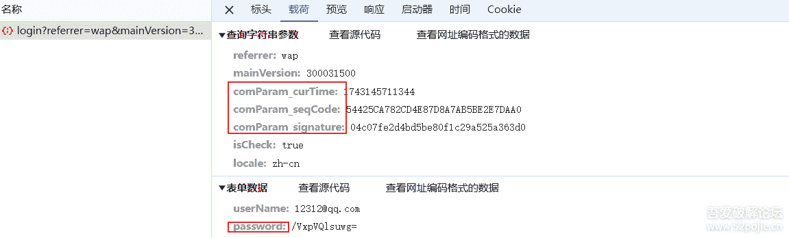
image.png (35.14 KB, 下载次数: 1)
[href="forum.php?mod=attachment&aid=Mjc2Njc1OHw0Nzc4YTk2OXwxNzkzNTcxMDg0fDE2ODA4NnwyMDE5NTM3&nothumb=yes" target="_blank"](https://www.52pojie.cn/forum.php?mod=attachment&aid=Mjc2Njc1OHw0Nzc4YTk2OXwxNzkzNTcxMDg0fDE2ODA4NnwyMDE5NTM3&nothumb=yes)
2025-3-28 15:15 上传

--------------------------------------------------------------------------------------------------------------------------------------------------------------------------------------------------------------------------

### `Csm`、`Cst` 求解
先从请求载荷开始`Csm`、`Cst`的求解：全局搜索 `Cst`，断点，点击登录触发断点

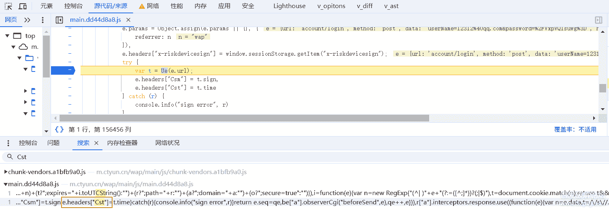
image.png (68.61 KB, 下载次数: 0)
[href="forum.php?mod=attachment&aid=Mjc2Njc2MHw2NDA5MjgyNXwxNzkzNTcxMDg0fDE2ODA4NnwyMDE5NTM3&nothumb=yes" target="_blank"](https://www.52pojie.cn/forum.php?mod=attachment&aid=Mjc2Njc2MHw2NDA5MjgyNXwxNzkzNTcxMDg0fDE2ODA4NnwyMDE5NTM3&nothumb=yes)
2025-3-28 15:20 上传

`F9`，进来这里，扣代码

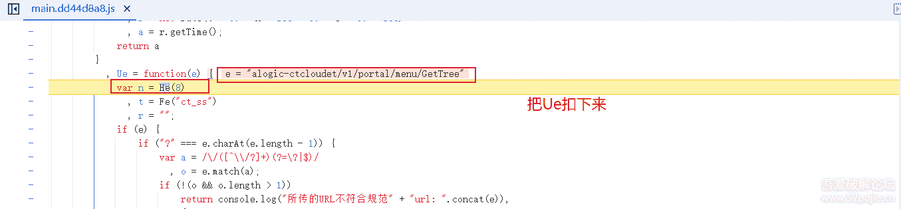
image.png (21.79 KB, 下载次数: 1)
[href="forum.php?mod=attachment&aid=Mjc2Njc2MXw2ZDUyM2UwZnwxNzkzNTcxMDg0fDE2ODA4NnwyMDE5NTM3&nothumb=yes" target="_blank"](https://www.52pojie.cn/forum.php?mod=attachment&aid=Mjc2Njc2MXw2ZDUyM2UwZnwxNzkzNTcxMDg0fDE2ODA4NnwyMDE5NTM3&nothumb=yes)
2025-3-28 15:22 上传

扣代码运行

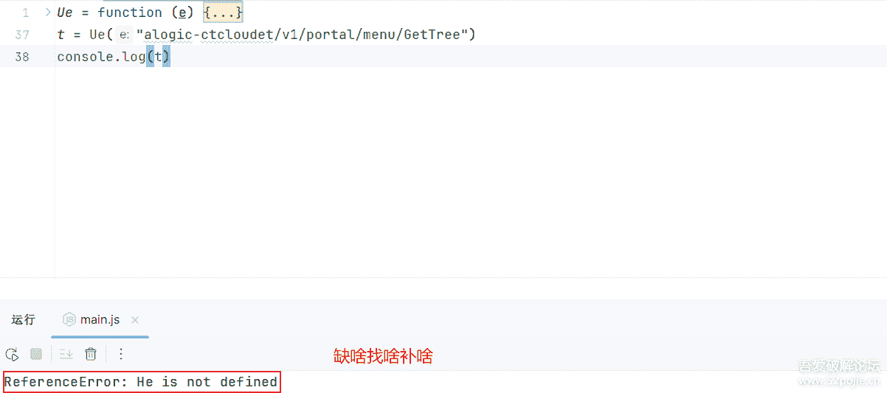
image.png (37.91 KB, 下载次数: 0)
[href="forum.php?mod=attachment&aid=Mjc2Njc2MnwzMTgyODA0MXwxNzkzNTcxMDg0fDE2ODA4NnwyMDE5NTM3&nothumb=yes" target="_blank"](https://www.52pojie.cn/forum.php?mod=attachment&aid=Mjc2Njc2MnwzMTgyODA0MXwxNzkzNTcxMDg0fDE2ODA4NnwyMDE5NTM3&nothumb=yes)
2025-3-28 15:26 上传

`ReferenceError: `Fe` is not defined`

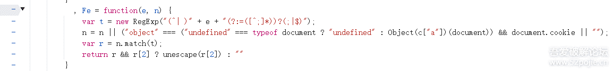
image.png (11.53 KB, 下载次数: 0)
[href="forum.php?mod=attachment&aid=Mjc2Njc2M3xjMWJjYTliM3wxNzkzNTcxMDg0fDE2ODA4NnwyMDE5NTM3&nothumb=yes" target="_blank"](https://www.52pojie.cn/forum.php?mod=attachment&aid=Mjc2Njc2M3xjMWJjYTliM3wxNzkzNTcxMDg0fDE2ODA4NnwyMDE5NTM3&nothumb=yes)
2025-3-28 15:27 上传

`ReferenceError: `_e` is not defined`

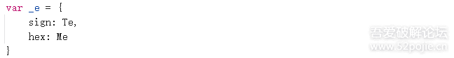
image.png (6.56 KB, 下载次数: 0)
[href="forum.php?mod=attachment&aid=Mjc2Njc2NHw1NmRmOGRkYXwxNzkzNTcxMDg0fDE2ODA4NnwyMDE5NTM3&nothumb=yes" target="_blank"](https://www.52pojie.cn/forum.php?mod=attachment&aid=Mjc2Njc2NHw1NmRmOGRkYXwxNzkzNTcxMDg0fDE2ODA4NnwyMDE5NTM3&nothumb=yes)
2025-3-28 15:36 上传

`ReferenceError: `Te` is not defined`（类似的，在那个文件找，能找到对应的函数）实际要扣取的全部代码如下，在红框内

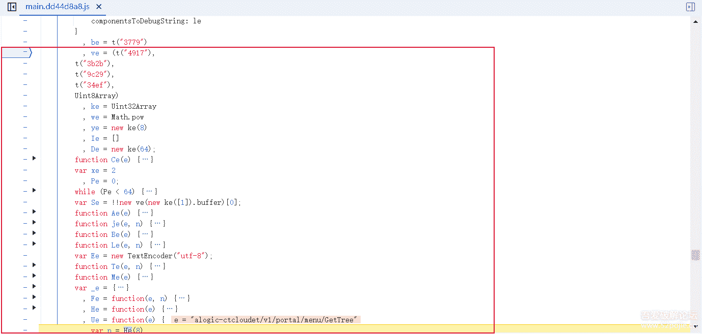
image.png (30.77 KB, 下载次数: 0)
[href="forum.php?mod=attachment&aid=Mjc2Njc2NnxjMmRjZjBiZXwxNzkzNTcxMDg0fDE2ODA4NnwyMDE5NTM3&nothumb=yes" target="_blank"](https://www.52pojie.cn/forum.php?mod=attachment&aid=Mjc2Njc2NnxjMmRjZjBiZXwxNzkzNTcxMDg0fDE2ODA4NnwyMDE5NTM3&nothumb=yes)
2025-3-28 15:44 上传

最后报错：

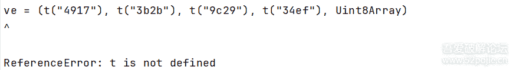
image.png (16.23 KB, 下载次数: 0)
[href="forum.php?mod=attachment&aid=Mjc2Njc2OHw1YjliMTBmNHwxNzkzNTcxMDg0fDE2ODA4NnwyMDE5NTM3&nothumb=yes" target="_blank"](https://www.52pojie.cn/forum.php?mod=attachment&aid=Mjc2Njc2OHw1YjliMTBmNHwxNzkzNTcxMDg0fDE2ODA4NnwyMDE5NTM3&nothumb=yes)
2025-3-28 15:54 上传

从`t`进来，发现是加载器，用到了 `webpack`技术，将当前文件内容复制下来，不知道什么是 `webpack`请自行搜索教程

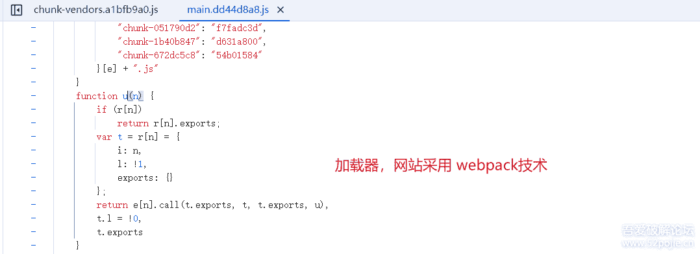
image.png (28.14 KB, 下载次数: 0)
[href="forum.php?mod=attachment&aid=Mjc2Njc2OXwzODc4ZGU3OXwxNzkzNTcxMDg0fDE2ODA4NnwyMDE5NTM3&nothumb=yes" target="_blank"](https://www.52pojie.cn/forum.php?mod=attachment&aid=Mjc2Njc2OXwzODc4ZGU3OXwxNzkzNTcxMDg0fDE2ODA4NnwyMDE5NTM3&nothumb=yes)
2025-3-28 15:58 上传

只复制红框内的内容

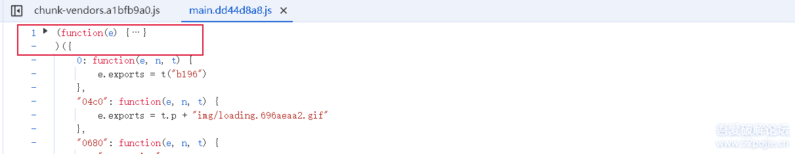
image.png (15.9 KB, 下载次数: 0)
[href="forum.php?mod=attachment&aid=Mjc2Njc3MXw5OTA4ODNlM3wxNzkzNTcxMDg0fDE2ODA4NnwyMDE5NTM3&nothumb=yes" target="_blank"](https://www.52pojie.cn/forum.php?mod=attachment&aid=Mjc2Njc3MXw5OTA4ODNlM3wxNzkzNTcxMDg0fDE2ODA4NnwyMDE5NTM3&nothumb=yes)
2025-3-28 15:59 上传

导出加载器全局使用

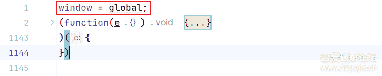
image.png (18.96 KB, 下载次数: 0)
[href="forum.php?mod=attachment&aid=Mjc2Njc3NnwwMDY5NmExY3wxNzkzNTcxMDg0fDE2ODA4NnwyMDE5NTM3&nothumb=yes" target="_blank"](https://www.52pojie.cn/forum.php?mod=attachment&aid=Mjc2Njc3NnwwMDY5NmExY3wxNzkzNTcxMDg0fDE2ODA4NnwyMDE5NTM3&nothumb=yes)
2025-3-28 16:04 上传

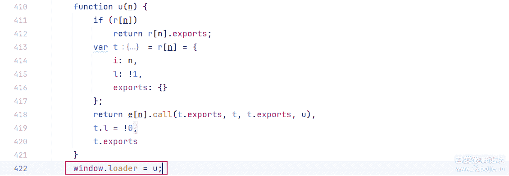
image.png (42.26 KB, 下载次数: 0)
[href="forum.php?mod=attachment&aid=Mjc2Njc3M3w0NjVlOTJmMXwxNzkzNTcxMDg0fDE2ODA4NnwyMDE5NTM3&nothumb=yes" target="_blank"](https://www.52pojie.cn/forum.php?mod=attachment&aid=Mjc2Njc3M3w0NjVlOTJmMXwxNzkzNTcxMDg0fDE2ODA4NnwyMDE5NTM3&nothumb=yes)
2025-3-28 16:02 上传

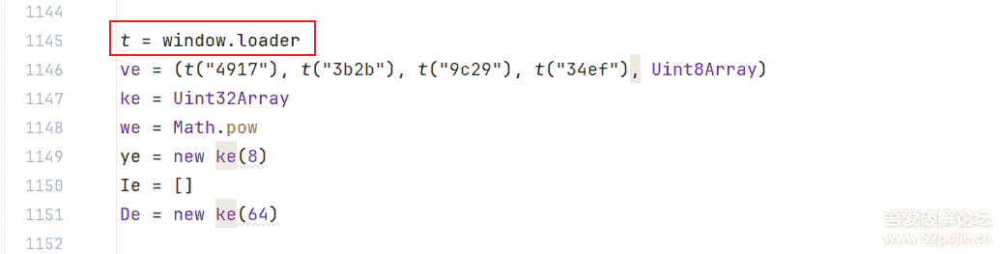
image.png (34.74 KB, 下载次数: 0)
[href="forum.php?mod=attachment&aid=Mjc2Njc3NXw0YzcwMzQ4MXwxNzkzNTcxMDg0fDE2ODA4NnwyMDE5NTM3&nothumb=yes" target="_blank"](https://www.52pojie.cn/forum.php?mod=attachment&aid=Mjc2Njc3NXw0YzcwMzQ4MXwxNzkzNTcxMDg0fDE2ODA4NnwyMDE5NTM3&nothumb=yes)
2025-3-28 16:04 上传

打印所需要的模块

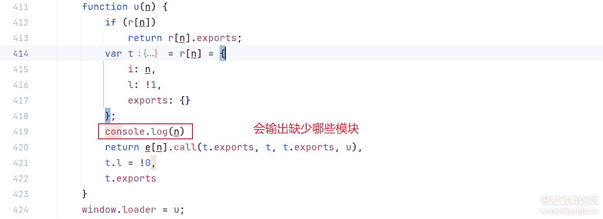
image.png (52.54 KB, 下载次数: 0)
[href="forum.php?mod=attachment&aid=Mjc2Njc3N3wzM2UzNzcxM3wxNzkzNTcxMDg0fDE2ODA4NnwyMDE5NTM3&nothumb=yes" target="_blank"](https://www.52pojie.cn/forum.php?mod=attachment&aid=Mjc2Njc3N3wzM2UzNzcxM3wxNzkzNTcxMDg0fDE2ODA4NnwyMDE5NTM3&nothumb=yes)
2025-3-28 16:05 上传

全局搜索 `4917`


image.png (17.91 KB, 下载次数: 0)
[href="forum.php?mod=attachment&aid=Mjc2Njc3OHxhODY4ODhmM3wxNzkzNTcxMDg0fDE2ODA4NnwyMDE5NTM3&nothumb=yes" target="_blank"](https://www.52pojie.cn/forum.php?mod=attachment&aid=Mjc2Njc3OHxhODY4ODhmM3wxNzkzNTcxMDg0fDE2ODA4NnwyMDE5NTM3&nothumb=yes)
2025-3-28 16:06 上传

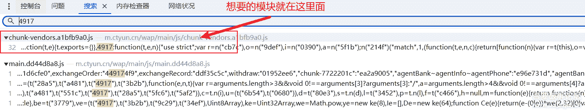
image.png (65.62 KB, 下载次数: 0)
[href="forum.php?mod=attachment&aid=Mjc2Njc3OXxhMTI0OWM2N3wxNzkzNTcxMDg0fDE2ODA4NnwyMDE5NTM3&nothumb=yes" target="_blank"](https://www.52pojie.cn/forum.php?mod=attachment&aid=Mjc2Njc3OXxhMTI0OWM2N3wxNzkzNTcxMDg0fDE2ODA4NnwyMDE5NTM3&nothumb=yes)
2025-3-28 16:07 上传

后面发现缺很多，干脆直接把那些模块全部复制下来

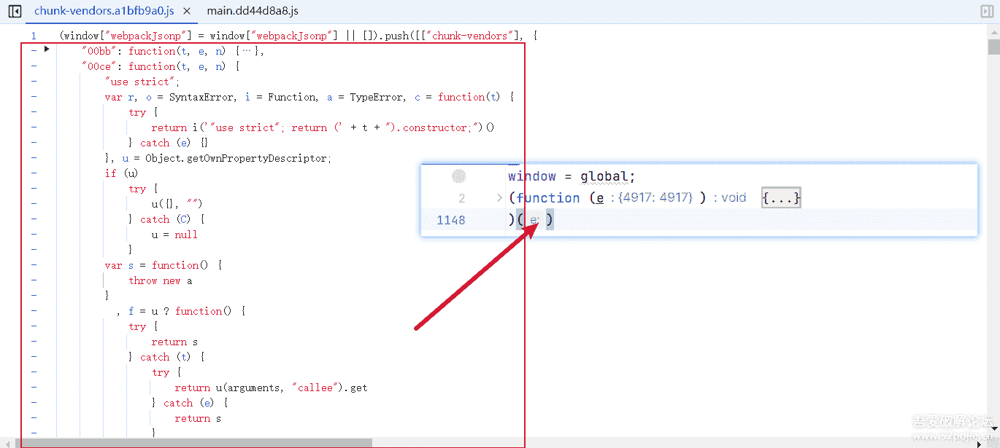
image.png (45.12 KB, 下载次数: 0)


# 加密参数求解分析

[href="forum.php?mod=attachment&aid=Mjc2Njc4NXw0NWQwMDUwM3wxNzkzNTcxMDg0fDE2ODA4NnwyMDE5NTM3&nothumb=yes" target="_blank"](https://www.52pojie.cn/forum.php?mod=attachment&aid=Mjc2Njc4NXw0NWQwMDUwM3wxNzkzNTcxMDg0fDE2ODA4NnwyMDE5NTM3&nothumb=yes)

2025-3-28 16:13 上传

运行

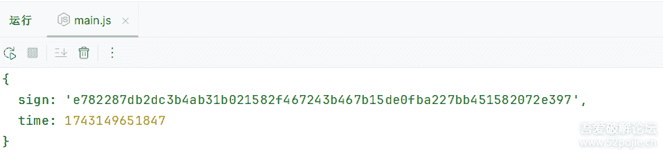

image.png (23.17 KB, 下载次数: 1)

[href="forum.php?mod=attachment&aid=Mjc2Njc4Nnw4YTZmYTEyYnwxNzkzNTcxMDg0fDE2ODA4NnwyMDE5NTM3&nothumb=yes" target="_blank"](https://www.52pojie.cn/forum.php?mod=attachment&aid=Mjc2Njc4Nnw4YTZmYTEyYnwxNzkzNTcxMDg0fDE2ODA4NnwyMDE5NTM3&nothumb=yes)

2025-3-28 16:14 上传

## 请求载荷中加密参数求解

接下来是请求载荷中加密参数的求解：全局搜索 `comParam_curTime`，断点调试

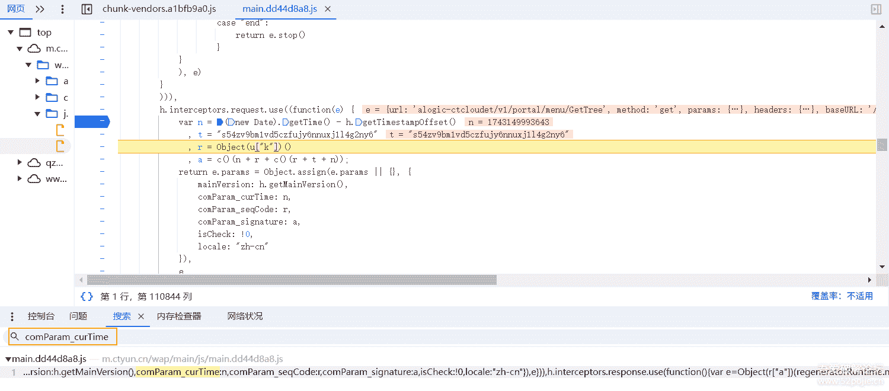

image.png (60.05 KB, 下载次数: 0)

[href="forum.php?mod=attachment&aid=Mjc2Njc4N3wyNDBmOGVmMXwxNzkzNTcxMDg0fDE2ODA4NnwyMDE5NTM3&nothumb=yes" target="_blank"](https://www.52pojie.cn/forum.php?mod=attachment&aid=Mjc2Njc4N3wyNDBmOGVmMXwxNzkzNTcxMDg0fDE2ODA4NnwyMDE5NTM3&nothumb=yes)

2025-3-28 16:21 上传

`r = Object(u["k"])()` 指的是下面这个 `H` 函数

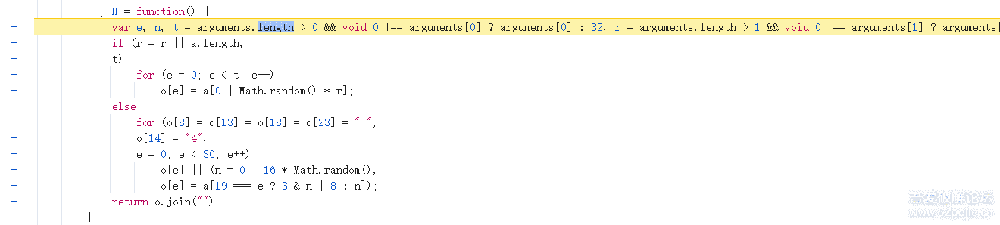

image.png (15.25 KB, 下载次数: 0)

[href="forum.php?mod=attachment&aid=Mjc2Njc4OHw0ZjhiYjA1Y3wxNzkzNTcxMDg0fDE2ODA4NnwyMDE5NTM3&nothumb=yes" target="_blank"](https://www.52pojie.cn/forum.php?mod=attachment&aid=Mjc2Njc4OHw0ZjhiYjA1Y3wxNzkzNTcxMDg0fDE2ODA4NnwyMDE5NTM3&nothumb=yes)

2025-3-28 16:24 上传

`c()` 函数执行的是 `_()` 函数


image.png (10.56 KB, 下载次数: 0)

[href="forum.php?mod=attachment&aid=Mjc2Njc4OXxjYTQ1YjE0OHwxNzkzNTcxMDg0fDE2ODA4NnwyMDE5NTM3&nothumb=yes" target="_blank"](https://www.52pojie.cn/forum.php?mod=attachment&aid=Mjc2Njc4OXxjYTQ1YjE0OHwxNzkzNTcxMDg0fDE2ODA4NnwyMDE5NTM3&nothumb=yes)

2025-3-28 16:26 上传

全部复制下来

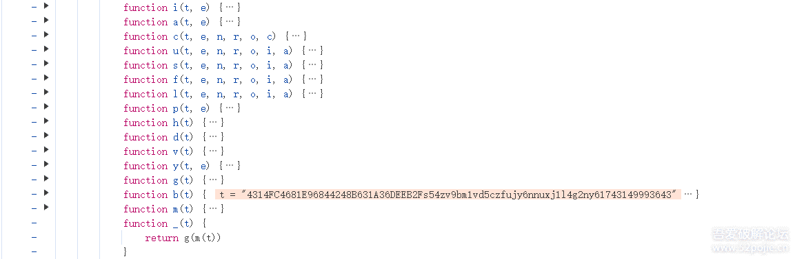

image.png (20.51 KB, 下载次数: 0)

[href="forum.php?mod=attachment&aid=Mjc2Njc5MHwwNzU4YmY3OHwxNzkzNTcxMDg0fDE2ODA4NnwyMDE5NTM3&nothumb=yes" target="_blank"](https://www.52pojie.cn/forum.php?mod=attachment&aid=Mjc2Njc5MHwwNzU4YmY3OHwxNzkzNTcxMDg0fDE2ODA4NnwyMDE5NTM3&nothumb=yes)

2025-3-28 16:27 上传

运行

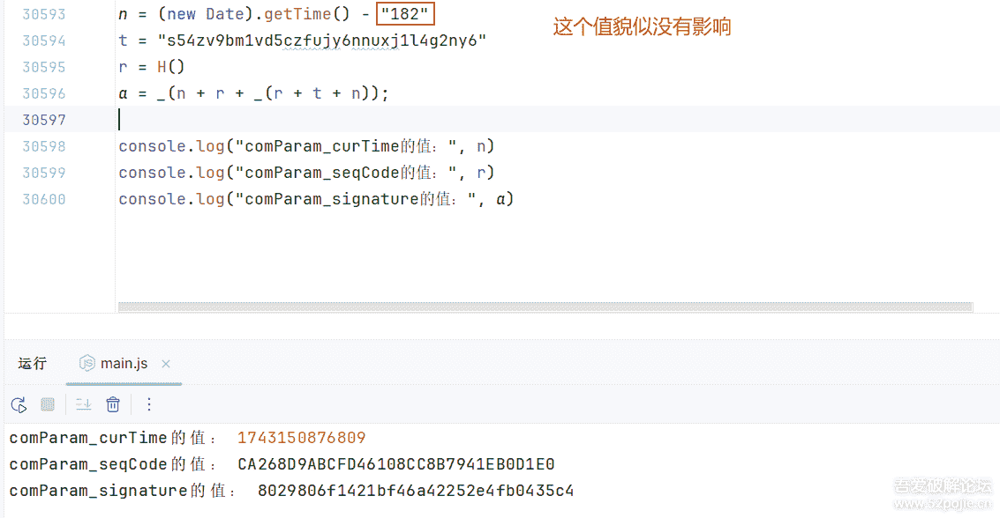

image.png (86.4 KB, 下载次数: 1)

[href="forum.php?mod=attachment&aid=Mjc2Njc5MXw2Yzk5ZmRkZXwxNzkzNTcxMDg0fDE2ODA4NnwyMDE5NTM3&nothumb=yes" target="_blank"](https://www.52pojie.cn/forum.php?mod=attachment&aid=Mjc2Njc5MXw2Yzk5ZmRkZXwxNzkzNTcxMDg0fDE2ODA4NnwyMDE5NTM3&nothumb=yes)

2025-3-28 16:35 上传

核心代码：

```javascript
function run() {
    biaotou = Ue(e_url)
    n = (new Date).getTime() - '182'
    t = "s54zv9bm1vd5czfujy6nnuxj1l4g2ny6"
    r = H()
    a = _(n + r + _(r + t + n));
    return [biaotou,n,r,a]
}
```

---

## 表单数据中的 `password` 求解

接下来是表单数据中的 `password` 的求解：全局搜索 `password`，这里的 `username` 和 `password` 在一起，猜测加密位置在这里，所以选择在这里断点

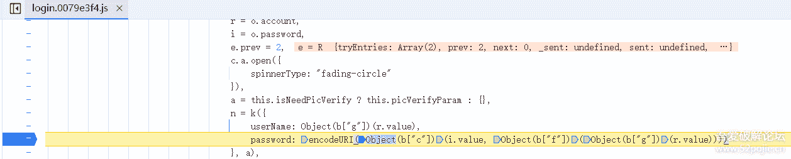

image.png (19.4 KB, 下载次数: 0)

[href="forum.php?mod=attachment&aid=Mjc2Njc5M3w5OTExNjJiM3wxNzkzNTcxMDg0fDE2ODA4NnwyMDE5NTM3&nothumb=yes" target="_blank"](https://www.52pojie.cn/forum.php?mod=attachment&aid=Mjc2Njc5M3w5OTExNjJiM3wxNzkzNTcxMDg0fDE2ODA4NnwyMDE5NTM3&nothumb=yes)

2025-3-28 16:41 上传

进来到这里，这里的逻辑是在用户输入的账号末尾补 0 直到长度为 24，如果超过 24 位则取前 24 位

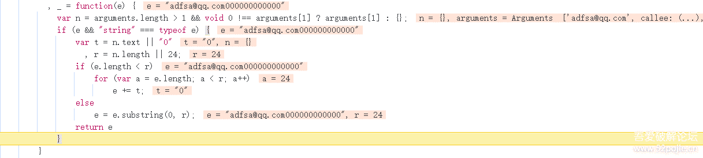

image.png (18.08 KB, 下载次数: 0)

[href="forum.php?mod=attachment&aid=Mjc2Njc5NXwzMmY3YTkzMHwxNzkzNTcxMDg0fDE2ODA4NnwyMDE5NTM3&nothumb=yes" target="_blank"](https://www.52pojie.cn/forum.php?mod=attachment&aid=Mjc2Njc5NXwzMmY3YTkzMHwxNzkzNTcxMDg0fDE2ODA4NnwyMDE5NTM3&nothumb=yes)

2025-3-28 16:44 上传

`F9` 进来，这就太明显了

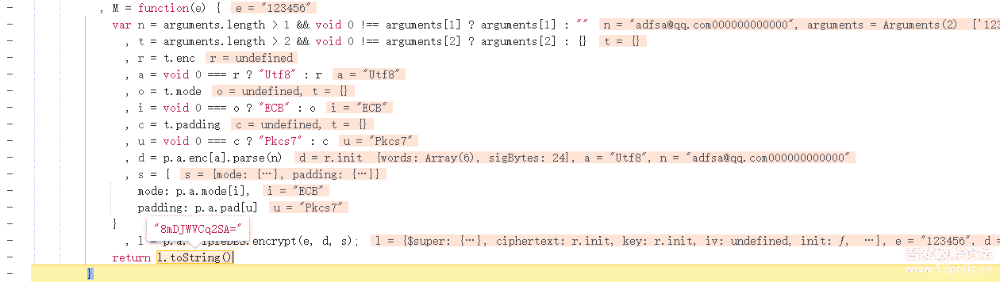

image.png (24.76 KB, 下载次数: 0)

[href="forum.php?mod=attachment&aid=Mjc2Njc5NnwxMWJlNDcxN3wxNzkzNTcxMDg0fDE2ODA4NnwyMDE5NTM3&nothumb=yes" target="_blank"](https://www.52pojie.cn/forum.php?mod=attachment&aid=Mjc2Njc5NnwxMWJlNDcxN3wxNzkzNTcxMDg0fDE2ODA4NnwyMDE5NTM3&nothumb=yes)

2025-3-28 16:45 上传

### 改写 `M` 函数

代码：

```javascript
const cryptoJs = require('crypto-js')

function M(username, password) {

    if (username.length 
```

### 运行结果对比

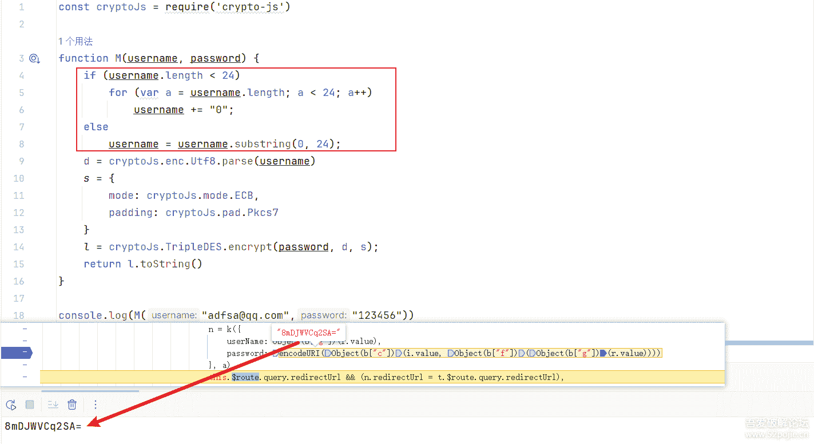

image.png (106.64 KB, 下载次数: 0)

[href="forum.php?mod=attachment&aid=Mjc2Njc5N3wzMjNlYWE2MXwxNzkzNTcxMDg0fDE2ODA4NnwyMDE5NTM3&nothumb=yes" target="_blank"](https://www.52pojie.cn/forum.php?mod=attachment&aid=Mjc2Njc5N3wzMjNlYWE2MXwxNzkzNTcxMDg0fDE2ODA4NnwyMDE5NTM3&nothumb=yes)

2025-3-28 16:48 上传

### 主函数

```python
```


```
import json

import requests
import subprocess
from functools import partial

subprocess.Popen = partial(subprocess.Popen, encoding="utf-8")
import execjs

base_url = "数据接口，自行填写"

username = input("请输入您的账号：")
password = input("请输入您的密码：")

# 求password
with open("password.js", encoding="utf-8") as f:
    jscode = f.read()

js = execjs.compile(jscode)
password_encryption = js.call("login", username, password)
print(password_encryption)
form_data = {
    "userName": username,
    "password": password_encryption
}

# 求标头和载荷的加密参数
with open("demo.js", encoding="utf-8") as f:
    jscode = f.read()

js = execjs.compile(jscode)
result = js.call("run")
print(result)
Csm = result[0]['sign']
Cst = result[0]['time']
print(Csm,Cst)
headers = {
    "accept": "application/json, text/plain, */*",
    "accept-encoding": "gzip, deflate, br, zstd",
    "accept-language": "zh-CN,zh;q=0.9",
    "cache-control": "no-cache",
    "connection": "keep-alive",
    "content-length": "60",
    "content-type": "application/x-www-form-urlencoded",
    "csm": Csm,
    "cst": str(Cst),
    "host": "m.ctyun.cn",
    "origin": "。。。",
    "pragma": "no-cache",
    "referer": "。。。",
    "sec-ch-ua": "\"Google Chrome\";v=\"131\", \"Chromium\";v=\"131\", \"Not_A Brand\";v=\"24\"",
    "sec-ch-ua-mobile": "?0",
    "sec-ch-ua-platform": "\"Windows\"",
    "sec-fetch-dest": "empty",
    "sec-fetch-mode": "cors",
    "sec-fetch-site": "same-origin",
    "user-agent": "Mozilla/5.0 (Windows NT 10.0; Win64; x64) AppleWebKit/537.36 (KHTML, like Gecko) Chrome/131.0.0.0 Safari/537.36",
    "x-riskdevicesign": "50b8ae96f222fd0f2879125bc5fc6e08",
}
params = {
    "referrer": "wap",
    "mainVersion": "300031500",
    "comParam_curTime": result[1],
    "comParam_seqCode": result[2],
    "comParam_signature": result[3],
    "isCheck": True,
    "locale": "zh-cn"
}

print(params)
res = requests.post(base_url, headers=headers, params=params, data=form_data)
user_data = res.text
user_data = json.loads(user_data)
print(json.dumps(user_data,indent=4, ensure_ascii=False))
```

登录成功显示：

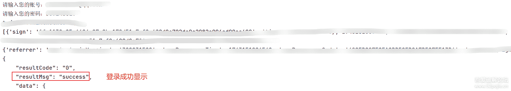

image.png (75.68 KB, 下载次数: 0)

[href="forum.php?mod=attachment&aid=Mjc2Njc5OHxiMjBlZDliZXwxNzkzNTcxMDg0fDE2ODA4NnwyMDE5NTM3&nothumb=yes" target="_blank"](https://www.52pojie.cn/forum.php?mod=attachment&aid=Mjc2Njc5OHxiMjBlZDliZXwxNzkzNTcxMDg0fDE2ODA4NnwyMDE5NTM3&nothumb=yes)

2025-3-28 16:51 上传

登录失败显示：

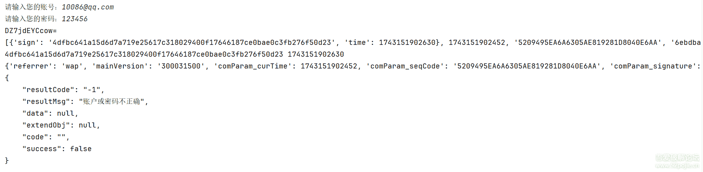

image.png (70.74 KB, 下载次数: 0)

[href="forum.php?mod=attachment&aid=Mjc2Njc5OXw2NmUyMWE4NHwxNzkzNTcxMDg0fDE2ODA4NnwyMDE5NTM3&nothumb=yes" target="_blank"](https://www.52pojie.cn/forum.php?mod=attachment&aid=Mjc2Njc5OXw2NmUyMWE4NHwxNzkzNTcxMDg0fDE2ODA4NnwyMDE5NTM3&nothumb=yes)

2025-3-28 16:51 上传

整个过程就是这样，有不足之处请各位大佬指出，有逆向的资源也可以分享，本人正在学习逆向中，目前已经学了一个月，菜鸟上路，多多指教

--------------------------------------------------------------------------------------------------------------------------------------------------------------------------------------------------------------------------------------
