# [CTF] 2025腾讯游戏安全技术竞赛初赛-题解(有源码)

- 原帖: https://www.52pojie.cn/forum.php?mod=viewthread&tid=2020132
- 抓取时间: 2026-11-01T22:11:21

## 源码

开源地址: [//github.com/DejavuSecure/2025-tencent-game-security-race-pre" target="_blank" rel="noopener noreferrer nofollow"](https://github.com/DejavuSecure/2025-tencent-game-security-race-pre:rel="nofollow noopener" href="https)

## 第一部分：阅读题目要求

根据题目要求 :

选择 Windows 11 22H2 系统，关闭 Windows Defender, VBS, HyperV 后，以管理员权限执行解题程序。首先打开`ACEFirstRound.exe`，提示请输入flag。

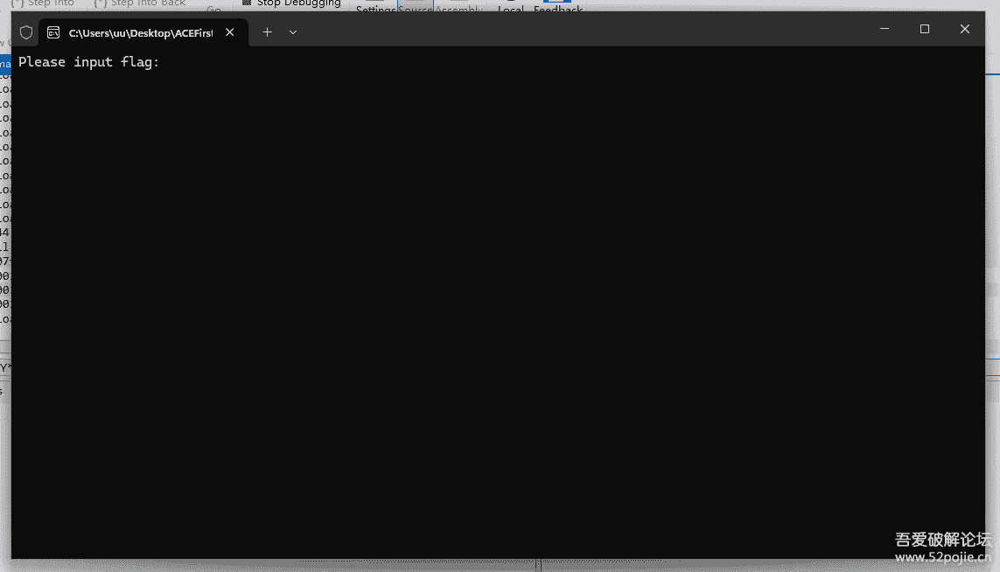

0.png (45.59 KB, 下载次数: 3)

[href="forum.php?mod=attachment&aid=Mjc2NzkzM3wwMGRjNWNkM3wxNzkzNTcxMDc4fDE2ODA4NnwyMDIwMTMy&nothumb=yes" target="_blank"](https://www.52pojie.cn/forum.php?mod=attachment&aid=Mjc2NzkzM3wwMGRjNWNkM3wxNzkzNTcxMDc4fDE2ODA4NnwyMDIwMTMy&nothumb=yes)

2025-4-1 17:18 上传

解题开始:

## 第二部分：Ring3 程序调试

### 主模块地址获取

在进程启动的初期输入: `lm` 获得主模块的地址。

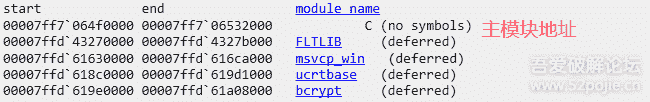

1.png (24.02 KB, 下载次数: 0)

[href="forum.php?mod=attachment&aid=Mjc2NzkzNHxkYWNhNzJiNnwxNzkzNTcxMDc4fDE2ODA4NnwyMDIwMTMy&nothumb=yes" target="_blank"](https://www.52pojie.cn/forum.php?mod=attachment&aid=Mjc2NzkzNHxkYWNhNzJiNnwxNzkzNTcxMDc4fDE2ODA4NnwyMDIwMTMy&nothumb=yes)

2025-4-1 17:18 上传

共需绕过两处检测，第一处为 R3 的基础反调试函数`sub_1400010D0`，第二处为驱动加载后对 R3 的修补检测。具体表现为

- `windbg` 调试程序无法正常执行
- 绕过 R3 调试检测后在驱动加载时对程序下断， 程序会直接被结束。

这里的做法是直接在 `sub_140001370` 处阻止驱动加载。

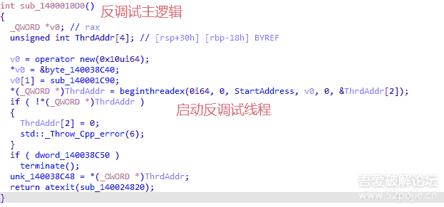

2.png (29.69 KB, 下载次数: 1)

[href="forum.php?mod=attachment&aid=Mjc2NzkzNXwzMGY3Y2Q2OHwxNzkzNTcxMDc4fDE2ODA4NnwyMDIwMTMy&nothumb=yes" target="_blank"](https://www.52pojie.cn/forum.php?mod=attachment&aid=Mjc2NzkzNXwzMGY3Y2Q2OHwxNzkzNTcxMDc4fDE2ODA4NnwyMDIwMTMy&nothumb=yes)

2025-4-1 17:18 上传


```
eb 模块地址+10D0 C3
// ret 用于阻止R3反调试执行
eb 模块地址+1370 48 C7 C0 01 00 00 00 C3
// mov rax， 1
// ret 用于阻止R0驱动加载
```

执行修补后 `R3` 程序可以正常调试。

# 第三部分：Ring3 程序行为分析

- 创建 `ACEDriverSDK` 类，其中包括 安装驱动 和 与驱动的通讯逻辑 。
- 校验输入字符串的头部和长度: 头部必须为 `ACE_` 。长度不满足的字符串无法通过校验，这里输入随机字符串"ACE_2580219509218592511" ，可以通过`R3`校验最终传递到`R0`。
- 从代码释放 base58 自定义字符集 "abcdefghijkmnopqrstuvwxyzABCDEFGHJKLMNPQRSTUVWXYZ1234567890!@+/" 和异或密钥 "sxx" 。动态分析得到的自定义字符集: 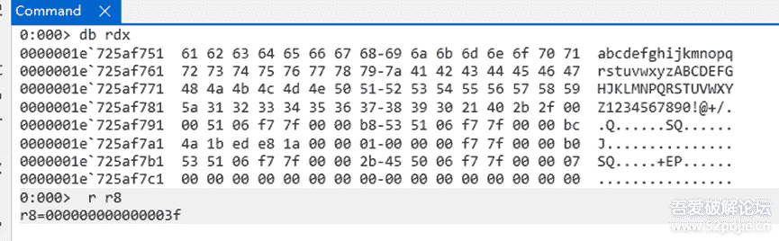 3.png (154.03 KB, 下载次数: 1) [href="forum.php?mod=attachment&aid=Mjc2NzkzNnw5ZGRiNjk0ZXwxNzkzNTcxMDc4fDE2ODA4NnwyMDIwMTMy&nothumb=yes" target="_blank"](https://www.52pojie.cn/forum.php?mod=attachment&aid=Mjc2NzkzNnw5ZGRiNjk0ZXwxNzkzNTcxMDc4fDE2ODA4NnwyMDIwMTMy&nothumb=yes) 2025-4-1 17:18 上传 释放自定义字符集的函数: 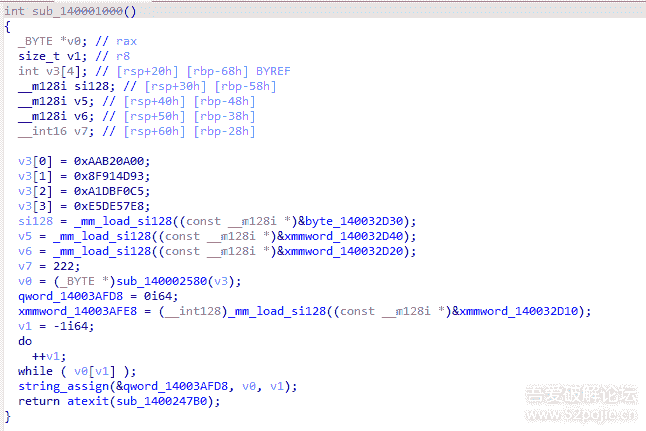 4.png (39.8 KB, 下载次数: 2) [href="forum.php?mod=attachment&aid=Mjc2NzkzN3wyZDAxMGI5Y3wxNzkzNTcxMDc4fDE2ODA4NnwyMDIwMTMy&nothumb=yes" target="_blank"](https://www.52pojie.cn/forum.php?mod=attachment&aid=Mjc2NzkzN3wyZDAxMGI5Y3wxNzkzNTcxMDc4fDE2ODA4NnwyMDIwMTMy&nothumb=yes) 2025-4-1 17:18 上传 释放异或密钥的代码: 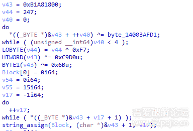 5.png (19.74 KB, 下载次数: 2) [href="forum.php?mod=attachment&aid=Mjc2NzkzOHw4NDUwNzljZHwxNzkzNTcxMDc4fDE2ODA4NnwyMDIwMTMy&nothumb=yes" target="_blank"](https://www.52pojie.cn/forum.php?mod=attachment&aid=Mjc2NzkzOHw4NDUwNzljZHwxNzkzNTcxMDc4fDE2ODA4NnwyMDIwMTMy&nothumb=yes) 2025-4-1 17:18 上传
- 调用设置了自定义字符集的 `base58_encrypt` 函数对用户输入进行编码，将编码结果加上符号 '@' 后倒序排列。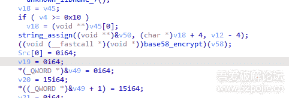 6.png (17.27 KB, 下载次数: 1) [href="forum.php?mod=attachment&aid=Mjc2NzkzOXxiOWQyYjEyZXwxNzkzNTcxMDc4fDE2ODA4NnwyMDIwMTMy&nothumb=yes" target="_blank"](https://www.52pojie.cn/forum.php?mod=attachment&aid=Mjc2NzkzOXxiOWQyYjEyZXwxNzkzNTcxMDc4fDE2ODA4NnwyMDIwMTMy&nothumb=yes) 2025-4-1 17:19 上传
- 用异或密钥 "sxx" 循环对编码后的结果执行异或， 得到异或后的结果。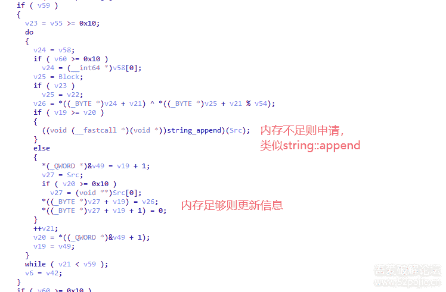 7.png (36.88 KB, 下载次数: 2) [href="forum.php?mod=attachment&aid=Mjc2Nzk0MHxhOWRhMDIzOHwxNzkzNTcxMDc4fDE2ODA4NnwyMDIwMTMy&nothumb=yes" target="_blank"](https://www.52pojie.cn/forum.php?mod=attachment&aid=Mjc2Nzk0MHxhOWRhMDIzOHwxNzkzNTcxMDc4fDE2ODA4NnwyMDIwMTMy&nothumb=yes) 2025-4-1 17:19 上传
- 调用 `ACEDriverSDK::Communicate(+96)` 发送数据到内核，传递加密得到的密文，在驱动中对密文进行验证。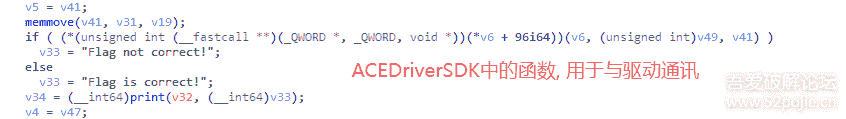 8.png (19.13 KB, 下载次数: 2) [href="forum.php?mod=attachment&aid=Mjc2Nzk0MXwzZjVkMDdiMHwxNzkzNTcxMDc4fDE2ODA4NnwyMDIwMTMy&nothumb=yes" target="_blank"](https://www.52pojie.cn/forum.php?mod=attachment&aid=Mjc2Nzk0MXwzZjVkMDdiMHwxNzkzNTcxMDc4fDE2ODA4NnwyMDIwMTMy&nothumb=yes) 2025-4-1 17:19 上传 通讯时调用 `ACEDriverSDK::Handler(+64)` ，最终调用 `FilterSendMessage` 实现与内核间的通讯。

# 第四部分：Ring0 程序调试

内核中主要逻辑均被 TVM 执行了代码变异，没有全局反调试逻辑，针对主要逻辑疑有防篡改检测(或其他逻辑)。体现为: 直接对 `sub_140001000` 下断，系统发生蓝屏，蓝屏模块为 `ACEDriver.sys` 。不影响对内核的调试分析，不需要针对分析和绕过反调试。

# 第五部分：Ring0 程序行为分析

## 静态分析: FilterSendMessage->MessageNotifyCallback

分析 `FilterSendMessage` 在内核中的派遣函数 `MessageNotifyCallback(+0x1280)` ：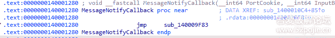 9.png (17.95 KB, 下载次数: 2) [href="forum.php?mod=attachment&aid=Mjc2Nzk0Mnw0NmVkN2ZiM3wxNzkzNTcxMDc4fDE2ODA4NnwyMDIwMTMy&nothumb=yes" target="_blank"](https://www.52pojie.cn/forum.php?mod=attachment&aid=Mjc2Nzk0Mnw0NmVkN2ZiM3wxNzkzNTcxMDc4fDE2ODA4NnwyMDIwMTMy&nothumb=yes) 2025-4-1 17:19 上传 函数逻辑被 TVM 混淆， 但强度不高， 可以静态分析， 也可以动态调试。这里结合两种方式分析。

## 动态调试: 对 MessageNotifyCallback 下断点获得需要分析的代码范围

对 `MessageNotifyCallback` 下断， 查看参数获得由`R3`传入驱动的缓冲区地址。发现缓冲区数据为 8字节未知数据+`R3`传入的加密数据 如图。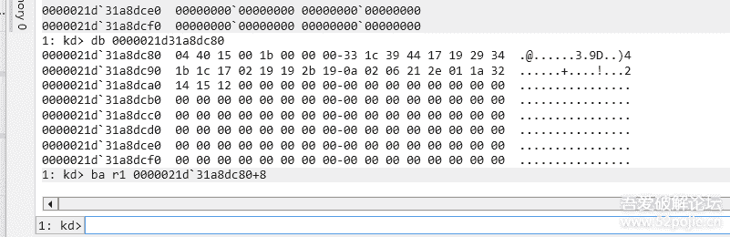 10.png (37.35 KB, 下载次数: 3) [href="forum.php?mod=attachment&aid=Mjc2Nzk0M3wxYjdiZTY0M3wxNzkzNTcxMDc4fDE2ODA4NnwyMDIwMTMy&nothumb=yes" target="_blank"](https://www.52pojie.cn/forum.php?mod=attachment&aid=Mjc2Nzk0M3wxYjdiZTY0M3wxNzkzNTcxMDc4fDE2ODA4NnwyMDIwMTMy&nothumb=yes) 2025-4-1 17:19 上传 其下访问断点，目的是找到第一次访问加密数据的代码，缩小需要分析的代码范围。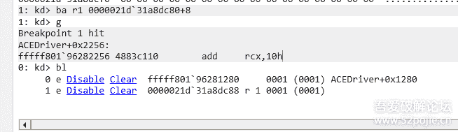 11.png (21.99 KB, 下载次数: 1) [href="forum.php?mod=attachment&aid=Mjc2Nzk0NHwwYWYwOTI4ZnwxNzkzNTcxMDc4fDE2ODA4NnwyMDIwMTMy&nothumb=yes" target="_blank"](https://www.52pojie.cn/forum.php?mod=attachment&aid=Mjc2Nzk0NHwwYWYwOTI4ZnwxNzkzNTcxMDc4fDE2ODA4NnwyMDIwMTMy&nothumb=yes) 2025-4-1 17:19 上传

## 静态分析: 分析命中断点处及其后续逻辑

对命中点函数分析，初步确定为 `memcpy` ，直接在 ida 中改名: 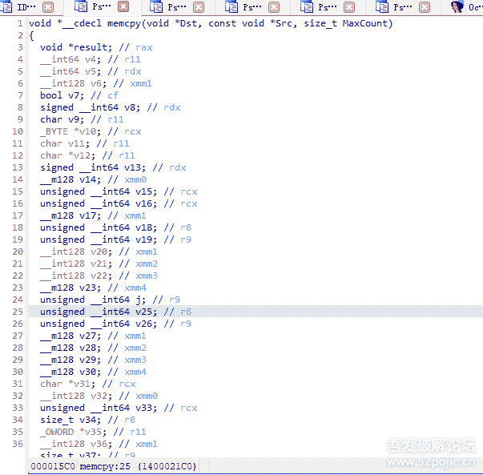 12.png (52.16 KB, 下载次数: 3) [href="forum.php?mod=attachment&aid=Mjc2Nzk0NXw2YWY1ZjNhNHwxNzkzNTcxMDc4fDE2ODA4NnwyMDIwMTMy&nothumb=yes" target="_blank"](https://www.52pojie.cn/forum.php?mod=attachment&aid=Mjc2Nzk0NXw2YWY1ZjNhNHwxNzkzNTcxMDc4fDE2ODA4NnwyMDIwMTMy&nothumb=yes) 2025-4-1 17:19 上传 这个函数的调用方确为被 TVM 混淆的 `MessageNotifyCallback` ，重点关注这个函数执行后的逻辑。

## 加密关键逻辑分析

重新运行驱动，对疑为 `memcpy` 的函数下断，确定函数的参数，分析后确定该函数为 `memcpy` 。ida 中从 `memcpy` 开始往下看，忽略显然的混淆垃圾逻辑，可以看到一个指向 `sub_140001448` 的 call 。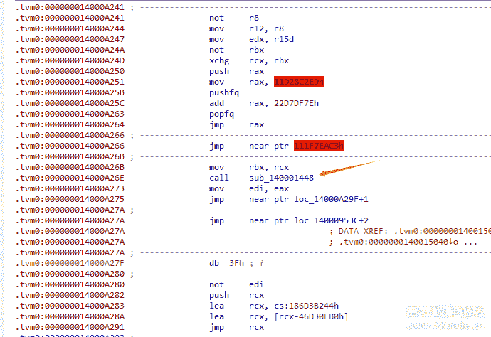 13.png (52 KB, 下载次数: 2) [href="forum.php?mod=attachment&aid=Mjc2Nzk0NnwxMTY0ZTlmMXwxNzkzNTcxMDc4fDE2ODA4NnwyMDIwMTMy&nothumb=yes" target="_blank"](https://www.52pojie.cn/forum.php?mod=attachment&aid=Mjc2Nzk0NnwxMTY0ZTlmMXwxNzkzNTcxMDc4fDE2ODA4NnwyMDIwMTMy&nothumb=yes) 2025-4-1 17:19 上传 跟踪进入，忽略显然的垃圾逻辑，发现一个指向 `sub_140001AA0` 的 call 。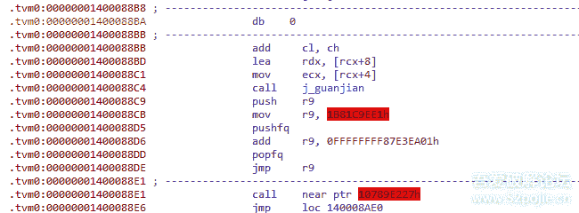 14.png (27.28 KB, 下载次数: 2) [href="forum.php?mod=attachment&aid=Mjc2Nzk0N3w0OWZkNGNmMHwxNzkzNTcxMDc4fDE2ODA4NnwyMDIwMTMy&nothumb=yes" target="_blank"](https://www.52pojie.cn/forum.php?mod=attachment&aid=Mjc2Nzk0N3w0OWZkNGNmMHwxNzkzNTcxMDc4fDE2ODA4NnwyMDIwMTMy&nothumb=yes) 2025-4-1 17:19 上传 跟踪进入，首先看到加载字符串 "ACE6" 。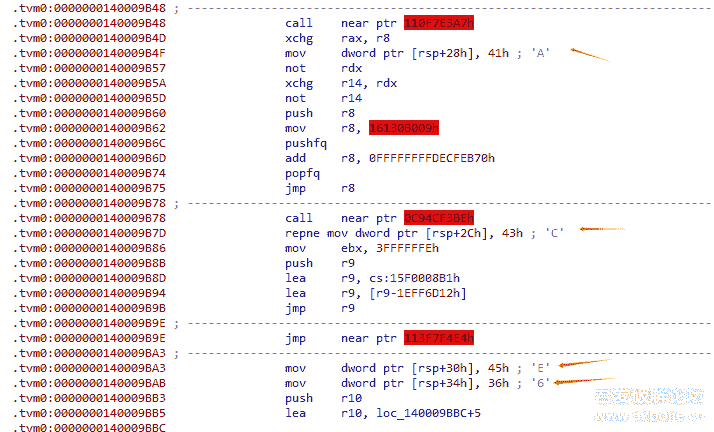 15.png (51.1 KB, 下载次数: 2) [href="forum.php?mod=attachment&aid=Mjc2Nzk0OHw1Yzk4N2M2NnwxNzkzNTcxMDc4fDE2ODA4NnwyMDIwMTMy&nothumb=yes" target="_blank"](https://www.52pojie.cn/forum.php?mod=attachment&aid=Mjc2Nzk0OHw1Yzk4N2M2NnwxNzkzNTcxMDc4fDE2ODA4NnwyMDIwMTMy&nothumb=yes) 2025-4-1 17:19 上传

## 动态调试: 加密关键逻辑分析

在函数上下断，对函数进行动态分析。得到第一个参数(`RCX`)为 密钥长度 ，第二个参数(`RDX`)为 被传入的密钥 。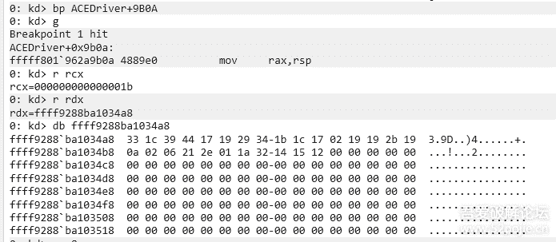 16.png (41.09 KB, 下载次数: 2) [href="forum.php?mod=attachment&aid=Mjc2Nzk0OXw3NmExZGIzY3wxNzkzNTcxMDc4fDE2ODA4NnwyMDIwMTMy&nothumb=yes" target="_blank"](https://www.52pojie.cn/forum.php?mod=attachment&aid=Mjc2Nzk0OXw3NmExZGIzY3wxNzkzNTcxMDc4fDE2ODA4NnwyMDIwMTMy&nothumb=yes) 2025-4-1 17:19 上传 继续跟进，看到 `ACEDriver+0x9bc9` 处有 `cmp ecx, 2Ah` 逻辑，判断了密钥长度是否为 2A ，猜测正确的密钥长度为 `0x2A` 。注: 后续验证密钥长度确为`0x2A`(42字节)。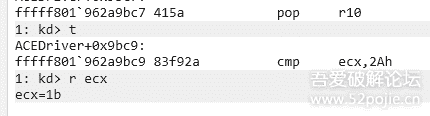 17.png (12.01 KB, 下载次数: 1) [href="forum.php?mod=attachment&aid=Mjc2Nzk1MHw0ZGM5OWNhY3wxNzkzNTcxMDc4fDE2ODA4NnwyMDIwMTMy&nothumb=yes" target="_blank"](https://www.52pojie.cn/forum.php?mod=attachment&aid=Mjc2Nzk1MHw0ZGM5OWNhY3wxNzkzNTcxMDc4fDE2ODA4NnwyMDIwMTMy&nothumb=yes) 2025-4-1 17:19 上传 紧接着 ja 跳转：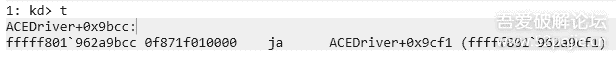 18.png (11.45 KB, 下载次数: 2) [href="forum.php?mod=attachment&aid=Mjc2Nzk1MXxiYWM5NmM5ZXwxNzkzNTcxMDc4fDE2ODA4NnwyMDIwMTMy&nothumb=yes" target="_blank"](https://www.52pojie.cn/forum.php?mod=attachment&aid=Mjc2Nzk1MXxiYWM5NmM5ZXwxNzkzNTcxMDc4fDE2ODA4NnwyMDIwMTMy&nothumb=yes) 2025-4-1 17:19 上传 跟踪到 `ACEDriver+0x9c56` 处发现 `call ACEDriver+0x1000` ，此时记录参数，可以发现 `rdx=rcx+8` 。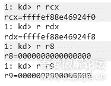 19.png (13.04 KB, 下载次数: 1) [href="forum.php?mod=attachment&aid=Mjc2Nzk1Mnw0M2I0NTk5YXwxNzkzNTcxMDc4fDE2ODA4NnwyMDIwMTMy&nothumb=yes" target="_blank"](https://www.52pojie.cn/forum.php?mod=attachment&aid=Mjc2Nzk1Mnw0M2I0NTk5YXwxNzkzNTcxMDc4fDE2ODA4NnwyMDIwMTMy&nothumb=yes) 2025-4-1 17:19 上传 ida 中查看 `ACEDriver+0x1000` 为未混淆逻辑， 进入静态分析。

## 静态分析: TEA加密

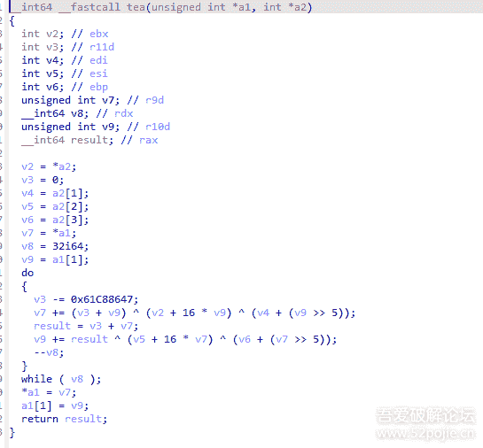 20.png (30.46 KB, 下载次数: 2) [href="forum.php?mod=attachment&aid=Mjc2Nzk1M3wzNWU0MzNjNXwxNzkzNTcxMDc4fDE2ODA4NnwyMDIwMTMy&nothumb=yes" target="_blank"](https://www.52pojie.cn/forum.php?mod=attachment&aid=Mjc2Nzk1M3wzNWU0MzNjNXwxNzkzNTcxMDc4fDE2ODA4NnwyMDIwMTMy&nothumb=yes) 2025-4-1 17:19 上传 肉眼可见 `tea` 算法的 `magicnumber=0x61C88647` ，对其按 x 进行引用分析。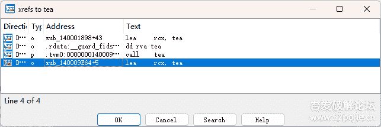 21.png (15.67 KB, 下载次数: 2) [href="forum.php?mod=attachment&aid=Mjc2Nzk1NHxkODg1NTBkNHwxNzkzNTcxMDc4fDE2ODA4NnwyMDIwMTMy&nothumb=yes" target="_blank"](https://www.52pojie.cn/forum.php?mod=attachment&aid=Mjc2Nzk1NHxkODg1NTBkNHwxNzkzNTcxMDc4fDE2ODA4NnwyMDIwMTMy&nothumb=yes) 2025-4-1 17:19 上传 发现 `sub_140001898` 处对执行了动态修补，这里的函数没有混淆。注：如果函数混淆了也可以判断除 `call tea` 处有其他函数对该函数的指针进行了引用，因为 `__guard_fids_table` 中引用了 `tea` 。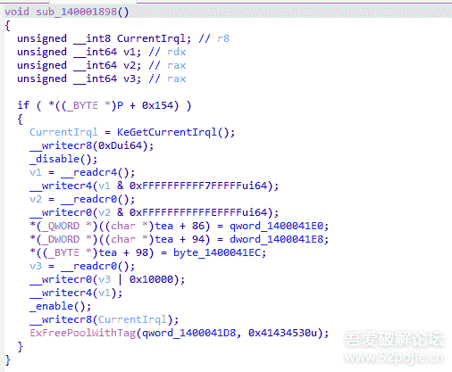 22.png (27.01 KB, 下载次数: 1) [href="forum.php?mod=attachment&aid=Mjc2Nzk1NXw5N2RkYzk4YnwxNzkzNTcxMDc4fDE2ODA4NnwyMDIwMTMy&nothumb=yes" target="_blank"](https://www.52pojie.cn/forum.php?mod=attachment&aid=Mjc2Nzk1NXw5N2RkYzk4YnwxNzkzNTcxMDc4fDE2ODA4NnwyMDIwMTMy&nothumb=yes) 2025-4-1 17:19 上传 `sub_140001898` 关闭了 `CR4.CET` 来避免修改 `CR0.WP` 时产生 #GP 异常，非常经典的无视内存属性写入的代码。在调试器中查看被动态修补处，提取出动态修补的逻辑。

## 代码编写: TEA加密

将`tea`函数和动态修补的 `shellcode` 代码提取，模拟修补逻辑并修复地址引用后可以编写一个相同逻辑的 `tea` 加密机程序（见附件）。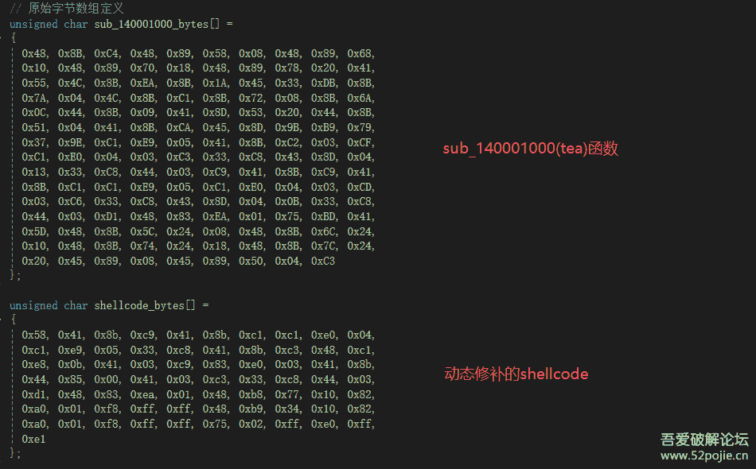 23.png (161.88 KB, 下载次数: 1) [href="forum.php?mod=attachment&aid=Mjc2Nzk1NnxmZGExMTQwY3wxNzkzNTcxMDc4fDE2ODA4NnwyMDIwMTMy&nothumb=yes" target="_blank"](https://www.52pojie.cn/forum.php?mod=attachment&aid=Mjc2Nzk1NnxmZGExMTQwY3wxNzkzNTcxMDc4fDE2ODA4NnwyMDIwMTMy&nothumb=yes) 2025-4-1 17:19 上传

## 动态调试: TEA加密

继续对 `tea` 函数进行动态分析，查看其参数可以发现 `rcx` 地址记录了 `int` 数组 `0x33,0x1c,0x41,0x43,0x45,0x36` ，其中 `0x33,0x1c` 是我们之前密文的前两个字节， `0x41,0x43,0x45,0x36` 为 "ACE6" 。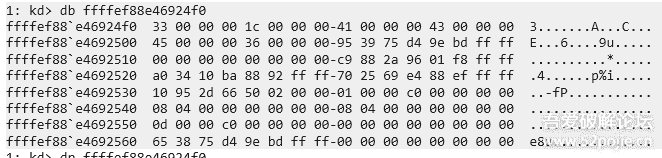 24.png (34.27 KB, 下载次数: 2) [href="forum.php?mod=attachment&aid=Mjc2Nzk1N3xmZjAwZWM0NXwxNzkzNTcxMDc4fDE2ODA4NnwyMDIwMTMy&nothumb=yes" target="_blank"](https://www.52pojie.cn/forum.php?mod=attachment&aid=Mjc2Nzk1N3xmZjAwZWM0NXwxNzkzNTcxMDc4fDE2ODA4NnwyMDIwMTMy&nothumb=yes) 2025-4-1 17:19 上传 跟踪 `tea` 函数执行结束，返回调用处，在缓冲区中得到加密后的密文 `2b c6 8e db ed cc 10 08` ， "ACE6" 也就是 `tea` 加密的密钥了。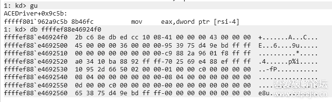 25.png (38.12 KB, 下载次数: 1) [href="forum.php?mod=attachment&aid=Mjc2Nzk1OHw1NWYyYWRhNnwxNzkzNTcxMDc4fDE2ODA4NnwyMDIwMTMy&nothumb=yes" target="_blank"](https://www.52pojie.cn/forum.php?mod=attachment&aid=Mjc2Nzk1OHw1NWYyYWRhNnwxNzkzNTcxMDc4fDE2ODA4NnwyMDIwMTMy&nothumb=yes) 2025-4-1 17:19 上传 出函数后第一句就是对比加密后的结果( `cmp dword ptr [rsp+20h], eax` )。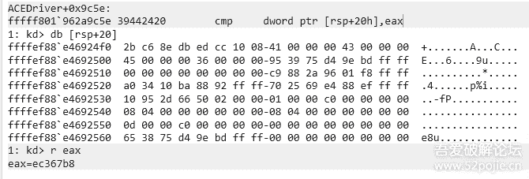 26.png (36.82 KB, 下载次数: 2) [href="forum.php?mod=attachment&aid=Mjc2Nzk1OXxiNGI5MjgyM3wxNzkzNTcxMDc4fDE2ODA4NnwyMDIwMTMy&nothumb=yes" target="_blank"](https://www.52pojie.cn/forum.php?mod=attachment&aid=Mjc2Nzk1OXxiNGI5MjgyM3wxNzkzNTcxMDc4fDE2ODA4NnwyMDIwMTMy&nothumb=yes) 2025-4-1 17:19 上传 可以知道 `tea` 加密后的前四个字节应该是 `0xec367b8` 也就是 `b8 67 c3 0e` 。编写程序循环尝试前两个值直到找到可以使得加密后的前四个字节为 `0xec367b8` 的组合。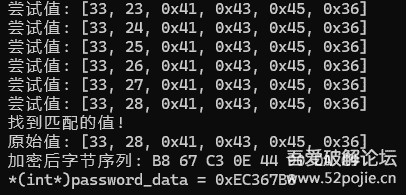 27.png (18.41 KB, 下载次数: 2) [href="forum.php?mod=attachment&aid=Mjc2Nzk2MHwzZTJkNDg1N3wxNzkzNTcxMDc4fDE2ODA4NnwyMDIwMTMy&nothumb=yes" target="_blank"](https://www.52pojie.cn/forum.php?mod=attachment&aid=Mjc2Nzk2MHwzZTJkNDg1N3wxNzkzNTcxMDc4fDE2ODA4NnwyMDIwMTMy&nothumb=yes) 2025-4-1 17:19 上传 最终得到匹配的序列 `0x33 0x28 0x41 0x43 0x45 0x36` ，也就是传入驱动时的密文前两个字应该是 `0x33 0x28` ，用 `sxx` 密文解密后得到前两个字符应该是 @P 。 28.png (20.27 KB, 下载次数: 0) [href="forum.php?mod=attachment&aid=Mjc2Nzk2MXwyOWYxMjdkMHwxNzkzNTcxMDc4fDE2ODA4NnwyMDIwMTMy&nothumb=yes" target="_blank"](https://www.52pojie.cn/forum.php?mod=attachment&aid=Mjc2Nzk2MXwyOWYxMjdkMHwxNzkzNTcxMDc4fDE2ODA4NnwyMDIwMTMy&nothumb=yes) 2025-4-1 17:19 上传 重新启动驱动，回到 `tea` 函数校验逻辑，修改传入的参数为 `33 28` 后继续执行，成功通过了第一轮的校验，进入第二轮校验。此时传入`tea`函数的数据为 `39 00 00 00 44 00 00 00` (也就是传入驱动的密文的下两个字节)。离开 `tea` 函数后又马上进入了对比逻辑。这时候逻辑就很显然了，正确的 `tea` 加密后的密文被从内存中循环读入，与我们传入驱动后被 `tea` 加密后的密文每两个字节加密后对比一次。很容易发现密文是通过 `mov eax, dword ptr [rsi-4]` 读入的，而 `rsi` 在之前的代码中被 +8，也就是 `rsi` 在第一轮对比被初始化后，每次对比中 `rsi` 都会+8得到正确密文被 `tea` 加密后的部分。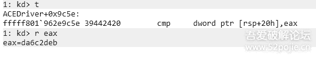 29.png (11.56 KB, 下载次数: 2) [href="forum.php?mod=attachment&aid=Mjc2Nzk2MnwzOGY1NDQ1OXwxNzkzNTcxMDc4fDE2ODA4NnwyMDIwMTMy&nothumb=yes" target="_blank"](https://www.52pojie.cn/forum.php?mod=attachment&aid=Mjc2Nzk2MnwzOGY1NDQ1OXwxNzkzNTcxMDc4fDE2ODA4NnwyMDIwMTMy&nothumb=yes) 2025-4-1 17:19 上传 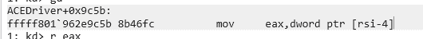 30.png (2.36 KB, 下载次数: 2) [href="forum.php?mod=attachment&aid=Mjc2Nzk2M3xkMDM3YjI0Y3wxNzkzNTcxMDc4fDE2ODA4NnwyMDIwMTMy&nothumb=yes" target="_blank"](https://www.52pojie.cn/forum.php?mod=attachment&aid=Mjc2Nzk2M3xkMDM3YjI0Y3wxNzkzNTcxMDc4fDE2ODA4NnwyMDIwMTMy&nothumb=yes) 2025-4-1 17:19 上传 直接从 `驱动模块+0x4060` 的内存中得到明文对应的所有 `tea` 串。


```
B8 67 C3 0E 44 90 DA C9 EB 2D 6C DA C3 C9 DD 88 75 15 A0 32 B4 D0 1D 23 74 8A 9E 4B 74 3E 5D D7 12 87 AB EA 88 E8 04 E7 AC 31 1A E0 5C 20 AE EC 67 74 BE A7 A3 52 62 0C 4E EC EF 1A

44 ED 0D C4 CC 42 C8 C3 0E 0C 4A DE FC F3 24 7C 01 D0 B8 8F 6E 3E 15 11 5C D1 0E 53 11 48 21 F4 E0 17 B5 BE 34 16 F9 63 A5 F8 96 4D C8 EA 23 FE DF 7A 60 2C 5C D8 43 CC 5B 6C 18 FF

A5 E1 63 87 58 BD 87 91 9B 06 D1 87 7B 8D 87 D7 68 6B 6E 83 3F C6 A0 55 B3 FD 79 D9 EE 4D 52 3E 82 5C B3 7A 8D DA F4 A2 4C BA 08 17 E6 53 06 71
```

编写代码对 `tea` 串解密后得到传入驱动时的密文经过 `"sxx"` 异或前的内容：`"@PksUn39kYj763ggA1HLBUCaWSZv4vs4CwSevAnQEs"`。

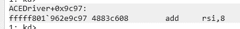

[31.png (1.87 KB, 下载次数: 3)](https://www.52pojie.cn/forum.php?mod=attachment&aid=Mjc2Nzk2NHw0MzVlNzAyMHwxNzkzNTcxMDc4fDE2ODA4NnwyMDIwMTMy&nothumb=yes)

经过 `"sxx"` 异或后的16进制字符串：

```
33 28 13 00 2d 16 40 41 13 2a 12 4f 45 4b 1f 14 39 49 3b 34 3a 26 3b 19 24 2b 22 05 4c 0e 00 4c 3b 04 2b 1d 05 39 16 22 3d 0b
```

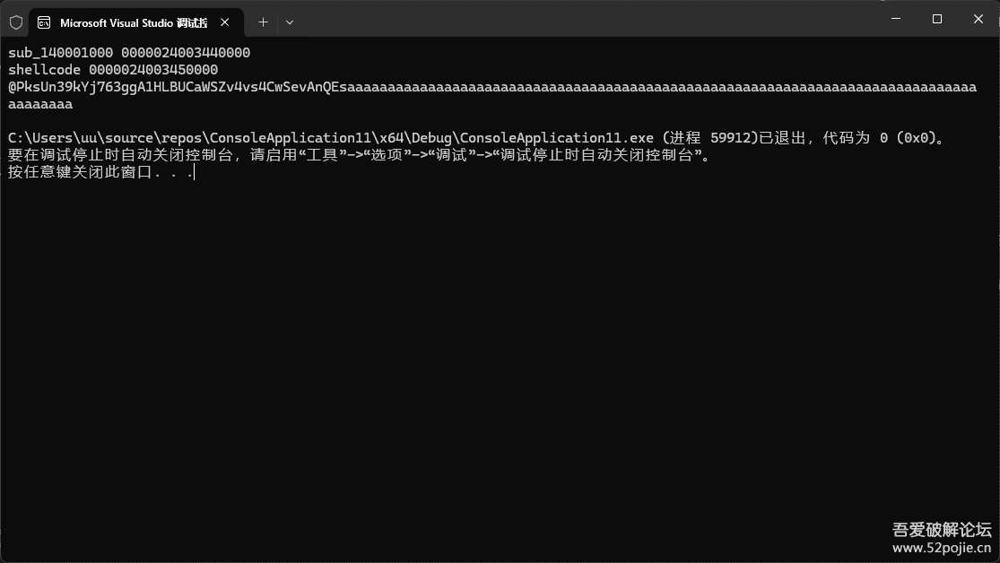

[32.png (36.59 KB, 下载次数: 1)](https://www.52pojie.cn/forum.php?mod=attachment&aid=Mjc2Nzk2NXw1OTZiZGNiYnwxNzkzNTcxMDc4fDE2ODA4NnwyMDIwMTMy&nothumb=yes)

重新启动驱动，在输入密钥前对 `MessageNotifyCallback` 下断，修改传入的16进制内容为新的字符串。

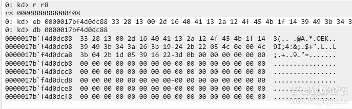

[33.png (38.43 KB, 下载次数: 2)](https://www.52pojie.cn/forum.php?mod=attachment&aid=Mjc2Nzk2NnxkZmE2ZDQ0MHwxNzkzNTcxMDc4fDE2ODA4NnwyMDIwMTMy&nothumb=yes)

对得到的传入驱动的正确密文进行验证：

可以看到 `r3` 输出了 `Flag is correct`，这说明我们找到的密文是正确的，只需要再解密一次就能得到正确的明文flag。

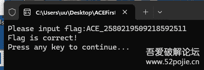

[34.png (16.77 KB, 下载次数: 1)](https://www.52pojie.cn/forum.php?mod=attachment&aid=Mjc2Nzk2N3w0ZGRjYWZkY3wxNzkzNTcxMDc4fDE2ODA4NnwyMDIwMTMy&nothumb=yes)

### 第六部分：自定义字符集的Base58加密算法复现

分析 `r3` 的初次加密，很容易发现 `base58` 的加密特征，并且 `r3` 的 `sub_140001000` 处有一个修改版的 `xorstr` 函数，释放了显然是字符集的`"abcdefghijkmnopqrstuvwxyzABCDEFGHJKLMNPQRSTUVWXYZ1234567890!@+/"`。

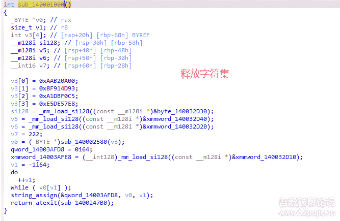

[35.png (41.53 KB, 下载次数: 2)](https://www.52pojie.cn/forum.php?mod=attachment&aid=Mjc2Nzk2OHxkZGQ4ZTQyYXwxNzkzNTcxMDc4fDE2ODA4NnwyMDIwMTMy&nothumb=yes)

我们只需要自行编写 `base58` 解码函数，并替换 `base58` 原本的字符集为自定义的字符集，即可解码得到的 `base58` 编码字符串。

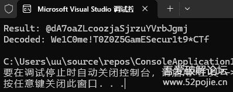

[36.png (22.17 KB, 下载次数: 2)](https://www.52pojie.cn/forum.php?mod=attachment&aid=Mjc2Nzk2OXwzNjIwZTMxNHwxNzkzNTcxMDc4fDE2ODA4NnwyMDIwMTMy&nothumb=yes)

最终成功编码我们随机输入的字符串`"ACE2580219509218592511"`为正确的结果，并且成功解码得到的编码字符串`"@PksUn39kYj763ggA1HLBUCaWSZv4vs4CwSevAnQEs"`为`"We1C0me!T0Z0Z5GamESecur1t9*CTf"`。

在解码后的字符串前加上前缀`"ACE"`，得到`"ACE_We1C0me!T0Z0Z5GamESecur1t9*CTf"`，输入程序即可验证通过。

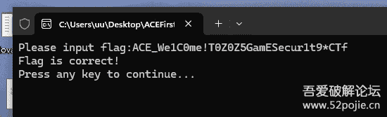

[37.png (34.79 KB, 下载次数: 2)](https://www.52pojie.cn/forum.php?mod=attachment&aid=Mjc2Nzk3MHwwNmIwN2VjMHwxNzkzNTcxMDc4fDE2ODA4NnwyMDIwMTMy&nothumb=yes)

### 答后感

很不错的一道CTF题，结合了传统CTF的思想和内核知识。关键的加密逻辑被隐藏在TVM混淆后的代码中，考察了一定程度上的混淆后的代码的分析能力。

通讯用了 `FilterSendMessage`，在游戏安全领域并不常见（开源的少大家没得抄）。继2022年决赛 `ZwSetSystemInformation` 通讯之后又一次掏出好玩的通讯机制，大手子们又有得抄了。
