# [CTF] 腾讯游戏安全大赛2025初赛题解

- 原帖: https://www.52pojie.cn/forum.php?mod=viewthread&tid=2020188
- 抓取时间: 2026-11-01T22:11:19

记录一下今年 2025 初赛过程

## 题目描述

小Q是一位热衷于PC客户端安全的技术爱好者，为了不断提升自己的技能，他经常参与各类CTF竞赛。某天，他收到了一封来自神秘人的邮件，内容如下：

“我可以引领你进入游戏安全的殿堂，但在此之前，你需要通过我的考验。打开这扇大门的钥匙就隐藏在附件中，你有能力找到它吗？

## 找到正确的flag（2分）

flag：flag{ACE_We1C0me!T0Z0Z5GamESecurit9*CTf}

### R3分析

先说结论：

- 运行之后先加载驱动程序。
- 输入 flag，判断是否以 ACE_ 开头。
- base58 编码剩余的部分，进行反转之后在开头添加 @
- 以 `sxx` 密钥对上一个步骤的结果进行异或加密。
- 封装数据，发送给驱动程序。

下面是分析过程：

#### 静态分析

定义了一个 `ACEDriverSDK` 类，初始化虚表。

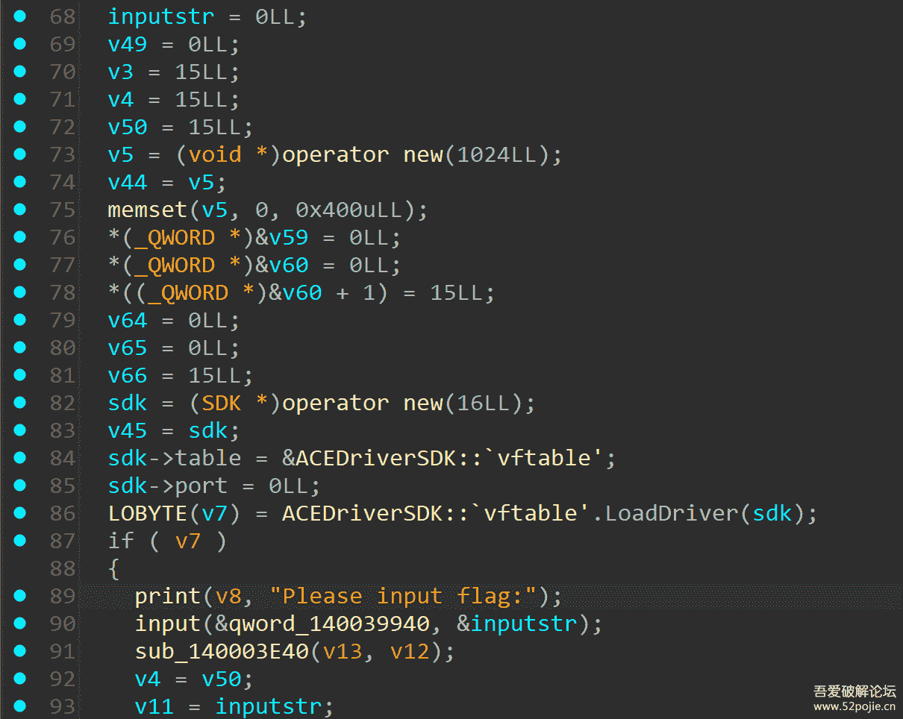

[1.png (128.57 KB, 下载次数: 1)](https://www.52pojie.cn/forum.php?mod=attachment&aid=Mjc2Nzk3MnwyYTE4NWI3MnwxNzkzNTcxMDc3fDE2ODA4NnwyMDIwMTg4&nothumb=yes)

2025-4-1 17:35 上传

类的定义放 IDA 很简单

```
struct SDK
{
    vtable *table;
    HANDLE port;
};
```

虚表可以根据需要进行还原，这里给出我还原的虚表定义

```
struct vtable
{
    void (*init)(SDK *);
    PVOID ptr[7];
    void (*FltCommunite)(__int64 a1, int a2, const void *a3, unsigned int a4, LPVOID lpOutBuffer, DWORD dwOutBufferSize, DWORD *a7);
    int (__fastcall *LoadDriver)(SDK *);
    void (*ClosePort)(SDK *);
    void (*Test)(SDK *);
    bool (*checkflag)(__int64 SDK, __int64 a2, __int64 a3);
};
```

随后就是判断开头是否为 ACE_

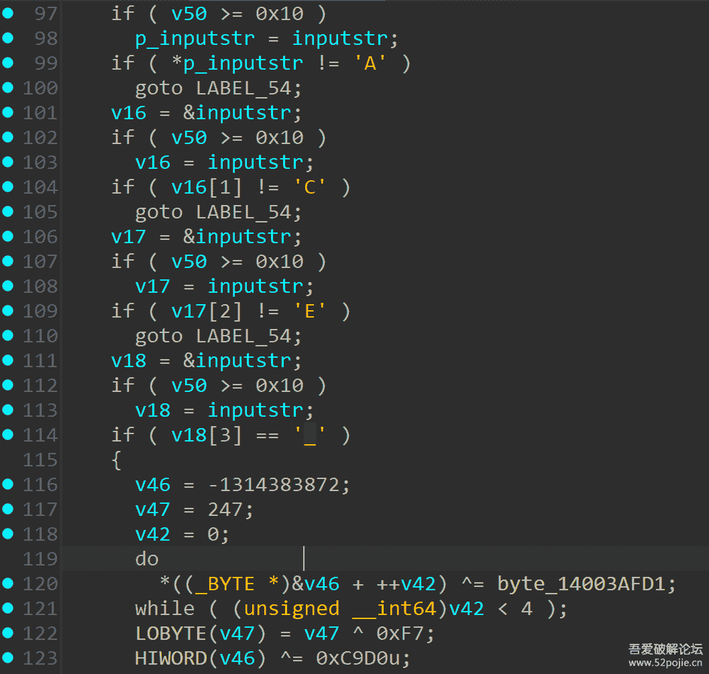

[2.png (116.96 KB, 下载次数: 2)](https://www.52pojie.cn/forum.php?mod=attachment&aid=Mjc2Nzk3M3wzMWUyZDE2ZnwxNzkzNTcxMDc3fDE2ODA4NnwyMDIwMTg4&nothumb=yes)

2025-4-1 17:35 上传

然后初始化了异或密钥，取 ACE_ 后的字符串进行其余的加密操作，比如 base58 然后逆转。

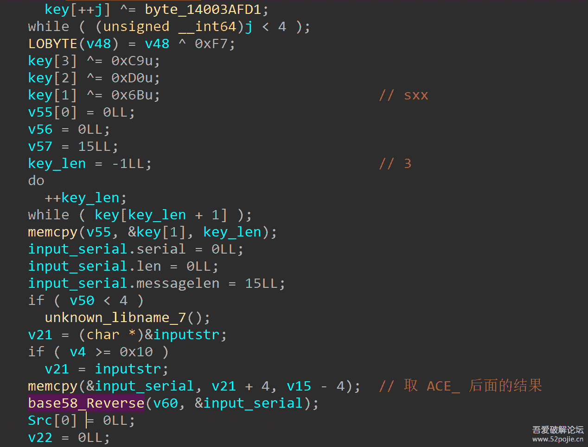

[3.png (104.39 KB, 下载次数: 3)](https://www.52pojie.cn/forum.php?mod=attachment&aid=Mjc2Nzk3NHwwZTMzNGZkOHwxNzkzNTcxMDc3fDE2ODA4NnwyMDIwMTg4&nothumb=yes)

2025-4-1 17:35 上传

做完这些操作后，再异或加密。

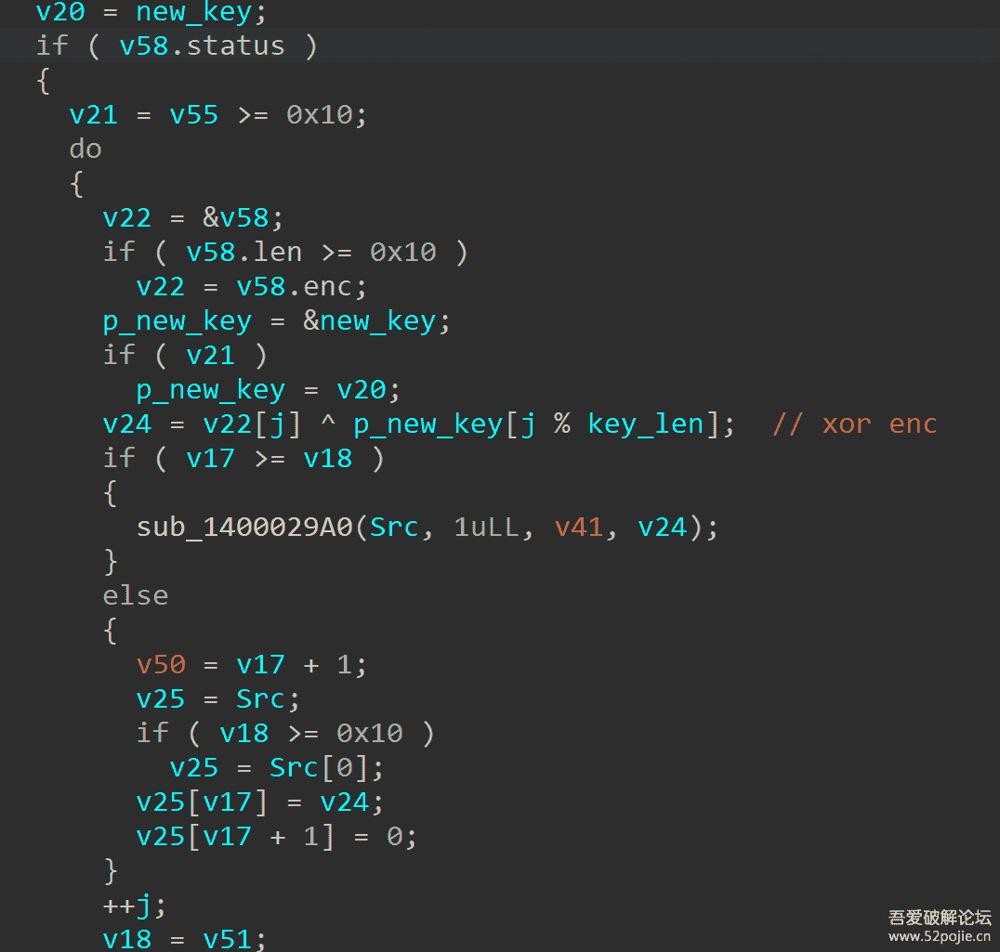

[5.png (71.14 KB, 下载次数: 3)](https://www.52pojie.cn/forum.php?mod=attachment&aid=Mjc2Nzk3NXw5MjI3Y2I5MHwxNzkzNTcxMDc3fDE2ODA4NnwyMDIwMTg4&nothumb=yes)

2025-4-1 17:35 上传

最后通过虚表调用 `checkflag` 函数。

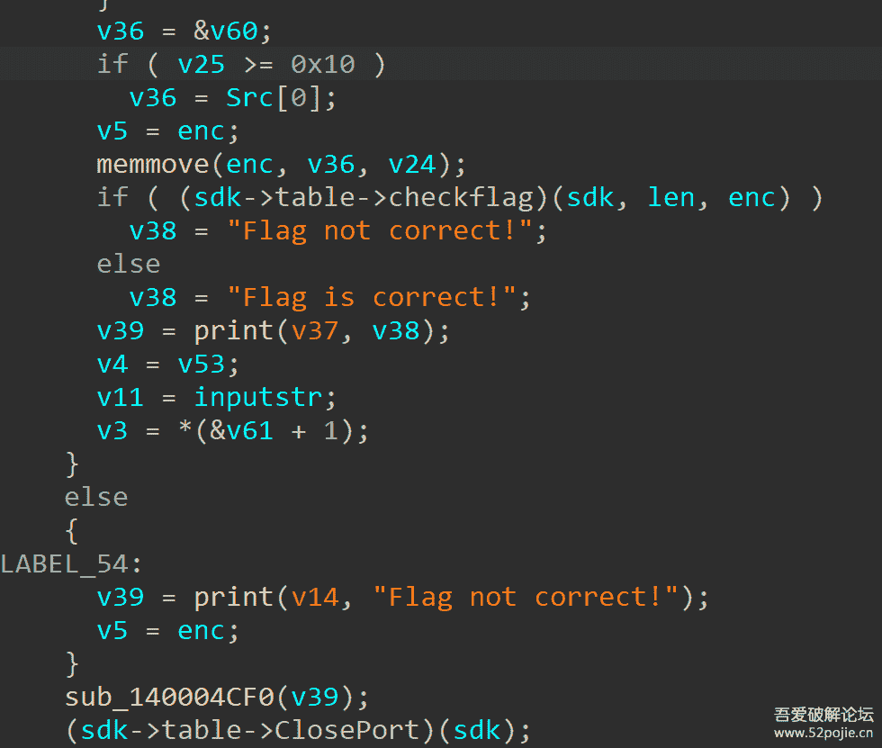

[6.png (68.95 KB, 下载次数: 0)](https://www.52pojie.cn/forum.php?mod=attachment&aid=Mjc2Nzk3NnwyNTY1Nzg4MHwxNzkzNTcxMDc3fDE2ODA4NnwyMDIwMTg4&nothumb=yes)

2025-4-1 17:35 上传

`checkflag` 的逻辑也很简单，就是调用 `SDK` 的通信函数

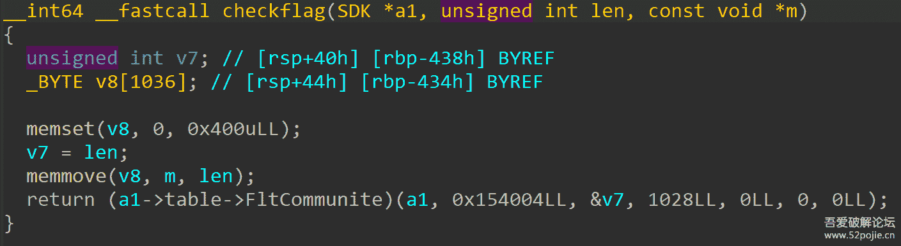

[7.png (49.44 KB, 下载次数: 1)](https://www.52pojie.cn/forum.php?mod=attachment&aid=Mjc2Nzk3N3xlMWFmNmUxNnwxNzkzNTcxMDc3fDE2ODA4NnwyMDIwMTg4&nothumb=yes)

2025-4-1 17:35 上传

最后就是看构造通信数据了，0x154004 显然是一个 magic 数据，作为调用功能号，其余的加密数据被追加到 magic 之后。

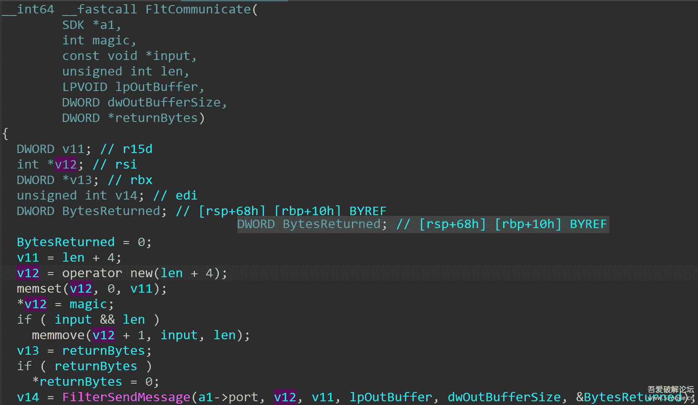

[8.png (113.89 KB, 下载次数: 0)](https://www.52pojie.cn/forum.php?mod=attachment&aid=Mjc2Nzk3OHwxNjRlMjY1OXwxNzkzNTcxMDc3fDE2ODA4NnwyMDIwMTg4&nothumb=yes)

2025-4-1 17:35 上传

其实中间还漏了一个密文长度追加的逻辑，不过因为动调很容易看出来，所以这部分放另一部分说明，通信协议如下所示

```
(4字节功能号)
(4字节数据长度，设该值为x)
(x字节加密数据)
```

#### 动态调试

以上分析均结合了动态调试的结果，下面说明一些比较长的函数逻辑判断。

首先注意到关键加密函数的一个关键操作：

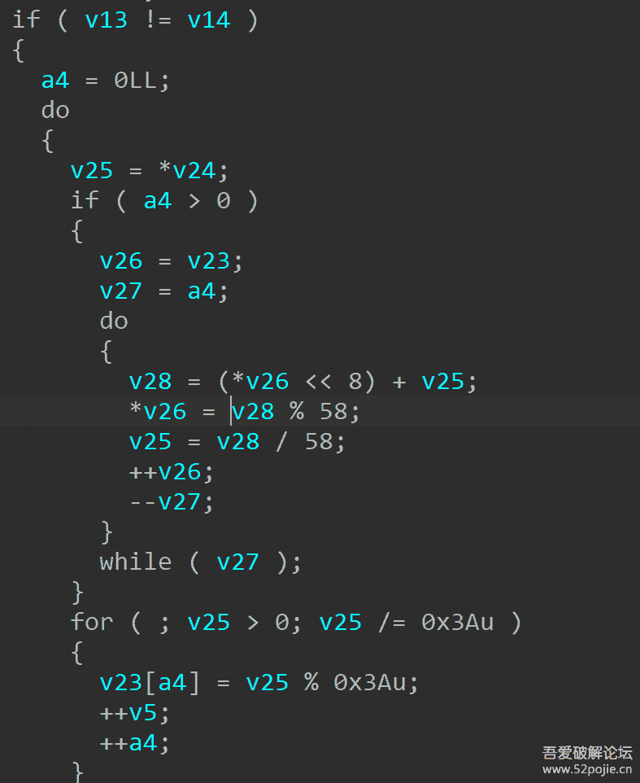

[9.png (50.54 KB, 下载次数: 1)](https://www.52pojie.cn/forum.php?mod=attachment&aid=Mjc2Nzk3OXwxZjU1ZDg4YnwxNzkzNTcxMDc3fDE2ODA4NnwyMDIwMTg4&nothumb=yes)

2025-4-1 17:35 上传

断在写入指令，可以发现，最后写入的结果都小于 58，最后返回了一个包含大小写字母和数字的字符串，并且，这个临时写入的变量和最终的密文之间存在对应的关系。

这里以输入 ACE_11111111111111111111 为例。

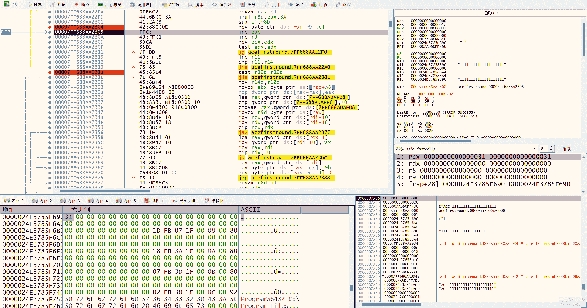

[10.png (482.33 KB, 下载次数: 1)](https://www.52pojie.cn/forum.php?mod=attachment&aid=Mjc2Nzk4MHwzM2JkNDg3YXwxNzkzNTcxMDc3fDE2ODA4NnwyMDIwMTg4&nothumb=yes)

2025-4-1 17:35 上传

第一次循环将 1 写入了该内存，很好理解，因为 1 的 ASCII 小于 58。

然后直接跳出循环，看看最终结果。

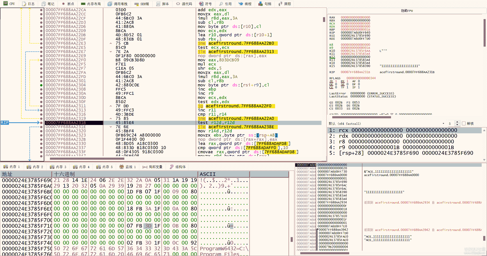

[11.png (475.38 KB, 下载次数: 1)](https://www.52pojie.cn/forum.php?mod=attachment&aid=Mjc2Nzk4MXxiOTgyNWZlZHwxNzkzNTcxMDc3fDE2ODA4NnwyMDIwMTg4&nothumb=yes)

2025-4-1 17:35 上传

其实这里大致可以想到 base58 编码了，拿标准 base58 试试看，主要试试相同位置的字符是否能对应上，如果能对应上那就是 base58 无疑了，最多换了码表，顺便说一下，这个地方调试可以顺带 dump 码表，我选择直接在该内存上写上 0 1 2 ...，最后观察字符串的输出，得到码表 abcdefghijkmnopqrstuvwxyzABCDEFGHJKLMNPQRSTUVWXYZ123456789。

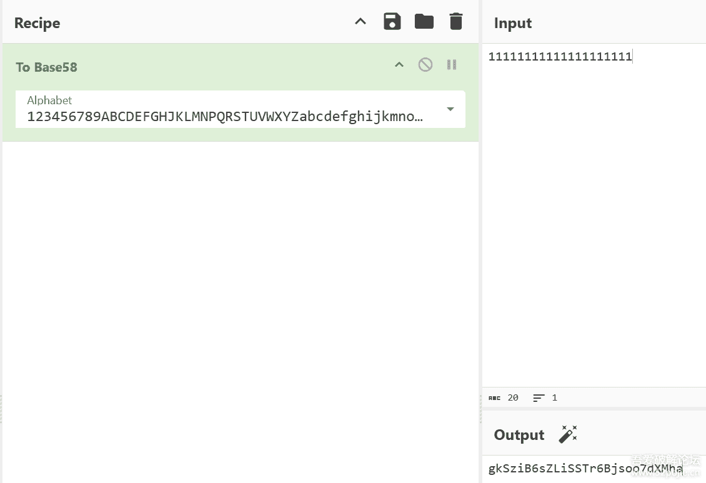

[12.png (42.62 KB, 下载次数: 1)](https://www.52pojie.cn/forum.php?mod=attachment&aid=Mjc2Nzk4MnwzNTAxYTE0NnwxNzkzNTcxMDc3fDE2ODA4NnwyMDIwMTg4&nothumb=yes)

2025-4-1 17:35 上传

可以发现能对应上，只是顺序反了，随后跳出该函数，返回，观察返回的字符串

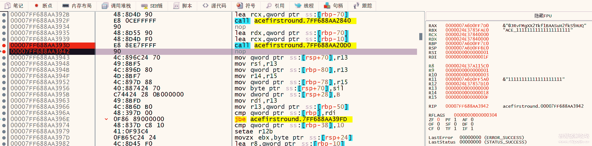

[13.png (212.84 KB, 下载次数: 1)](https://www.52pojie.cn/forum.php?mod=attachment&aid=Mjc2Nzk4M3xiOGY4Y2Y4ZnwxNzkzNTcxMDc3fDE2ODA4NnwyMDIwMTg4&nothumb=yes)

2025-4-1 17:35 上传

可以发现相同的字符至少也是能对应上的，只是前面多了一个 @

因为异或密钥稍微跟一下就能得到，就不过多赘述，直接看到最后，在 `FilterSendMessage` 处下断，观察传出的数据。

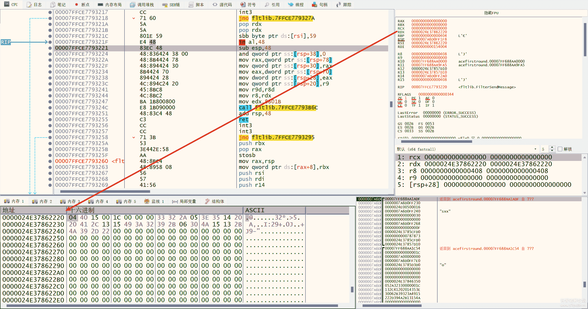

[15.png (446.12 KB, 下载次数: 2)](https://www.52pojie.cn/forum.php?mod=attachment&aid=Mjc2Nzk4NHwzYzcyODljNXwxNzkzNTcxMDc3fDE2ODA4NnwyMDIwMTg4&nothumb=yes)

2025-4-1 17:35 上传

这里也可以看出来了，头四个字节 0x154004，后面四个字节 0x1c 跟后面密文的长度一致。

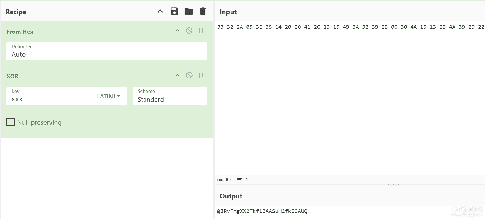

[16.png (53.85 KB, 下载次数: 2)](https://www.52pojie.cn/forum.php?mod=attachment&aid=Mjc2Nzk4NXwwM2VlOTRlMnwxNzkzNTcxMDc3fDE2ODA4NnwyMDIwMTg4&nothumb=yes)

2025-4-1 17:35 上传

不放心逻辑再去验证一遍，确定是对的，R3 的所有逻辑至此分析完毕。

### R0分析

#### 去混淆

静态分析，直接找通信的回调函数，应该是注册回调的时候没有加混淆，IDA直接能识别出来。但是加了混淆，由于混淆强度不高，直接特征码大法去掉所有混淆。

```python
import idc
import idaapi
import idautils

def fill_nop(start, length):
    for i in range(length):
        patch_byte(start+i, 0x90)

def find_pattern(pattern):
    matches = []
    byte_pattern = []
    for byte in pattern.split():
        if byte == "??":
            byte_pattern.append(None)  # 通配符
        else:
            byte_pattern.append(int(byte, 16))
    pattern_length = len(byte_pattern)
    for head in range(0x140008000,0x140016000):
        match = True
        for i in range(pattern_length):
            current_byte = get_wide_byte(head + i)
            if byte_pattern[i] is not None and current_byte != byte_pattern[i]:
                match = False
                break
        if match:
            matches.append(head)
```


```python
return matches

parttern = "41 ?? ?? ?? ?? ?? ?? ?? ?? ?? ?? ?? 9C ?? ?? ?? ?? ?? ?? ?? 9D 41 FF ?? ?? 41 ??"

#parttern="41 51 4C 8D 0D ?? ?? ?? ?? 4D 8D 89 ?? ?? ?? ?? 41 FF E1 ?? 41 59"
#parttern="41 ?? 4C 8D ?? ?? ?? ?? ?? 4D 8D ?? ?? ?? ?? ?? 41 FF ?? ?? 41 ??"
#parttern="51 48 8D ?? ?? ?? ?? ?? 48 8D ?? ?? ?? ?? ?? FF ?? E8 59"
#parttern="52 48 8D ?? ?? ?? ?? ?? 48 8D ?? ?? ?? ?? ?? FF ?? E8 5A"
#parttern="?? 48 B8 ?? ?? ?? ?? ?? ?? ?? ?? 9C ?? ?? ?? ?? ?? ?? ?? 9D FF ?? ?? ??"
#parttern="41 ?? ?? ?? ?? ?? ?? ?? ?? ?? ?? ?? 9C ?? ?? ?? ?? ?? ?? ?? 9D 41 FF ?? ?? 41 ??"
#parttern="52 48 8D ?? ?? ?? ?? ?? 48 8D ?? ?? ?? ?? ?? FF ?? E8 5A"
#parttern="41 ?? ?? ?? ?? ?? ?? ?? ?? ?? ?? ?? 9C ?? ?? ?? ?? ?? ?? ?? 9D 41 FF ?? ?? 41 ??"
#parttern="41 ?? 4C 8D ?? ?? ?? ?? ?? 4D 8D ?? ?? ?? ?? ?? 41 FF ?? ?? 41 ??"
#parttern="41 51 4C 8D 0D ?? ?? ?? ?? 4D 8D 89 ?? ?? ?? ?? 41 FF E1 ?? 41 59"
#parttern="51 48 B9 ?? ?? ?? ?? ?? ?? ?? ?? 9C 48 81  ?? ?? ?? ?? ?? 9D FF E1 E8 59"
#parttern="52 48 8D ?? ?? ?? ?? ?? 48 8D ?? ?? ?? ?? ?? FF E2 E9 5A"
#parttern="E9 01 00 00 00 ??"
#parttern="50 48 8D ?? ?? ?? ?? ?? 48 8D ?? ?? ?? ?? ?? FF E0 ?? 58"
#parttern="51 48 8D ?? ?? ?? ?? ?? 48 8D ?? ?? ?? ?? ?? FF E1 ?? 59"
#parttern="?? 48 ?? ?? ?? ?? ?? ?? ?? ?? ?? 9C 48 ?? ?? ?? ?? ?? ?? 9D FF ?? ?? ??"

patch_addr_list1 = find_pattern(parttern)

def patch_flower(addr):
    fill_nop(addr,(len(parttern)+2)//3)

for addr in patch_addr_list1:
    print("[+]", hex(addr))
    patch_flower(addr)
```

每个特征码运行一遍大部分的函数都能进行反编译了（特征码是边分析边总结的，所以可能存在重复的）

## 静态分析

顺着消息回调函数找到关键调用

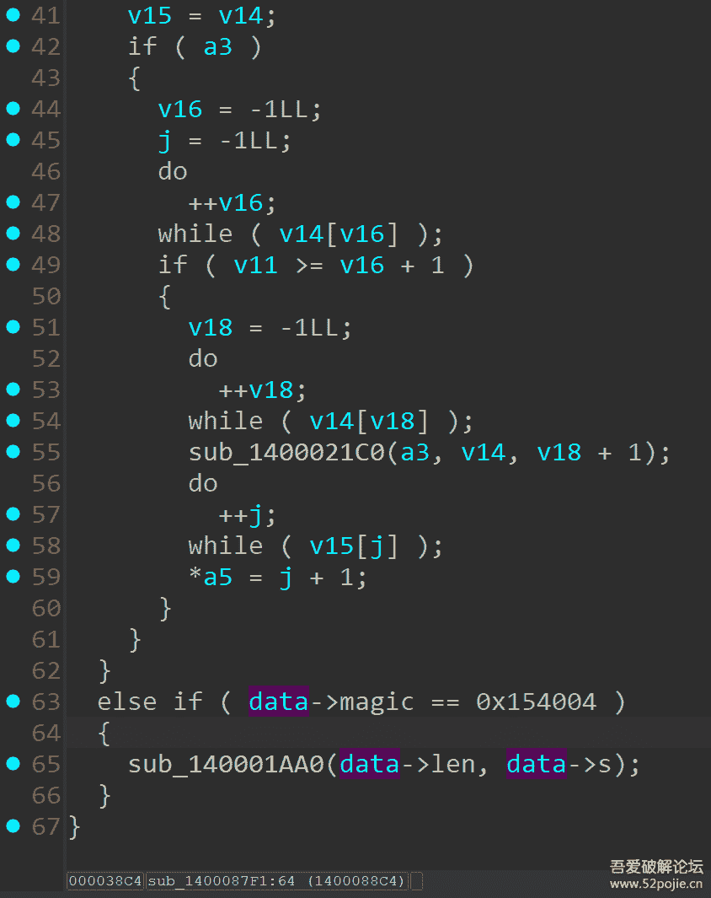

17.png (74.97 KB, 下载次数: 0)
[href="forum.php?mod=attachment&aid=Mjc2Nzk4NnwyNjBkMDE2Y3wxNzkzNTcxMDc3fDE2ODA4NnwyMDIwMTg4&nothumb=yes" target="_blank"](https://www.52pojie.cn/forum.php?mod=attachment&aid=Mjc2Nzk4NnwyNjBkMDE2Y3wxNzkzNTcxMDc3fDE2ODA4NnwyMDIwMTg4&nothumb=yes)
2025-4-1 17:36 上传

由于通信的时候`magic==0x154004`是确定的，另外一个分支是测试使用的，因此完全可以不用分析，只分析`1AA0`函数即可。

本场比赛的第一个需要注意的点（不能算坑，只是踩了）：

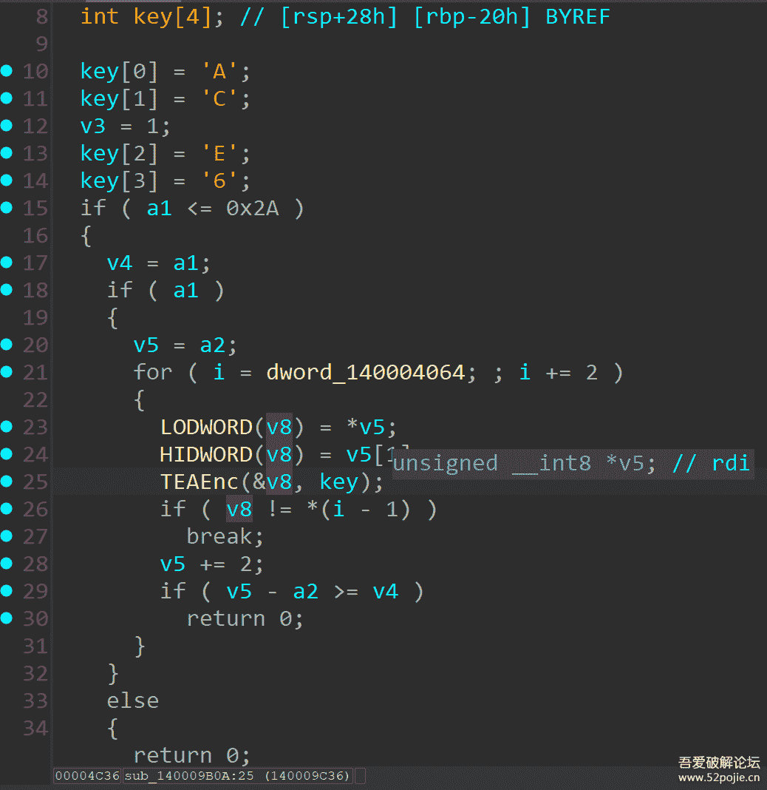

18.png (91.03 KB, 下载次数: 1)
[href="forum.php?mod=attachment&aid=Mjc2Nzk4N3wxZDEwMWE4N3wxNzkzNTcxMDc3fDE2ODA4NnwyMDIwMTg4&nothumb=yes" target="_blank"](https://www.52pojie.cn/forum.php?mod=attachment&aid=Mjc2Nzk4N3wxZDEwMWE4N3wxNzkzNTcxMDc3fDE2ODA4NnwyMDIwMTg4&nothumb=yes)
2025-4-1 17:36 上传

可以发现`R3`传过来的数据是每两个字节为一组，每个字节零扩展成`unsigned int`类型作为TEA加密的明文传入。

TEA加密看似是标版，实则解密之后会发现不对，这里可以先dump`140004060`的数据，尝试进行TEA解密。其实很好判断解密是否成功，解密之后的数据异或`sxx`之后，应当得到一个`@`开头的全ASCII字符，标准解密失败之后有次不小心交叉引用`TEAEnc`函数的时候发现了问题所在。

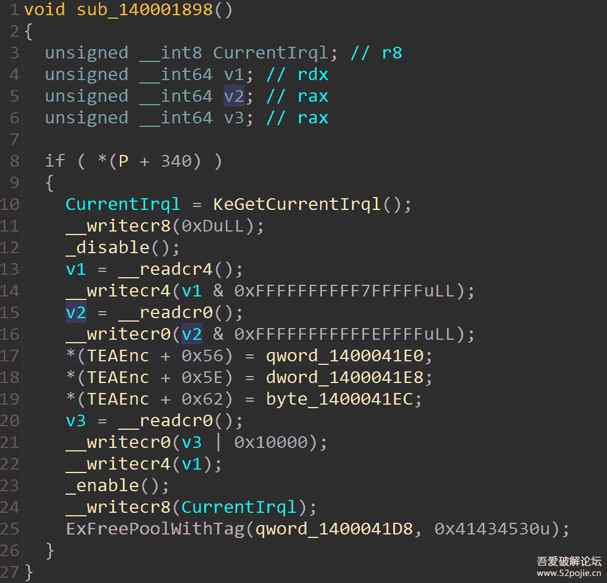

20.png (110.85 KB, 下载次数: 1)
[href="forum.php?mod=attachment&aid=Mjc2Nzk4OHw1ZjBiZjFmZnwxNzkzNTcxMDc3fDE2ODA4NnwyMDIwMTg4&nothumb=yes" target="_blank"](https://www.52pojie.cn/forum.php?mod=attachment&aid=Mjc2Nzk4OHw1ZjBiZjFmZnwxNzkzNTcxMDc3fDE2ODA4NnwyMDIwMTg4&nothumb=yes)
2025-4-1 17:36 上传

显然，该函数是被hook了，这里直接考虑动态调试去dump。

## 动态调试

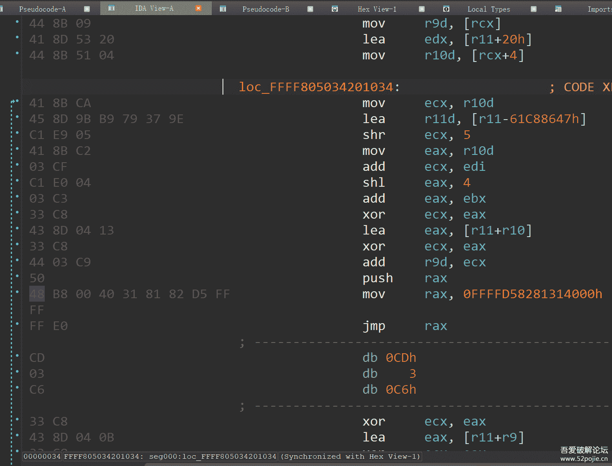

21.png (120.06 KB, 下载次数: 1)
[href="forum.php?mod=attachment&aid=Mjc2Nzk4OXxjZmRjMzJhOHwxNzkzNTcxMDc3fDE2ODA4NnwyMDIwMTg4&nothumb=yes" target="_blank"](https://www.52pojie.cn/forum.php?mod=attachment&aid=Mjc2Nzk4OXxjZmRjMzJhOHwxNzkzNTcxMDc3fDE2ODA4NnwyMDIwMTg4&nothumb=yes)
2025-4-1 17:36 上传

找到地址直接去看看hook函数。

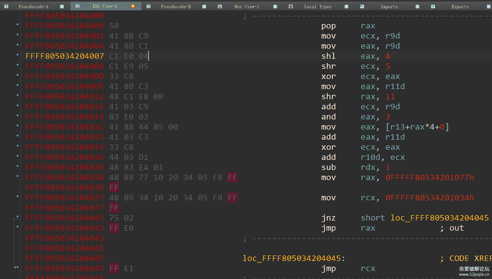

22.png (170.44 KB, 下载次数: 1)
[href="forum.php?mod=attachment&aid=Mjc2Nzk5MHw3YTY4YmJhMXwxNzkzNTcxMDc3fDE2ODA4NnwyMDIwMTg4&nothumb=yes" target="_blank"](https://www.52pojie.cn/forum.php?mod=attachment&aid=Mjc2Nzk5MHw3YTY4YmJhMXwxNzkzNTcxMDc3fDE2ODA4NnwyMDIwMTg4&nothumb=yes)
2025-4-1 17:36 上传

好在该hook也不复杂，但是直接分析汇编指令显然也不明智，把hook跳板拆开，将有效的指令插入原code中，最后修正偏移即可，这里可以直接选择区域导出十六进制值放`CyberChef`去分析，修跳转偏移也是。

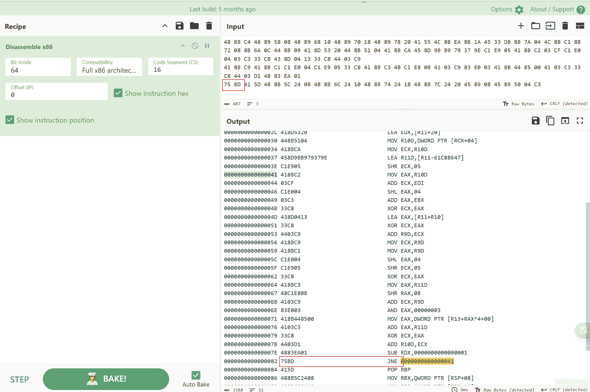

23.png (318.58 KB, 下载次数: 0)
[href="forum.php?mod=attachment&aid=Mjc2Nzk5MXwxY2RlYTQzNHwxNzkzNTcxMDc3fDE2ODA4NnwyMDIwMTg4&nothumb=yes" target="_blank"](https://www.52pojie.cn/forum.php?mod=attachment&aid=Mjc2Nzk5MXwxY2RlYTQzNHwxNzkzNTcxMDc3fDE2ODA4NnwyMDIwMTg4&nothumb=yes)
2025-4-1 17:36 上传

修图中框选的指令偏移即可。最后直接用`IDA`反编译，得到最终结果。

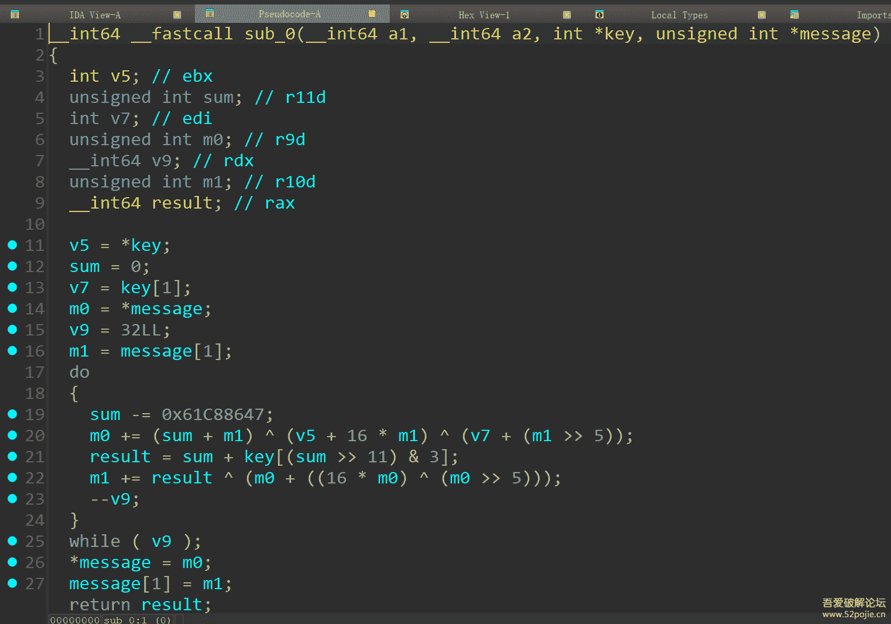

24.png (110.09 KB, 下载次数: 1)
[href="forum.php?mod=attachment&aid=Mjc2Nzk5Mnw0YWY0NzM2MnwxNzkzNTcxMDc3fDE2ODA4NnwyMDIwMTg4&nothumb=yes" target="_blank"](https://www.52pojie.cn/forum.php?mod=attachment&aid=Mjc2Nzk5Mnw0YWY0NzM2MnwxNzkzNTcxMDc3fDE2ODA4NnwyMDIwMTg4&nothumb=yes)
2025-4-1 17:36 上传

根据伪代码写逆向逻辑即可。

```c
#include
#include
#include

void decrypt_tea(uint32_t* v, uint32_t* k) {
        uint32_t delta = 0x9e3779b9;
    uint32_t v0 = v[0], v1 = v[1], sum = delta*32, i;     /* set up */
    uint32_t k0 = k[0], k1 = k[1], k2 = k[2], k3 = k[3];    /* cache key */
    for (i = 0; i > 11) & 3]; 
            v1 -= result ^ (v0 + ((16 * v0) ^ (v0 >> 5)));
            v0 -= (sum + v1) ^ (k0 + 16 * v1) ^ (k1 + (v1 >> 5));
        sum -= delta;
    }                                                           /* end cycle */
    v[0] = v0; v[1] = v1;
}
unsigned char ida_chars[200] =
{
        ...
};
char enc[100]={0};
int main(){

        uint32_t k[]={
                'A','C',
                'E','6',
        };
        for(int i=0;i
```

手动去掉`@`，然后逆转再`base58`解码，得到答案。

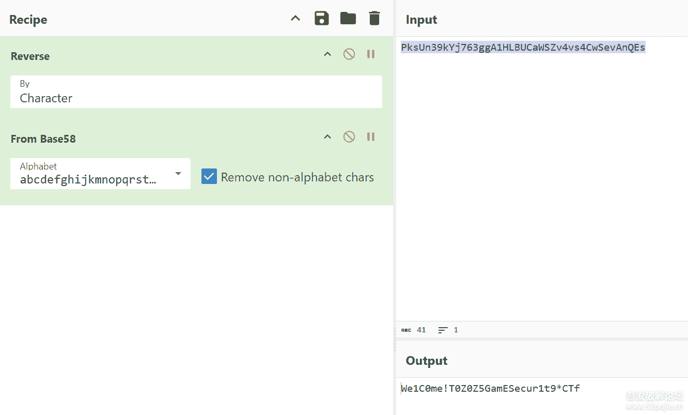

25.png (51.61 KB, 下载次数: 3)
[href="forum.php?mod=attachment&aid=Mjc2Nzk5M3wzYzZiNjA5NHwxNzkzNTcxMDc3fDE2ODA4NnwyMDIwMTg4&nothumb=yes" target="_blank"](https://www.52pojie.cn/forum.php?mod=attachment&aid=Mjc2Nzk5M3wzYzZiNjA5NHwxNzkzNTcxMDc3fDE2ODA4NnwyMDIwMTg4&nothumb=yes)
2025-4-1 17:36 上传

所以最终正确输入就是`ACE_We1C0me!T0Z0Z5GamESecur1t9*CTf`。
