# 【原创】一款适用于菜鸟的 GPS 位置模拟器进行位置模拟的方法和工具

- 原帖：<https://www.52pojie.cn/forum.php?mod=viewthread&tid=2020933>
- 抓取时间：2026-11-01T22:11:11

## 前言
采用软件无线电模拟 GPS 已经有很多相关的研究了，尤其是最著名的开源项目 `gps-sim`、`gps-sim-sdr` 等。里面详细给出了生成 GPS 信号基带的详细算法。但是目前而言大多数软件都是基于命令行的，需要用户设置好多参数才能正常工作。这对于初学者来说是不友好的。本帖将给出一个可以在 Windows 上直接使用的带 GUI 的一键式集成了最新导航文件下载、SDR 信号发射的一体化工具，供广大软件无线电爱好者使用。

## 硬件要求

- 必选硬件：Windows 电脑、USRP B210/B200 系列 SDR。
- 可选硬件：外接 10MHz 驯服时钟以提升信号精度和性能。

## 工具下载地址

[附件下载](https://www.52pojie.cn/forum.php?mod=attachment&aid=Mjc2ODE4NXxlMjczMDk5MnwxNzkzNTcxMDY5fDE2ODA4NnwyMDIwOTMz&nothumb=yes)（2025-4-2 12:46 上传）

## 基本软件安装

### 安装 USRP 驱动
插上 USRP B210 或 B200 后，设备管理器里面有未知设备，选择更新驱动程序，选择搜索 `erllc_uhd_winusb_driver` 目录，安装。

### 获取 EarthScope API Key
注册一个账号 [www.earthscope.org](https://www.earthscope.org)，注册完毕之后可以查看自己的 API Key，用这个 Key 可以下载最新的导航星历文件，这个 Key 基本上每 2 天变化一次。API Key 页面：<https://www.earthscope.org/user/keys>。

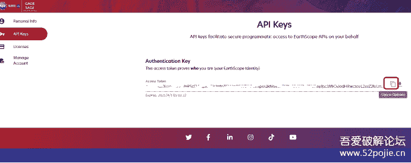

[附件下载](https://www.52pojie.cn/forum.php?mod=attachment&aid=Mjc2ODE4Nnw4OWEyOGU3ZXwxNzkzNTcxMDY5fDE2ODA4NnwyMDIwOTMz&nothumb=yes)（2025-4-2 12:46 上传）

### 导航星历文件
工具目录下已经包含了比较新的导航文件 `ab140890.25n`，一般情况下可以不下载最新的，如果对于精度要求高，则需要按照下面的方法粘贴你的 Key，点击下载按钮。

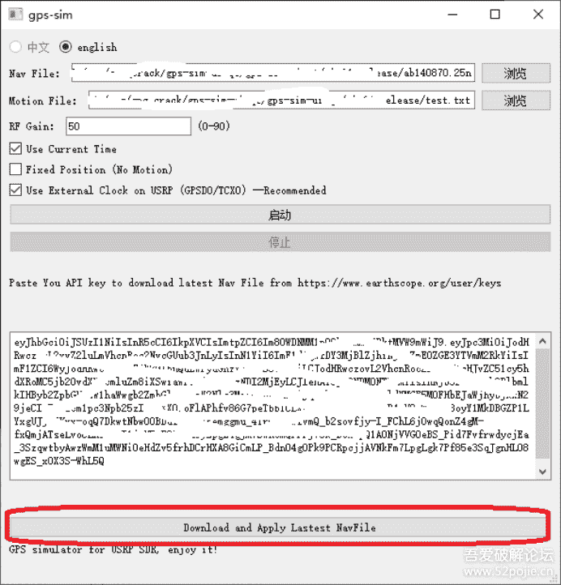

[附件下载](https://www.52pojie.cn/forum.php?mod=attachment&aid=Mjc2ODE4N3xmOTZmMWUzY3wxNzkzNTcxMDY5fDE2ODA4NnwyMDIwOTMz&nothumb=yes)（2025-4-2 12:47 上传）

如果你的 Key 无效或者过期，则弹出如下提示：

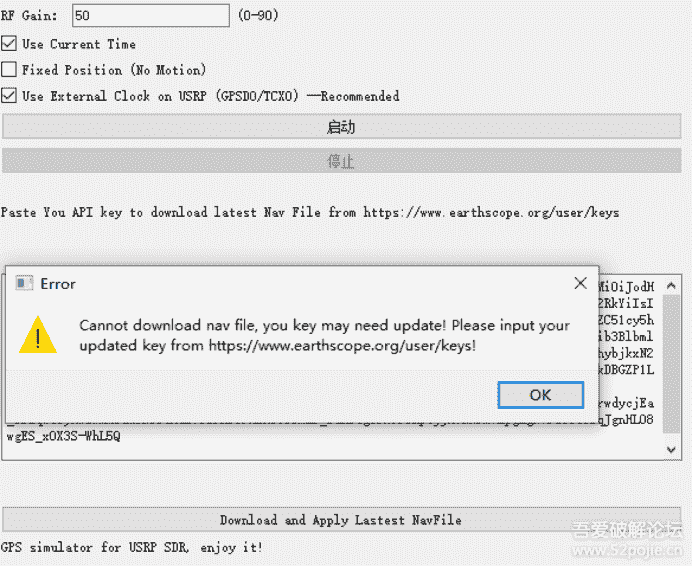

[附件下载](https://www.52pojie.cn/forum.php?mod=attachment&aid=Mjc2ODE4OHxlYzExNWI3MXwxNzkzNTcxMDY5fDE2ODA4NnwyMDIwOTMz&nothumb=yes)（2025-4-2 12:47 上传）

如果 Key 有效，则弹出如下成功提示，并且自动应用最新的导航文件。

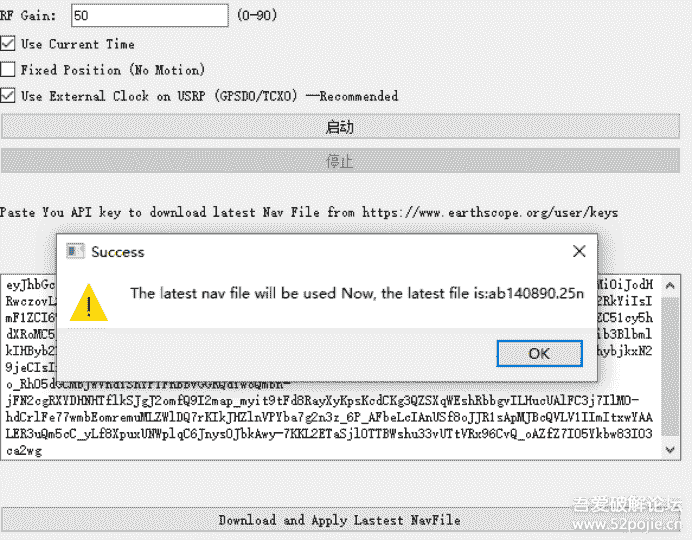

[附件下载](https://www.52pojie.cn/forum.php?mod=attachment&aid=Mjc2ODIxMHwxM2JjNDJlMHwxNzkzNTcxMDY5fDE2ODA4NnwyMDIwOTMz&nothumb=yes)（2025-4-2 14:08 上传）

### 运动轨迹文件
对于 `Motion File`（运动轨迹文件），本程序目录默认提供了一个 `test.txt`。里面的内容是一系列的 NEMA 指令流。

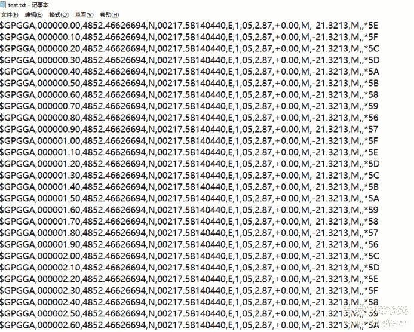

[附件下载](https://www.52pojie.cn/forum.php?mod=attachment&aid=Mjc2ODIxMnxhNDUzMWE3NXwxNzkzNTcxMDY5fDE2ODA4NnwyMDIwOTMz&nothumb=yes)（2025-4-2 14:09 上传）

默认情况下选择这个进行测试即可。如果要生成自己的轨迹文件，方法如下：采用谷歌地图或者其他国内的地图或者户外运动软件导出特定位置的运动轨迹，注意一定要导出为 `kml` 格式的地图才行；保存为 `kml` 文件是不能够直接使用的，它本质上只是一种包含路径中关键坐标点的格式，并不包含实际运动轨迹中加速、减速、静止这样的数据，我们要对其进行转换。转换格式需要用到 `SatGenNMEA` 软件（软件包中有提供）。打开 `SatGenNMEA` 软件，将数据更新频率设置为 `10Hz`，其他的都用默认参数就行，然后点击 `Load KML file`，然后点击 `Generate NMEA file`，即可生成标准的 NMEA 轨迹文件，好了这个文件就可以在 `gps-sim` 里面使用了。

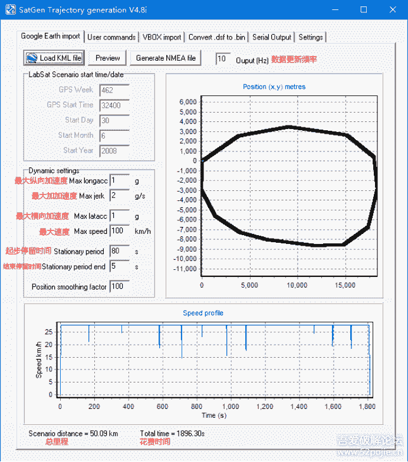

[附件下载](https://www.52pojie.cn/forum.php?mod=attachment&aid=Mjc2ODIxNHxjOTdkN2NmNXwxNzkzNTcxMDY5fDE2ODA4NnwyMDIwOTMz&nothumb=yes)（2025-4-2 14:10 上传）

## 实验验证

### 启动工具
双击软件里面的 `gps-sim.exe` 打开工具。认识一下里面的复选框。如下复选框的选项可以根据需求进行勾选，如果是固定位置，无需运动模拟，就勾选 `Fixed Position`。如果没有购买外接时钟源，手里如果只有一个 USRP，那么就去勾选 `Use external clock`。

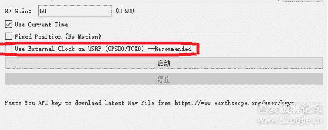

[附件下载](https://www.52pojie.cn/forum.php?mod=attachment&aid=Mjc2ODIxNXxiMzdkMGRjZXwxNzkzNTcxMDY5fDE2ODA4NnwyMDIwOTMz&nothumb=yes)（2025-4-2 14:11 上传）

插入 USRP B210，点击启动按钮。启动之后就可以从命令窗里面看到的模拟卫星的状态。启动后的运行情况如下：命令窗口会显示模拟的导航卫星状态。

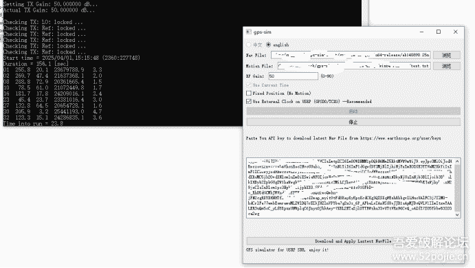

[附件下载](https://www.52pojie.cn/forum.php?mod=attachment&aid=Mjc2ODIxNnxlNjZiZDFlOHwxNzkzNTcxMDY5fDE2ODA4NnwyMDIwOTMz&nothumb=yes)（2025-4-2 14:11 上传）

### 作者采用的硬件配置
如下是作者采用的硬件配置：

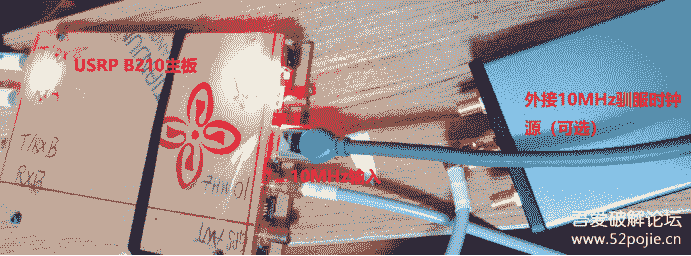

[附件下载](https://www.52pojie.cn/forum.php?mod=attachment&aid=Mjc2ODIxN3wzOGZkMmYwNHwxNzkzNTcxMDY5fDE2ODA4NnwyMDIwOTMz&nothumb=yes)（2025-4-2 14:12 上传）

### 手机端验证
打开手机上的 `GPS Test` 软件，就可以看到信号超级好的卫星信号，并且手机在模拟的位置上定位成功。

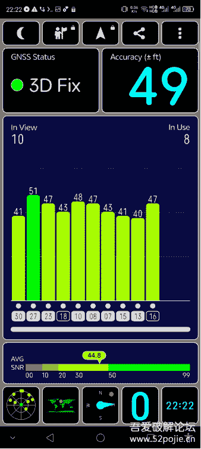

[附件下载](https://www.52pojie.cn/forum.php?mod=attachment&aid=Mjc2ODIxOHwxMzVmN2ViN3wxNzkzNTcxMDY5fDE2ODA4NnwyMDIwOTMz&nothumb=yes)（2025-4-2 14:13 上传）

## 关键代码
本工具相对于已有的工具，主要增加了针对 USRB B210 的控制部分和导航星历文件的自动识别下载。如下是这几部分的主要代码，供大家参考。GPS 基带信号产生的核心代码采用了 `gps-sim` 的开源部分，故而不在这里赘述。GUI 部分是基于 `qtCreator` 做的，这部分 GUI 代码也无需展示，大家可以自行比猫画虎。

### 星历文件识别与下载代码
根据电脑时间识别最新星历文件及其下载过程的代码：

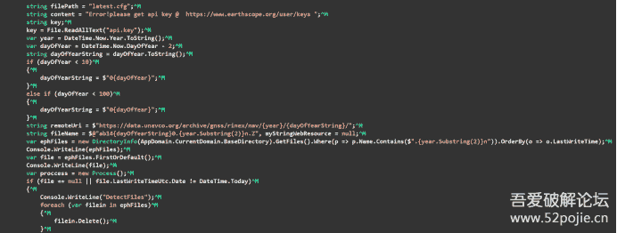

[附件下载](https://www.52pojie.cn/forum.php?mod=attachment&aid=Mjc2ODIxOXw2MTM2MTRiZnwxNzkzNTcxMDY5fDE2ODA4NnwyMDIwOTMz&nothumb=yes)（2025-4-2 14:14 上传）

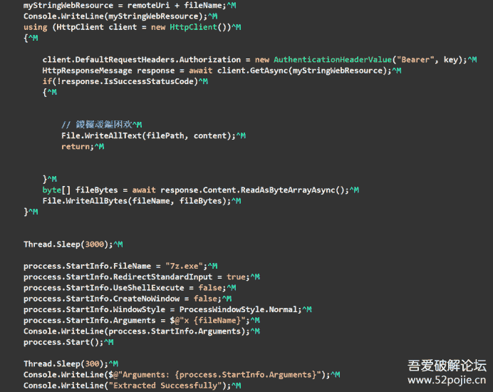

[附件下载](https://www.52pojie.cn/forum.php?mod=attachment&aid=Mjc2ODIyMXwzYTViOWIzZXwxNzkzNTcxMDY5fDE2ODA4NnwyMDIwOTMz&nothumb=yes)（2025-4-2 14:14 上传）

### USRP B210 初始化代码
USRP B210 进行初始化过程的主要代码：

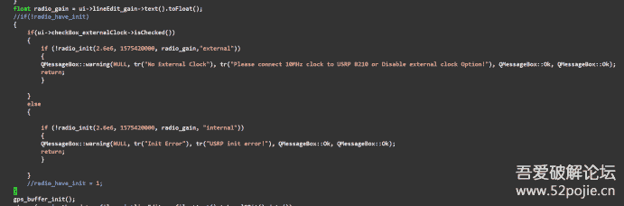

[附件下载](https://www.52pojie.cn/forum.php?mod=attachment&aid=Mjc2ODIyM3xhMTlhYmJjN3wxNzkzNTcxMDY5fDE2ODA4NnwyMDIwOTMz&nothumb=yes)（2025-4-2 14:15 上传）

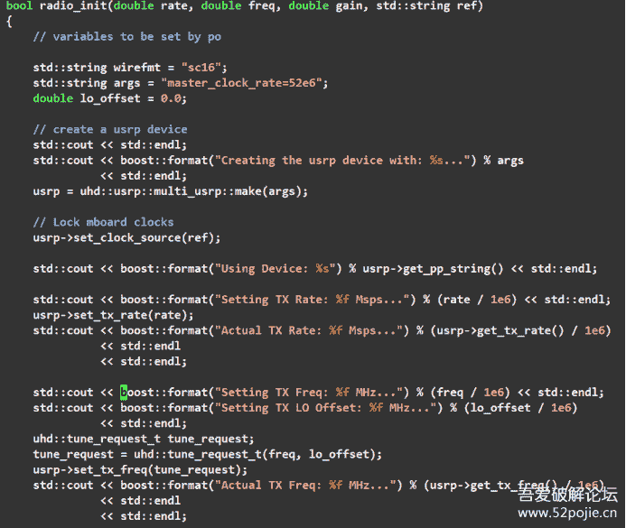

[附件下载](https://www.52pojie.cn/forum.php?mod=attachment&aid=Mjc2ODIyNnwwYjMzODdmM3wxNzkzNTcxMDY5fDE2ODA4NnwyMDIwOTMz&nothumb=yes)（2025-4-2 14:16 上传）

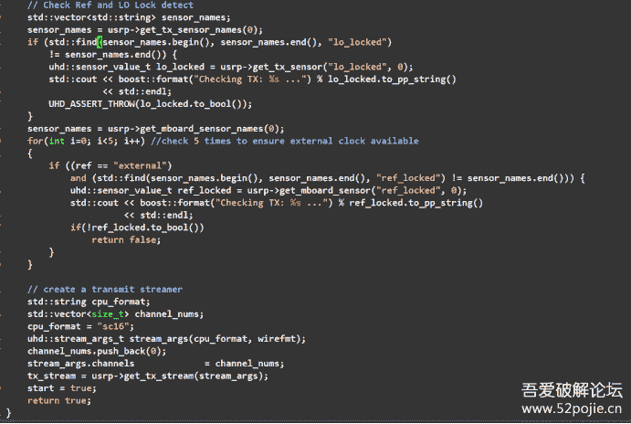

[附件下载](https://www.52pojie.cn/forum.php?mod=attachment&aid=Mjc2ODIyN3wzZWEzMzM2OXwxNzkzNTcxMDY5fDE2ODA4NnwyMDIwOTMz&nothumb=yes)（2025-4-2 14:17 上传）
