# [原创] 解开Windows微信备份文件

- 原帖: https://www.52pojie.cn/forum.php?mod=viewthread&tid=2021739
- 抓取时间: 2026-11-01T22:11:08

解开Windows微信备份文件

使用电脑微信上的“菜单-迁移与备份-备份与恢复”功能可以将手机微信上的聊天记录存储到电脑，以后也可以恢复到手机。如果可以将这些备份的聊天记录直接提取出来就可以随心所欲地整理、保存了。

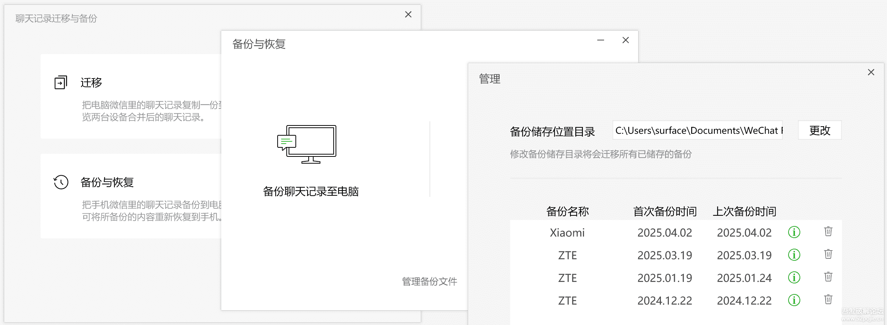

操作0.png (128.12 KB, 下载次数: 6)

[href="forum.php?mod=attachment&aid=Mjc2ODkwNXxmNTVmMzZmMHwxNzkzNTcxMDY2fDE2ODA4NnwyMDIxNzM5&nothumb=yes" target="_blank"](https://www.52pojie.cn/forum.php?mod=attachment&aid=Mjc2ODkwNXxmNTVmMzZmMHwxNzkzNTcxMDY2fDE2ODA4NnwyMDIxNzM5&nothumb=yes)

2025-4-5 20:12 上传

本文使用的电脑微信（64位）、安卓微信的版本如下：

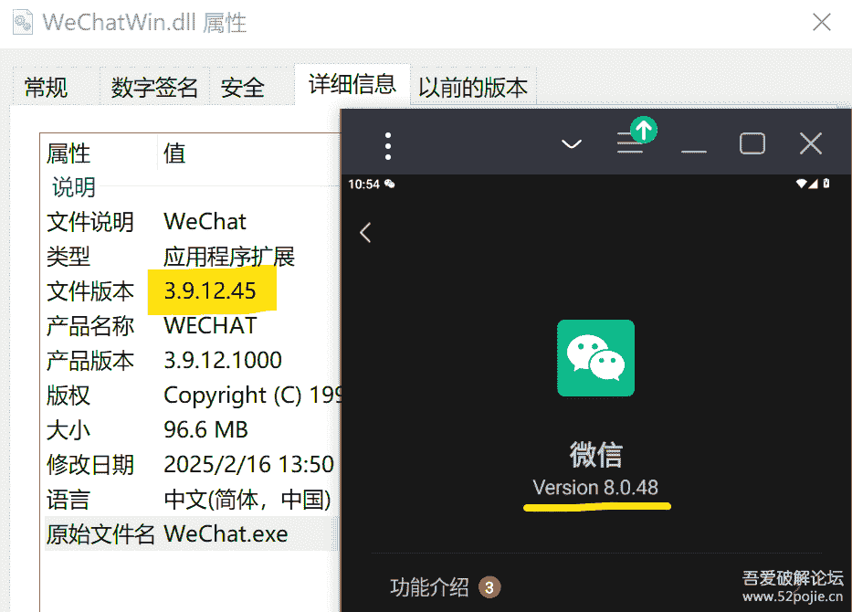

版本信息0.png (86.57 KB, 下载次数: 6)

[href="forum.php?mod=attachment&aid=Mjc2ODkwNnwwODY4MjkxM3wxNzkzNTcxMDY2fDE2ODA4NnwyMDIxNzM5&nothumb=yes" target="_blank"](https://www.52pojie.cn/forum.php?mod=attachment&aid=Mjc2ODkwNnwwODY4MjkxM3wxNzkzNTcxMDY2fDE2ODA4NnwyMDIxNzM5&nothumb=yes)

2025-4-5 20:12 上传

## 观察电脑微信的行为

电脑微信的备份功能会将手机聊天记录备份到形如 `C:\Users\XXX\Documents\WeChat Files\YYY\BackupFiles` 目录下，其内每一个文件夹对应一个备份，文件有：
- `Backup.db` （似乎是SQLite数据库，但打不开可能加密了）
- `BAK_0_TEXT` （看文件名似乎是消息文本 ）
- `BAK_0_MEDIA` （看文件名似乎是媒体文件）

进入“查看备份文件”，发现备份的详细信息，如机型等信息可以展示出来，猜测在加载备份文件列表时，微信就已经进行了数据库解密读取的操作。可以通过一些手段确认，微信在加载备份列表时，确实对 `Backup.db` 有读取的动作。另外解密电脑微信的主数据库，其中也没有找到任何与我的机型相关的记录或条目。根据这两点，可以确认微信在加载备份列表时确实解密并读取了备份文件，也意味着密钥一定会加载到内存中，也就能够通过 `x64dbg` 等动态调试工具提取出来。

电脑微信可以全量备份但部分恢复。例如，可以从时间跨度很长的备份中单独摘一小段时间内的聊天记录恢复到手机，也可以从备份的所有会话中单独摘几个会话恢复到手机。

## 动态调试电脑微信 抓取Backup.db数据库密钥

我是64位的Windows 微信，所以就用 `x64dbg` 附加到 `WeChat.exe` 啦。

首先，在 `x64dbg` 中寻找与密钥处理逻辑相关的字符串。进入模块 `wechatwin.dll`，然后列出模块中的所有字符串，可以搜索“key”这个词猜一猜。我们发现了 `"dbKey can't be NULL"`. 有点意思。

跳转到对应的汇编，这可能是一个判断语句的分支。从这条汇编向上走到其它跳转指令的紧后面，也就是这个判断分支的开头。然后通过“查找引用”功能，找到跳转到分支起始地址的两条跳转指令。

断点打在这两个 `je` 指令上。然后在微信中点击“管理备份列表”。断点命中了，`RDI` 值为数值 `0x20` 即 十进制32，寄存器 `R13` 指向的内存存储了一段字节，这段字节似乎也以32字节长度为界而结束了。

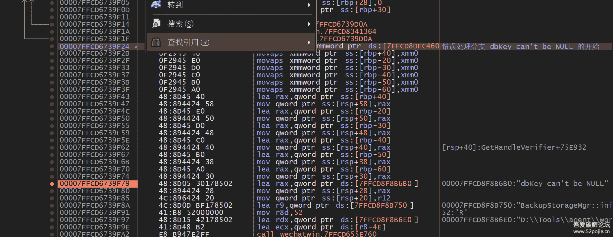

数据库1.png (264.07 KB, 下载次数: 5)

[href="forum.php?mod=attachment&aid=Mjc2ODkwN3w4MmFjOTI4YnwxNzkzNTcxMDY2fDE2ODA4NnwyMDIxNzM5&nothumb=yes" target="_blank"](https://www.52pojie.cn/forum.php?mod=attachment&aid=Mjc2ODkwN3w4MmFjOTI4YnwxNzkzNTcxMDY2fDE2ODA4NnwyMDIxNzM5&nothumb=yes)

2025-4-5 20:12 上传

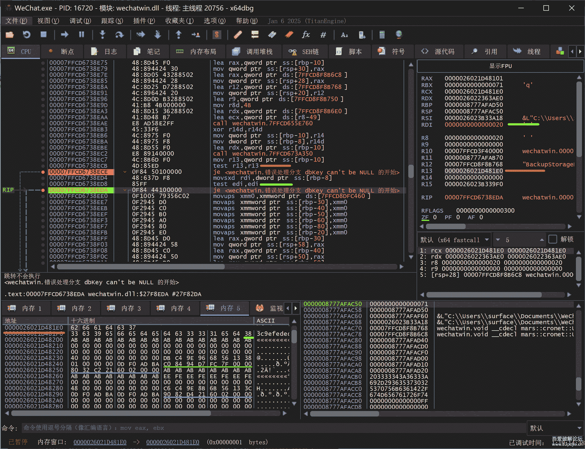

数据库2.png (591.11 KB, 下载次数: 4)

[href="forum.php?mod=attachment&aid=Mjc2ODkwOHw4YjNmM2E3Y3wxNzkzNTcxMDY2fDE2ODA4NnwyMDIxNzM5&nothumb=yes" target="_blank"](https://www.52pojie.cn/forum.php?mod=attachment&aid=Mjc2ODkwOHw4YjNmM2E3Y3wxNzkzNTcxMDY2fDE2ODA4NnwyMDIxNzM5&nothumb=yes)

2025-4-5 20:12 上传

可以猜测，`RDI` 和 `R13` 确定了密钥的内容和长度，长度为32字节。试试用这个密钥解密 `Backup.db`，算法还是先用解密微信主数据库的算法先试试。发现可以解密出来正常打开，很好，就是用这串密钥解密db文件了。

## 备份文件内容分析

按正常的算法解密 `Backup.db`。下面的代码来自 [//mp.weixin.qq.com/s/nckZTQ0leQLz27vUv4KfGg" target="_blank" rel="noopener noreferrer nofollow"](https://mp.weixin.qq.com/s/nckZTQ0leQLz27vUv4KfGg:rel="nofollow noopener" href="https)

用Python写的很方便使用，我稍作了修改。AES解密用的是 `pycryptodome` (`pip install pycryptodome`).

```
import hmac
import ctypes
import hashlib
from Crypto.Cipher import AES

def decrypt_msg(path, password):
    KEY_SIZE = 32
    DEFAULT_ITER = 64000
    DEFAULT_PAGESIZE = 4096  # 4048数据 + 16IV + 20 HMAC + 12
    SQLITE_FILE_HEADER = bytes("SQLite format 3", encoding="ASCII") + bytes(1)  # SQLite 文件头

    with open(path, "rb") as f:
        blist = f.read()

    salt = blist[:16]  # 前16字节为盐
    key = hashlib.pbkdf2_hmac("sha1", password, salt, DEFAULT_ITER, KEY_SIZE)  # 获得Key

    page1 = blist[16:DEFAULT_PAGESIZE]  # 丢掉salt

    mac_salt = bytes([x ^ 0x3a for x in salt])
    mac_key = hashlib.pbkdf2_hmac("sha1", key, mac_salt, 2, KEY_SIZE)

    hash_mac = hmac.new(mac_key, digestmod="sha1")
    hash_mac.update(page1[:-32])
    hash_mac.update(bytes(ctypes.c_int(1)))

    if hash_mac.digest() != page1[-32:-12]:
        raise RuntimeError("Wrong Password")

    pages = [blist[i:i+DEFAULT_PAGESIZE] for i in range(DEFAULT_PAGESIZE, len(blist), DEFAULT_PAGESIZE)]
    pages.insert(0, page1)  # 把第一页补上

    with open(f"{path}.dec.db", "wb") as f:
        f.write(SQLITE_FILE_HEADER)  # 写入文件头
        for i in pages:
            t = AES.new(key, AES.MODE_CBC, i[-48:-32])
            f.write(t.decrypt(i[:-48]))
            f.write(i[-48:])

if __name__ == "__main__":
    path = "Backup.db" # 数据库路径
    key = bytes.fromhex( # 密钥的十六进制码
        "66 32 64 30 63 35 32 65 32 33 36 39 32 63 30 37"
        "32 65 32 33 36 39 35 63 30 37 32 66 32 64 30 63"
    )
    decrypt_msg(path, key)
```

大致看看，发现 `Backup.db` 中没有存储真正的聊天内容。只有表 `Session` 存储了对话和群聊的名称。

数据库表 `MsgSegments` 中有几列，看字段的命名，好像是文件名称、偏移和长度，其中文件名称字段出现了 `BAK_0_TEXT`。可以猜测，真正的的聊天记录内容还是存储在配套的 `BAK_0_TEXT` 文件中，而这个文件由许多小段组合而来，每一小段的文件位置、偏移和长度都记录在了 `MsgSegments` 表对应的行内。类似的，通过 `MsgMedia` 和 `MsgFileSegments` 这两个表，也猜测图片视频文件也以类似的方式存储在 `BAK_0_MEDIA`、`BAK_1_MEDIA` 等文件中。

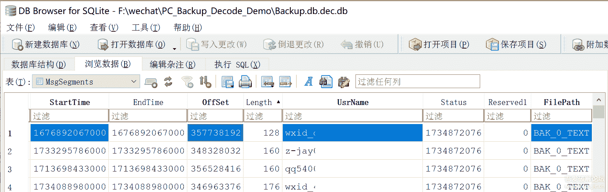

数据库3.png (112.06 KB, 下载次数: 7)

[href="forum.php?mod=attachment&aid=Mjc2ODkwOXwxMjI2NWQzNnwxNzkzNTcxMDY2fDE2ODA4NnwyMDIxNzM5&nothumb=yes" target="_blank"](https://www.52pojie.cn/forum.php?mod=attachment&aid=Mjc2ODkwOXwxMjI2NWQzNnwxNzkzNTcxMDY2fDE2ODA4NnwyMDIxNzM5&nothumb=yes)

2025-4-5 20:12 上传

但是，如果我们直接把 `BAK_0_TEXT` 的小段摘出来，是看不到什么有意义的字符的，别说汉字了，连ASCII字符看着也不像是正常的聊天消息内容。肯定是又是加密过。

电脑微信可以从完整的备份数据中单独摘出部分消息恢复到手机，所以估计 `BAK_0_TEXT` 包含的每个文件片段都是相互独立的，即每个片段都可以独立解密。不然，哪怕只想解密单个片段，都得把整个大文件解密才行，相信微信的开发人员应该不会这么蠢。

### 手机微信静态分析

把微信APK从手机中提取出来，使用 `Jadx` 反编译分析。这么多文件，从哪里看起呢，我们可以从微信的UI界面入手。

在手机上打开“开发者选项”中的“显示当前界面的包名”，然后在电脑上执行“备份至电脑”，手机上就会显示“备份聊天记录至电脑”的界面，再进入“选择聊天记录”。这个两个界面的类名分别为 `BackupPcUI` 和 `PCChooseConversationUI`

然后就在 `Jadx` 中查找这个类，就得开始一层一层地分析代码了。

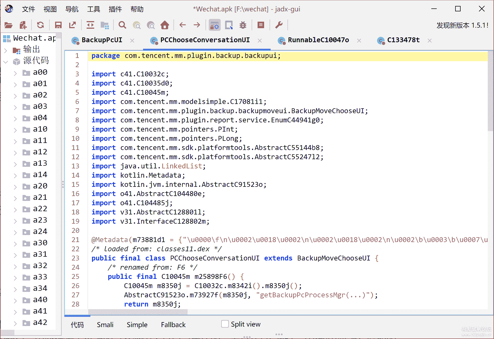

安卓1.png (212.63 KB, 下载次数: 8)

[href="forum.php?mod=attachment&aid=Mjc2ODkxMXw5NmUzOGIwOHwxNzkzNTcxMDY2fDE2ODA4NnwyMDIxNzM5&nothumb=yes" target="_blank"](https://www.52pojie.cn/forum.php?mod=attachment&aid=Mjc2ODkxMXw5NmUzOGIwOHwxNzkzNTcxMDY2fDE2ODA4NnwyMDIxNzM5&nothumb=yes)

2025-4-5 20:13 上传

这里我把当时分析代码的一些笔记贴到这里供参考。这里我开启了 `Jadx` 的反混淆功能（不知道 `Jadx` 的反混淆是否在不同的电脑上运行都能给出相同的符号名）。我当时也参考了 `JEB` 反编译的结果，两个软件对比着看……

这些流程很复杂，详细分析逻辑的时候，有一些技巧：

- 保持耐心。
- 根据日志注释字符串判断这个函数或某些变量的功能或含义。
- 如果注释表明这是一个错误处理的逻辑分支，就不必去看这个分支的代码了。
- 整个流程使用了不少类似线程池的东西，要特别注意类中有没有 `run` 方法等类似特征。
- 结合多个工具查看，例如Java反编译结合 `Jadx` 和 `JEB` 相互参照着看，原生代码反编译用 `JEB` 和 `IDA` 参照着看。

...

> 

下面是详细读代码分析的过程

———— 改天再贴。


[href="forum.php?mod=attachment&aid=Mjc2OTYyOXwyMzQxMmFjYnwxNzkzNTcxMDY2fDE2ODA4NnwyMDIxNzM5" target="_blank"](https://www.52pojie.cn/forum.php?mod=attachment&aid=Mjc2OTYyOXwyMzQxMmFjYnwxNzkzNTcxMDY2fDE2ODA4NnwyMDIxNzM5)

(14.68 KB, 下载次数: 70)

2025-4-8 21:40 上传

点击文件名下载附件
下载积分: 吾爱币 -1 CB

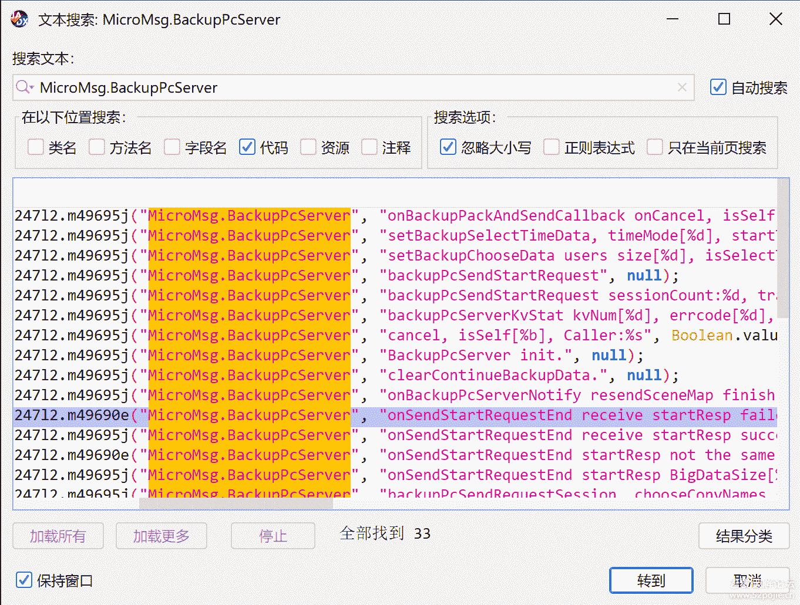

安卓3.png (213.27 KB, 下载次数: 6)

[href="forum.php?mod=attachment&aid=Mjc2ODkxMnw5MzNlOWE3NHwxNzkzNTcxMDY2fDE2ODA4NnwyMDIxNzM5&nothumb=yes" target="_blank"](https://www.52pojie.cn/forum.php?mod=attachment&aid=Mjc2ODkxMnw5MzNlOWE3NHwxNzkzNTcxMDY2fDE2ODA4NnwyMDIxNzM5&nothumb=yes)

2025-4-5 20:13 上传

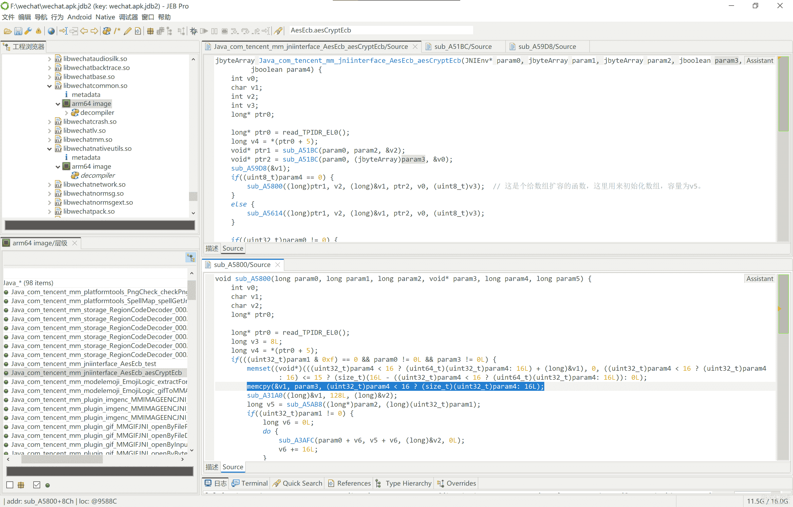

安卓4.png (430.74 KB, 下载次数: 5)

[href="forum.php?mod=attachment&aid=Mjc2ODkxM3w5OGMwMWVmY3wxNzkzNTcxMDY2fDE2ODA4NnwyMDIxNzM5&nothumb=yes" target="_blank"](https://www.52pojie.cn/forum.php?mod=attachment&aid=Mjc2ODkxM3w5OGMwMWVmY3wxNzkzNTcxMDY2fDE2ODA4NnwyMDIxNzM5&nothumb=yes)

2025-4-5 20:13 上传

...

仔细分析代码之后，可以发现一些内部实现的要点：

- 第一，是这个密钥是动态下发的。通过相关的代码发现这个密钥的获取和写入成员变量时，似乎涉及了 `protobuf` 的解包。因此猜测手机端的这个密钥不是自己生成的，而是从其它地方（比如电脑端）获取的。
- 第二，代码中大量使用了名称中有 `protobuf` 字样的包，说明对象的序列化可能多是使用 `protobuf` 实现的。
- 第三，也是最重要的一点，加密算法为 `AES-ECB`，且只使用了16字节的密钥，换言之，只使用了传入密钥的前16字节为真正用于加密的密钥。

### 手机微信动态调试

根据静态分析结果，使用 `Frida` 在安卓微信上动态打点监视，主要是为了找出手机微信中的密钥。这里重点关注的是原生函数 `AesEcb` 的输入，因为它其中的参数，按我们上面静态分析的结论，就有密钥。

启动模拟器，模拟器打开 `ROOT` 权限和 `ADB` 调试，并安装 `Frida`.

`Frida` 的具体安装使用就不多说了。`frida-server` 也从官网下载的最新的，传输到安卓上，注意模拟器的架构是 `x86` 的。创建 Python 虚拟环境安装 `frida-tools`.

```
adb connect 192.168.28.154  # 远程调试要手动 adb connect 到模拟器的IP地址
```


```
adb push ./frida-server-16.0.8-android-x86_64  /data/local/tmp/frida-server
adb shell

    chmod +x /data/local/tmp/frida-server
    su  # 超级管理员
    /data/local/tmp/frida-server

pip install frida-tools
frida -U 微信 -l hook.js
```

这里使用的Frida脚本`hook.js`需要自己编写。不过，在`JADX`中右击代码中相关方法的名称可以直接生成Frida代码，简直不要太方便。只要在`Jadx`给出的代码上添加些 `console.log` 把密钥打印出来就可以了（把字节按16进制打印出来方便阅读）。

```
function hookTest1(){
    function printhex(arr) {
        let ss = ''
        for(let i=0; i 
```

可以看到，这里打印的密钥与`Backup.db`的密钥相同。

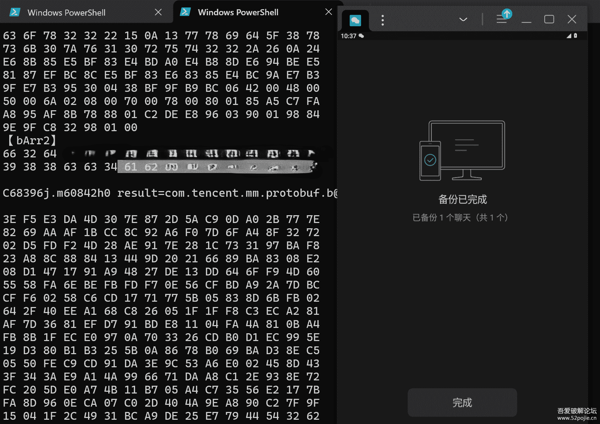
调试1.png (209.41 KB, 下载次数: 5)

[href="forum.php?mod=attachment&aid=Mjc2OTYyNnxiMzA4Y2VkMXwxNzkzNTcxMDY2fDE2ODA4NnwyMDIxNzM5&nothumb=yes" target="_blank"](https://www.52pojie.cn/forum.php?mod=attachment&aid=Mjc2OTYyNnxiMzA4Y2VkMXwxNzkzNTcxMDY2fDE2ODA4NnwyMDIxNzM5&nothumb=yes)
2025-4-8 21:36 上传

## 2> 解密 `BAK_0_TXT` 文件并提取聊天消息内容

下面就可以使用 `ASE-ECB` 解密 `BAK_0_TEXT` 消息片段了。这里提供一些示例代码。这里，我使用 `blackboxprotobuf`（`pip install bbpb`）直接解码 protobuf。AES 解密还是使用 `pycryptodome`。

注意，上面我们分析代码时已经强调过了，安卓微信加密消息片段使用的是16字节截取的密钥，所以这里解密也需要截取前面的16字节。

```
OFFSET = 356218880 # 片段的偏移
LENGTH = 1008      # 与长度
FILENAME = 'BAK_0_TEXT'
KEY = bytes.fromhex('66 32 64 30 63 35 32 65 32 33 36 39 32 63 30 37') # 密钥
with open(FILENAME, 'rb') as f:
    f.seek(OFFSET)
    rawbytes = f.read(LENGTH)
    from Crypto.Cipher import AES
    cipher = AES.new(KEY, AES.MODE_ECB)
    txtbytes = cipher.decrypt(rawbytes)
    #print(len(txtbytes), txtbytes[-1], txtbytes[128:256])
    #txtbytes = txtbytes[0:-txtbytes[-1]]
    print(txtbytes)
    import blackboxprotobuf  # pip install bbpb
    message,typedef = blackboxprotobuf.decode_message(txtbytes)
    from pprint import pprint
    pprint(message)
```

只看 `txtbytes` 就可以看到正常的聊天消息的样子——正常的数字、字母、XML标记等等。而 `decode_message` 就是 Protobuf 反序列化后的字典结构，但是由于我们不知道原始的 Protobuf 协议文件，所以输出的东西都像下面这样子，字典的键名是些不知所云的数字。要分析实际的字段含义，例如，对下面的这条消息，我们就在电脑微信自己的聊天消息 `MicroMsg.db` 数据库文件中找到同一条消息对应的行，对比数据库字段值与 Protobuf 解码出的字段值，尽量把解码字典的字段与 `MicroMsg.db` 数据库字段逐一匹配起来。

```
       {'1': 1, # type 类型
        '10': 0,
        '13': {'1': 0},
        '14': 0,
        '15': 0,
        '11': {}, # 媒体文件（如果有）
        '16': 739315802669645222, # MsgSvrId
        '17': 852963701, # MsgSequence
        '18': 1720602127000, # Sequence
        '19': 0,
        '3': {'1': 'wxid_av0mvrd7aq8er0'}, # 发送者
        '4': {'1': 'wxid_8xsk0zv10rut22'}, # 接收人
        '5': {'1': '嗯嗯，我刚才去看了也不在[破涕为笑]'}, # 消息内容
        '6': 4,
        '7': 1720602127, # CreateTime
        '8': {}, 
        '9': 0},

。。。
```

在消息记录中找到媒体文件的名称，经由 `MsgMedia` 表中的 `MediaId` 字段和 `MsgFileSegments` 表的 `MapKey` 字段定位到文件名（如 `BAK_0_MEIDA`）、偏移和长度。将相应的文件片段类似地提取、解密、存为文件即可。长度较长的文件会被分成为几个片段，需要分别解密然后按顺序拼接为完整的文件。注意同一个文件的不同片段只有最末片段才需要 `unpad`。

提取解密 `BAK_0_MEIDA` 的代码我就不给了，自己写吧 :-)

## 2> 探寻电脑微信中密钥的流转过程

现在来看看密钥的来源。

把在 `x64dbg` 中调试的涉及密钥处理的关键位置 `"dbKey can't be NULL"`，同样在 `IDA` 中定位。在 `IDA` 中打开 `wechatwin.dll`，同样地查找字符串，再 `List cross reference to` 转到就行。然后，按下 `F5`，进行反编译得到伪C代码，现在可以清晰地看到代码逻辑了。

`x64dbg` 动态调试时，两个 `je` 对应伪码中 `if` 的两个条件（下图中高亮），判断条件中涉及好几处 `v64`。不知道 `v64` 是什么，但 `v64` 来自 `sub_1827FA350`，不妨进去看看。估计 `sub_1827FA350` 加载了 `v64`，并通过引用返回到外面。

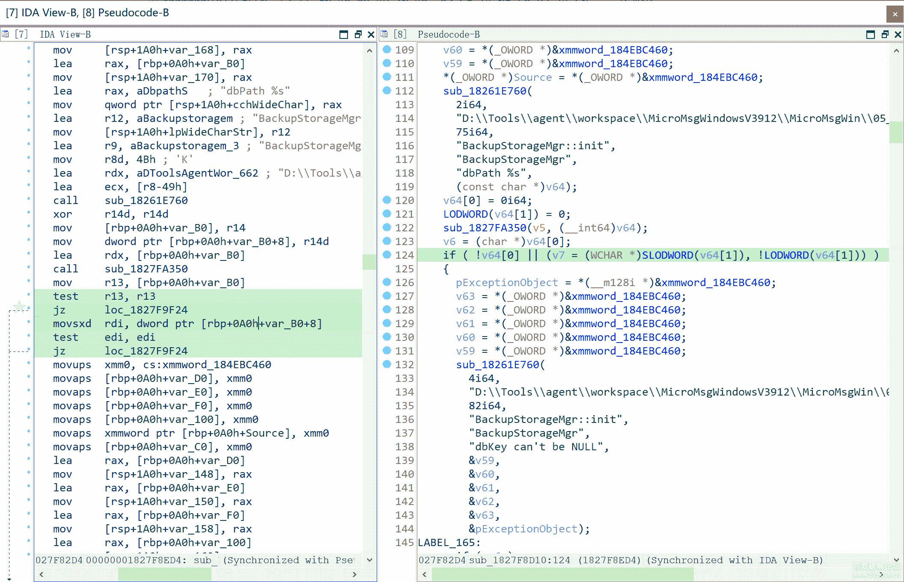
密钥1.png (314.44 KB, 下载次数: 7)

[href="forum.php?mod=attachment&aid=Mjc2ODkxNHwyMDhhOTkxNXwxNzkzNTcxMDY2fDE2ODA4NnwyMDIxNzM5&nothumb=yes" target="_blank"](https://www.52pojie.cn/forum.php?mod=attachment&aid=Mjc2ODkxNHwyMDhhOTkxNXwxNzkzNTcxMDY2fDE2ODA4NnwyMDIxNzM5&nothumb=yes)
2025-4-5 20:13 上传

下面是 `sub_1827FA350` 的伪码。先看函数定义和参数，上一层的 `v64` 就是这里的函数参数 `a2`，大概是个指针，`a2` 又来自于 `sub_18261D750`。

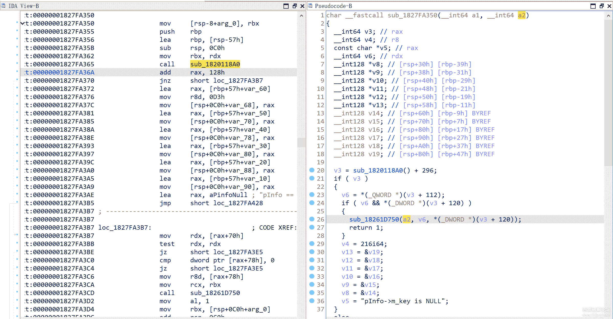
密钥2.png (312.15 KB, 下载次数: 6)

[href="forum.php?mod=attachment&aid=Mjc2ODkxNXxiYmVlNDg0YnwxNzkzNTcxMDY2fDE2ODA4NnwyMDIxNzM5&nothumb=yes" target="_blank"](https://www.52pojie.cn/forum.php?mod=attachment&aid=Mjc2ODkxNXxiYmVlNDg0YnwxNzkzNTcxMDY2fDE2ODA4NnwyMDIxNzM5&nothumb=yes)
2025-4-5 20:13 上传

再进入 `sub_18261D750` 大概扫一眼，其实就是先开一段新的内存空间，然后用标准库 `memmove` 把老空间的东西复制至新空间。因此，`sub_18261D750(a2, v6, *(_DWORD *)(v3+120))` 的意思就是把 `v6` 以长度 `*(v3+120)` 复制到 `a2`。

接着，回到上一层的 `sub_1827FA350`，从 `sub_18261D750` 往前看函数的开头有如下几个变量，它们通过在 `sub_1820118A0` 返回的指针上进行偏移，获得了两个值：

```
v3 = sub_1820118A0() + 296;
v6 = *(_QWORD *)(v3 + 112);
if ( v6 && *(_DWORD *)(v3 + 120) )
```

于是深入 `sub_1820118A0`。里面用到了一个变量 `qword_185A25D48`，没有看到这个符号的传参或声明，似乎是全局变量。如果这个全局变量为空，则加线程锁并例化对象赋进去，如果已经有值了就直接返回，这是经典的单例模式。那个 `qword_185A25D48` 双击进去，确实是落在了 DLL 文件的 `.data` 节中，而且地址是固定的，即位于相对 DLL 基址的固定偏移，无疑是用作全局变量，就叫它 `pInfo` 吧。现在知道了 `sub_1820118A0` 返回 `pInfo` 全局变量指针。

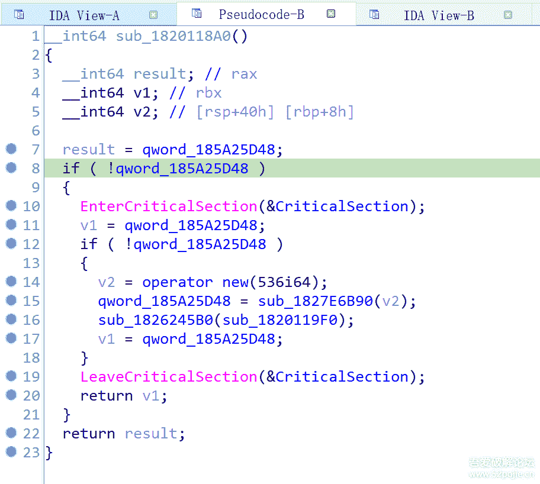
密钥3.png (75.6 KB, 下载次数: 6)

[href="forum.php?mod=attachment&aid=Mjc2ODkxNnwwY2RiNTY2NHwxNzkzNTcxMDY2fDE2ODA4NnwyMDIxNzM5&nothumb=yes" target="_blank"](https://www.52pojie.cn/forum.php?mod=attachment&aid=Mjc2ODkxNnwwY2RiNTY2NHwxNzkzNTcxMDY2fDE2ODA4NnwyMDIxNzM5&nothumb=yes)
2025-4-5 20:13 上传

因此，猜测 `QWORD` 值 `*(QWORD *)(v3+112)` 是指向密钥字节串的地址，字节串长度为 `*(DWORD *)(v3+120)`，这两个变量又是在固定地址的全局变量之上加以固定偏移得到的。

。。。

接下来在 `x64dbg` 中定位到相应的位置，动态调试查看。

注意看下面有个字符串 `"pInfo->m_key is NULL"`，可以使用这个标志性字符串在 `x64dbg` 中定位到上面分析的地方。这个字符串位于错误处理分支，于是把断点加在相关的判断跳转之前。简单分析下面这些断点。`A3E5` 处是错误处理分支的开始，这个分支是从 `A3BE` 或 `A3C4` 跳转过来的。而上面的 `"pInfo==NULL"` 看起来是另一个错误处理分支，所以再把断点打在跨过错误处理分支的 `jne` 指令上。

这样，我们就打了三个断点，标记有 `"pInfo->m_key is NULL"` 的分支打了两个断点，`"pInfo==NULL"` 打了一个断点，分别对应着 C 代码中的两个 `if`。

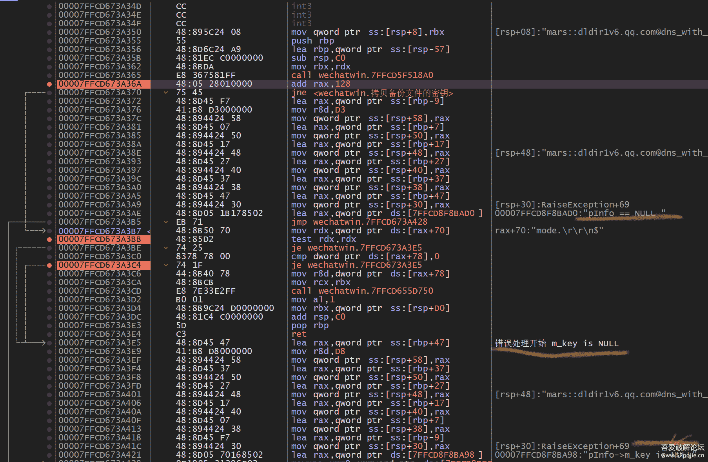
密钥4.png (430.84 KB, 下载次数: 5)

[href="forum.php?mod=attachment&aid=Mjc2ODkxN3xlNGU1ODdiNXwxNzkzNTcxMDY2fDE2ODA4NnwyMDIxNzM5&nothumb=yes" target="_blank"](https://www.52pojie.cn/forum.php?mod=attachment&aid=Mjc2ODkxN3xlNGU1ODdiNXwxNzkzNTcxMDY2fDE2ODA4NnwyMDIxNzM5&nothumb=yes)
2025-4-5 20:14 上传

点击微信界面上的“查看备份文件”，断点可以命中。

- 对于第一个 `jne`，即 IDA C 代码中的 `if(v3)`
- 对于第一个 `je` 前的断点，找到此时寄存器 `RDX` 对应的内存区域，可以看到相同的密钥字节串。
- 对于第二个 `je` 的断点，关注 `[rax+78h]` 的值，为 `00 00 00 20`，也就是十进制的32，确实是密钥长度。

所以进一步印证了，指针 `v6=*(v3+112)` 指向了密钥字节串，且其长度为 `*(v3+120)`。而且，根据动态调试中观察到的值，这与我们最一开始发现的密钥内容与密钥长度是一致的。

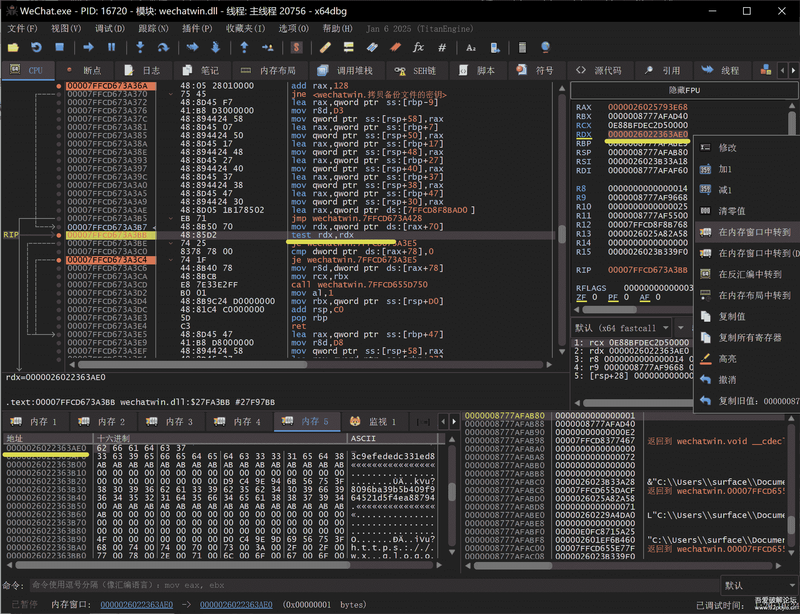
密钥5.png (574.88 KB, 下载次数: 5)

[href="forum.php?mod=attachment&aid=Mjc2ODkxOHw5OTgzNjgxN3wxNzkzNTcxMDY2fDE2ODA4NnwyMDIxNzM5&nothumb=yes" target="_blank"](https://www.52pojie.cn/forum.php?mod=attachment&aid=Mjc2ODkxOHw5OTgzNjgxN3wxNzkzNTcxMDY2fDE2ODA4NnwyMDIxNzM5&nothumb=yes)
2025-4-5 20:14 上传

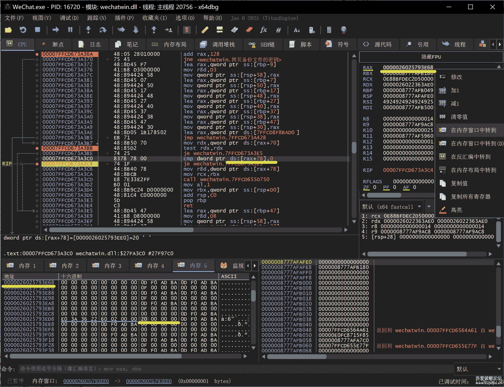
密钥6.png (554.49 KB, 下载次数: 8)

[href="forum.php?mod=attachment&aid=Mjc2ODkxOXw3OGZhZDJiN3wxNzkzNTcxMDY2fDE2ODA4NnwyMDIxNzM5&nothumb=yes" target="_blank"](https://www.52pojie.cn/forum.php?mod=attachment&aid=Mjc2ODkxOXw3OGZhZDJiN3wxNzkzNTcxMDY2fDE2ODA4NnwyMDIxNzM5&nothumb=yes)
2025-4-5 20:14 上传

## 2> 通过动态调试验证密钥提取方法

`qword_185A25D48`（也就是 `pInfo`）是全局变量，相对 DLL 的基址是固定的，再这上面加固定偏移，就可以得到需要的密钥字节串。我们在 `x64dbg` 中验证一下这个思路。

`IDA` 在整个 DLL 的反汇编开头就写明 `Imagebase` 为 `0x180000000`，所以 `pInfo` 相对基址偏移 `0x5A25D48`。

在 `x64dbg` 的“符号”中，看到 `wechatwin.dll` 实际载入的基址为 `0x7FFCD3F40000`，则 `pInfo` 实际的地址等于基址加偏移为 `0x7FFCD9965D48`，在“内存布局”窗口中转到这个地址。

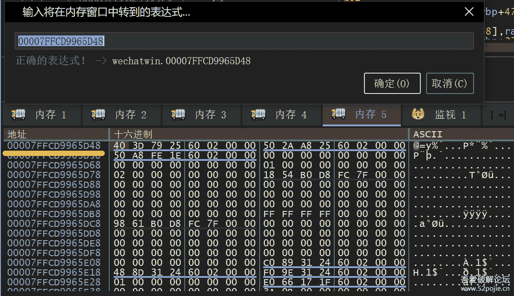
动态1.png (103.97 KB, 下载次数: 8)

[href="forum.php?mod=attachment&aid=Mjc2ODkyMHxhNTE5NTE0OXwxNzkzNTcxMDY2fDE2ODA4NnwyMDIxNzM5&nothumb=yes" target="_blank"](https://www.52pojie.cn/forum.php?mod=attachment&aid=Mjc2ODkyMHxhNTE5NTE0OXwxNzkzNTcxMDY2fDE2ODA4NnwyMDIxNzM5&nothumb=yes)
2025-4-5 20:15 上传

`pInfo` 存储了一个地址，继续转到这个地址（选中这8个字节并“在内存窗口中转到QWORD”）：

- 从这个位置开始，向下数 `(296+120=416)` 个字节处为密钥长度 `00 00 00 20` 即 十进制32
- 同样从这个位置，向下数 `(296+112=408)` 个字节处是个地址，跳转过去就是密钥字节串

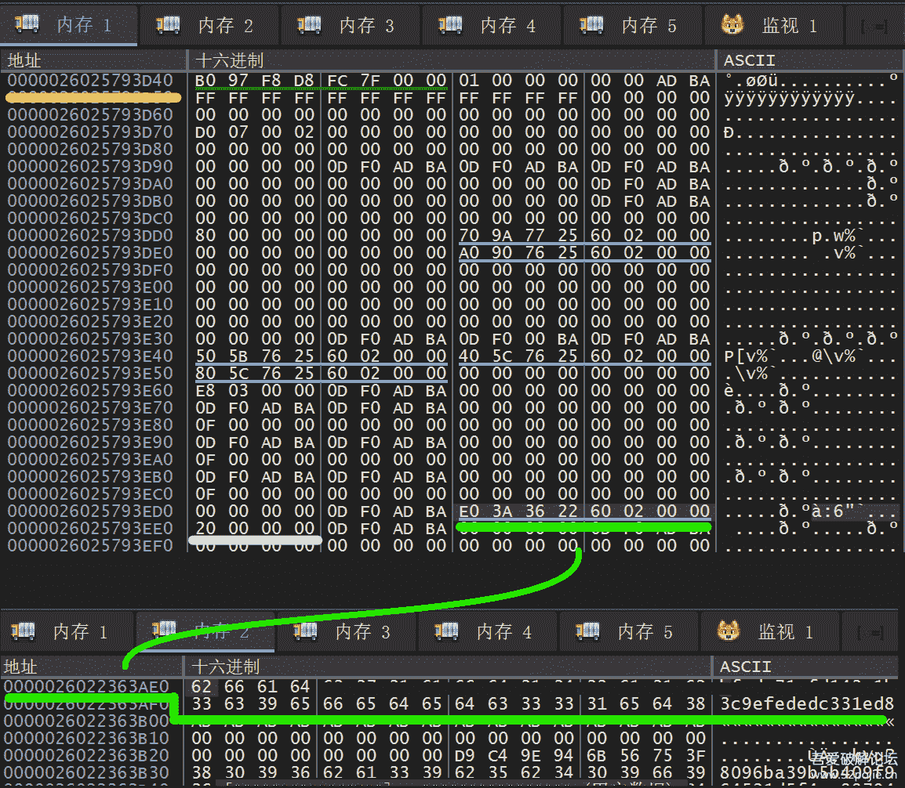
动态23.png (166.02 KB, 下载次数: 6)

[href="forum.php?mod=attachment&aid=Mjc2ODkyMXw4NWJhNTM0NnwxNzkzNTcxMDY2fDE2ODA4NnwyMDIxNzM5&nothumb=yes" target="_blank"](https://www.52pojie.cn/forum.php?mod=attachment&aid=Mjc2ODkyMXw4NWJhNTM0NnwxNzkzNTcxMDY2fDE2ODA4NnwyMDIxNzM5&nothumb=yes)
2025-4-5 20:15 上传

这样密钥内容和密钥长度就都从茫茫内存数据中抓出来了。不过，似乎不同的账号登录时，密钥的长度都是32字节，或许我们只关注密钥的内容就可以了。

## 参考：

- 微信数据库


## 参考链接

- [https://mp.weixin.qq.com/s/nckZTQ0leQLz27vUv4KfGg](https://mp.weixin.qq.com/s/nckZTQ0leQLz27vUv4KfGg)
- [https://blog.greycode.top/posts/android-wechat-bak/](https://blog.greycode.top/posts/android-wechat-bak/)
- `adb + frida`
- [https://blog.csdn.net/Melect/article/details/90903083](https://blog.csdn.net/Melect/article/details/90903083)
- [https://mobile.sqlsec.com/3/4/](https://mobile.sqlsec.com/3/4/)
- [https://blog.csdn.net/u014600432/article/details/43971511](https://blog.csdn.net/u014600432/article/details/43971511)
- [https://www.52pojie.cn/thread-1823118-1-1.html](https://www.52pojie.cn/thread-1823118-1-1.html)

## 使用的工具

- `x64dbg_2025_01_06.zip`
- `IDA Pro 7.7.220118 (SP1) (x86, x64, ARM64)​ No key no patch.7z`
- [https://www.52pojie.cn/thread-1581672-1-1.html](https://www.52pojie.cn/thread-1581672-1-1.html)
- `Jadx-1.5.0.zip`
- `JEB_demo_5.22.0.202412102010_by_CXV.7z`
- [https://www.52pojie.cn/thread-1992148-1-1.html](https://www.52pojie.cn/thread-1992148-1-1.html)
