# [Web逆向] 【js逆向】虾m视频真实地址

- 原帖: https://www.52pojie.cn/forum.php?mod=viewthread&tid=2021915
- 抓取时间: 2026-11-01T22:11:04

本文章中所有内容仅供学习交流使用，不用于其他任何目的，不提供完整代码，抓包内容、敏感网址、数据接口等均已做脱敏处理，严禁用于商业用途和非法用途，否则由此产生的一切后果均与作者无关.本文章未经许可禁止转载，禁止任何修改后二次传播，擅自使用本文讲解的技术而导致的任何意外，作者均不负责

## 目标网址
目标网址：`aHR0cHM6Ly9qeC54bWZsdi5jb20vP3VybD1odHRwczovL3YucXEuY29tL3gvY292ZXIvbXpjMDAyMDB1OHZmemN6Lmh0bWw=`

感谢各位大佬的观看，我是菜鸟，新手上路，在某同学的忽悠下入坑js逆向，请多指教

`f12`，输入网址后回车，点击`xhr`查看数据包：

要分析的是这个，它发的是`post`请求，但是得到的是一张裂图，感觉有点奇怪

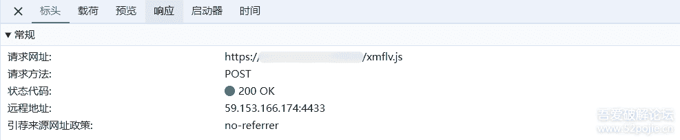
image.png (22.11 KB, 下载次数: 1)
[href="forum.php?mod=attachment&aid=Mjc2OTE0OHxhYTVkNjkzZnwxNzkzNTcxMDYyfDE2ODA4NnwyMDIxOTE1&nothumb=yes" target="_blank"](https://www.52pojie.cn/forum.php?mod=attachment&aid=Mjc2OTE0OHxhYTVkNjkzZnwxNzkzNTcxMDYyfDE2ODA4NnwyMDIxOTE1&nothumb=yes)
2025-4-6 20:46 上传

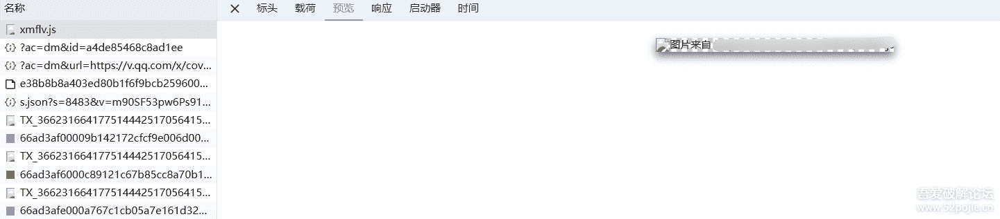
image.png (48.74 KB, 下载次数: 1)
[href="forum.php?mod=attachment&aid=Mjc2OTE0NnwzZGUzY2Y4MHwxNzkzNTcxMDYyfDE2ODA4NnwyMDIxOTE1&nothumb=yes" target="_blank"](https://www.52pojie.cn/forum.php?mod=attachment&aid=Mjc2OTE0NnwzZGUzY2Y4MHwxNzkzNTcxMDYyfDE2ODA4NnwyMDIxOTE1&nothumb=yes)
2025-4-6 20:46 上传

把图片下载下来以txt文件打开查看内容

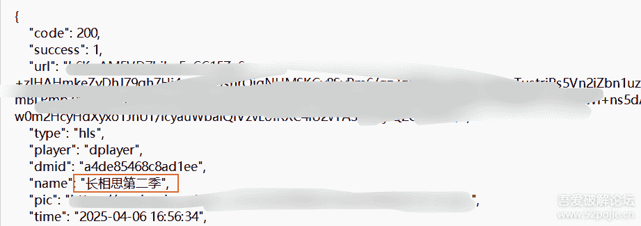
image.png (56.57 KB, 下载次数: 1)
[href="forum.php?mod=attachment&aid=Mjc2OTE0OXw4OTA5MzJlNHwxNzkzNTcxMDYyfDE2ODA4NnwyMDIxOTE1&nothumb=yes" target="_blank"](https://www.52pojie.cn/forum.php?mod=attachment&aid=Mjc2OTE0OXw4OTA5MzJlNHwxNzkzNTcxMDYyfDE2ODA4NnwyMDIxOTE1&nothumb=yes)
2025-4-6 20:48 上传

查看载荷，要求解的加密参数有三个`url`，`time`，`key`

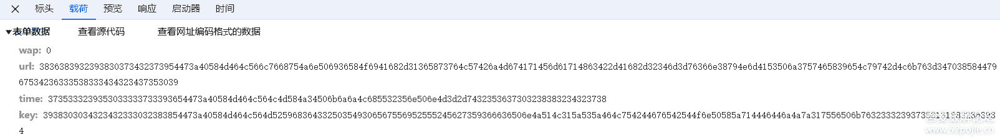
image.png (26 KB, 下载次数: 1)
[href="forum.php?mod=attachment&aid=Mjc2OTE1MHw0MmY4Mjc2MHwxNzkzNTcxMDYyfDE2ODA4NnwyMDIxOTE1&nothumb=yes" target="_blank"](https://www.52pojie.cn/forum.php?mod=attachment&aid=Mjc2OTE1MHw0MmY4Mjc2MHwxNzkzNTcxMDYyfDE2ODA4NnwyMDIxOTE1&nothumb=yes)
2025-4-6 20:50 上传

全局搜索 `key`:

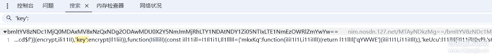
image.png (28.06 KB, 下载次数: 1)
[href="forum.php?mod=attachment&aid=Mjc2OTE1MXxlYzMzMjYyMXwxNzkzNTcxMDYyfDE2ODA4NnwyMDIxOTE1&nothumb=yes" target="_blank"](https://www.52pojie.cn/forum.php?mod=attachment&aid=Mjc2OTE1MXxlYzMzMjYyMXwxNzkzNTcxMDYyfDE2ODA4NnwyMDIxOTE1&nothumb=yes)
2025-4-6 20:50 上传

进来，发现请求载荷参数生成的位置：


image.png (11.44 KB, 下载次数: 1)
[href="forum.php?mod=attachment&aid=Mjc2OTE1MnxkZjI2YmZkOXwxNzkzNTcxMDYyfDE2ODA4NnwyMDIxOTE1&nothumb=yes" target="_blank"](https://www.52pojie.cn/forum.php?mod=attachment&aid=Mjc2OTE1MnxkZjI2YmZkOXwxNzkzNTcxMDYyfDE2ODA4NnwyMDIxOTE1&nothumb=yes)
2025-4-6 20:52 上传

`wap`是固定值，不用管

先求解`url`，断点刷新网页调试

括号里面的`url`是视频的原地址


image.png (13.11 KB, 下载次数: 1)
[href="forum.php?mod=attachment&aid=Mjc2OTE1M3wwYjUxMzhiN3wxNzkzNTcxMDYyfDE2ODA4NnwyMDIxOTE1&nothumb=yes" target="_blank"](https://www.52pojie.cn/forum.php?mod=attachment&aid=Mjc2OTE1M3wwYjUxMzhiN3wxNzkzNTcxMDYyfDE2ODA4NnwyMDIxOTE1&nothumb=yes)
2025-4-6 20:53 上传

`F9`进来，复制整个文件的代码，利用工具解`ob`混淆

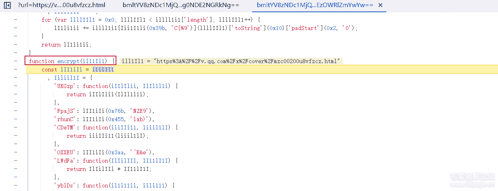
image.png (28.51 KB, 下载次数: 1)
[href="forum.php?mod=attachment&aid=Mjc2OTE1NXwxZmFhZjZiN3wxNzkzNTcxMDYyfDE2ODA4NnwyMDIxOTE1&nothumb=yes" target="_blank"](https://www.52pojie.cn/forum.php?mod=attachment&aid=Mjc2OTE1NXwxZmFhZjZiN3wxNzkzNTcxMDYyfDE2ODA4NnwyMDIxOTE1&nothumb=yes)
2025-4-6 20:54 上传

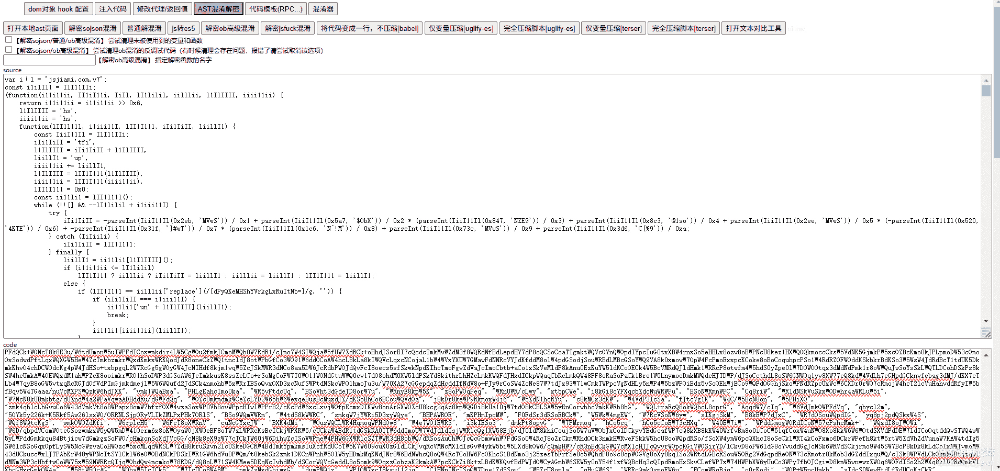
image.png (131.01 KB, 下载次数: 1)
[href="forum.php?mod=attachment&aid=Mjc2OTE1NnwwYTYyNWJiYXwxNzkzNTcxMDYyfDE2ODA4NnwyMDIxOTE1&nothumb=yes" target="_blank"](https://www.52pojie.cn/forum.php?mod=attachment&aid=Mjc2OTE1NnwwYTYyNWJiYXwxNzkzNTcxMDYyfDE2ODA4NnwyMDIxOTE1&nothumb=yes)
2025-4-6 20:55 上传

把代码复制下来

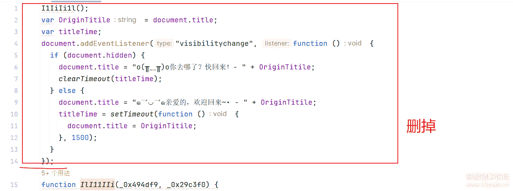
image.png (86.35 KB, 下载次数: 1)
[href="forum.php?mod=attachment&aid=Mjc2OTE1OXw0MmQxZjAwZnwxNzkzNTcxMDYyfDE2ODA4NnwyMDIxOTE1&nothumb=yes" target="_blank"](https://www.52pojie.cn/forum.php?mod=attachment&aid=Mjc2OTE1OXw0MmQxZjAwZnwxNzkzNTcxMDYyfDE2ODA4NnwyMDIxOTE1&nothumb=yes)
2025-4-6 20:58 上传

[JavaScript] 纯文本查看 复制代码


```console.log(encrypt("原视频地址"))
```

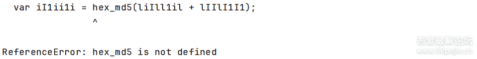

image.png (14.86 KB, 下载次数: 1)

[href="forum.php?mod=attachment&aid=Mjc2OTE2MHw0YWFhY2VjMHwxNzkzNTcxMDYyfDE2ODA4NnwyMDIxOTE1&nothumb=yes" target="_blank"](https://www.52pojie.cn/forum.php?mod=attachment&aid=Mjc2OTE2MHw0YWFhY2VjMHwxNzkzNTcxMDYyfDE2ODA4NnwyMDIxOTE1&nothumb=yes)

2025-4-6 21:00 上传

找到 `hex_md5` 函数的位置，缺啥补啥即可

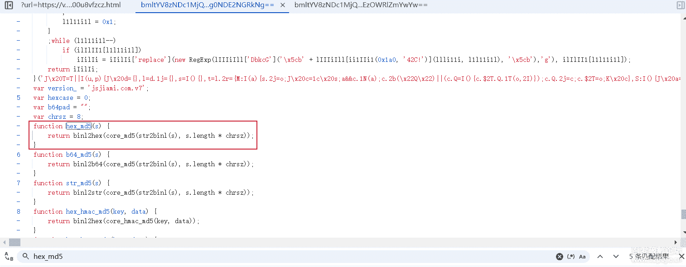

image.png (40.66 KB, 下载次数: 1)

[href="forum.php?mod=attachment&aid=Mjc2OTE2MXw5MzI1YThmOXwxNzkzNTcxMDYyfDE2ODA4NnwyMDIxOTE1&nothumb=yes" target="_blank"](https://www.52pojie.cn/forum.php?mod=attachment&aid=Mjc2OTE2MXw5MzI1YThmOXwxNzkzNTcxMDYyfDE2ODA4NnwyMDIxOTE1&nothumb=yes)

2025-4-6 21:01 上传

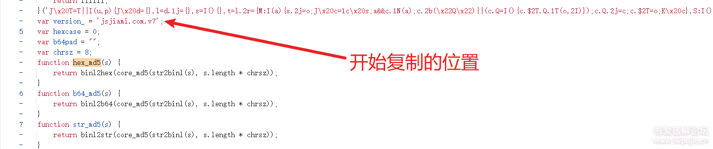

image.png (29.6 KB, 下载次数: 1)

[href="forum.php?mod=attachment&aid=Mjc2OTE2MnxlOTU2NWJhNHwxNzkzNTcxMDYyfDE2ODA4NnwyMDIxOTE1&nothumb=yes" target="_blank"](https://www.52pojie.cn/forum.php?mod=attachment&aid=Mjc2OTE2MnxlOTU2NWJhNHwxNzkzNTcxMDYyfDE2ODA4NnwyMDIxOTE1&nothumb=yes)

2025-4-6 21:02 上传

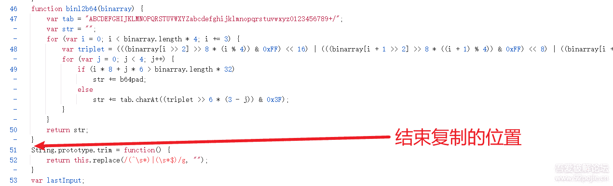

image.png (28.96 KB, 下载次数: 1)

[href="forum.php?mod=attachment&aid=Mjc2OTE2NHw1NzExNWEzMnwxNzkzNTcxMDYyfDE2ODA4NnwyMDIxOTE1&nothumb=yes" target="_blank"](https://www.52pojie.cn/forum.php?mod=attachment&aid=Mjc2OTE2NHw1NzExNWEzMnwxNzkzNTcxMDYyfDE2ODA4NnwyMDIxOTE1&nothumb=yes)

2025-4-6 21:02 上传

运行就能得到结果：

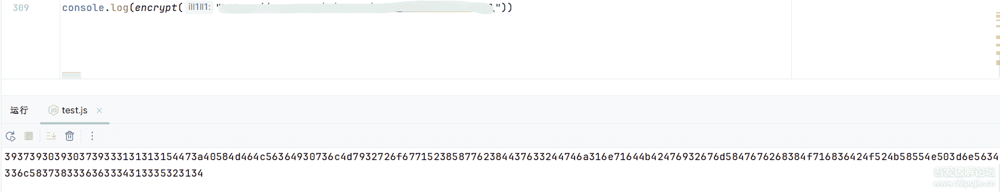

image.png (38.38 KB, 下载次数: 1)

[href="forum.php?mod=attachment&aid=Mjc2OTE2NXw5ZTAwNjRmY3wxNzkzNTcxMDYyfDE2ODA4NnwyMDIxOTE1&nothumb=yes" target="_blank"](https://www.52pojie.cn/forum.php?mod=attachment&aid=Mjc2OTE2NXw5ZTAwNjRmY3wxNzkzNTcxMDYyfDE2ODA4NnwyMDIxOTE1&nothumb=yes)

2025-4-6 21:04 上传

接下来是分析`time`：

很明显，`time` 的结果就是 `encrypt(time)`

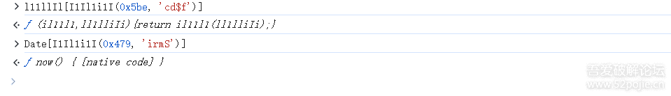

image.png (9.76 KB, 下载次数: 1)

[href="forum.php?mod=attachment&aid=Mjc2OTE2N3xmZjkyNWM1ZXwxNzkzNTcxMDYyfDE2ODA4NnwyMDIxOTE1&nothumb=yes" target="_blank"](https://www.52pojie.cn/forum.php?mod=attachment&aid=Mjc2OTE2N3xmZjkyNWM1ZXwxNzkzNTcxMDYyfDE2ODA4NnwyMDIxOTE1&nothumb=yes)

2025-4-6 21:05 上传

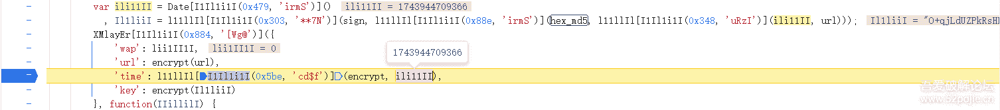

image.png (18.36 KB, 下载次数: 1)

[href="forum.php?mod=attachment&aid=Mjc2OTE3MHxlMTgwZWMzOXwxNzkzNTcxMDYyfDE2ODA4NnwyMDIxOTE1&nothumb=yes" target="_blank"](https://www.52pojie.cn/forum.php?mod=attachment&aid=Mjc2OTE3MHxlMTgwZWMzOXwxNzkzNTcxMDYyfDE2ODA4NnwyMDIxOTE1&nothumb=yes)

2025-4-6 21:08 上传

代码测试：

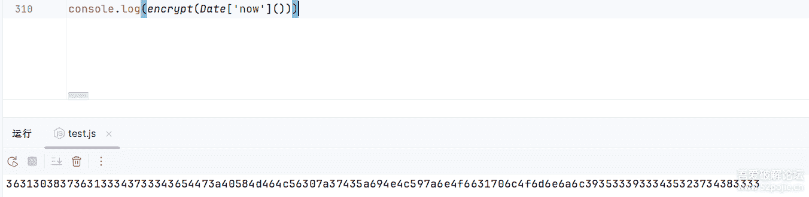

image.png (29.11 KB, 下载次数: 1)

[href="forum.php?mod=attachment&aid=Mjc2OTE3M3wwZTc3MjcyOXwxNzkzNTcxMDYyfDE2ODA4NnwyMDIxOTE1&nothumb=yes" target="_blank"](https://www.52pojie.cn/forum.php?mod=attachment&aid=Mjc2OTE3M3wwZTc3MjcyOXwxNzkzNTcxMDYyfDE2ODA4NnwyMDIxOTE1&nothumb=yes)

2025-4-6 21:10 上传

接下来是分析`key`：

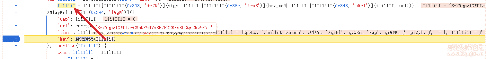

image.png (21.13 KB, 下载次数: 1)

[href="forum.php?mod=attachment&aid=Mjc2OTE3MnwyNTBkYjQyNnwxNzkzNTcxMDYyfDE2ODA4NnwyMDIxOTE1&nothumb=yes" target="_blank"](https://www.52pojie.cn/forum.php?mod=attachment&aid=Mjc2OTE3MnwyNTBkYjQyNnwxNzkzNTcxMDYyfDE2ODA4NnwyMDIxOTE1&nothumb=yes)

2025-4-6 21:09 上传

```javascript
Il1liiI = l11llIl[I1Il1i1I(0x303, '**7N')](sign, l11llIl[I1Il1i1I(0x88e, 'irmS')](hex_md5, l11llIl[I1Il1i1I(0x348, 'uRzI')](ili11II, url)))
```

控制台输出：

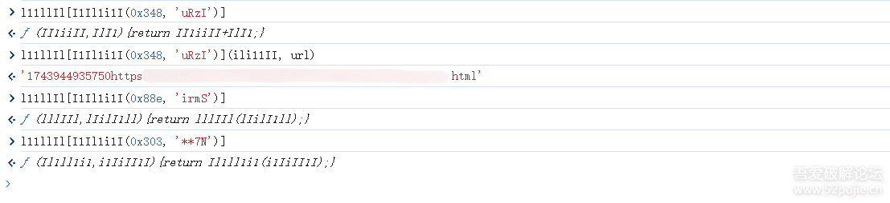

image.png (16.54 KB, 下载次数: 1)

[href="forum.php?mod=attachment&aid=Mjc2OTE3NHwyNTU2YTBhZHwxNzkzNTcxMDYyfDE2ODA4NnwyMDIxOTE1&nothumb=yes" target="_blank"](https://www.52pojie.cn/forum.php?mod=attachment&aid=Mjc2OTE3NHwyNTU2YTBhZHwxNzkzNTcxMDYyfDE2ODA4NnwyMDIxOTE1&nothumb=yes)

2025-4-6 21:15 上传

`l11llIl[I1Il1i1I(0x303, '**7N')](sign, l11llIl[I1Il1i1I(0x88e, 'irmS')](hex_md5, l11llIl[I1Il1i1I(0x348, 'uRzI')](ili11II, url)))` 的结果：`sign(l11llIl[I1Il1i1I(0x88e, 'irmS')](hex_md5, l11llIl[I1Il1i1I(0x348, 'uRzI')](ili11II, url)))`

编写代码：

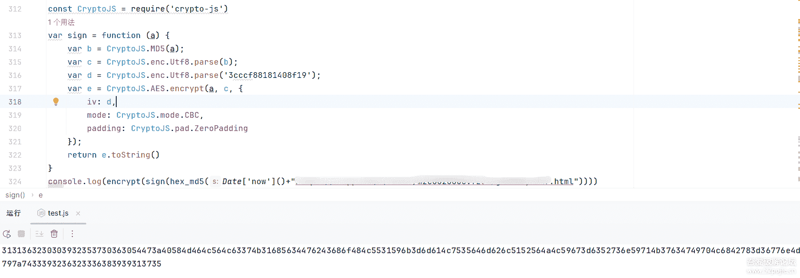

image.png (109.28 KB, 下载次数: 2)

[href="forum.php?mod=attachment&aid=Mjc2OTE3NXw3NWVhZTFlNnwxNzkzNTcxMDYyfDE2ODA4NnwyMDIxOTE1&nothumb=yes" target="_blank"](https://www.52pojie.cn/forum.php?mod=attachment&aid=Mjc2OTE3NXw3NWVhZTFlNnwxNzkzNTcxMDYyfDE2ODA4NnwyMDIxOTE1&nothumb=yes)

2025-4-6 21:16 上传

关键的js代码：

```javascript
function run() {
    encrypted_url = encrypt("原视频地址")
    time = Date['now']()
    encrypted_time = encrypt(time)
    key = encrypt(sign(hex_md5(time+"原视频地址")))
    return [encrypted_url, encrypted_time, key]
}
```

编写主函数：

```python
import requests

import subprocess

from functools import partial

subprocess.Popen = partial(subprocess.Popen, encoding="utf-8")

import execjs

base_url = '请求的网址'

headers = {

    "authority": "",

    "method": "POST",

    "path": "/xmflv.js",

    "scheme": "https",

    "accept": "application/json, text/javascript, */*; q=0.01",

    "accept-encoding": "gzip, deflate, br, zstd",

    "accept-language": "zh-CN,zh;q=0.9",

    "cache-control": "no-cache",

    "content-length": "549",

    "content-type": "application/x-www-form-urlencoded; charset=UTF-8",

    "origin": "",

    "pragma": "no-cache",

    "priority": "u=1, i",

    "sec-ch-ua": "\"Google Chrome\";v=\"131\", \"Chromium\";v=\"131\", \"Not_A Brand\";v=\"24\"",

    "sec-ch-ua-mobile": "?0",

    "sec-ch-ua-platform": "\"Windows\"",

    "sec-fetch-dest": "empty",

    "sec-fetch-mode": "cors",

    "sec-fetch-site": "cross-site",

    "user-agent": "Mozilla/5.0 (Windows NT 10.0; Win64; x64) AppleWebKit/537.36 (KHTML, like Gecko) Chrome/131.0.0.0 Safari/537.36",

}

with open("main.js") as f:

    jscode = f.read()

js = execjs.compile(jscode)

result = js.call("run")

print(result)

payload = {

    'wap': 0,

    'url': result[0],

    'time': result[1],

    'key': result[2]

}

res = requests.post(base_url, headers=headers, data=payload)

print(res.text)
```

运行成功图示：得到的就是我们那个图片以文本文件打开显示的内容

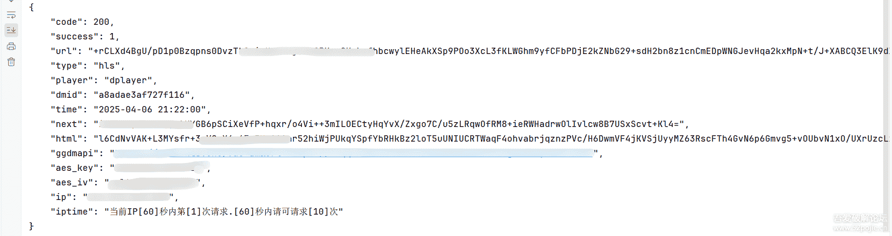

image.png (109.08 KB, 下载次数: 1)

[href="forum.php?mod=attachment&aid=Mjc2OTE3OXw4ZTcyYTllMnwxNzkzNTcxMDYyfDE2ODA4NnwyMDIxOTE1&nothumb=yes" target="_blank"](https://www.52pojie.cn/forum.php?mod=attachment&aid=Mjc2OTE3OXw4ZTcyYTllMnwxNzkzNTcxMDYyfDE2ODA4NnwyMDIxOTE1&nothumb=yes)

2025-4-6 21:22 上传

补充!!!

鉴于评论区一位大佬给出的代码，再结合自己的理解和复现

加密函数:

```javascript
const CryptoJS = require('crypto-js')

function generateRandom13Number() {
    return Math.floor(Math.random() * 9e12) + 1e12;
}

function signCoen(input) {
    const str = generateRandom13Number() + 'TG:@XMFLV' + input + generateRandom13Number();
    return [...str].map(c => c.charCodeAt(0).toString(16).padStart(2, '0')).join('');
}

function encrypt(input_string) {

    char_set = "ABCDEFGHIJKLMNOPQRSTUVWXYZabcdefghijklmnopqrstuvwxyz0123456789-=+"
    random_index = Math['floor']((Math['random']() * 65))
    random_char = char_set[random_index]
    secret_key = '54473a584d464c56'

    hash_key = CryptoJS.MD5(secret_key + random_char)

    hash_key = String(hash_key).substr(random_index % 8, 7);
    input_string = btoa(input_string)

    encrypted_string = ''
    new_index = 0
    hash_index = 0
    for (iIill11l = 0; iIill11l
```

```javascript
const CryptoJS = require('crypto-js')

function decrypt(iliiIiii, ill1lII, iil1IIII) {

    let i1i1i1lI = CryptoJS['AES']['decrypt'](iliiIiii, CryptoJS['enc']['Utf8']['parse'](ill1lII), {

        'iv': CryptoJS['enc']['Utf8']['parse'](iil1IIII),

        'mode': CryptoJS['mode']['CBC'],

        'padding': CryptoJS['pad']['Pkcs7']

    });

    return i1i1i1lI.toString(CryptoJS.enc.Utf8)
}
```


```javascript
}
function run(url, aes_key, aes_iv){
    return decrypt(url, aes_key, aes_iv)
}
```

## 主函数

```python
import json
import requests
import subprocess
from functools import partial
subprocess.Popen = partial(subprocess.Popen, encoding="utf-8")
import execjs

base_url = '请求的网址'

headers = {
    "authority": "",
    "method": "POST",
    "path": "/xmflv.js",
    "scheme": "https",
    "accept": "application/json, text/javascript, */*; q=0.01",
    "accept-encoding": "gzip, deflate, br, zstd",
    "accept-language": "zh-CN,zh;q=0.9",
    "cache-control": "no-cache",
    "content-length": "549",
    "content-type": "application/x-www-form-urlencoded; charset=UTF-8",
    "origin": "",
    "pragma": "no-cache",
    "priority": "u=1, i",
    "sec-ch-ua": "\"Google Chrome\";v=\"131\", \"Chromium\";v=\"131\", \"Not_A Brand\";v=\"24\"",
    "sec-ch-ua-mobile": "?0",
    "sec-ch-ua-platform": "\"Windows\"",
    "sec-fetch-dest": "empty",
    "sec-fetch-mode": "cors",
    "sec-fetch-site": "cross-site",
    "user-agent": "Mozilla/5.0 (Windows NT 10.0; Win64; x64) AppleWebKit/537.36 (KHTML, like Gecko) Chrome/131.0.0.0 Safari/537.36",
}

with open("main.js") as f:
    jscode = f.read()

js = execjs.compile(jscode)

result = js.call("run")
print(result)
payload = {
    'wap': 0,
    'url': result[0],
    'time': result[1],
    'key': result[2]
}

res = requests.post(base_url, headers=headers, data=payload)
print(res.text)
json_data = res.text
json_data = json.loads(json_data)

url = json_data['url']
aes_key = json_data['aes_key']
aes_iv = json_data['aes_iv']

with open("main2.js") as f:
    jscode = f.read()

js = execjs.compile(jscode)

result = js.call("run", url, aes_key, aes_iv)

print(result)
```

整个过程就是这样，有不足之处请各位大佬指出，今天的分享就到这里！
