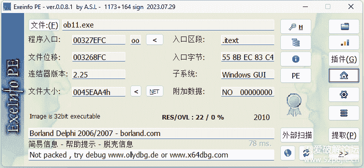
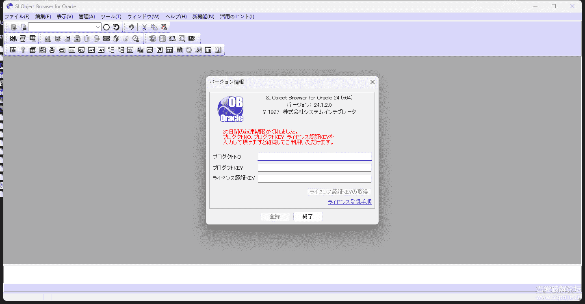
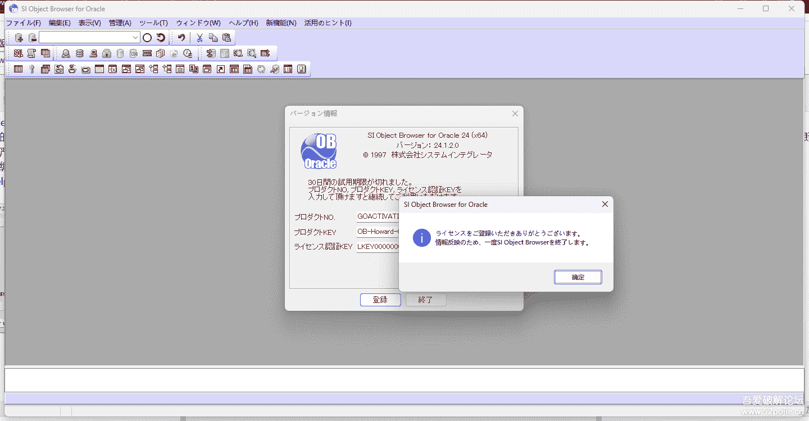

# [原创] SI ObjectBrowser 注册逻辑逆向

- 原帖: https://www.52pojie.cn/forum.php?mod=viewthread&tid=2022797
- 抓取时间: 2026-11-01T22:10:54

SI ObjectBrowser 是一款使用 delphi 编写的 oracle 操作工具，首次接触这个工具是 2007 年，从日本客户手中拿到的，不得不说，性能是真的强，就连后面 oracle 官方出的工具都不行。

这款软件是日本一家公司开发的，曾经也有过中文版，里面广告满天飞。后来查了一下，12 以后再没有官方中文版了，主要是 oracle 本身只适合银行等大型企业，占有率已经明显不如 mysql 和 postgres 了。前两天突然想试试去它的注册逻辑，可能是日本盗版没有那么严重吧，软件几乎没有对注册做任何防护。

本文中提到的内容仅用于对汇编、逆向、注册算法的学习，不提供任何注册破解工具。

本文以 OB11 为例，IDA 对于 delphi2007 的函数解析更精准。

首先，按照惯例，查壳，



`image.png`（81.83 KB，下载次数：1）

<https://www.52pojie.cn/forum.php?mod=attachment&aid=Mjc2OTkwMHxmMjgwOTU2NHwxNzkzNTcxMDUyfDE2ODA4NnwyMDIyNzk3&nothumb=yes>

2025-4-9 17:26 上传

无壳，delphi2006/2007 编写。

打开 IDA，由于整个程序只有一个 `exe`，逻辑全在一个文件里，IDA 加载要一段时间。

加载完搜索 `Tfrm`，这个是 delphi 的界面事件前缀。



`image.png`（70.08 KB，下载次数：0）

<https://www.52pojie.cn/forum.php?mod=attachment&aid=Mjc2OTkwMXw5NmNlNGRjNXwxNzkzNTcxMDUyfDE2ODA4NnwyMDIyNzk3&nothumb=yes>

2025-4-9 17:27 上传

登录按钮事件对应的是 `TfrmRegist_actCommitExecute`

查看 IDA 代码，`F5` 转为 C 代码

[C++] 纯文本查看 复制代码


```
int __usercall TfrmRegist_actCommitExecute@(int a1@, double a2@)
{
  int IsAdmin; // eax
  int v4; // edx
  int v5; // edx
  int v6; // edx
  int v7; // edx
  int v8; // edx
  int v9; // edx
  int v10; // esi
  unsigned __int16 v11; // ax
  int v12; // edx
  int v13; // edx
  int v14; // edx
  int v15; // eax
  int v16; // edx
  int v17; // edx
  void *v19; // [esp-8h] [ebp-98h]
  int v20; // [esp-4h] [ebp-94h]
  void *v21; // [esp-4h] [ebp-94h]
  void *v22; // [esp+0h] [ebp-90h]
  unsigned __int16 v23; // [esp+0h] [ebp-90h]
  void *v24; // [esp+4h] [ebp-8Ch]
  void *v25; // [esp+4h] [ebp-8Ch]
  int v26; // [esp+4h] [ebp-8Ch]
  unsigned __int16 v27; // [esp+4h] [ebp-8Ch]
  int v28; // [esp+4h] [ebp-8Ch]
  void *v29; // [esp+4h] [ebp-8Ch]
  unsigned int v30[2]; // [esp+8h] [ebp-88h] BYREF
  int *v31; // [esp+10h] [ebp-80h]
  void *v32[7]; // [esp+1Ch] [ebp-74h] BYREF
  _TBYTE v33; // [esp+38h] [ebp-58h]
  int v34; // [esp+44h] [ebp-4Ch] BYREF
  int v35; // [esp+48h] [ebp-48h] BYREF
  int System__AnsiString; // [esp+4Ch] [ebp-44h] BYREF
  int v37[4]; // [esp+50h] [ebp-40h] BYREF
  void *v38; // [esp+68h] [ebp-28h] BYREF
  void *v39[5]; // [esp+6Ch] [ebp-24h] BYREF
  double v40; // [esp+80h] [ebp-10h]
  int v41; // [esp+8Ch] [ebp-4h] BYREF
  int savedregs; // [esp+90h] [ebp+0h] BYREF

  v31 = &savedregs;
  v30[1] = (unsigned int)&loc_67C32E;
  v30[0] = (unsigned int)NtCurrentTeb()->NtTib.ExceptionList;
  __writefsdword(0, (unsigned int)v30);
  IsAdmin = TfrmRegist_IsAdmin(a1);
  if ( (_BYTE)IsAdmin )
  {
    if ( (unsigned __int8)sub_52D3BC(*(Controls::TControl **)(a1 + 908)) )
    {
      LOWORD(v5) = 48;
      sub_7179AC((int)&str__v_____N_gNO____1[1], v5);
      *(_DWORD *)(a1 + 0x294) = 0;
      Sysutils::Abort();
    }
    if ( (unsigned __int8)sub_52D3BC(*(Controls::TControl **)(a1 + 912)) )
    {
      LOWORD(v6) = 48;
      sub_7179AC((int)&str__v_____N_gKEY___0[1], v6);
      *(_DWORD *)(a1 + 0x294) = 0;
      Sysutils::Abort();
    }
    if ( (unsigned __int8)sub_52D3BC(*(Controls::TControl **)(a1 + 940)) )
    {
      Controls::TControl::GetText(*(Controls::TControl **)(a1 + 912));
      v24 = v39[4];
      Controls::TControl::GetText(*(Controls::TControl **)(a1 + 908));
      if ( (unsigned __int8)sub_7242FC((int)v39[3], (int)v24) )
      {
        LOWORD(v7) = 48;
        sub_7179AC((int)&str____C_Z___X_F__K_2[1], v7);
        *(_DWORD *)(a1 + 0x294) = 0;
        Sysutils::Abort();
      }
    }
    Controls::TControl::GetText(*(Controls::TControl **)(a1 + 0x390));
    Controls::TControl::GetText(*(Controls::TControl **)(a1 + 0x38C));
    if ( (unsigned __int8)((int (__fastcall *)(int))sub_7245F8)((int)v39[1]) )
    {
      if ( *(_DWORD *)(a1 + 0x3B8) == 1 )
      {
        Controls::TControl::GetText(*(Controls::TControl **)(a1 + 0x390));
        v25 = v39[0];
        sub_722884((int)&v38);
        v22 = v38;
        v20 = System::__linkproc__ LStrClr(&v41);
        Controls::TControl::GetText(*(Controls::TControl **)(a1 + 0x38C));
        Controls::TControl::GetText(*(Controls::TControl **)(a1 + 0x3AC));
        if ( (unsigned __int8)((int (__stdcall *)(int, void *, void *))sub_72307C)(v20, v22, v25) )
        {
          Controls::TControl::GetText(*(Controls::TControl **)(a1 + 0x390));
          if ( sub_7242A8(v37[3]) )
          {
            Controls::TControl::GetText(*(Controls::TControl **)(a1 + 0x390));
            v26 = v37[2];
            Controls::TControl::GetText(*(Controls::TControl **)(a1 + 0x38C));
            if ( !(unsigned __int8)sub_7242FC(v37[1], v26) )
            {
              Controls::TControl::GetText(*(Controls::TControl **)(a1 + 912));
              v10 = sub_724208(v37[0]);
              sub_703160((int)&System__AnsiString);
              v27 = Sysutils::StrToIntDef(System__AnsiString, 0);
              sub_703160((int)&v35);
              v23 = Sysutils::StrToIntDef(v35, 0);
              sub_703160((int)&v34);
              v11 = Sysutils::StrToIntDef(v34, 0);
              Sysutils::EncodeDate(v11, v23, v27);
              v40 = a2;
              Sysutils::Now();
              if ( a2 > v40 )
              {
                LOWORD(v12) = 64;
                sub_7179AC((int)&str_______C_Z___X_[1], v12);
                *(_DWORD *)(a1 + 0x294) = 0;
                Sysutils::Abort();
              }
              Sysutils::IncMonth(-v10, v12);
              a2 = a2 - 1.0;
              *(double *)&v33 = a2;
              Sysutils::Now();
              if ( *(double *)&v33 > a2 )
              {
                LOWORD(v13) = 64;
                sub_7179AC((int)&str__V_X_e_____t_[1], v13);
                *(_DWORD *)(a1 + 0x294) = 0;
                Sysutils::Abort();
              }
            }
          }
          Controls::TControl::GetText(*(Controls::TControl **)(a1 + 0x390));
          v28 = sub_7242A8((int)v32[6]) != 0;
          Controls::TControl::GetText(*(Controls::TControl **)(a1 + 0x3AC));
          if ( (unsigned __int8)sub_7235B8((unsigned int)v32[5], v28) )
          {
            Controls::TControl::GetText(*(Controls::TControl **)(a1 + 0x390));
            v29 = v32[4];
            Controls::TControl::GetText(*(Controls::TControl **)(a1 + 0x38C));
            if ( !(unsigned __int8)sub_7242FC((int)v32[3], (int)v29) )
            {
              LOWORD(v14) = 64;
              sub_7179AC((int)&str_______C_Z___X__0[1], v14);
              *(_DWORD *)(a1 + 660) = 0;
              Sysutils::Abort();
            }
          }
          Sysutils::Now();
          Controls::TControl::GetText(*(Controls::TControl **)(a1 + 0x3AC));
          v21 = v32[2];
          Controls::TControl::GetText(*(Controls::TControl **)(a1 + 0x390));
          v19 = v32[1];
          Controls::TControl::GetText(*(Controls::TControl **)(a1 + 0x38C));
          v15 = sub_721E54(v32[0], v19, (int)v21, HIDWORD(*(unsigned __int64 *)&a2), SLODWORD(a2));
          if ( (_BYTE)v15 )
          {
            Sysutils::Now();
            sub_723ECC(LODWORD(a2), HIDWORD(*(unsigned __int64 *)&a2));
            LOWORD(v17) = 64;
            sub_7179AC((int)&str____C_Z___X_o____0[1], v17);
            *(_DWORD *)(a1 + 0x294) = 1;
          }
          else
          {
            LOBYTE(v15) = 1;
            if ( sub_720E78(v15) )
            {
              LOWORD(v16) = 48;
              sub_7179AC((int)&str__G______________3[1], v16);
            }
            else
            {
              LOWORD(v16) = 48;
              sub_7179AC((int)&str__G______________4[1], v16);
            }
            *(_DWORD *)(a1 + 0x294) = 0;
            Sysutils::Abort();
          }
        }
        else
        {
          LOWORD(v9) = 48;
          sub_7179AC((int)&str____C_Z___X_F__K_3[1], v9);
          *(_DWORD *)(a1 + 660) = 0;
          Sysutils::Abort();
        }
      }
    }
    else
    {
      LOWORD(v8) = 48;
      sub_7179AC((int)&str_______________23[1], v8);
      *(_DWORD *)(a1 + 660) = 0;
      Sysutils::Abort();
    }
  }
  else
  {
    LOBYTE(IsAdmin) = 1;
    if ( sub_720E78(IsAdmin) )
    {
      LOWORD(v4) = 48;
      sub_7179AC((int)&str_____________8[1], v4);
    }
    else
    {
      LOWORD(v4) = 48;
      sub_7179AC((int)&str_____________9[1], v4);
    }
  }
  __writefsdword(0, v30[0]);
  v31 = (int *)&loc_67C335;
  System::__linkproc__ LStrArrayClr(v32, 7);
  System::__linkproc__ LStrArrayClr(&v34, 3);
  System::__linkproc__ LStrArrayClr(v37, 6);
  System::__linkproc__ LStrClr(&v38);
  System::__linkproc__ LStrArrayClr(v39, 5);
  return System::__linkproc__ LStrClr(&v41);
}
```

代码内容比较多，`sub_52D3BC`是检查界面输入是否为空，`sub_7179AC`为弹窗，可以理解为`MessageBox`，其它接口下面具体分析。

## 分析上面代码逻辑：

1. 检测当前登录用户是否是管理员，如果不是则报错。
2. 检查`ProductNo`、`ProductKey`是否为空，为空则报错
3. 检查`License認証Key`是否为空，为空时调用`sub_7242FC`，如果返回1则报错。`sub_7242FC`的逻辑会在后面说明
4. 调用`sub_7245F8`，返回0则报错，逻辑在后面会详细说明
5. 调用`sub_722884`获取硬件信息，后面详细说明
6. 调用`sub_72307C`校验`license`
7. 注册信息写入注册表

## 接下来，我们看一下`sub_7245F8`的逻辑

```
int __fastcall sub_7245F8(int System::AnsiString, int a2)
{
  char v3; // zf
```


## 反编译代码

```c
int v4; // ecx
int v5; // eax
int v6; // esi
int v7; // ebx
unsigned __int8 v8; // al
int v9; // eax
int v10; // eax
int v11; // eax
__int64 v12; // rax
int v13; // eax
int v14; // esi
int v15; // ebx
int v17; // [esp-14h] [ebp-64h]
void *v18; // [esp-10h] [ebp-60h]
void *v19; // [esp-10h] [ebp-60h]
char v20; // [esp-10h] [ebp-60h]
unsigned int v21[2]; // [esp-Ch] [ebp-5Ch] BYREF
int *v22; // [esp-4h] [ebp-54h]
int v23; // [esp+8h] [ebp-48h] BYREF
int System__AnsiString[4]; // [esp+Ch] [ebp-44h] BYREF
void *v25[3]; // [esp+1Ch] [ebp-34h] BYREF
void *v26; // [esp+28h] [ebp-28h] BYREF
int v27[3]; // [esp+2Ch] [ebp-24h] BYREF
int v28; // [esp+38h] [ebp-18h]
unsigned __int8 v29; // [esp+3Fh] [ebp-11h]
int v30; // [esp+40h] [ebp-10h]
int v31; // [esp+44h] [ebp-Ch] BYREF
int v32[2]; // [esp+48h] [ebp-8h]
int savedregs; // [esp+50h] [ebp+0h] BYREF

v30 = a2;
v22 = &savedregs;
v21[1] = (unsigned int)&loc_724867;
v21[0] = (unsigned int)NtCurrentTeb()->NtTib.ExceptionList;
__writefsdword(0, (unsigned int)v21);
v29 = 0;
Sysutils::Trim(System::AnsiString);

if ( v27[2] )
{
    Sysutils::Trim(v30);
    if ( v27[1] )
    {
        System::__linkproc__ LStrCopy(v27);
        System::__linkproc__ LStrCmp(v27[0], &str_OB__1[1]);
        if ( v3 )
        {
            v32[0] = 0;
            v32[1] = 0;
            v28 = 0;
            if ( sub_7242A8(v30) )
                System::__linkproc__ LStrCatN(&v31, 3, v4, "OB-del2007ent", "ohm");
            else
                System::__linkproc__ LStrCatN(&v31, 3, v4, "OB11-del2009ent", "usj");
            v5 = v31;
            if ( v31 )
                v5 = *(_DWORD *)(v31 - 4);
            v6 = v5;
            if ( v5 > 0 )
            {
                v7 = 1;
                do
                {
                    v8 = *(_BYTE *)(v31 + v7 - 1);
                    *((_BYTE *)v32 + v7 % 8) ^= v8;
                    v28 += v8;
                    ++v7;
                    --v6;
                }
                while ( v6 );
            }
            v9 = System::__linkproc__ LStrCopy(&v31);
            sub_7222AC(v9);
            v10 = sub_722230(v31);
            Sysutils::IntToHex(v10, 2);
            v18 = v25[2];
            Sysutils::IntToHex(v28 % 256, 2);
            sub_722E8C(v25[1], v18, &v26);
            v19 = v26;
            v11 = sub_722230(v31);
            Sysutils::IntToHex(v11, 4);
            v17 = System__AnsiString[3];
            v12 = System::__linkproc__ _llmod(0, 256);
            Sysutils::IntToHex(v12, 10);
            sub_722E8C(System__AnsiString[2], v17, v25);
            System::__linkproc__ LStrCat3((int)&v31, v25[0], v19);
            v13 = v31;
            if ( v31 )
                v13 = *(_DWORD *)(v31 - 4);
            v14 = v13;
            if ( v13 > 0 )
            {
                v15 = 1;
                do
                {
                    if ( !(v15 % 3) )
                    {
                        unknown_libname_72(System__AnsiString, *(unsigned __int8 *)(v31 + v15 - 1));
                        Sysutils::LowerCase(System__AnsiString[0]);
                        v20 = *(_BYTE *)System__AnsiString[1];
                        *(_BYTE *)(j_unknown_libname_77_0(&v31) + v15 - 1) = v20;
                    }
                    ++v15;
                    --v14;
                }
                while ( v14 );
            }
            System::__linkproc__ LStrInsert(&str___441[1]);
            System::__linkproc__ LStrCopy(&v23);
            System::__linkproc__ LStrCmp(v23, v31);
            if ( v3 )
                v29 = 1;
        }
    }
}

__writefsdword(0, v21[0]);
v22 = (int *)&loc_72486E;
System::__linkproc__ LStrArrayClr(&v23, 12);
System::__linkproc__ LStrClr(&v31);
return v29;
}
```

## 具体逻辑

1、`ProductKey` 需要以 `OB-` 开头。

2、调用 `sub_7242A8`，判断 `OB-` 后面的第 4-6 位是否是数字，是数字则为旧版本，新旧版本拼接字符串不同，我们以新版本为例，拼接字符串即为 `"OB11-del2009ent" + ProductNo + "usj"`。

3、拼接后的字符串间隔 8 位做异或运算，结果保存在 2-1 位。并加算每一位的和，结果保留最低 1 字节，C 代码如下：

```c
int isNumber = is_numeric(Key + 6, 3);
    size_t FullKeyLen = strlen(KeyBase[isNumber]) + strlen(No) + 3;
    char *FullKey = (char*)malloc(FullKeyLen + 1);
    memset(FullKey, 0, FullKeyLen + 1);

    sprintf_s(FullKey, FullKeyLen + 1, "%s%s%s", KeyBase[isNumber], No, TailFlag[isNumber]);
    unsigned char FullKeyCalcResult[8] = { 0 };
    unsigned char FullKeySumResult = 0;
    for (size_t i = 0; i
```

```c
unsigned char realKey[6] = { 0 };

    memcpy(realKey, Key + 3, 6);

    int KeyCalcResult = 0;

    for (int i = 0; i
```

```c
char KeyTable[]  = "ABCDEFGHIJKLMNOPQRSTUVWXYZ1234567890";
    char KeyTable2[] = "T6ERUB7391GW8Q04YZ5KDICA2FMXSVLPHNOJ";
```

6、4 的计算结果按 2、3、4、1 字节顺序在 `KeyTable` 中查表，找到位置 2

7、位置 1 + 位置 2，如果大于 36 则减去 36，并找到此位置在 `KeyTable` 对应的字符，共 12 字节。

8、7 中得到的字符串，按 3 的倍数位转为小写字符，并在第 6 位后面插入 `'-'`

9、8 中得到的 13 字节字符串，与 `Key` 中的第 7 位开始做比较，若不同，则报错。

`sub_722884` 的具体逻辑转为 C 代码如下：

```c
DWORD LogicalDrivesFlags = GetLogicalDrives();

    LogicalDrivesFlags = LogicalDrivesFlags
```


```
int __userpurge sub_72307C@(
        int a1@,
        int a2@,
        __int32 a3@,
        int a4@,
        int a5@,
        volatile __int32 *a6,
        void *a7,
        void *a8)
{
  char v9; // zf
  int v10; // eax
  int v11; // eax
  int v12; // eax
  int v14; // [esp-10h] [ebp-80h]
  unsigned int v15[2]; // [esp-Ch] [ebp-7Ch] BYREF
  int *v16; // [esp-4h] [ebp-74h]
  int v17; // [esp+4h] [ebp-6Ch] BYREF
  unsigned int v18; // [esp+8h] [ebp-68h] BYREF
  int v19; // [esp+Ch] [ebp-64h] BYREF
  unsigned int v20; // [esp+10h] [ebp-60h] BYREF
  int v21; // [esp+14h] [ebp-5Ch] BYREF
  int v22; // [esp+18h] [ebp-58h] BYREF
  int v23; // [esp+1Ch] [ebp-54h] BYREF
  int v24; // [esp+20h] [ebp-50h] BYREF
  int v25; // [esp+24h] [ebp-4Ch] BYREF
  int v26; // [esp+28h] [ebp-48h] BYREF
  int v27; // [esp+2Ch] [ebp-44h] BYREF
  int v28; // [esp+30h] [ebp-40h] BYREF
  int v29; // [esp+34h] [ebp-3Ch] BYREF
  int v30; // [esp+38h] [ebp-38h] BYREF
  int v31; // [esp+3Ch] [ebp-34h] BYREF
  int v32; // [esp+40h] [ebp-30h] BYREF
  int v33; // [esp+44h] [ebp-2Ch] BYREF
  int v34; // [esp+48h] [ebp-28h] BYREF
  unsigned int v35; // [esp+4Ch] [ebp-24h] BYREF
  void *v36; // [esp+50h] [ebp-20h] BYREF
  void *v37; // [esp+54h] [ebp-1Ch] BYREF
  unsigned int v38; // [esp+58h] [ebp-18h] BYREF
  int v39; // [esp+5Ch] [ebp-14h] BYREF
  int v40; // [esp+60h] [ebp-10h] BYREF
  char v41[4]; // [esp+64h] [ebp-Ch] BYREF
  int v42; // [esp+68h] [ebp-8h]
  int System__AnsiString; // [esp+6Ch] [ebp-4h] BYREF
  int savedregs; // [esp+70h] [ebp+0h] BYREF

  v42 = _InterlockedExchange(&System__AnsiString, a3);
  System__AnsiString = a2;
  System::__linkproc__ LStrAddRef(a2);
  System::__linkproc__ LStrAddRef(v42);
  System::__linkproc__ LStrAddRef(a8);
  System::__linkproc__ LStrAddRef(a7);
  if ( a6 )
    *a6 = 0;
  v16 = &savedregs;
  v15[1] = (unsigned int)&loc_723387;
  v15[0] = (unsigned int)NtCurrentTeb()->NtTib.ExceptionList;
  __writefsdword(0, (unsigned int)v15);
  if ( (unsigned __int8)sub_7242FC(v42, (int)a8) )
  {
    sub_7222AC();
    System::__linkproc__ LStrCopy(System__AnsiString, 1, 4, (int)v41);
    if ( (a1 != 1 || (System::__linkproc__ LStrCmp(*(unsigned int *)v41, (unsigned int)&str_LKEY[1]), v9))
      && (a1 || (System::__linkproc__ LStrCmp(*(unsigned int *)v41, (unsigned int)&str_DKEY[1]), v9)) )
    {
      Sysutils::StringReplace(System__AnsiString, (int)&str___436[1], 0, a1, a4, a5, (int)v41, 1);
      System::__linkproc__ LStrCopy(*(int *)v41, 5, 4, (int)&v40);
      System::__linkproc__ LStrCopy(*(int *)v41, 9, 4, (int)&v39);
      System::__linkproc__ LStrCopy(*(int *)v41, 13, 4, (int)&v38);
      System::__linkproc__ LStrCopy(*(int *)v41, 17, 4, (int)&v37);
      System::__linkproc__ LStrCopy(*(int *)v41, 21, 4, (int)&v36);
      System::__linkproc__ LStrCopy(*(int *)v41, 25, 4, (int)&v35);
      System::__linkproc__ LStrLAsg(&v34, &str_ACTIVATION[1]);
      sub_722D68(v38, &v32);
      sub_722F90(v32, v39, &v33);
      System::__linkproc__ LStrLAsg(&v38, v33);
      sub_722D68(v37, &v30);
      sub_722F90(v30, v39, &v31);
      System::__linkproc__ LStrLAsg(&v37, v31);
      sub_722D68(v36, &v28);
      sub_722F90(v28, v39, &v29);
      System::__linkproc__ LStrLAsg(&v36, v29);
      sub_722D68(v35, &v26);
      sub_722F90(v26, v40, &v27);
      System::__linkproc__ LStrLAsg(&v35, v27);
      sub_722D68(v39, &v24);
      sub_722F90(v24, v40, &v25);
      System::__linkproc__ LStrLAsg(&v39, v25);
      v10 = sub_722230(v34);
      Sysutils::IntToHex(abs32(v10), 4u, (int)&v22);
      v14 = v22;
      sub_722D68(v40, &v21);
      sub_722F90(v21, v14, &v23);
      System::__linkproc__ LStrLAsg(&v40, v23);
      System::__linkproc__ LStrCat3((int)&v19, a8, a7);
      v11 = sub_722230(v19);
      Sysutils::IntToHex(abs32(v11), 4u, (int)&v20);
      System::__linkproc__ LStrCmp(v38, v20);
      if ( v9 )
      {
        System::__linkproc__ LStrCat3((int)&v17, v37, v36);
        v12 = sub_722230(v17);
        Sysutils::IntToHex(abs32(v12), 4u, (int)&v18);
        System::__linkproc__ LStrCmp(v35, v18);
        if ( v9 )
        {
          System::__linkproc__ LStrCat3((int)a6, v37, v36);
          LOBYTE(a1) = 1;
        }
        else
        {
          a1 = 0;
        }
      }
      else
      {
        a1 = 0;
      }
    }
    else
    {
      a1 = 0;
    }
  }
  else
  {
    System::__linkproc__ LStrAsg(a6, (__int32)&str_99991231_0[1]);
    LOBYTE(a1) = 1;
  }
  __writefsdword(0, v15[0]);
  v16 = (int *)&loc_72338E;
  System::__linkproc__ LStrArrayClr(&v17, 27);
  System::__linkproc__ LStrArrayClr(&a7, 2);
  return a1;
}
```

1、调用`sub_7242FC`判断是否需要检查License，应该是为了兼容旧版本吧，`sub_7242FC`简单来说就是如果`ProductNo`是`GOACTIVATION`返回1，如果是`NOACTIVATION`返回0，如果`Key`的前6字节是`OB-999`返回0，如果`Key`前7字节是`OBR-999`返回0.

2、`sub_7242FC`返回0则不校验license，有效期到9999/12/31，如果返回1，校验license.

3、license校验逻辑比较多`sub_722D68`、`sub_722F90`、`sub_722D68`的组合，简单来说就是查表进行字符转换，`sub_722D68`是找`KeyTable2`中的位置，`sub_722F90`是找`KeyTable`中的位置。

4、license必须是`LKEY`开头或`DKEY`开头，去掉'-'.

5、去掉'-'后，license共计28字节。

6、license第13-16字节按1、2、3、4字节顺序从`KeyTable2`中查表并分别减去license第9-12字节按2、3、4、1的顺序从`KeyTable`中查表得到的位置做差，如果差



image.png (87.01 KB, 下载次数: 2)

[href="forum.php?mod=attachment&aid=Mjc2OTkwMnw4M2RlMDZiZHwxNzkzNTcxMDUyfDE2ODA4NnwyMDIyNzk3&nothumb=yes" target="_blank"](https://www.52pojie.cn/forum.php?mod=attachment&aid=Mjc2OTkwMnw4M2RlMDZiZHwxNzkzNTcxMDUyfDE2ODA4NnwyMDIyNzk3&nothumb=yes)

2025-4-9 17:27 上传
