# [Web逆向] 某房指数一个简单的aes加解密。

- 原帖：https://www.52pojie.cn/forum.php?mod=viewthread&tid=2023597
- 抓取时间：2026-11-01T22:10:46

本文章中所有内容仅供学习交流，抓包内容、敏感网址、数据接口均已做脱敏处理，严禁用于商业用途和非法用途，否则由此产生的一切后果均与作者无关，若有侵权，请联系我立即删除！

## 目标与网站

目标：请求参数`signcode`，和请求结果`data`。

网站：`aHR0cDovL3d3dy5jY2hpbmRleC5jb20vSG9tZS9pbmRleA==`

## 分析过程

### 1. 观察请求与响应

先看一下控制台响应数据，发现所有请求参数都是一个`signCode`，还是加密后的结果，对应结果中数据`data`也是一样，不同的数据加密后的字符串长度不同。（可以大胆的猜测一下对称加密，常见的对称加密aes,des等，sm4也是一个对称加密算法，说不定就是其中一个呢）

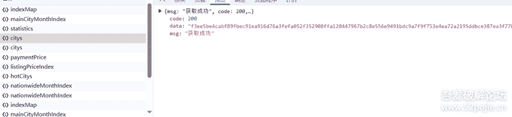

`image.png` (52.11 KB, 下载次数: 1) 附件：[下载](https://www.52pojie.cn/forum.php?mod=attachment&aid=Mjc3MDQ1Mnw0YmM3YjhkOXwxNzkzNTcxMDQ0fDE2ODA4NnwyMDIzNTk3&nothumb=yes) 2025-4-12 14:27 上传

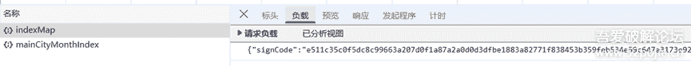

`image.png` (36.77 KB, 下载次数: 1) 附件：[下载](https://www.52pojie.cn/forum.php?mod=attachment&aid=Mjc3MDQ1M3xlMmU1NGI4OXwxNzkzNTcxMDQ0fDE2ODA4NnwyMDIzNTk3&nothumb=yes) 2025-4-12 14:28 上传

### 2. 定位 `signCode` 生成位置

像这种加密后的字符串，可以直接hook住`JSON`中的`parse()`和`stringify()`，还是很好用的。也可以直接搜索关键字`signCode`，只有三个，数量比较少，后面两个可以直接添加断点。

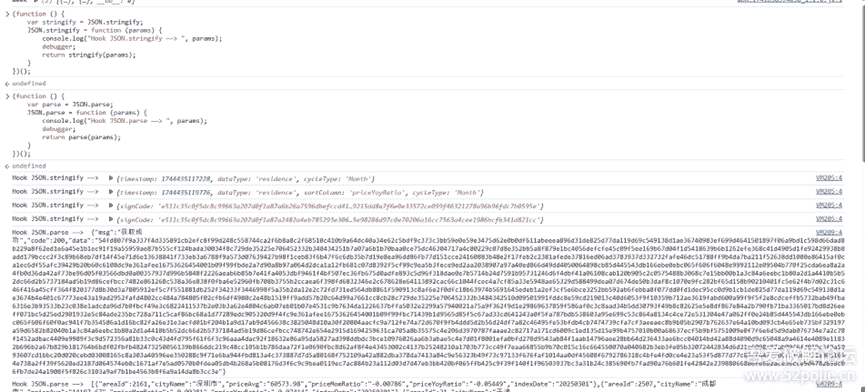

`image.png` (324.92 KB, 下载次数: 1) 附件：[下载](https://www.52pojie.cn/forum.php?mod=attachment&aid=Mjc3MDQ1NHw0YzU5MWYwZnwxNzkzNTcxMDQ0fDE2ODA4NnwyMDIzNTk3&nothumb=yes) 2025-4-12 14:28 上传

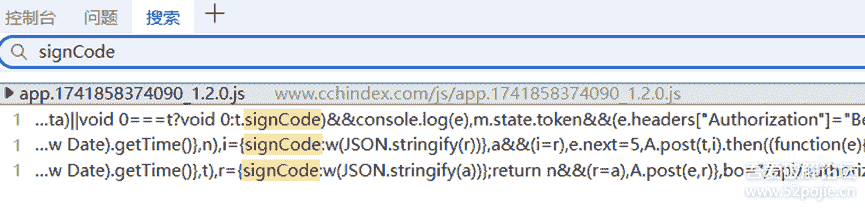

`image.png` (115.57 KB, 下载次数: 1) 附件：[下载](https://www.52pojie.cn/forum.php?mod=attachment&aid=Mjc3MDQ1NXwxYjEwMTE3NXwxNzkzNTcxMDQ0fDE2ODA4NnwyMDIzNTk3&nothumb=yes) 2025-4-12 14:28 上传

用hook和关键字搜索都可以定位到`signCode`生成的地方`w(JSON.stringify(r))`，打印一下值看看结果。

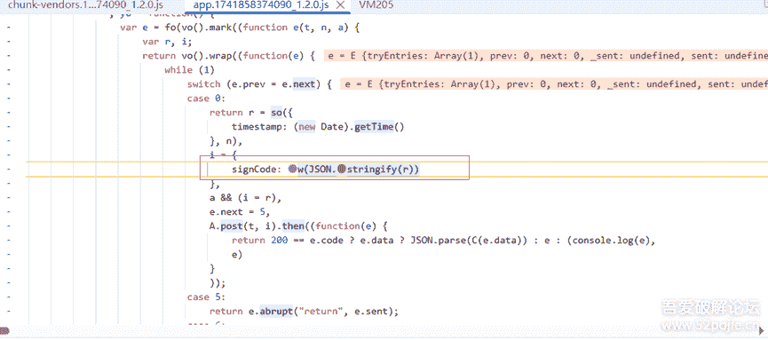

`image.png` (98.59 KB, 下载次数: 0) 附件：[下载](https://www.52pojie.cn/forum.php?mod=attachment&aid=Mjc3MDQ2MHxmNjgwMGM5NHwxNzkzNTcxMDQ0fDE2ODA4NnwyMDIzNTk3&nothumb=yes) 2025-4-12 14:30 上传

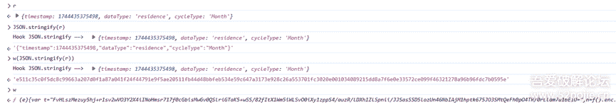

`image.png` (65.81 KB, 下载次数: 1) 附件：[下载](https://www.52pojie.cn/forum.php?mod=attachment&aid=Mjc3MDQ2MXwxODlhMzk1NnwxNzkzNTcxMDQ0fDE2ODA4NnwyMDIzNTk3&nothumb=yes) 2025-4-12 14:30 上传

加密过程就在`w`这个函数中实现的，我们直接进入到这个函数中看看发生了什么。

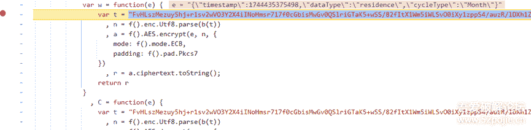

`image.png` (80.37 KB, 下载次数: 1) 附件：[下载](https://www.52pojie.cn/forum.php?mod=attachment&aid=Mjc3MDQ2MnwyMmUxZTVhZXwxNzkzNTcxMDQ0fDE2ODA4NnwyMDIzNTk3&nothumb=yes) 2025-4-12 14:30 上传

### 3. 分析加密函数 `w`

在函数`w`中，传入一个参数`e`，然后定义了一个字符串变量`t`，在下面可以看到这是一个aes加密的js代码，使用ECB (Electronic Codebook) 模式，PKCS#7填充。`e`是需要加密的字符串，`n`是`key`转换后的`words`数据，其中`b(t)`的结果就是`key`（函数`b`就在`w`上面，是一个rsa解密的，有兴趣的可以看一下）。根据这些条件随便找一个aes在线加解密网站测试一下。可以看到结果是一样的。

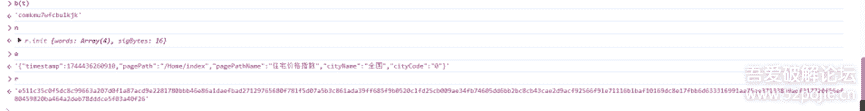

`image.png` (34.75 KB, 下载次数: 0) 附件：[下载](https://www.52pojie.cn/forum.php?mod=attachment&aid=Mjc3MDQ2M3w3ZDMzM2Q3Y3wxNzkzNTcxMDQ0fDE2ODA4NnwyMDIzNTk3&nothumb=yes) 2025-4-12 14:31 上传

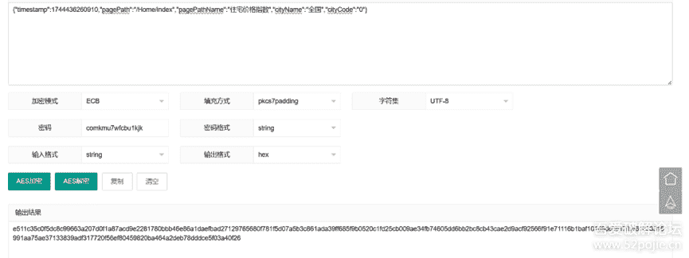

`image.png` (66.44 KB, 下载次数: 0) 附件：[下载](https://www.52pojie.cn/forum.php?mod=attachment&aid=Mjc3MDQ2NHw5OTVmMjI4OXwxNzkzNTcxMDQ0fDE2ODA4NnwyMDIzNTk3&nothumb=yes) 2025-4-12 14:31 上传

### 4. 解密函数与代码验证

同样的解密函数也是一样，就在`w`的下面。函数`C`。搞懂所有思路的就可以上代码测试了，直接扣js代码，在`node`环境`CryptoJS`加密库或者直接使用`python`里面的`Crypto`都可以。我这直接使用`python`代码了。测试了一下没有什么问题，至此可以结束了，感谢观看。

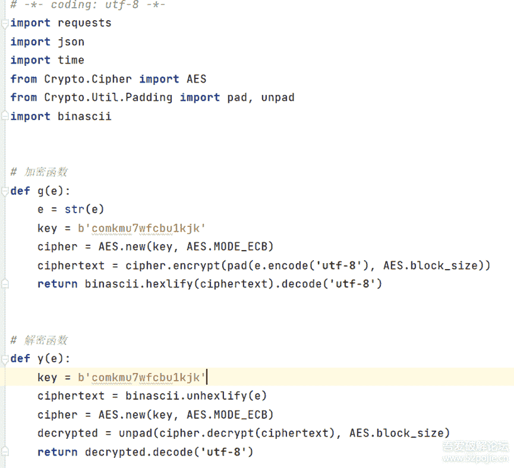

`image.png` (186.46 KB, 下载次数: 1) 附件：[下载](https://www.52pojie.cn/forum.php?mod=attachment&aid=Mjc3MDQ2NXw3ZDA2NzU5MXwxNzkzNTcxMDQ0fDE2ODA4NnwyMDIzNTk3&nothumb=yes) 2025-4-12 14:32 上传

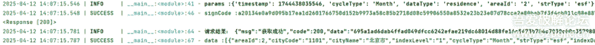

`image.png` (71.17 KB, 下载次数: 0) 附件：[下载](https://www.52pojie.cn/forum.php?mod=attachment&aid=Mjc3MDQ2N3w2OTJmYmI2N3wxNzkzNTcxMDQ0fDE2ODA4NnwyMDIzNTk3&nothumb=yes) 2025-4-12 14:32 上传
