# [.NET逆向] 手把手教你破解Listary最新版V6.3.2.88Pro无弹窗~

- 原帖: https://www.52pojie.cn/forum.php?mod=viewthread&tid=2025340
- 抓取时间: 2026-11-01T22:10:32

## 第一步：工具准备

- Listary v6.3.2.88

Listary官网下载地址：https://www.listary.com/

下载后正常安装即可，我这边是安装到`D:\Program Files\Listary`

- dnSpy v6.1.8

https://github.com/dnSpy/dnSpy/releases/tag/v6.1.8

下载：`dnSpy-net-win64.zip`

解压到某个目录下即可。

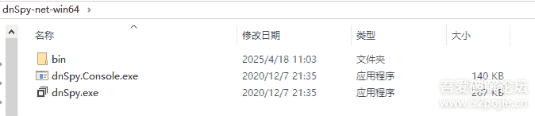

001.png (17.77 KB, 下载次数: 4)

[href="forum.php?mod=attachment&aid=Mjc3MjIxNnw5ZjQ1MzFkM3wxNzkzNTcxMDI5fDE2ODA4NnwyMDI1MzQw&nothumb=yes" target="_blank"](https://www.52pojie.cn/forum.php?mod=attachment&aid=Mjc3MjIxNnw5ZjQ1MzFkM3wxNzkzNTcxMDI5fDE2ODA4NnwyMDI1MzQw&nothumb=yes)

2025-4-18 13:38 上传

- de4dot v3.2.0.0

下载地址：https://github.com/kant2002/de4dot/releases/tag/v3.2.0

下载：`de4dot-net8.0-winx64.zip`

解压到某个目录下即可。

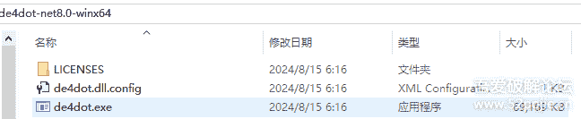

002.png (19.12 KB, 下载次数: 5)

[href="forum.php?mod=attachment&aid=Mjc3MjIxN3xiNjQyNmE4NXwxNzkzNTcxMDI5fDE2ODA4NnwyMDI1MzQw&nothumb=yes" target="_blank"](https://www.52pojie.cn/forum.php?mod=attachment&aid=Mjc3MjIxN3xiNjQyNmE4NXwxNzkzNTcxMDI5fDE2ODA4NnwyMDI1MzQw&nothumb=yes)

2025-4-18 13:38 上传

## 第二步：反混淆

- 将安装目录下的`D:\Program Files\Listary\Listary.exe`直接拖到`de4dot.exe`上

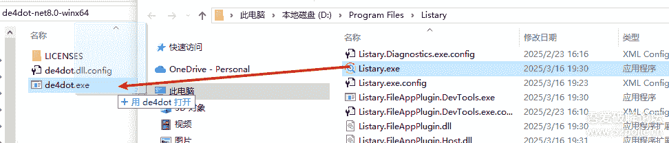

003.png (49.28 KB, 下载次数: 3)

[href="forum.php?mod=attachment&aid=Mjc3MjIxOHw3YWQ5YWQ1MHwxNzkzNTcxMDI5fDE2ODA4NnwyMDI1MzQw&nothumb=yes" target="_blank"](https://www.52pojie.cn/forum.php?mod=attachment&aid=Mjc3MjIxOHw3YWQ5YWQ1MHwxNzkzNTcxMDI5fDE2ODA4NnwyMDI1MzQw&nothumb=yes)

2025-4-18 13:38 上传

- 这时会在安装目录下生成`Listary-cleaned.exe`

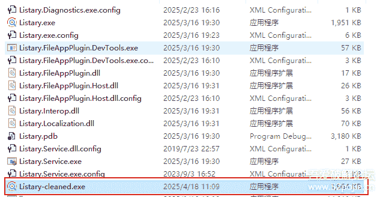

004.png (57.14 KB, 下载次数: 5)

[href="forum.php?mod=attachment&aid=Mjc3MjIxOXxkNmZjMzcxN3wxNzkzNTcxMDI5fDE2ODA4NnwyMDI1MzQw&nothumb=yes" target="_blank"](https://www.52pojie.cn/forum.php?mod=attachment&aid=Mjc3MjIxOXxkNmZjMzcxN3wxNzkzNTcxMDI5fDE2ODA4NnwyMDI1MzQw&nothumb=yes)

2025-4-18 13:38 上传

- 重命名下文件

`Listary.exe` => `Listary0.exe`  
`Listary-cleaned.exe` => `Listary.exe`

## 第三步：修改代码

- 打开`dnSpy.exe`，将`Listary.exe`拖到dnSpy程序集资源管理器窗口中

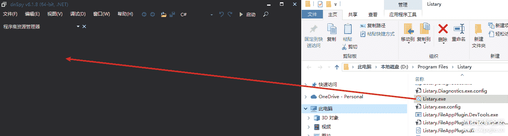

005.png (70.17 KB, 下载次数: 4)

[href="forum.php?mod=attachment&aid=Mjc3MjIyMHxjZjc0YmJiMHwxNzkzNTcxMDI5fDE2ODA4NnwyMDI1MzQw&nothumb=yes" target="_blank"](https://www.52pojie.cn/forum.php?mod=attachment&aid=Mjc3MjIyMHxjZjc0YmJiMHwxNzkzNTcxMDI5fDE2ODA4NnwyMDI1MzQw&nothumb=yes)

2025-4-18 13:38 上传

- 修改`Listary.Core.Pro/LicenseChecker`，修改1个地方

进入`Listary.Core.Pro`，`LicenseChecker`鼠标右键`CheckLicense`，选择编辑方法

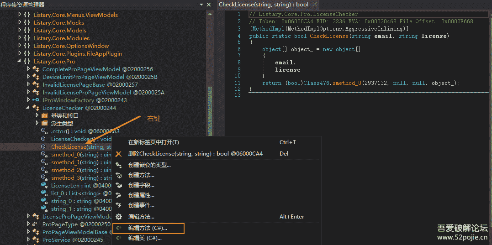

006.png (90.26 KB, 下载次数: 2)

[href="forum.php?mod=attachment&aid=Mjc3MjIyMXxiMWExMjIyMHwxNzkzNTcxMDI5fDE2ODA4NnwyMDI1MzQw&nothumb=yes" target="_blank"](https://www.52pojie.cn/forum.php?mod=attachment&aid=Mjc3MjIyMXxiMWExMjIyMHwxNzkzNTcxMDI5fDE2ODA4NnwyMDI1MzQw&nothumb=yes)

2025-4-18 13:38 上传

将方法`CheckLicense()`函数内容修改为如下，点击右下角的编译

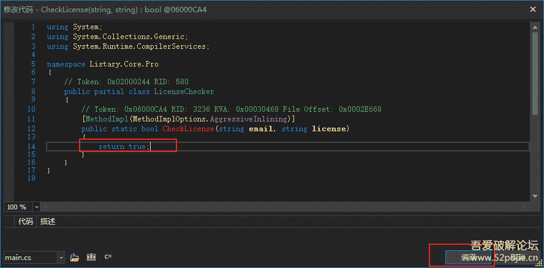

007.png (25.33 KB, 下载次数: 5)

[href="forum.php?mod=attachment&aid=Mjc3MjIyMnw2Y2Q1N2E1OHwxNzkzNTcxMDI5fDE2ODA4NnwyMDI1MzQw&nothumb=yes" target="_blank"](https://www.52pojie.cn/forum.php?mod=attachment&aid=Mjc3MjIyMnw2Y2Q1N2E1OHwxNzkzNTcxMDI5fDE2ODA4NnwyMDI1MzQw&nothumb=yes)

2025-4-18 13:38 上传

- 修改`Listary.Core.Pro/LicenseProPageViewModel`，修改1个地方

在`LicenseChecker`底下还有个`LicenseProPageViewModel`，同样右键`CheckLicense()`选择编辑方法

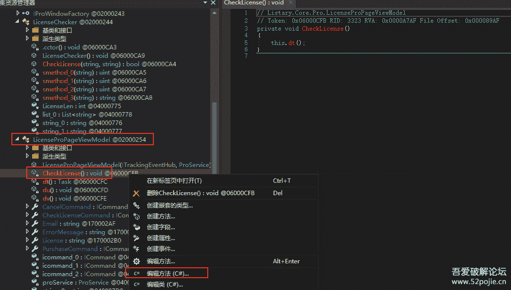

008.png (97.25 KB, 下载次数: 4)

[href="forum.php?mod=attachment&aid=Mjc3MjIyM3w5NmI2Zjc3ZXwxNzkzNTcxMDI5fDE2ODA4NnwyMDI1MzQw&nothumb=yes" target="_blank"](https://www.52pojie.cn/forum.php?mod=attachment&aid=Mjc3MjIyM3w5NmI2Zjc3ZXwxNzkzNTcxMDI5fDE2ODA4NnwyMDI1MzQw&nothumb=yes)

2025-4-18 13:38 上传

删除第15行，修改后如下图，然后选右下角的编译

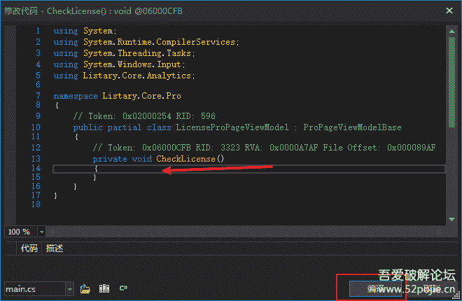

009.png (24.69 KB, 下载次数: 5)

[href="forum.php?mod=attachment&aid=Mjc3MjIyNHwxOTg0YmFhZXwxNzkzNTcxMDI5fDE2ODA4NnwyMDI1MzQw&nothumb=yes" target="_blank"](https://www.52pojie.cn/forum.php?mod=attachment&aid=Mjc3MjIyNHwxOTg0YmFhZXwxNzkzNTcxMDI5fDE2ODA4NnwyMDI1MzQw&nothumb=yes)

2025-4-18 13:38 上传

- 修改`Listary.Core.Pro/ProService`，修改四个地方

右键`ProService`，选择编辑类

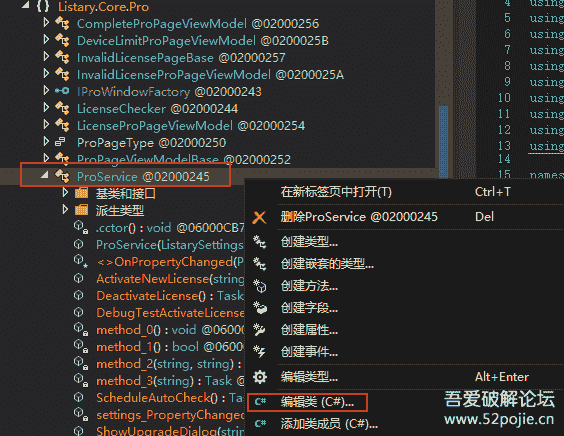

010.png (70.37 KB, 下载次数: 3)

[href="forum.php?mod=attachment&aid=Mjc3MjIyNXxkN2ZhNWRkYnwxNzkzNTcxMDI5fDE2ODA4NnwyMDI1MzQw&nothumb=yes" target="_blank"](https://www.52pojie.cn/forum.php?mod=attachment&aid=Mjc3MjIyNXxkN2ZhNWRkYnwxNzkzNTcxMDI5fDE2ODA4NnwyMDI1MzQw&nothumb=yes)

2025-4-18 13:38 上传

**修改地方1：删除以下2行**

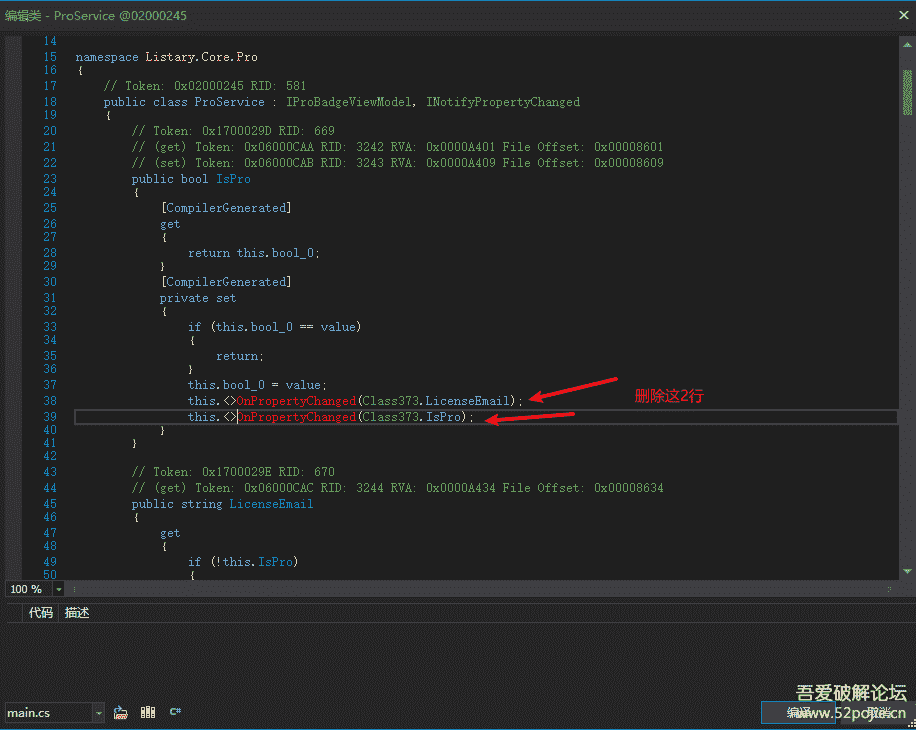

011.png (36.41 KB, 下载次数: 2)

[href="forum.php?mod=attachment&aid=Mjc3MjIyNnw4ODhjMDQ3ZHwxNzkzNTcxMDI5fDE2ODA4NnwyMDI1MzQw&nothumb=yes" target="_blank"](https://www.52pojie.cn/forum.php?mod=attachment&aid=Mjc3MjIyNnw4ODhjMDQ3ZHwxNzkzNTcxMDI5fDE2ODA4NnwyMDI1MzQw&nothumb=yes)

2025-4-18 13:38 上传

**修改地方2：跳到210行附近删除以下内容**

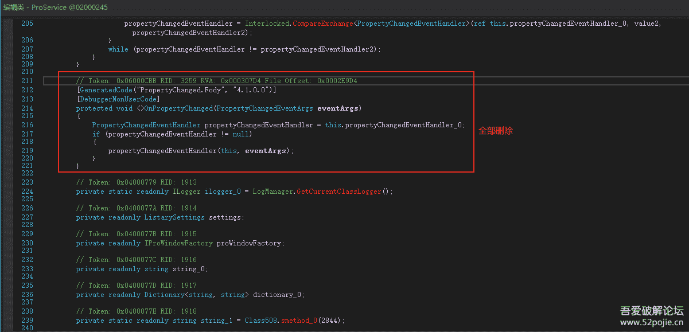

012.png (35.32 KB, 下载次数: 5)

[href="forum.php?mod=attachment&aid=Mjc3MjIyN3wxYmJlOTQzOXwxNzkzNTcxMDI5fDE2ODA4NnwyMDI1MzQw&nothumb=yes" target="_blank"](https://www.52pojie.cn/forum.php?mod=attachment&aid=Mjc3MjIyN3wxYmJlOTQzOXwxNzkzNTcxMDI5fDE2ODA4NnwyMDI1MzQw&nothumb=yes)

2025-4-18 13:38 上传

**修改地方3：2个函数`ActivateNewLicense`、`method_2`**

将函数内容修改为：`return Task.FromResult(new ProService.ActivationResult());`

例如`ActivateNewLicense`修改前：

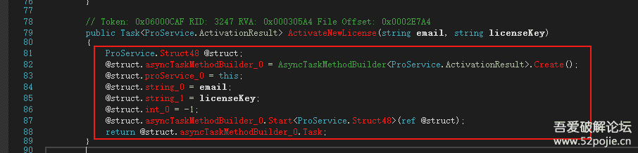

013.png (16.92 KB, 下载次数: 4)

[href="forum.php?mod=attachment&aid=Mjc3MjIyOHw5NmY4NDI4OHwxNzkzNTcxMDI5fDE2ODA4NnwyMDI1MzQw&nothumb=yes" target="_blank"](https://www.52pojie.cn/forum.php?mod=attachment&aid=Mjc3MjIyOHw5NmY4NDI4OHwxNzkzNTcxMDI5fDE2ODA4NnwyMDI1MzQw&nothumb=yes)

2025-4-18 13:38 上传

对`ActivateNewLicense`、`method_2`修改后：

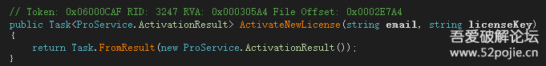

014.png (9.57 KB, 下载次数: 4)

[href="forum.php?mod=attachment&aid=Mjc3MjIyOXwzNDI2ZWI5ZXwxNzkzNTcxMDI5fDE2ODA4NnwyMDI1MzQw&nothumb=yes" target="_blank"](https://www.52pojie.cn/forum.php?mod=attachment&aid=Mjc3MjIyOXwzNDI2ZWI5ZXwxNzkzNTcxMDI5fDE2ODA4NnwyMDI1MzQw&nothumb=yes)

2025-4-18 13:39 上传

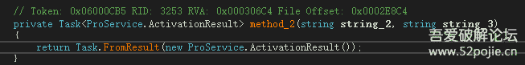

015.png (9.97 KB, 下载次数: 4)

[href="forum.php?mod=attachment&aid=Mjc3MjIzMHw3YWVmMzVhOXwxNzkzNTcxMDI5fDE2ODA4NnwyMDI1MzQw&nothumb=yes" target="_blank"](https://www.52pojie.cn/forum.php?mod=attachment&aid=Mjc3MjIzMHw3YWVmMzVhOXwxNzkzNTcxMDI5fDE2ODA4NnwyMDI1MzQw&nothumb=yes)

2025-4-18 13:39 上传

**修改地方4：4个函数`DeactivateLicense`、`ScheduleAutoCheck`、`DebugTestActivateLicense`、`method_3`**

将函数内容修改为：`return Task.CompletedTask;`

例如`DeactivateLicense`修改前：

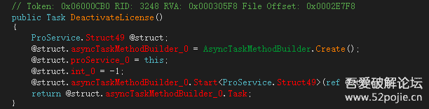

016.png (12.57 KB, 下载次数: 5)

[href="forum.php?mod=attachment&aid=Mjc3MjIzMXwxNDNkZDNmZnwxNzkzNTcxMDI5fDE2ODA4NnwyMDI1MzQw&nothumb=yes" target="_blank"](https://www.52pojie.cn/forum.php?mod=attachment&aid=Mjc3MjIzMXwxNDNkZDNmZnwxNzkzNTcxMDI5fDE2ODA4NnwyMDI1MzQw&nothumb=yes)

2025-4-18 13:39 上传

对上面四个函数修改后：

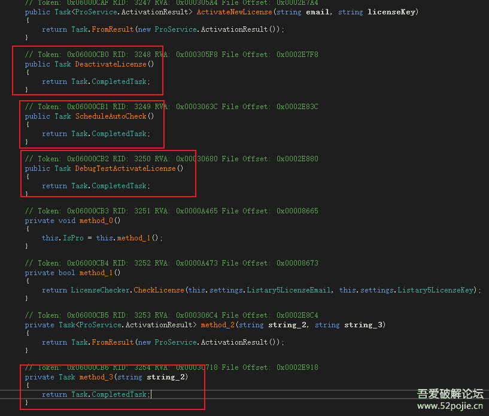

017.png (29.26 KB, 下载次数: 4)

[href="forum.php?mod=attachment&aid=Mjc3MjIzMnw0YmYwOTEyZnwxNzkzNTcxMDI5fDE2ODA4NnwyMDI1MzQw&nothumb=yes" target="_blank"](https://www.52pojie.cn/forum.php?mod=attachment&aid=Mjc3MjIzMnw0YmYwOTEyZnwxNzkzNTcxMDI5fDE2ODA4NnwyMDI1MzQw&nothumb=yes)

2025-4-18 13:39 上传

- 修改完毕，点击右下角的编译。

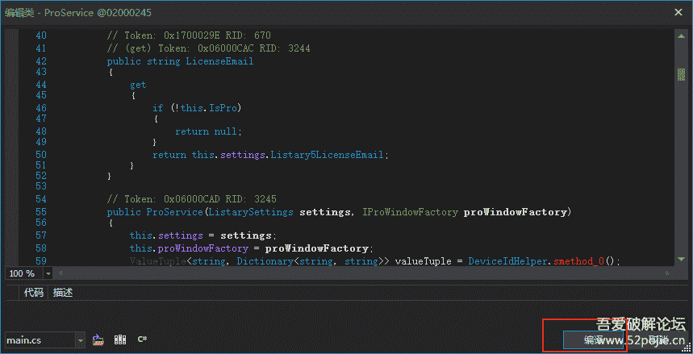

021.png (25.9 KB, 下载次数: 3)

https://www.52pojie.cn/forum.php?mod=attachment&aid=Mjc3MjI3OXw1ZTU4ZWNmM3wxNzkzNTcxMDI5fDE2ODA4NnwyMDI1MzQw&nothumb=yes

2025-4-18 16:43 上传

- 最后点击左上角的文件，保存模块，确定

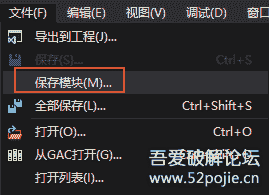

018.png (17.18 KB, 下载次数: 4)

https://www.52pojie.cn/forum.php?mod=attachment&aid=Mjc3MjIzM3w2NjZjOTAyNXwxNzkzNTcxMDI5fDE2ODA4NnwyMDI1MzQw&nothumb=yes

2025-4-18 13:39 上传

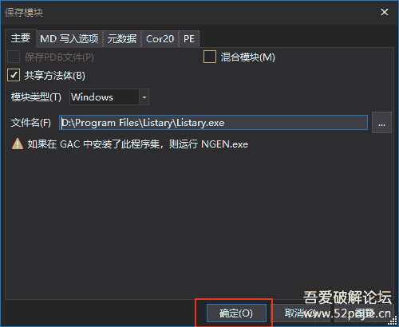

019.png (25.77 KB, 下载次数: 4)

https://www.52pojie.cn/forum.php?mod=attachment&aid=Mjc3MjIzNHwxMDc4ZGQ4MnwxNzkzNTcxMDI5fDE2ODA4NnwyMDI1MzQw&nothumb=yes

2025-4-18 13:39 上传

### 第四步：运行 `Listary.exe`。完结撒花~

020.png (20.74 KB, 下载次数: 3)

https://www.52pojie.cn/forum.php?mod=attachment&aid=Mjc3MjI1Nnw0ZjU0ZDc0N3wxNzkzNTcxMDI5fDE2ODA4NnwyMDI1MzQw&nothumb=yes

2025-4-18 14:52 上传
