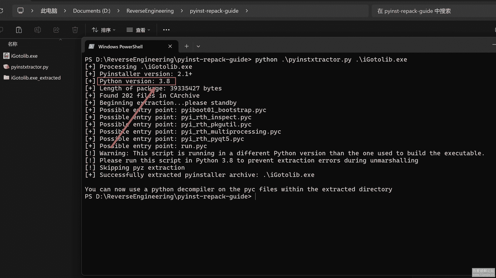
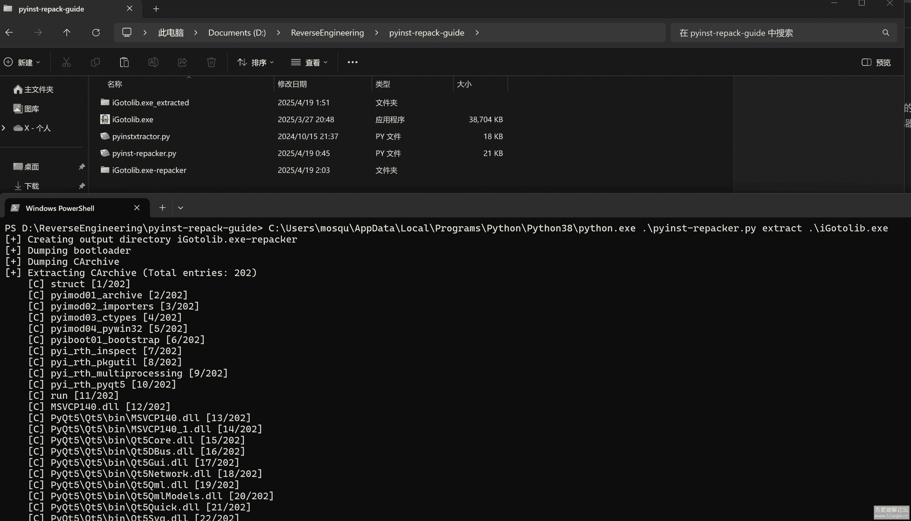
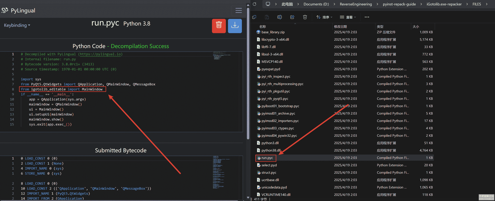
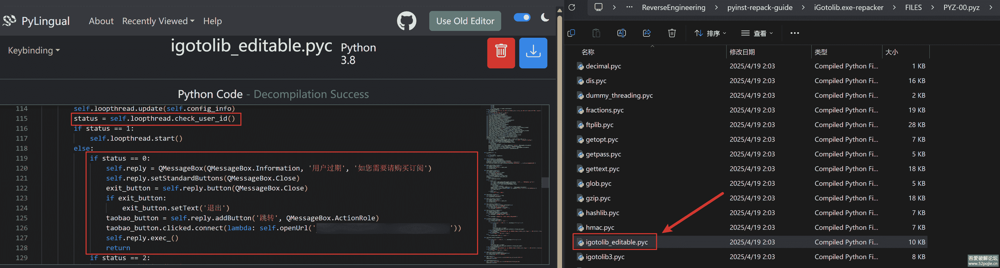
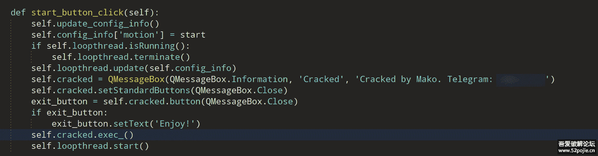
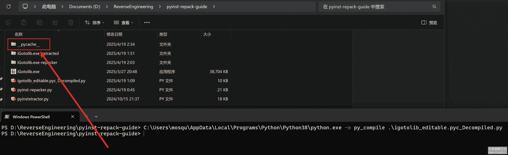
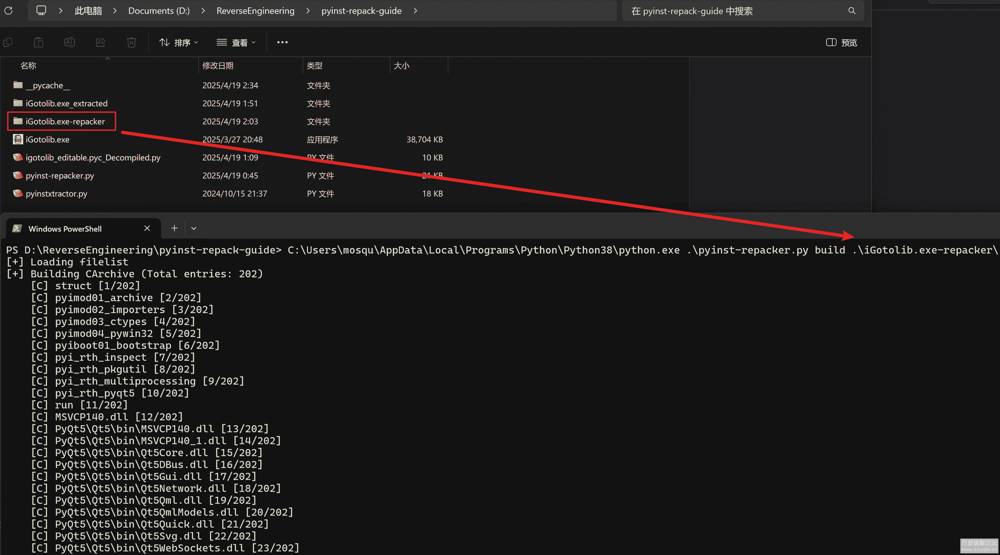
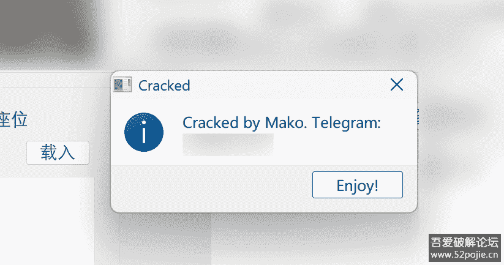

# [原创] Pyinstaller Repack 指南

- 原帖：<https://www.52pojie.cn/forum.php?mod=viewthread&tid=2025482>
- 抓取时间：2026-11-01T22:10:29

大一牲，想要 Patch 一个抢学校图书馆座位的软件，却困于 Pyinstaller 程序的重打包，以此为契机研究了一下 Repack 的完整流程，避免接触难懂难修改的字节码，并使用了一个几乎无人知晓的工具 `pyinstaller-repacker`（截至这篇文章完稿，仅有 4 个 star）。

## 0. 目标

本指南将用这个简单的例子教你如何：

- 导出程序中所有的 `pyc` 文件
- 反编译并阅读程序源码
- 直接对源码进行修改，并 Repack 一个修改版

## 1. 准备工具

- 查看源程序 Python 版本的工具：[pyinstxtractor](https://github.com/extremecoders-re/pyinstxtractor)
- Repack 工具：[pyinstaller-repacker](https://github.com/pyinstxtractor/pyinstaller-repacker)
- 在线反编译器：[PyLingual](https://pylingual.io/)
- 一个任意版本的 [Python](https://python.org)

## 2. 解包源程序

### 2.1 查看源程序打包使用的 Python 版本

查看源程序打包使用的 Python 版本：

如图得知源程序打包使用的 Python 版本为 3.8，所以我们要安装一个 3.8 版本的 Python 环境（此处不作管理多 Python 版本的教程，请自行管理环境），并在对应的 Python 版本中安装所需的依赖：`pip install lxml lief`

### 2.2 使用 `pyinstaller-repacker` 解包源程序

使用对应版本的 Python 环境运行 `pyinstaller-repacker` 脚本，解包源程序：`python .\pyinst-repacker.py extract [源程序名]`

运行至 `[+] Done!` 时，即为完成解包。

## 3. 反编译源码

### 3.1 分析入口点

进入目录 `[源程序名]-repacker/FILES`，在此处即可找到程序的入口点 `pyc` 文件，将其拖入 [PyLingual](https://pylingual.io/) 进行反编译：

如图，发现入口点启动了 `igotolib_editable` 包含的 `App` 窗口，接着分析该文件。

### 3.2 分析 `igotolib_editable.pyc`

进入目录 `[源程序名]-repacker/FILES/PYZ-00.pyz`，找到其中的 `igotolib_editable.pyc`，拖入反编译器：

找到购买检测逻辑。

## 4. 修改与重新打包

### 4.1 下载并修改源码

点击反编译器右上角的蓝色下载按钮，即可将源码下载至本地。

完全删除 `status` 检测逻辑，并加上一些 `Cracked` 信息：

### 4.2 编译修改后的源码

使用对应版本的 Python 环境将修改后的源码编译为 `pyc` 文件：`python -m py_compile [源码]`

如图，将会生成一个 `__pycache__` 文件夹，内含的文件即为修改后的 `pyc` 文件。

### 4.3 替换 `pyc` 并重新打包

将修改后的 `pyc` 文件重命名为被替换的 `pyc` 文件名称，替换原 `pyc` 文件后，重新打包为 `exe`：`python .\pyinst-repacker.py build .\[源程序名]-repacker\`

等待一段时间后运行至 `[+] Done!` 时，即为完成打包，在目录 `[源程序名]-repacker\` 中即可找到 Repack 后的程序。

## 5. 大功告成

测试程序，运行正常：

## 6. 说明

- 使用到的两个工具 `pyinstxtractor` 与 `pyinstaller-repacker` 已上传至附件。
- 即使使用的 Python 版本不对应，`pyinstaller-repacker` 也能够从 `pyz` 中解压出文件，但是会导致无法反编译，所以请务必使用与源程序相同的 Python 版本!!
- 经测试，PyLingual 能够正确反编译 3.13 及以下所有版本的 `pyc`。
