# [Web逆向] 某当网登录滑块逆向

- 原帖: https://www.52pojie.cn/forum.php?mod=viewthread&tid=2025578
- 抓取时间: 2026-11-01T22:10:27

本文章中所有内容仅供学习交流，抓包内容、敏感网址、数据接口均已做脱敏处理，严禁用于商业用途和非法用途，否则由此产生的一切后果均与作者无关，若有侵权，请联系我立即删除！

### 目标
实现账号的登录，滑块验证。

### 网站
aHR0cHM6Ly9sb2dpbi5kYW5nZGFuZy5jb20vIw==

### 说明
本文主要是对该网站实现登录，逆向其中遇到的滑块。

## 1.
随便输入手机号和密码，手动滑动滑块实现登录全过程，在控制台可以看到一些主要的请求，从后往前分析，看看每个请求需要的参数，主要四次请求。
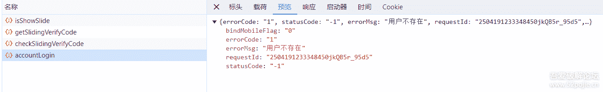
image.png (32.52 KB, 下载次数: 1)
[href="forum.php?mod=attachment&aid=Mjc3MjM3M3xlYjNiNzY1NHwxNzkzNTcxMDI1fDE2ODA4NnwyMDI1NTc4&nothumb=yes" target="_blank"](https://www.52pojie.cn/forum.php?mod=attachment&aid=Mjc3MjM3M3xlYjNiNzY1NHwxNzkzNTcxMDI1fDE2ODA4NnwyMDI1NTc4&nothumb=yes)
2025-4-19 12:36 上传
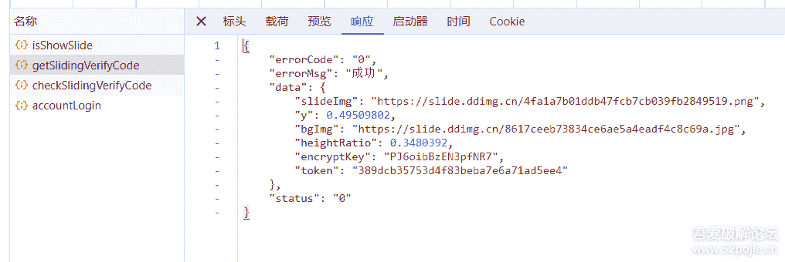
image.png (41.56 KB, 下载次数: 1)
[href="forum.php?mod=attachment&aid=Mjc3MjM3N3wxNzYyODNmOXwxNzkzNTcxMDI1fDE2ODA4NnwyMDI1NTc4&nothumb=yes" target="_blank"](https://www.52pojie.cn/forum.php?mod=attachment&aid=Mjc3MjM3N3wxNzYyODNmOXwxNzkzNTcxMDI1fDE2ODA4NnwyMDI1NTc4&nothumb=yes)
2025-4-19 12:49 上传
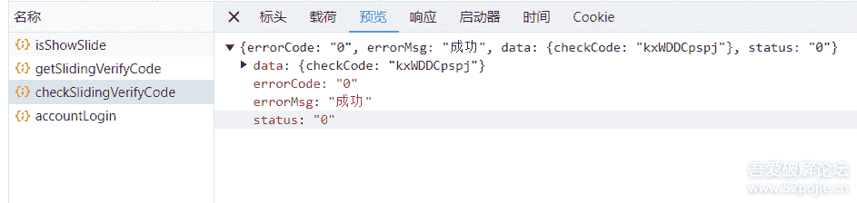
image.png (27.59 KB, 下载次数: 1)
[href="forum.php?mod=attachment&aid=Mjc3MjM3OHw2YjllY2MyNXwxNzkzNTcxMDI1fDE2ODA4NnwyMDI1NTc4&nothumb=yes" target="_blank"](https://www.52pojie.cn/forum.php?mod=attachment&aid=Mjc3MjM3OHw2YjllY2MyNXwxNzkzNTcxMDI1fDE2ODA4NnwyMDI1NTc4&nothumb=yes)
2025-4-19 12:50 上传
`isShowSlide` 原本以为是对参数的验证，结果是无需理会
`getSlidingVerifyCode` 主要是获得滑块验证的图片
`checkSlidingVerifyCode` 是对滑块的校验
`accountLogin` 登录接口
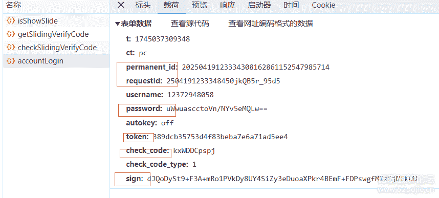
image.png (49.28 KB, 下载次数: 0)
[href="forum.php?mod=attachment&aid=Mjc3MjM3Nnw0N2ZiMzE1ZnwxNzkzNTcxMDI1fDE2ODA4NnwyMDI1NTc4&nothumb=yes" target="_blank"](https://www.52pojie.cn/forum.php?mod=attachment&aid=Mjc3MjM3Nnw0N2ZiMzE1ZnwxNzkzNTcxMDI1fDE2ODA4NnwyMDI1NTc4&nothumb=yes)
2025-4-19 12:47 上传

## 2.
登录需要的参数有很多需要分析，主要分析是 `sign` 的生成过程，`token` 是 `getSlidingVerifyCode` 返回结果数据，`check_token` 是验证滑块后 `checkSlidingVerifyCode` 返回结果数据。

## 3.
首先是先获得滑块的图片，可以看到主要有三个参数。前两个 `permanent_id` `requestid` 在这四次请求中同时存在，值还是一样的。直接搜索 `sign` 或者 hook `JSON`，`xhr` 断点指定接口等
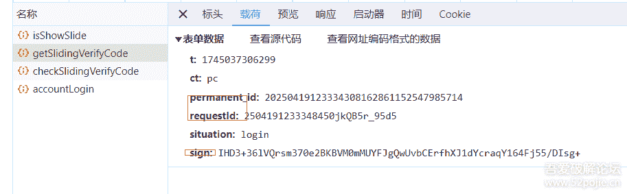
image.png (38.07 KB, 下载次数: 1)
[href="forum.php?mod=attachment&aid=Mjc3MjM3OXwzYjYxYTZiYXwxNzkzNTcxMDI1fDE2ODA4NnwyMDI1NTc4&nothumb=yes" target="_blank"](https://www.52pojie.cn/forum.php?mod=attachment&aid=Mjc3MjM3OXwzYjYxYTZiYXwxNzkzNTcxMDI1fDE2ODA4NnwyMDI1NTc4&nothumb=yes)
2025-4-19 12:53 上传
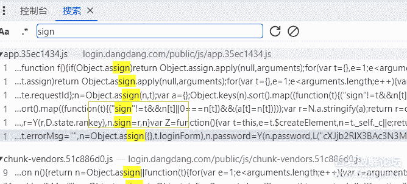
image.png (59.9 KB, 下载次数: 0)
[href="forum.php?mod=attachment&aid=Mjc3MjM4MHxiYWEzOGQyNHwxNzkzNTcxMDI1fDE2ODA4NnwyMDI1NTc4&nothumb=yes" target="_blank"](https://www.52pojie.cn/forum.php?mod=attachment&aid=Mjc3MjM4MHxiYWEzOGQyNHwxNzkzNTcxMDI1fDE2ODA4NnwyMDI1NTc4&nothumb=yes)
2025-4-19 13:04 上传

## 4.
直接搜索 `sign` 返回不多，主要两个打上断点，再次请求，可以看到变量 `n` 就是一些请求参数，`r` 就是最终 `sign` 的值，加密有的结果在赋值到 `n` 中，`permanent_id` 等于 `e` ，`e` 的生成在上面 `e = G()`，`G()` 函数，
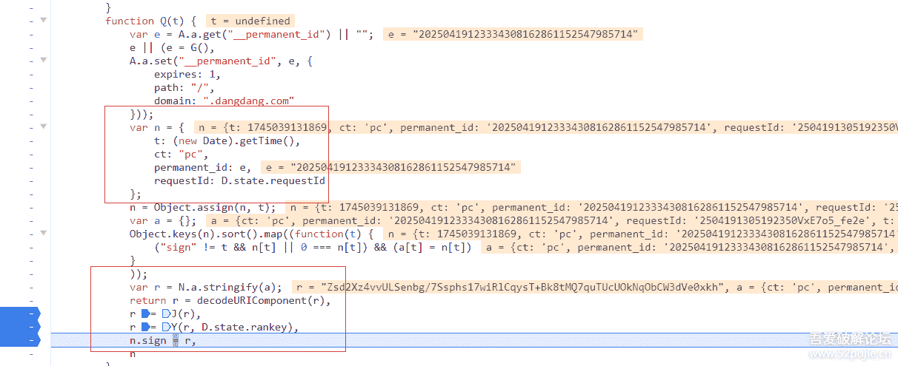
image.png (83.26 KB, 下载次数: 0)
[href="forum.php?mod=attachment&aid=Mjc3MjM4NHw4MzhkNzg2M3wxNzkzNTcxMDI1fDE2ODA4NnwyMDI1NTc4&nothumb=yes" target="_blank"](https://www.52pojie.cn/forum.php?mod=attachment&aid=Mjc3MjM4NHw4MzhkNzg2M3wxNzkzNTcxMDI1fDE2ODA4NnwyMDI1NTc4&nothumb=yes)
2025-4-19 13:10 上传
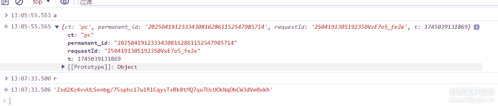
image.png (39.06 KB, 下载次数: 1)
[href="forum.php?mod=attachment&aid=Mjc3MjM4M3w3ODVlZDZkOXwxNzkzNTcxMDI1fDE2ODA4NnwyMDI1NTc4&nothumb=yes" target="_blank"](https://www.52pojie.cn/forum.php?mod=attachment&aid=Mjc3MjM4M3w3ODVlZDZkOXwxNzkzNTcxMDI1fDE2ODA4NnwyMDI1NTc4&nothumb=yes)
2025-4-19 13:08 上传

## 5.
`D.state.requestId` 返回 `requestId` 刚开始我以为这个值是 js 生成的，在往上跟栈找着找着发现是接口返回的数据，首先重新刷新网站，再次断到当前位置，直接打印 `requestid` 的结果，直接搜索。
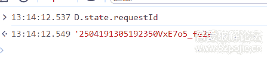
image.png (12.11 KB, 下载次数: 1)
[href="forum.php?mod=attachment&aid=Mjc3MjM4NnxkY2UxMGM4MXwxNzkzNTcxMDI1fDE2ODA4NnwyMDI1NTc4&nothumb=yes" target="_blank"](https://www.52pojie.cn/forum.php?mod=attachment&aid=Mjc3MjM4NnxkY2UxMGM4MXwxNzkzNTcxMDI1fDE2ODA4NnwyMDI1NTc4&nothumb=yes)
2025-4-19 13:18 上传
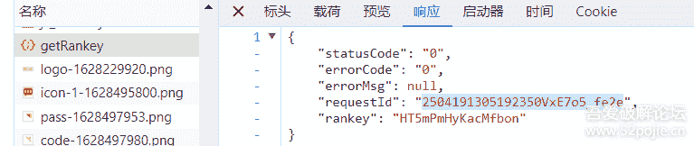
image.png (30.34 KB, 下载次数: 1)
[href="forum.php?mod=attachment&aid=Mjc3MjM4N3xiMWI3NzEyN3wxNzkzNTcxMDI1fDE2ODA4NnwyMDI1NTc4&nothumb=yes" target="_blank"](https://www.52pojie.cn/forum.php?mod=attachment&aid=Mjc3MjM4N3xiMWI3NzEyN3wxNzkzNTcxMDI1fDE2ODA4NnwyMDI1NTc4&nothumb=yes)
2025-4-19 13:19 上传
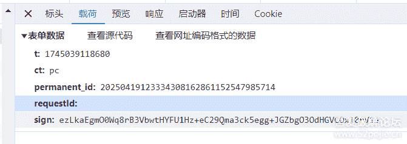
image.png (27.47 KB, 下载次数: 1)
[href="forum.php?mod=attachment&aid=Mjc3MjM4OXxhNzRhZDRhYnwxNzkzNTcxMDI1fDE2ODA4NnwyMDI1NTc4&nothumb=yes" target="_blank"](https://www.52pojie.cn/forum.php?mod=attachment&aid=Mjc3MjM4OXxhNzRhZDRhYnwxNzkzNTcxMDI1fDE2ODA4NnwyMDI1NTc4&nothumb=yes)
2025-4-19 13:20 上传

## 6.
`requestId` 直接是一个接口返回值，请求参数也是先获得 `permanent_id` 和 `sign`， 所以先分析，函数 `G()` 里面生成规律，在看 `sign`。直接控制台打印 `G()`，跳转到函数里面。
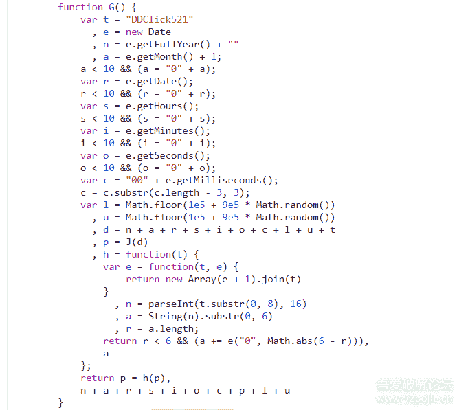
image.png (52.97 KB, 下载次数: 1)
[href="forum.php?mod=attachment&aid=Mjc3MjM5MHxhNjJhYzk3NHwxNzkzNTcxMDI1fDE2ODA4NnwyMDI1NTc4&nothumb=yes" target="_blank"](https://www.52pojie.cn/forum.php?mod=attachment&aid=Mjc3MjM5MHxhNjJhYzk3NHwxNzkzNTcxMDI1fDE2ODA4NnwyMDI1NTc4&nothumb=yes)
2025-4-19 13:22 上传

## 7.
大致分析一下这个函数，先是定义一个 `t` 变量，在获得当前时间时分秒等，随机生成两个参数，一大堆拼接成 `d`，然后函数 `J()` 对 `d` 转换，明显是一个 `md5`，测试一下是一个标准的 `md5`。后面有定义一个 `h()` 函数对 `p` 转换。

image.png (9.54 KB, 下载次数: 1)
[href="forum.php?mod=attachment&aid=Mjc3MjM5MXxlODU5OGExY3wxNzkzNTcxMDI1fDE2ODA4NnwyMDI1NTc4&nothumb=yes" target="_blank"](https://www.52pojie.cn/forum.php?mod=attachment&aid=Mjc3MjM5MXxlODU5OGExY3wxNzkzNTcxMDI1fDE2ODA4NnwyMDI1NTc4&nothumb=yes)
2025-4-19 13:30 上传
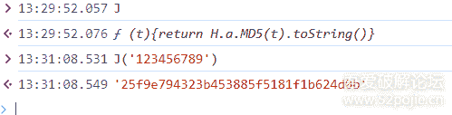
image.png (17.13 KB, 下载次数: 1)
[href="forum.php?mod=attachment&aid=Mjc3MjM5M3w0YTVmODkxZXwxNzkzNTcxMDI1fDE2ODA4NnwyMDI1NTc4&nothumb=yes" target="_blank"](https://www.52pojie.cn/forum.php?mod=attachment&aid=Mjc3MjM5M3w0YTVmODkxZXwxNzkzNTcxMDI1fDE2ODA4NnwyMDI1NTc4&nothumb=yes)
2025-4-19 13:34 上传
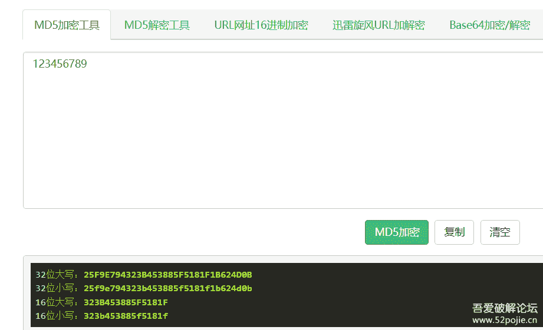
image.png (35.5 KB, 下载次数: 1)
[href="forum.php?mod=attachment&aid=Mjc3MjM5MnxlOGU0ODgzM3wxNzkzNTcxMDI1fDE2ODA4NnwyMDI1NTc4&nothumb=yes" target="_blank"](https://www.52pojie.cn/forum.php?mod=attachment&aid=Mjc3MjM5MnxlOGU0ODgzM3wxNzkzNTcxMDI1fDE2ODA4NnwyMDI1NTc4&nothumb=yes)
2025-4-19 13:33 上传

## 8.
可以直接把 `G()` 扣下来的改一下 `J()` 函数，也可以直接用 `python` 实现还原过程，自己写或者扔给 ai 一键转换也可以，一下是 py 代码。
[Python] 纯文本查看 复制代码


```python
def random_string():
    # 基础字符串
    base_string = "DDClick521"

    # 获取当前时间
    now = datetime.datetime.now()
    year = str(now.year)
    month = str(now.month).zfill(2)  # 确保月份是两位数
    day = str(now.day).zfill(2)
    hour = str(now.hour).zfill(2)
    minute = str(now.minute).zfill(2)
    second = str(now.second).zfill(2)
    millisecond = str(now.microsecond)[:3].zfill(3)  # 取毫秒的前三位

    # 生成随机数
    random_num1 = str(random.randint(100000, 999999))
    random_num2 = str(random.randint(100000, 999999))

    # 组合字符串
    combined_string = year + month + day + hour + minute + second + millisecond + random_num1 + random_num2 + base_string

    # 创建 MD5 哈希
    md5_hash = hashlib.md5(combined_string.encode()).hexdigest()

    # 处理哈希前八位
    def process_hash(hash_str):
        hex_value = int(hash_str[:8], 16)
        str_value = str(hex_value)[:6]
        if len(str_value)
```
`getRankey` 请求断住，看一下请求加密参数需要哪些，主要是一个 `permanent_id`，`N.a.stringify(a)`； 把 `a` 转换成 url 查询字符串，在 `decodeURIComponent` 编码，在使用函数 `J` 转换，这个 `J` 似曾相识，

就是和之前的一样，也是 `md5` 转换，主要看一下函数 `Y` 的功能，传入两个参数，第一个参数是明文 `md5` 值，第二个参数是密钥，因为 `getRankey` 接口请求前，`rankey` 和 `requestId` 都还为空，所以第一次生成 `sign` 是密钥为空。

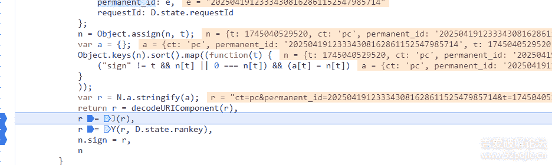

image.png (48.27 KB, 下载次数: 1)

[href="forum.php?mod=attachment&aid=Mjc3MjM5N3wzOTNlODdkMnwxNzkzNTcxMDI1fDE2ODA4NnwyMDI1NTc4&nothumb=yes" target="_blank"](https://www.52pojie.cn/forum.php?mod=attachment&aid=Mjc3MjM5N3wzOTNlODdkMnwxNzkzNTcxMDI1fDE2ODA4NnwyMDI1NTc4&nothumb=yes)

2025-4-19 13:42 上传

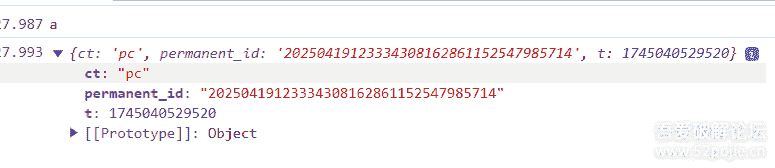

image.png (21.89 KB, 下载次数: 0)

[href="forum.php?mod=attachment&aid=Mjc3MjM5OHxiNDE2YzU3ZXwxNzkzNTcxMDI1fDE2ODA4NnwyMDI1NTc4&nothumb=yes" target="_blank"](https://www.52pojie.cn/forum.php?mod=attachment&aid=Mjc3MjM5OHxiNDE2YzU3ZXwxNzkzNTcxMDI1fDE2ODA4NnwyMDI1NTc4&nothumb=yes)

2025-4-19 13:43 上传

## 10. 进入到函数 Y 中
可以看着这是一个 `aes` 加密，测试过了也是一个标准的加密，具体加密还原使用 `js` 还是 `python` 当然是看你的心情了。

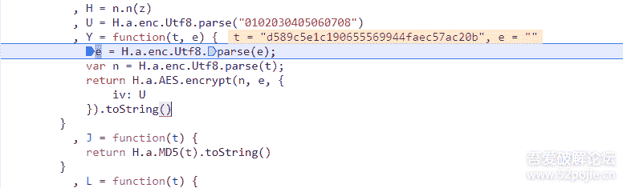

image.png (27.26 KB, 下载次数: 0)

[href="forum.php?mod=attachment&aid=Mjc3MjQwNnw2N2YwODFjNnwxNzkzNTcxMDI1fDE2ODA4NnwyMDI1NTc4&nothumb=yes" target="_blank"](https://www.52pojie.cn/forum.php?mod=attachment&aid=Mjc3MjQwNnw2N2YwODFjNnwxNzkzNTcxMDI1fDE2ODA4NnwyMDI1NTc4&nothumb=yes)

2025-4-19 13:50 上传

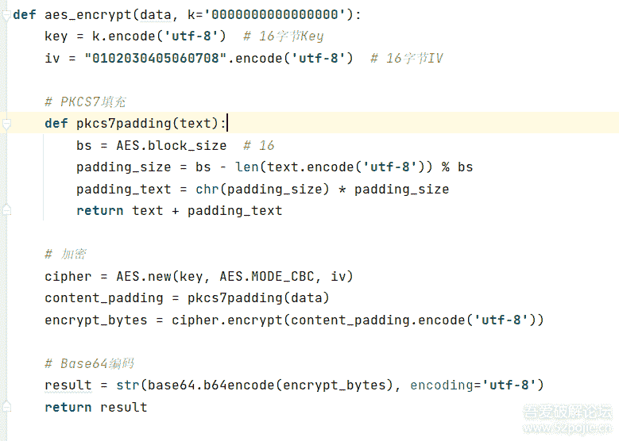

image.png (76.02 KB, 下载次数: 1)

[href="forum.php?mod=attachment&aid=Mjc3MjQwOHw0ZDEwNjkyMHwxNzkzNTcxMDI1fDE2ODA4NnwyMDI1NTc4&nothumb=yes" target="_blank"](https://www.52pojie.cn/forum.php?mod=attachment&aid=Mjc3MjQwOHw0ZDEwNjkyMHwxNzkzNTcxMDI1fDE2ODA4NnwyMDI1NTc4&nothumb=yes)

2025-4-19 13:54 上传

## 11. t 参数说明
哦对，还有一个 `t` 参数，是时间戳，这样就可以拿到 `rankey` 和 `requestId`，需要注意的是，在请求 `getSlidingVerifyCode` 接口时，注意一下参数，密钥就是 `rankey`。

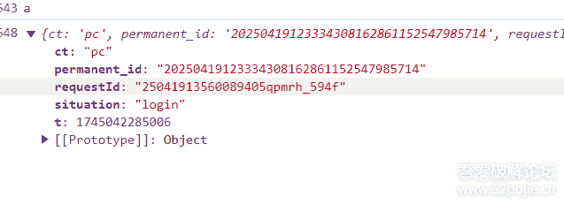

image.png (24.43 KB, 下载次数: 1)

[href="forum.php?mod=attachment&aid=Mjc3MjQwOXw3ZmI5YzhmZnwxNzkzNTcxMDI1fDE2ODA4NnwyMDI1NTc4&nothumb=yes" target="_blank"](https://www.52pojie.cn/forum.php?mod=attachment&aid=Mjc3MjQwOXw3ZmI5YzhmZnwxNzkzNTcxMDI1fDE2ODA4NnwyMDI1NTc4&nothumb=yes)

2025-4-19 13:59 上传

## 12. 滑块验证参数
获得图片后，就是要是别滑块的距离了，我使用的是 `ddddocr` 。验证滑块的参数有点多。

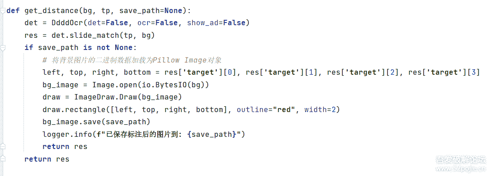

image.png (70.93 KB, 下载次数: 1)

[href="forum.php?mod=attachment&aid=Mjc3MjQxMHw4ZTBkYjI0ZHwxNzkzNTcxMDI1fDE2ODA4NnwyMDI1NTc4&nothumb=yes" target="_blank"](https://www.52pojie.cn/forum.php?mod=attachment&aid=Mjc3MjQxMHw4ZTBkYjI0ZHwxNzkzNTcxMDI1fDE2ODA4NnwyMDI1NTc4&nothumb=yes)

2025-4-19 14:01 上传

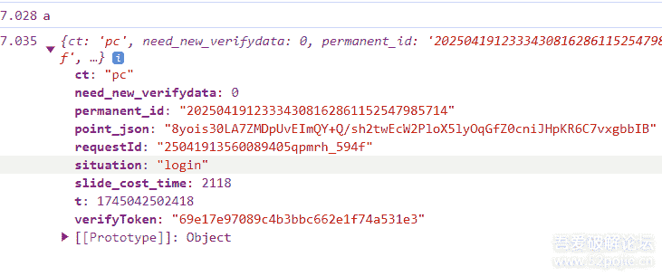

image.png (39.35 KB, 下载次数: 1)

[href="forum.php?mod=attachment&aid=Mjc3MjQxMnwyZjJhZTE0OHwxNzkzNTcxMDI1fDE2ODA4NnwyMDI1NTc4&nothumb=yes" target="_blank"](https://www.52pojie.cn/forum.php?mod=attachment&aid=Mjc3MjQxMnwyZjJhZTE0OHwxNzkzNTcxMDI1fDE2ODA4NnwyMDI1NTc4&nothumb=yes)

2025-4-19 14:02 上传

`point_json` 是加密过的

`slide_cost_time` 滑动时间

`verifyToken` 验证 token，获得图片时一起返回值

其他没有什么特殊参数了

## 13. point_json 生成
现在主要看一下 `point_json` 怎么生成的，直接搜索打下断点，还是 `aes` 加密，其中不同的是 `key` 值，`t.left` 就是滑动的距离，`t.json.y` 是请求图片时返回的 `y`，`t.json.encryptKey` 是返回的 `encryptKey`

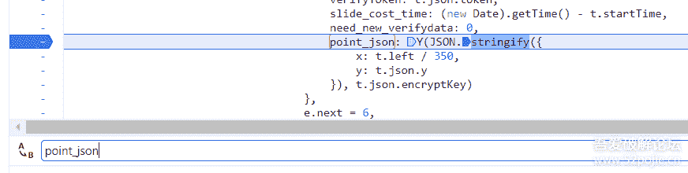

image.png (22.22 KB, 下载次数: 1)

[href="forum.php?mod=attachment&aid=Mjc3MjQxNHw5MjdhNzU2N3wxNzkzNTcxMDI1fDE2ODA4NnwyMDI1NTc4&nothumb=yes" target="_blank"](https://www.52pojie.cn/forum.php?mod=attachment&aid=Mjc3MjQxNHw5MjdhNzU2N3wxNzkzNTcxMDI1fDE2ODA4NnwyMDI1NTc4&nothumb=yes)

2025-4-19 14:09 上传

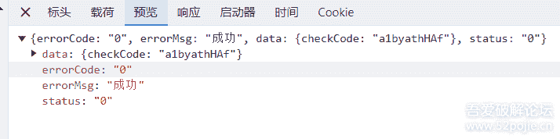

image.png (19.81 KB, 下载次数: 1)

[href="forum.php?mod=attachment&aid=Mjc3MjQxNnw2NzUxOThmZHwxNzkzNTcxMDI1fDE2ODA4NnwyMDI1NTc4&nothumb=yes" target="_blank"](https://www.52pojie.cn/forum.php?mod=attachment&aid=Mjc3MjQxNnw2NzUxOThmZHwxNzkzNTcxMDI1fDE2ODA4NnwyMDI1NTc4&nothumb=yes)

2025-4-19 14:14 上传

## 14. 滑块验证成功后
滑块验证成功后会返回 `checkcode`，至此登录接口还有一个 `password` 的生成规则，直接搜也能搜到就是有一点多，可以直接使用 `xhr` 断点 `accountLogin`，找到 `password` 生成地方。

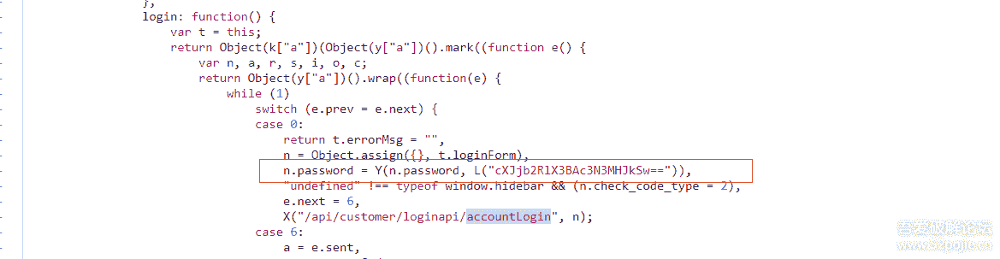

image.png (39.05 KB, 下载次数: 1)

[href="forum.php?mod=attachment&aid=Mjc3MjQxOXw5ODQ2YjkwYXwxNzkzNTcxMDI1fDE2ODA4NnwyMDI1NTc4&nothumb=yes" target="_blank"](https://www.52pojie.cn/forum.php?mod=attachment&aid=Mjc3MjQxOXw5ODQ2YjkwYXwxNzkzNTcxMDI1fDE2ODA4NnwyMDI1NTc4&nothumb=yes)

2025-4-19 14:19 上传

## 15. Y 函数再次使用
同样也是 `Y` 函数，传入你输入的密码，`key` 的值是固定的。到此所有参数都分析完了，使用代码测试测试。

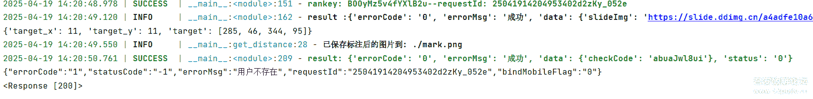

image.png (75.85 KB, 下载次数: 1)

[href="forum.php?mod=attachment&aid=Mjc3MjQyMHw4NmMxZmM4OXwxNzkzNTcxMDI1fDE2ODA4NnwyMDI1NTc4&nothumb=yes" target="_blank"](https://www.52pojie.cn/forum.php?mod=attachment&aid=Mjc3MjQyMHw4NmMxZmM4OXwxNzkzNTcxMDI1fDE2ODA4NnwyMDI1NTc4&nothumb=yes)

2025-4-19 14:21 上传

结果没什么问题，因为没有注册账号，没有尝试登录看看。本贴到此结束啦，感谢观看，感谢各位老铁，点个赞呗。

