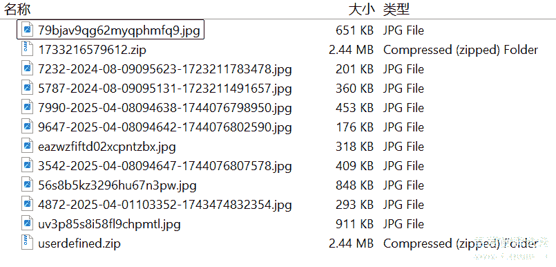
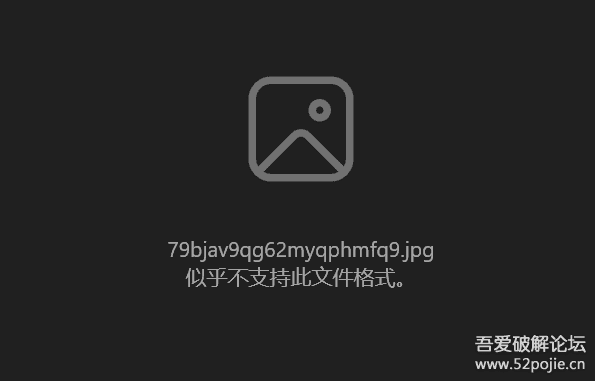
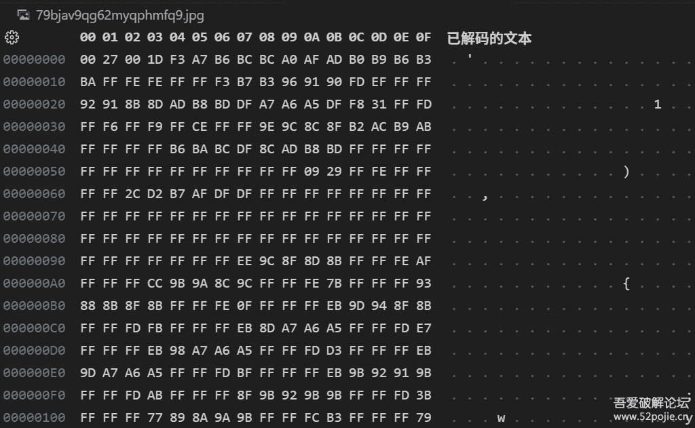
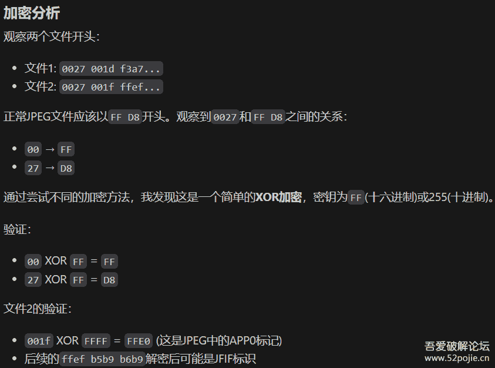

# [分享] xx锁屏预览图片解密——记一次小白使用AI逆向加密算法

- 原帖: https://www.52pojie.cn/forum.php?mod=viewthread&tid=2026748
- 抓取时间: 2026-11-01T22:10:25

xx锁屏有时推送的锁屏图片挺好看的，以前可以在特定位置（`xxx\devicecenter\LockScreen\cache`）直接获得无加密的图片，最近（2025年4月）每天推送的锁屏图片找不到了，用`everything`一番探索发现位于“`xx\AppStore\LockScreen\cache`”，

image.png (46.43 KB, 下载次数: 0)
[href="forum.php?mod=attachment&aid=Mjc3MzIwOXw0NGE0NTI5ZXwxNzkzNTcxMDIzfDE2ODA4NnwyMDI2NzQ4&nothumb=yes" target="_blank"](https://www.52pojie.cn/forum.php?mod=attachment&aid=Mjc3MzIwOXw0NGE0NTI5ZXwxNzkzNTcxMDIzfDE2ODA4NnwyMDI2NzQ4&nothumb=yes)
目录结构
2025-4-23 21:52 上传

喜而双击之，然后两眼一黑（物理黑屏），提示无权限，好我改权限，把本地微软账户添加到所有者，赋予all权限。再双击之，再次两眼一黑

image.png (17.68 KB, 下载次数: 0)
[href="forum.php?mod=attachment&aid=Mjc3MzIxM3xmYThiOGY3YXwxNzkzNTcxMDIzfDE2ODA4NnwyMDI2NzQ4&nothumb=yes" target="_blank"](https://www.52pojie.cn/forum.php?mod=attachment&aid=Mjc3MzIxM3xmYThiOGY3YXwxNzkzNTcxMDIzfDE2ODA4NnwyMDI2NzQ4&nothumb=yes)
加密或损坏
2025-4-23 21:56 上传

扔给图片格式转换器依然报错，遂怀疑加密了。HEX之

image.png (105.32 KB, 下载次数: 0)
[href="forum.php?mod=attachment&aid=Mjc3MzIxNHw1ZGU1MzFjNHwxNzkzNTcxMDIzfDE2ODA4NnwyMDI2NzQ4&nothumb=yes" target="_blank"](https://www.52pojie.cn/forum.php?mod=attachment&aid=Mjc3MzIxNHw1ZGU1MzFjNHwxNzkzNTcxMDIzfDE2ODA4NnwyMDI2NzQ4&nothumb=yes)
HEX
2025-4-23 21:58 上传

好嘛，头文件00 27明显不是jpg的FF D8，尝试补一个头文件后发现直接报错。嗯应该不是缺头文件。打开另一张加密图片观察，头部是00 27 00 1f，找到相同的部分：“00 27 00”
没什么头绪，胡乱试了几种常见加密算法都不对。然后我把HEX头部复制扔给Claude 3.7 sonnet，问它猜一下这是什么加密，结果马上猜出来是“FF”的异或加密

image.png (54.97 KB, 下载次数: 1)
[href="forum.php?mod=attachment&aid=Mjc3MzIxN3wyZjJjZTVhNnwxNzkzNTcxMDIzfDE2ODA4NnwyMDI2NzQ4&nothumb=yes" target="_blank"](https://www.52pojie.cn/forum.php?mod=attachment&aid=Mjc3MzIxN3wyZjJjZTVhNnwxNzkzNTcxMDIzfDE2ODA4NnwyMDI2NzQ4&nothumb=yes)
AI猜出的XOR
2025-4-23 22:06 上传

笑死，AI真的带来翻天覆地的变化，传统思路应该是逆向`EXE`->下断点查找调用接口->还原加密/解密函数。现在我只需要把头文件丢给AI，5秒搞定。虽然工程师设置的这个加密算法和秘钥太过简单，但不管怎么说，也是一种新思路。大道至简，朴实无华


## 解密函数
```
def decrypt_jpg(encrypted_bytes, output_filename):    """
    解密JPEG文件，使用XOR 0xFF
    
    参数:
    encrypted_bytes -- 加密的字节数据
    output_filename -- 输出文件路径
    """
    # 使用XOR FF解密
    decrypted_bytes = bytes([b ^ 0xFF for b in encrypted_bytes])
    
    # 保存解密后的文件
    with open(output_filename, 'wb') as f:
        f.write(decrypted_bytes)
    
    print(f"已保存解密文件至 {output_filename}")
```

然后简简单单用`pyqt6`写了个gui工具：
https://wwai.lanzouu.com/irxOS2uapb2b
密码:cy3m
小白首次分享，大佬轻喷，刮刮乐揭晓xx代码6IGU5oOz6ZSB5bGP
