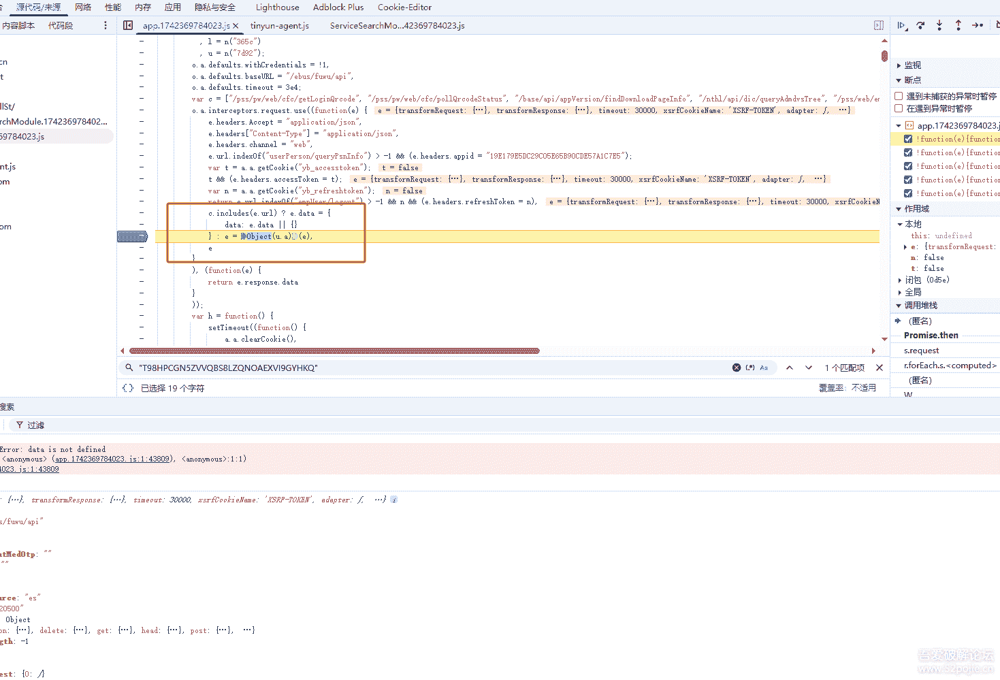
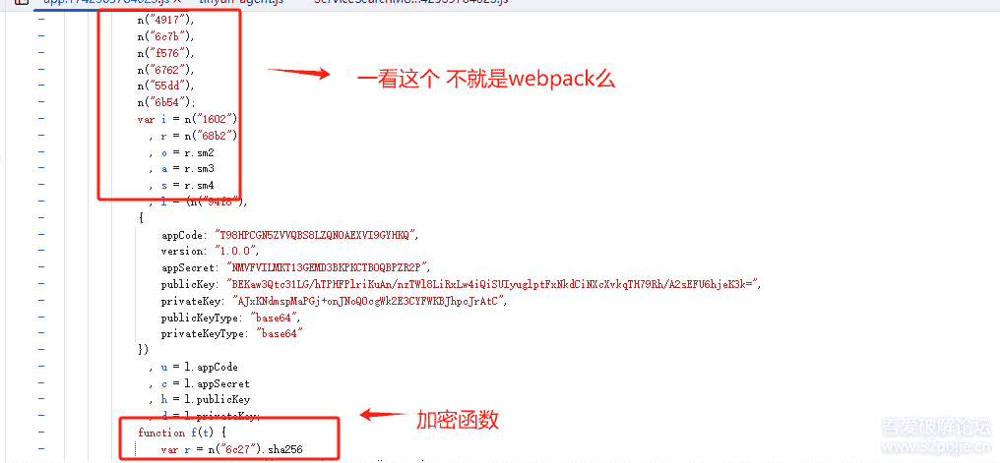
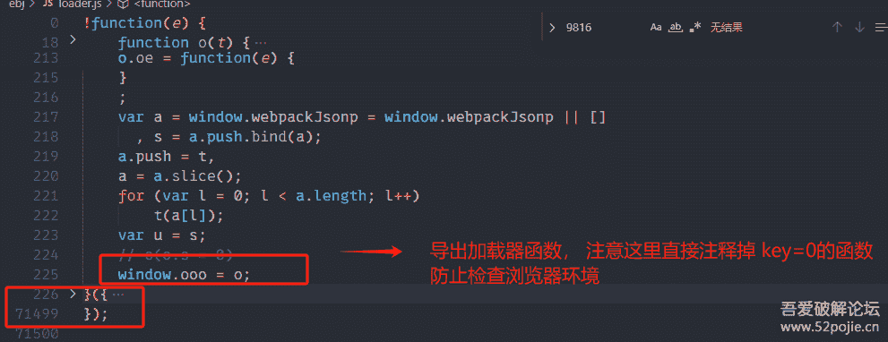
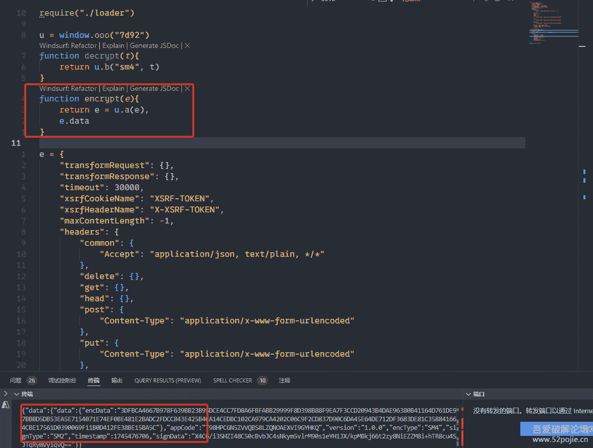
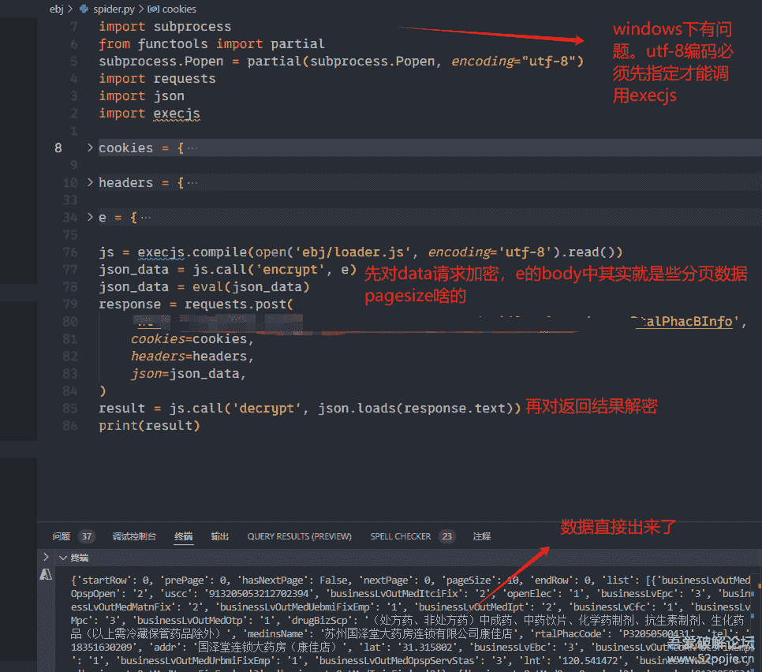

# [Web逆向] 一个可以练习webpack的站

- 原帖: https://www.52pojie.cn/forum.php?mod=viewthread&tid=2026911
- 抓取时间: 2026-11-01T22:10:21

## 网址

`aHR0cHM6Ly9mdXd1Lm5oc2EuZ292LmNuL25hdGlvbmFsSGFsbFN0LyMvc2VhcmNoL3BoYXJtYWNpZXM=`

## 分析

1. 发现发送 `request` 时候带着参数
2. 返回 `response` 也是加密过的

## 步骤

### 1. 查看网络接口
`f12` 看网络接口 `POST` 的传参

### 2. req 报文

```
{"data":{"data":{"encData":"3DFBCA4667B978F639BB23B95DCE4CC7FD8A6FBFABB29999F8D398B88F9EA7F3CCD20943B4DAE96380B41164D761DE97BBBD5DB53EA5E7154071E74EF0BE481E2BADC2FDCC843E425B4CA14CEDBC102C8FAC228E3FCCD7616813AFFBFC8928E064DE712DF3683DE81C358841664CBE17561D0390069F11B0D412FE38BE15BA5C"},"appCode":"T98HPCGN5ZVVQBS8LZQNOAEXVI9GYHKQ","version":"1.0.0","encType":"SM4","signType":"SM2","timestamp":1745474870,"signData":"e8NNcfuVvI4LfHjYRkQehhF0AAcrF+cnfFta0Bn1z4iJNCBTmRaWImrnB7iW8bQXoijuzne8Fo61AF6/ovAZKw=="}}
```

### 3. 断点定位
直接搜索 `interceptors.request(` 查找 `req` 拦截器，因为随便点了几个页面发现每个请求都带着 `encData` 这样的数据格式，试试拦截器。



1745475733377.png (78.87 KB, 下载次数: 0)

[href="forum.php?mod=attachment&aid=Mjc3MzM2OXxhODc5MjY5NXwxNzkzNTcxMDE5fDE2ODA4NnwyMDI2OTEx&nothumb=yes" target="_blank"](https://www.52pojie.cn/forum.php?mod=attachment&aid=Mjc3MzM2OXxhODc5MjY5NXwxNzkzNTcxMDE5fDE2ODA4NnwyMDI2OTEx&nothumb=yes)

3

2025-4-24 15:10 上传

发现有对 `data` 进行处理。打印下前后 `e` 的内容。加密信息给上了。那 `e=Object(u.a)(e)` 这个地方肯定做过了啥，跳转过去看看有 `sha256` 关键字。本来想扣代码的。一看这不是 `webpack` 么。直接暴力扣下来



1745476016494.png (28.87 KB, 下载次数: 0)

[href="forum.php?mod=attachment&aid=Mjc3MzM3MHw3N2I0MDYxYnwxNzkzNTcxMDE5fDE2ODA4NnwyMDI2OTEx&nothumb=yes" target="_blank"](https://www.52pojie.cn/forum.php?mod=attachment&aid=Mjc3MzM3MHw3N2I0MDYxYnwxNzkzNTcxMDE5fDE2ODA4NnwyMDI2OTEx&nothumb=yes)

4

2025-4-24 15:10 上传

## webpack 扣取

1. 看到图1中 `u= n("7d92")` 直接打断点，刷新页面进到加载器。标准的 `webpack` 格式。直接全部拷下来

放到 `loading.js` 中 7w 多行（本人菜狗，一个一个具体加载不如全部拷下来。ps 希望有大佬能教一下如何动态加载自动拷贝）

直接右击下运行下没问题。注意注释掉加载 `0` 的那行代码



1745476398716.png (74.2 KB, 下载次数: 0)

[href="forum.php?mod=attachment&aid=Mjc3MzM3MXxlZTQyMTdkNXwxNzkzNTcxMDE5fDE2ODA4NnwyMDI2OTEx&nothumb=yes" target="_blank"](https://www.52pojie.cn/forum.php?mod=attachment&aid=Mjc3MzM3MXxlZTQyMTdkNXwxNzkzNTcxMDE5fDE2ODA4NnwyMDI2OTEx&nothumb=yes)

5

2025-4-24 15:10 上传

2. 图1中只用到了 `u`，那么很好 `u = window.ooo('7d92')`；加载下就行了

3. 定义一个 `encrypt` 函数。然后从浏览器里把 `e` 拷贝出来。执行下发现请求加密加上了



1745477021920.png (143.19 KB, 下载次数: 0)

[href="forum.php?mod=attachment&aid=Mjc3MzM2N3xkY2QzMTM2MXwxNzkzNTcxMDE5fDE2ODA4NnwyMDI2OTEx&nothumb=yes" target="_blank"](https://www.52pojie.cn/forum.php?mod=attachment&aid=Mjc3MzM2N3xkY2QzMTM2MXwxNzkzNTcxMDE5fDE2ODA4NnwyMDI2OTEx&nothumb=yes)

1

2025-4-24 15:09 上传

4. `response` 解密同理。虽然不知道具体加密逻辑是什么。直接用 `u` 去调用就行

## python 封装

1. 直接赋值 `curl` 请求。丢网址上生成 `python` 脚本。
2. 使用 `execjs` 把刚才扣的 `js` 代码直接调用



1745477543950.png (159.72 KB, 下载次数: 0)

[href="forum.php?mod=attachment&aid=Mjc3MzM2OHxlNWI1MTk1MnwxNzkzNTcxMDE5fDE2ODA4NnwyMDI2OTEx&nothumb=yes" target="_blank"](https://www.52pojie.cn/forum.php?mod=attachment&aid=Mjc3MzM2OHxlNWI1MTk1MnwxNzkzNTcxMDE5fDE2ODA4NnwyMDI2OTEx&nothumb=yes)

2

2025-4-24 15:10 上传
