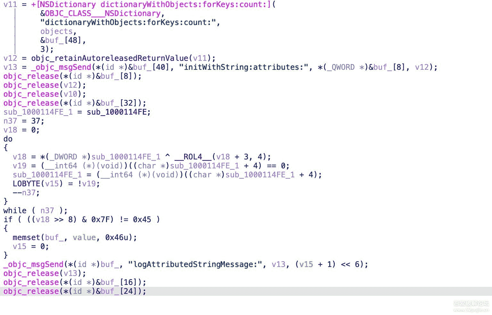
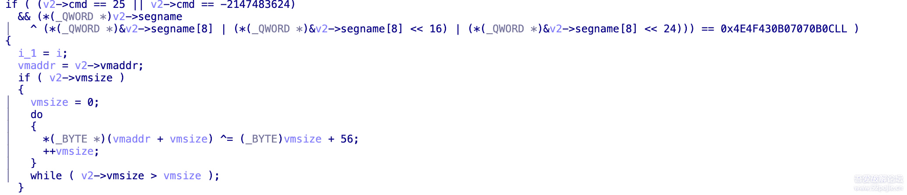

# [MacOS逆向] Hopper Disassembler for macOS之内存检测

- 原帖: https://www.52pojie.cn/forum.php?mod=viewthread&tid=2028033
- 抓取时间: 2026-11-01T22:10:11
- Hopper Disassembler 有内存检测，当内存代码被patch时，会异常退出。

现在有个重要函数，地址是`114FE`，通过`frida` hook

```javascript
function hook_sub_114FE() {
    //mem_patch(surge_base.base.add(0x114FE),64,1);
    x114FE_bak = x114FE_addr.readByteArray(16);

    Interceptor.attach(surge_base.base.add(0x114FE), {
        onEnter: function (args) {
        },

        // onLeave is called after the original function executes, before it returns
        onLeave: function (retval) {
            //console.log("[+] sub_1000CC940 returned (via attach) - onLeave");
            console.log("0x114FE    Original return value:", retval, "->", 1); // Log original return value
            retval.replace(0x1);
            //sub_114FE.detach();
        }
    });
}
```

启动后，打开一个文件反编译，就会崩溃。

## 使用硬件断点分析读取内存操作

参考了代码（https://github.com/hackcatml/frida-watchpoint-tutorial）

`frida` 在新版本中增加了硬件断点操作。

在`114FE`处，下硬件断点。

`installWatchpoint(0x114FE, 1, "r")`

```javascript
function installWatchpoint(addr, size, conditions) {
    _addr = addr;
    _size = size;
    _conditions = conditions;
    threads = Process.enumerateThreads();
    Process.setExceptionHandler(e => {
        if (['breakpoint', 'single-step'].includes(e.type)) {
            console.log(`\n[!] ${e.context.pc} ${e.context.pc.sub(surge_base.base)} tried to "${_conditions}" at ${_addr}`);
            for (const thread of threads) {
                if (thread.id === Process.getCurrentThreadId()) {
                    thread.unsetHardwareWatchpoint(0);
                    unsetWatchPoint = true;
                    return true;
                }
            }
        }
        return false;
    });
    for (const thread of threads) {
        try {
            thread.setHardwareWatchpoint(0, addr, size, conditions);
            console.log(` HardwareWatchpoint set at ${addr} (${thread.id} ${thread.name})`);
        } catch (error) {}
    }
}

function reInstallWatchPoint() {
    for (const thread of threads) {
        try {
            thread.setHardwareWatchpoint(0, _addr, _size, _conditions);
        } catch (error) {}
    }
}

var int = setInterval(() => {
    if (unsetWatchPoint) {
        reInstallWatchPoint();
        unsetWatchPoint = false;
    }
}, 0);
```

可以看到有两个地方在读取内存并校验，我们选择其中一个。



找到调用地方，`-[HopperDocument logErrorStringMessage:]`

`hook` 这个函数，在进入时，恢复内存，在离开时，设置`hook`。

```javascript
function logErrorStringMessage() {
    var logErrorStringMessage = ObjC.classes.HopperDocument["- logErrorStringMessage:"];
    Interceptor.attach(logErrorStringMessage.implementation, {
        onEnter(args) {
            mylog("logErrorStringMessage...")
            write_mem(x114FE_addr,x114FE_bak);
        },
        onLeave: function (retval) {
            write_mem(x114FE_addr,x114FE_patch);
        }
    })
}
```

再次启动程序，会发现已经检测不到内存修改了。

## 类似方法，可以找到 `tp_const` 解密算法，算法挺简单的。


