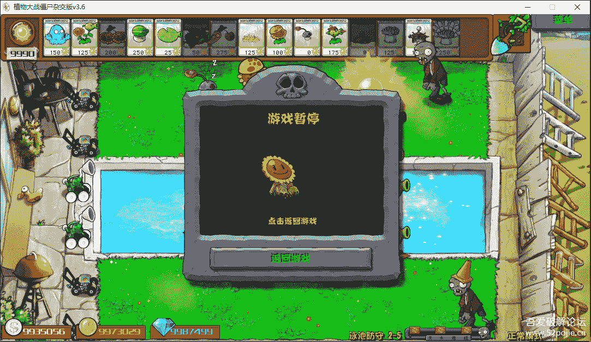
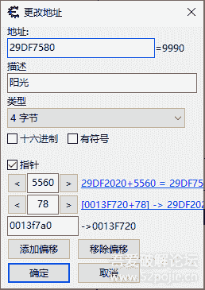
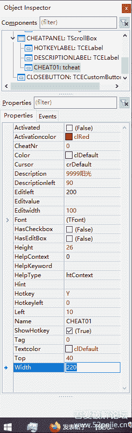
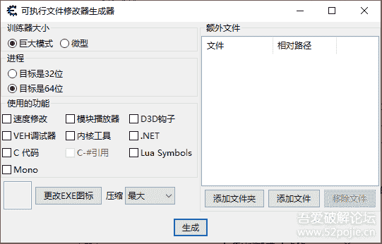
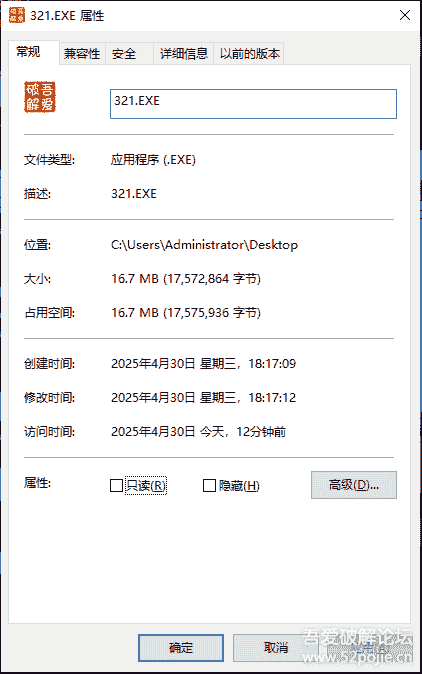

# [分享] 使用ce修改器修改植物大战僵尸杂交版3.6并生成exe

原帖: https://www.52pojie.cn/forum.php?mod=viewthread&tid=2028476  
抓取时间: 2026-11-01T22:10:08

昨天更新了，今天在试玩的时候发现有些问题，`2.0`的版本无了。索性自己写一个修改器，写一个阳光就行了。

`wechat_2025-04-30_173627_000.png` (949.19 KB, 下载次数: 5)

[href="forum.php?mod=attachment&aid=Mjc3NDg2NnwwNWU2MDllM3wxNzkzNTcxMDA2fDE2ODA4NnwyMDI4NDc2&nothumb=yes" target="_blank"](https://www.52pojie.cn/forum.php?mod=attachment&aid=Mjc3NDg2NnwwNWU2MDllM3wxNzkzNTcxMDA2fDE2ODA4NnwyMDI4NDc2&nothumb=yes)

2025-4-30 17:36 上传

## 1. 怎么找内存值

可以多找找资料。

`wechat_2025-04-30_173701_495.png` (19.95 KB, 下载次数: 5)

[href="forum.php?mod=attachment&aid=Mjc3NDg2N3w3NjE0Yzc4M3wxNzkzNTcxMDA2fDE2ODA4NnwyMDI4NDc2&nothumb=yes" target="_blank"](https://www.52pojie.cn/forum.php?mod=attachment&aid=Mjc3NDg2N3w3NjE0Yzc4M3wxNzkzNTcxMDA2fDE2ODA4NnwyMDI4NDc2&nothumb=yes)

2025-4-30 17:37 上传

## 2. 我主要说一下 ce修改器生成exe的问题

点击生成后会报错`CHEAT0`冲突，其实就是你上次创建没有正确稳定位置。

`wechat_2025-04-30_182215_551.png` (43.78 KB, 下载次数: 3)

[href="forum.php?mod=attachment&aid=Mjc3NDg3OHwwY2MwNjlhNnwxNzkzNTcxMDA2fDE2ODA4NnwyMDI4NDc2&nothumb=yes" target="_blank"](https://www.52pojie.cn/forum.php?mod=attachment&aid=Mjc3NDg3OHwwY2MwNjlhNnwxNzkzNTcxMDA2fDE2ODA4NnwyMDI4NDc2&nothumb=yes)

2025-4-30 18:22 上传

`Name`改一下，高度改成`26`，长度改成`220`就可以了。这个界面记得保存一下，想不到吧，这个界面还要保存哈哈哈。

`wechat_2025-04-30_182459_277.png` (21.56 KB, 下载次数: 6)

[href="forum.php?mod=attachment&aid=Mjc3NDg3OXw3MjQ1N2QwNXwxNzkzNTcxMDA2fDE2ODA4NnwyMDI4NDc2&nothumb=yes" target="_blank"](https://www.52pojie.cn/forum.php?mod=attachment&aid=Mjc3NDg3OXw3MjQ1N2QwNXwxNzkzNTcxMDA2fDE2ODA4NnwyMDI4NDc2&nothumb=yes)

2025-4-30 18:25 上传

然后就可以了，直接保存`exe`。如果你的生成`exe`无法显示，就是这个设计图形出问题了。

`wechat_2025-04-30_182611_592.png` (29.84 KB, 下载次数: 1)

[href="forum.php?mod=attachment&aid=Mjc3NDg4MHw5NzA2OWE5OXwxNzkzNTcxMDA2fDE2ODA4NnwyMDI4NDc2&nothumb=yes" target="_blank"](https://www.52pojie.cn/forum.php?mod=attachment&aid=Mjc3NDg4MHw5NzA2OWE5OXwxNzkzNTcxMDA2fDE2ODA4NnwyMDI4NDc2&nothumb=yes)

2025-4-30 18:26 上传

只是改内存，这个不需要勾勾画画（其他我也不会）。

## 接下来说重要的问题

版本问题 `7.5`：

- 我测试了可以`win10`系统
- `7.6`会出错`lua`脚本冲突，无法理解
- `7.3`根本创建不了，大小永远小`5m`，怀疑就是界面合不上去

如果你生成的大小在`16.7m`以下，说明你的界面设计有问题，一般会出现`10m-15m`大小。

`wechat_2025-04-30_182932_166.png` (38 KB, 下载次数: 4)

[href="forum.php?mod=attachment&aid=Mjc3NDg4MXw4ZTE4ZmU4OHwxNzkzNTcxMDA2fDE2ODA4NnwyMDI4NDc2&nothumb=yes" target="_blank"](https://www.52pojie.cn/forum.php?mod=attachment&aid=Mjc3NDg4MXw4ZTE4ZmU4OHwxNzkzNTcxMDA2fDE2ODA4NnwyMDI4NDc2&nothumb=yes)

2025-4-30 18:29 上传

最后附上`ce7.5`的压缩包。
