# [Web逆向] 信息公示平台搜索滑块逆向

- 原帖: https://www.52pojie.cn/forum.php?mod=viewthread&tid=2028581
- 抓取时间: 2026-11-01T22:10:06

本文章中所有内容仅供学习交流，抓包内容、敏感网址、数据接口均已做脱敏处理，严禁用于商业用途和非法用途，否则由此产生的一切后果均与作者无关，若有侵权，请联系我立即删除！

目标：实现搜索后，滑块验证，得到结果。

网站：aHR0cHM6Ly94eGdzLmNoaW5hbnBvLm1jYS5nb3YuY24vZ3N4dC9uZXdMaXN0

## 1. 显示输入搜索关键字触发滑块验证
显示输入搜索关键字，触发滑块验证，在`/slideCaptcha`也没有什么校验直接，直接拿到了数据，`a`和`b`后面要用到的参数，`c`中有`cutImage`和`oriImage`是背景和缺口图的base64编码数据。

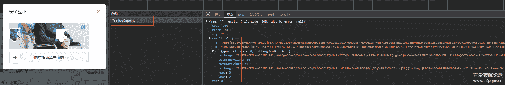

## 2. 校验滑块获取搜索数据
接下来校验滑块走一遍，看看如何拿到搜索后的数据。`slide_captcha_check`滑块的校验，请求参数中有`a` `b` `c`三个，验证成功后，请求`/gridQuery.html`获得搜索后的数据。所以只需要分析这三个参数的由来就行。

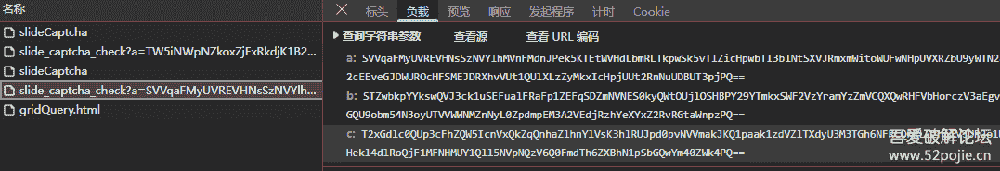

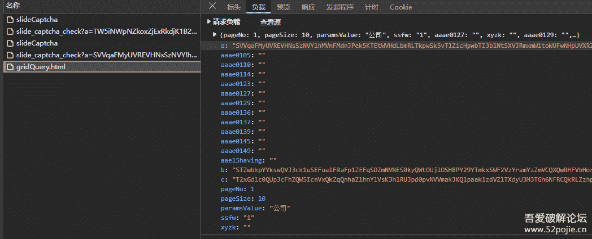

## 3. 参数特征
在`slide_captcha_check`中，`msg`结果我是遇到三种，大致看一下`a` `b` `c`都是=`结尾的很像base64下面就hook到生成的地方看看。

`success` 验证成功

`jcaptha invalid`好像是超时无效

`jcaptha wrong` 滑块的距离不对

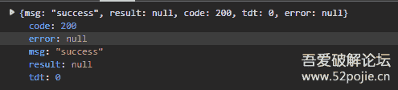

## 4. Hook JSON 生成
先是测试一下hook `JSON`中`stringify`，`parse`，能用，找到参数生成后，往上跟栈，往上走一步，发现`t`是生成后的结果，看一下`t`是如何来的。

```javascript
(function () {
    var stringify = JSON.stringify;
    JSON.stringify = function (params) {
        console.log("Hook JSON.stringify ——> ", params);
        debugger;
        return stringify(params);
    }
})();

(function () {
    var parse = JSON.parse;
    JSON.parse = function (params) {
        console.log("Hook JSON.parse ——> ", params);
        debugger;
        return parse(params);
    }
})();
```

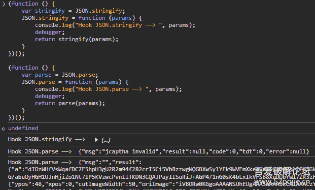

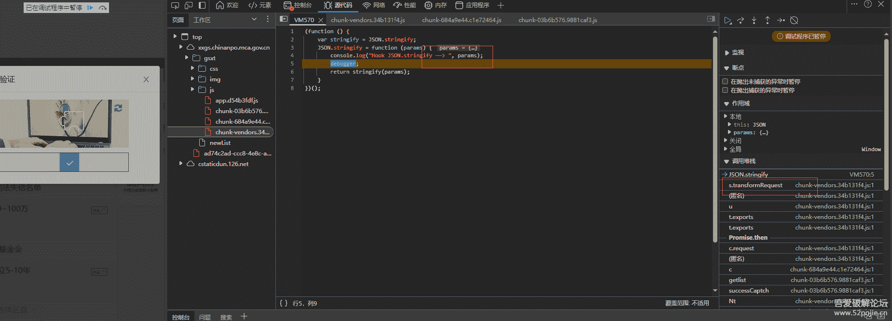

## 5. 定位 checkLocation
在往上跟一步，打上断点后，刷新页面重新定到滑动滑块后，继续往上分析栈，在`checkLocation`中发现了熟悉的字段，可以清空其他断点，只定这三个。

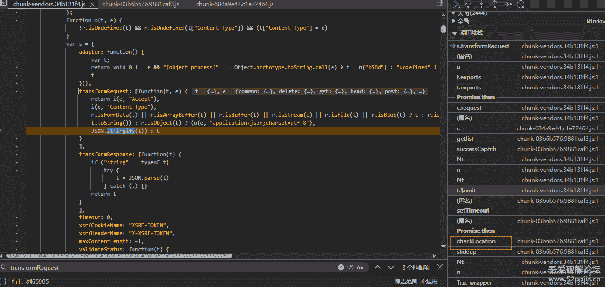

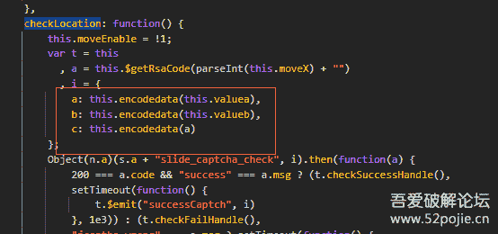

## 6. a b 参数生成
先看`a` `b`的值，是`valuea`和`valueb`经过`encodedata`得到的，`value a b`就是和返回图片base64数据一起返回的`a` `b`，`encodedata`就是base64编码。

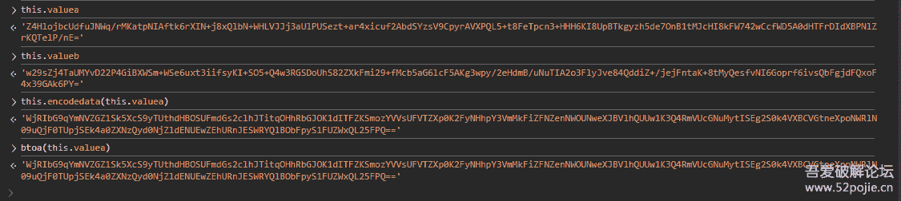

## 7. c 参数生成
主要是看一下`c`的生成，在`c`编码前，是对上面定义的`a`，`this.moveX`，顾名思义是滑动的距离，转成字符串，经过`this.$getRsaCode`得到的结果，直接跳转进去看看源码，打下断点。

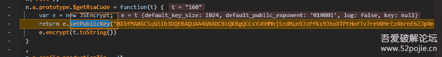

## 8. RSA 加密实现
这是一个典型的`rsa`加密，创建`JSEncrypt`对象，`JSEncrypt`是一个 JavaScript 库，用于执行 RSA 加密和解密操作。设置公钥，知道这些条件后直接上`python`代码。

`default_key_size`：1024位，表示RSA密钥的长度。
`default_public_exponent`：010001（十进制65537）。

```python
def rsa_encrypt(t):
    # 公钥字符串   PEM格式
    public_key_str = """-----BEGIN PUBLIC KEY-----
    公钥
    -----END PUBLIC KEY-----"""
    public_key = RSA.import_key(public_key_str)
    cipher = PKCS1_v1_5.new(public_key)
    message = str(t).encode('utf-8')
    encrypted_bytes = cipher.encrypt(message)
    encrypted_str = base64.b64encode(encrypted_bytes).decode('utf-8')
    return encrypted_str
```

## 9. 得到 c
得到的`rsa`加密滑动距离结果后，在进行`base64`编码得到`c`。

## 10. 滑块距离识别
滑块距离识别同样使用的`dddocr`，或者使用`cv2`，识别成功率五五开吧，看背景图缺口是纯白色，把滑块改成白色再用对比，感觉会成功率高一点把（有佬优化了，教教小生）。

```python
def get_distance(bg, tp, save_path=None):
    det = DdddOcr(det=False, ocr=False, show_ad=False)
    res = det.slide_match(tp, bg, simple_target=True)
    if save_path is not None:
        # 将背景图片的二进制数据加载为Pillow Image对象
        left, top, right, bottom = res['target'][0], res['target'][1], res['target'][2], res['target'][3]
        bg_image = Image.open(io.BytesIO(bg))
        draw = ImageDraw.Draw(bg_image)
        draw.rectangle([left, top, right, bottom], outline="red", width=2)
        bg_image.save(save_path)
        logger.info(f"已保存标注后的图片到: {save_path}")
        return res
    return res
```

至此该网站搜索的滑块分析完了，大致不难，感谢观看，给点热心值，感谢老铁们。

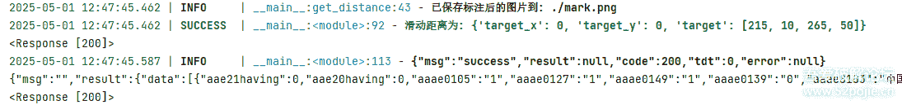
