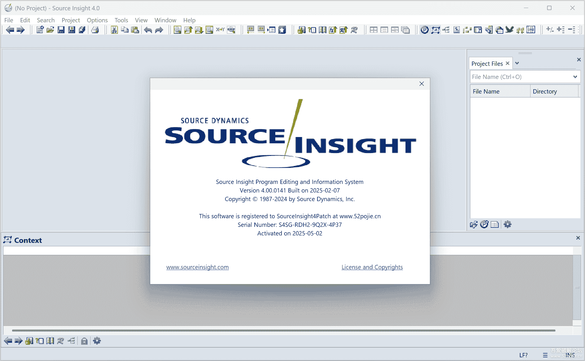

# [原创] 【Source Insight 4 CracKed Patch】更方便的 Source Insight 4 补丁及注册机

- 原帖: https://www.52pojie.cn/forum.php?mod=viewthread&tid=2028667
- 抓取时间: 2026-11-01T22:10:04

## 本文前言

Source Insight 4 是一款非常强大的源代码编辑器和代码分析工具，而对于其授权过程的逆向分析网上已经有许多文章了（本文结尾也贴了几个参考的帖子），本文不再赘述，这里仅分享一个本人编写的更方便的补丁及其实现方式，集成了联网验证补丁和注册机的功能，用于自动通过其授权而无需修改任何文件（众所周知添加不是修改x），代码放在了 [SourceInsight4Patch](https://github.com/YukiIsait/SourceInsight4Patch) 仓库。



Snipaste_2025-05-02_09-37-30.png (131.53 KB, 下载次数: 1)

https://www.52pojie.cn/forum.php?mod=attachment&aid=Mjc3NTAyOHxiYzFmMTIwNXwxNzkzNTcxMDAxfDE2ODA4NnwyMDI4NjY3&nothumb=yes

2025-5-2 10:01 上传

## 实现原理

通过在 Source Insight 4 的程序目录中伪造并代理其导入的系统库 `msimg32.dll` 来注入其进程（使用本人制作的小工具 [ProxyPESourceGenerator](https://github.com/YukiIsait/ProxyPESourceGenerator) 生成用于代理 `msimg32.dll` 的源代码），并使用微软的 [Detours](https://github.com/microsoft/Detours) 库劫持其哈希校验和联网校验功能后自动生成授权文件以本地激活。

### 劫持校验

#### 劫持哈希校验功能部分

```
BOOL Patch::CryptVerifySignatureW(HCRYPTHASH hHash, const BYTE* pbSignature, DWORD dwSigLen, HCRYPTKEY hPubKey, LPCWSTR szDescription, DWORD dwFlags) {
    // 跳过签名验证
    return TRUE;
}
```

#### 劫持联网校验功能部分

```
HINTERNET Patch::InternetOpenW(LPCWSTR lpszAgent, DWORD dwAccessType, LPCWSTR lpszProxy, LPCWSTR lpszProxyBypass, DWORD dwFlags) {

    // 阻止检查授权，防止序列号被加入在线黑名单

    // 检查授权的 UA 是 Source Insight，检查更新的 UA 是 SourceInsight/4.0

    if (std::wcscmp(lpszAgent, L"Source Insight") == 0) {

        SetLastError(ERROR_ACCESS_DENIED);

        return NULL;

    }

    return internetOpenW(lpszAgent, dwAccessType, lpszProxy, lpszProxyBypass, dwFlags);

}
```

### 授权文件生成

#### 生成序列号部分

```
wchar_t LicenseSerial::GenerateRandomLetterOrDigit() {
    std::uniform_int_distribution distribution(0, 35);
    uint16_t randomValue = distribution(randomEngine);
    if (randomValue  distribution(0, 3);
    switch (distribution(randomEngine)) {
        case 0:
            return L'R';
        case 1:
            return L'G';
        case 2:
            return L'D';
        default:
            return L'F';
    }
}

std::wstring LicenseSerial::Generate() {
    std::wstring serial(19, L'-');
    wchar_t* serialData = serial.data();
    serialData[0] = L'S';
    serialData[1] = L'S';
    serialData[2] = L'S';
    serialData[3] = L'G';
    serialData[5] = GenerateRandomLetterOrDigit();
    serialData[6] = GenerateRandomRGDF();
    serialData[7] = GenerateRandomLetterOrDigit();
    serialData[8] = GenerateRandomLetterOrDigit();
    for (size_t i = 0; i 
```

#### 生成授权文件部分

```
void License::EnsureAvailability() {

    // 获取 %ProgramData%\Source Insight\4.0\si4.lic 文件路径，如果父目录不存在则创建

    std::array commonAppDataPath;

    if (SHGetFolderPathW(nullptr, CSIDL_COMMON_APPDATA, nullptr, 0, commonAppDataPath.data()) != S_OK) {

        throw std::runtime_error("Failed to get CSIDL_COMMON_APPDATA path, error code: " + std::to_string(GetLastError()));

    }

    std::filesystem::path licenseFilePath = std::filesystem::path(commonAppDataPath.data()) / L"Source Insight" / L"4.0" / L"si4.lic";

    std::filesystem::create_directories(licenseFilePath.parent_path());

    // 如果 License 文件不存在或不包含 SourceInsight4Patch 字符串，则生成一个新的

    std::wfstream licenseFile;

    licenseFile.exceptions(std::ifstream::failbit | std::ifstream::badbit);

    if (std::filesystem::exists(licenseFilePath)) {

        licenseFile.open(licenseFilePath, std::ios::in);

        std::span magic(L"SourceInsight4Patch", 19);

        std::istreambuf_iterator end;

        if (std::search(std::istreambuf_iterator(licenseFile), end, magic.begin(), magic.end()) != end) {

            licenseFile.close();

            return;

        }

        licenseFile.close();

    }

    licenseFile.open(licenseFilePath, std::ios::out | std::ios::trunc);

    LicenseSerial licenseSerial;

    std::chrono::time_point now = std::chrono::system_clock::now();

    licenseFile \n" \

                               L"    

- \n" \

                               L"    \n" \

                               L"", licenseSerial.Generate(), now);

    licenseFile.close();

}
```

## 使用方式

- 从官网下载并安装 Source Insight 4。
- 将 `msimg32.dll` 复制到 Source Insight 4 的安装目录中。
- 运行 Source Insight 4 即可正常使用。

## 使用说明

- Source Insight 4 具有网络验证功能，本工具通过劫持 `InternetOpenW` 并根据其联网验证的 UA 来阻止其验证以及上传序列号的功能，而又不影响其检测更新的功能，这样本工具生成的序列号将不会被上传到黑名单。
- Source Insight 4 内置了一些硬编码的黑名单序列号，本工具通过首次启动时随机生成序列号来规避，如果真的撞大运了（?）恰巧遇到自动生成的序列号在黑名单中，可以手动删除 `%ProgramData%\Source Insight\4.0\si4.lic` 并重启软件来重新生成序列号。
- Source Insight 4 在检查更新时会联网下载黑名单序列号列表，你懂的，如果真的撞大运了（?）按上述方法解决即可。

## 相关链接

- https://www.sourceinsight.com/download/
- https://github.com/YukiIsait/SourceInsight4Patch
- https://wwjz.lanzoul.com/b0aw9bzib（密码：YUKI / 文件：SourceInsight4Patch.zip）

## 参考帖子

- https://www.52pojie.cn/thread-1770613-1-1.html
- https://www.52pojie.cn/thread-1797076-1-1.html
- https://www.52pojie.cn/thread-1247470-1-1.html

## 免责声明

本补丁仅供技术交流使用。我们感谢软件作者的辛勤努力，强烈鼓励用户支持正版，以便软件得以持续改进和更新。未经软件作者许可，不得将本补丁用于商业用途或侵犯版权行为。使用本补丁所产生的一切后果由用户自行承担，与补丁提供者无关。
