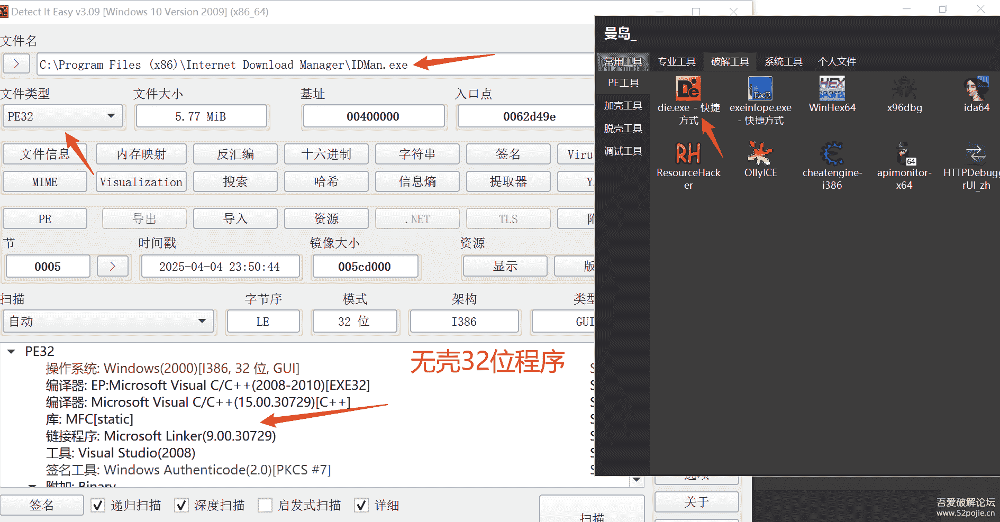
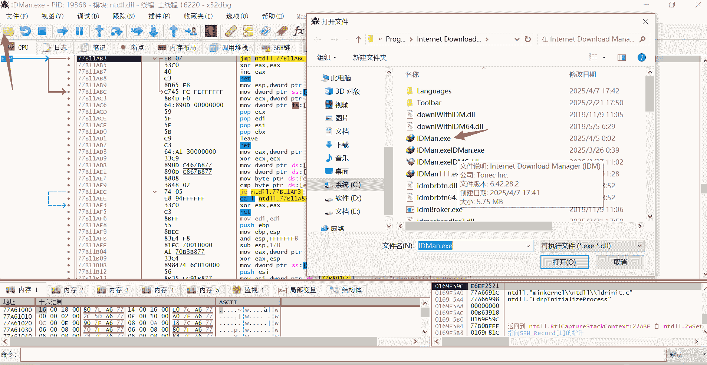
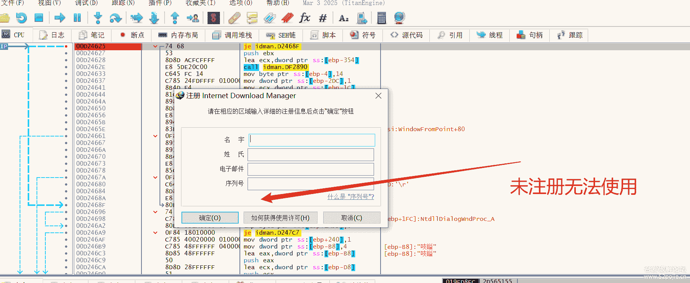
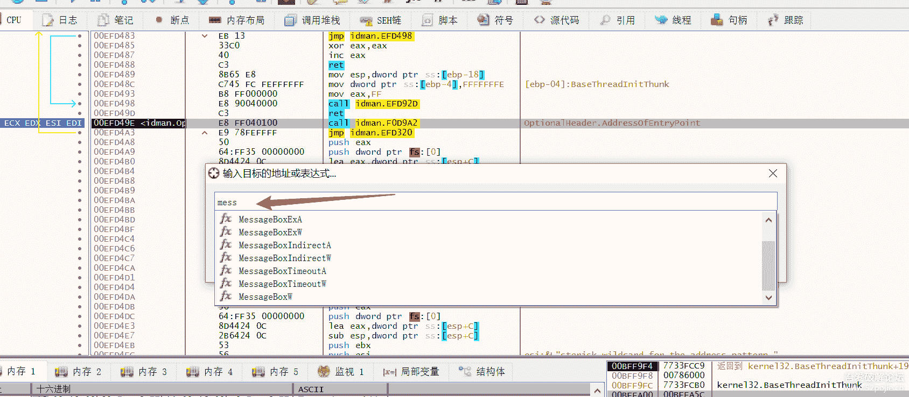
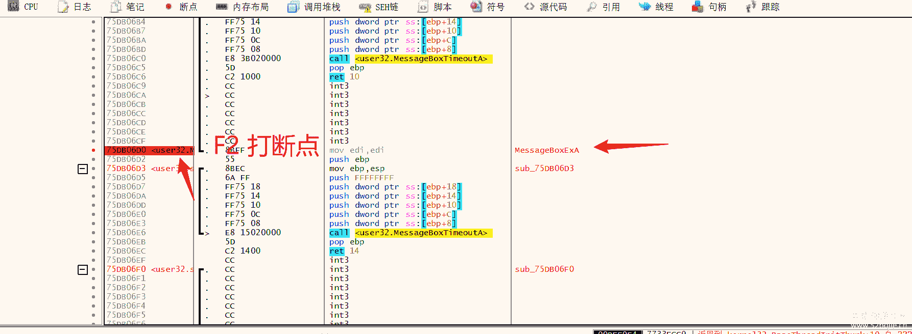
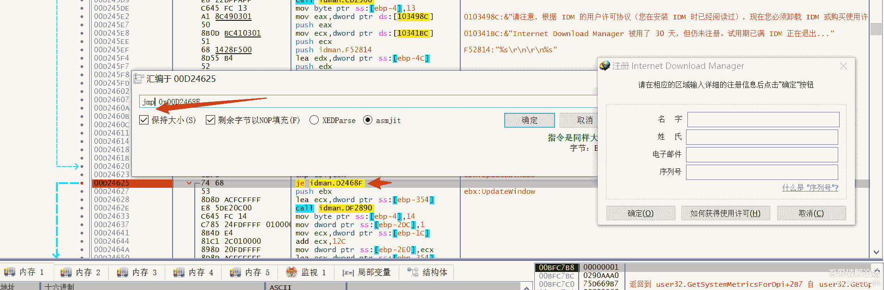
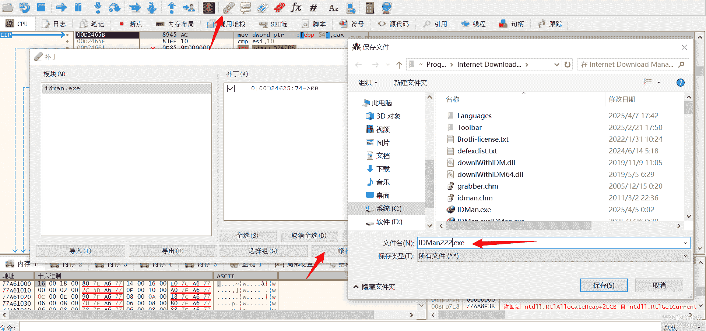
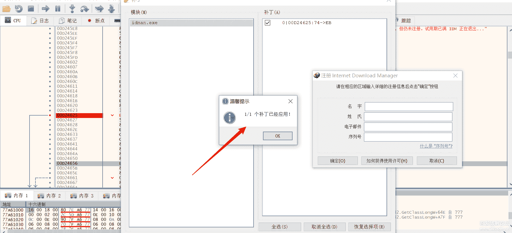
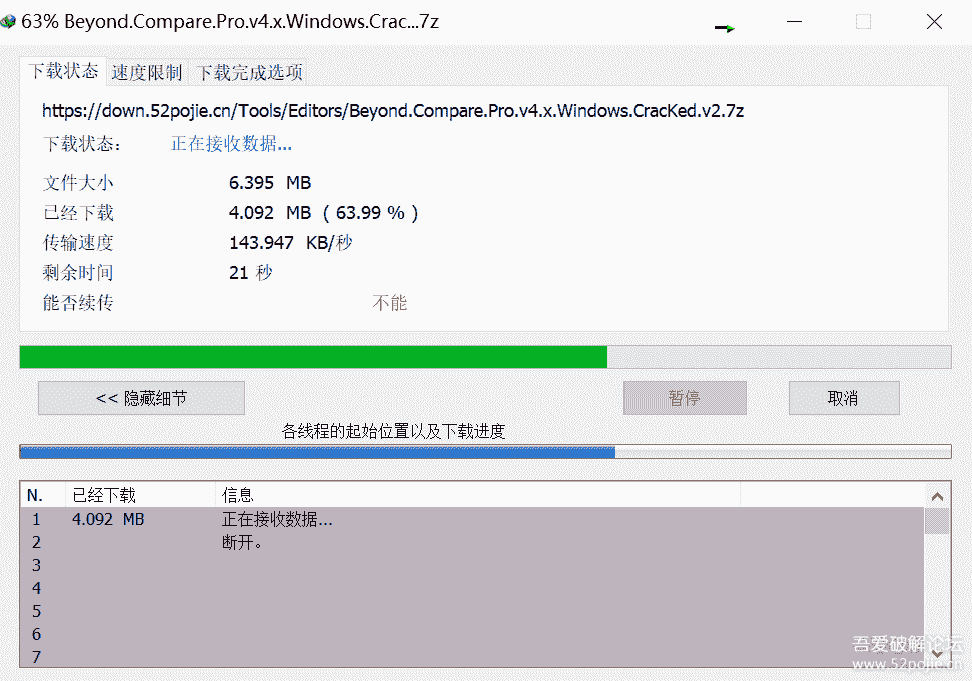

# [原创] 基于`x32dbg`破解idm

- 原帖：<https://www.52pojie.cn/forum.php?mod=viewthread&tid=2029943>
- 抓取时间：2026-11-01T22:09:57

小白贴，仅供个人研究学习

## 前言

本文将通过逆向工程案例分析，演示如何利用`x32dbg`调试器分析Windows应用程序的保护机制。研究对象为某下载管理软件的注册模块，通过本案例学习：

- 逆向工程基本方法论
- `x32dbg`高级调试技巧
- 内存补丁技术原理
- 软件保护机制分析

（注：文中案例仅用于教学演示，请支持正版软件）

## 一、实验环境准备

### 1. 工具清单

- `x32dbg`
- PE分析工具：`DIE`（[//www.52pojie.cn/thread-661779-1-1.html](https://www.52pojie.cn/thread-661779-1-1.html)）
- 环境：Windows 10 22H2（主要是防不良分子，怕有病毒）
- 目标程序：Internet Download Manager 6.xx

### 2. 安全须知

- 在隔离虚拟机环境操作
- 禁用杀毒软件实时监控（仅限实验环境）
- 操作前创建系统快照

## 二、逆向分析流程

### 2.1 目的

通过逆向IDM。绕过程序注册，直接运行主程序。

### 2.2 查壳

`DIE`工具查壳：`IDMan.exe`为无壳32位程序。



`查壳.png`（192.19 KB，下载次数：0）

[附件](https://www.52pojie.cn/forum.php?mod=attachment&aid=Mjc3NTk2MXw4ZjNlNWJkNXwxNzkzNTcwOTk0fDE2ODA4NnwyMDI5OTQz&nothumb=yes)

2025-5-8 15:23 上传

### 2.1 验证机制定位

1. 打开`x32dbg`。

    

    `x32dbg.png`（14.06 KB，下载次数：0）

    [附件](https://www.52pojie.cn/forum.php?mod=attachment&aid=Mjc3NTk2MnxhZjEwYTdlYnwxNzkzNTcwOTk0fDE2ODA4NnwyMDI5OTQz&nothumb=yes)

    2025-5-8 15:23 上传

2. 打开需要动态调试的程序`IDMan.exe`。

    

    `打开程序.png`（292.73 KB，下载次数：0）

    [附件](https://www.52pojie.cn/forum.php?mod=attachment&aid=Mjc3NTk2M3xlMGZiN2JkZHwxNzkzNTcwOTk0fDE2ODA4NnwyMDI5OTQz&nothumb=yes)

    2025-5-8 15:24 上传

3. 问题现象：如果未注册`IDMan.exe`会自动退出。

    

    `未注册.png`（181.54 KB，下载次数：0）

    [附件](https://www.52pojie.cn/forum.php?mod=attachment&aid=Mjc3NTk2NHw3NzBmYWZiN3wxNzkzNTcwOTk0fDE2ODA4NnwyMDI5OTQz&nothumb=yes)

    2025-5-8 15:24 上传

4. API断点追踪：绕过注册，直接使用。原理：程序弹出窗体是调用Windows API函数，一般是以下函数，而该程序中显示是超过30天，那很有可能也调用`MessageBoxTimeoutA`函数，根据猜想可以在以下函数处打断点。

    弹出窗体函数：
    - `MessageBoxW`
    - `MessageBoxA`
    - `MessageBoxTimeoutA`

    按`ctrl+G`回车键，在`x32dbg`中搜索以上函数，找到位置按`F2`打断点。

    

    `api函数打断点.png`（163.23 KB，下载次数：0）

    [附件](https://www.52pojie.cn/forum.php?mod=attachment&aid=Mjc3NTk2NXxmZTJlOTc4ZnwxNzkzNTcwOTk0fDE2ODA4NnwyMDI5OTQz&nothumb=yes)

    2025-5-8 15:25 上传

    

    `f2打断点.png`（133.61 KB，下载次数：0）

    [附件](https://www.52pojie.cn/forum.php?mod=attachment&aid=Mjc3NTk2NnxkN2Y1Y2M0ZHwxNzkzNTcwOTk0fDE2ODA4NnwyMDI5OTQz&nothumb=yes)

    2025-5-8 15:25 上传

### 2.2 关键跳转定位

这一步需要花费时间调试，是绕过的关键步骤。

通过调试定位注册窗体。

`F9`开始调试，`F8`单步执行，直至弹出注册窗体。

找到代码关键位置：

```asm
74 68 jz 0x00D2468F ; 修改为 jmp
```

### 2.3 打补丁

1. 在`x32dbg`窗口。在代码关键位置右键汇编将`jz`修改为`jmp`。勾选剩余字节以`NOP`填充，保持大小，点击确定后，关掉修改窗口。

    

    `修改强制跳转.png`（169.72 KB，下载次数：0）

    [附件](https://www.52pojie.cn/forum.php?mod=attachment&aid=Mjc3NTk2N3xlNDVlYjFiMnwxNzkzNTcwOTk0fDE2ODA4NnwyMDI5OTQz&nothumb=yes)

    2025-5-8 15:26 上传

2. 点击打补丁按钮开始打补丁，程序重命名为`IDMan222.exe`。

    

    `打补丁.png`（188.02 KB，下载次数：1）

    [附件](https://www.52pojie.cn/forum.php?mod=attachment&aid=Mjc3NTk2OHw3YWZmYTJmNnwxNzkzNTcwOTk0fDE2ODA4NnwyMDI5OTQz&nothumb=yes)

    2025-5-8 15:26 上传

    

    `补丁成功.png`（142.36 KB，下载次数：0）

    [附件](https://www.52pojie.cn/forum.php?mod=attachment&aid=Mjc3NTk2OXwzYTAzNzU2N3wxNzkzNTcwOTk0fDE2ODA4NnwyMDI5OTQz&nothumb=yes)

    2025-5-8 15:27 上传

3. 运行打补丁后的`IDMan222.exe`程序，下载成功，则代表绕过注册成功。

    

    `正常下载.png`（47.35 KB，下载次数：0）

    [附件](https://www.52pojie.cn/forum.php?mod=attachment&aid=Mjc3NTk3MXw0NWJmMjlhOHwxNzkzNTcwOTk0fDE2ODA4NnwyMDI5OTQz&nothumb=yes)

    2025-5-8 15:27 上传

## 三、防御与反制技术

### 3.1 软件加固方法

既然有绕过注册的方法，那么当然有防御与反制的技术，以下是常用的技术。

1. 代码混淆技术
    - 控制流平坦化
    - 虚假跳转指令注入
2. 完整性校验：

    ```c
    if (CalcCRC(".text") != 0x12345678)
        SelfDestruct();
    ```
3. 加壳
4. 动态检测IP，封禁IP
5. 蓝屏
6. 格盘（这种建议不要做，事不能做绝。俗话说做人留一线，日后好相见。咋们是善良的人，不能做违法的事）

## 四、法律与道德声明

1. 本文仅用于：
    - 软件安全技术研究
    - 逆向工程方法论学习
    - 保护机制开发参考
2. 严格禁止：
    - 商业行为（[www.52pojie.cn](https://www.52pojie.cn)）
    - 软件版权侵犯
    - 非法程序传播
