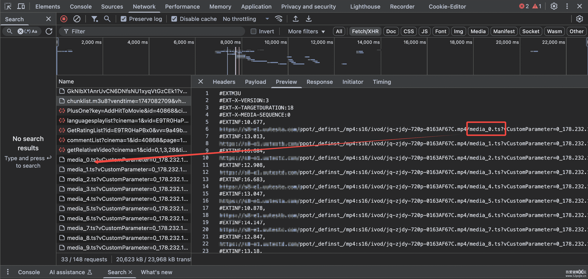
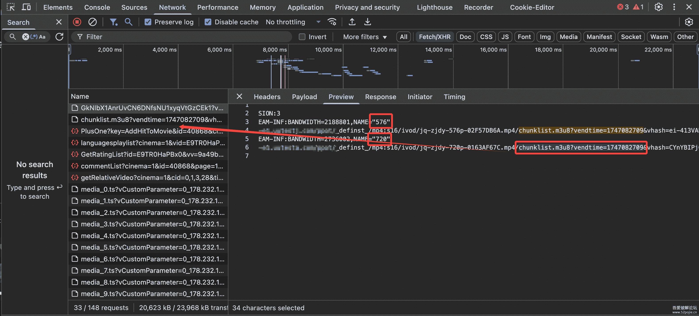
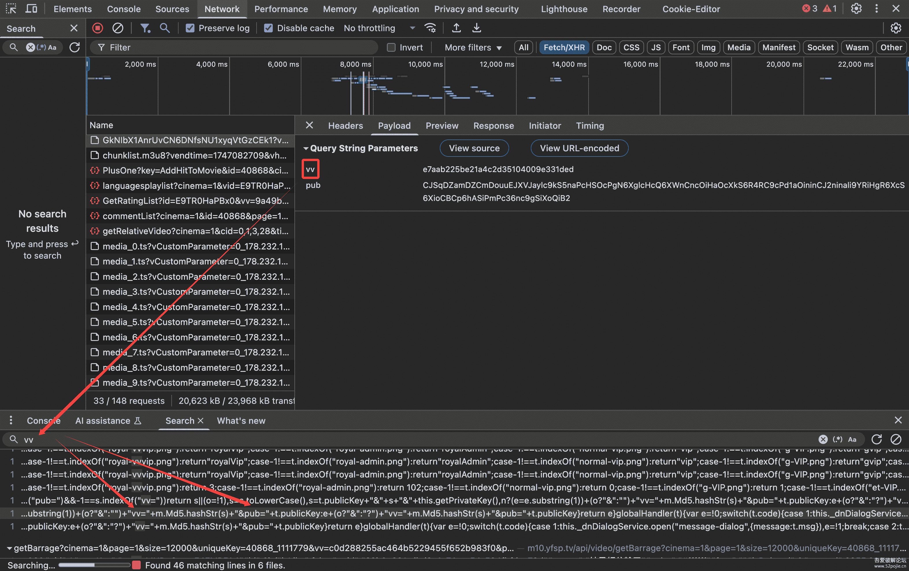
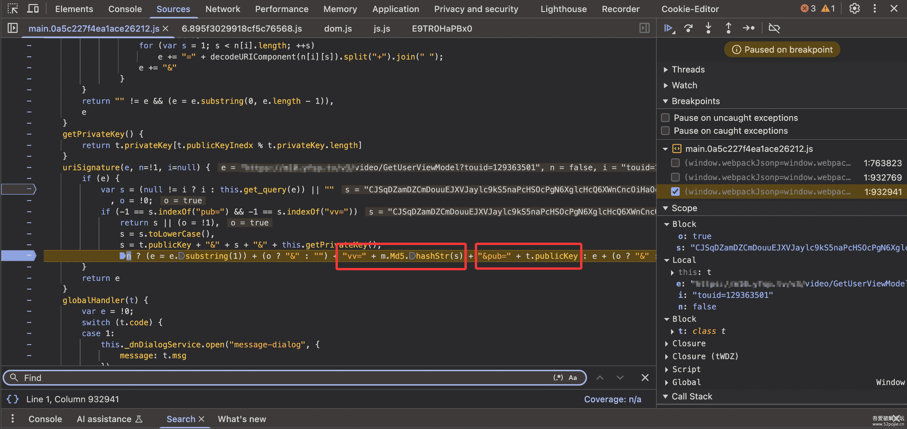

# [Web逆向] 【js逆向】爱xx视频逆向分析

- 原帖: https://www.52pojie.cn/forum.php?mod=viewthread&tid=2030526
- 抓取时间: 2026-11-01T22:09:48

本文章中所有内容仅供学习交流使用，不用于其他任何目的，不提供完整代码，抓包内容、敏感网址、数据接口等均已做脱敏处理，严禁用于商业用途和非法用途，否则由此产生的一切后果均与作者无关.本文章未经许可禁止转载，禁止任何修改后二次传播，擅自使用本文讲解的技术而导致的任何意外，作者均不负责

---

目标网址：`aHR0cHM6Ly93d3cueWZzcC50di9wbGF5L0U5VFIwSGFQQngw`

---

重拾`js`逆向，请多指教！网站有点简单。`f12`，输入网址后回车，点击`xhr`查看数据包：



`01.png` (723.5 KB, 下载次数: 1)

[https://www.52pojie.cn/forum.php?mod=attachment&aid=Mjc3NjQ3Nnw1NWZmZTI2NnwxNzkzNTcwOTg1fDE2ODA4NnwyMDMwNTI2&nothumb=yes](https://www.52pojie.cn/forum.php?mod=attachment&aid=Mjc3NjQ3Nnw1NWZmZTI2NnwxNzkzNTcwOTg1fDE2ODA4NnwyMDMwNTI2&nothumb=yes)

2025-5-11 06:48 上传

可以看到的是，视频输出`ts`在某一个`.m3u8`的文件内，并且没有任何的加密方式，也就是视频可以直接下载。那么怎么获得这个`.m3u8`呢？

定位到`.m3u8`文件也是在上一个文件中生成的



`02.png` (501.91 KB, 下载次数: 0)

[https://www.52pojie.cn/forum.php?mod=attachment&aid=Mjc3NjQ3N3wyYzVjMGUxOXwxNzkzNTcwOTg1fDE2ODA4NnwyMDMwNTI2&nothumb=yes](https://www.52pojie.cn/forum.php?mod=attachment&aid=Mjc3NjQ3N3wyYzVjMGUxOXwxNzkzNTcwOTg1fDE2ODA4NnwyMDMwNTI2&nothumb=yes)

2025-5-11 06:49 上传

然后分析这个文件是怎么生成的，可以看到的是传入了`vv`和`pub`两个参数。全局搜索之后可以发现，`vv`和`pub`都是同时写入一个参数`e`.



`03.png` (805.73 KB, 下载次数: 1)

[https://www.52pojie.cn/forum.php?mod=attachment&aid=Mjc3NjQ3OHwyZTY4ODA4YXwxNzkzNTcwOTg1fDE2ODA4NnwyMDMwNTI2&nothumb=yes](https://www.52pojie.cn/forum.php?mod=attachment&aid=Mjc3NjQ3OHwyZTY4ODA4YXwxNzkzNTcwOTg1fDE2ODA4NnwyMDMwNTI2&nothumb=yes)

2025-5-11 06:49 上传

直接定位到位置，然后打上断点，可以看到`vv`是通过`md5`加密再转字符串；`pub`就是`publicKey`。后续我们知道`PrivateKey`和`publicKey`都是在网页打开之初就自动生成的。



`04.png` (520.95 KB, 下载次数: 1)

[https://www.52pojie.cn/forum.php?mod=attachment&aid=Mjc3NjQ3OXw2NzZiMzAwMnwxNzkzNTcwOTg1fDE2ODA4NnwyMDMwNTI2&nothumb=yes](https://www.52pojie.cn/forum.php?mod=attachment&aid=Mjc3NjQ3OXw2NzZiMzAwMnwxNzkzNTcwOTg1fDE2ODA4NnwyMDMwNTI2&nothumb=yes)

2025-5-11 06:49 上传

到了这一步我们就把该代码抠出来

[JavaScript] 纯文本查看 复制代码

```javascript
function uriSignature(e, n=!1, i=null) {
    if (e) {
        var s = (null != i ? i : this.get_query(e)) || ""
          , o = !0;
        if (-1 == s.indexOf("pub=") && -1 == s.indexOf("vv="))
            return s || (o = !1),
            s = s.toLowerCase(),
            s = t.publicKey + "&" + s + "&" + this.getPrivateKey(),
            n ? (e = e.substring(1)) + (o ? "&" : "") + "vv=" + m.Md5.hashStr(s) + "&pub=" + t.publicKey : e + (o ? "&" : "?") + "vv=" + m.Md5.hashStr(s) + "&pub=" + t.publicKey
    }
    return e
}
```

进一步地，我们在`Node.js`里面补充我们需要的元素，缺啥补啥。`m.Md5.hashStr`函数可以直接调包使用，用函数 `hashStr()` 替代。

[JavaScript] 纯文本查看 复制代码

```javascript
const crypto = require('crypto');

function hashStr(t) {

  return crypto.createHash('md5').update(t, 'utf8').digest('hex');

}

function getPrivateKey() {

    return t.privateKey[t.publicKeyInedx % t.privateKey.length]

}

function get_query(t) {

    var e = "";

    if (t.indexOf("?") > -1) {

        var n = t.substring(t.indexOf("?") + 1).split("&");

        if (n.length > 0)

            for (var i = 0; i 
```

后续的工作省略了，例如全局搜索`publicKey`或者`privateKey`，这两个数值可以在视频页面文本中获得。

每个视频网页对应的`e`的数值不同，但可以通过进一步地分析获得，但“加密方式”是一样的，都需要获得对应的`vv`和`pub`数值，聪明的你一定可以发现怎么进一步获取数值`e`。


以后还得多多跟前辈们学习。
