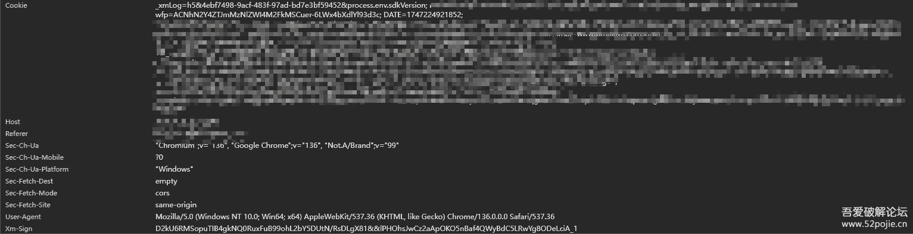
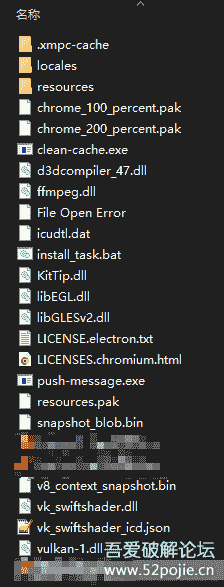
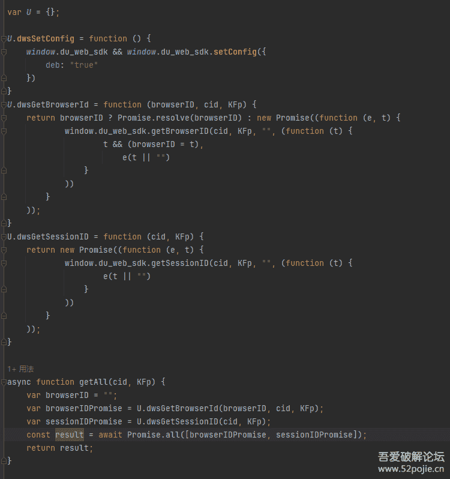
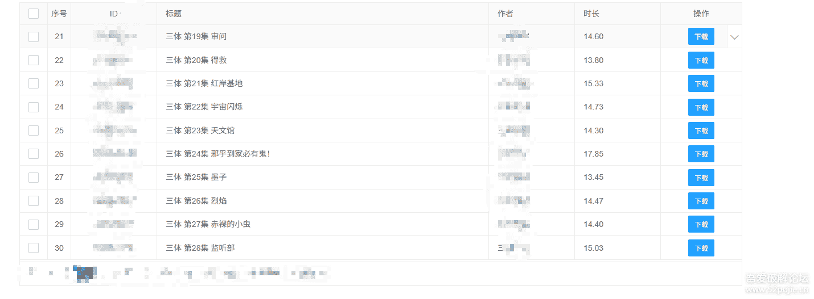
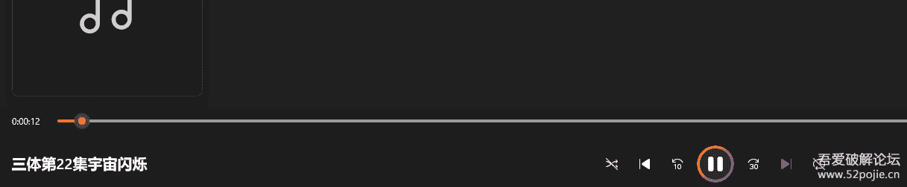

# [Web逆向] 音频网站逆向如何进行捞偏门

- 原帖：<https://www.52pojie.cn/forum.php?mod=viewthread&tid=2031462>
- 抓取时间：2026-11-01T22:09:39

> 本文章中所有内容仅供学习交流使用，不用于其他任何目的，不提供完整代码，抓包内容、敏感网址、数据接口等均已做脱敏处理，严禁用于商业用途和非法用途，否则由此产生的一切后果均与作者无关.本文章未经许可禁止转载，禁止任何修改后二次传播，擅自使用本文讲解的技术而导致的任何意外，作者均不负责

正文开始

严格来说这不算真正的 js 逆向，算是捞了一次偏门，真正去逆向太复杂中间还要多重计算，请求校验接口之类的复杂的处理逻辑。最终嫌麻烦采用师夷长技以制夷（不知道这句话合不合适）用魔法打败魔法，直接用它的，哈哈

此次逆向有两个难点：一个是它的 `sign`、`wfp`，还有就是 `url` 解密，下面一步一步进行处理

## 1. 处理 `sign` 与 `wfp`

首先，`sign`、`wfp` 可以合并一个进行处理。



image.png (60.85 KB, 下载次数: 2)

[附件](https://www.52pojie.cn/forum.php?mod=attachment&aid=Mjc3NzA0MXw4MTY3MjUwOHwxNzkzNTcwOTc3fDE2ODA4NnwyMDMxNDYy&nothumb=yes)

2025-5-14 20:26 上传

web版和windows桌面版都是用的同一个接口，web版更新频繁，windows要比web更新慢，看一眼windows程序的结构



image.png (25.33 KB, 下载次数: 0)

[附件](https://www.52pojie.cn/forum.php?mod=attachment&aid=Mjc3NzA0Mnw1MjVlNTAzMHwxNzkzNTcwOTc3fDE2ODA4NnwyMDMxNDYy&nothumb=yes)

2025-5-14 20:29 上传

一眼 Electron。解密开始：使用 `asar` 解包（使用 `npm` 下载即可），解完包后会出现 `app` 文件，找到 `X.X.X.js` 这个文件，这个就是计算 `xm-sign` 信息的文件。

主要计算逻辑是将 `cid` 与 `kdf` 这两个参数先进行加密请求后台的校验接口返回结果后经过加密，解密最终得到 `sign` 的值，太复杂太复杂，懒得搞。

直接采用 js 的方式引用这个 `x.x.x.js`，修改调用方法完美解决，因为 `sign` 加密不涉及 `token` 信息，不需要自己在重写加密方法。下面是调用逻辑：



image.png (81.03 KB, 下载次数: 0)

[附件](https://www.52pojie.cn/forum.php?mod=attachment&aid=Mjc3NzA0M3xiOGU3NjlhZnwxNzkzNTcwOTc3fDE2ODA4NnwyMDMxNDYy&nothumb=yes)

2025-5-14 20:40 上传

`cid` 和 `kpf` 自己去源码里找吧，很明显就能看到，这样就解决了 `xm-sign` 的反爬虫校验问题。

## 2. 处理 `wpf` 与 `url` 解密

还有一个 `wpf`，这个是根据浏览器、系统信息经过一系列的加密后请求接口后的返回值再经过加密的结果，麻烦非常麻烦。

咱们继续捞偏门，好在这个就直接在 `cookie` 里面就有，拿过来直接用，哈哈。

这样就解决了请求头反爬虫校验，还有一个重要的问题就是 `url` 解密，这个比较简单，`base64` 加解密。

Python 代码：

```python
inito = bytes([183, 174, 108, 16, 131, 159, 250, 5, 239, 110, 193, 202, 153, 137, 251, 176, 119, 150, 47, 204, 97, 237,
               1, 71, 177, 42, 88, 218, 166, 82, 87, 94, 14, 195, 69, 127, 215, 240, 225, 197, 238, 142, 123, 44, 219,
               50, 190, 29, 181, 186, 169, 98, 139, 185, 152, 13, 141, 76, 6, 157, 200, 132, 182, 49, 20, 116, 136, 43,
               155, 194, 101, 231, 162, 242, 151, 213, 53, 60, 26, 134, 211, 56, 28, 223, 107, 161, 199, 15, 229, 61,
               96,
               41, 66, 158, 254, 21, 165, 253, 103, 89, 3, 168, 40, 246, 81, 95, 58, 31, 172, 78, 99, 45, 148, 187, 222,
               124, 55, 203, 235, 64, 68, 149, 180, 35, 113, 207, 118, 111, 91, 38, 247, 214, 7, 212, 209, 189, 241, 18,
               115, 173, 25, 236, 121, 249, 75, 57, 216, 10, 175, 112, 234, 164, 70, 206, 198, 255, 140, 230, 12, 32,
               83,
               46, 245, 0, 62, 227, 72, 191, 156, 138, 248, 114, 220, 90, 84, 170, 128, 19, 24, 122, 146, 80, 39, 37, 8,
               34, 22, 11, 93, 130, 63, 154, 244, 160, 144, 79, 23, 133, 92, 54, 102, 210, 65, 67, 27, 196, 201, 106,
               143, 52, 74, 100, 217, 179, 48, 233, 126, 117, 184, 226, 85, 171, 167, 86, 2, 147, 17, 135, 228, 252,
               105,
               30, 192, 129, 178, 120, 36, 145, 51, 163, 77, 205, 73, 4, 188, 125, 232, 33, 243, 109, 224, 104, 208,
               221,
               59, 9])
inita = bytes(
    [204, 53, 135, 197, 39, 73, 58, 160, 79, 24, 12, 83, 180, 250, 101, 60, 206, 30, 10, 227, 36, 95, 161, 16, 135, 150,
     235, 116, 242, 116, 165, 171])

initr = bytes(
    [188, 174, 178, 234, 171, 147, 70, 82, 76, 72, 192, 132, 60, 17, 30, 127, 184, 233, 48, 105, 38, 232, 240, 21, 47,
     252, 41, 229, 209, 213, 71, 40, 63, 152, 156, 88, 51, 141, 139, 145, 133, 2, 160, 191, 11, 100, 10, 78, 253, 151,
     42, 166, 92, 22, 185, 140, 164, 91, 194, 175, 239, 217, 177, 75, 19, 225, 94, 107, 125, 138, 242, 31, 182, 150, 15,
     24, 226, 29, 80, 116, 168, 118, 28, 1, 186, 220, 158, 79, 59, 244, 119, 9, 189, 161, 74, 130, 221, 56, 216, 241,
     212, 26, 218, 170, 85, 165, 153, 69, 238, 93, 255, 142, 3, 159, 215, 67, 33, 249, 53, 176, 77, 254, 222, 25, 115,
     101, 148, 16, 13, 237, 197, 5, 58, 157, 135, 248, 223, 61, 198, 211, 110, 44, 54, 111, 52, 227, 4, 46, 205, 7, 219,
     136, 14, 87, 114, 64, 104, 50, 39, 203, 81, 196, 43, 163, 173, 109, 108, 187, 102, 195, 37, 235, 65, 190, 113, 149,
     143, 8, 27, 155, 207, 134, 123, 224, 129, 245, 62, 66, 172, 122, 126, 12, 162, 214, 90, 247, 251, 124, 201, 236,
     117, 183, 73, 95, 89, 246, 181, 179, 83, 228, 193, 99, 6, 45, 112, 32, 154, 128, 230, 131, 206, 243, 57, 84, 146,
     0, 35, 96, 250, 137, 36, 208, 103, 34, 68, 204, 231, 144, 120, 98, 202, 49, 210, 23, 200, 18, 86, 55, 121, 20, 199,
     97, 167, 180, 169, 106])

initn = bytes(
    [20, 234, 159, 167, 230, 233, 58, 255, 158, 36, 210, 254, 133, 166, 59, 63, 209, 177, 184, 155, 85, 235, 94, 1, 242,
     87, 228, 232, 191, 3, 69, 178])

diviceTypes = ['www2', 'mweb2']

def getSoundCryptLink(data: dict) -> str:
    link = data['link']
    deviceType = data['deviceType']
    u = inito
    c = inita
    if deviceType not in diviceTypes:
        u = initr
        c = initn
    relink = re.sub(r'-', '+', re.sub(r'_', '/', link))
    linkbytes = replaceBase64(relink)
    r = bytearray(len(linkbytes) - 16)
    for i in range(len(linkbytes) - 16):
        r[i] = charCodeAt(linkbytes[i], 0)
    n = bytearray(16)
    for t in range(16):
        n[t] = charCodeAt(linkbytes[len(linkbytes) - 16 + t], 0)
    for e in range(len(r)):
        r[e] = u[r[e]]
    for e in range(0, len(r), 16):
        p(r, e, n)
    for e in range(0, len(r), 32):
        p(r, e, c)
    decodeUrl = r.decode('utf-8')
    return decodeUrl

def p(e, t, r):
    n = min(len(e) - t, len(r))
    for o in range(n):
        e[o + t] = e[o + t] ^ r[o]

def replaceBase64(data: str):
    import re
    datas = re.sub(r'[^A-Za-z0-9\+\/]', '', data)
    return [str(c) for c in base64_decode(datas, 'latin1')]

def base64_decode(encode, encoding='utf-8'):
    missing_padding = 4 - len(encode) % 4
    if missing_padding:
        encode += '=' * missing_padding
    return base64.b64decode(encode).decode(encoding)

def fromCharCode(*args):
    return ''.join([chr(code) for code in args])

def charCodeAt(string, index):
    if index >= len(string):
        raise IndexError("Index out of range")
    return ord(string[index])
```

## 3. 本地收听

然后我们就可以愉快的进行本地听啦



image.png (69.14 KB, 下载次数: 1)

[附件](https://www.52pojie.cn/forum.php?mod=attachment&aid=Mjc3NzA0OHwwODU1YzIwZXwxNzkzNTcwOTc3fDE2ODA4NnwyMDMxNDYy&nothumb=yes)

2025-5-14 20:50 上传



image.png (19.42 KB, 下载次数: 1)

[附件](https://www.52pojie.cn/forum.php?mod=attachment&aid=Mjc3NzA0N3w2ZDdhZGFmZXwxNzkzNTcwOTc3fDE2ODA4NnwyMDMxNDYy&nothumb=yes)

2025-5-14 20:49 上传
