# [Web逆向] 某站`w_rid`加密参数分析

- 原帖: https://www.52pojie.cn/forum.php?mod=viewthread&tid=2033704
- 抓取时间: 2026-11-01T22:09:12

先放个网址：aHR0cHM6Ly93d3cuYmlsaWJpbGkuY29tL2Jhbmd1bWkvcGxheS9lcDE2MzM2NDM= 今天刚上线，就拿他来做

这个站难度不高，但是网上参考文章更新不多，我在刚开始学被难住了很久，现在做一个简单的分析

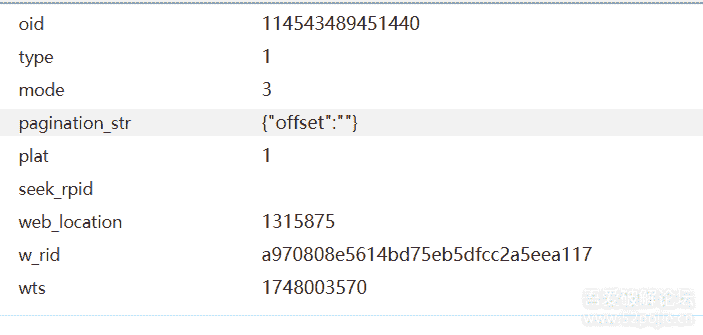

加密参数`w_rid`.png (21.75 KB, 下载次数: 1)

[href="forum.php?mod=attachment&aid=Mjc3ODkzNnwxZjRhYmIyM3wxNzkzNTcwOTUwfDE2ODA4NnwyMDMzNzA0&nothumb=yes" target="_blank"](https://www.52pojie.cn/forum.php?mod=attachment&aid=Mjc3ODkzNnwxZjRhYmIyM3wxNzkzNTcwOTUwfDE2ODA4NnwyMDMzNzA0&nothumb=yes)

2025-5-23 21:05 上传

加密参数`w_rid`

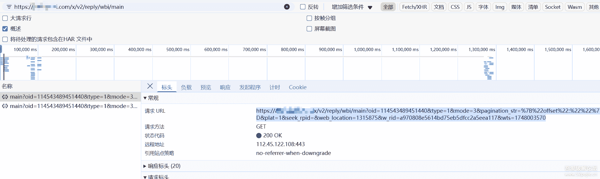

马赛克后接口.png (99.23 KB, 下载次数: 2)

[href="forum.php?mod=attachment&aid=Mjc3ODkzOHxhYjZlYjk0ZXwxNzkzNTcwOTUwfDE2ODA4NnwyMDMzNzA0&nothumb=yes" target="_blank"](https://www.52pojie.cn/forum.php?mod=attachment&aid=Mjc3ODkzOHxhYjZlYjk0ZXwxNzkzNTcwOTUwfDE2ODA4NnwyMDMzNzA0&nothumb=yes)

2025-5-23 21:08 上传

这个是评论区的接口，可以自行滑动或者直接搜索接口：aHR0cHM6Ly9hcGkuYmlsaWJpbGkuY29tL3gvdjIvcmVwbHkvd2JpL21haW4=

这里就不演示跟栈，直接搜索`w_rid`,给所有关键的地方下断点，一共是六个出现加密参数的地方

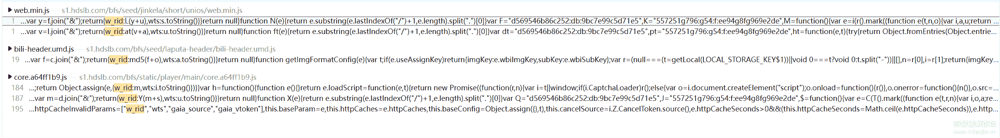

搜索`w_rid`.png (102.37 KB, 下载次数: 1)

[href="forum.php?mod=attachment&aid=Mjc3ODkzOXwyYzRkOTdkZnwxNzkzNTcwOTUwfDE2ODA4NnwyMDMzNzA0&nothumb=yes" target="_blank"](https://www.52pojie.cn/forum.php?mod=attachment&aid=Mjc3ODkzOXwyYzRkOTdkZnwxNzkzNTcwOTUwfDE2ODA4NnwyMDMzNzA0&nothumb=yes)

2025-5-23 21:09 上传

依次下断点

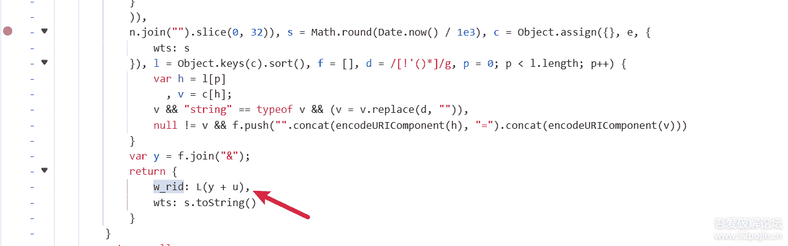

断点1.png (45.53 KB, 下载次数: 1)

[href="forum.php?mod=attachment&aid=Mjc3ODk0MHw4N2MzYmIzYnwxNzkzNTcwOTUwfDE2ODA4NnwyMDMzNzA0&nothumb=yes" target="_blank"](https://www.52pojie.cn/forum.php?mod=attachment&aid=Mjc3ODk0MHw4N2MzYmIzYnwxNzkzNTcwOTUwfDE2ODA4NnwyMDMzNzA0&nothumb=yes)

2025-5-23 21:11 上传

可以看出差别的

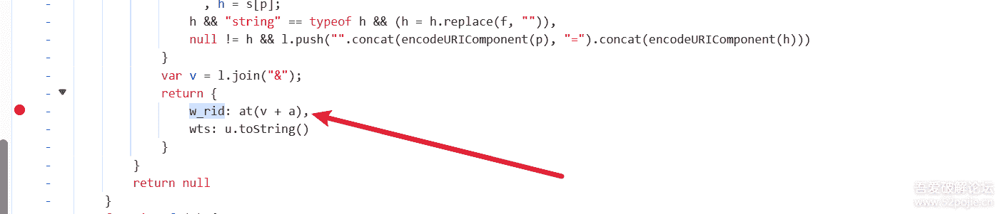

断点2.png (34.02 KB, 下载次数: 1)

[href="forum.php?mod=attachment&aid=Mjc3ODk0MXw4OGNjOTMzN3wxNzkzNTcwOTUwfDE2ODA4NnwyMDMzNzA0&nothumb=yes" target="_blank"](https://www.52pojie.cn/forum.php?mod=attachment&aid=Mjc3ODk0MXw4OGNjOTMzN3wxNzkzNTcwOTUwfDE2ODA4NnwyMDMzNzA0&nothumb=yes)

2025-5-23 21:12 上传

这里我们大概可以猜到加密的方式`MD5`（爬虫老鸟可能直接最开始看到长度就敏感了）


断点3.png (19.74 KB, 下载次数: 1)

[href="forum.php?mod=attachment&aid=Mjc3ODk0NHw2NjdkZmE4MHwxNzkzNTcwOTUwfDE2ODA4NnwyMDMzNzA0&nothumb=yes" target="_blank"](https://www.52pojie.cn/forum.php?mod=attachment&aid=Mjc3ODk0NHw2NjdkZmE4MHwxNzkzNTcwOTUwfDE2ODA4NnwyMDMzNzA0&nothumb=yes)

2025-5-23 21:13 上传

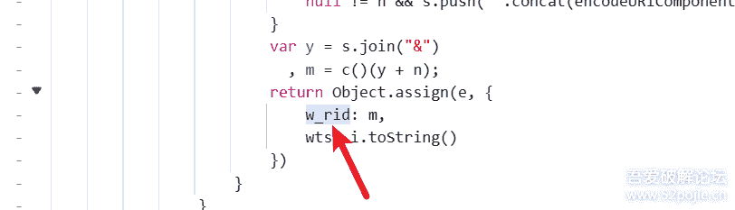

断电4.png (21.99 KB, 下载次数: 1)

[href="forum.php?mod=attachment&aid=Mjc3ODk0OHxkNDAxMDY3NnwxNzkzNTcwOTUwfDE2ODA4NnwyMDMzNzA0&nothumb=yes" target="_blank"](https://www.52pojie.cn/forum.php?mod=attachment&aid=Mjc3ODk0OHxkNDAxMDY3NnwxNzkzNTcwOTUwfDE2ODA4NnwyMDMzNzA0&nothumb=yes)

2025-5-23 21:14 上传

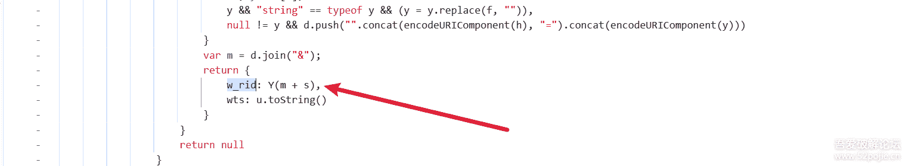

断点5.png (34.55 KB, 下载次数: 1)

[href="forum.php?mod=attachment&aid=Mjc3ODk0OXwxYjA0MWZhM3wxNzkzNTcwOTUwfDE2ODA4NnwyMDMzNzA0&nothumb=yes" target="_blank"](https://www.52pojie.cn/forum.php?mod=attachment&aid=Mjc3ODk0OXwxYjA0MWZhM3wxNzkzNTcwOTUwfDE2ODA4NnwyMDMzNzA0&nothumb=yes)

2025-5-23 21:15 上传

最后一个就直接pass了{:1_918:}，然后我们重新刷新界面或者放开断点下拉看看情况，我们可以看到当接口走过 `w_rid`: `at(v + a)`后出现了我们的目标接口，同时返回值与接口的`w_rid`值一样

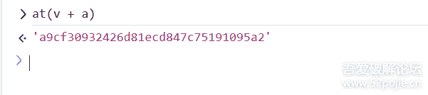

加密效果.png (10.78 KB, 下载次数: 1)

[href="forum.php?mod=attachment&aid=Mjc3ODk1MHw5ODE4NDNmZXwxNzkzNTcwOTUwfDE2ODA4NnwyMDMzNzA0&nothumb=yes" target="_blank"](https://www.52pojie.cn/forum.php?mod=attachment&aid=Mjc3ODk1MHw5ODE4NDNmZXwxNzkzNTcwOTUwfDE2ODA4NnwyMDMzNzA0&nothumb=yes)

2025-5-23 21:18 上传

然后对比一下接口的参数

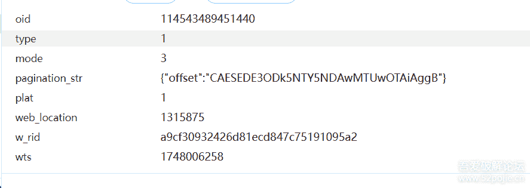

对比加密参数.png (24.27 KB, 下载次数: 1)

[href="forum.php?mod=attachment&aid=Mjc3ODk1MXwxZDNiNGE2MnwxNzkzNTcwOTUwfDE2ODA4NnwyMDMzNzA0&nothumb=yes" target="_blank"](https://www.52pojie.cn/forum.php?mod=attachment&aid=Mjc3ODk1MXwxZDNiNGE2MnwxNzkzNTcwOTUwfDE2ODA4NnwyMDMzNzA0&nothumb=yes)

2025-5-23 21:19 上传

是一样的值，这样的话可以确定这里就是加密参数产生的地方

把加密代码直接拉过来分析

```
function lt(e) {
    var t, r, n = function (e) {
        var t;
        if (e.useAssignKey)
            return {
                imgKey: e.wbiImgKey,
                subKey: e.wbiSubKey
            };
        var r = (null === (t = function (e) {
            try {
                return localStorage.getItem(e)
            } catch (e) {
                return null
            }
        }(ct)) || void 0 === t ? void 0 : t.split("-")) || []
            , n = r[0]
            , o = r[1]
            , i = n ? ft(n) : e.wbiImgKey
            , a = o ? ft(o) : e.wbiSubKey;
        return {
            imgKey: i,
            subKey: a
        }
    }(arguments.length > 1 && void 0 !== arguments[1] ? arguments[1] : {
        wbiImgKey: "",
        wbiSubKey: ""
    }), o = n.imgKey, i = n.subKey;
    if (o && i) {
        for (var a = (t = o + i,
            r = [],
            [46, 47, 18, 2, 53, 8, 23, 32, 15, 50, 10, 31, 58, 3, 45, 35, 27, 43, 5, 49, 33, 9, 42, 19, 29, 28, 14, 39, 12, 38, 41, 13, 37, 48, 7, 16, 24, 55, 40, 61, 26, 17, 0, 1, 60, 51, 30, 4, 22, 25, 54, 21, 56, 59, 6, 63, 57, 62, 11, 36, 20, 34, 44, 52].forEach((function (e) {
                    t.charAt(e) && r.push(t.charAt(e))
                }
            )),
            r.join("").slice(0, 32)), u = Math.round(Date.now() / 1e3), s = Object.assign({}, e, {
            wts: u
        }), c = Object.keys(s).sort(), l = [], f = /[!'()*]/g, d = 0; d 
```

可以看到`w_rid`是由`at(v + a)`生成的`at`函数我们有了一个猜测，然后对`v + a`加密后生成，调用`at`函数做一个简单测试

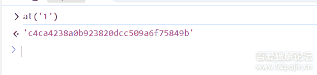

`at`函数测试.png (11.18 KB, 下载次数: 1)

[href="forum.php?mod=attachment&aid=Mjc3ODk1Mnw5ZTA4MTkzMnwxNzkzNTcwOTUwfDE2ODA4NnwyMDMzNzA0&nothumb=yes" target="_blank"](https://www.52pojie.cn/forum.php?mod=attachment&aid=Mjc3ODk1Mnw5ZTA4MTkzMnwxNzkzNTcwOTUwfDE2ODA4NnwyMDMzNzA0&nothumb=yes)

2025-5-23 21:26 上传

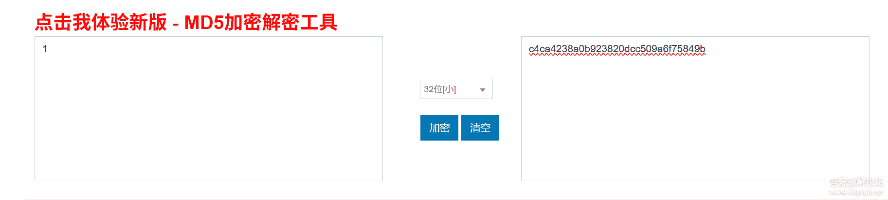

`at`函数加密对比.png (33.83 KB, 下载次数: 1)

[href="forum.php?mod=attachment&aid=Mjc3ODk1M3w3YjcwYmViNnwxNzkzNTcwOTUwfDE2ODA4NnwyMDMzNzA0&nothumb=yes" target="_blank"](https://www.52pojie.cn/forum.php?mod=attachment&aid=Mjc3ODk1M3w3YjcwYmViNnwxNzkzNTcwOTUwfDE2ODA4NnwyMDMzNzA0&nothumb=yes)

2025-5-23 21:26 上传

测试可以看出来，`at`函数加密是标准的`md5`，只需要分析`v`和`a`函数的生成，可以查看作用域

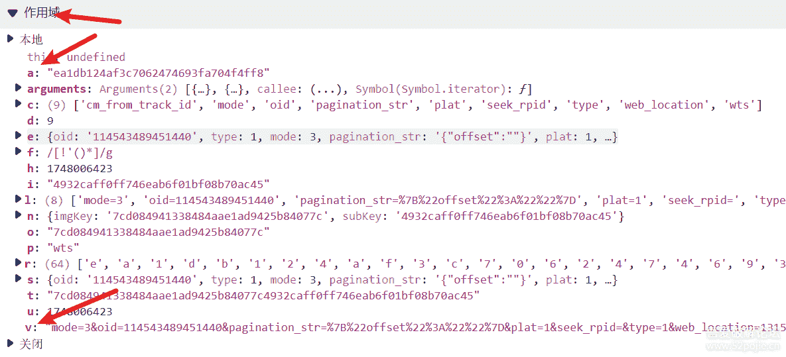

作用域.png (86.77 KB, 下载次数: 1)

[href="forum.php?mod=attachment&aid=Mjc3ODk1NHxiNjc1Mzc1OHwxNzkzNTcwOTUwfDE2ODA4NnwyMDMzNzA0&nothumb=yes" target="_blank"](https://www.52pojie.cn/forum.php?mod=attachment&aid=Mjc3ODk1NHxiNjc1Mzc1OHwxNzkzNTcwOTUwfDE2ODA4NnwyMDMzNzA0&nothumb=yes)

2025-5-23 21:28 上传

`a`和`v`是在本地作用域，往上找`a`和`v`的生成位置，这是加密时`v`的值

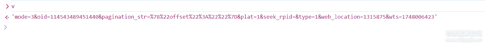

`v`的值.png (16.03 KB, 下载次数: 1)

[href="forum.php?mod=attachment&aid=Mjc3ODk1NnxlZGM0NmNkM3wxNzkzNTcwOTUwfDE2ODA4NnwyMDMzNzA0&nothumb=yes" target="_blank"](https://www.52pojie.cn/forum.php?mod=attachment&aid=Mjc3ODk1NnxlZGM0NmNkM3wxNzkzNTcwOTUwfDE2ODA4NnwyMDMzNzA0&nothumb=yes)

2025-5-23 21:30 上传

传入参数`e`

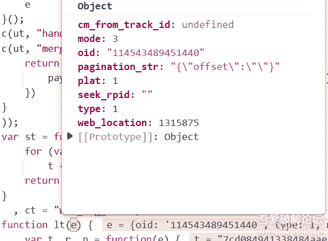

传入参数.png (49.62 KB, 下载次数: 1)

[href="forum.php?mod=attachment&aid=Mjc3ODk1N3xlMDUyNDFjZXwxNzkzNTcwOTUwfDE2ODA4NnwyMDMzNzA0&nothumb=yes" target="_blank"](https://www.52pojie.cn/forum.php?mod=attachment&aid=Mjc3ODk1N3xlMDUyNDFjZXwxNzkzNTcwOTUwfDE2ODA4NnwyMDMzNzA0&nothumb=yes)

2025-5-23 21:33 上传

可以看出`v`是在传入参数`e`的前提下进行处理

```
// wts的生成位置

 u = Math.round(Date.now() / 1e3)

 wts: u
```

注意是的代码在处理过程中：变成了`=`，再利用`&`进行拼接处理

```
var v = l.join("&");
```

然后就是`a`的生成过程，代码片段如下，经过测试，`o`和`i`的值是固定的
```


``` 
// o = "7cd084941338484aae1ad9425b84077c" i ="4932caff0ff746eab6f01bf08b70ac45"

o = n.imgKey, i = n.subKey

for (var a = (t = o + i,
            r = [],
            [46, 47, 18, 2, 53, 8, 23, 32, 15, 50, 10, 31, 58, 3, 45, 35, 27, 43, 5, 49, 33, 9, 42, 19, 29, 28, 14, 39, 12, 38, 41, 13, 37, 48, 7, 16, 24, 55, 40, 61, 26, 17, 0, 1, 60, 51, 30, 4, 22, 25, 54, 21, 56, 59, 6, 63, 57, 62, 11, 36, 20, 34, 44, 52].forEach((function (e) {
                    t.charAt(e) && r.push(t.charAt(e))
                }
            )),r.join("").slice(0, 32))

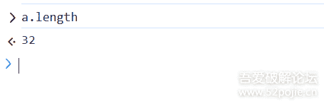

```

这段代码的作用是从字符串`t`中按特定索引顺序提取有效字符，生成新的数组 `r`并取前32位，并将结果赋值给变量 `a`，`t`是由`o + i`生成的，利用python对这个进行还原
32位.png (7.64 KB, 下载次数: 0)

[href="forum.php?mod=attachment&aid=Mjc3ODk2MHwxYWM1YmE2OXwxNzkzNTcwOTUwfDE2ODA4NnwyMDMzNzA0&nothumb=yes" target="_blank"](https://www.52pojie.cn/forum.php?mod=attachment&aid=Mjc3ODk2MHwxYWM1YmE2OXwxNzkzNTcwOTUwfDE2ODA4NnwyMDMzNzA0&nothumb=yes)

2025-5-23 21:46 上传

```
o = "7cd084941338484aae1ad9425b84077c"
i = "4932caff0ff746eab6f01bf08b70ac45"
t = o + i 
indices = [
    46, 47, 18, 2, 53, 8, 23, 32, 15, 50, 10, 31, 58, 3, 45, 35,
    27, 43, 5, 49, 33, 9, 42, 19, 29, 28, 14, 39, 12, 38, 41, 13,
    37, 48, 7, 16, 24, 55, 40, 61, 26, 17, 0, 1, 60, 51, 30, 4,
    22, 25, 54, 21, 56, 59, 6, 63, 57, 62, 11, 36, 20, 34, 44, 52
]

a = []
for e in indices:
    if e 
```

然后我们就可以愉快的完成完整的`w_rid`逆向过程
