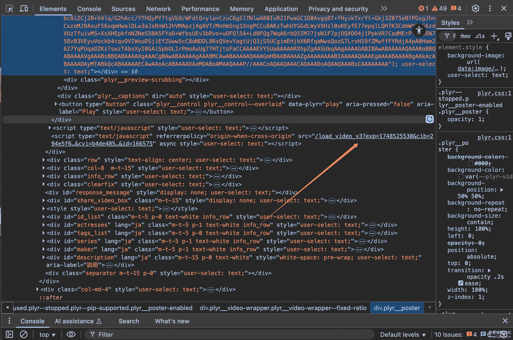
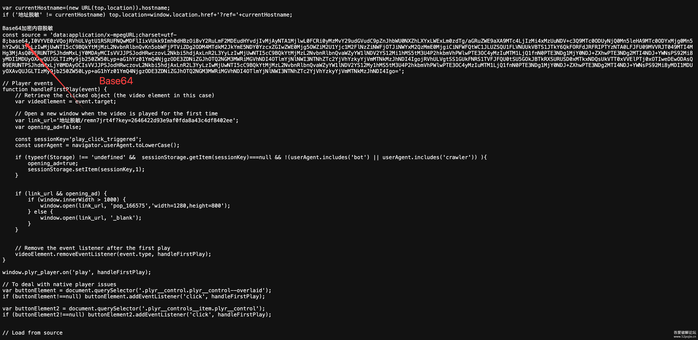
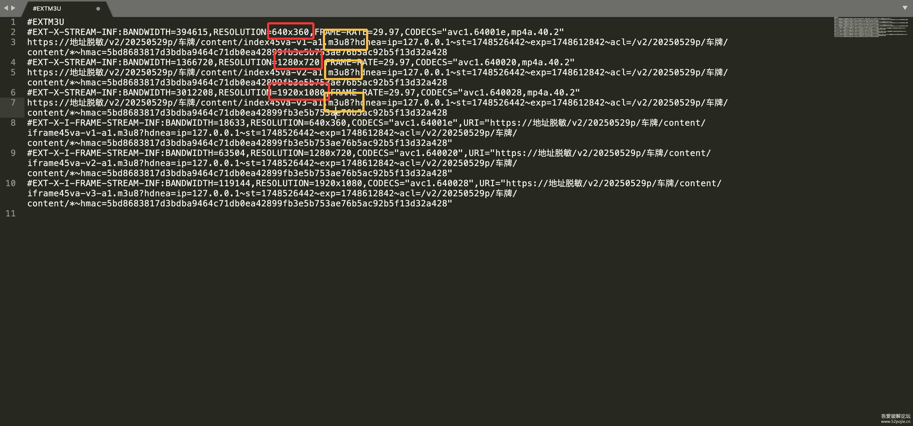

# [Web逆向] 某视频网站视频逆向（内容脱敏，学习思路）

- 原帖: https://www.52pojie.cn/forum.php?mod=viewthread&tid=2035143
- 抓取时间: 2026-11-01T22:08:54

本文章中所有内容仅供学习交流使用，不用于其他任何目的，不提供完整代码，抓包内容、敏感网址、数据接口等均已做脱敏处理，严禁用于商业用途和非法用途，否则由此产生的一切后果均与作者无关。本文章未经许可禁止转载，禁止任何修改后二次传播，擅自使用本文讲解的技术而导致的任何意外，作者均不负责。

---

目标网址：由于内容涉及敏感内容，故不分享链接。

---

最近找一些学习JS逆向的资料，想了解某些敏感视频是如何被渲染出来的。索性用到最近学到的知识来了解网站的视频是如何调用的，也在这里告诫大伙，不要为了学习而累坏了身体。

网站有点简单。Control+Shift+C，如果是Mac系统的可以用Command+Shift+C，然后点击那该死的视频，直接可以定位到视频的HTML地址：

Picture1.png (894.06 KB, 下载次数: 1)

2025-5-29 21:28 上传

可以看到的是，在下面调用了一个可疑的JS文件，可以右键打开这个JS文件内容。可以发现里面有一串经过Base64进行简单加密的内容（内容脱敏，别白费力气了）。

Picture 2.png (601.74 KB, 下载次数: 1)

2025-5-29 21:52 上传

可以通过Base64解密发现，这返回的就是一些`.m3u8`为后缀的视频文件。内容确实是大伙想的那样（有我们需要的`m3u8`）。

Pciture 3.png (474.38 KB, 下载次数: 1)

2025-5-29 21:55 上传

后续楼主自己放到了Downie或者Omni Player中测试，完全没有问题。

本帖没有进行JS逆向，是因为敏感信息太多啦！不过这个给大伙一个思路，怎么看网站的视频存储的位置。

## 总结

本文发现一些网站的`M3U8`的文件地址通过Base64加密，并存储在了某个JS文件里。
