# [Web逆向] 某花顺登录滑块逆向

- 原帖：https://www.52pojie.cn/forum.php?mod=viewthread&tid=2035508
- 抓取时间：2026-11-01T22:08:49

本文章中所有内容仅供学习交流，抓包内容、敏感网址、数据接口均已做脱敏处理，严禁用于商业用途和非法用途，否则由此产生的一切后果均与作者无关，若有侵权，请联系我立即删除！

目标：实现账号登录、滑块验证与 `python` 纯算。

网站：aHR0cHM6Ly91cGFzcy4xMGpxa2EuY29tLmNuL2xvZ2luP3JlZGlyPUhUVFBfUkVGRVJFUg==

## 1. 分析登录过程中的所有请求

老样子先分析登录过程中需要的所有请求：账号密码登录、触发滑块，先寻找获得图片的接口，分上下两部分分析整个过程。该网站会禁用 `f12`，所以在请求之前就先打开控制台。

我们根据验证码图片的 URL 可以找到，在 `getprehandle` 请求中有我们想要的参数，后面再分析。

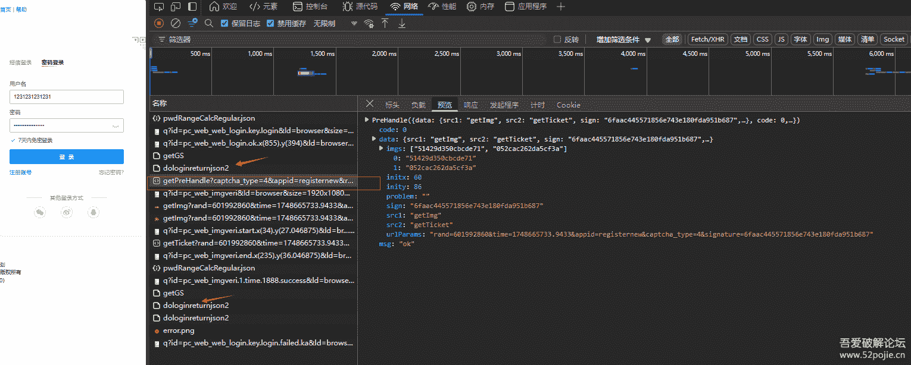

## 2. 验证码触发前的请求

验证码触发前，主要有两次请求：`getGS` 和 `dologinreturnjson2`。在 `getGS` 的请求参数中可以看到是在验证账号，得到 `dsk`、`dsv`、`ssv`，这些后面都会用到。

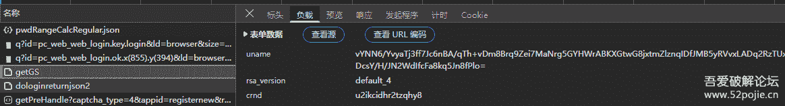

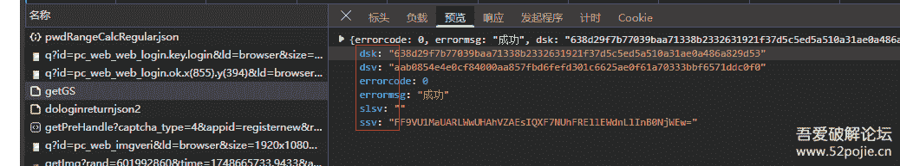

### 2.2 `dologinreturnjson2` 请求

在 `dologinreturnjson2` 请求中可以看到参数有点多，结果触发验证码。需要分析的参数就是 `uname`、`passwd`、`passwdsalt`、`dsk`、`crnd`。

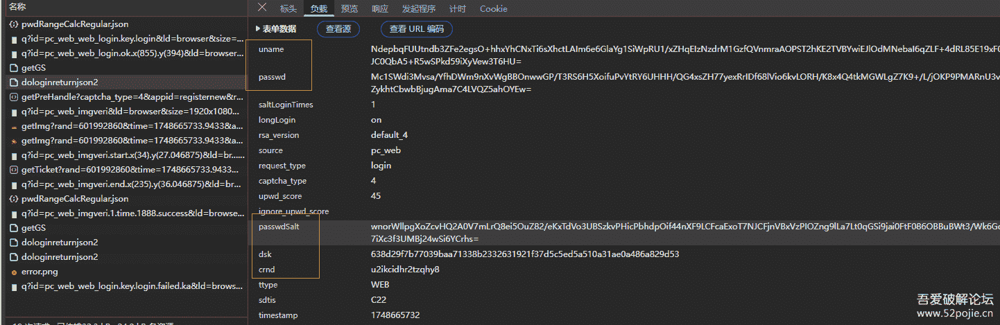

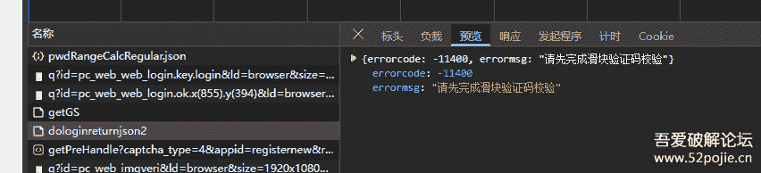

## 3. 定位参数生成位置

先是定位到参数生成的地方，那我直接根据参数名搜索 `passwdsalt`，这个结果会少很多，可以快速定位。跳转过来之后，在其之上就是所有参数的生成。太好了，源码中还有注释，直接都打上断点逐步分析。

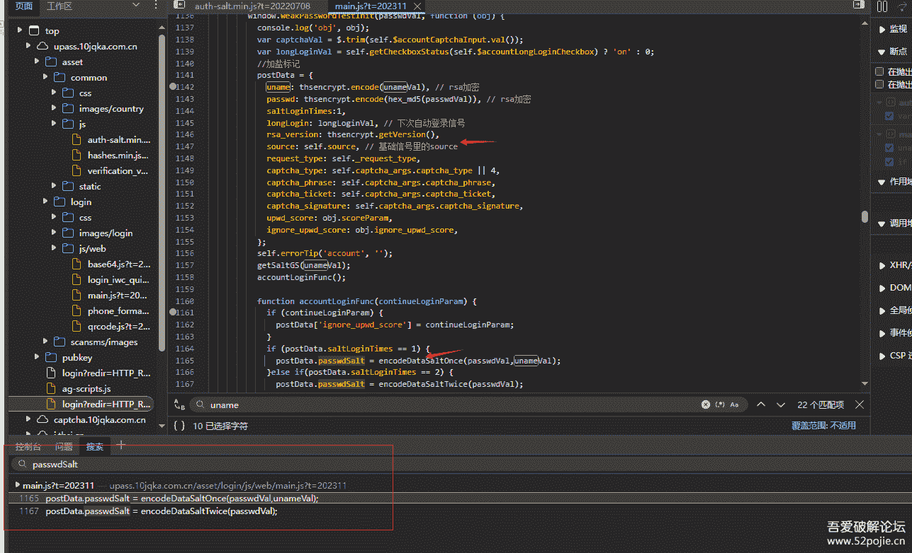

## 4. 分析 `uname` 与 `passwd` 参数

登录账号先定位到 `uname`，先看 `uname` 和 `passwd` 这两个参数。加密方式还备注上了，真好。可以看到，传入账号-密码，经过 `thsencrypt` 中 `encode()` 方法加密；密码参数多做了一步处理，经过 `hex_md5()`，看名字应该是 MD5 编码。在控制台打印测试一下，找个网站测试一下是标准的 MD5，这就可以不用分析 `js` 源码了，主要进 `thsencrypt` 的 `encode()` 方法里面看看。单步跳进去。

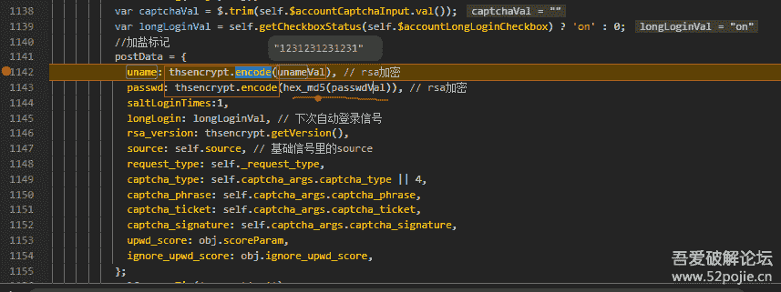

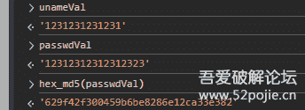

## 5. 分析 `encode()` 方法

在 `encode()` 中传入三个参数，直接返回函数 `encryptencode()` 的结果，其中 `b` 是账号，`a` 是密钥，`c` 是公钥指数，返回 Base64 格式字符串。转换成 `python` 代码。

```python
def encrypt_encode(plaintext: str) -> str:
    modulus_hex = ""  # 这里填入十六进制模数字符串
    exponent_hex = "10001"  # 一般是 65537 的十六进制表示
    if not modulus_hex or not exponent_hex:
        raise ValueError("modulus and publicExponent could not be null")
    modulus = int(modulus_hex, 16)
    exponent = int(exponent_hex, 16)
    key = RSA.construct((modulus, exponent))
    cipher = PKCS1_v1_5.new(key)
    plaintext_bytes = plaintext.encode('utf-8')
    encrypted_bytes = cipher.encrypt(plaintext_bytes)
    if not encrypted_bytes:
        raise ValueError("encrypt failed")

    return b64encode(encrypted_bytes).decode('utf-8')
```

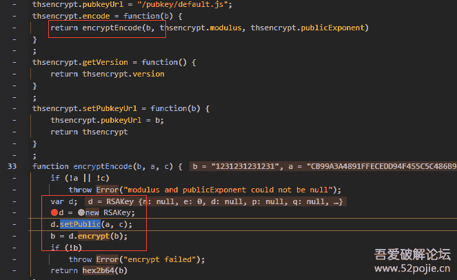

## 6. 验证 RSA 代码与 `crnd` 生成

先验证代码是否能用，测试是不是标准 RSA，因为加密结果每次都不一样，直接测试请求。在 `getGS` 中请求参数是 `uname`、`rsa_version` 和 `crnd`，现在看一下 `crnd` 怎么生成，继续往下走，进入 `getSaltGs()` 中。

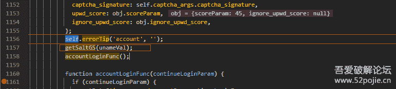

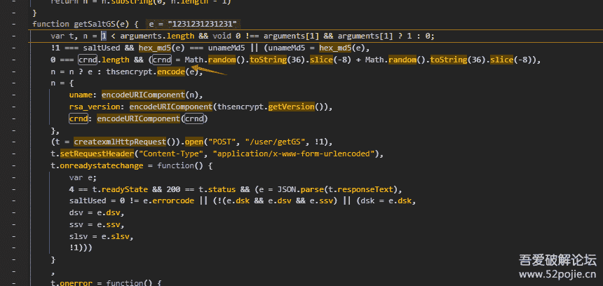

## 7. 分析 `crnd` 随机数生成

可以看到随机数转 36 进制取后八位，重复两边，生成 16 位只包含数字和字母的字符串。那我直接从 0 到 9 和小写字母中随机取十六位，一样的效果。

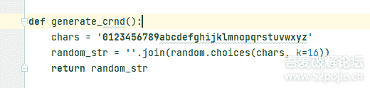

## 8. 测试 `getGS` 与 `passwdsalt` 生成

用生成的 `uname` 和 `crnd` 测试 `getGS`。若 `uname` 参数为空，返回参数错误；若加密不对，返回的 `dsk`、`ssv` 等都是空。

测试完接着往下分析。相对 `dologinreturnjson2` 里面还有 `passwdsalt` 和 `dsk` 这两个参数没有分析，`dsk` 是 `getGS` 中返回的。

继续往下走：`postData.passwdSalt = encodeDataSaltOnce(passwdVal, unameVal);`，进入 `encodeDataSaltOnce()` 中，分析生成过程。

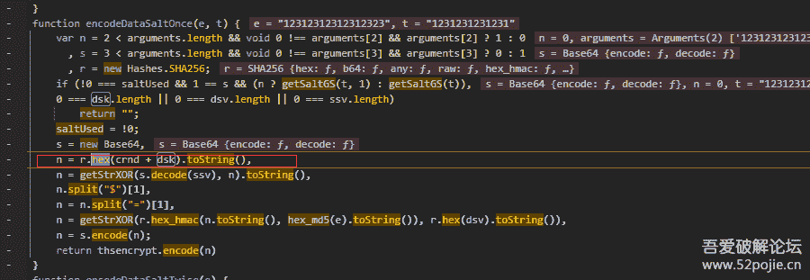

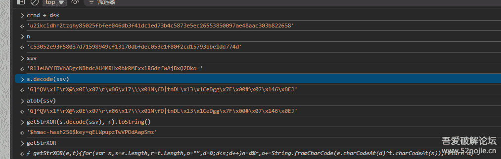

## 9. 分析 `encodeDataSaltOnce()` 与 `getStrXOR()`

先到第一次生成 `n` 的地方，可以看到是拿 `crnd + dsk`，传给 `r.hex`，`r` 在上面定义的有，可以看到是 `hash 256`。往下走是先把 `ssv` 进行 Base64 解码，再传入 hash 后的 `n`，在函数 `getStrXOR()` 中转换。

可以看到是实现两个字符串的字符逐位异或操作（XOR 操作）。转化成 `python` 代码。

```python
def get_str_xor(e: str, t: str) -> str:
    s = len(e)
    r = len(t)
    o = []
    for d in range(s):
        n = d % r
```

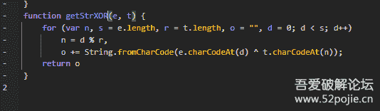


```python
xor_char = chr(ord(e[d]) ^ ord(t[n]))

o.append(xor_char)

return ''.join(o)
```

### 10. 继续往下走

`n` 为转换后的结果（取等号后面），作为 `HmacSHA256` 的 `key`，`r.hex_hmac` 是 `HmacSHA256`，`e` 是密码。

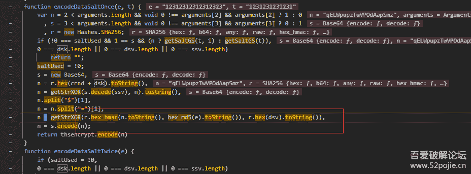

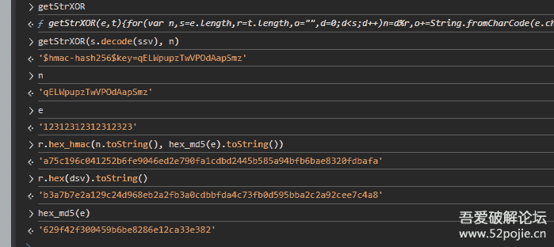

### 11. 测试 `r.hex_hmac`

`e` 先 `md5` 再 `HmacSHA256`，结果作为 `getStrXOR` 第一个参数，对 `dsv` 进行 `sha256` 作为第二个参数。经过 `getStrXOR` 后 `n` 的值再 `base64` 编码一下，就到了 `rsa` 加密的最终 `n` 了。函数 `encodeDataSaltOnce` 返回 `rsa` 加密的 `n`，用 `python` 慢慢一步步地还原，这样就得到了 `passwdSalt`。

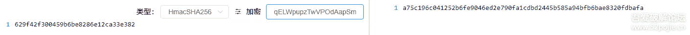

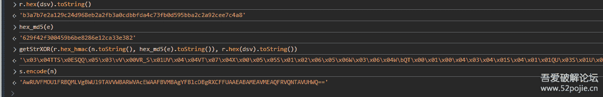

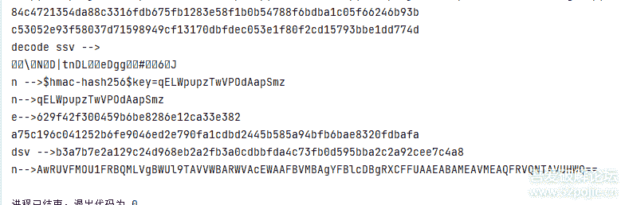

### 12. 参数分析完成

到现在参数都分析完啦，可以测试了，验证一下，接下来开始分析滑块的验证。

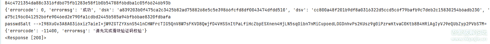

### 13. 滑块验证的请求参数

滑块验证的请求参数主要查看一下两个：`signature` 是请求图片时返回的 `sign`，可以发现，那 `phrase` 这个参数就是主要检验的了，直接搜索。

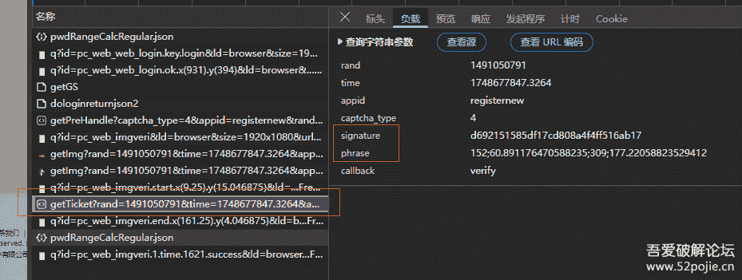

### 14. URL 生成规则

跳转进去可以看到 `url` 的生成规则，后半部分是 `(x) + ";" + inity + ";" + opt.width + ";" + opt.height;`，其中 `opt` 的宽高都是定值，`x` 是滑动的距离，需要看一下 `inity` 的生成。在当前 `js` 文件中搜索 `inity`，不多，很好定位。

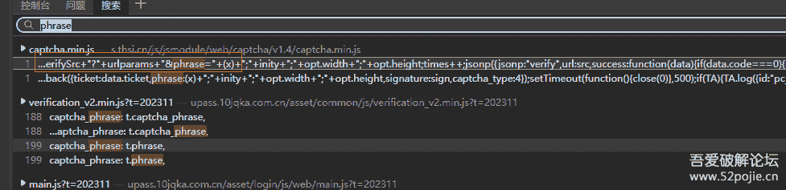

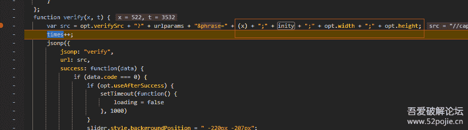

### 15. `inity` 的赋值

可以看到 `inity` 的赋值是 `data.data.inity / 195 * opt.height` 的结果，`data` 是 `getPreHandle` 的相应结果，`opt.height` 写死。

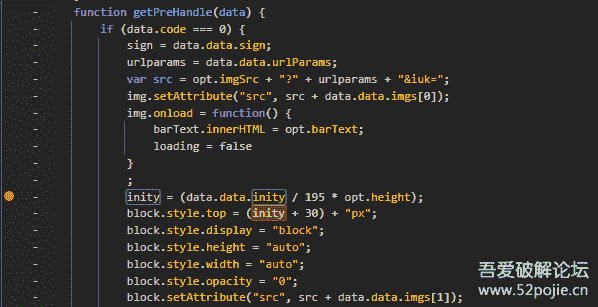

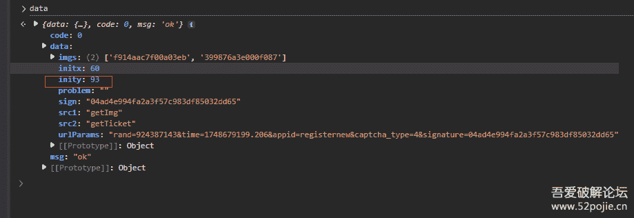

### 16. 图片 URL 与 `ddddocr`

图片的 `url` 在 `getPreHandle` 请求结果中，其中请求参数都可以写死，用来获得验证的图片和滑块。滑动距离的识别使用的是 `ddddocr`，以下是 `python` 代码：

```python
def get_distance(bg, tp, save_path=None):
    det = DdddOcr(det=False, ocr=False, show_ad=False)
    res = det.slide_match(tp, bg, simple_target=True)
    if save_path is not None:
        # 将背景图片的二进制数据加载为Pillow Image对象
        left, top, right, bottom = res['target'][0], res['target'][1], res['target'][2], res['target'][3]
        bg_image = Image.open(io.BytesIO(bg))
        draw = ImageDraw.Draw(bg_image)
        draw.rectangle([left, top, right, bottom], outline="red", width=2)
        bg_image.save(save_path)
        logger.info(f"已保存标注后的图片到: {save_path}")
        return res
    return res
```

### 17. 测试滑块验证结果

识别坐标标注的左上角和右下角，当取滑动距离时和浏览器需要的距离有一点偏差，测试一下减去个固定值就行，验证成功就可以拿到 `ticket` 了。

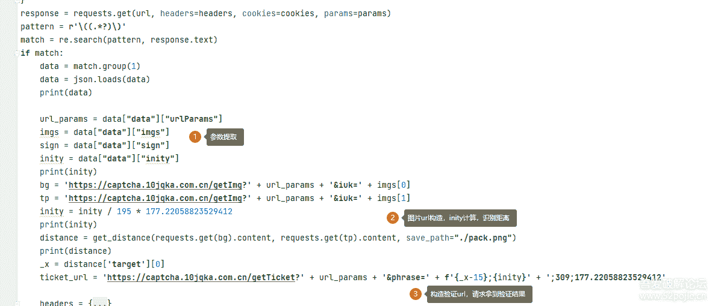

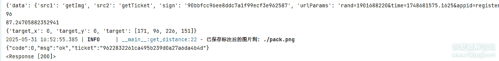

### 18. 最后一步

接下来就是最后一步了，来看下半部分，在验证的时候多了一些滑块验证成功后的一些参数，带上这些参数，再去验证登录，就可以啦。

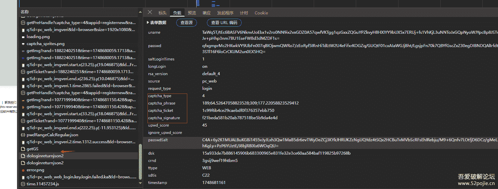

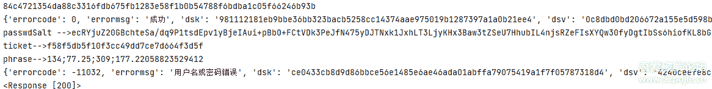

验证了一下，至此结束啦，感谢观看哦，祝大家端午节快乐！！（选择甜粽子还是肉粽子呢，犒劳自己）


