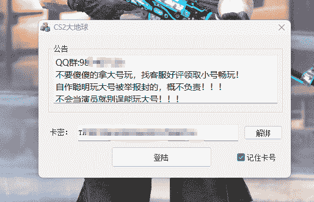
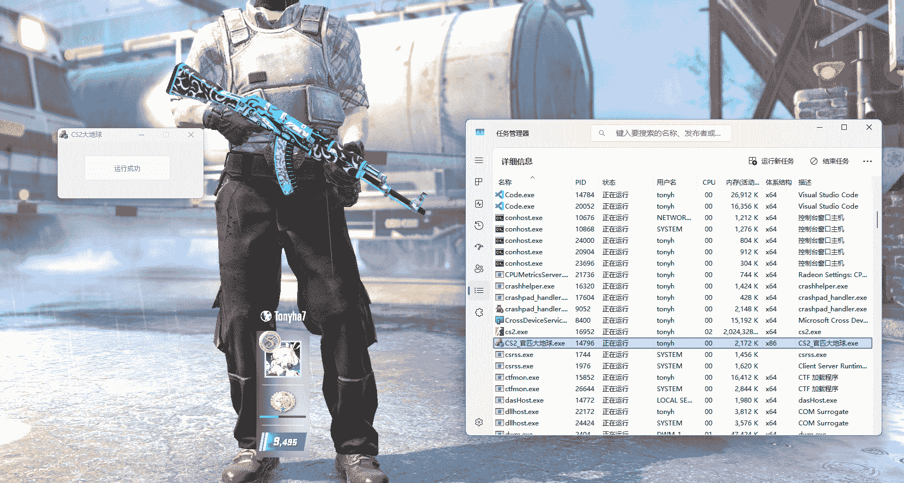
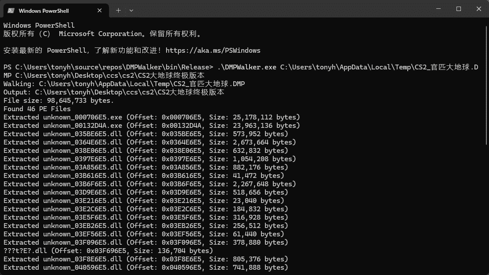
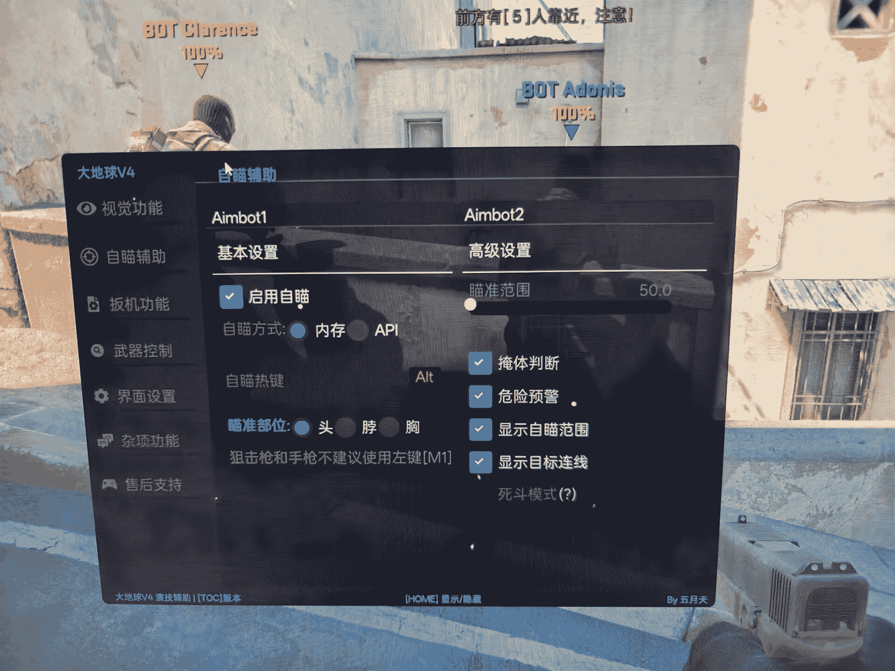

# [原创] `DMPWalker`实战破解垃圾外挂

- 原帖: https://www.52pojie.cn/forum.php?mod=viewthread&tid=2035779
- 抓取时间: 2026-11-01T22:08:41

## 前言

最近在研究`dll`注入为了方便比较注入前后的程序区别在Claude的加持下写了个从内存转储文件中读取二进制文件的小工具

[`DMPWalker`](https://github.com/Tonyha7/DMPWalker)

接下来演示下破解垃圾外挂程序

以淘宝销量最高的大地球为例花了三元巨款买了张天卡

## 过程

首先正常登录辅助加载功能

等待功能完全加载后从任务管理器中右键创建内存转储文件

这里窗口在截图时没显示

然后使用`DMPWalker`来从这个`DMP`文件中获取可执行文件

其中有两个`exe`文件

一个是这个外挂的登录程序另一个是这个外挂的功能

（对的这个外挂是纯外部的）

破解完成

