# [Web逆向] 超星某习通滑块验证登录逆向分析

- 原帖: https://www.52pojie.cn/forum.php?mod=viewthread&tid=2037138
- 抓取时间: 2026-11-01T22:08:33

## 前言
前言：验证码比赛题做不过，刚好去某习通上写老师布置的作业，看到了登录验证码，非常基础适合入门

直接开干：aHR0cHM6Ly92OC5jaGFveGluZy5jb20v


image.png (283.37 KB, 下载次数: 1)
[href="forum.php?mod=attachment&aid=Mjc4MTMzNnw3Zjg4MGJjMXwxNzkzNTcwOTExfDE2ODA4NnwyMDM3MTM4&nothumb=yes" target="_blank"](https://www.52pojie.cn/forum.php?mod=attachment&aid=Mjc4MTMzNnw3Zjg4MGJjMXwxNzkzNTcwOTExfDE2ODA4NnwyMDM3MTM4&nothumb=yes)
2025-6-7 11:31 上传

## 一、流程分析

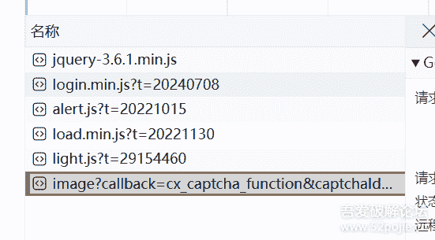
image.png (24.97 KB, 下载次数: 0)
[href="forum.php?mod=attachment&aid=Mjc4MTM0MHw5ZjE4MWI4Y3wxNzkzNTcwOTExfDE2ODA4NnwyMDM3MTM4&nothumb=yes" target="_blank"](https://www.52pojie.cn/forum.php?mod=attachment&aid=Mjc4MTM0MHw5ZjE4MWI4Y3wxNzkzNTcwOTExfDE2ODA4NnwyMDM3MTM4&nothumb=yes)
2025-6-7 11:40 上传

简单刷新界面，可以看到返回的内容主要是这几个js文件，可以简单的看一下每一个js文件的大致情况

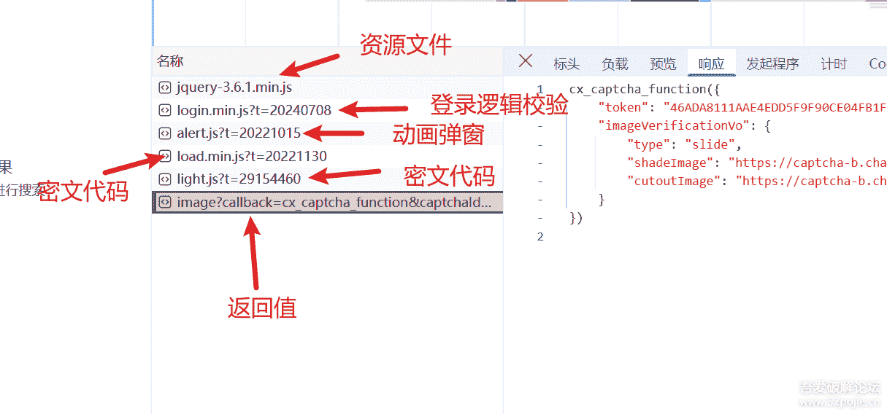
image.png (83.56 KB, 下载次数: 0)
[href="forum.php?mod=attachment&aid=Mjc4MTM0NXxjNjZjNjJjMHwxNzkzNTcwOTExfDE2ODA4NnwyMDM3MTM4&nothumb=yes" target="_blank"](https://www.52pojie.cn/forum.php?mod=attachment&aid=Mjc4MTM0NXxjNjZjNjJjMHwxNzkzNTcwOTExfDE2ODA4NnwyMDM3MTM4&nothumb=yes)
2025-6-7 11:47 上传

这样我们先看一下最后一个返回的文件

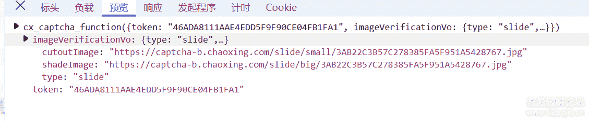
image.png (39.85 KB, 下载次数: 1)
[href="forum.php?mod=attachment&aid=Mjc4MTM0OHwxZDkwNGZhOHwxNzkzNTcwOTExfDE2ODA4NnwyMDM3MTM4&nothumb=yes" target="_blank"](https://www.52pojie.cn/forum.php?mod=attachment&aid=Mjc4MTM0OHwxZDkwNGZhOHwxNzkzNTcwOTExfDE2ODA4NnwyMDM3MTM4&nothumb=yes)
2025-6-7 11:55 上传

有两个图片地址，打开看一下，可以确定这个就是滑块的图片信息，用于后面计算距离用


image.png (15.21 KB, 下载次数: 1)
[href="forum.php?mod=attachment&aid=Mjc4MTM1MHxmZGQ0NTE3MXwxNzkzNTcwOTExfDE2ODA4NnwyMDM3MTM4&nothumb=yes" target="_blank"](https://www.52pojie.cn/forum.php?mod=attachment&aid=Mjc4MTM1MHxmZGQ0NTE3MXwxNzkzNTcwOTExfDE2ODA4NnwyMDM3MTM4&nothumb=yes)
2025-6-7 11:57 上传

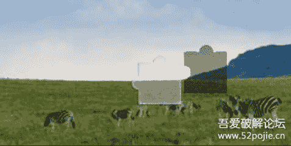
image.png (121.76 KB, 下载次数: 1)
[href="forum.php?mod=attachment&aid=Mjc4MTM1MXwwOGVlZTY2MHwxNzkzNTcwOTExfDE2ODA4NnwyMDM3MTM4&nothumb=yes" target="_blank"](https://www.52pojie.cn/forum.php?mod=attachment&aid=Mjc4MTM1MXwwOGVlZTY2MHwxNzkzNTcwOTExfDE2ODA4NnwyMDM3MTM4&nothumb=yes)
2025-6-7 11:58 上传

同时可以看到请求载荷里面有个`token`，返回值里面有一个`token`，说明这里进行了一个处理，可能是给后面的加密使用，同时可以看到请求载荷还有`captchaId`，`captchaKey`，`token`，`iv` 都疑是要处理的密文数据，我们先多刷新几次，看看变和不变得参数。

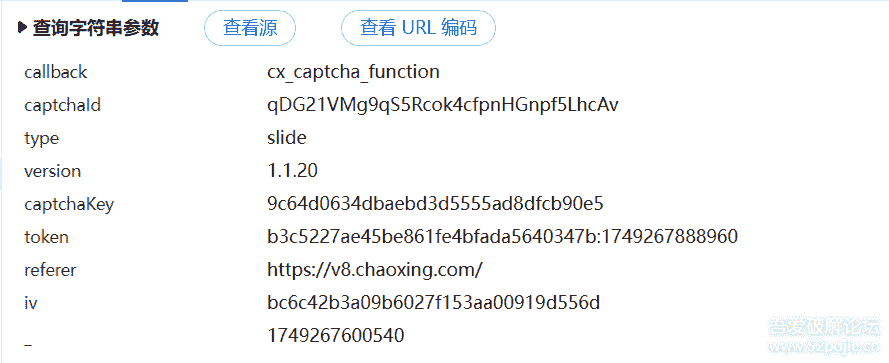
image.png (39.2 KB, 下载次数: 1)
[href="forum.php?mod=attachment&aid=Mjc4MTM0Nnw5MDg0YTNhMHwxNzkzNTcwOTExfDE2ODA4NnwyMDM3MTM4&nothumb=yes" target="_blank"](https://www.52pojie.cn/forum.php?mod=attachment&aid=Mjc4MTM0Nnw5MDg0YTNhMHwxNzkzNTcwOTExfDE2ODA4NnwyMDM3MTM4&nothumb=yes)
2025-6-7 11:55 上传

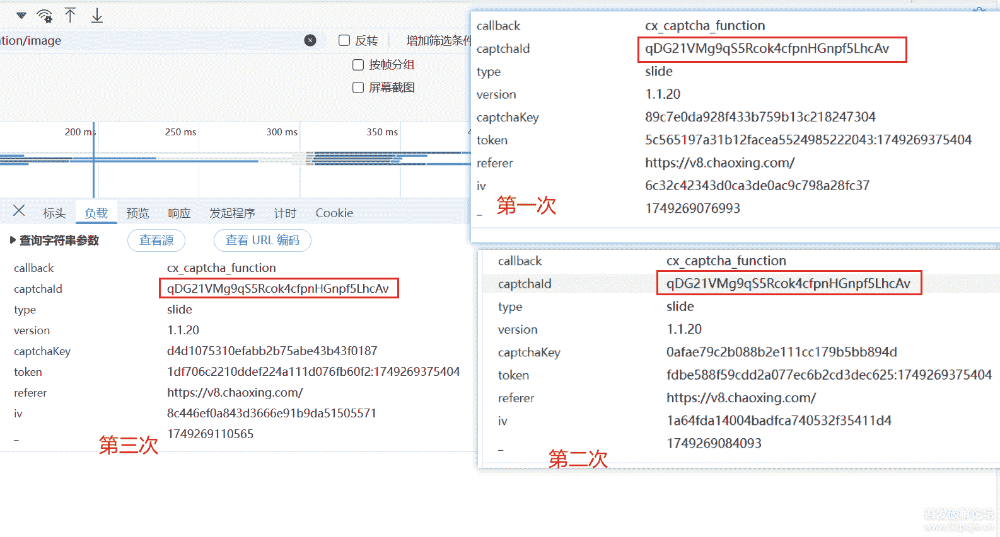
image.png (254.32 KB, 下载次数: 1)
[href="forum.php?mod=attachment&aid=Mjc4MTM1M3xhMGRlNTk5NnwxNzkzNTcwOTExfDE2ODA4NnwyMDM3MTM4&nothumb=yes" target="_blank"](https://www.52pojie.cn/forum.php?mod=attachment&aid=Mjc4MTM1M3xhMGRlNTk5NnwxNzkzNTcwOTExfDE2ODA4NnwyMDM3MTM4&nothumb=yes)
2025-6-7 12:05 上传

通过三次刷新，可以发现`captchaId`是唯一一个固定不变的请求参数，其余参数都是经过加密处理动态变化的，为了保险，可以在全局搜一下`captchaId`

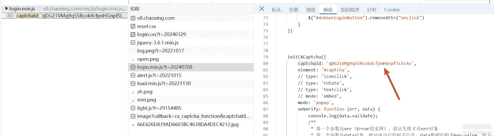
image.png (117.41 KB, 下载次数: 1)
[href="forum.php?mod=attachment&aid=Mjc4MTM1NHwxMGI4MTAyN3wxNzkzNTcwOTExfDE2ODA4NnwyMDM3MTM4&nothumb=yes" target="_blank"](https://www.52pojie.cn/forum.php?mod=attachment&aid=Mjc4MTM1NHwxMGI4MTAyN3wxNzkzNTcwOTExfDE2ODA4NnwyMDM3MTM4&nothumb=yes)
2025-6-7 12:07 上传

这样就非常明确`captchaId`是一个定值，接下来继续对滑块流程进行分析，我们输入用户名（手机号有校验，11位手机号最好标准点去测试）密码弹出验证，进一步分析处理验证码

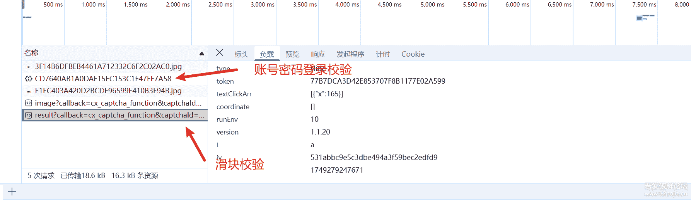
image.png (83.45 KB, 下载次数: 1)
[href="forum.php?mod=attachment&aid=Mjc4MTM4Mnw1NmUzM2YwYnwxNzkzNTcwOTExfDE2ODA4NnwyMDM3MTM4&nothumb=yes" target="_blank"](https://www.52pojie.cn/forum.php?mod=attachment&aid=Mjc4MTM4Mnw1NmUzM2YwYnwxNzkzNTcwOTExfDE2ODA4NnwyMDM3MTM4&nothumb=yes)
2025-6-7 14:59 上传

可以看到我们滑动滑块到处理结束出现两个数据信息，image接口是验证失败后重新请求新的图片，两个内容分别是滑动校验，账号密码校验

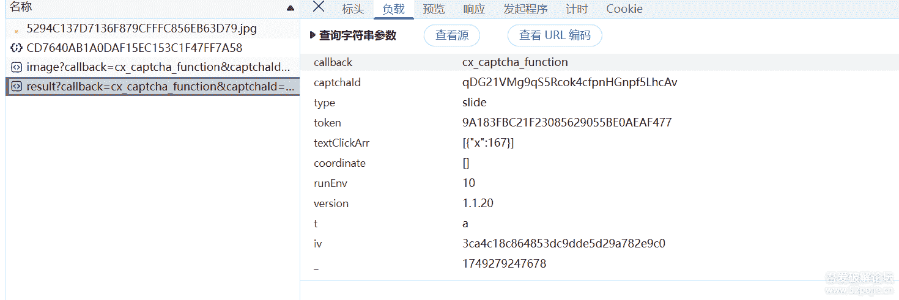
image.png (59.96 KB, 下载次数: 1)
[href="forum.php?mod=attachment&aid=Mjc4MTM4M3xiMDQ3YTczMnwxNzkzNTcwOTExfDE2ODA4NnwyMDM3MTM4&nothumb=yes" target="_blank"](https://www.52pojie.cn/forum.php?mod=attachment&aid=Mjc4MTM4M3xiMDQ3YTczMnwxNzkzNTcwOTExfDE2ODA4NnwyMDM3MTM4&nothumb=yes)
2025-6-7 15:07 上传

可以看到在滑块校验接口，参数里面有`token`，`textClickArr`，`iv`，在这里可以猜测`token`（可以进行对比）应该是上一个接口返回，同时看到有返回值，应该是用于账号登录校验的，我们看到与上一个接口有相似加密参数`token`，`iv`。重新抓包进行对比。

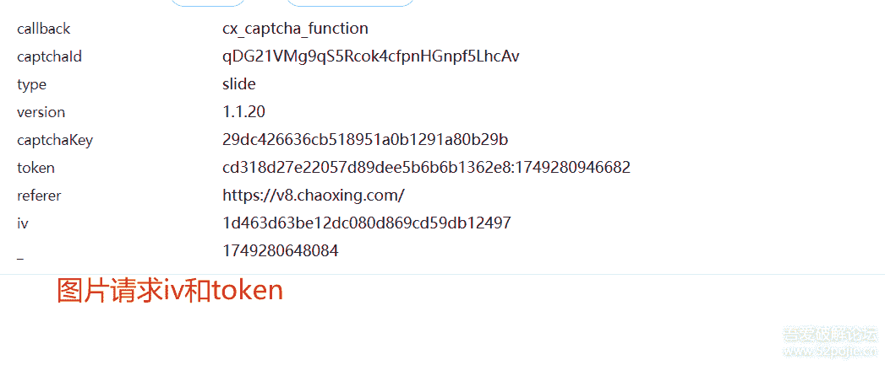
image.png (40.88 KB, 下载次数: 1)
[href="forum.php?mod=attachment&aid=Mjc4MTM4N3w3MWY5ZWRkY3wxNzkzNTcwOTExfDE2ODA4NnwyMDM3MTM4&nothumb=yes" target="_blank"](https://www.52pojie.cn/forum.php?mod=attachment&aid=Mjc4MTM4N3w3MWY5ZWRkY3wxNzkzNTcwOTExfDE2ODA4NnwyMDM3MTM4&nothumb=yes)
2025-6-7 15:19 上传

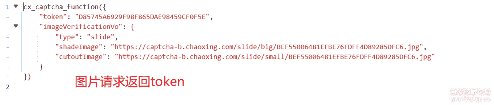
image.png (97.05 KB, 下载次数: 1)
[href="forum.php?mod=attachment&aid=Mjc4MTM4OHw3YzQwYjVhMHwxNzkzNTcwOTExfDE2ODA4NnwyMDM3MTM4&nothumb=yes" target="_blank"](https://www.52pojie.cn/forum.php?mod=attachment&aid=Mjc4MTM4OHw3YzQwYjVhMHwxNzkzNTcwOTExfDE2ODA4NnwyMDM3MTM4&nothumb=yes)
2025-6-7 15:20 上传

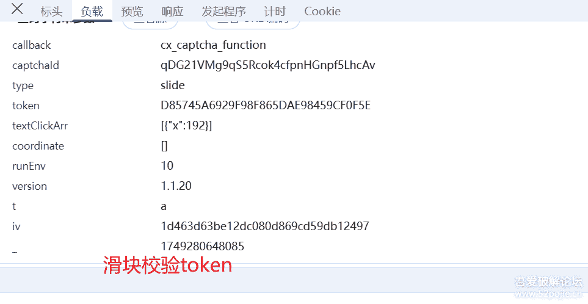
image.png (49.05 KB, 下载次数: 1)
[href="forum.php?mod=attachment&aid=Mjc4MTM4OXw5MTVhY2Q5Y3wxNzkzNTcwOTExfDE2ODA4NnwyMDM3MTM4&nothumb=yes" target="_blank"](https://www.52pojie.cn/forum.php?mod=attachment&aid=Mjc4MTM4OXw5MTVhY2Q5Y3wxNzkzNTcwOTExfDE2ODA4NnwyMDM3MTM4&nothumb=yes)
2025-6-7 15:20 上传

根据图片信息对比，我们可以清晰的看出，图片请求生成的`iv`接下来用到了滑块校验上，返回值的`token`同样也用在了校验上，还有一个`x`就是滑动的距离

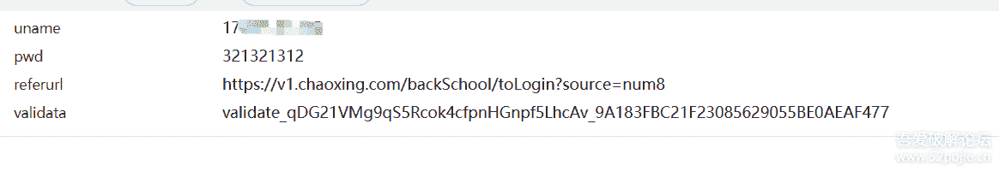
image.png (21.75 KB, 下载次数: 1)
[href="forum.php?mod=attachment&aid=Mjc4MTM4NXw3Y2U3MTIwN3wxNzkzNTcwOTExfDE2ODA4NnwyMDM3MTM4&nothumb=yes" target="_blank"](https://www.52pojie.cn/forum.php?mod=attachment&aid=Mjc4MTM4NXw3Y2U3MTIwN3wxNzkzNTcwOTExfDE2ODA4NnwyMDM3MTM4&nothumb=yes)
2025-6-7 15:11 上传

这个是登陆的账号校验，`validata`参数是由上一个滑块校验后返回，同时传入账号密码。

接下来进行简单的流程梳理：

（1）首先是处理`captchaKey`，`token`，`iv`参数加密逻辑，从image接口拿到图片链接地址，同时得到新的`token`值用于接下来的校验请求

（2）通过`ddddocr`识别滑块距离以及上一个接口的`iv`和返回的`token`获取`validata`参数

（3）携带`validata`参数和账号密码请求

## 二、加密定位与还原

### 1、首先处理图片接口
首先处理图片接口，直接跟栈下断点（也可以直接搜，非常明显）

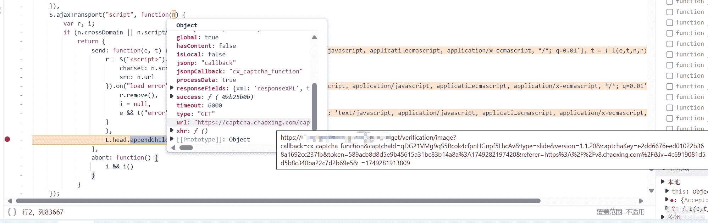
image.png (149.88 KB, 下载次数: 1)
[href="forum.php?mod=attachment&aid=Mjc4MTM5MHxiYWVhMzUzMnwxNzkzNTcwOTExfDE2ODA4NnwyMDM3MTM4&nothumb=yes" target="_blank"](https://www.52pojie.cn/forum.php?mod=attachment&aid=Mjc4MTM5MHxiYWVhMzUzMnwxNzkzNTcwOTExfDE2ODA4NnwyMDM3MTM4&nothumb=yes)
2025-6-7 15:39 上传

跟栈打断点，先确定是我们要找的接口，很明显已经生成我们需要的加密参数，所以继续网上走，也可以根据作用域判断接口对不对

跟了两步就发现非常明显的参数位置，我们直接下断点刷新测试一下

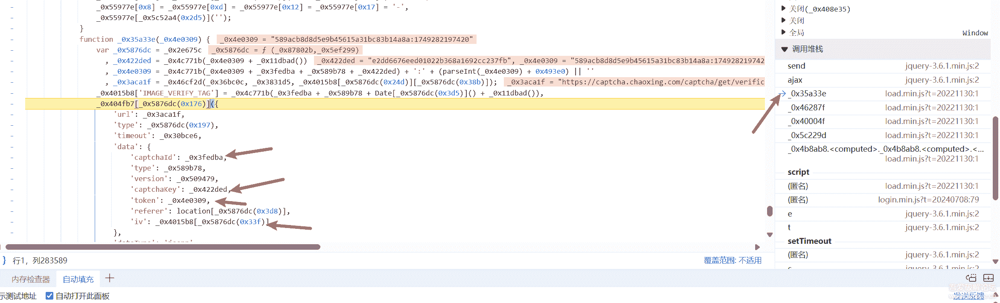
image.png (193.04 KB, 下载次数: 1)
[href="forum.php?mod=attachment&aid=Mjc4MTM5MXwzMmU3NjE1NnwxNzkzNTcwOTExfDE2ODA4NnwyMDM3MTM4&nothumb=yes" target="_blank"](https://www.52pojie.cn/forum.php?mod=attachment&aid=Mjc4MTM5MXwzMmU3NjE1NnwxNzkzNTcwOTExfDE2ODA4NnwyMDM3MTM4&nothumb=yes)
2025-6-7 15:41 上传

这里的传入参数很像时间戳，但是保持警惕

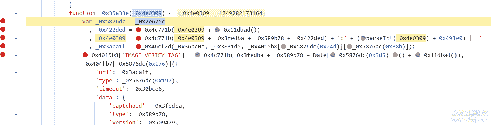
image.png (74.26 KB, 下载次数: 0)
[href="forum.php?mod=attachment&aid=Mjc4MTM5MnxkODk2MjdlMXwxNzkzNTcwOTExfDE2ODA4NnwyMDM3MTM4&nothumb=yes" target="_blank"](https://www.52pojie.cn/forum.php?mod=attachment&aid=Mjc4MTM5MnxkODk2MjdlMXwxNzkzNTcwOTExfDE2ODA4NnwyMDM3MTM4&nothumb=yes)
2025-6-7 15:43 上传

对加密参数进行分析可得


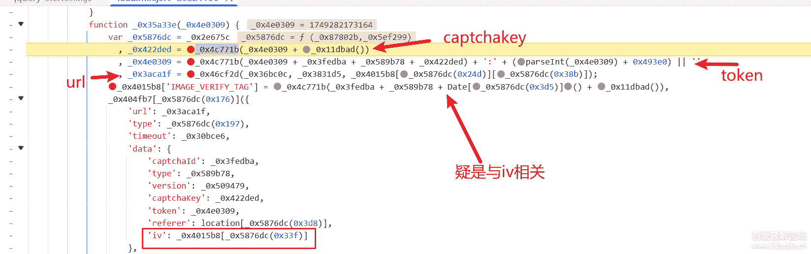

image.png (111.17 KB, 下载次数: 1)

[下载附件](https://www.52pojie.cn/forum.php?mod=attachment&aid=Mjc4MTM5M3w2OGJjNWI0YXwxNzkzNTcwOTExfDE2ODA4NnwyMDM3MTM4&nothumb=yes)

加密参数分析

2025-6-7 15:56 上传

除了iv都找到了加密点，接下来是对加密进行分析，所有加密都是由`_0x4c771b`函数进行的，将加密逻辑先拿出来

```javascript
let captchaKey = _0x4c771b(_0x4e0309 + _0x11dbad())
let token = _0x4c771b(_0x4e0309 + _0x3fedba + _0x589b78 + _0x422ded) + ':' + (parseInt(_0x4e0309) + 0x493e0) || ''
```

对`_0x4c771b`简单测试一下

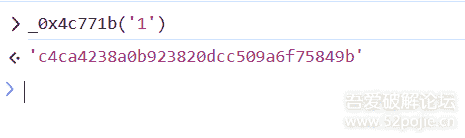

image.png (10.98 KB, 下载次数: 1)

[下载附件](https://www.52pojie.cn/forum.php?mod=attachment&aid=Mjc4MTM5NHxhOTRmNjU5MnwxNzkzNTcwOTExfDE2ODA4NnwyMDM3MTM4&nothumb=yes)

md5测试

2025-6-7 16:02 上传

非常标准的md5加密，直接开干，这个滑块是非常简单的，知道了是md5，我们继续看他的参数信息，`_0x4e0309`是传入的参数（怀疑是时间戳），接下来是`_0x11dbad`这个函数

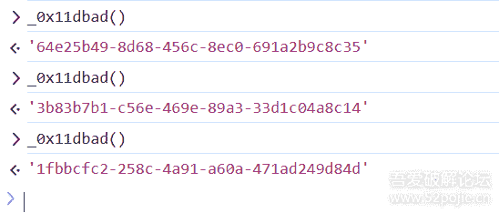

image.png (20.25 KB, 下载次数: 0)

[下载附件](https://www.52pojie.cn/forum.php?mod=attachment&aid=Mjc4MTM5NXxkNmYyZWU1YnwxNzkzNTcwOTExfDE2ODA4NnwyMDM3MTM4&nothumb=yes)

随机函数

2025-6-7 16:04 上传

应该是一个生成随机数的函数，直接跟进去扣下来看看有没有什么问题

```javascript
function _0x11dbad() {
    var _0x5c52a4 = _0x2e675c;
    for (var _0x55977e = [], _0x12474f = _0x5c52a4(0x2f9), _0x33c6e8 = 0x0; _0x33c6e8
```

还是有一个简单的ob混淆保护，我们直接处理一下，还原结果如下

```javascript
function f() {
    var vA = [];
    var vLS0123456789abcdef = "0123456789abcdef";
    for (var vLN0 = 0; vLN0
```

因为这个混淆很简单，基本上都是明文了，没用写ast插件还原，可以借鉴大佬的开源项目：`webcrack`，这样第一个加密参数处理就完成了，继续下一个值的还原

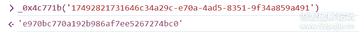

image.png (14.21 KB, 下载次数: 1)

[下载附件](https://www.52pojie.cn/forum.php?mod=attachment&aid=Mjc4MTM5Nnw1MzNiNGI0OXwxNzkzNTcwOTExfDE2ODA4NnwyMDM3MTM4&nothumb=yes)

浏览器md5

2025-6-7 16:16 上传


image.png (51.47 KB, 下载次数: 2)

[下载附件](https://www.52pojie.cn/forum.php?mod=attachment&aid=Mjc4MTM5N3xiMWViZjE5MHwxNzkzNTcwOTExfDE2ODA4NnwyMDM3MTM4&nothumb=yes)

python实现

2025-6-7 16:16 上传


image.png (10.67 KB, 下载次数: 0)

[下载附件](https://www.52pojie.cn/forum.php?mod=attachment&aid=Mjc4MTM5OHwyNzllN2Q4MHwxNzkzNTcwOTExfDE2ODA4NnwyMDM3MTM4&nothumb=yes)

参数对比

2025-6-7 16:17 上传

没有问题，继续肝!!!!!接下来是token的逻辑，通过md5对`_0x4e0309 + _0x3fedba + _0x589b78 + _0x422ded`进行拼接，然后拼接上： 在加上传入参数+300000

```javascript
_0x4c771b(_0x4e0309 + _0x3fedba + _0x589b78 + _0x422ded) + ':' + (parseInt(_0x4e0309) + 0x493e0) || ''
```


image.png (44.33 KB, 下载次数: 1)

[下载附件](https://www.52pojie.cn/forum.php?mod=attachment&aid=Mjc4MTM5OXxmYWMzYTZlMXwxNzkzNTcwOTExfDE2ODA4NnwyMDM3MTM4&nothumb=yes)

captchaId

2025-6-7 16:20 上传

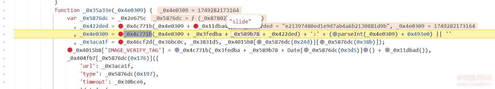

image.png (74.05 KB, 下载次数: 1)

[下载附件](https://www.52pojie.cn/forum.php?mod=attachment&aid=Mjc4MTQwMHxiOGUyY2ZlMHwxNzkzNTcwOTExfDE2ODA4NnwyMDM3MTM4&nothumb=yes)

slide

2025-6-7 16:21 上传

这个参数很熟悉，是固定值`captchaId`，`slide`以及刚才的加密返回结果。这样好像我们的`token`也搞定了，接下来就是看`iv`的逻辑，我们直接看`_0x4015b8['IMAGE_VERIFY_TAG']`这个和`iv`有关联的赋值，可以看到也是一个md5加密，利用了`captchaId`，`slide`字符拼接，当前时间戳（很敏感，为什么传入一个时间还要获取当前时间），后面还要加上一个随机数。接下来断到`iv`那里去看看情况

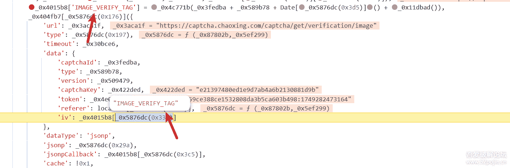

image.png (89.48 KB, 下载次数: 1)

[下载附件](https://www.52pojie.cn/forum.php?mod=attachment&aid=Mjc4MTQwNHwzZjZmZWU5NXwxNzkzNTcwOTExfDE2ODA4NnwyMDM3MTM4&nothumb=yes)

iv赋值

2025-6-7 16:28 上传

貌似好像就是我们刚才处理的结果，直接拿捏，接下来就是去处理怀疑的东西

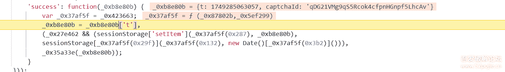

image.png (43.19 KB, 下载次数: 1)

[下载附件](https://www.52pojie.cn/forum.php?mod=attachment&aid=Mjc4MTQwNXwzOTRjZGU3ZHwxNzkzNTcwOTExfDE2ODA4NnwyMDM3MTM4&nothumb=yes)

怀疑值

2025-6-7 16:31 上传

直接跟上去看看情况，发现这个参数似乎也是某个接口传进来的，然后去获取，我们重新检查一下有返回值的响应，特别是在获取图片之前

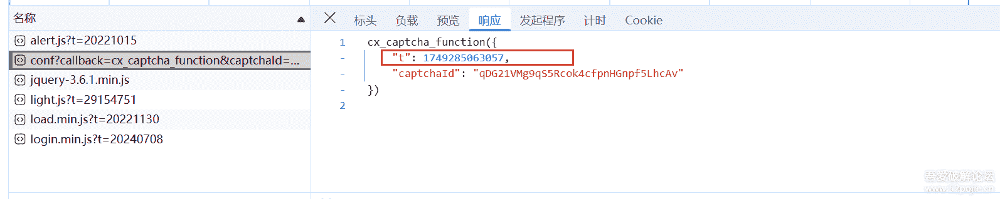

image.png (40.2 KB, 下载次数: 1)

[下载附件](https://www.52pojie.cn/forum.php?mod=attachment&aid=Mjc4MTQwNnwyN2JmOTNhNXwxNzkzNTcwOTExfDE2ODA4NnwyMDM3MTM4&nothumb=yes)

t的来源

2025-6-7 16:32 上传

这样我们整个过程就搞定了，然后依次去请求获取。

## 三、代码整理

提供大致的python代码，首先是第一次的获取时间请求

先定义一下全局的要用的东西（代码很丑，应付，大佬们见谅）

```python
import requestsimport time
import re
import json
import hashlib
import random
import ddddocr

captchaId = 'qDG21VMg9qS5Rcok4cfpnHGnpf5LhcAv'
    now_time = int(time.time() * 1000)

def uuid():
    hex_chars = "0123456789abcdef"
    vA = [random.choice(hex_chars) for _ in range(36)]
    vA[14] = "4"
    original_char = vA[19]
    try:
        num = int(original_char, 16)
    except ValueError:
        num = 0
    new_value = (num & 3) | 8
    vA[19] = hex_chars[new_value]
    dash_positions = [8, 13, 18, 23]
    for pos in dash_positions:
        vA[pos] = "-"

    return "".join(vA)

def md5_encode(data):
    md5_ = hashlib.md5()
    md5_.update(data.encode('utf-8'))
    return md5_.hexdigest()
```

获取服务器时间请求

```python
def get_service_time():

    cookies = {}

    headers = { }

    params = {

        'callback': 'cx_captcha_function',

        'captchaId': captchaId,

        '_': now_time,

    }

    response = requests.get('脱敏处理', params=params, cookies=cookies,

                            headers=headers).text

    res = re.findall(r'cx_captcha_function\((.*)\)', response)

    jsonn_res = json.loads(res[0])

    service_time = jsonn_res['t']

    return service_time
```

这样就有了传入的参数时间，解析来就是图片请求的加密逻辑处理

```python
service_time = str(get_service_time())
captchaKey = md5_encode(service_time + uuid())
pic_token = md5_encode(service_time + captchaId + "slide" + captchaKey) + ':' + str(int(service_time) + 0x493e0);
iv = md5_encode(captchaId + "slide" + str(now_time) + uuid())
```

这样得到图片的地址和新的token继续请求，同时处理滑块距离问题，利用`ddddocr`（这里`ddddocr`好像有点问题，大佬们可以测试一下），

```python
params = {

        'callback': 'cx_captcha_function',

        'captchaId': captchaId,

        'type': 'slide',

        'version': '1.1.20',

        'captchaKey': captchaKey,

        'token': pic_token,

        'referer': 'https://v8.chaoxing.com/',

        'iv': iv,

        '_': now_time,

    }

    response = requests.get(

        '脱敏处理',

        params=params,

        cookies=cookies,
```


```python
headers=headers,
).text

res = re.findall(r'cx_captcha_function\((.*)\)', response)

js_res = json.loads(res[0])

next_token = js_res['token']

shadeImage = js_res['imageVerificationVo']['shadeImage']

cutoutImage = js_res['imageVerificationVo']['cutoutImage']

shade = requests.get(shadeImage, cookies=cookies, headers=headers).content

cutout = requests.get(cutoutImage, cookies=cookies, headers=headers).content

with open('shade.jpg', 'wb') as f:
    f.write(shade)

with open('cutout.jpg', 'wb') as f:
    f.write(cutout)

det = ddddocr.DdddOcr(det=False, ocr=True, show_ad=False)

with open('shade.jpg', 'rb') as f:
    target_bytes = f.read()

with open('cutout.jpg', 'rb') as f:
    background_bytes = f.read()

res = det.slide_match(target_bytes, background_bytes, simple_target=True)

value = res['target']

return value, next_token, iv
```

大致滑块部分就搞完了，接下来账号验证请求后加上用户名和密码去验证就完成了

我感觉排版有点乱，提前感谢版主大佬帮忙修改一下{:1_889:}加上代码有点不会排版了
