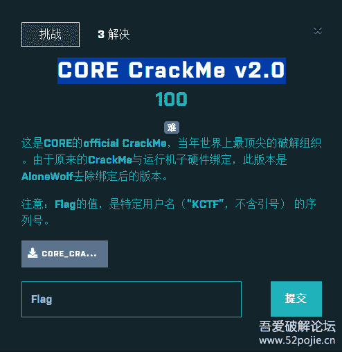
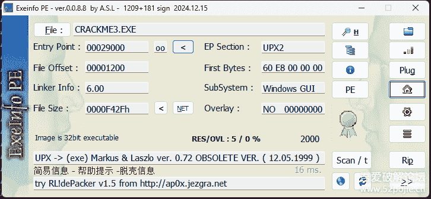
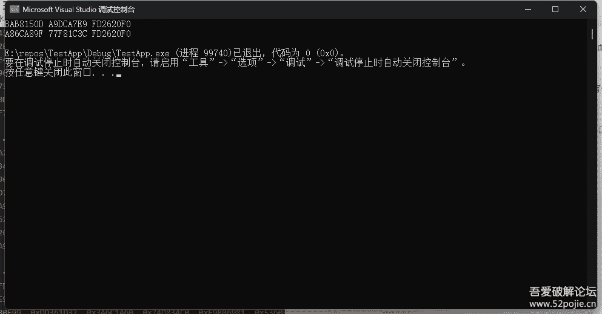
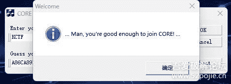

# [CTF] 逆向-[KCTF-Reverse]CORE CrackMe v2.0

- 原帖: https://www.52pojie.cn/forum.php?mod=viewthread&tid=2037517
- 抓取时间: 2026-11-01T22:08:27



1.png (27.11 KB, 下载次数: 2)

[1.png 附件](https://www.52pojie.cn/forum.php?mod=attachment&aid=Mjc4MTc0M3wwYThmMjY3YnwxNzkzNTcwOTA1fDE2ODA4NnwyMDM3NTE3&nothumb=yes)

2025-6-9 15:16 上传

这个Reverse比较古老，已经有20多年了，但难度确实不小。

先查壳



2.png (86.6 KB, 下载次数: 1)

[2.png 附件](https://www.52pojie.cn/forum.php?mod=attachment&aid=Mjc4MTc0NHwxN2IzYmQzYXwxNzkzNTcwOTA1fDE2ODA4NnwyMDM3NTE3&nothumb=yes)

2025-6-9 15:16 上传

`upx`压缩壳，0.72，废弃版本，工具无法解压。

反正不用IDA进行调试，直接`x32dbg`中，dump内存，保存后拖入IDA。

这里说一下，网上常规的[https://www.52pojie.cn/forum-5-1.html](https://www.52pojie.cn/forum-5-1.html)都是OEP->dump->IAT表修复等步骤，如果不需要在IDA中进行调试，直接dump内存，就可以IDA分析静态代码，伪代码都是正常的。

```
int __usercall sub_4020A0@(int a1@, int a2@, int a3@, int a4@)
{
  int v4; // eax
  char *i; // ecx
  int v6; // ebx
  char *v7; // edi
  int v8; // eax
  int v9; // esi
  int v10; // eax
  char *j; // ecx
  int v12; // ebx
  int v14; // eax
  char v15[100]; // [esp+8Ch] [ebp-66Ch] BYREF
  char v16[500]; // [esp+F0h] [ebp-608h] BYREF
  char v17[500]; // [esp+2E4h] [ebp-414h] BYREF
  char v18[500]; // [esp+4D8h] [ebp-220h] BYREF
  int v19; // [esp+6CCh] [ebp-2Ch] BYREF
  int v20; // [esp+6D0h] [ebp-28h] BYREF
  int v21; // [esp+6D4h] [ebp-24h] BYREF
  _DWORD v22[4]; // [esp+6D8h] [ebp-20h] BYREF
  char v23[4]; // [esp+6E8h] [ebp-10h] BYREF
  char v24[4]; // [esp+6ECh] [ebp-Ch] BYREF
  char v25[4]; // [esp+6F0h] [ebp-8h] BYREF
  int v26; // [esp+6F4h] [ebp-4h]

  v26 = a1;
  if ( (unsigned int)dword_417158(a2, a4, a3) >= 0x80000000 )
    dword_4171D0(v15, aSoftwareMicros_0);
  else
    dword_4171D0(v15, aSoftwareMicros);
  memset(v16, 0, sizeof(v16));
  memset(v17, 0, sizeof(v17));
  memset(v18, 0, sizeof(v18));
  sub_412706((_DWORD *)(v26 + 0x5C), (int)v16, 100);// 获取name
  sub_412706((_DWORD *)(v26 + 0xAC), (int)v17, 100);// code
  strcpy(v18, v16);
  sub_408D70(v18);                              // 逆序
  strcat(v16, v18);
  dword_41700C(0x80000002, v15, &v19);
  v20 = 1;
  v21 = 256;
  dword_417008(v19, dword_422480, 0, &v20, v18, &v21);
  strcat(v16, v18);
  v20 = 1;
  v21 = 256;
  dword_417008(v19, dword_4224A0, 0, &v20, v18, &v21);
  strcat(v16, v18);
  v4 = 0;
  for ( i = v16; *i; ++v4 )
    ++i;
  v6 = v4;
  sub_4014E0(v22);
  v7 = &v16[v6];
  *(_DWORD *)v7 = 0;
  *((_DWORD *)v7 + 1) = 0;
  *((_DWORD *)v7 + 2) = 0;
  *((_DWORD *)v7 + 3) = 0;
  *((_DWORD *)v7 + 4) = 0;
  *((_DWORD *)v7 + 5) = 0;
  *((_DWORD *)v7 + 6) = 0;
  *((_DWORD *)v7 + 7) = 0;
  *((_DWORD *)v7 + 8) = 0;
  *((_DWORD *)v7 + 9) = 0;
  *((_DWORD *)v7 + 10) = 0;
  *((_DWORD *)v7 + 11) = 0;
  *((_DWORD *)v7 + 12) = 0;
  *((_DWORD *)v7 + 13) = 0;
  *((_DWORD *)v7 + 14) = 0;
  *((_DWORD *)v7 + 15) = 0;
  *((_DWORD *)v7 + 16) = 0;
  *((_DWORD *)v7 + 17) = 0;
  *((_DWORD *)v7 + 18) = 0;
  v7[76] = 0;
  v7[77] = 0;
  v7[78] = 0;
  v16[v6] = 0x80;
  v8 = 64 - (((_BYTE)v6 + 1) & 0x3F);
  if ( v8
```

```
int *__cdecl sub_401AD0(int *a1, _DWORD *a2, _DWORD *a3)
{

  int v5; // esi

  int v6; // edi

  int v7; // esi

  int v8; // edi

  int *result; // eax

  int *v10; // [esp+18h] [ebp-24h]

  unsigned __int8 v11; // [esp+1Ch] [ebp-20h]

  int v12; // [esp+1Ch] [ebp-20h]

  int v13; // [esp+20h] [ebp-1Ch]

  unsigned __int8 v14; // [esp+20h] [ebp-1Ch]

  int v15; // [esp+28h] [ebp-14h]

  v5 = 0;

  v6 = 0;

  v10 = a1 + 1;

  do

  {

    v13 = *a3 & *v10;

    v11 = sub_401AB0(*a2 & *a1);

    ++v5;

    ++a3;

    ++a2;

    v6 = ((unsigned __int8)sub_401AB0(v13) ^ v11) & 1 ^ (2 * v6);

  }

  while ( (unsigned __int8)v5
```

```
int __cdecl sub_401AB0(int a1)
{
  int v1; // edx
  int result; // eax

  v1 = a1;
  for ( result = 0; v1; v1 &= v1 - 1 )
    ++result;
  return result;
}
```

`sub_401AB0`是计算参数的二进制表示中，1的个数，也就是汉明距离。`sub_401AD0`中，将2次汉明距离异或后，与1做按位与运算，也就是汉明距离的奇偶性，并以此作为2进制值计算出`v6`和`v8`.

说实话，这个逆运算困扰了我很久，按照反编译的代码，根本找不到逆运算的任何思路。看雪论坛在当年有一个帖子解释这个程序里有一句话，汉明距离奇偶性的判断有另外的等效计算方法，而那个方法是可逆的。于是寻找奇偶性计算的替代方法。

其实，奇偶性计算就是一个偶消奇不消的过程，值为1的位数是奇数还是偶数，那么，把每一bit进行异或即可，但没必要运行那么多次，折半异或性能更好。于是找到替代函数

```
static int haming_weight(_QWORD x)

{

    x = (x >> 32) ^ (x & 0xffffffff);

    x = (x >> 16) ^ (x & 0xffff);

    x = (x >> 8) ^ (x & 0xff);

    x = (x >> 4) ^ (x & 0xf);

    x = (x >> 2) ^ (x & 0x3);

    x = (x >> 1) ^ (x & 0x1);

    return x;

}
```

同时，汉明距离异或值的奇偶性，等于汉明距离奇偶的异或值，这里就有一种豁然开朗的感觉，入参数组的`data[0]`和`data[1]`可以看作一个64位整数，两组`key`同时拼接为一组64为整数的数组，于是`sub_401AD0`可以等效替换为

```
static void __cdecl encrypt(_DWORD* Data, _DWORD* maskKey1, _DWORD* maskKey2)
{
    _DWORD v8 = 0;
    _DWORD v6 = 0;
    for (int i = 0;i
```

```
// 预计算密钥的奇偶性矩阵

static void build_key_matrix(_DWORD* maskKey1, _DWORD* maskKey2, _DWORD matrix[64][64]) {

    for (int i = 0; i > j) & 1;

            matrix[i + 32][j] = (key2 >> j) & 1;

        }

    }

}

static bool matrix_inverse(_DWORD input[64][64], _DWORD output[64][64])

{

    _DWORD aug[64][128]; // 增广矩阵 [I | A]

    // 初始化增广矩阵

    for (int i = 0; i > (i)) & 1;

        cipher_bits[i + 32] = (Data[1] >> (i)) & 1;

    }

    // 矩阵乘法恢复原始数据

    _QWORD plain = 0;

    for (int i = 0; i > 32);

}
```

最后，解密过程为


```c
    _DWORD dword_41C5C0[] = {
        0xDFCF8EDF, 0xFE7C76FE, 0xFCF8EDFC, 0xF9F1DBF9, 0xF3E3B7F2, 0xBF9F1DBF, 0x7F3E3B7F, 0xE7C76FE5,
        0xCF8EDFCB, 0x7C76FE5F, 0xF8EDFCBE, 0x9F1DBF97, 0x3E3B7F2F, 0x8EDFCBE0, 0x1DBF97C1, 0xC76FE5F0,
        0xF1DBF97C, 0xE3B7F2F8, 0x3B7F2F82, 0x76FE5F05, 0xBF97C156, 0x6FE5F055, 0xDBF97C15, 0xB7F2F82A,
        0xDFCBE0AB, 0xEDFCBE0A, 0xF97C1561, 0xF2F82AC3, 0xE5F05586, 0x7F2F82AC, 0xFE5F0558, 0xFCBE0AB0,
        0xCBE0AB0C, 0x97C15619, 0x2F82AC32, 0x5F055865, 0x7C156197, 0xF82AC32E, 0xF055865C, 0xE0AB0CB9,
        0xC1561973, 0x82AC32E7, 0xBE0AB0CB, 0x055865CE, 0x0AB0CB9C, 0x2AC32E72, 0x15619739, 0x55865CE4,
        0xAB0CB9C8, 0xAC32E723, 0x5865CE46, 0xB0CB9C8D, 0x6197391B, 0xC32E7236, 0x865CE46C, 0x0CB9C8D9,
        0x56197391, 0x65CE46CB, 0xCB9C8D96, 0x197391B2, 0x32E72365, 0x97391B2C, 0x2E723659, 0x5CE46CB3
    };
    _DWORD dword_41C4C0[] = {
        0xAE10E7F5, 0x7087FFB6, 0xE10FFF6D, 0x421FDEDF, 0x843FBDBF, 0xDC21EFEF, 0x3843FFDB, 0x887F5B7B,
        0x90FE96F3, 0x07F45782, 0x0FE8AF04, 0xA1FD0DE3, 0xC3FA3BC3, 0xFE8AF04F, 0x7D15C09B, 0x7F457827,
        0x1FD15E09, 0x3FA2BC13, 0xFA2B8136, 0x74572268, 0x15CA5A45, 0xC5728693, 0x515CA9A5, 0xA2B9534B,
        0x0AE52D22, 0xE8AE44D0, 0xDCA5845F, 0x394B28BB, 0x72965177, 0x2B94B48B, 0x57296916, 0xAE52D22D,
        0xE52CA2EF, 0x4A5965DB, 0x94B2CBB7, 0xA965B76A, 0x2596BDA5, 0x4B2D7B4A, 0x965AF695, 0xACB5CD2F,
        0xD96BBA5B, 0x32D754B3, 0xD2CB4ED0, 0x65AEA967, 0xCB5D52CE, 0x2D750B30, 0x16BA8598, 0x5AEA1660,
        0xB5D42CC0, 0x5750D30E, 0xAEA1A61D, 0xDD436C3E, 0x3A86F879, 0x750DF0F2, 0xEA1BE1E5, 0x5437E3CF,
        0xEBA87985, 0x21BF7E74, 0x437EFCE8, 0xA86FC79E, 0xD0DFAF38, 0x86FDF9D1, 0x8DFBD3A7, 0x9BF7874A
    };
    _DWORD dword_41C3C0[] = { 
        0x9B4D1349, 0x369A2692, 0xCDA689A4, 0xDA689A48, 0xB4D13490, 0x69A26921, 0xD344D243, 0x6D344D24,
        0xA689A486, 0x4D13490D, 0x9A26921A, 0x689A486B, 0x344D2435, 0xD13490D7, 0xA26921AE, 0x89A486BA,
        0x44D2435D, 0x13490D75, 0x26921AEA, 0x4D2435D5, 0x9A486BAA, 0x3490D754, 0x6921AEA9, 0xD2435D52,
        0xA486BAA5, 0x490D754B, 0x921AEA96, 0x2435D52C, 0x486BAA58, 0x90D754B1, 0x21AEA962, 0x435D52C4,
        0x86BAA589, 0x1AEA9624, 0x0D754B12, 0x35D52C48, 0x6BAA5890, 0xD754B120, 0x5D52C481, 0xBAA58902,
        0xAEA96240, 0xEA96240A, 0x754B1205, 0xAA58902A, 0x54B12055, 0xA96240AA, 0x52C48154, 0xD52C4815,
        0xA58902A9, 0x4B120553, 0x96240AA7, 0x2C48154E, 0x58902A9D, 0xB120553A, 0x6240AA75, 0xC48154EA,
        0x48154EAB, 0x902A9D56, 0x20553AAC, 0x8902A9D5, 0x120553AA, 0x240AA755, 0x8154EAB3, 0x40AA7559
    };
    _DWORD dword_41C2C0[] = { 
        0x0BCFEF35, 0x179FDE6B, 0xC5E7E798, 0x5E7F79AC, 0xBCFEF359, 0xF9FDC6B7, 0x73FBAD6A, 0x2F3FBCD6,
        0xE7F75AD5, 0x4FEE95AF, 0x9FDD2B5E, 0xFF74CD76, 0xBFBA76B9, 0x7EE9BAE8, 0xFDD375D1, 0xF74D974E,
        0x7BA6CBA7, 0x6E9B0E99, 0xDD361D32, 0x3A6C1A60, 0x74D834C0, 0xE9B06981, 0x5360F306, 0xA6C1E60C,
        0xCD83EC1D, 0x1B07F83F, 0x360FF07E, 0x6C1FE0FD, 0xD83FC1FA, 0x307FA3F0, 0x60FF47E1, 0xC1FE8FC2,
        0x03FD3F80, 0x0FF4FE02, 0x07FA7F01, 0x1FE9FC04, 0x3FD3F808, 0x7FA7F010, 0x7E9FE047, 0xFD3FC08E,
        0xFF4FE021, 0xF4FF4232, 0x7A7FA119, 0xD3FD48C3, 0x27FAB183, 0x4FF56306, 0x9FEAC60D, 0x69FEA461,
        0xBFD5AC1E, 0xFFAB7839, 0x7F56D076, 0xFEADA0ED, 0x7D5B61DE, 0xFAB6C3BC, 0x756DA77D, 0xEADB4EFA,
        0x2DB58F80, 0x5B6B1F00, 0xB6D63E01, 0x55B6BDF1, 0xAB6D7BE3, 0xD6DAD7C2, 0x5B589808, 0xEDAC5C06 
    };

    _DWORD Data[] = { 0xBAB8150D, 0x57308F2C, 0xAEA9D86B };

    decrypt(Data + 1, dword_41C4C0, dword_41C5C0);
    decrypt(Data, dword_41C2C0, dword_41C3C0);
    printf("%X %X %X\n", Data[0], Data[1], Data[2]);
```



3.png (29.97 KB, 下载次数: 2)

[href="forum.php?mod=attachment&aid=Mjc4MTc0NnwwMDAxYjM2M3wxNzkzNTcwOTA1fDE2ODA4NnwyMDM3NTE3&nothumb=yes" target="_blank"](https://www.52pojie.cn/forum.php?mod=attachment&aid=Mjc4MTc0NnwwMDAxYjM2M3wxNzkzNTcwOTA1fDE2ODA4NnwyMDM3NTE3&nothumb=yes)

2025-6-9 15:16 上传

附上程序内执行成功的截图



CORE3_Success.jpg (14.69 KB, 下载次数: 2)

[href="forum.php?mod=attachment&aid=Mjc4MTc0N3w5ZTk2NjllMnwxNzkzNTcwOTA1fDE2ODA4NnwyMDM3NTE3&nothumb=yes" target="_blank"](https://www.52pojie.cn/forum.php?mod=attachment&aid=Mjc4MTc0N3w5ZTk2NjllMnwxNzkzNTcwOTA1fDE2ODA4NnwyMDM3NTE3&nothumb=yes)

2025-6-9 15:16 上传
