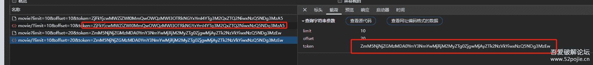
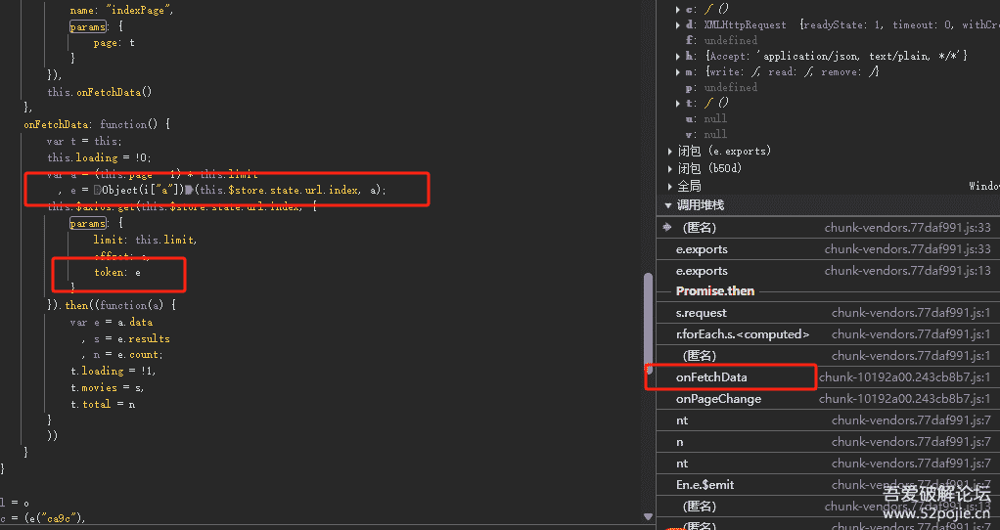
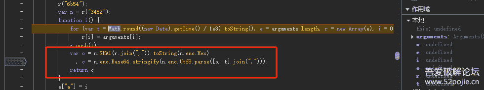
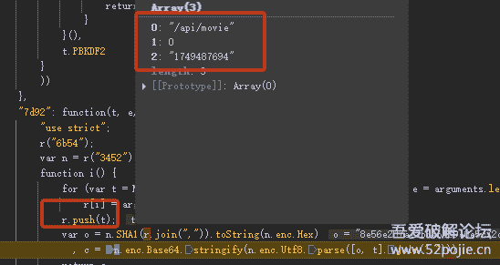
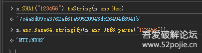
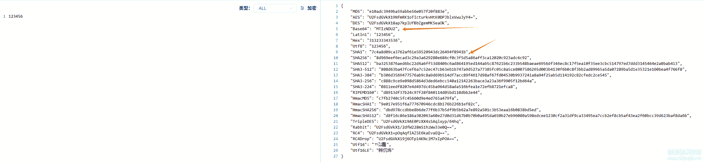

# [Web逆向] [原创]Scrape Spa2加密逆向过程分析

- 原帖: https://www.52pojie.cn/forum.php?mod=viewthread&tid=2037616
- 抓取时间: 2026-11-01T22:08:25

本题链接为aHR0cHM6Ly9zcGEyLnNjcmFwZS5jZW50ZXIv

打开网站翻页看浏览器抓包进行分析发现请求参数中有一个键为`token`的参数疑似加密参数



image.png (46.23 KB, 下载次数: 1)

[下载附件](https://www.52pojie.cn/forum.php?mod=attachment&aid=Mjc4MTgxNHw5NDE5YTZjNHwxNzkzNTcwOTAzfDE2ODA4NnwyMDM3NjE2&nothumb=yes)

2025-6-10 00:42 上传

通过打XHR断点后跟盏发现参数获取的地方, 然后单步进去发现加密位置.



image.png (52.46 KB, 下载次数: 1)

[下载附件](https://www.52pojie.cn/forum.php?mod=attachment&aid=Mjc4MTgxNXxhZDllNzE4MnwxNzkzNTcwOTAzfDE2ODA4NnwyMDM3NjE2&nothumb=yes)

2025-6-10 00:47 上传



image.png (17.57 KB, 下载次数: 0)

[下载附件](https://www.52pojie.cn/forum.php?mod=attachment&aid=Mjc4MTgxNnwyYzAxNDUyYXwxNzkzNTcwOTAzfDE2ODA4NnwyMDM3NjE2&nothumb=yes)

2025-6-10 00:47 上传

这里可以发现把`t` push 进了`r`，`t`为时间戳，`r[0]`是固定的，`r[1]`应该是`offset`。然后下面把拥有3个参数的`r`用`join()`方法转换为字符串后进行了疑似SHA1的加密。



image.png (19 KB, 下载次数: 0)

[下载附件](https://www.52pojie.cn/forum.php?mod=attachment&aid=Mjc4MTgxN3xlODhmNDNkY3wxNzkzNTcwOTAzfDE2ODA4NnwyMDM3NjE2&nothumb=yes)

2025-6-10 00:48 上传

至于是否标准算法, 我们测试一下即可, 既然要测试 看到下面关键词未Base64也顺便测试是否标准算法吧. 如果是标准算法就懒得扣了



image.png (9.29 KB, 下载次数: 1)

[下载附件](https://www.52pojie.cn/forum.php?mod=attachment&aid=Mjc4MTgxOHw4NmNiYjhkMHwxNzkzNTcwOTAzfDE2ODA4NnwyMDM3NjE2&nothumb=yes)

2025-6-10 00:52 上传



image.png (98.71 KB, 下载次数: 1)

[下载附件](https://www.52pojie.cn/forum.php?mod=attachment&aid=Mjc4MTgxOXwxMWRiOWI4NnwxNzkzNTcwOTAzfDE2ODA4NnwyMDM3NjE2&nothumb=yes)

2025-6-10 00:52 上传

验证完了是标准算法后开始撸代码, 已知`r[0]`是固定的 `r[1]`是请求参数的`offset`, `r[2]`是时间戳. `join`一个`","`然后进行sha1加密

```python
    for i in range(1,11):
        offset = (i - 1) * 10
        t = int(time.time())
        r = ['/api/movie', offset, t]
        o = hashlib.sha1(','.join(str(i) for i in r).encode()).hexdigest()
```

把`o`加密出来之后还要进行`c`的加密, `c`的加密涉及到`o`和`t`, 跟上面一样 组一个`[o, t]`的数组, 然后用`join`转换成字符串后进行b64加密即可

```python
c = base64.b64encode(','.join(str(i) for i in [o, t]).encode()).decode()
```

完整代码如下:

```python
import base64
import hashlib
import time

import requests_html

requests = requests_html.HTMLSession()

def main():
    headers = {
        'User-Agent': 'Mozilla/5.0 (Windows NT 10.0; Win64; x64) AppleWebKit/537.36 (KHTML, like Gecko) Chrome/137.0.0.0 Safari/537.36'
    }
    url = f'https://spa2.scrape.center/api/movie/'
    for i in range(1,11):
        offset = (i - 1) * 10
        t = int(time.time())
        r = ['/api/movie', offset, t]
        o = hashlib.sha1(','.join(str(i) for i in r).encode()).hexdigest()
        c = base64.b64encode(','.join(str(i) for i in [o, t]).encode()).decode()
        params = {
            'limit': 10,
            'offset': offset,
            'token': c
        }
        response = requests.get(url, params=params, headers=headers).json()
        print(response)

if __name__ == '__main__':
    main()
```
