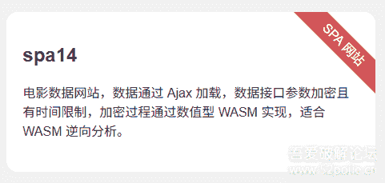
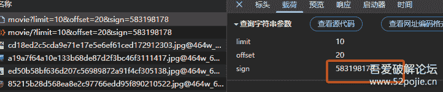
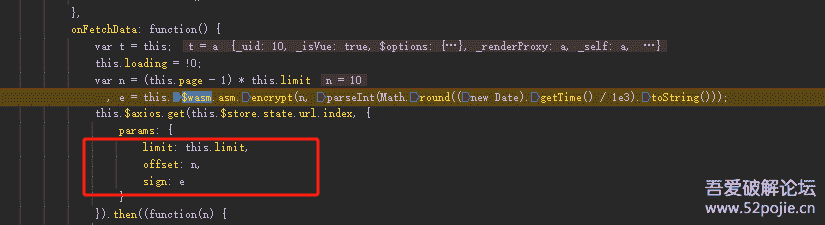
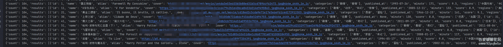

# [Web逆向] [原创]Scrape spa14 wasm加密过程分析

## 基本信息

- 原帖：https://www.52pojie.cn/forum.php?mod=viewthread&tid=2037819
- 抓取时间：2026-11-01T22:08:21

## 分析过程

本次分析网站为`aHR0cHM6Ly9zcGExNC5zY3JhcGUuY2VudGVyL3BhZ2UvMw==`。

已知本网站加密为 wasm 实现的。



`image.png` (28.68 KB, 下载次数: 1)

[附件下载](https://www.52pojie.cn/forum.php?mod=attachment&aid=Mjc4MTk0MXw4NmMzMWFkNHwxNzkzNTcwODk4fDE2ODA4NnwyMDM3ODE5&nothumb=yes)

2025-6-10 16:51 上传

直接打开网站，然后 F12 抓包看看哪个是加密参数!!!! 很明显就是 `sign` 了。



`image.png` (34.9 KB, 下载次数: 1)

[附件下载](https://www.52pojie.cn/forum.php?mod=attachment&aid=Mjc4MTk0MnxjZmRkNTQ4OXwxNzkzNTcwODk4fDE2ODA4NnwyMDM3ODE5&nothumb=yes)

2025-6-10 16:52 上传

知道 `sign` 是加密参数后，直接全局搜 `sign`：定位加密位置（如果搜 `sign` 不行那就加个冒号，再不行加等号，此方法在普通网站中挺好用，但是在一些故意隐藏变量名的就不好使了）。



`image.png` (14.21 KB, 下载次数: 1)

[附件下载](https://www.52pojie.cn/forum.php?mod=attachment&aid=Mjc4MTk0NXw3ZjM3MWI2ZHwxNzkzNTcwODk4fDE2ODA4NnwyMDM3ODE5&nothumb=yes)

2025-6-10 17:06 上传

找到了加密地点后，发现两个参数 `n`、`e`。`n` 参数明显是当前页码 - 1 * 10，10 为固定数。

`e` 参数是用 wasm 加密的，分别传入了 `n` 参数和一个 10 位数的向上取整的时间戳，他的源代码为：

```javascript
parseInt(Math.round((new Date).getTime() / 1e3).toString())
```

其实改成这个也一样：

```javascript
Math.round((new Date).getTime() / 1e3).toString()
```

好了，分析完了（毕竟 wasm 代码我也看不懂，直接调用就算了），直接开撸。

首先先构建 `n` 参数：

```python
n = (i - 1) * 10
```

然后导入 python 的 wasmer 包，顺便构建 `instance` 实例：

```python
from wasmer import Instance, Store, engine, Module
from wasmer_compiler_cranelift import Compiler

store = Store(engine.JIT(Compiler))
module = Module(store, open('spa14.wasm', 'rb').read())
instance = Instance(module)
```

然后通过刚才构建的 wasm 实例来进行参数加密：

```python
sign = instance.exports.encrypt(n, math.ceil(time.time()))
```

打完收工！核心代码都在上面了，完整的代码就不贴了，提高自己动手能力嘛。



`image.png` (150.58 KB, 下载次数: 1)

[附件下载](https://www.52pojie.cn/forum.php?mod=attachment&aid=Mjc4MTk1NHwyNDdiOGRhYXwxNzkzNTcwODk4fDE2ODA4NnwyMDM3ODE5&nothumb=yes)

2025-6-10 17:33 上传
