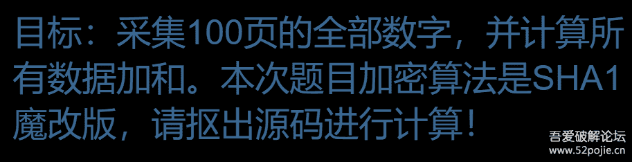
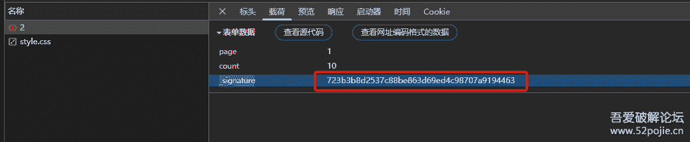
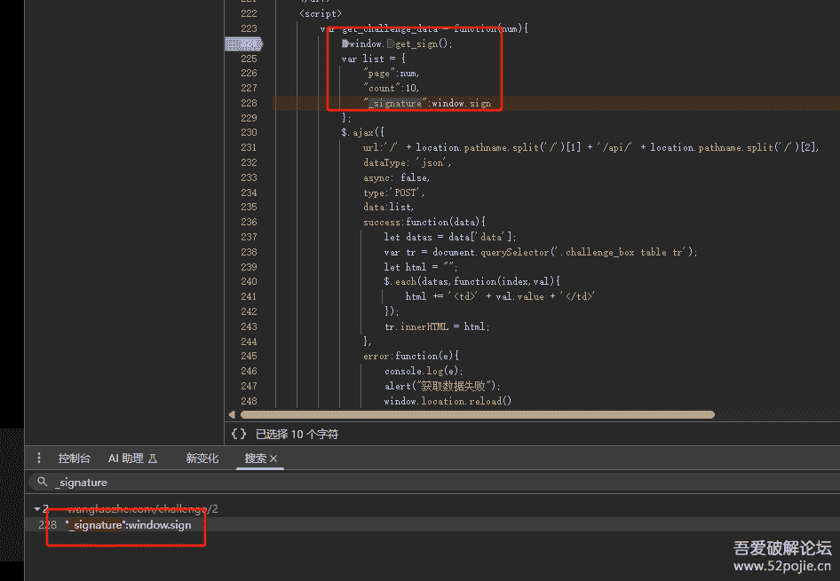
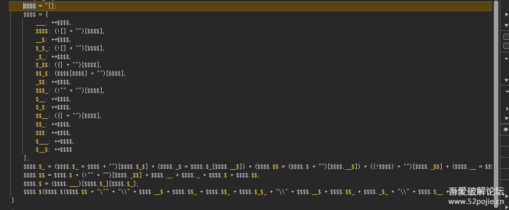
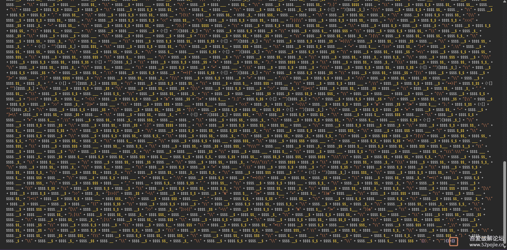
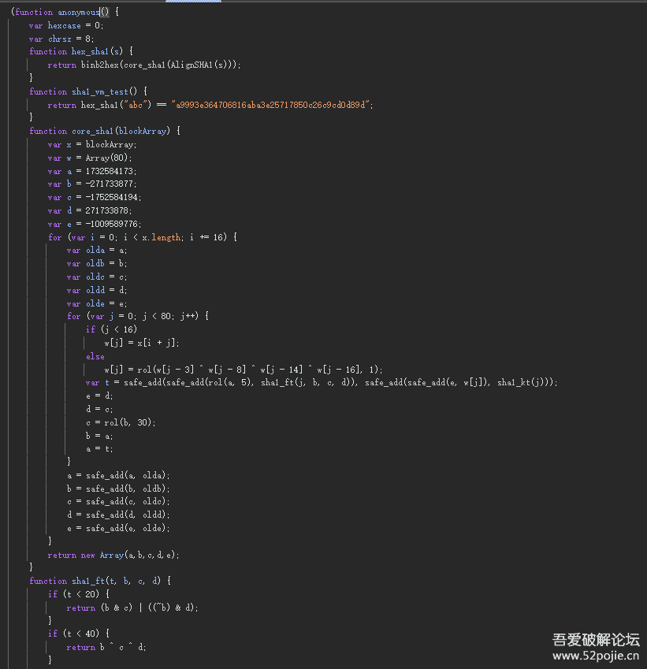
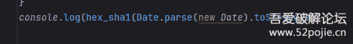
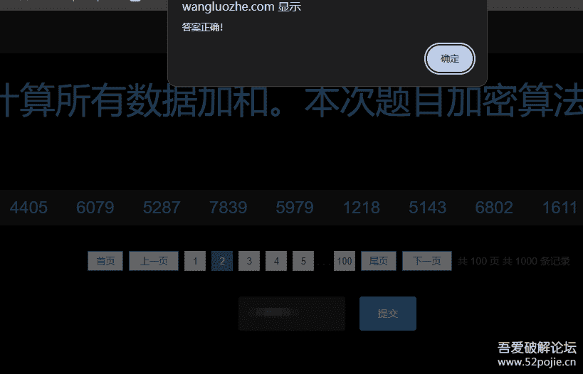

# [Web逆向] [原创] 网洛者 JJEncode加密 - 初体验 逆向分析

- 原帖: https://www.52pojie.cn/forum.php?mod=viewthread&tid=2037870
- 抓取时间: 2026-11-01T22:08:19

本次逆向题目为`aHR0cHM6Ly93YW5nbHVvemhlLmNvbS9jaGFsbGVuZ2UvMg==`。


[附件下载](https://www.52pojie.cn/forum.php?mod=attachment&aid=Mjc4MTk4OHwwYWM1Y2NlOXwxNzkzNTcwODk2fDE2ODA4NnwyMDM3ODcw&nothumb=yes)（`image.png`，62.95 KB，下载次数：1；2025-6-10 21:39 上传）

## 抓包定位

打开网站 开启`F12`抓包, 发现请求是`h2` 和请求参数`_signature`为加密参数


[附件下载](https://www.52pojie.cn/forum.php?mod=attachment&aid=Mjc4MTk4M3xkYjUxNTcxOXwxNzkzNTcwODk2fDE2ODA4NnwyMDM3ODcw&nothumb=yes)（`image.png`，21.46 KB，下载次数：0；2025-6-10 21:30 上传）

全局搜`_signature`发现加密函数入口, 先打个断点 再翻页单步进去看一看啥情况


[附件下载](https://www.52pojie.cn/forum.php?mod=attachment&aid=Mjc4MTk4NHw4NGU1NGRkZnwxNzkzNTcwODk2fDE2ODA4NnwyMDM3ODcw&nothumb=yes)（`image.png`，34.36 KB，下载次数：1；2025-6-10 21:31 上传）

好家伙, 果然是JJEncode, 一大堆看不懂的东西, 怎么办 怎么处理???


[附件下载](https://www.52pojie.cn/forum.php?mod=attachment&aid=Mjc4MTk4NXwzMTI5ZWE1NXwxNzkzNTcwODk2fDE2ODA4NnwyMDM3ODcw&nothumb=yes)（`image.png`，21.42 KB，下载次数：1；2025-6-10 21:32 上传）

## 处理 JJEncode

既然看不懂那就不用看懂, 把他变成能看懂的代码就好了, JJEncode处理方法很简单. 把他所有代码复制下来, 把最后的一对括号删了, 然后在`console`那黏贴运行一下就好了. 这下能看懂了吧?


[附件下载](https://www.52pojie.cn/forum.php?mod=attachment&aid=Mjc4MTk4NnwyYWVjZDE4MHwxNzkzNTcwODk2fDE2ODA4NnwyMDM3ODcw&nothumb=yes)（`image.png`，75.47 KB，下载次数：1；2025-6-10 21:37 上传）


[附件下载](https://www.52pojie.cn/forum.php?mod=attachment&aid=Mjc4MTk4N3xkMjg2Yjg3MXwxNzkzNTcwODk2fDE2ODA4NnwyMDM3ODcw&nothumb=yes)（`image.png`，27.81 KB，下载次数：1；2025-6-10 21:38 上传）

## 提取签名算法

上面都已经说了时候魔改的`SHA1`, 这个是练习的网站, 应该也没啥必要骗你, 所以直接扣下来吧, 也懒得试是否标准算法了

扣下来之后吧他的第一个`function`给去了, 然后`sign`就不赋值了 直接`console`出来


[附件下载](https://www.52pojie.cn/forum.php?mod=attachment&aid=Mjc4MTk4OXwwODI2MDkwY3wxNzkzNTcwODk2fDE2ODA4NnwyMDM3ODcw&nothumb=yes)（`image.png`，13.02 KB，下载次数：1；2025-6-10 21:49 上传）

## Python 调用

`python`调用就直接用`node`来调用, 关键代码如下

```python
        _signature = subprocess.Popen("node 2.JJEncode加密-初体验 ", encoding="utf-8", stdout=subprocess.PIPE)
        _signature = _signature.stdout.read().replace('\n', '')
```

打完收工, 关键代码已经有了 其他代码没有难度自己撸吧


[附件下载](https://www.52pojie.cn/forum.php?mod=attachment&aid=Mjc4MTk5MHxlZjQ4MTNiZXwxNzkzNTcwODk2fDE2ODA4NnwyMDM3ODcw&nothumb=yes)（`image.png`，44.56 KB，下载次数：0；2025-6-10 21:50 上传）
