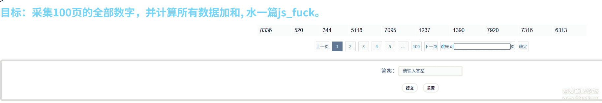
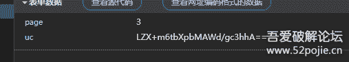
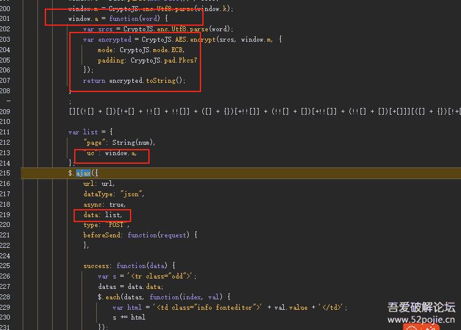
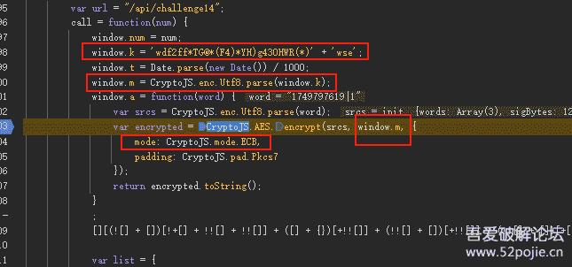
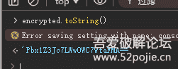
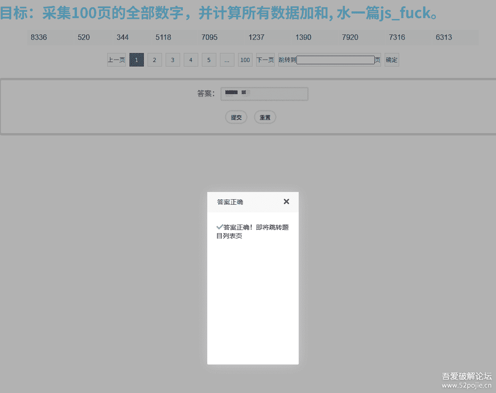

# [Web逆向] [原创] 猿人学 学员14题 js_fuck 逆向分析

- 原帖: `https://www.52pojie.cn/forum.php?mod=viewthread&tid=2038595`
- 抓取时间: `2026-11-01T22:08:13`

本次分析网站为: `aHR0cHM6Ly93d3cucHl0aG9uLXNwaWRlci5jb20vY2hhbGxlbmdlLzE0`



image.png (40.86 KB, 下载次数: 1)

[href="forum.php?mod=attachment&aid=Mjc4MjYwMnxlNzc3YTFkYXwxNzkzNTcwODkxfDE2ODA4NnwyMDM4NTk1&nothumb=yes" target="_blank"](https://www.52pojie.cn/forum.php?mod=attachment&aid=Mjc4MjYwMnxlNzc3YTFkYXwxNzkzNTcwODkxfDE2ODA4NnwyMDM4NTk1&nothumb=yes)

2025-6-13 14:46 上传

## 开搞

先打开`F12`抓包, 翻页请求, 查看加密参数, 发现在请求参数中发现`key`为`uc`的参数是加密的



image.png (11.87 KB, 下载次数: 2)

[href="forum.php?mod=attachment&aid=Mjc4MjYwNHxjOTA5NmJmNXwxNzkzNTcwODkxfDE2ODA4NnwyMDM4NTk1&nothumb=yes" target="_blank"](https://www.52pojie.cn/forum.php?mod=attachment&aid=Mjc4MjYwNHxjOTA5NmJmNXwxNzkzNTcwODkxfDE2ODA4NnwyMDM4NTk1&nothumb=yes)

2025-6-13 14:48 上传

打下`XHR`断点, 继续翻页后跟盏发现了许多东西, `data` 的值是`list`传过来的, 而`list`刚好在上面由`page`和`uc`组成的(`uc`恰好是我们要找的加密参数), 而`uc`是`window.a`获取的, 在这里上面有一串`js_fuck`(好像没用, 直接忽略), 再上面是`window.a`的加密内容, 看代码看出来应该是`AES`加密, 打个断点继续分析



image.png (25.01 KB, 下载次数: 1)

[href="forum.php?mod=attachment&aid=Mjc4MjYwNXwxNjY5NDVkMnwxNzkzNTcwODkxfDE2ODA4NnwyMDM4NTk1&nothumb=yes" target="_blank"](https://www.52pojie.cn/forum.php?mod=attachment&aid=Mjc4MjYwNXwxNjY5NDVkMnwxNzkzNTcwODkxfDE2ODA4NnwyMDM4NTk1&nothumb=yes)

2025-6-13 14:50 上传

跟盏发现`window.a`传进来的参数`word`是由10位的时间戳+"|"+页码组成的, 而认识`js`的`AES`加密的就知道`CryptoJS.AES.encrypt`第一个参数为加密内容, 第二个参数为`key`, 而下面可以看到他的`mode`是`ECB`, `AES`的`ECB`是不需要`iv`的, 所以置空, `key`是从`window.m`来的, `window.m`只是对`window.k`进行了十六进制的转换



image.png (18.53 KB, 下载次数: 3)

[href="forum.php?mod=attachment&aid=Mjc4MjYwOXw1NGM3MzI0NHwxNzkzNTcwODkxfDE2ODA4NnwyMDM4NTk1&nothumb=yes" target="_blank"](https://www.52pojie.cn/forum.php?mod=attachment&aid=Mjc4MjYwOXw1NGM3MzI0NHwxNzkzNTcwODkxfDE2ODA4NnwyMDM4NTk1&nothumb=yes)

2025-6-13 14:54 上传

## Python 实现

分析完毕, 开撸`python`代码

首先先`import` 所需的库

```python
import base64

from Crypto.Cipher import AES
from Crypto.Util.Padding import pad
```

然后`new`一个`crypto`对象把`key`放进去, `key`需要进行`encode`, 第二个参数需要选择`ECB`

```python
crypto = AES.new("wdf2ff*TG@*(F4)*YH)g430HWR(*)wse".encode(), AES.MODE_ECB)  # key, mode, iv. ECB不需要IV
```

然后构建加密参数, 进行加密

```python
for i in range(1, 101):
    crypto_data = f"{int(time.time())}|{i}"
    data = {
        'page': i,
        'uc': base64.b64encode(crypto.encrypt(pad(crypto_data.encode(), AES.block_size))).decode()
    }
```

尝试加密看看是否加密后的结果跟网页内一致



image.png (10.64 KB, 下载次数: 2)

[href="forum.php?mod=attachment&aid=Mjc4MjYxMXxkM2E1ZmUxOHwxNzkzNTcwODkxfDE2ODA4NnwyMDM4NTk1&nothumb=yes" target="_blank"](https://www.52pojie.cn/forum.php?mod=attachment&aid=Mjc4MjYxMXxkM2E1ZmUxOHwxNzkzNTcwODkxfDE2ODA4NnwyMDM4NTk1&nothumb=yes)

2025-6-13 15:03 上传


image.png (2.68 KB, 下载次数: 3)

[href="forum.php?mod=attachment&aid=Mjc4MjYxMnxlNjNhZjBlMnwxNzkzNTcwODkxfDE2ODA4NnwyMDM4NTk1&nothumb=yes" target="_blank"](https://www.52pojie.cn/forum.php?mod=attachment&aid=Mjc4MjYxMnxlNjNhZjBlMnwxNzkzNTcwODkxfDE2ODA4NnwyMDM4NTk1&nothumb=yes)

2025-6-13 15:03 上传

打完收工



image.png (48.41 KB, 下载次数: 3)

[href="forum.php?mod=attachment&aid=Mjc4MjYxNXxmODg1YWQ0NXwxNzkzNTcwODkxfDE2ODA4NnwyMDM4NTk1&nothumb=yes" target="_blank"](https://www.52pojie.cn/forum.php?mod=attachment&aid=Mjc4MjYxNXxmODg1YWQ0NXwxNzkzNTcwODkxfDE2ODA4NnwyMDM4NTk1&nothumb=yes)

2025-6-13 15:04 上传

核心代码都放上去了, 其他的代码就不贴了 提高动手能力.
