# [Web逆向] 某香医生`sign`值参数逆向分析

- 原帖: https://www.52pojie.cn/forum.php?mod=viewthread&tid=2038968
- 抓取时间: 2026-11-01T22:08:12

本文章中所有内容仅供学习交流使用，不用于其他任何目的，不提供完整代码，抓包内容、敏感网址、数据接口等均已做脱敏处理，严禁用于商业用途和非法用途，否则由此产生的一切后果均与作者无关.本文章未经许可禁止转载，禁止任何修改后二次传播，擅自使用本文讲解的技术而导致的任何意外，作者均不负责

## 一个简单的`sign`加密参数逆向分析思路：

食用地址：aHR0cHM6Ly93d3cuZHh5LmNuL2Jicy9uZXd3ZWIvcGMvY2FzZQ==

## 一、抓包分析目标参数

### 1、分析目标接口
Cmh0dHBzOi8vd3d3LmR4eS5jbi9iYnMvbmV3d2ViL2Nhc2UtYmFuay9wYWdlLXBvc3QtaW5mbw==

### 2、需要处理参数

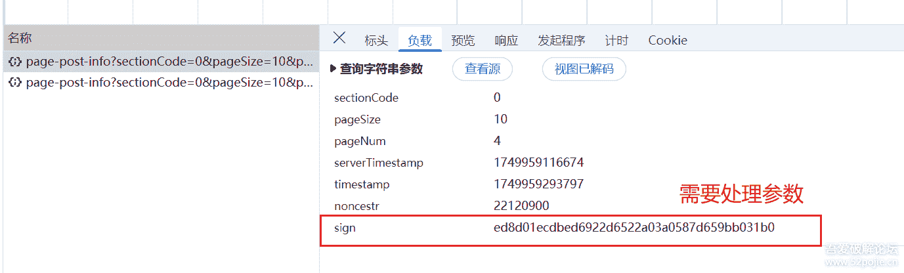

image.png (54.4 KB, 下载次数: 0)

[href="forum.php?mod=attachment&aid=Mjc4Mjk3NnxiNDA1ZjM0MXwxNzkzNTcwODg5fDE2ODA4NnwyMDM4OTY4&nothumb=yes" target="_blank"](https://www.52pojie.cn/forum.php?mod=attachment&aid=Mjc4Mjk3NnxiNDA1ZjM0MXwxNzkzNTcwODg5fDE2ODA4NnwyMDM4OTY4&nothumb=yes)

`sign`参数

2025-6-15 12:01 上传

非常明确就一个`sign`参数需要处理，爬虫老鸟可能会直接拿过来看看长度，猜一下大概是什么算法，像非常常见的标准32位`md5`也遇到过很多次

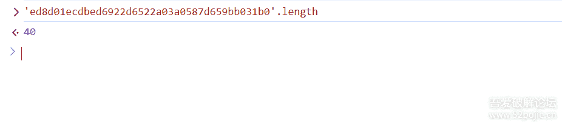

image.png (12.3 KB, 下载次数: 0)

[href="forum.php?mod=attachment&aid=Mjc4Mjk3N3w0YmUzOWFmY3wxNzkzNTcwODg5fDE2ODA4NnwyMDM4OTY4&nothumb=yes" target="_blank"](https://www.52pojie.cn/forum.php?mod=attachment&aid=Mjc4Mjk3N3w0YmUzOWFmY3wxNzkzNTcwODg5fDE2ODA4NnwyMDM4OTY4&nothumb=yes)

参数长度

2025-6-15 12:03 上传

很好，40位，当场退役，接下来就是跟栈分析

## 二、跟栈定位加密函数

### 1、直接跟进来打个断点，其实我们跟栈的目的很明确，其实就是找到加密函数的生成位置，从而复现加密逻辑

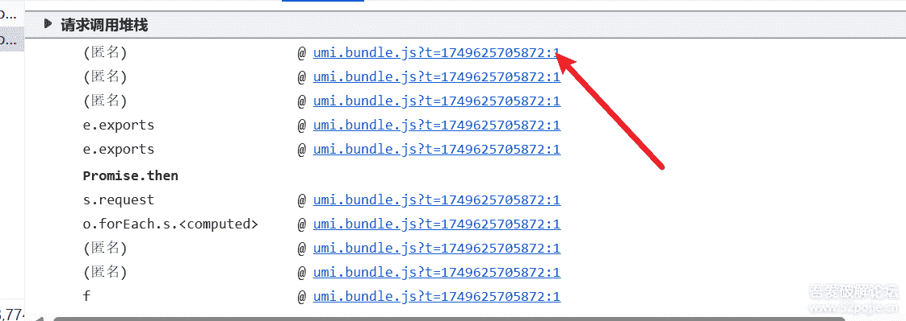

image.png (63.81 KB, 下载次数: 1)

[href="forum.php?mod=attachment&aid=Mjc4Mjk3OXw2MjcyODU0MnwxNzkzNTcwODg5fDE2ODA4NnwyMDM4OTY4&nothumb=yes" target="_blank"](https://www.52pojie.cn/forum.php?mod=attachment&aid=Mjc4Mjk3OXw2MjcyODU0MnwxNzkzNTcwODg5fDE2ODA4NnwyMDM4OTY4&nothumb=yes)

跟栈

2025-6-15 12:05 上传

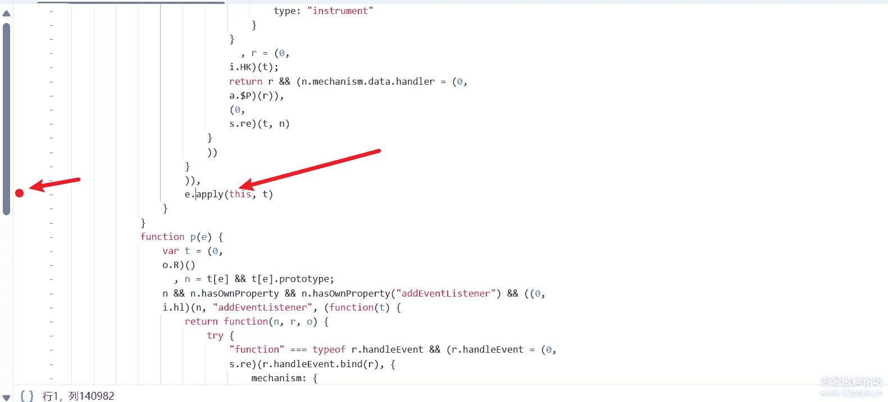

image.png (64.65 KB, 下载次数: 0)

[href="forum.php?mod=attachment&aid=Mjc4Mjk4MHxlZmYxZmY1NXwxNzkzNTcwODg5fDE2ODA4NnwyMDM4OTY4&nothumb=yes" target="_blank"](https://www.52pojie.cn/forum.php?mod=attachment&aid=Mjc4Mjk4MHxlZmYxZmY1NXwxNzkzNTcwODg5fDE2ODA4NnwyMDM4OTY4&nothumb=yes)

断点

2025-6-15 12:06 上传

接下来，我们选择下滑点击查看更多，因为这是一个翻页的加密参数，刷新会导致不必要的接口加载，所以下滑更适合食用（所有都需要根据具体情况去选择）

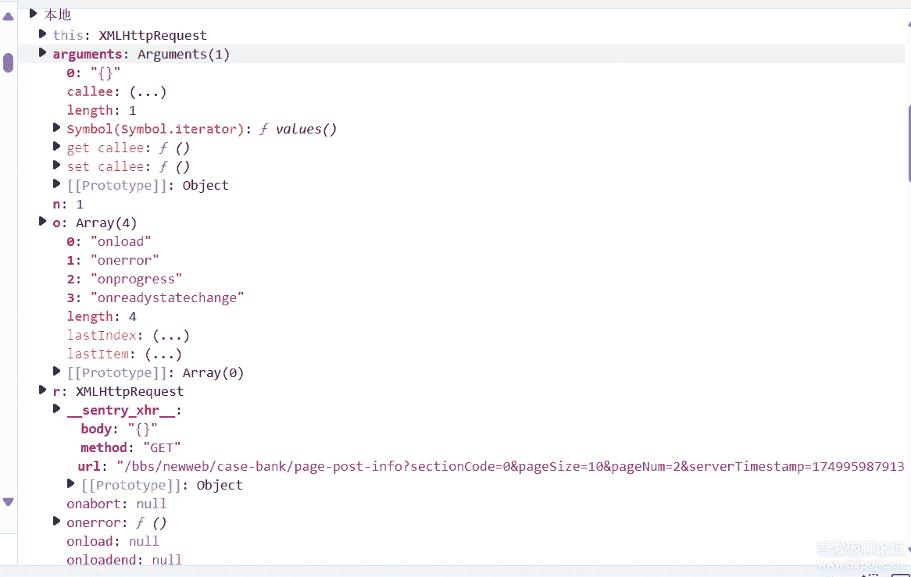

image.png (69.3 KB, 下载次数: 1)

[href="forum.php?mod=attachment&aid=Mjc4Mjk4MXw4NTg4MTlkN3wxNzkzNTcwODg5fDE2ODA4NnwyMDM4OTY4&nothumb=yes" target="_blank"](https://www.52pojie.cn/forum.php?mod=attachment&aid=Mjc4Mjk4MXw4NTg4MTlkN3wxNzkzNTcwODg5fDE2ODA4NnwyMDM4OTY4&nothumb=yes)

作用域

2025-6-15 12:10 上传

接下来我们根据断住的内容去分析参数的位置，大佬们可以自行选择作用于查看或者控制台打印查看

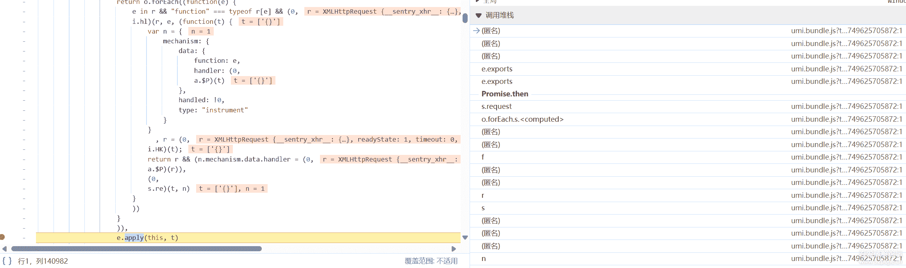

image.png (144.1 KB, 下载次数: 0)

[href="forum.php?mod=attachment&aid=Mjc4Mjk4M3w5YzI3MDY3M3wxNzkzNTcwODg5fDE2ODA4NnwyMDM4OTY4&nothumb=yes" target="_blank"](https://www.52pojie.cn/forum.php?mod=attachment&aid=Mjc4Mjk4M3w5YzI3MDY3M3wxNzkzNTcwODg5fDE2ODA4NnwyMDM4OTY4&nothumb=yes)

异步

2025-6-15 12:11 上传

我们可以看到整个执行有自执行函数，异步，比较复杂的生成过程，我们直接往上走，看看加密参数的生成位置

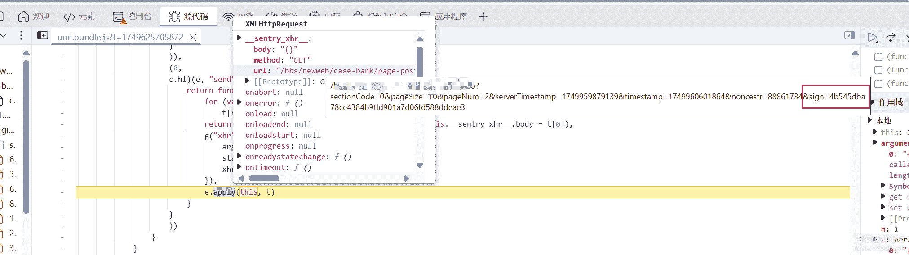

image.png (111.22 KB, 下载次数: 2)

[href="forum.php?mod=attachment&aid=Mjc4Mjk4NHxiNTcyMDBiMnwxNzkzNTcwODg5fDE2ODA4NnwyMDM4OTY4&nothumb=yes" target="_blank"](https://www.52pojie.cn/forum.php?mod=attachment&aid=Mjc4Mjk4NHxiNTcyMDBiMnwxNzkzNTcwODg5fDE2ODA4NnwyMDM4OTY4&nothumb=yes)

第一个参数位置

2025-6-15 12:14 上传

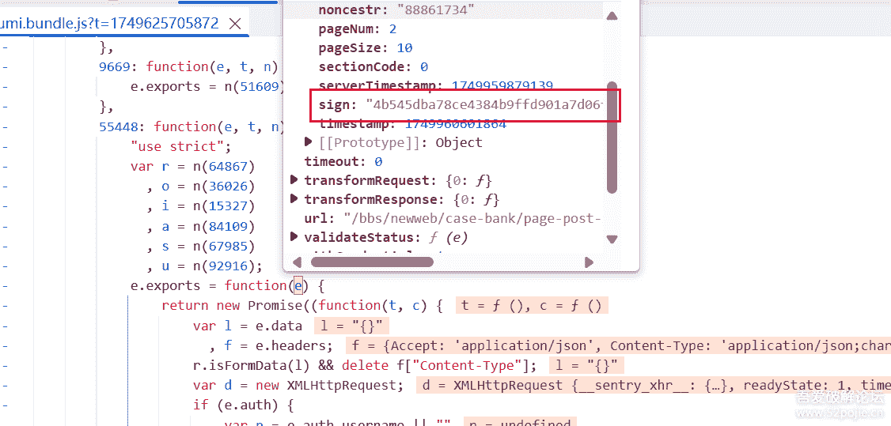

image.png (105.52 KB, 下载次数: 1)

[href="forum.php?mod=attachment&aid=Mjc4Mjk4Nnw1MTcxMWZjN3wxNzkzNTcwODg5fDE2ODA4NnwyMDM4OTY4&nothumb=yes" target="_blank"](https://www.52pojie.cn/forum.php?mod=attachment&aid=Mjc4Mjk4Nnw1MTcxMWZjN3wxNzkzNTcwODg5fDE2ODA4NnwyMDM4OTY4&nothumb=yes)

第二个参数位置

2025-6-15 12:16 上传

很明显都不是参数产生的位置，都是传进来的参数，我们继续往上走

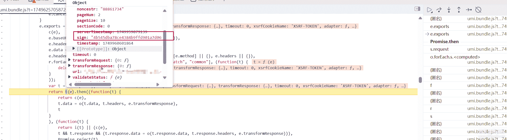

image.png (162.66 KB, 下载次数: 0)

[href="forum.php?mod=attachment&aid=Mjc4Mjk4OHw5NTI5Y2RkYnwxNzkzNTcwODg5fDE2ODA4NnwyMDM4OTY4&nothumb=yes" target="_blank"](https://www.52pojie.cn/forum.php?mod=attachment&aid=Mjc4Mjk4OHw5NTI5Y2RkYnwxNzkzNTcwODg5fDE2ODA4NnwyMDM4OTY4&nothumb=yes)

第三次参数

2025-6-15 12:17 上传

很快就到了异步的位置，还是不是加密产生的地方，所以我们要继续往上走，重新在异步位置下断点，下来加载更多刷新，然后把其他断点可以删掉

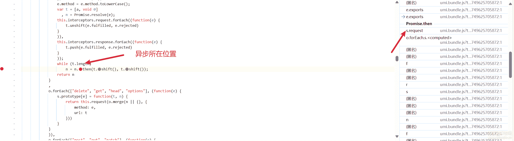

image.png (147.25 KB, 下载次数: 1)

[href="forum.php?mod=attachment&aid=Mjc4Mjk5MXxlNmNkYWM3OXwxNzkzNTcwODg5fDE2ODA4NnwyMDM4OTY4&nothumb=yes" target="_blank"](https://www.52pojie.cn/forum.php?mod=attachment&aid=Mjc4Mjk5MXxlNmNkYWM3OXwxNzkzNTcwODg5fDE2ODA4NnwyMDM4OTY4&nothumb=yes)

异步位置

2025-6-15 12:19 上传

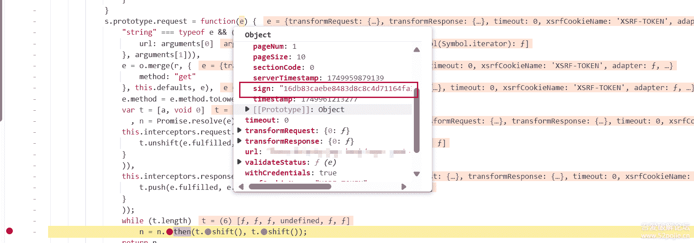

image.png (125 KB, 下载次数: 0)

[href="forum.php?mod=attachment&aid=Mjc4Mjk5MnxiMTg4YWJlZXwxNzkzNTcwODg5fDE2ODA4NnwyMDM4OTY4&nothumb=yes" target="_blank"](https://www.52pojie.cn/forum.php?mod=attachment&aid=Mjc4Mjk5MnxiMTg4YWJlZXwxNzkzNTcwODg5fDE2ODA4NnwyMDM4OTY4&nothumb=yes)

异步参数

2025-6-15 12:21 上传

还是一样`sign`已经生成了，这里依旧不是我们加密逻辑的地方，继续往上走一下

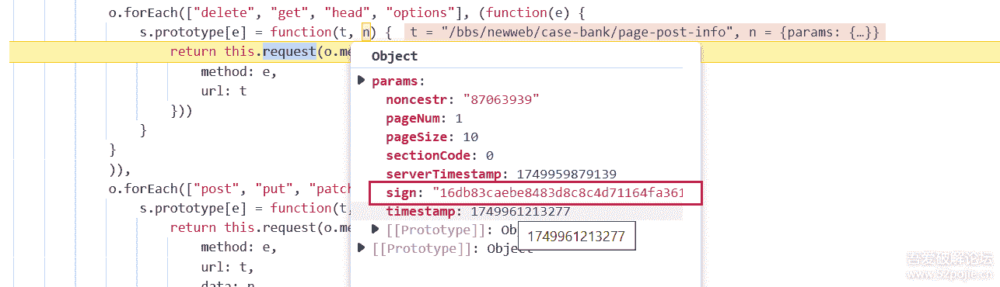

image.png (69.04 KB, 下载次数: 1)

[href="forum.php?mod=attachment&aid=Mjc4Mjk5NHxiODk5ZDllOXwxNzkzNTcwODg5fDE2ODA4NnwyMDM4OTY4&nothumb=yes" target="_blank"](https://www.52pojie.cn/forum.php?mod=attachment&aid=Mjc4Mjk5NHxiODk5ZDllOXwxNzkzNTcwODg5fDE2ODA4NnwyMDM4OTY4&nothumb=yes)

异步参数2

2025-6-15 12:22 上传

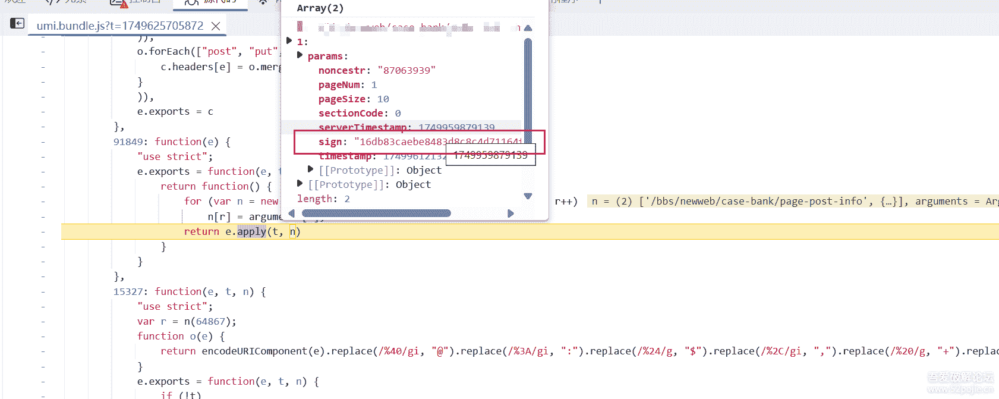

image.png (107.8 KB, 下载次数: 1)

[href="forum.php?mod=attachment&aid=Mjc4Mjk5NXwyOWM5OWE4YXwxNzkzNTcwODg5fDE2ODA4NnwyMDM4OTY4&nothumb=yes" target="_blank"](https://www.52pojie.cn/forum.php?mod=attachment&aid=Mjc4Mjk5NXwyOWM5OWE4YXwxNzkzNTcwODg5fDE2ODA4NnwyMDM4OTY4&nothumb=yes)

异步参数3

2025-6-15 12:22 上传

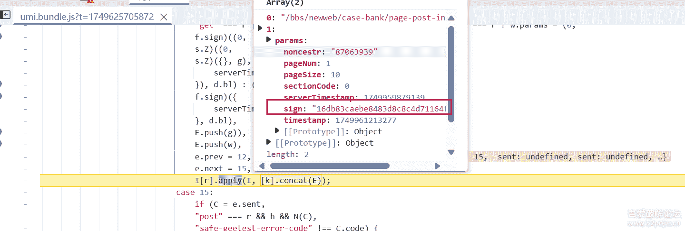

image.png (84.75 KB, 下载次数: 0)

[href="forum.php?mod=attachment&aid=Mjc4Mjk5Nnw0OGVhMmRhZXwxNzkzNTcwODg5fDE2ODA4NnwyMDM4OTY4&nothumb=yes" target="_blank"](https://www.52pojie.cn/forum.php?mod=attachment&aid=Mjc4Mjk5Nnw0OGVhMmRhZXwxNzkzNTcwODg5fDE2ODA4NnwyMDM4OTY4&nothumb=yes)

异步参数4

2025-6-15 12:23 上传

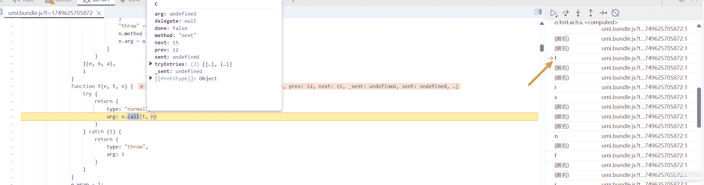

image.png (135.61 KB, 下载次数: 1)

[href="forum.php?mod=attachment&aid=Mjc4Mjk5N3xjZmNiMDI1NnwxNzkzNTcwODg5fDE2ODA4NnwyMDM4OTY4&nothumb=yes" target="_blank"](https://www.52pojie.cn/forum.php?mod=attachment&aid=Mjc4Mjk5N3xjZmNiMDI1NnwxNzkzNTcwODg5fDE2ODA4NnwyMDM4OTY4&nothumb=yes)

空值

2025-6-15 12:23 上传

这里我们就发现有问题了，我们没有找到加密参数`sign`，说明接下来就是生成`sign`的位置，我们一直往上走该结束了，可以往下走

回到我们这张图的所在位置，接下来就是找相关的代码，进行加密参数的分析

## 三、加密算法及代码分析

这一部分的话需要一些基本的js代码阅读能力，对代码执行逻辑进行分析

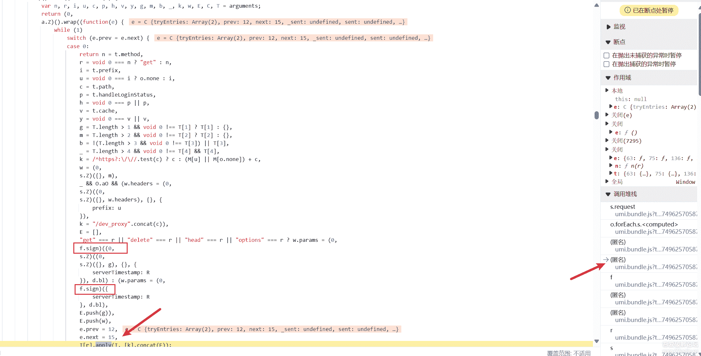

image.png (204.28 KB, 下载次数: 2)

[href="forum.php?mod=attachment&aid=Mjc4MzAxNHxiYWMzMDA2MXwxNzkzNTcwODg5fDE2ODA4NnwyMDM4OTY4&nothumb=yes" target="_blank"](https://www.52pojie.cn/forum.php?mod=attachment&aid=Mjc4MzAxNHxiYWMzMDA2MXwxNzkzNTcwODg5fDE2ODA4NnwyMDM4OTY4&nothumb=yes)

加密

2025-6-15 13:24 上传

这是一段控制流的代码，我们可以清晰地看到熟悉的参数`sign`，可以猜测是在这里形成加密参数，我们在可疑位置之前和之后打上断点，看看情况，放开其他断点加载更多

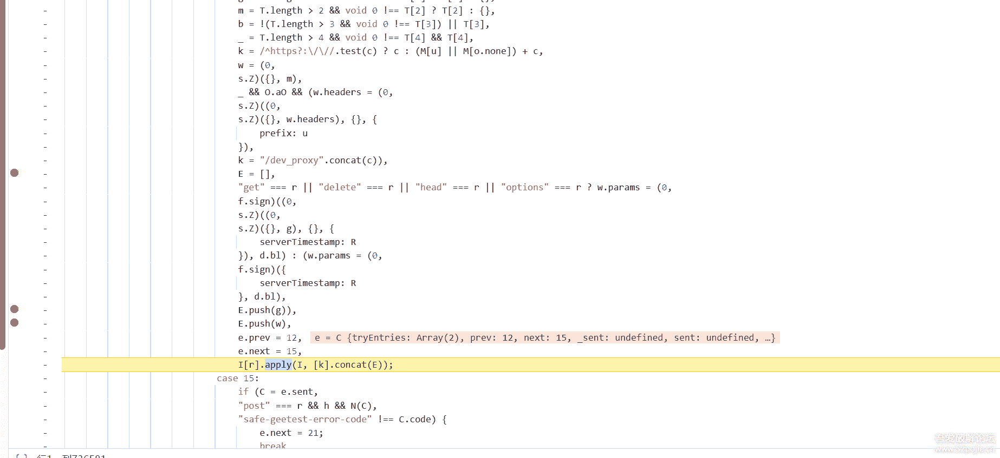

image.png (91.96 KB, 下载次数: 1)

[href="forum.php?mod=attachment&aid=Mjc4MzAxNnxmYWZiY2U4ZnwxNzkzNTcwODg5fDE2ODA4NnwyMDM4OTY4&nothumb=yes" target="_blank"](https://www.52pojie.cn/forum.php?mod=attachment&aid=Mjc4MzAxNnxmYWZiY2U4ZnwxNzkzNTcwODg5fDE2ODA4NnwyMDM4OTY4&nothumb=yes)

可疑位置

2025-6-15 13:27 上传

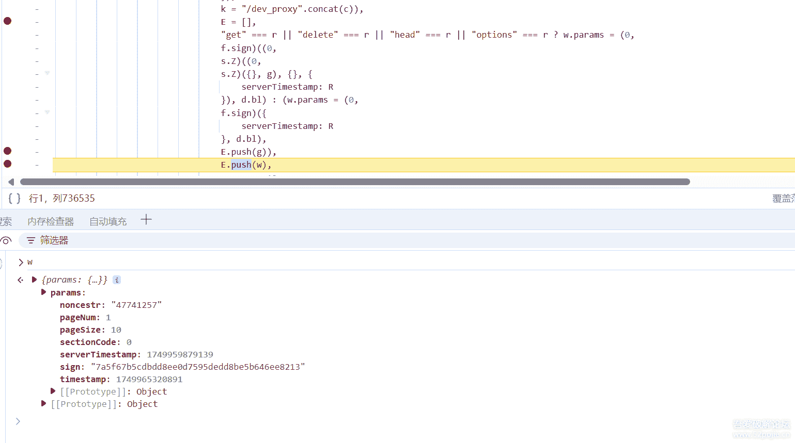

image.png (76.15 KB, 下载次数: 1)

[href="forum.php?mod=attachment&aid=Mjc4MzAxOHxjMDgyMmE1MXwxNzkzNTcwODg5fDE2ODA4NnwyMDM4OTY4&nothumb=yes" target="_blank"](https://www.52pojie.cn/forum.php?mod=attachment&aid=Mjc4MzAxOHxjMDgyMmE1MXwxNzkzNTcwODg5fDE2ODA4NnwyMDM4OTY4&nothumb=yes)

w

2025-6-15 13:30 上传

这里可以看出，加密参数是`w`中的值，生成的，核心代码逻辑如下：


# 请求参数与签名逻辑分析

## 请求参数构造

```javascript
r === "get" || "delete" === r || "head" === r || "options" === r  ? w.params = f.sign(s.Z(s.Z({}, g), { serverTimestamp: R }), d.bl)
  : w.params = f.sign({ serverTimestamp: R }, d.bl)
```

这段代码是一个三元表达式，根据变量 `r` 的值选择两种不同的方式构造 `w.params` 对象。条件为真时，执行：

```javascript
w.params = f.sign(
  s.Z(
    s.Z({}, g),
    { serverTimestamp: R }serverTimestamp
  ),
  d.bl
)
```

条件为假时执行：

```javascript
w.params = f.sign(
  { serverTimestamp: R },
  d.bl
)
```

我们可以借助 ai 或者自己稍微改写一下逻辑，更方便理解：

```javascript
if (r === "get" || r === "delete" || r === "head" || r === "options") {
  // 合并 g 和 serverTimestamp
  const merged = Object.assign({}, g, { serverTimestamp: R });
  w.params = f.sign(merged, d.bl);
} else {
  // 仅使用 serverTimestamp
  w.params = f.sign({ serverTimestamp: R }, d.bl);
}
```

这个大概是针对不同的请求接口做加密是设计的，根据我们当前请求方式为 `get` 请求，直接下断点看看情况。


*`image.png`（37.01 KB，下载次数：1），新断点，2025-6-15 13:39 上传*

[附件下载](https://www.52pojie.cn/forum.php?mod=attachment&aid=Mjc4MzAyMXxjZWFjODg4ZHwxNzkzNTcwODg5fDE2ODA4NnwyMDM4OTY4&nothumb=yes)

这里我们一定要利用单步调试，这样就是可以进入到核心的加密逻辑中。

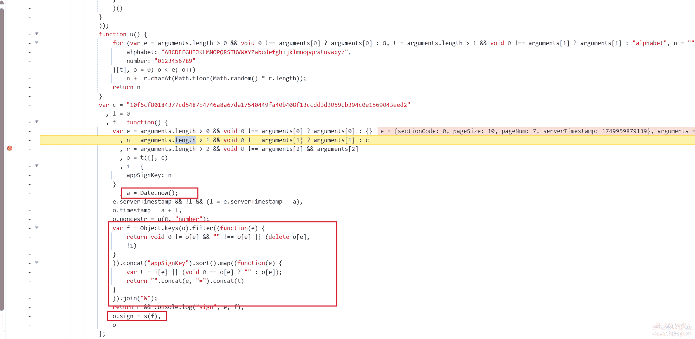

*`image.png`（124.24 KB，下载次数：0），加密逻辑分析，2025-6-15 13:41 上传*

[附件下载](https://www.52pojie.cn/forum.php?mod=attachment&aid=Mjc4MzAyM3xhYjZlZGFiNnwxNzkzNTcwODg5fDE2ODA4NnwyMDM4OTY4&nothumb=yes)

这里我们们可以看到，`sign` 值的产生应该是通过 `s` 函数对 `f` 进行加密。

```javascript
var f = Object.keys(o).filter((function(e) {
                        return void 0 != o[e] && "" !== o[e] || (delete o[e],
                        !1)
                    }
                    )).concat("appSignKey").sort().map((function(e) {
                        var t = i[e] || (void 0 == o[e] ? "" : o[e]);
                        return "".concat(e, "=").concat(t)
                    }
                    )).join("&");
```

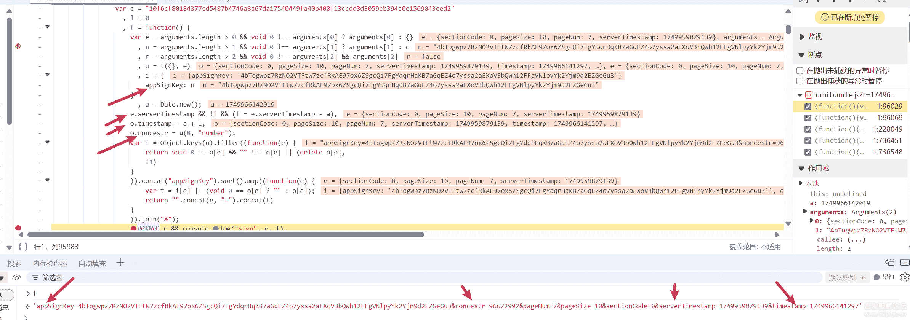

*`image.png`（260.01 KB，下载次数：0），`f` 参数的拼接，2025-6-15 13:46 上传*

[附件下载](https://www.52pojie.cn/forum.php?mod=attachment&aid=Mjc4MzAyNXwwOGZmZDRlOHwxNzkzNTcwODg5fDE2ODA4NnwyMDM4OTY4&nothumb=yes)

可以看出，`f` 是对 `appSignKey`，`noncestr`，`pageNum`，`pageSize`，`sectionCode`，`serverTimestamp`，`timestamp` 拼接产生的，我们可以通过不断地下来加载来确定哪些是是变得哪些是不变的，`pageNum` 是翻页的参数是根据具体的页码传入的，`appSignKey` 通过测试是一个定值，接下里分析的就是：

```javascript
a = Date.now();
e.serverTimestamp && !l && (l = e.serverTimestamp - a),
o.timestamp = a + l,
o.noncestr = u(8, "number");
```

这些参数内容 `serverTimestamp` 是服务器的时间，`timestamp` 就是当前时间和服务器时间的一个差值，`u` 的逻辑我们跟进去看看。

```javascript
function u() {
                    for (var e = arguments.length > 0 && void 0 !== arguments[0] ? arguments[0] : 8, t = arguments.length > 1 && void 0 !== arguments[1] ? arguments[1] : "alphabet", n = "", r = {
                        alphabet: "ABCDEFGHIJKLMNOPQRSTUVWXYZabcdefghijklmnopqrstuvwxyz",
                        number: "0123456789"
                    }[t], o = 0; o
```

简单转化一下：

```python
import random

def random_string(length=8, charset='alphabet'):
    charsets = {
        'alphabet': "ABCDEFGHIJKLMNOPQRSTUVWXYZabcdefghijklmnopqrstuvwxyz",
        'number': "0123456789"
    }
    char_set = charsets.get(charset)
    if char_set is None:
        raise ValueError(f"Invalid charset: {charset}. Use 'alphabet' or 'number'")
    return ''.join(random.choice(char_set) for _ in range(length))
```

这样我们的加密参数就搞定了，接下来就是研究真正实现加密的 `s` 函数。

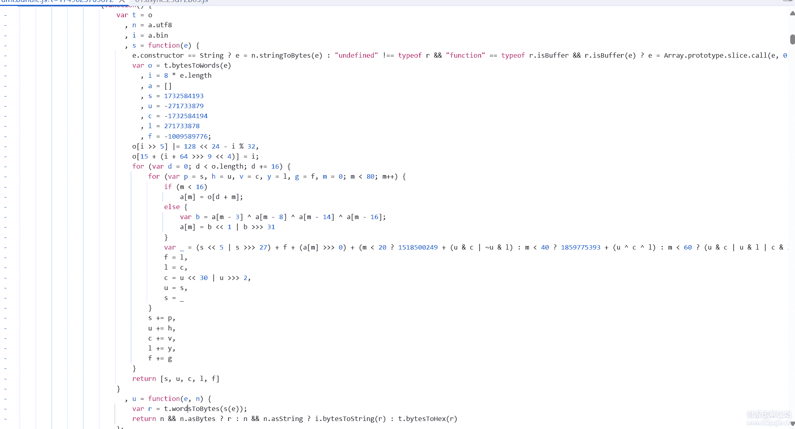

*`image.png`（103.51 KB，下载次数：1），`sha1`，2025-6-15 14:01 上传*

[附件下载](https://www.52pojie.cn/forum.php?mod=attachment&aid=Mjc4MzAyNnw3NWY5YzU4NXwxNzkzNTcwODg5fDE2ODA4NnwyMDM4OTY4&nothumb=yes)

简单的看一下，密码学大佬（强烈推荐 q 佬的密码公众号，可以自行学习一下，我已经请教过了，可以观察常量的特征来分析）可能就直接秒了，对于密码学菜狗的我选择丢给 ai 分析一下，非常标准的 `sha1` 加密，可以简单测试一下。

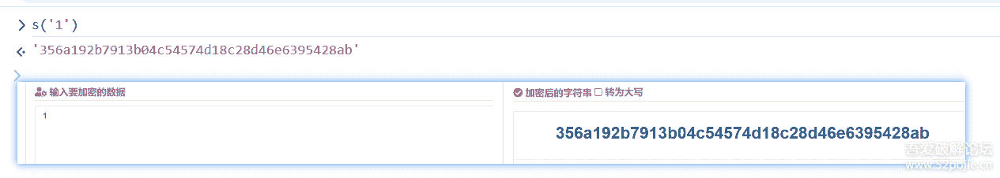

*`image.png`（36.6 KB，下载次数：0），加密对比，2025-6-15 14:04 上传*

[附件下载](https://www.52pojie.cn/forum.php?mod=attachment&aid=Mjc4MzAyN3wyZjBiZDRjZnwxNzkzNTcwODg5fDE2ODA4NnwyMDM4OTY4&nothumb=yes)

非常标准，完美，这样我们直接调用就ok了。

```python
from hashlib import sha1
def get_sign(datas: dict):
    sign = '&'.join([f'{key}={value}' for key, value in datas.items()])
    sign_sha1 = sha1(sign.encode()).hexdigest()
    return sign_sha1
```

然后就ok了，非常适合新手朋友食用。


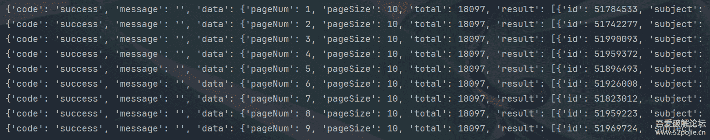

*`image.png`（321.57 KB，下载次数：1），结果，2025-6-15 14:07 上传*

[附件下载](https://www.52pojie.cn/forum.php?mod=attachment&aid=Mjc4MzAzMHwwMDZkZDNkYXwxNzkzNTcwODg5fDE2ODA4NnwyMDM4OTY4&nothumb=yes)
