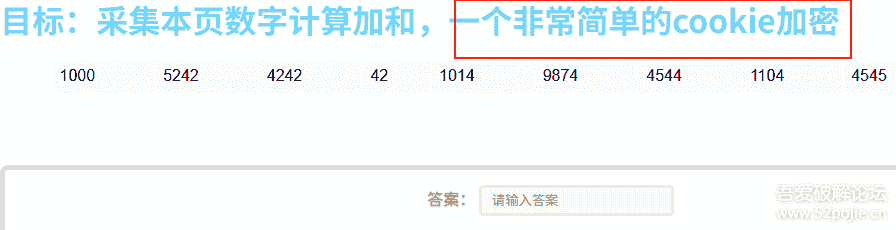
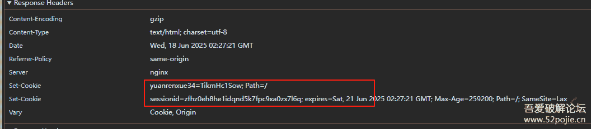
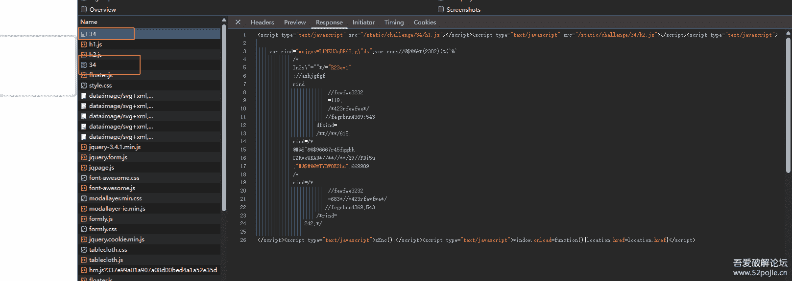
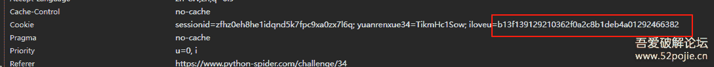
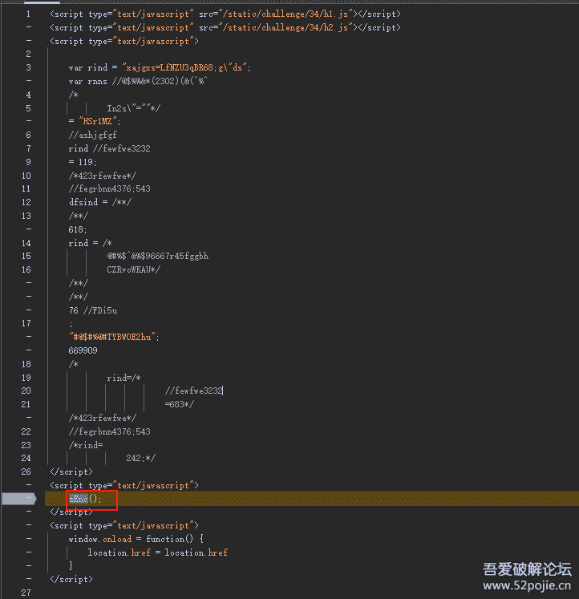
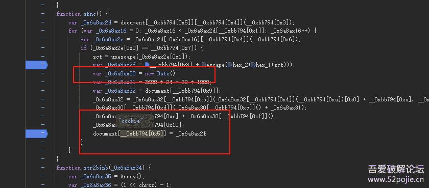
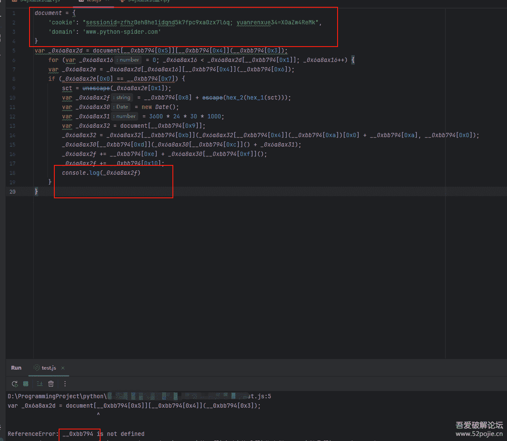
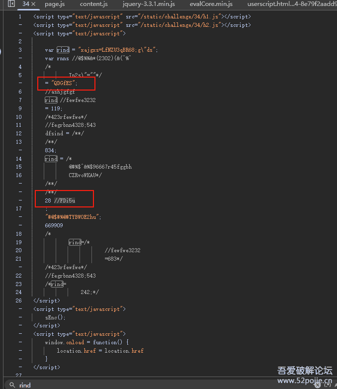

# [Web逆向] [原创] 猿人学学员题34题 js加课例题1 逆向分析

- 原帖: https://www.52pojie.cn/forum.php?mod=viewthread&tid=2039700
- 抓取时间: 2026-11-01T22:08:07

本次分析的地址为: `aHR0cHM6Ly93d3cucHl0aG9uLXNwaWRlci5jb20vY2hhbGxlbmdlLzM0`

看题目可以知道只是一个简单的cookie加密,就直接从cookie入手,其他的先不管了



image.png (27.77 KB, 下载次数: 0)

[href="forum.php?mod=attachment&aid=Mjc4MzYwNXw5NmQ0MWFhZXwxNzkzNTcwODg1fDE2ODA4NnwyMDM5NzAw&nothumb=yes" target="_blank"](https://www.52pojie.cn/forum.php?mod=attachment&aid=Mjc4MzYwNXw5NmQ0MWFhZXwxNzkzNTcwODg1fDE2ODA4NnwyMDM5NzAw&nothumb=yes)

2025-6-18 10:24 上传

先在后台把除了`sessionid`这个cookie以外全清理掉,然后打开`f12`抓包工具,刷新页面看一下

可以看到34这个链接是请求了2次并且内容都是不一样的,中间还有h1和h2的js包导入.

第一次请求34的时候有set-cookie所以`yuanrenxue34`这个cookie是返回的,无需理会

但是在第二次请求的时候却多了一个名为`iloveu`的cookie,此cookie应该是加密的



image.png (26.14 KB, 下载次数: 0)

[href="forum.php?mod=attachment&aid=Mjc4MzYwN3wxOTk2Njc0OXwxNzkzNTcwODg1fDE2ODA4NnwyMDM5NzAw&nothumb=yes" target="_blank"](https://www.52pojie.cn/forum.php?mod=attachment&aid=Mjc4MzYwN3wxOTk2Njc0OXwxNzkzNTcwODg1fDE2ODA4NnwyMDM5NzAw&nothumb=yes)

2025-6-18 10:30 上传



image.png (59.4 KB, 下载次数: 0)

[href="forum.php?mod=attachment&aid=Mjc4MzYwNnwyZjJkYzZiYXwxNzkzNTcwODg1fDE2ODA4NnwyMDM5NzAw&nothumb=yes" target="_blank"](https://www.52pojie.cn/forum.php?mod=attachment&aid=Mjc4MzYwNnwyZjJkYzZiYXwxNzkzNTcwODg1fDE2ODA4NnwyMDM5NzAw&nothumb=yes)

2025-6-18 10:28 上传



image.png (18.67 KB, 下载次数: 0)

[href="forum.php?mod=attachment&aid=Mjc4MzYwOHxjNGY0Yzk5ZHwxNzkzNTcwODg1fDE2ODA4NnwyMDM5NzAw&nothumb=yes" target="_blank"](https://www.52pojie.cn/forum.php?mod=attachment&aid=Mjc4MzYwOHxjNGY0Yzk5ZHwxNzkzNTcwODg1fDE2ODA4NnwyMDM5NzAw&nothumb=yes)

2025-6-18 10:31 上传

第一次访问的34内容中除了一堆看不懂的东西以外还有一个名为的执行方法`sEnc`,单步跟进去后发现可以代码`new Date()` `document['cookie']`这些东西



image.png (25.15 KB, 下载次数: 0)

[href="forum.php?mod=attachment&aid=Mjc4MzYxNnxmNDRiNjBmZHwxNzkzNTcwODg1fDE2ODA4NnwyMDM5NzAw&nothumb=yes" target="_blank"](https://www.52pojie.cn/forum.php?mod=attachment&aid=Mjc4MzYxNnxmNDRiNjBmZHwxNzkzNTcwODg1fDE2ODA4NnwyMDM5NzAw&nothumb=yes)

2025-6-18 10:55 上传



image.png (23.43 KB, 下载次数: 0)

[href="forum.php?mod=attachment&aid=Mjc4MzYxOXxlNTM4Yzg4NHwxNzkzNTcwODg1fDE2ODA4NnwyMDM5NzAw&nothumb=yes" target="_blank"](https://www.52pojie.cn/forum.php?mod=attachment&aid=Mjc4MzYxOXxlNTM4Yzg4NHwxNzkzNTcwODg1fDE2ODA4NnwyMDM5NzAw&nothumb=yes)

2025-6-18 10:58 上传

我也不管他是什么加密了,直接扣代码吧.直接吧`sEnc`整个方法扣下来

把他的cookie `console.log`出来,然后补一下`document`环境,一直运行缺什么扣什么



image.png (122.24 KB, 下载次数: 0)

[href="forum.php?mod=attachment&aid=Mjc4MzYyMHxkZGJkNjAzMnwxNzkzNTcwODg1fDE2ODA4NnwyMDM5NzAw&nothumb=yes" target="_blank"](https://www.52pojie.cn/forum.php?mod=attachment&aid=Mjc4MzYyMHxkZGJkNjAzMnwxNzkzNTcwODg1fDE2ODA4NnwyMDM5NzAw&nothumb=yes)

2025-6-18 11:01 上传

当你扣到一半的时候发现`rind`(`rnns`)未定义的报错,经过分析后这两个参数是在第一次请求34的链接返回的,只需要通过正则提取即可,在js调试过程中暂时写死吧到时候再给个参数替换就好



image.png (30.86 KB, 下载次数: 0)

[href="forum.php?mod=attachment&aid=Mjc4MzYyMnxiZTk4NjQ2OHwxNzkzNTcwODg1fDE2ODA4NnwyMDM5NzAw&nothumb=yes" target="_blank"](https://www.52pojie.cn/forum.php?mod=attachment&aid=Mjc4MzYyMnxiZTk4NjQ2OHwxNzkzNTcwODg1fDE2ODA4NnwyMDM5NzAw&nothumb=yes)

2025-6-18 11:10 上传

扣完了之后把动态参数设置好,方便替换

[Python] 纯文本查看 复制代码
```
rind = "rind_value"
rnns = "rnns_value"
cookie = process.argv[2] + " " + process.argv[3];
document = {
    // 'cookie': "sessionid=zfhz0eh8he1idqnd5k7fpc9xa0zx7l6q; yuanrenxue34=XOaZw4ReMk",
    'cookie': cookie,
    'domain': 'www.python-spider.com'
}
```
因为他的`cookie`是需要当值传回去,并且还要更新,所以我会单独把`cookie`拿出来不放在`headers`里面

[Python] 纯文本查看 复制代码
```
cookie = {
        'sessionid': 'zfhz0eh8he1idqnd5k7fpc9xa0zx7l6q'
    }
    response = requests.get(url, headers=headers, cookies=cookie)
    rind = re.findall(r'/\*\*//\*\*/(\d{2,3})//FDi5u', response.text)[0]
    rnns = re.findall(r'""\*/="(\w+)"', response.text)[0]
```
请求完第一次获取到`rind`和`rnns`参数之后,对js文件进行替换

[Python] 纯文本查看 复制代码
```
    # rind和rnns值的替换
    with open('34.js加课例题1.js', 'r', encoding='utf-8') as f:
        file = f.read()
        with open ('test.js', 'w', encoding='utf-8') as f:
            f.write(file.replace('rind_value', rind).replace('rnns_value', rnns))
```
替换完之后把获取到的最新的`cookie`,`yuanrenxue34`和`sessionid`两个`cookie`拼接起来用来加密

[Python] 纯文本查看 复制代码
```
    cookie = str()
    for i in response.cookies.items():
        cookie += '='.join(i) + "; "
```
然后用`subprocess`调用`node`来运行js文件返回结果

[Python] 纯文本查看 复制代码
```
    iloveu = subprocess.Popen(f"node test {cookie[:-2]}", encoding="utf-8", stdout=subprocess.PIPE)
    iloveu = iloveu.stdout.read().replace('\n', "")
    cookie = requests.cookies.get_dict()
    cookie['iloveu'] = re.findall("iloveu=(\w+);", iloveu)[0]
```
打完收工,核心代码都在上面了,具体代码照常不贴提高动手能力
