# [Web逆向] 某天御滑块逆向分析

- 原帖: https://www.52pojie.cn/forum.php?mod=viewthread&tid=2042898
- 抓取时间: 2026-11-01T22:07:35

本文章中所有内容仅供学习交流使用，不用于其他任何目的，不提供完整代码，抓包内容、敏感网址、数据接口等均已做脱敏处理，严禁用于商业用途和非法用途，否则由此产生的一切后果均与作者无关.本文章未经许可禁止转载，禁止任何修改后二次传播，擅自使用本文讲解的技术而导致的任何意外，作者均不负责

用产品体验网站做某天御滑块的纯算分析，难度适中，使用地址：aHR0cHM6Ly90aWFueXUuMzYwLmNuLyMvZ2xvYmFsL2RldGFpbHMvc2xpZGluZy1wdXp6bGU=

参考文章：

RSA密钥格式解析&转换------aHR0cHM6Ly9tcC53ZWl4aW4ucXEuY29tL3MvcHcycEFEYU1QaWJpTlJvQ3dhOUlzZz9zY2VuZT0x

加密的诗篇：RSA与Padding技术的艺术融合------aHR0cHM6Ly9tcC53ZWl4aW4ucXEuY29tL3MvaU0xS1lldy13R1VORXBwWk1YTG5vdw==

【密码学】分组密码模式------aHR0cHM6Ly9tcC53ZWl4aW4ucXEuY29tL3MvNzZjNXNyWVZrakdIS203MmN4TU1jUQ==

代码使用了混淆加密，可以参考蔡老板文章和视频做`ast`还原处理，我就不献丑，只做一个简单的处理。

## 一、流程分析

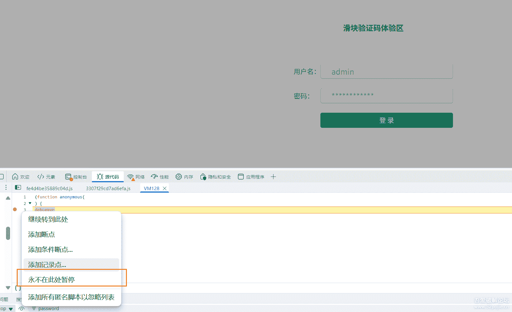

image.png (72.55 KB, 下载次数: 0)

[href="forum.php?mod=attachment&aid=Mjc4NjYzMXxhNmNkZDc2MnwxNzkzNTcwODUzfDE2ODA4NnwyMDQyODk4&nothumb=yes" target="_blank"](https://www.52pojie.cn/forum.php?mod=attachment&aid=Mjc4NjYzMXxhNmNkZDc2MnwxNzkzNTcwODUzfDE2ODA4NnwyMDQyODk4&nothumb=yes)

debug

2025-7-2 06:13 上传

打开控制台就是一个`debugger`，直接选择永不停留简单过掉，或者`hook`也行。

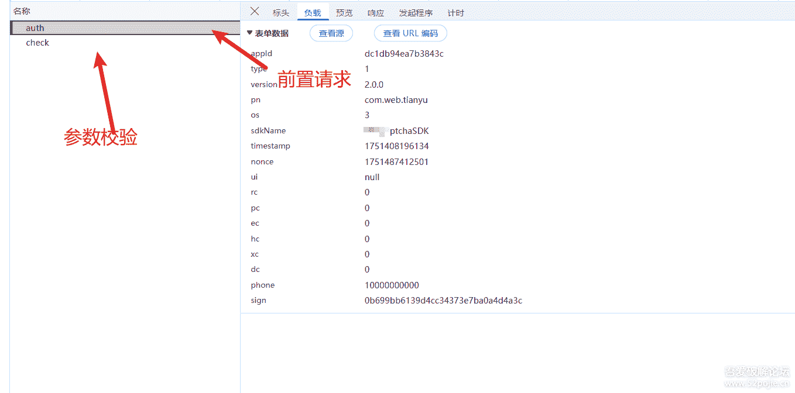

image.png (52.54 KB, 下载次数: 0)

[href="forum.php?mod=attachment&aid=Mjc4NjYzMnxkMTM3NjE4M3wxNzkzNTcwODUzfDE2ODA4NnwyMDQyODk4&nothumb=yes" target="_blank"](https://www.52pojie.cn/forum.php?mod=attachment&aid=Mjc4NjYzMnxkMTM3NjE4M3wxNzkzNTcwODUzfDE2ODA4NnwyMDQyODk4&nothumb=yes)

参数数量

2025-7-2 06:17 上传

完成一次完整的滑块滑动，发现就两个接口，一个是前置请求接口，一个是校验接口，我们进行多次滑动来分析固定值和可疑的加密参数

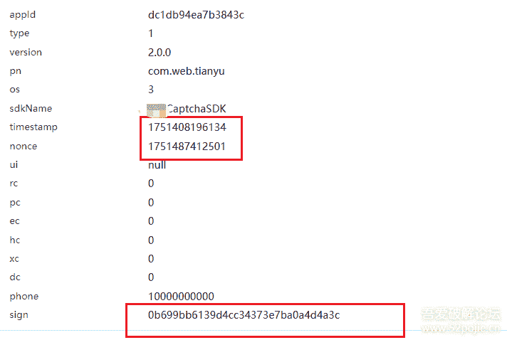

image.png (25.31 KB, 下载次数: 0)

[href="forum.php?mod=attachment&aid=Mjc4NjYzM3xkZDQ4ZDUyMnwxNzkzNTcwODUzfDE2ODA4NnwyMDQyODk4&nothumb=yes" target="_blank"](https://www.52pojie.cn/forum.php?mod=attachment&aid=Mjc4NjYzM3xkZDQ4ZDUyMnwxNzkzNTcwODUzfDE2ODA4NnwyMDQyODk4&nothumb=yes)

前置请求可疑参数

2025-7-2 06:20 上传

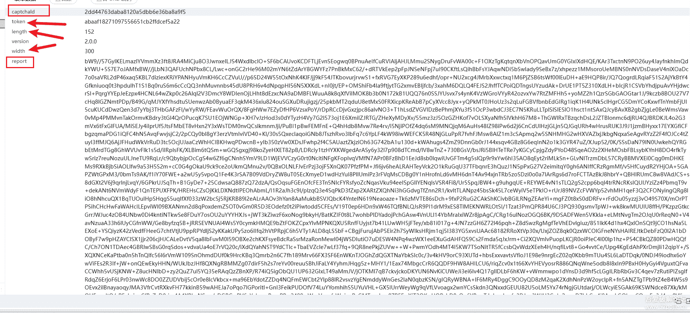

image.png (341.06 KB, 下载次数: 0)

[href="forum.php?mod=attachment&aid=Mjc4NjYzNHwzMmI3NDc3N3wxNzkzNTcwODUzfDE2ODA4NnwyMDQyODk4&nothumb=yes" target="_blank"](https://www.52pojie.cn/forum.php?mod=attachment&aid=Mjc4NjYzNHwzMmI3NDc3N3wxNzkzNTcwODUzfDE2ODA4NnwyMDQyODk4&nothumb=yes)

校验接口

2025-7-2 06:21 上传

发现一共有七个可疑的变化参数。

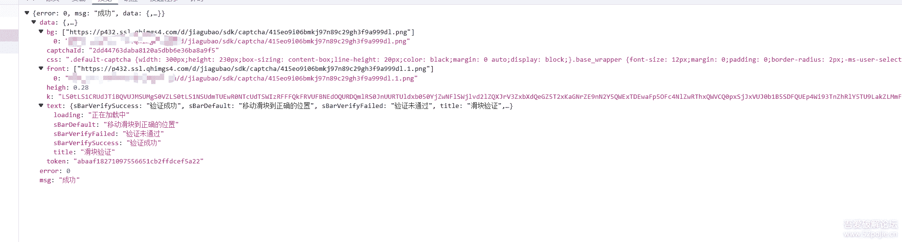

image.png (79.94 KB, 下载次数: 0)

[href="forum.php?mod=attachment&aid=Mjc4NjYzNXw5ZTI4MjliZHwxNzkzNTcwODUzfDE2ODA4NnwyMDQyODk4&nothumb=yes" target="_blank"](https://www.52pojie.cn/forum.php?mod=attachment&aid=Mjc4NjYzNXw5ZTI4MjliZHwxNzkzNTcwODUzfDE2ODA4NnwyMDQyODk4&nothumb=yes)

前置接口返回值

2025-7-2 06:23 上传

我们查看前置接口的返回值，发现`captchaId`，`token`是由前置接口返回生成的，所以不需要处理，接下来就是背景图和滑块图的信息都在接口当中

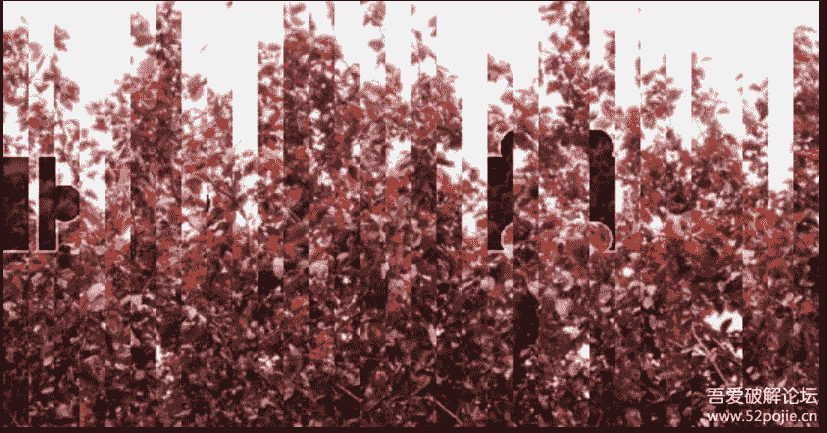

image.png (675.75 KB, 下载次数: 0)

[href="forum.php?mod=attachment&aid=Mjc4NjYzNnxkZGNhZjY2MXwxNzkzNTcwODUzfDE2ODA4NnwyMDQyODk4&nothumb=yes" target="_blank"](https://www.52pojie.cn/forum.php?mod=attachment&aid=Mjc4NjYzNnxkZGNhZjY2MXwxNzkzNTcwODUzfDE2ODA4NnwyMDQyODk4&nothumb=yes)

背景图

2025-7-2 06:25 上传

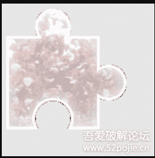

image.png (48.34 KB, 下载次数: 0)

[href="forum.php?mod=attachment&aid=Mjc4NjYzN3xkMTcyZWY0M3wxNzkzNTcwODUzfDE2ODA4NnwyMDQyODk4&nothumb=yes" target="_blank"](https://www.52pojie.cn/forum.php?mod=attachment&aid=Mjc4NjYzN3xkMTcyZWY0M3wxNzkzNTcwODUzfDE2ODA4NnwyMDQyODk4&nothumb=yes)

滑块图

2025-7-2 06:26 上传

好家伙，背景图被切成了32条，重新排序的，但是他在接口中返回就是乱序，说明后期在前端也进行了重新组合处理。

所以我们需要处理的内容有：

1、前置请求变化参数`timestamp`，`nonce`，`sign`
2、背景图重新贴图处理，识别距离
3、校验接口`report`，`length`参数

## 二、参数逆向分析和还原

### 1、前置接口还原分析

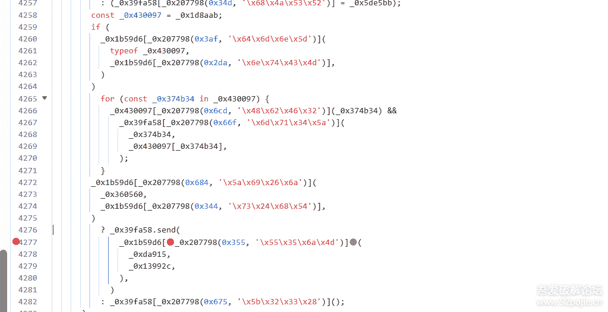

image.png (82.38 KB, 下载次数: 0)

[href="forum.php?mod=attachment&aid=Mjc4NjYzOHwzZDJhOGM4M3wxNzkzNTcwODUzfDE2ODA4NnwyMDQyODk4&nothumb=yes" target="_blank"](https://www.52pojie.cn/forum.php?mod=attachment&aid=Mjc4NjYzOHwzZDJhOGM4M3wxNzkzNTcwODUzfDE2ODA4NnwyMDQyODk4&nothumb=yes)

前置接口跟栈1

2025-7-2 06:30 上传

我们直接跟进去下断点，可以简单翻看一下源码，大体上是个ob混淆，有很多十六进制数字和编码的字符串，可以简单用一个`ast`插件处理替换

```javascript
traverse(ast, {    StringLiteral({node}) {
        if (node.extra && /\\[ux]/gi.test(node.extra.raw)) {
            node.extra = undefined;
        }
    }
});
traverse(ast, {
    NumericLiteral({node}) {
        if (node.extra && /^0[obx]/i.test(node.extra.raw)) {
            node.extra = undefined;
        }
    }
});
```

这次滑块加密有一个特点，很多加密都是在本地作用域实现的，有看作用域习惯的大佬可能上手嘎嘎快

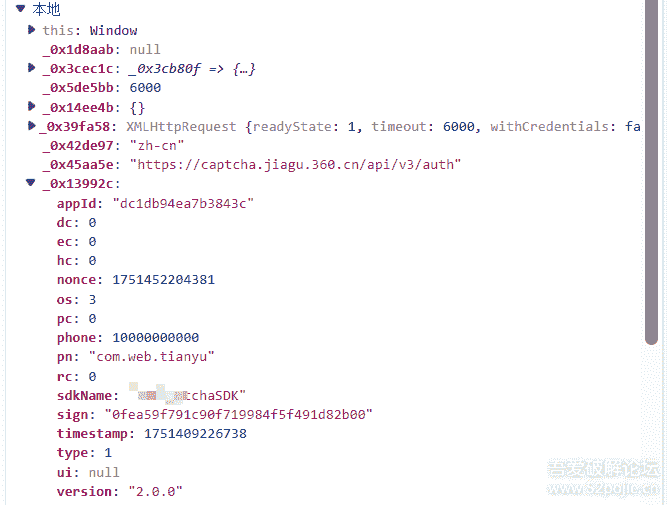

image.png (42.39 KB, 下载次数: 0)

[href="forum.php?mod=attachment&aid=Mjc4NjYzOXxhNzkxYjExMnwxNzkzNTcwODUzfDE2ODA4NnwyMDQyODk4&nothumb=yes" target="_blank"](https://www.52pojie.cn/forum.php?mod=attachment&aid=Mjc4NjYzOXxhNzkxYjExMnwxNzkzNTcwODUzfDE2ODA4NnwyMDQyODk4&nothumb=yes)

作用域1

2025-7-2 06:35 上传

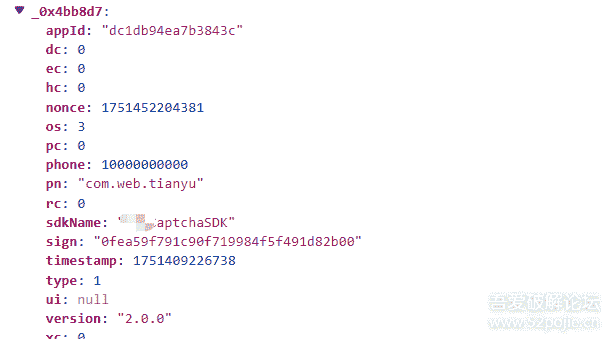

image.png (25.3 KB, 下载次数: 0)

[href="forum.php?mod=attachment&aid=Mjc4NjY0MHwwYTE5MWM0NXwxNzkzNTcwODUzfDE2ODA4NnwyMDQyODk4&nothumb=yes" target="_blank"](https://www.52pojie.cn/forum.php?mod=attachment&aid=Mjc4NjY0MHwwYTE5MWM0NXwxNzkzNTcwODUzfDE2ODA4NnwyMDQyODk4&nothumb=yes)

作用域2

2025-7-2 06:36 上传

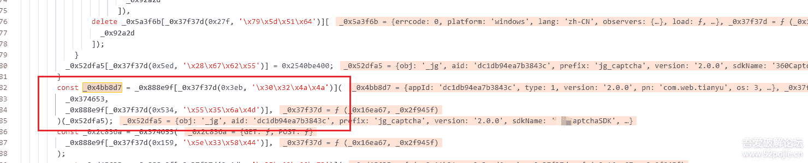

image.png (74.8 KB, 下载次数: 0)

[href="forum.php?mod=attachment&aid=Mjc4NjY0MXxlNmRkMmExZHwxNzkzNTcwODUzfDE2ODA4NnwyMDQyODk4&nothumb=yes" target="_blank"](https://www.52pojie.cn/forum.php?mod=attachment&aid=Mjc4NjY0MXxlNmRkMmExZHwxNzkzNTcwODUzfDE2ODA4NnwyMDQyODk4&nothumb=yes)

sign加密接口

2025-7-2 06:37 上传

每次根据本地变量名搜索，很快能定位到加密生成的位置，我们下断点，重新加载滑块

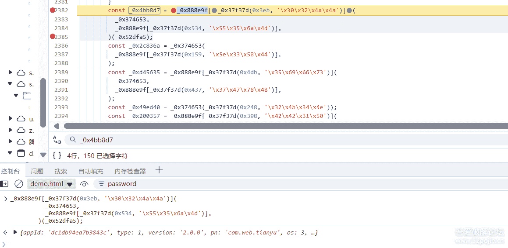

image.png (93.46 KB, 下载次数: 0)

[href="forum.php?mod=attachment&aid=Mjc4NjY0Mnw1Y2RlOTM2YnwxNzkzNTcwODUzfDE2ODA4NnwyMDQyODk4&nothumb=yes" target="_blank"](https://www.52pojie.cn/forum.php?mod=attachment&aid=Mjc4NjY0Mnw1Y2RlOTM2YnwxNzkzNTcwODUzfDE2ODA4NnwyMDQyODk4&nothumb=yes)

加密函数测试

2025-7-2 06:39 上传

先简单在控制台测试一下，发现确实是函数生成的逻辑，我们分析一下大致的流程

```javascript
_0x888e9f[_0x37f37d(0x3eb, '\x30\x32\x4a\x4a')](          _0x374653,
          _0x888e9f[_0x37f37d(0x534, '\x55\x35\x6a\x4d')],
        )(_0x52dfa5);
```

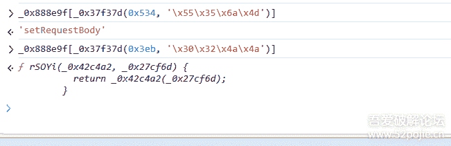

image.png (23.56 KB, 下载次数: 0)

[href="forum.php?mod=attachment&aid=Mjc4NjY0M3w1MDViMGVjZnwxNzkzNTcwODUzfDE2ODA4NnwyMDQyODk4&nothumb=yes" target="_blank"](https://www.52pojie.cn/forum.php?mod=attachment&aid=Mjc4NjY0M3w1MDViMGVjZnwxNzkzNTcwODUzfDE2ODA4NnwyMDQyODk4&nothumb=yes)

混淆逻辑1

2025-7-2 06:41 上传

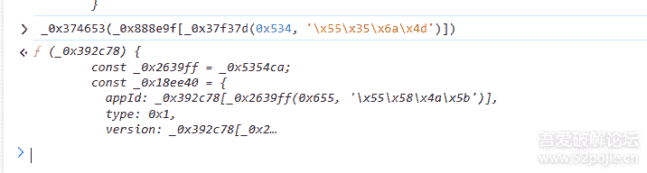

image.png (19.84 KB, 下载次数: 0)

[href="forum.php?mod=attachment&aid=Mjc4NjY0NHxjM2MxNjIwM3wxNzkzNTcwODUzfDE2ODA4NnwyMDQyODk4&nothumb=yes" target="_blank"](https://www.52pojie.cn/forum.php?mod=attachment&aid=Mjc4NjY0NHxjM2MxNjIwM3wxNzkzNTcwODUzfDE2ODA4NnwyMDQyODk4&nothumb=yes)

混淆逻辑2

2025-7-2 06:43 上传

这样可以看出来 `_0x374653`是一个函数名，传入参数是`'setRequestBody'`，他们的返回值也是一个函数，传入的参数是`_0x52dfa5`，我们直接跟进去看看

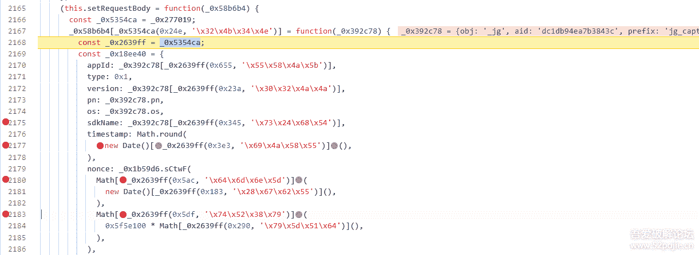

image.png (88.33 KB, 下载次数: 0)

[href="forum.php?mod=attachment&aid=Mjc4NjY0NXwxNDgzZTFhYnwxNzkzNTcwODUzfDE2ODA4NnwyMDQyODk4&nothumb=yes" target="_blank"](https://www.52pojie.cn/forum.php?mod=attachment&aid=Mjc4NjY0NXwxNDgzZTFhYnwxNzkzNTcwODUzfDE2ODA4NnwyMDQyODk4&nothumb=yes)

对象结构

2025-7-2 06:44 上传

进来之后很明显就看到了两个要处理的参数，我们直接下断点分析一下逻辑


``` 
timestamp: Math.round(            new Date()[_0x2639ff(0x3e3, '\x69\x4a\x58\x55')](),
          ),
          nonce: _0x1b59d6.sCtwF(
            Math[_0x2639ff(0x5ac, '\x64\x6d\x6e\x5d')](
              new Date()[_0x2639ff(0x183, '\x28\x67\x62\x55')](),
            ),
            Math[_0x2639ff(0x5df, '\x74\x52\x38\x79')](
              0x5f5e100 * Math[_0x2639ff(0x290, '\x79\x5d\x51\x64')](),
            ),

```

我们对混淆借助控制台进行处理后，还原代码为

[Asm] 纯文本查看 复制代码

```
var timestamp = Math.round(new Date()['getTime']());

var nonce = Math['floor'](100000000 * Math['random']())
```

这两个参数我们就处理完了，接下来就是找`sign`的位置和加密逻辑，我们直接在返回值位置下断点，看看整体的流程。

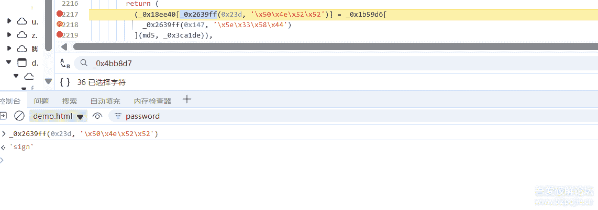

image.png (40.6 KB, 下载次数: 0)

[href="forum.php?mod=attachment&aid=Mjc4NjY0NnwxMDdlNGEyYnwxNzkzNTcwODUzfDE2ODA4NnwyMDQyODk4&nothumb=yes" target="_blank"](https://www.52pojie.cn/forum.php?mod=attachment&aid=Mjc4NjY0NnwxMDdlNGEyYnwxNzkzNTcwODUzfDE2ODA4NnwyMDQyODk4&nothumb=yes)

## sign逻辑

2025-7-2 06:48 上传

很明显发现了`sign`的赋值位置和大致的逻辑

[JavaScript] 纯文本查看 复制代码

```
_0x1b59d6[
            _0x2639ff(0x147, '\x5e\x33\x58\x44')
          ](md5, _0x3ca1de))
         
```

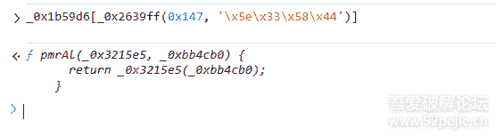

image.png (13.92 KB, 下载次数: 0)

[href="forum.php?mod=attachment&aid=Mjc4NjY0N3xkMTdlN2Q2OXwxNzkzNTcwODUzfDE2ODA4NnwyMDQyODk4&nothumb=yes" target="_blank"](https://www.52pojie.cn/forum.php?mod=attachment&aid=Mjc4NjY0N3xkMTdlN2Q2OXwxNzkzNTcwODUzfDE2ODA4NnwyMDQyODk4&nothumb=yes)

## sign加密逻辑

2025-7-2 06:50 上传

很明显能看出加密的逻辑，第一个参数是一个函数名，对第二参数进行加密，我们可以看到的函数名是`md5`，传入参数是`_0x3ca1de`，我们需要先简单测试一下是不是标准算法

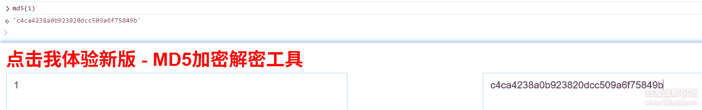

image.png (31.57 KB, 下载次数: 0)

[href="forum.php?mod=attachment&aid=Mjc4NjY0OHxkYjljZWQyOXwxNzkzNTcwODUzfDE2ODA4NnwyMDQyODk4&nothumb=yes" target="_blank"](https://www.52pojie.cn/forum.php?mod=attachment&aid=Mjc4NjY0OHxkYjljZWQyOXwxNzkzNTcwODUzfDE2ODA4NnwyMDQyODk4&nothumb=yes)

## md5标准检测

2025-7-2 06:52 上传

所以`sign`核心是一个`md5`加密，我们再看看`_0x3ca1de`的生成逻辑

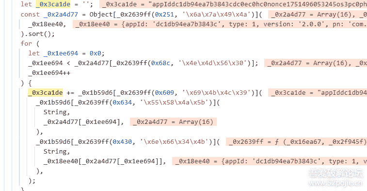

image.png (67.79 KB, 下载次数: 0)

[href="forum.php?mod=attachment&aid=Mjc4NjY0OXwyM2ExOWQ2M3wxNzkzNTcwODUzfDE2ODA4NnwyMDQyODk4&nothumb=yes" target="_blank"](https://www.52pojie.cn/forum.php?mod=attachment&aid=Mjc4NjY0OXwyM2ExOWQ2M3wxNzkzNTcwODUzfDE2ODA4NnwyMDQyODk4&nothumb=yes)

## 生成逻辑1

2025-7-2 06:54 上传

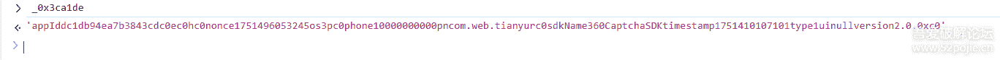

image.png (15.4 KB, 下载次数: 0)

[href="forum.php?mod=attachment&aid=Mjc4NjY1MHwzNWVkYWNjZXwxNzkzNTcwODUzfDE2ODA4NnwyMDQyODk4&nothumb=yes" target="_blank"](https://www.52pojie.cn/forum.php?mod=attachment&aid=Mjc4NjY1MHwzNWVkYWNjZXwxNzkzNTcwODUzfDE2ODA4NnwyMDQyODk4&nothumb=yes)

## 生成逻辑2

2025-7-2 06:54 上传

大体上就是对前面的请求头的参数转化为字符串拼接，所以这一部分我们整体用`python`还原

[Python] 纯文本查看 复制代码

```
from hashlib import md5

import time

def sign_md5(en_data):

    return md5(en_data.encode()).hexdigest()

def nonce_get():

    t1 = round(time.time() * 1000)  

    t2 = random.randrange(100000000) 

    return t1 + t2

def first_response():

    timestamp = str(int(time.time() * 1000))

    nonce = nonce_get()

    headers = {

    }

    data = {

        "appId": "dc1db94ea7b3843c",

        "dc": 0,

        "ec": 0,

        "hc": 0,

        "nonce": nonce,

        "os": 3,

        "pc": 0,

        "phone": 10000000000,

        "pn": "com.web.tianyu",

        "rc": 0,

        "sdkName":脱敏处理,

        "timestamp": timestamp,

        "type": 1,

        "ui": 'null',

        "version": "2.0.0",

        "xc": 0,

    }

    encode_sign = ''.join(f"{key}{value}" for key, value in data.items())

    sign = sign_md5(encode_sign)

    data['sign'] = sign

    response = requests.post(脱敏处理, headers=headers, data=data).json()
```

## 2、校验接口还原分析

完成前置接口的加密逻辑，我们可以提取的参数有背景图地址，滑块地址，`captchaId`，`token`，接下来就是分析校验参口的加密逻辑`report`参数

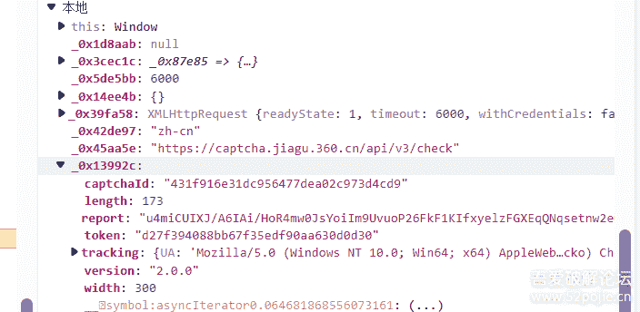

image.png (45.84 KB, 下载次数: 0)

[href="forum.php?mod=attachment&aid=Mjc4NjY1MXxkMDk0ZTZiYXwxNzkzNTcwODUzfDE2ODA4NnwyMDQyODk4&nothumb=yes" target="_blank"](https://www.52pojie.cn/forum.php?mod=attachment&aid=Mjc4NjY1MXxkMDk0ZTZiYXwxNzkzNTcwODUzfDE2ODA4NnwyMDQyODk4&nothumb=yes)

## 校验接口作用域1

2025-7-2 07:02 上传

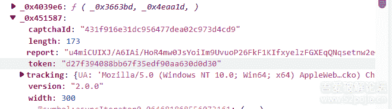

image.png (29.65 KB, 下载次数: 0)

[href="forum.php?mod=attachment&aid=Mjc4NjY1MnxhNjUwMTI4ZHwxNzkzNTcwODUzfDE2ODA4NnwyMDQyODk4&nothumb=yes" target="_blank"](https://www.52pojie.cn/forum.php?mod=attachment&aid=Mjc4NjY1MnxhNjUwMTI4ZHwxNzkzNTcwODUzfDE2ODA4NnwyMDQyODk4&nothumb=yes)

## 校验接口作用域2

2025-7-2 07:03 上传

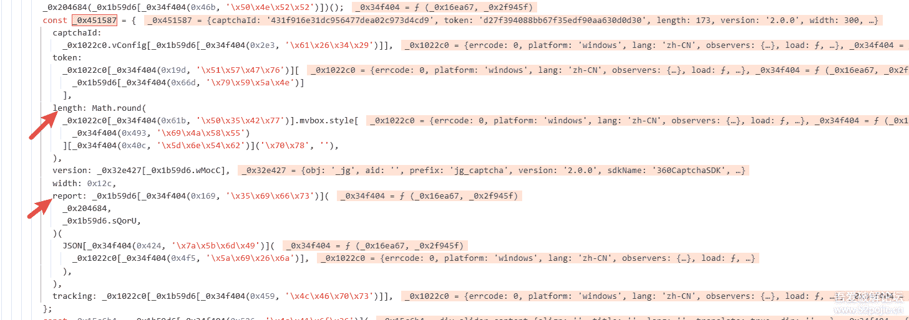

image.png (128.66 KB, 下载次数: 0)

[href="forum.php?mod=attachment&aid=Mjc4NjY1M3xjODg3MDQ0OXwxNzkzNTcwODUzfDE2ODA4NnwyMDQyODk4&nothumb=yes" target="_blank"](https://www.52pojie.cn/forum.php?mod=attachment&aid=Mjc4NjY1M3xjODg3MDQ0OXwxNzkzNTcwODUzfDE2ODA4NnwyMDQyODk4&nothumb=yes)

## 校验接口加密逻辑

2025-7-2 07:03 上传

还是同理跟着作用域可以很快找到加密的地址，都是明文的（说明直接搜也可以找到），然后就是来分析他的加密逻辑

[JavaScript] 纯文本查看 复制代码

```
_0x1b59d6[_0x34f404(0x169, '\x35\x69\x66\x73')](            _0x204684,
            _0x1b59d6.sQorU,
          )(
            JSON[_0x34f404(0x424, '\x7a\x5b\x6d\x49')](
              _0x1022c0[_0x34f404(0x4f5, '\x5a\x69\x26\x6a')],
            ),
          ),
```

还是一样的，我们通过控制台进行还原

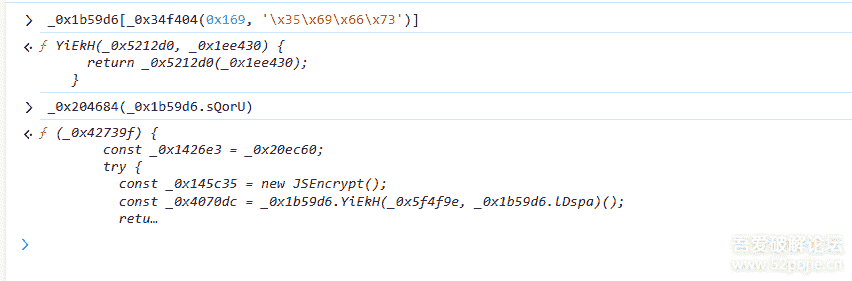

image.png (26.26 KB, 下载次数: 0)

[href="forum.php?mod=attachment&aid=Mjc4NjY1NHw4M2MyMWQzZHwxNzkzNTcwODUzfDE2ODA4NnwyMDQyODk4&nothumb=yes" target="_blank"](https://www.52pojie.cn/forum.php?mod=attachment&aid=Mjc4NjY1NHw4M2MyMWQzZHwxNzkzNTcwODUzfDE2ODA4NnwyMDQyODk4&nothumb=yes)

## 校验接口加密逻辑

2025-7-2 07:17 上传

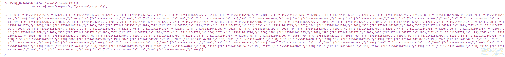

image.png (98.24 KB, 下载次数: 0)

[href="forum.php?mod=attachment&aid=Mjc4NjY1NXw4ZDc2M2NhMXwxNzkzNTcwODUzfDE2ODA4NnwyMDQyODk4&nothumb=yes" target="_blank"](https://www.52pojie.cn/forum.php?mod=attachment&aid=Mjc4NjY1NXw4ZDc2M2NhMXwxNzkzNTcwODUzfDE2ODA4NnwyMDQyODk4&nothumb=yes)

## 轨迹

2025-7-2 07:19 上传

可以看到前面一部分是通过 `_0x204684`(`_0x1b59d6.sQorU`)返回一个函数，后面轨迹的值就是传入的参数

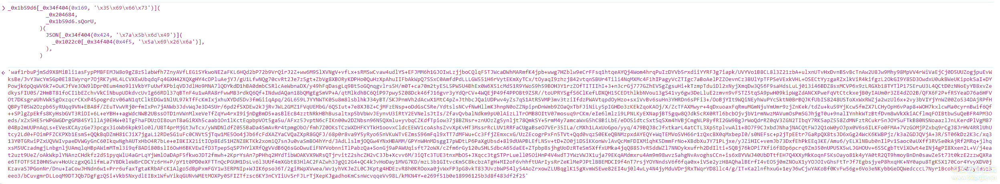

image.png (227.22 KB, 下载次数: 0)

[href="forum.php?mod=attachment&aid=Mjc4NjY1Nnw3OWRlMDU4MnwxNzkzNTcwODUzfDE2ODA4NnwyMDQyODk4&nothumb=yes" target="_blank"](https://www.52pojie.cn/forum.php?mod=attachment&aid=Mjc4NjY1Nnw3OWRlMDU4MnwxNzkzNTcwODUzfDE2ODA4NnwyMDQyODk4&nothumb=yes)

## 加密值

2025-7-2 07:20 上传

很明显他的加密逻辑就是对轨迹的处理，我们跟进去看看。

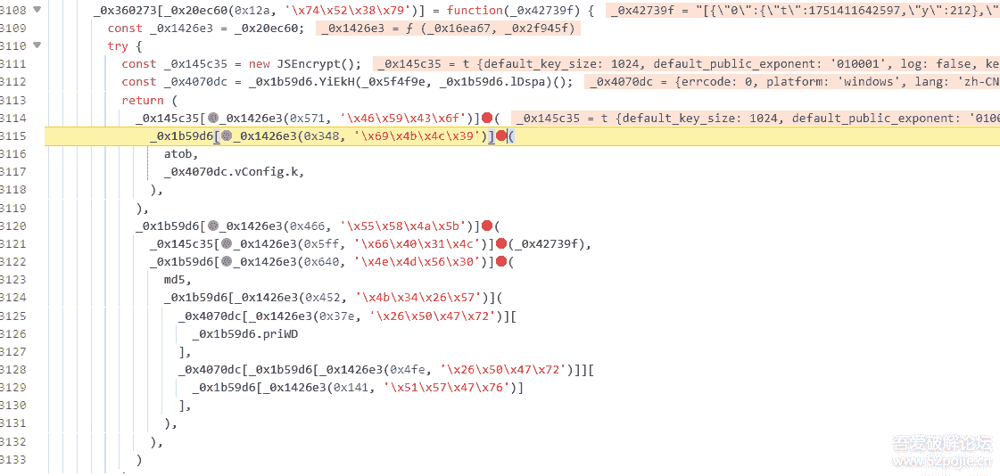

image.png (104.96 KB, 下载次数: 0)

[href="forum.php?mod=attachment&aid=Mjc4NjY1N3xmYTZiODExY3wxNzkzNTcwODUzfDE2ODA4NnwyMDQyODk4&nothumb=yes" target="_blank"](https://www.52pojie.cn/forum.php?mod=attachment&aid=Mjc4NjY1N3xmYTZiODExY3wxNzkzNTcwODUzfDE2ODA4NnwyMDQyODk4&nothumb=yes)

## 加密逻辑1

2025-7-2 07:22 上传

这里的嵌套比较多，我们要按照代码的执行顺序来分析。

[JavaScript] 纯文本查看 复制代码

```
_0x145c35[_0x1426e3(0x571, '\x46\x59\x43\x6f')](

              _0x1b59d6[_0x1426e3(0x348, '\x69\x4b\x4c\x39')](

                atob,

                _0x4070dc.vConfig.k,

              ),

            )
```

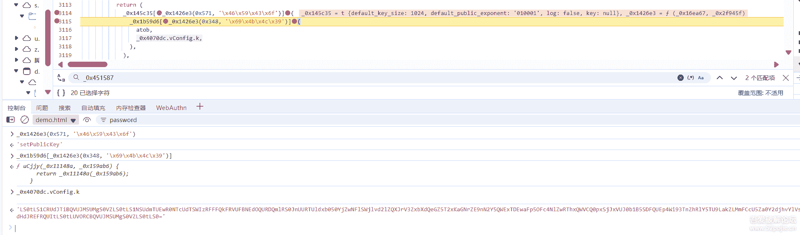

image.png (86.01 KB, 下载次数: 0)

[href="forum.php?mod=attachment&aid=Mjc4NjY1OHxlMTA3M2ViYnwxNzkzNTcwODUzfDE2ODA4NnwyMDQyODk4&nothumb=yes" target="_blank"](https://www.52pojie.cn/forum.php?mod=attachment&aid=Mjc4NjY1OHxlMTA3M2ViYnwxNzkzNTcwODUzfDE2ODA4NnwyMDQyODk4&nothumb=yes)

## 加密逻辑1分析

2025-7-2 07:24 上传

这样我们就有了一个比较清晰的逻辑，还有一个大胆的猜测，这是一个`rsa`加密，`setPublicKey(atob(_0x4070dc.vConfig.k))`

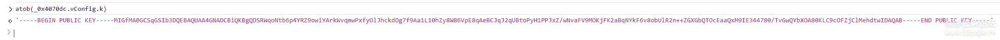


## `pub_key`

2025-7-2 07:26 上传

典型的 `pkcs8` 密钥格式（不清楚的看文章，这个很重要）

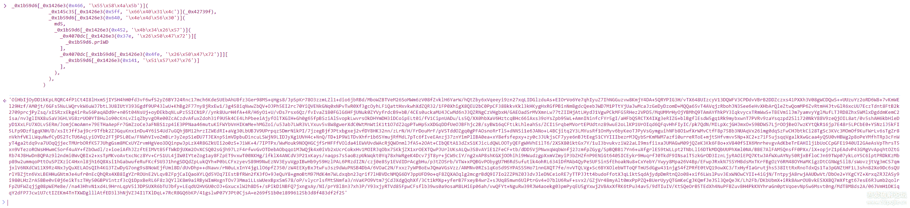

## 加密逻辑处理2


2025-7-2 07:29 上传

接下来就是核心逻辑的处理。

```javascript
_0x1b59d6[_0x1426e3(0x466, '\x55\x58\x4a\x5b')](              _0x145c35[_0x1426e3(0x5ff, '\x66\x40\x31\x4c')](_0x42739f),
              _0x1b59d6[_0x1426e3(0x640, '\x4e\x4d\x56\x30')](
                md5,
                _0x1b59d6[_0x1426e3(0x452, '\x4b\x34\x26\x57')](
                  _0x4070dc[_0x1426e3(0x37e, '\x26\x50\x47\x72')][
                    _0x1b59d6.priWD
                  ],
                  _0x4070dc[_0x1b59d6[_0x1426e3(0x4fe, '\x26\x50\x47\x72')]][
                    _0x1b59d6[_0x1426e3(0x141, '\x51\x57\x47\x76')]
                  ],
                ),
              ),
            )
```

这是整个抠出来的混淆逻辑，先进行第一步的处理

```asm
_0x1b59d6["PjQNt"](_0x145c35["encryptLong"](_0x42739f), _0x1b59d6["pmrAl"](md5, _0x1b59d6['vazGS'](_0x4070dc["vConfig"][_0x1b59d6.priWD], _0x4070dc["VVGww"][_0x1b59d6['FCsae']],),),)
```

这样我们可以得到一个比较清晰的代码，我们再将这段代码的执行逻辑给分别执行，不再嵌套（不能嫌麻烦，嫌麻烦就学 `ast`）。

```javascript
const configPriWD = '431f916e31dc956477dea02c973d4cd9';  // captchaId
const vvgwwFCsae = '074c78f4703210e56886940734b014b6';   // token
const vazGSResult = configPriWD + vvgwwFCsae
const pmrAlResult = md5(vazGSResult)
const encryptedLong = _0x145c35["encryptLong"](_0x42739f); // 轨迹 _0x42739f  rsa
const finalResult = encryptedLong + pmrAlResult
```

这样我们就能愉快的分析加密逻辑了（先简单写死），很明显就是一个 `rsa` 结合 `md5` 然后再拼接，这样我们 `report` 参数整体就实现了，接下来就是 `python` 和密码学的结合了。

首先要注意的几点

（1）`rsa` 加密的长度有限制，参考文章分组密码模式，采用 `ecb` 模式处理

（2）`pck8` 转化 `pck1` 格式，参考文章RSA密钥格式解析&转换（借助 `python` 偷懒做兼容）

（3）公钥存储的换行符处理

有兴趣可以看一下文章，给一个参考代码：

```python
import base64
from Crypto.PublicKey import RSA
from Crypto.Cipher import PKCS1_v1_5

def get_max_chunk_size(rsa_value):
    key_size_bytes = rsa_value.size_in_bytes()
    return key_size_bytes - 11

def format_pem_key():
    with open('public.pem', 'r') as f:
        key_str = f.read()
    base64_content = key_str.split('-----BEGIN PUBLIC KEY-----')[1].split('-----END PUBLIC KEY-----')[0]
    formatted_base64 = "\n".join(
        base64_content[i:i + 64] for i in range(0, len(base64_content), 64)
    )
    standard_pem = (
        "-----BEGIN PUBLIC KEY-----\n" +
        formatted_base64 + "\n" +
        "-----END PUBLIC KEY-----"
    )
    with open("public.pem", "w") as pem_file:
        pem_file.write(standard_pem)

def rsa_encrypt(rsa_key, enc_data):
    key = base64.b64decode(rsa_key).decode('utf-8')
    with open('public.pem', 'w') as f:
        f.write(key)
    format_pem_key()
    with open('public.pem', 'r') as f:
        key_value = f.read()
    pk = RSA.import_key(key_value)
    cipher = PKCS1_v1_5.new(pk)
    max_chunk_size = get_max_chunk_size(pk)
    text_bytes = enc_data.encode('utf-8')
    encrypted_chunks = []
    # 分段加密
    for i in range(0, len(text_bytes), max_chunk_size):
        chunk = text_bytes[i:i + max_chunk_size]
        encrypted_chunk = cipher.encrypt(chunk)
        encrypted_chunks.append(encrypted_chunk)
    # 合并所有分段并 Base64 编码
    encrypted_bytes = b''.join(encrypted_chunks)
    encrypted_base64 = base64.b64encode(encrypted_bytes).decode('utf-8')
    return encrypted_base64
```

## 3、滑块处理分析


canvas

2025-7-2 07:45 上传

上面还有一个轨迹和 `length` 参数没有处理都是和滑块有关系的。我们知道背景图返回时就是乱的，说明在前端对背景图进行了处理，我们这里借助事件侦听断点进行分析

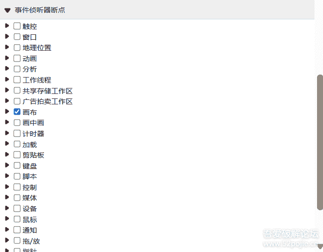


事件断点

2025-7-2 07:47 上传

我是菜狗用的中文的，大佬们英文界面就是 `canvas`，然后刷新图片加载

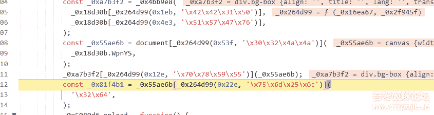


事件断点入口

2025-7-2 07:48 上传

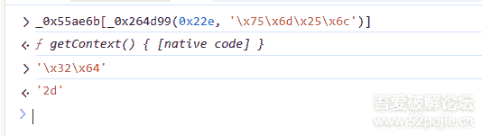


创建画布

2025-7-2 07:49 上传

简单分析一下里面的逻辑，经常补环境的大佬应该熟悉这个方法，创建一个画布，应该是存放滑块的地方，说明这里还没有进行一个处理，继续往下看

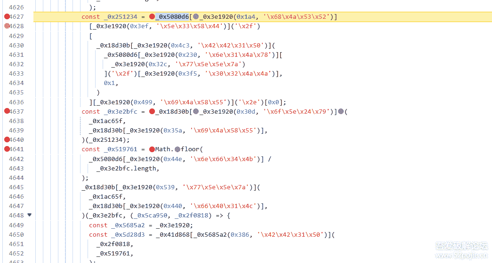


下断点思路

2025-7-2 07:51 上传

这后面跟着的是几个方法，我们直接都下上断点看看他的逻辑。

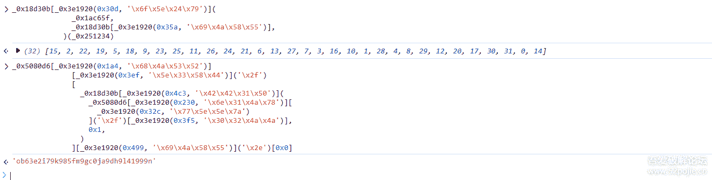


数组逻辑1

2025-7-2 07:53 上传

很有意思，先获取了 `_0x251234` 的值，又将它传入下一个方法获得了一个32位的数组，我们知道滑块的条数是32，这个会不会是滑块的正确顺序。

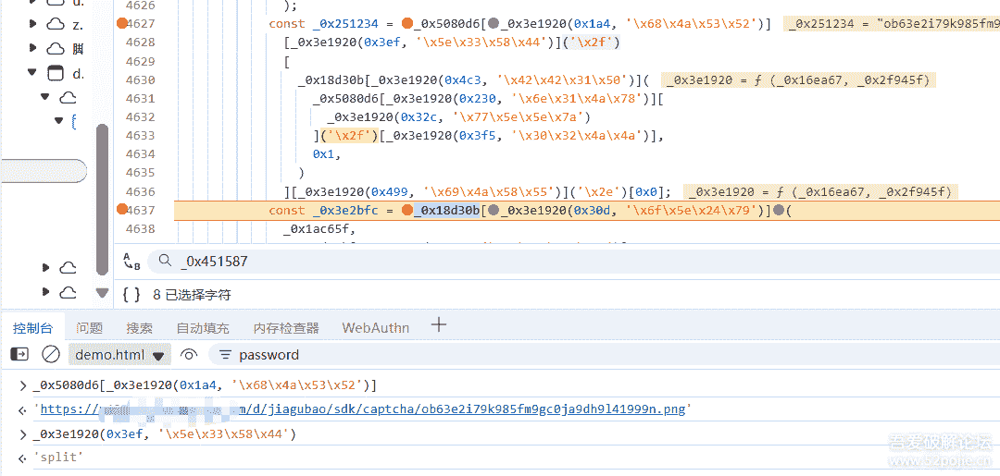


数组逻辑2

2025-7-2 07:57 上传

分析一下逻辑发现他是对一个地址进行了切片，这个还有点眼熟，好像就是滑块的背景图地址，取得格式前面的那一串字符

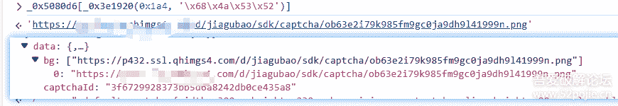


数组逻辑3

2025-7-2 07:59 上传

这一部分搞定了，我们来看数组生成的逻辑

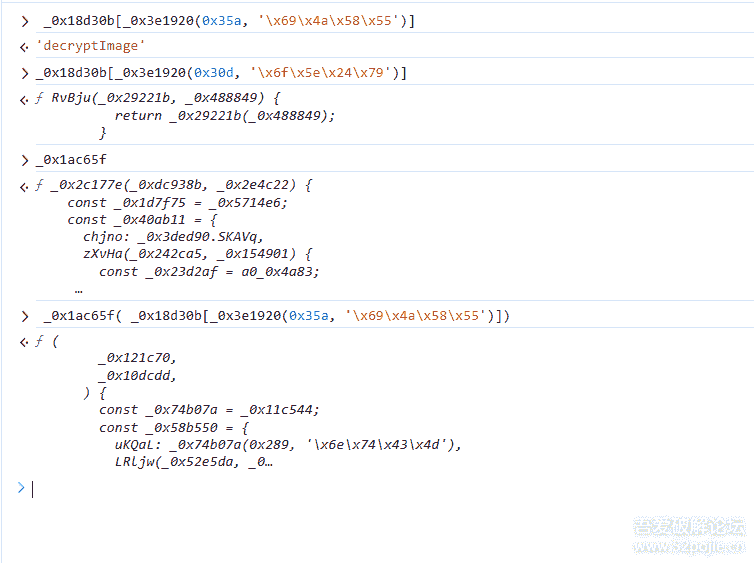


数组逻辑4

2025-7-2 08:01 上传

`_0x1ac65f(_0x18d30b[_0x3e1920(0x35a, '\x69\x4a\x58\x55')])`（`_0x251234`）利用 `_0x1ac65f(_0x18d30b[_0x3e1920(0x35a, '\x69\x4a\x58\x55')])` 函数对 `_0x251234` 也就是背景图的信息进行处理

跟进去看看逻辑。

[JavaScript] 纯文本查看 复制代码


```javascript
_0x3834dc[_0x11c544(0x42c, '\x5b\x32\x33\x28')] = function(        _0x121c70,
        _0x10dcdd,
      ) {
        const _0x74b07a = _0x11c544;
        const _0x58b550 = {
          uKQaL: _0x74b07a(0x289, '\x6e\x74\x43\x4d'),
          LRljw(_0x52e5da, _0x58ed7b) {
            return _0x52e5da === _0x58ed7b;
          },
        };
        function _0x1c18e2(_0x2a7547, _0x2daf7e) {
          const _0x208f76 = _0x74b07a;
          if (_0x2a7547[_0x58b550[_0x208f76(0x36a, '\x4c\x41\x6f\x36')]])
            return _0x2a7547[_0x58b550[_0x208f76(0x36a, '\x4c\x41\x6f\x36')]](
              _0x2daf7e,
            );
          for (
            let _0x282371 = 0x0,
              _0xca62fe = _0x2a7547[_0x208f76(0x3ec, '\x66\x40\x31\x4c')];
            _0x282371
```

还是一段混淆的代码，老规矩，直接处理掉混淆内容

[JavaScript] 纯文本查看 复制代码

```javascript
_0x3834dc = function (_0x121c70) {
    function _0x1c18e2(_0x2a7547, _0x2daf7e) {
        if (_0x2a7547["includes"]) {
            return _0x2a7547["includes"](_0x2daf7e);
        }
        for (let _0x282371 = 0, _0xca62fe = _0x2a7547.length; _0x282371
```

处理完成后我们可以简单测试一下结果是不是符合。

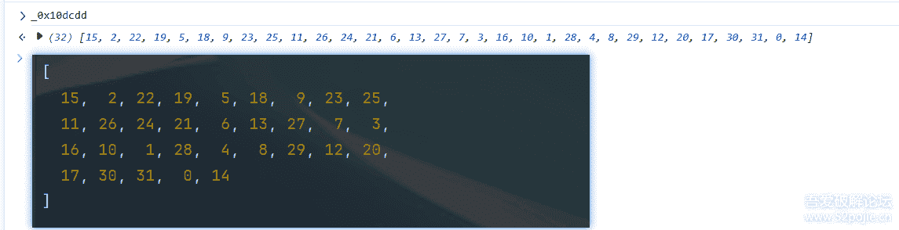

image.png (67.69 KB, 下载次数: 0)

[href="forum.php?mod=attachment&aid=Mjc4NjY3MHwzMGMxNWY5M3wxNzkzNTcwODUzfDE2ODA4NnwyMDQyODk4&nothumb=yes" target="_blank"](https://www.52pojie.cn/forum.php?mod=attachment&aid=Mjc4NjY3MHwzMGMxNWY5M3wxNzkzNTcwODUzfDE2ODA4NnwyMDQyODk4&nothumb=yes)

数组逻辑5

2025-7-2 08:07 上传

很好，非常符合，我们再用`python`简单实现一下同样的逻辑

[Python] 纯文本查看 复制代码

```python
def canvas_list(input_string):    def list_contains(lst, value):
        return value in lst

    result = []
    for i in range(32):
        if i >= len(input_string):
            break
        char_code = ord(input_string[i])
        while list_contains(result, char_code % 32):
            char_code += 1
        result.append(char_code % 32)
    return result
```

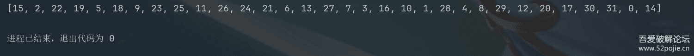

image.png (87.59 KB, 下载次数: 0)

[href="forum.php?mod=attachment&aid=Mjc4NjY3MXwzM2Q3NDJlZnwxNzkzNTcwODUzfDE2ODA4NnwyMDQyODk4&nothumb=yes" target="_blank"](https://www.52pojie.cn/forum.php?mod=attachment&aid=Mjc4NjY3MXwzM2Q3NDJlZnwxNzkzNTcwODUzfDE2ODA4NnwyMDQyODk4&nothumb=yes)

数组逻辑6

2025-7-2 08:09 上传

ok，搞定了，

## 三、总结

轨迹算法和图像还原的内容我就不献丑，纯应付处理代码，论坛里大佬有很多这样的算法，可以去===借鉴借鉴===，整个加密核心就是`rsa`的处理，更多的需要去看文章。


