# [Web逆向] 某美官网案例滑块逆向

- 原帖: https://www.52pojie.cn/forum.php?mod=viewthread&tid=2043649
- 抓取时间: 2026-11-01T22:07:27

本文章中所有内容仅供学习交流，抓包内容、敏感网址、数据接口均已做脱敏处理，严禁用于商业用途和非法用途，否则由此产生的一切后果均与作者无关，若有侵权，请联系我立即删除！

目标：实现滑块验证。

网站：aHR0cHM6Ly93d3cuaXNodW1laS5jb20vdHJpYWwvY2FwdGNoYS5odG1s

## 1. 又到周末了，开始今天的滑块分析，直接进官网中demo在线体验，找到滑块验证。


image.png (105.19 KB, 下载次数: 1)
[href="forum.php?mod=attachment&aid=Mjc4NzIxOXw0YTM0ZWQwNXwxNzkzNTcwODQ1fDE2ODA4NnwyMDQzNjQ5&nothumb=yes" target="_blank"](https://www.52pojie.cn/forum.php?mod=attachment&aid=Mjc4NzIxOXw0YTM0ZWQwNXwxNzkzNTcwODQ1fDE2ODA4NnwyMDQzNjQ5&nothumb=yes)
2025-7-5 11:13 上传

## 2. 抓包主要分析两个接口，一是获取验证码图片接口，二是进行校验的接口。

图片的获取参数很少，主要看两个`captchaUuid`和`organization`，其实两个都可以固定，`callback`后面时间戳，固不固定都行。

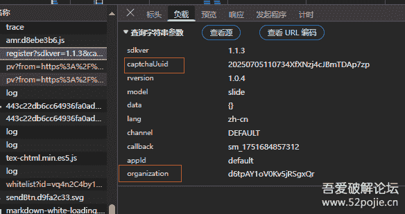
image.png (40.92 KB, 下载次数: 0)
[href="forum.php?mod=attachment&aid=Mjc4NzIyMHw5YjJjMjhmN3wxNzkzNTcwODQ1fDE2ODA4NnwyMDQzNjQ5&nothumb=yes" target="_blank"](https://www.52pojie.cn/forum.php?mod=attachment&aid=Mjc4NzIyMHw5YjJjMjhmN3wxNzkzNTcwODQ1fDE2ODA4NnwyMDQzNjQ5&nothumb=yes)
2025-7-5 11:15 上传

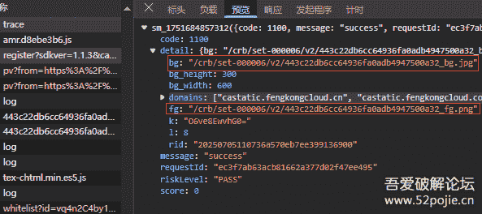
image.png (46.14 KB, 下载次数: 1)
[href="forum.php?mod=attachment&aid=Mjc4NzIyMnw3OTJkMDFhNHwxNzkzNTcwODQ1fDE2ODA4NnwyMDQzNjQ5&nothumb=yes" target="_blank"](https://www.52pojie.cn/forum.php?mod=attachment&aid=Mjc4NzIyMnw3OTJkMDFhNHwxNzkzNTcwODQ1fDE2ODA4NnwyMDQzNjQ5&nothumb=yes)
2025-7-5 11:22 上传

`organization` 是一个标识，在一个js文件中，固定值就行。`captchaUuid`直接全局搜索，有一个`getCaptchaUuid()`函数。代码是经过ob混淆的，前半部分是当前年月日时分秒，后半部分是从 `_0x2e8d92 = 'ABCDEFGHJKMNPQRSTWXYZabcdefhijkmnprstwxyz2345678'` 随机获得十八位。

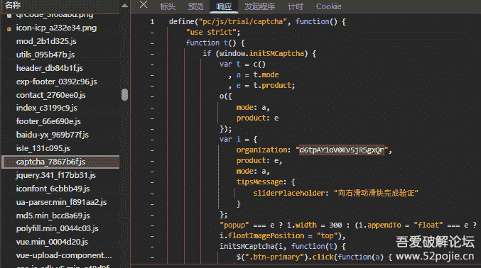
image.png (59.61 KB, 下载次数: 0)
[href="forum.php?mod=attachment&aid=Mjc4NzIzMnw1ODcwYmE3NHwxNzkzNTcwODQ1fDE2ODA4NnwyMDQzNjQ5&nothumb=yes" target="_blank"](https://www.52pojie.cn/forum.php?mod=attachment&aid=Mjc4NzIzMnw1ODcwYmE3NHwxNzkzNTcwODQ1fDE2ODA4NnwyMDQzNjQ5&nothumb=yes)
2025-7-5 12:50 上传

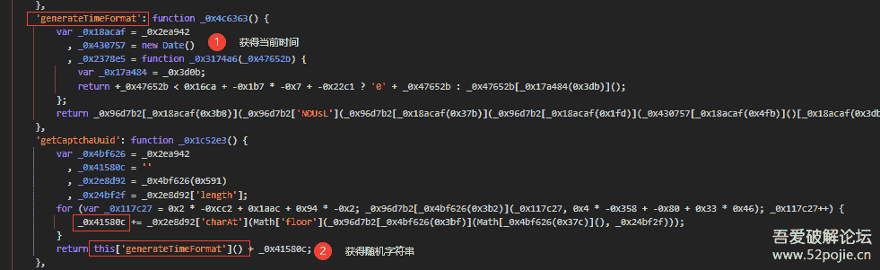
image.png (55.38 KB, 下载次数: 0)
[href="forum.php?mod=attachment&aid=Mjc4NzIzNHwzZmQyYjFmY3wxNzkzNTcwODQ1fDE2ODA4NnwyMDQzNjQ5&nothumb=yes" target="_blank"](https://www.52pojie.cn/forum.php?mod=attachment&aid=Mjc4NzIzNHwzZmQyYjFmY3wxNzkzNTcwODQ1fDE2ODA4NnwyMDQzNjQ5&nothumb=yes)
2025-7-5 12:55 上传

## 3. 标准的ob解混淆，我这在网站看到一个在线网站，测试一下可以用，网站就不发啦，直接搜就有的，可能会超时，多等待会。

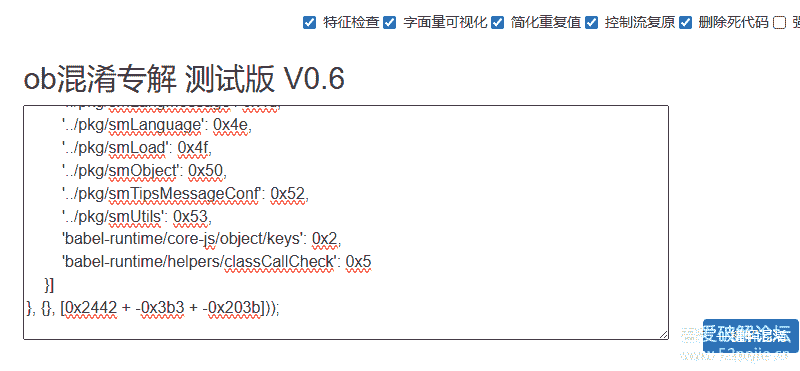
image.png (43.75 KB, 下载次数: 0)
[href="forum.php?mod=attachment&aid=Mjc4NzIzNnxlMDdjY2Q3NnwxNzkzNTcwODQ1fDE2ODA4NnwyMDQzNjQ5&nothumb=yes" target="_blank"](https://www.52pojie.cn/forum.php?mod=attachment&aid=Mjc4NzIzNnxlMDdjY2Q3NnwxNzkzNTcwODQ1fDE2ODA4NnwyMDQzNjQ5&nothumb=yes)
2025-7-5 13:07 上传

[JavaScript] 纯文本查看 复制代码


```
'generateTimeFormat': function _0x4c6363() {
        var _0x430757 = new Date(),
            _0x2378e5 = function _0x3174a6(_0x47652b) {
          return +_0x47652b
```

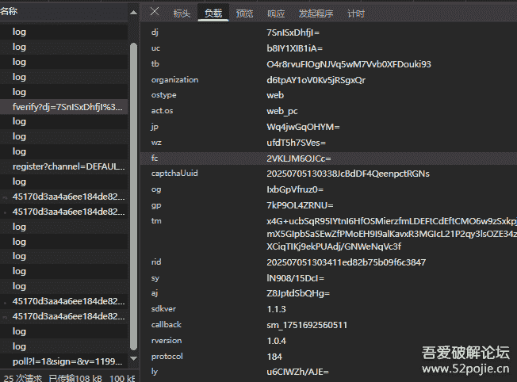

image.png (59.65 KB, 下载次数: 1)

[href="forum.php?mod=attachment&aid=Mjc4NzIzOHxkOWM0Y2NhM3wxNzkzNTcwODQ1fDE2ODA4NnwyMDQzNjQ5&nothumb=yes" target="_blank"](https://www.52pojie.cn/forum.php?mod=attachment&aid=Mjc4NzIzOHxkOWM0Y2NhM3wxNzkzNTcwODQ1fDE2ODA4NnwyMDQzNjQ5&nothumb=yes)

2025-7-5 13:16 上传

## 5. 校验成功结果
校验成功结果中 `riskLevel: "PASS"` 失败是 `"riskLevel":"REJECT"`。请求参数看着有什么，其实加密方式都一样，就 `key` 和明文不一样。可以直接全局搜索 `'tm'`，结果有三个。为啥搜它呢，密文长度独特，每次都会更新。看着都引人注目。

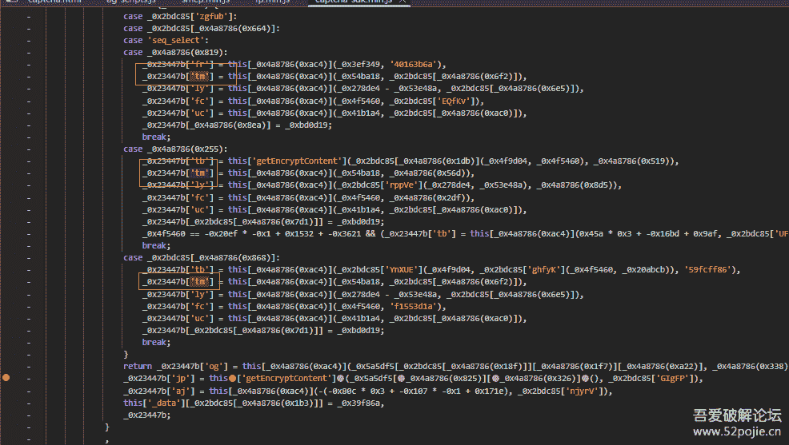

image.png (124.38 KB, 下载次数: 0)

[href="forum.php?mod=attachment&aid=Mjc4NzIzOXxhZGIyZTQxN3wxNzkzNTcwODQ1fDE2ODA4NnwyMDQzNjQ5&nothumb=yes" target="_blank"](https://www.52pojie.cn/forum.php?mod=attachment&aid=Mjc4NzIzOXxhZGIyZTQxN3wxNzkzNTcwODQ1fDE2ODA4NnwyMDQzNjQ5&nothumb=yes)

2025-7-5 13:27 上传

## 6. 解混淆替换
可以解混淆后代码，本地替换，或者 fidder 或者插件替换都行。注意是代码要压缩成一行，因为里面有自定义格式化检测 `isJsFormat`，每次加密明文的时候，为 `true` 会更改 `key` 值为 `_0x45d705` --> 是一个时间戳加域名。

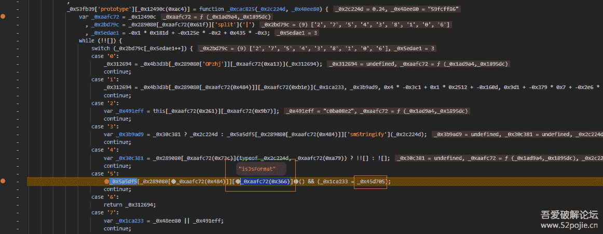

image.png (90.07 KB, 下载次数: 0)

[href="forum.php?mod=attachment&aid=Mjc4NzI0MHwxMDUxZTliM3wxNzkzNTcwODQ1fDE2ODA4NnwyMDQzNjQ5&nothumb=yes" target="_blank"](https://www.52pojie.cn/forum.php?mod=attachment&aid=Mjc4NzI0MHwxMDUxZTliM3wxNzkzNTcwODQ1fDE2ODA4NnwyMDQzNjQ5&nothumb=yes)

2025-7-5 13:33 上传

## 7. 参数来源
当然看原文也可以的，回到上面分析 `tm` 的参数由来，在 `switch` 之前有很多参数。请求参数的生成都是从过 `getEncryptContent` 方法。

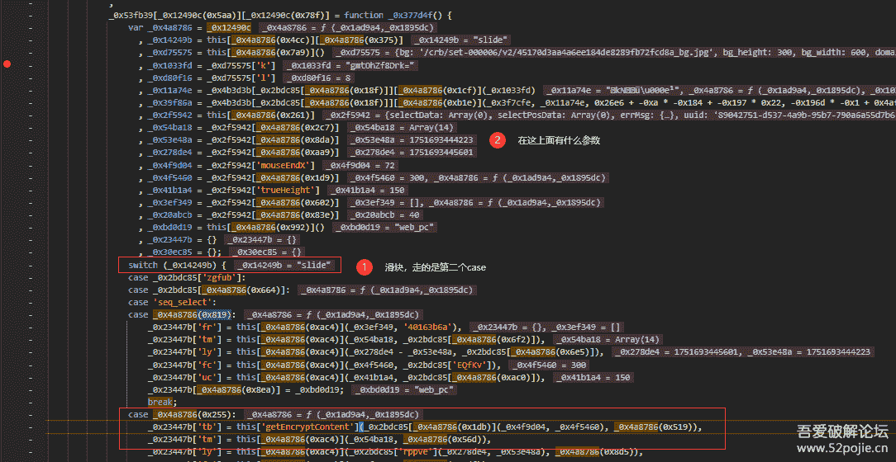

image.png (174.92 KB, 下载次数: 0)

[href="forum.php?mod=attachment&aid=Mjc4NzI0MnwyYzlkM2MxNnwxNzkzNTcwODQ1fDE2ODA4NnwyMDQzNjQ5&nothumb=yes" target="_blank"](https://www.52pojie.cn/forum.php?mod=attachment&aid=Mjc4NzI0MnwyYzlkM2MxNnwxNzkzNTcwODQ1fDE2ODA4NnwyMDQzNjQ5&nothumb=yes)

2025-7-5 13:48 上传

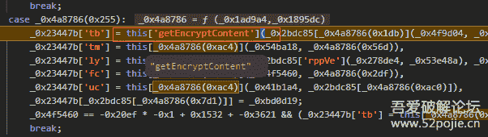

image.png (42.36 KB, 下载次数: 1)

[href="forum.php?mod=attachment&aid=Mjc4NzI0N3xmZjZmZTMxN3wxNzkzNTcwODQ1fDE2ODA4NnwyMDQzNjQ5&nothumb=yes" target="_blank"](https://www.52pojie.cn/forum.php?mod=attachment&aid=Mjc4NzI0N3xmZjZmZTMxN3wxNzkzNTcwODQ1fDE2ODA4NnwyMDQzNjQ5&nothumb=yes)

2025-7-5 14:01 上传

`_0x54ba18 = _0x2f5942[_0x4a8786(0x2c7)]` 鼠标轨迹
`_0x53e48a = _0x2f5942[_0x4a8786(0x8da)]` 滑动开始时间
`_0x278de4 = _0x2f5942[_0x4a8786(0xaa9)]` 滑动结束时间
`_0x4f9d04 = _0x2f5942['mouseEndX']` 滑动距离
`_0x4f5460 = _0x2f5942[_0x4a8786(0x1d9)]` 图片宽度
`_0x41b1a4 = _0x2f5942['trueHeight']` 图片高度
`_0x3ef349 = _0x2f5942[_0x4a8786(0x602)]` 空数据 fr 的明文
`_0x20abcb = _0x2f5942[_0x4a8786(0x83e)]` 滑块宽度

## 8. 加密算法
进到 `getEncryptContent` 里面是一个 `switch` 控制流，主要注意一下 `key`，和加密过程。这是一个 `des` 标准的加密算法 mode 是 `ECB`，padding 是 `ZeroPadding`，不需要 `iv`，在线网站测试或者 `py` 的标准库。

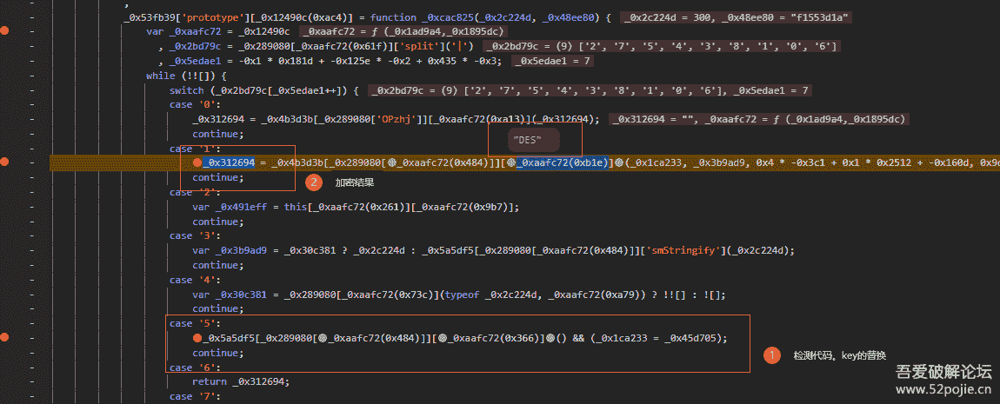

image.png (87.07 KB, 下载次数: 0)

[href="forum.php?mod=attachment&aid=Mjc4NzI1OXxlMmE3YjNiMXwxNzkzNTcwODQ1fDE2ODA4NnwyMDQzNjQ5&nothumb=yes" target="_blank"](https://www.52pojie.cn/forum.php?mod=attachment&aid=Mjc4NzI1OXxlMmE3YjNiMXwxNzkzNTcwODQ1fDE2ODA4NnwyMDQzNjQ5&nothumb=yes)

2025-7-5 14:11 上传

## 9. 参数对应
因为有很多参数，在 `break` 前打上日志断点，看方便，在根据请求参数一一对应，可以看到有部分参数的明文是固定的，注意的就是 `tm` `tb` 和 `ly`，对应着轨迹，距离比背景宽度，和滑动时间。

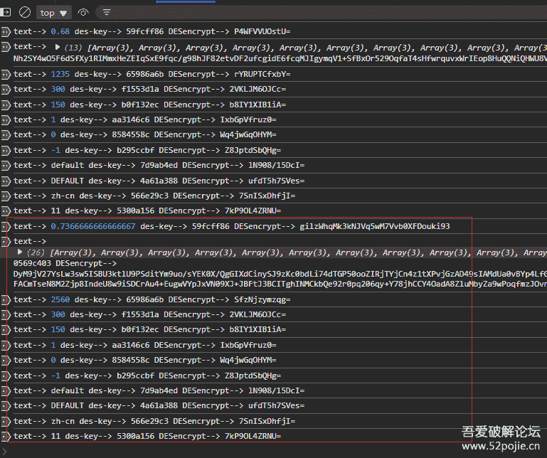

image.png (100.15 KB, 下载次数: 0)

[href="forum.php?mod=attachment&aid=Mjc4NzI2Mnw4ZTgwOWFjZXwxNzkzNTcwODQ1fDE2ODA4NnwyMDQzNjQ5&nothumb=yes" target="_blank"](https://www.52pojie.cn/forum.php?mod=attachment&aid=Mjc4NzI2Mnw4ZTgwOWFjZXwxNzkzNTcwODQ1fDE2ODA4NnwyMDQzNjQ5&nothumb=yes)

2025-7-5 14:18 上传

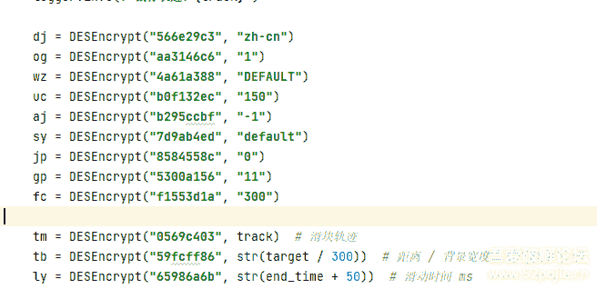

image.png (61.08 KB, 下载次数: 1)

[href="forum.php?mod=attachment&aid=Mjc4NzI2M3wxZTg1ZjY4MnwxNzkzNTcwODQ1fDE2ODA4NnwyMDQzNjQ5&nothumb=yes" target="_blank"](https://www.52pojie.cn/forum.php?mod=attachment&aid=Mjc4NzI2M3wxZTg1ZjY4MnwxNzkzNTcwODQ1fDE2ODA4NnwyMDQzNjQ5&nothumb=yes)

2025-7-5 14:20 上传

## 10. 距离识别
距离识别我这使的是 `ddddocr`，学习来说够用了，需要注意的是，背景图片的比例，下载下来的是 600*300，在官网显示的是 300*150，识别的距离除以 2 就行。

## 11. key 获取
关于 `key` 的获取，都在 `ob` 混淆的大数组中，根据版本不同相应的改变，现在来看版本是 `v1.0.4-184/captcha-sdk.min.js`

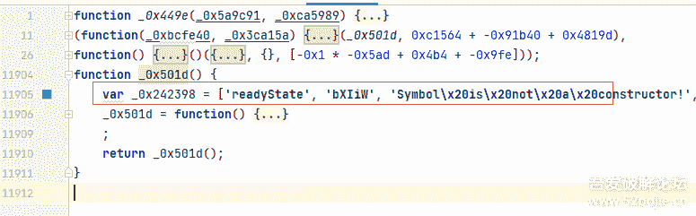

image.png (44.14 KB, 下载次数: 1)

[href="forum.php?mod=attachment&aid=Mjc4NzI3NHxhNDg2NGU0N3wxNzkzNTcwODQ1fDE2ODA4NnwyMDQzNjQ5&nothumb=yes" target="_blank"](https://www.52pojie.cn/forum.php?mod=attachment&aid=Mjc4NzI3NHxhNDg2NGU0N3wxNzkzNTcwODQ1fDE2ODA4NnwyMDQzNjQ5&nothumb=yes)

2025-7-5 14:28 上传

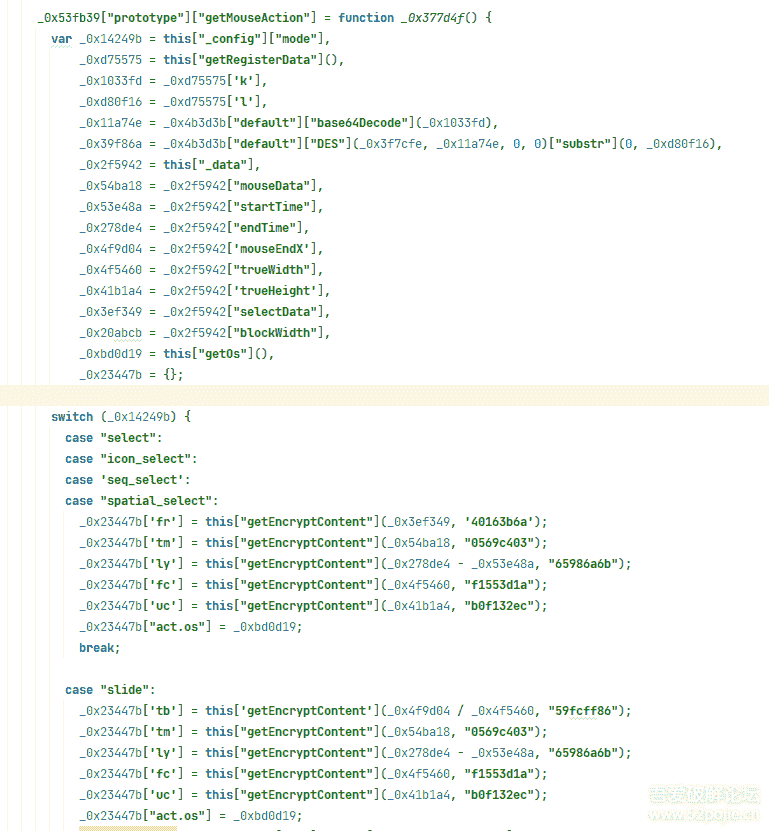

image.png (144.97 KB, 下载次数: 0)

[href="forum.php?mod=attachment&aid=Mjc4NzI3NXw4YzJhNjI2ZXwxNzkzNTcwODQ1fDE2ODA4NnwyMDQzNjQ5&nothumb=yes" target="_blank"](https://www.52pojie.cn/forum.php?mod=attachment&aid=Mjc4NzI3NXw4YzJhNjI2ZXwxNzkzNTcwODQ1fDE2ODA4NnwyMDQzNjQ5&nothumb=yes)

2025-7-5 14:33 上传

## 12. Python 还原代码
使用在线 `ob` 解混淆后代码看的很清晰了，版本不更新 `key` 应该不会变吧，等后面跟踪一下，我这使用 `python` 还原，下面是一些方法代码。

[Python] 纯文本查看 复制代码

```
def generate_slider_track(target_distance):
    track = []
    current_distance = 0
    current_time = 0
    y_offset = 0
    track.append([0, random.randint(0, 10), 0])
    while current_distance  10:
            x_step = random.randint(4, 10)
        else:
            x_step = random.randint(1, 4)
        current_distance += x_step
        if current_distance > target_distance:
            current_distance = target_distance
        # 纵向浮动在-5到5之间，模拟抖动
        y_offset = random.randint(-5, 5)
        track.append([current_distance, y_offset, current_time])
    return track

def DESEncrypt(key, text):
    key_bytes = key.encode('utf-8')
    des = DES.new(key_bytes, DES.MODE_ECB)
    padded_text = text.encode('utf-8')
    pad_len = 8 - (len(padded_text) % 8)
    if pad_len != 8:
        padded_text += b'\x00' * pad_len
    encrypted_bytes = des.encrypt(padded_text)
    # 返回Base64编码字符串
    return base64.b64encode(encrypted_bytes).decode('utf-8')

def random_str():
    return ''.join(random.choice('ABCDEFGHJKMNPQRSTWXYZabcdefhijkmnprstwxyz2345678') for _ in range(18))

def get_distance(bg, tp, save_path=None):
    det = DdddOcr(det=False, ocr=False, show_ad=False)
    res = det.slide_match(tp, bg, simple_target=True)
    if save_path is not None:
        # 将背景图片的二进制数据加载为Pillow Image对象
        left, top, right, bottom = res['target'][0], res['target'][1], res['target'][2], res['target'][3]
        bg_image = Image.open(io.BytesIO(bg))
        draw = ImageDraw.Draw(bg_image)
        draw.rectangle([left, top, right, bottom], outline="red", width=2)
        bg_image.save(save_path)
        print(f"已保存标注后的图片到: {save_path}")
        return res
    return res
```

## 13. 总结
轨迹-加密-随机字符串-距离识别，好了，完结撒花，又是愉快的周末，基本流程就这些了，测试一下，结果正确，这个 demo 分析完了，感谢大佬们观看。


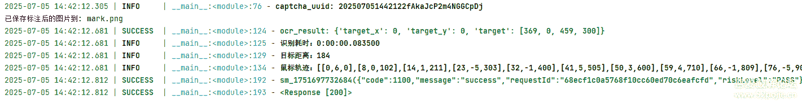

image.png (70.51 KB, 下载次数: 0)

[href="forum.php?mod=attachment&aid=Mjc4NzI3Nnw2Yzc5OWY4NnwxNzkzNTcwODQ1fDE2ODA4NnwyMDQzNjQ5&nothumb=yes" target="_blank"](https://www.52pojie.cn/forum.php?mod=attachment&aid=Mjc4NzI3Nnw2Yzc5OWY4NnwyMDQzNjQ5&nothumb=yes)

2025-7-5 14:42 上传
