# [Web逆向] ast还原某程登陆滑块逆向分析

- 原帖: https://www.52pojie.cn/forum.php?mod=viewthread&tid=2044075
- 抓取时间: 2026-11-01T22:07:22

一个比较简单的滑块案例，适合ast入门练手写写插件（推荐蔡老板），食用地址：aHR0cHM6Ly9hY2NvdW50cy5jdHJpcC5jb20vaDVMb2dpbi9sb2dpbl9jdHJpcD9zaWJsaW5nPVQ=工具网站：

> https://astexplorer.net/

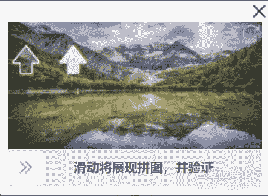

image.png (166.06 KB, 下载次数: 0)

[下载附件](https://www.52pojie.cn/forum.php?mod=attachment&aid=Mjc4NzY5MHwwMmFiMTgxN3wxNzkzNTcwODQwfDE2ODA4NnwyMDQ0MDc1&nothumb=yes)

滑块信息

2025-7-7 21:41 上传

## 一、流程分析

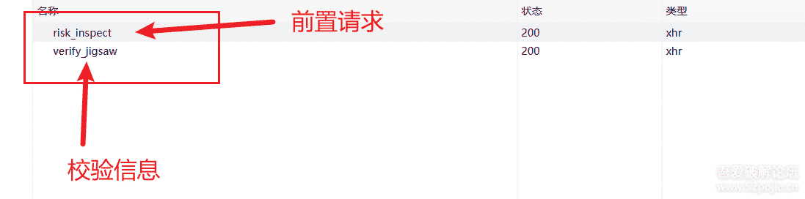

image.png (24.25 KB, 下载次数: 0)

[下载附件](https://www.52pojie.cn/forum.php?mod=attachment&aid=Mjc4NzY5MXw2MzQ1OWE2ZHwxNzkzNTcwODQwfDE2ODA4NnwyMDQ0MDc1&nothumb=yes)

接口信息

2025-7-7 21:43 上传

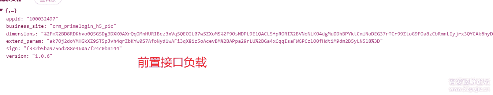

image.png (42.84 KB, 下载次数: 0)

[下载附件](https://www.52pojie.cn/forum.php?mod=attachment&aid=Mjc4NzY5M3w2NTgxY2FlNXwxNzkzNTcwODQwfDE2ODA4NnwyMDQ0MDc1&nothumb=yes)

前置接口负载

2025-7-7 21:44 上传

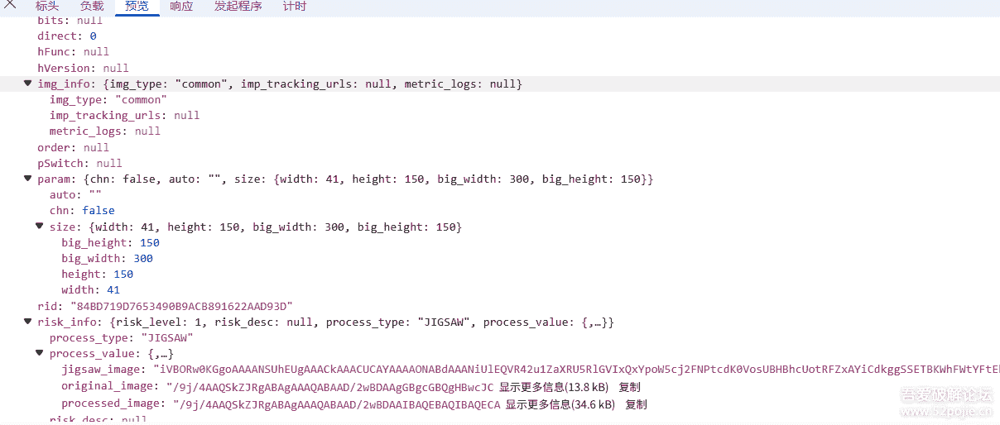

image.png (77.77 KB, 下载次数: 0)

[下载附件](https://www.52pojie.cn/forum.php?mod=attachment&aid=Mjc4NzY5MnxhMGNjMDk0YXwxNzkzNTcwODQwfDE2ODA4NnwyMDQ0MDc1&nothumb=yes)

前置接口返回值

2025-7-7 21:43 上传

整体来说就两个接口，难度不是很大，多抓几次包可以看到`extend_param`、`dimensions`、`sign`是变化的参数，需要我们去处理，返回值有个`token`，`rid`，图片信息，然后是校验接口的数据信息

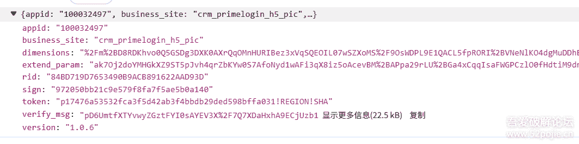

image.png (50.9 KB, 下载次数: 0)

[下载附件](https://www.52pojie.cn/forum.php?mod=attachment&aid=Mjc4NzY5NHwxY2NiZGRjYXwxNzkzNTcwODQwfDE2ODA4NnwyMDQ0MDc1&nothumb=yes)

校验接口负载

2025-7-7 21:50 上传

可以看到这里面的负载有一个`rid`，`token`是前面传回来的，我们不需要去处理，剩下的是`sign`，`verify_msg`，`extend_param`，整体难度不是很大

## 二、ast还原与参数逆向分析

还是老规矩直接去跟栈，演示过很多次了，就简单处理一下

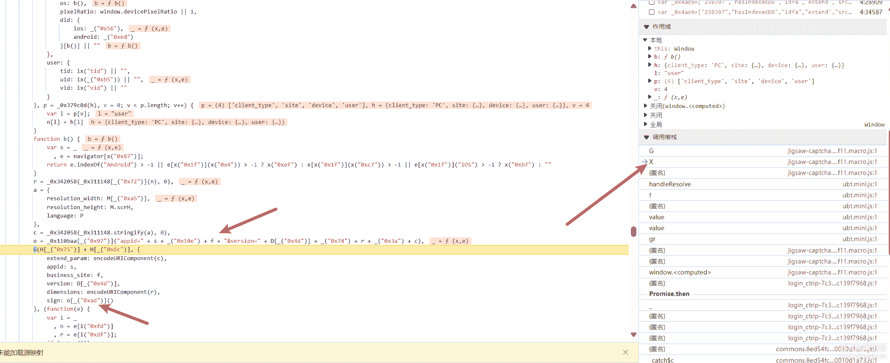

image.png (184.16 KB, 下载次数: 0)

[下载附件](https://www.52pojie.cn/forum.php?mod=attachment&aid=Mjc4NzY5N3w3MTg4ZTBkNXwxNzkzNTcwODQwfDE2ODA4NnwyMDQ0MDc1&nothumb=yes)

参数生成位置

2025-7-7 21:57 上传

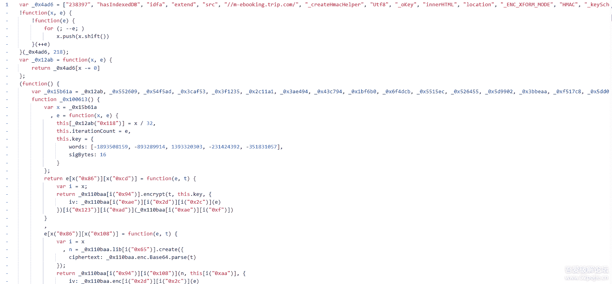

image.png (96.56 KB, 下载次数: 0)

[下载附件](https://www.52pojie.cn/forum.php?mod=attachment&aid=Mjc4NzY5OHxhYzUxZGMxNnwxNzkzNTcwODQwfDE2ODA4NnwyMDQ0MDc1&nothumb=yes)

前置接口混淆特征

2025-7-7 21:59 上传

其实往上走一步就看到了大致的一个流程，但是很明显能看到一个混淆的样子，再去大致看一下轨迹的那一个滑块的混淆情况

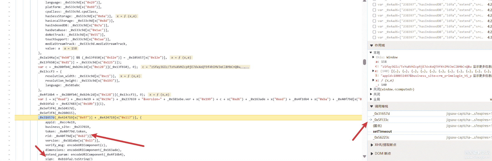

image.png (198.41 KB, 下载次数: 0)

[下载附件](https://www.52pojie.cn/forum.php?mod=attachment&aid=Mjc4NzY5OXwxZDMxYjVmOXwxNzkzNTcwODQwfDE2ODA4NnwyMDQ0MDc1&nothumb=yes)

校验接口生成位置

2025-7-7 22:03 上传

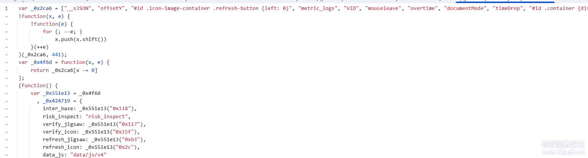

image.png (53.47 KB, 下载次数: 0)

[下载附件](https://www.52pojie.cn/forum.php?mod=attachment&aid=Mjc4NzcwMHw0N2U1YTNmZXwxNzkzNTcwODQwfDE2ODA4NnwyMDQ0MDc1&nothumb=yes)

校验接口特征

2025-7-7 22:03 上传

整体看一下他的代码特征，大数组，数组移位，解密函数，很明显的ob混淆，但是有没有花指令。我们直接扒下来还原试试。

```
let parse = require("@babel/parser").parse;

let traverse = require("@babel/traverse").default;

let generator = require("@babel/generator").default;

let fs = require("fs");

let types = require("@babel/types");

let jsc_code = fs.readFileSync("./源文件.js", encoding = "utf-8")

let ast = parse(jsc_code)

let init_ast = parse(jsc_code)

traverse(init_ast, {

    Program(path) {

        path.node.body = path.node.body.slice(0, 3);

        path.stop();

    }

});

eval(generator(init_ast, {minified: true}).code)

traverse(ast, {

       // 逗号表达式还原

    }

)

traverse(ast, {

    StringLiteral({node}) {

        if (node.extra && /\\[ux]/gi.test(node.extra.raw)) {

            node.extra = undefined;

        }

    }

});

traverse(ast, {

    NumericLiteral({node}) {

        if (node.extra && /^0[obx]/i.test(node.extra.raw)) {

            node.extra = undefined;

        }

    }

});

let decode_name = ['_0x12ab', '_0xe375fa']

traverse(ast, {

    VariableDeclarator(path) {

        const {id, init} = path.node;

        if (init && (init.type === 'Identifier' || init.type === 'FunctionDeclaration')) {

            let name = id.name

            decode_name.push(name)

        }

    }

});

traverse(ast, {

    CallExpression: {

        exit: function (path) {

            let {node} = path

            let func_name = node.callee.name

            if (!decode_name.includes(func_name)) {

                return

            }

            if (!node.arguments || node.arguments.length !== 1) {

                return;

            }

            let arg = node.arguments[0].value;

            if (!/^0[obx]/i.test(arg)) {

                return;

            }

            let eval_path = path.toString().replace(func_name, "_0x12ab")

            let result = eval(eval_path)

            path.replaceWith(types.valueToNode(result))

        }

    }

});

//

let js_code = generator(ast, {minified: true}).code;

fs.writeFileSync("./output.js", js_code)
```


逗号表达式我借用的是蔡老板的插件，尊重蔡老板的知识产权，知识给出我自己写的ast部分，大致思路先将ob三特征放入内存方便调用，要注意的是需要格式化处理，然后是十六进制和编码的还原，接下来就是混淆的核心，多次赋值解密函数调用，我采用的是收集所有的赋值，替换函数名为解密函数，直接还原，比较菜，大佬们仅供参考。这样就实现了这个混淆代码的还原，接下来用工具替换，我采用的是fiddler本地替换。

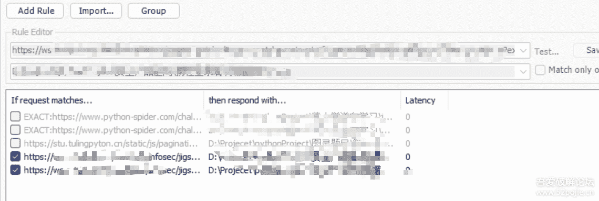

image.png (90.17 KB, 下载次数: 0) [附件](https://www.52pojie.cn/forum.php?mod=attachment&aid=Mjc4NzcwM3xmNTc4MmQxZnwxNzkzNTcwODQwfDE2ODA4NnwyMDQ0MDc1&nothumb=yes)

fiddler替换

2025-7-7 22:12 上传

看看替换后的效果

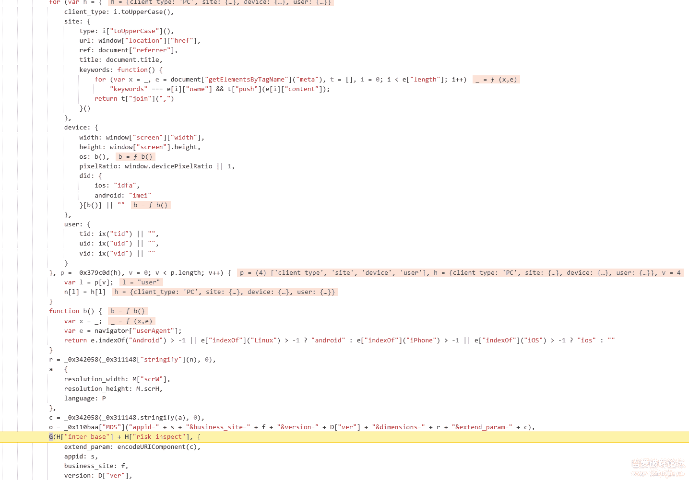

image.png (114.35 KB, 下载次数: 0) [附件](https://www.52pojie.cn/forum.php?mod=attachment&aid=Mjc4NzcwNHwyMDY5NjMwY3wxNzkzNTcwODQwfDE2ODA4NnwyMDQ0MDc1&nothumb=yes)

替换后前置接口

2025-7-7 22:15 上传

一下子神清气爽了，很舒畅。然后继续我们的参数分析。

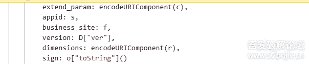

image.png (15.81 KB, 下载次数: 0) [附件](https://www.52pojie.cn/forum.php?mod=attachment&aid=Mjc4NzcwNXxjOTY2N2Q1YnwxNzkzNTcwODQwfDE2ODA4NnwyMDQ0MDc1&nothumb=yes)

参数位置

2025-7-7 22:16 上传

这些参数位置还是很清晰的，直接往上找找是咋生成的。

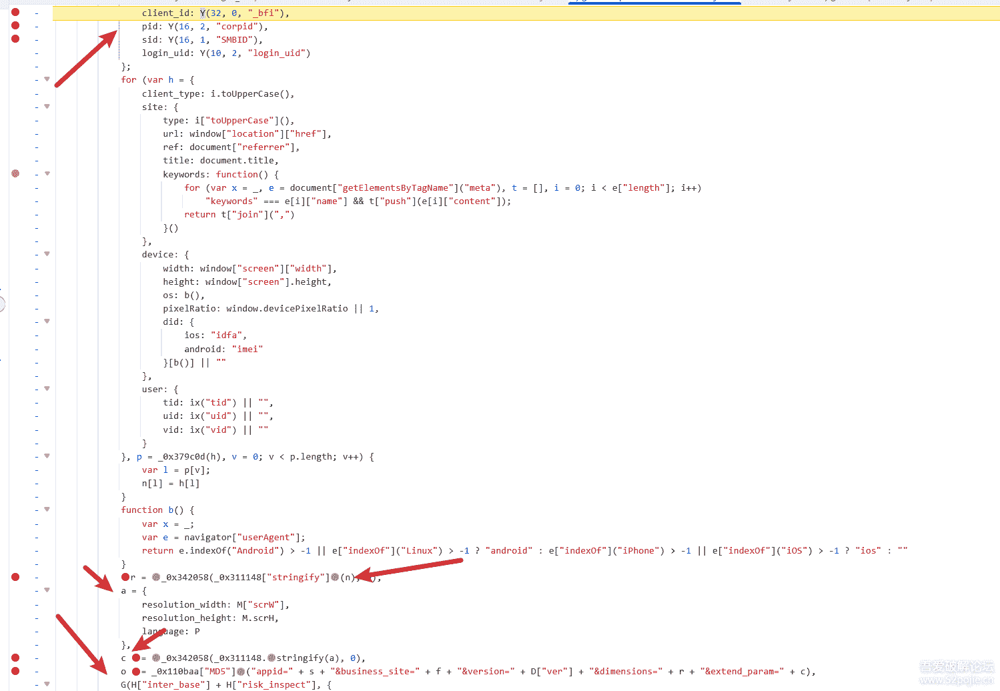

image.png (118.88 KB, 下载次数: 0) [附件](https://www.52pojie.cn/forum.php?mod=attachment&aid=Mjc4NzcwNnw0MWJmY2VkZnwxNzkzNTcwODQwfDE2ODA4NnwyMDQ0MDc1&nothumb=yes)

参数生成定位

2025-7-7 22:18 上传

最上面是一个`n`对象，后面对`n`进行了处理，还有一个`a`对象，同样的方法对进行了处理，然后拼接进行了一个md5的操作。很清晰的逻辑。

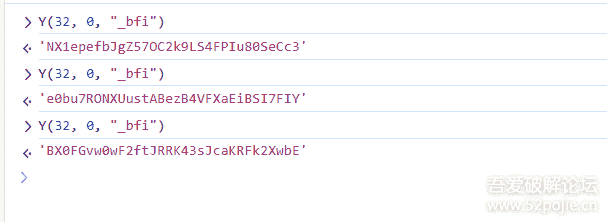

image.png (19.24 KB, 下载次数: 0) [附件](https://www.52pojie.cn/forum.php?mod=attachment&aid=Mjc4NzcwN3w1NGRjNTM4Y3wxNzkzNTcwODQwfDE2ODA4NnwyMDQ0MDc1&nothumb=yes)

y函数

2025-7-7 22:19 上传

我们在测试`y`的时候发现是一个动态变化的值，看看他的生成逻辑，转换成python代码

```javascript
function Y(x, t, i) {
    var n = e;
    var r = ix(i);
    if (r)
        return r;
    r = "",
    x = x || 32,
    t = t || 0;
    for (var a = ["ABCDEFGHIJKLMNOPQRSTUVWXYZabcdefghijklmnopqrstuvwxyz0123456789", "ABCDEFGHIJKLMNOPQRSTUVWXYZabcdefghijklmnopqrstuvwxyz", "0123456789", "0123456789abcdef"][t], c = a["length"], o = 0; o 
```

```python
import math
import random

def range_y(x=32, t=0):
    a = [
        "ABCDEFGHIJKLMNOPQRSTUVWXYZabcdefghijklmnopqrstuvwxyz0123456789",
        "ABCDEFGHIJKLMNOPQRSTUVWXYZabcdefghijklmnopqrstuvwxyz",
        "0123456789",
        "0123456789abcdef"
    ][t]
    c = len(a)
    r = ""
    for o in range(x):
        r += a[math.floor(random.random() * c)]
    return r
```

接下来就是`_0x342058`函数的实现逻辑

```javascript
e["prototype"]["encrypt"] = function(e, t) {
    var i = x;
    return _0x110baa["AES"].encrypt(t, this.key, {
        iv: _0x110baa["enc"]["Hex"]["parse"](e)
    })["ciphertext"]["toString"](_0x110baa["enc"]["Base64"])
}

function _0x342058(x, e) {
    var t = _0x15b61a;
    var i = "69783956775867344e5853626b645431";
    var n = new _0x254c65(128,1e3);
    return 0 === e ? n["encrypt"](i, x) : n["decrypt"](i, x)
}
```

应该还是很明显，这是一个aes加密，但是不同于之前的滑块，这里采用了一个hex的方式去处理数组，这个在python中对应的是`bytes.fromhex`函数，这里可以看到有一个`iv`，可以猜测是CBC加密，

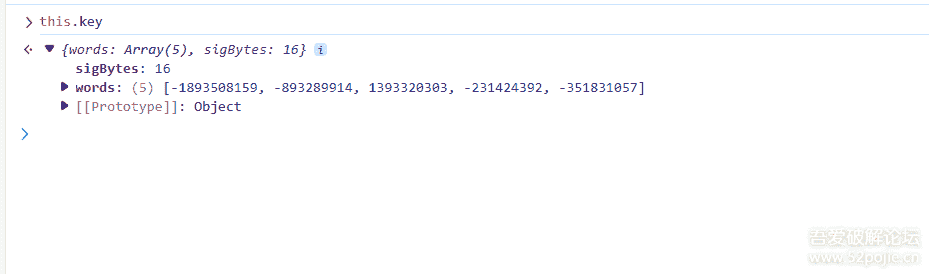

image.png (19.09 KB, 下载次数: 0) [附件](https://www.52pojie.cn/forum.php?mod=attachment&aid=Mjc4NzcwOHw1ZmU3NTQwN3wxNzkzNTcwODQwfDE2ODA4NnwyMDQ0MDc1&nothumb=yes)

key值

2025-7-7 22:24 上传

这里发现`key`值已经被转化了，我们需要先去还原他的字符串型形态的值，再用python去转化

```python
import struct

def word_array_to_hex_string(words, sig_bytes):
    byte_list = []
    for word in words:
        if word I', word)
        byte_list.extend(bytes_)
    byte_list = byte_list[:sig_bytes]

    return bytes(byte_list).hex()
```

这个函数的效果我们可义用转化后的`iv`进行测试，发现没有问题，最后得到我们的`key`值为`69783956775867344e5853626b645431`，我们就可以实现这一部分的加密逻辑

```python
import base64
from cryptography.hazmat.primitives.ciphers import Cipher, algorithms, modes
from cryptography.hazmat.primitives import padding
from cryptography.hazmat.backends import default_backend

def aesEncrypt(plaintext):
    iv = bytes.fromhex("69783956775867344e5853626b645431")
    key = bytes.fromhex('8f235bc1cac17a46530c616ff234be78')
    if isinstance(plaintext, str):
        plaintext = plaintext.encode('utf-8')
    cipher = Cipher(algorithms.AES(key), modes.CBC(iv), backend=default_backend())
    encryptor = cipher.encryptor()
    padder = padding.PKCS7(128).padder()
    padded_data = padder.update(plaintext) + padder.finalize()
    ciphertext = encryptor.update(padded_data) + encryptor.finalize()
    return base64.b64encode(ciphertext).decode('utf-8')
```

稍微检测一下

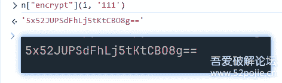

image.png (22.3 KB, 下载次数: 0) [附件](https://www.52pojie.cn/forum.php?mod=attachment&aid=Mjc4NzcwOXw1YjYwYmQwM3wxNzkzNTcwODQwfDE2ODA4NnwyMDQ0MDc1&nothumb=yes)

aes加密检测

2025-7-7 22:29 上传

蒙的很准{:1_889:}

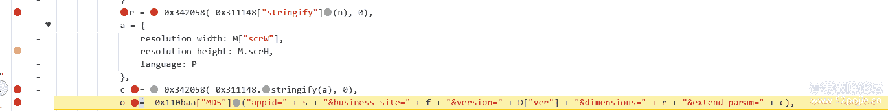

image.png (29.63 KB, 下载次数: 0) [附件](https://www.52pojie.cn/forum.php?mod=attachment&aid=Mjc4NzcxMHxjZTEwNmQ3OHwxNzkzNTcwODQwfDE2ODA4NnwyMDQ0MDc1&nothumb=yes)

a值加密

2025-7-7 22:30 上传

接下来的`a`值同样的函数加密就不过多赘叙了，后面就是一个md5拼接，先检测是不是标准的。

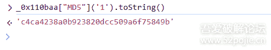

image.png (10.75 KB, 下载次数: 0) [附件](https://www.52pojie.cn/forum.php?mod=attachment&aid=Mjc4NzcxMXw4MDRhNGQxNHwxNzkzNTcwODQwfDE2ODA4NnwyMDQ0MDc1&nothumb=yes)

md5加密

2025-7-7 22:32 上传

非常标准，这样我们就完成了第一部分加密，我们看到后面还有一个`encodeURIComponent`函数，是url的一个编码处理，对应的的是`from urllib.parse import quote`，简单实现一下


```
import requests
import ddddocr

headers = {
}

json_data = {
    'extend_param': quote(extend_param),
    'appid': '100032497',
    'business_site': 'crm_primelogin_h5_pic',
    'version': '1.0.6',
    'dimensions': quote(dimensions),
    'sign': sign,
}

response = requests.post(‘脱敏处理', headers=headers, json=json_data).json()
rid = response['result']['rid']
token = response['result']['token']
bg_pic = base64.b64decode(response['result']['risk_info']['process_value']['jigsaw_image'])
sc_pic = base64.b64decode(response['result']['risk_info']['process_value']['processed_image'])
with open('bg_pic.png', 'wb') as f:
    f.write(bg_pic)
with open('sc_pic.png', 'wb') as f:
    f.write(sc_pic)
det = ddddocr.DdddOcr(det=False, ocr=True, show_ad=False)
with open('sc_pic.png', 'rb') as f:
    target_bytes = f.read()
with open('bg_pic.png', 'rb') as f:
    background_bytes = f.read()
rest = det.slide_match(target_bytes, background_bytes, simple_target=True)
value = rest['target'][0]
print('识别到距离', value)
```

接下来就是处理校验接口，经过我们分析，`token`和`rid`是前置接口传过来的，所以我们处理的参数不多，还是分析他的逻辑

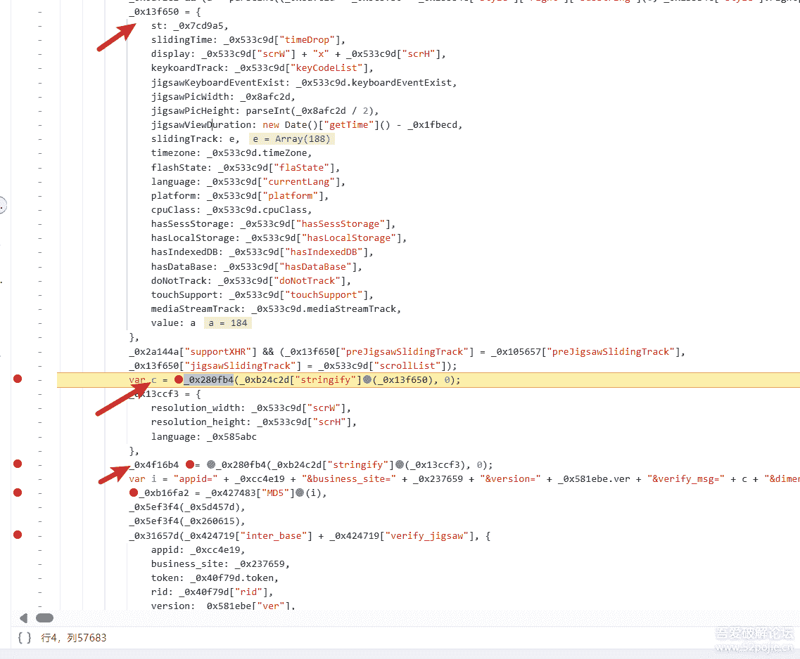

image.png (137.27 KB, 下载次数: 0)

[href="forum.php?mod=attachment&aid=Mjc4NzcxMnwzMmM1NjcxZXwxNzkzNTcwODQwfDE2ODA4NnwyMDQ0MDc1&nothumb=yes" target="_blank"](https://www.52pojie.cn/forum.php?mod=attachment&aid=Mjc4NzcxMnwzMmM1NjcxZXwxNzkzNTcwODQwfDE2ODA4NnwyMDQ0MDc1&nothumb=yes)

校验接口分析

2025-7-7 22:37 上传

看着逻辑都是一样的，我们都跟进去加密函数去看看情况

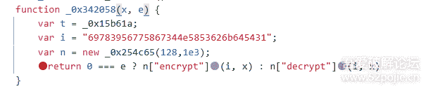

image.png (20.72 KB, 下载次数: 0)

[href="forum.php?mod=attachment&aid=Mjc4NzcxM3xkMjdlNDkzOHwxNzkzNTcwODQwfDE2ODA4NnwyMDQ0MDc1&nothumb=yes" target="_blank"](https://www.52pojie.cn/forum.php?mod=attachment&aid=Mjc4NzcxM3xkMjdlNDkzOHwxNzkzNTcwODQwfDE2ODA4NnwyMDQ0MDc1&nothumb=yes)

aes

2025-7-7 22:38 上传

好家伙，直接复用了，所以说还是前置接口那一套的逻辑，唯一的区别这里加密的是轨迹信息

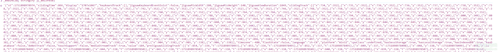

image.png (100 KB, 下载次数: 0)

[href="forum.php?mod=attachment&aid=Mjc4NzcxNHw5NTQ1OTgyM3wxNzkzNTcwODQwfDE2ODA4NnwyMDQ0MDc1&nothumb=yes" target="_blank"](https://www.52pojie.cn/forum.php?mod=attachment&aid=Mjc4NzcxNHw5NTQ1OTgyM3wxNzkzNTcwODQwfDE2ODA4NnwyMDQ0MDc1&nothumb=yes)

轨迹加密

2025-7-7 22:40 上传

后面一个`md5`的拼接{:1_918:}这样一个滑块就ok了

## 三、总结

所谓工欲善其事必先利其器，`ast`技术更好的帮助分析（我的`ast`还是很菜），这种虽然简单，但是看着麻烦，做一定的处理更加方便，整体来说还是一个入门级的案例。轨迹算法还是建议大佬们借鉴论坛里的大佬{:1_932:}我去准备明天考试了{:1_892:}
