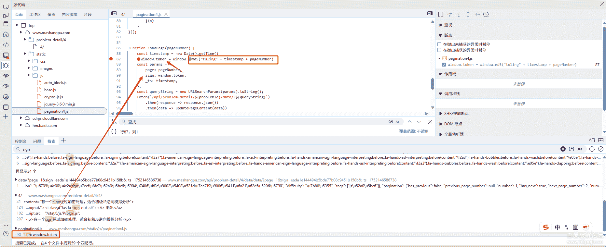
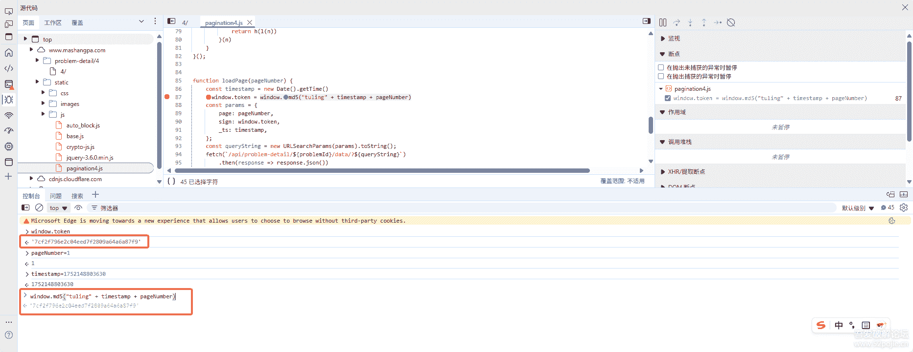
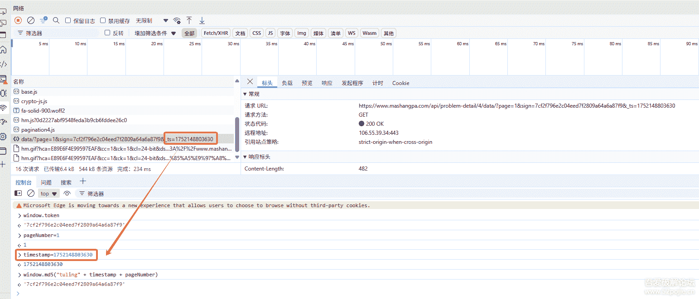

# [Web逆向] 码上爬-题四-JS逆向入门（首次发帖，请多关照，谢谢）

- 原帖: https://www.52pojie.cn/forum.php?mod=viewthread&tid=2044873
- 抓取时间: 2026-11-01T22:07:10

最近在学爬虫web逆向，看到的一个有意思的网站，顺带记录了一下解题过程。欢迎各位大佬多多指教{:1_893:}
分析地址：aHR0cHM6Ly93d3cubWFzaGFuZ3BhLmNvbS9wcm9ibGVtLWRldGFpbC80Lw==

image.png (20.11 KB, 下载次数: 1)
[href="forum.php?mod=attachment&aid=Mjc4ODM4Nnw2OTZmYmYzOHwxNzkzNTcwODI4fDE2ODA4NnwyMDQ0ODcz&nothumb=yes" target="_blank"](https://www.52pojie.cn/forum.php?mod=attachment&aid=Mjc4ODM4Nnw2OTZmYmYzOHwxNzkzNTcwODI4fDE2ODA4NnwyMDQ0ODcz&nothumb=yes)
2025-7-10 19:14 上传

## ①断点调试
发现请求中有个`sign`进行加密，`sign`是由`window.token`进行`MD5`加密得到，`_ts`为时间戳

image.png (181.27 KB, 下载次数: 2)
[href="forum.php?mod=attachment&aid=Mjc4ODM5MnwzZWRjNTc1MXwxNzkzNTcwODI4fDE2ODA4NnwyMDQ0ODcz&nothumb=yes" target="_blank"](https://www.52pojie.cn/forum.php?mod=attachment&aid=Mjc4ODM5MnwzZWRjNTc1MXwxNzkzNTcwODI4fDE2ODA4NnwyMDQ0ODcz&nothumb=yes)
2025-7-10 19:43 上传

## ②进行调试验证，与结果一致

image.png (125.4 KB, 下载次数: 1)
[href="forum.php?mod=attachment&aid=Mjc4ODM5NXxlYzFkOTQxMXwxNzkzNTcwODI4fDE2ODA4NnwyMDQ0ODcz&nothumb=yes" target="_blank"](https://www.52pojie.cn/forum.php?mod=attachment&aid=Mjc4ODM5NXxlYzFkOTQxMXwxNzkzNTcwODI4fDE2ODA4NnwyMDQ0ODcz&nothumb=yes)
2025-7-10 20:02 上传

image.png (112.99 KB, 下载次数: 0)
[href="forum.php?mod=attachment&aid=Mjc4ODM5NnxlZDczMWZlYnwxNzkzNTcwODI4fDE2ODA4NnwyMDQ0ODcz&nothumb=yes" target="_blank"](https://www.52pojie.cn/forum.php?mod=attachment&aid=Mjc4ODM5NnxlZDczMWZlYnwxNzkzNTcwODI4fDE2ODA4NnwyMDQ0ODcz&nothumb=yes)
2025-7-10 20:04 上传

## ③构造请求，实现代码如下：

```python
import time
import hashlib
import requests


headers = {
    'User-Agent':'Mozilla/5.0 (Windows NT 10.0; Win64; x64) AppleWebKit/537.36 (KHTML, like Gecko) Chrome/137.0.0.0 Safari/537.36 Edg/137.0.0.0',
    'referer':'https://www.mashangpa.com/problem-detail/4/'
}

# 需要登录，请先登录，获取cookie并完善参数
cookies = {
    'xxx':'xxxx',
    ......
}

final_sum = 0
start_time = time.time()
for page in range(1,21):
    time_stamp = int(time.time() * 1000)
    text = "tuling" + str(time_stamp) + str(page)
    sign = hashlib.md5(text.encode('utf-8'))
    sign = sign.hexdigest()
    url = f'https://www.mashangpa.com/api/problem-detail/4/data/?page={page}&sign={sign}&_ts={time_stamp}'
    print(url)
    response = requests.get(url, cookies=cookies, headers=headers)
    data = response.json().get('current_array')
    print(f"当前url: {url}, 数组: {data}")
    final_sum += sum(data)
end_time = time.time()
print(f"最终的和为: {final_sum}, 耗时: {end_time - start_time:.5f}s")
```

欢迎各位大佬批评指正，下次见:handshake:lol
