# [原创] `phpstudy`修改默认跳转官网到百度

- 原帖: `https://www.52pojie.cn/forum.php?mod=viewthread&tid=2045965`
- 抓取时间: `2026-11-01T22:06:59`

使用`phpstudy`时，点击左上角会跳转到其官方网站，原本是想去掉，后面给换成跳转`www.baidu.com`了

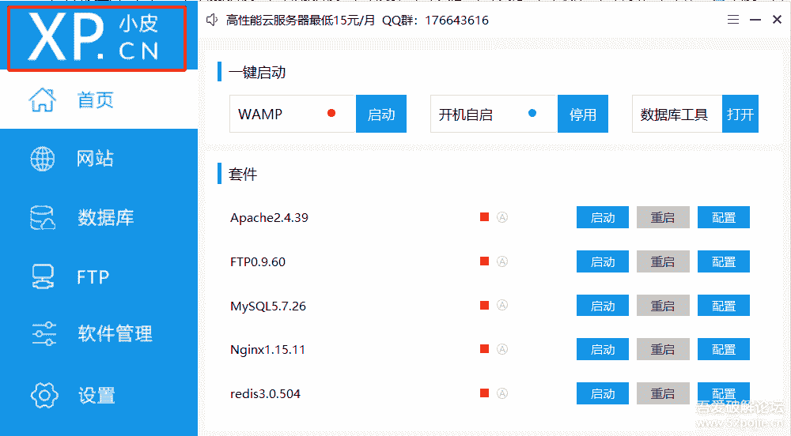
`image.png` (69.02 KB, 下载次数: 0)
[href="forum.php?mod=attachment&aid=Mjc4OTExN3wwNGRjNzQ5MXwxNzkzNTcwODE3fDE2ODA4NnwyMDQ1OTY1&nothumb=yes" target="_blank"](https://www.52pojie.cn/forum.php?mod=attachment&aid=Mjc4OTExN3wwNGRjNzQ5MXwxNzkzNTcwODE3fDE2ODA4NnwyMDQ1OTY1&nothumb=yes)
2025-7-15 22:39 上传

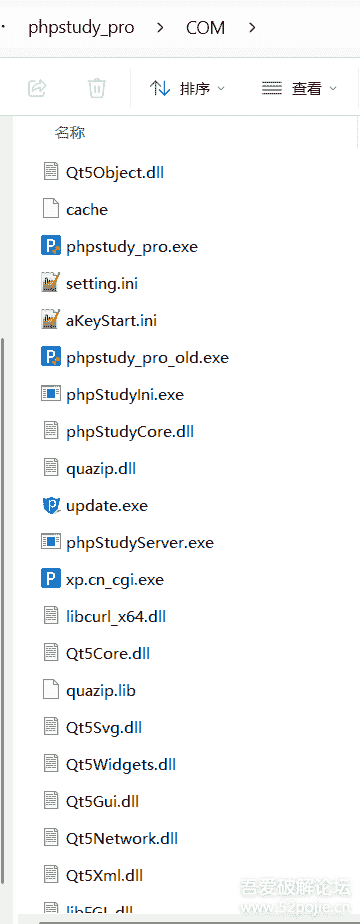
`image.png` (40.85 KB, 下载次数: 0)
[href="forum.php?mod=attachment&aid=Mjc4OTExOHxhMDBhZDMxNXwxNzkzNTcwODE3fDE2ODA4NnwyMDQ1OTY1&nothumb=yes" target="_blank"](https://www.52pojie.cn/forum.php?mod=attachment&aid=Mjc4OTExOHxhMDBhZDMxNXwxNzkzNTcwODE3fDE2ODA4NnwyMDQ1OTY1&nothumb=yes)
2025-7-15 22:41 上传

在`phpstudy`中找到`exe`，放进`x64dbg`，由于这里已经是去掉之后了，所以会有个原来的`phpstudy_pro_old.exe`

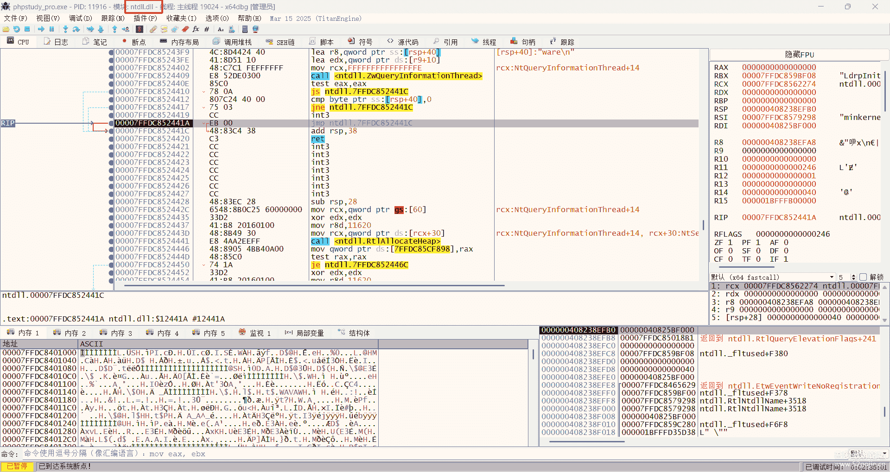
`image.png` (303.16 KB, 下载次数: 1)
[href="forum.php?mod=attachment&aid=Mjc4OTExOXxlYmEyMTRlM3wxNzkzNTcwODE3fDE2ODA4NnwyMDQ1OTY1&nothumb=yes" target="_blank"](https://www.52pojie.cn/forum.php?mod=attachment&aid=Mjc4OTExOXxlYmEyMTRlM3wxNzkzNTcwODE3fDE2ODA4NnwyMDQ1OTY1&nothumb=yes)
2025-7-15 22:43 上传

进来发现初始是`ntdll.dll`，根据看其它帖子的学习,可以通过运行到主程序模块

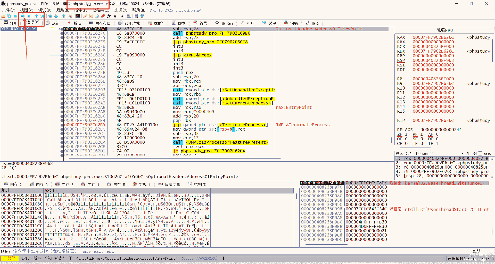
`image.png` (305.35 KB, 下载次数: 0)
[href="forum.php?mod=attachment&aid=Mjc4OTEyMHxjYWM0MWQxNXwxNzkzNTcwODE3fDE2ODA4NnwyMDQ1OTY1&nothumb=yes" target="_blank"](https://www.52pojie.cn/forum.php?mod=attachment&aid=Mjc4OTEyMHxjYWM0MWQxNXwxNzkzNTcwODE3fDE2ODA4NnwyMDQ1OTY1&nothumb=yes)
2025-7-15 22:46 上传

随着再次运行看到了小皮已经启动

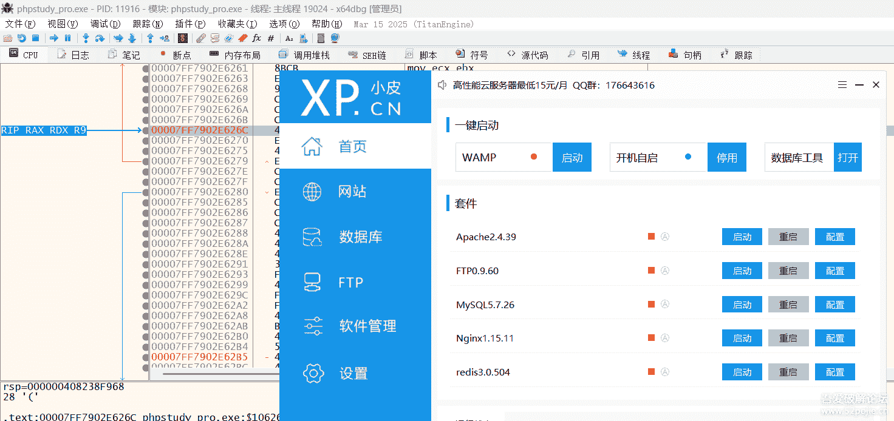
`image.png` (157.56 KB, 下载次数: 0)
[href="forum.php?mod=attachment&aid=Mjc4OTEyMXwyNDM5NWU2ZnwxNzkzNTcwODE3fDE2ODA4NnwyMDQ1OTY1&nothumb=yes" target="_blank"](https://www.52pojie.cn/forum.php?mod=attachment&aid=Mjc4OTEyMXwyNDM5NWU2ZnwxNzkzNTcwODE3fDE2ODA4NnwyMDQ1OTY1&nothumb=yes)
2025-7-15 22:48 上传

而后可以通过在当前模块，进行模块搜索来查找网址

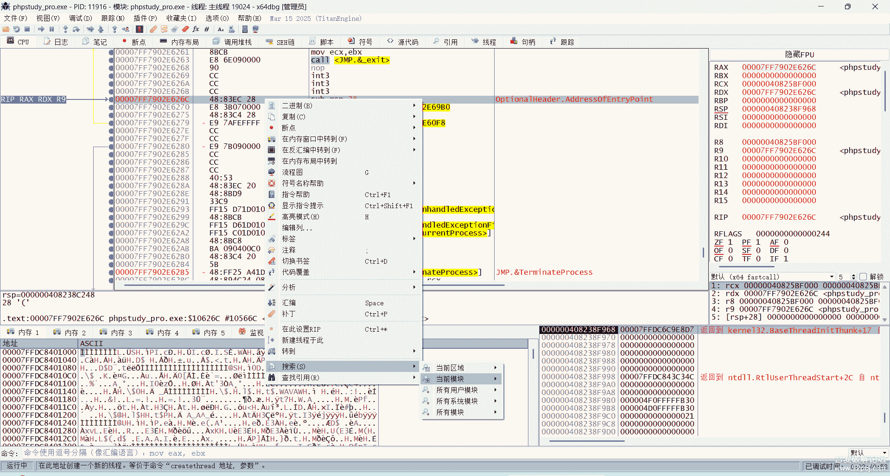
`image.png` (293.9 KB, 下载次数: 0)
[href="forum.php?mod=attachment&aid=Mjc4OTEyMnxmZTg5YmEyYnwxNzkzNTcwODE3fDE2ODA4NnwyMDQ1OTY1&nothumb=yes" target="_blank"](https://www.52pojie.cn/forum.php?mod=attachment&aid=Mjc4OTEyMnxmZTg5YmEyYnwxNzkzNTcwODE3fDE2ODA4NnwyMDQ1OTY1&nothumb=yes)
2025-7-15 22:49 上传

在当前模块搜索项中选择 字符串，这里截图没截上

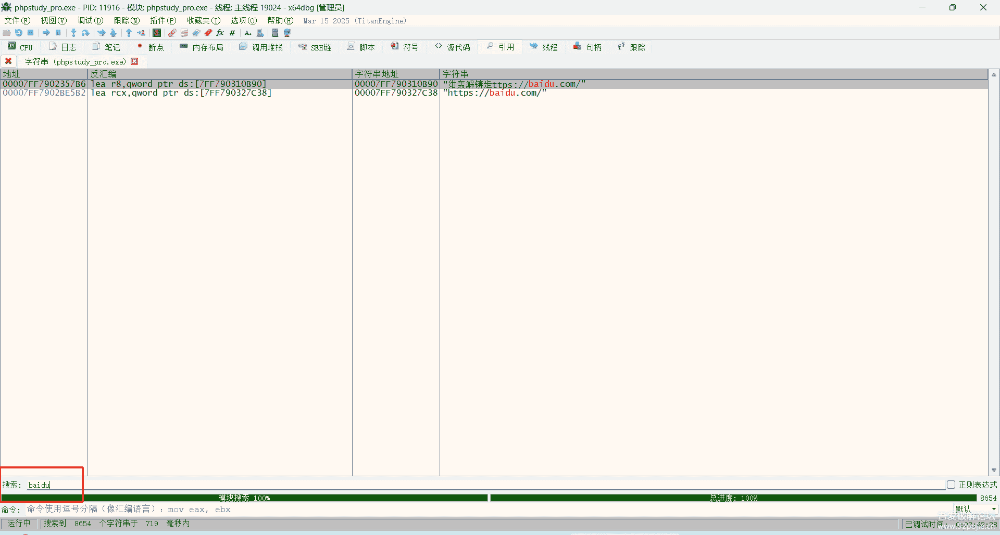
`image.png` (73.06 KB, 下载次数: 0)
[href="forum.php?mod=attachment&aid=Mjc4OTEyM3w5ZjczZDViNHwxNzkzNTcwODE3fDE2ODA4NnwyMDQ1OTY1&nothumb=yes" target="_blank"](https://www.52pojie.cn/forum.php?mod=attachment&aid=Mjc4OTEyM3w5ZjczZDViNHwxNzkzNTcwODE3fDE2ODA4NnwyMDQ1OTY1&nothumb=yes)
2025-7-15 22:51 上传

通过在此处搜索 `www` `https` `xp` 等字段可以查找到这两个地址处

由于已经修改过，所以我的这里是`baidu`..

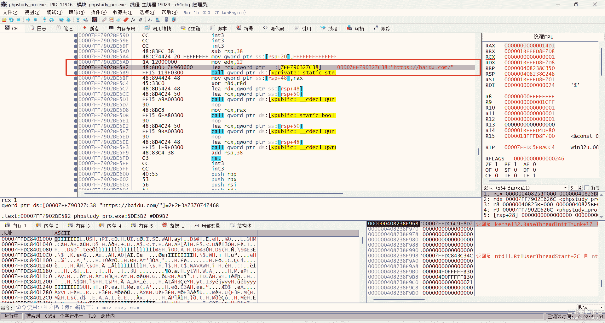
`image.png` (301.34 KB, 下载次数: 0)
[href="forum.php?mod=attachment&aid=Mjc4OTEyNHxiNzJlOThmNHwxNzkzNTcwODE3fDE2ODA4NnwyMDQ1OTY1&nothumb=yes" target="_blank"](https://www.52pojie.cn/forum.php?mod=attachment&aid=Mjc4OTEyNHxiNzJlOThmNHwxNzkzNTcwODE3fDE2ODA4NnwyMDQ1OTY1&nothumb=yes)
2025-7-15 22:52 上传

进入之后可以看到是这个，鼠标双击后面的地址，可以定位到目标地址

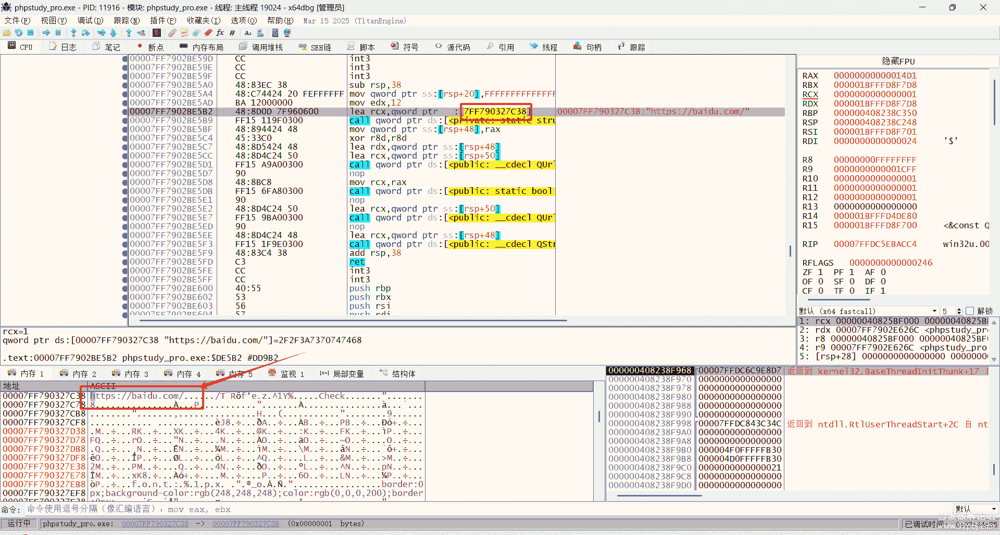
`image.png` (293.51 KB, 下载次数: 0)
[href="forum.php?mod=attachment&aid=Mjc4OTEyNXw0ZmZmMjhhOXwxNzkzNTcwODE3fDE2ODA4NnwyMDQ1OTY1&nothumb=yes" target="_blank"](https://www.52pojie.cn/forum.php?mod=attachment&aid=Mjc4OTEyNXw0ZmZmMjhhOXwxNzkzNTcwODE3fDE2ODA4NnwyMDQ1OTY1&nothumb=yes)
2025-7-15 22:53 上传

随后选中网址对其进行修改即可，尽量少动原本的东西，做到微调修改实现目标才好应该

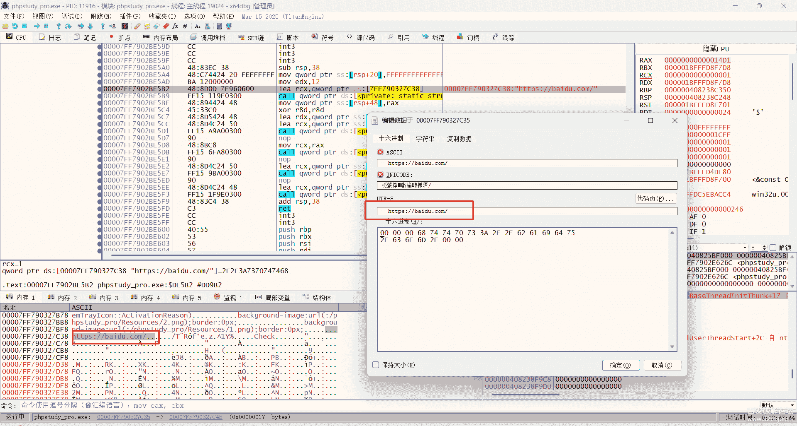
`image.png` (309.41 KB, 下载次数: 1)
[href="forum.php?mod=attachment&aid=Mjc4OTEyOHw3MjU0ZTFjNXwxNzkzNTcwODE3fDE2ODA4NnwyMDQ1OTY1&nothumb=yes" target="_blank"](https://www.52pojie.cn/forum.php?mod=attachment&aid=Mjc4OTEyOHw3MjU0ZTFjNXwxNzkzNTcwODE3fDE2ODA4NnwyMDQ1OTY1&nothumb=yes)
2025-7-15 22:57 上传

在修改完成后 `ctrl+p` 打补丁就可以了

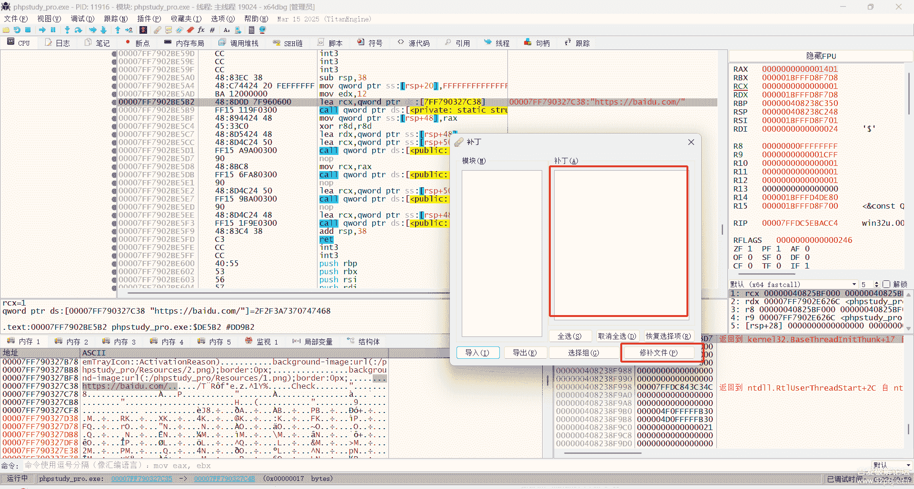
`image.png` (318.66 KB, 下载次数: 0)
[href="forum.php?mod=attachment&aid=Mjc4OTEyOXwxMDEzN2YxZHwxNzkzNTcwODE3fDE2ODA4NnwyMDQ1OTY1&nothumb=yes" target="_blank"](https://www.52pojie.cn/forum.php?mod=attachment&aid=Mjc4OTEyOXwxMDEzN2YxZHwxNzkzNTcwODE3fDE2ODA4NnwyMDQ1OTY1&nothumb=yes)
2025-7-15 22:59 上传

导出后还是为`phpstudy_pro.exe`，可以先将原来的修改名字或者将要保存到这个修改放到目录下，然后再修改原来的为其他名称，后续运行为这个，就可以了。

小白记录，有错误的地方或者更好的方法还请大佬们指导

