# [Web逆向] 关于图标点选验证码识别方案

- 原帖：`https://www.52pojie.cn/forum.php?mod=viewthread&tid=2046823`
- 抓取时间：2026-11-01T22:06:58

## 通用图标点选验证码识别方案

现在碰到图标点选验证码的方式，一般通过使用 `labelimg` 的方式进行打标，这种方式费时又费力。

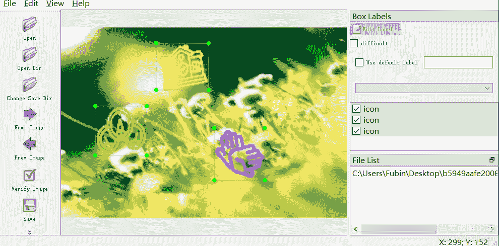

`labelImg` 打标

现在有一个比较通用的方式。首先获取验证码的图标种类，去重之后与自己的数据集整合。在这过程中可以直接记录位置与种类，并转成 `yolo` 的格式。这样可以直接通过 `yolo` 的方式直接训练，而且数据集的大小完全可以自己定义。

### 效果展示

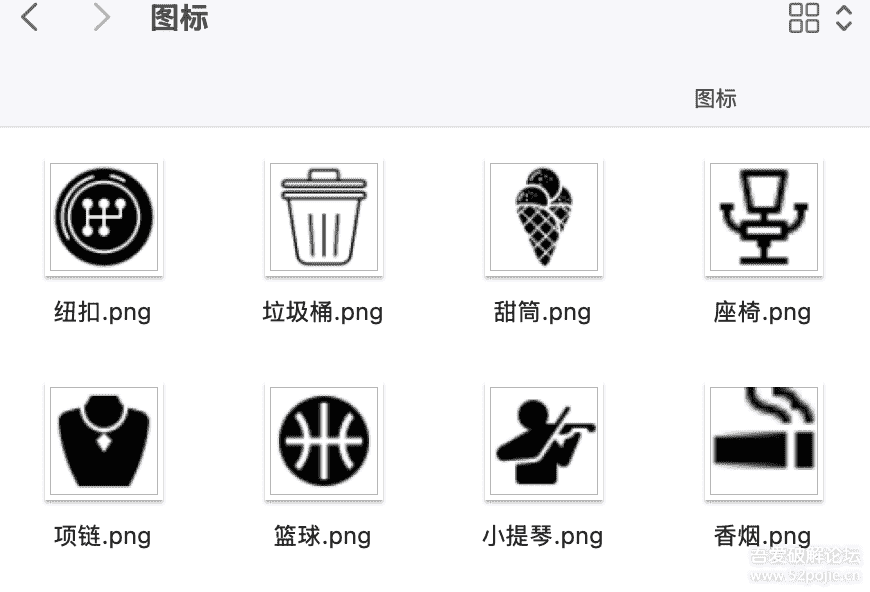

## 自定义数据集

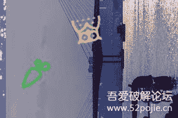

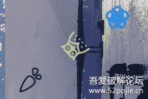

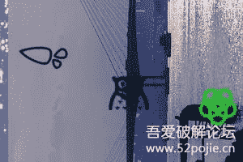

## 标签数据

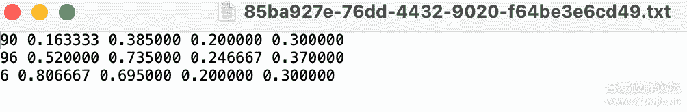

## `yolo`识别

数据集我使用了10000张左右训练。大概400个 `epoch`，`mPA50-95` 在94左右。使用的是 `YOLOv12`。

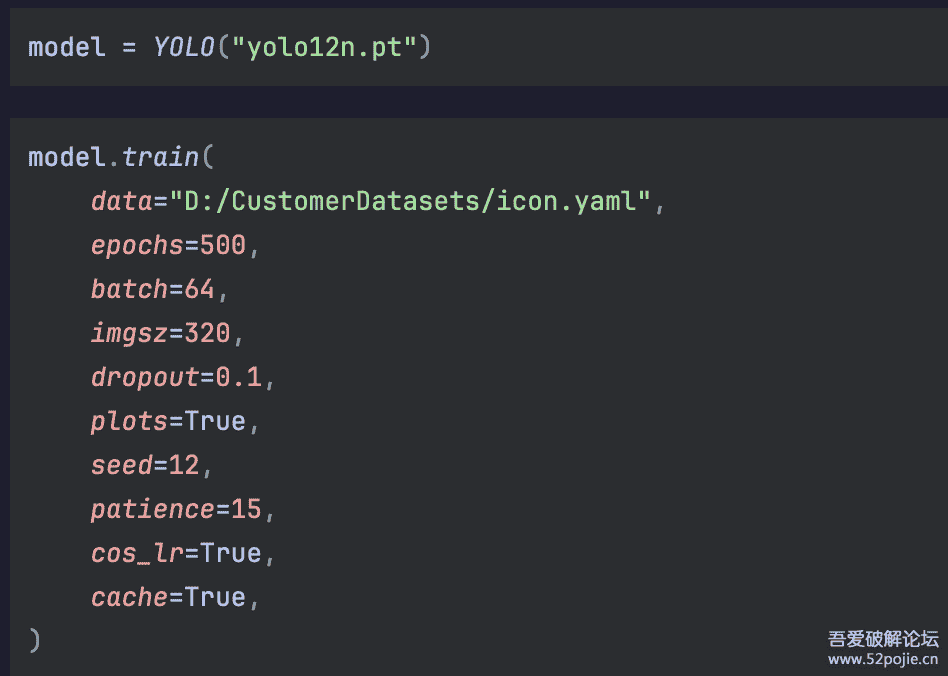

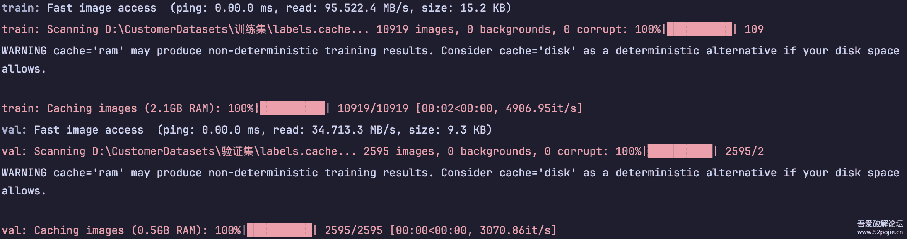

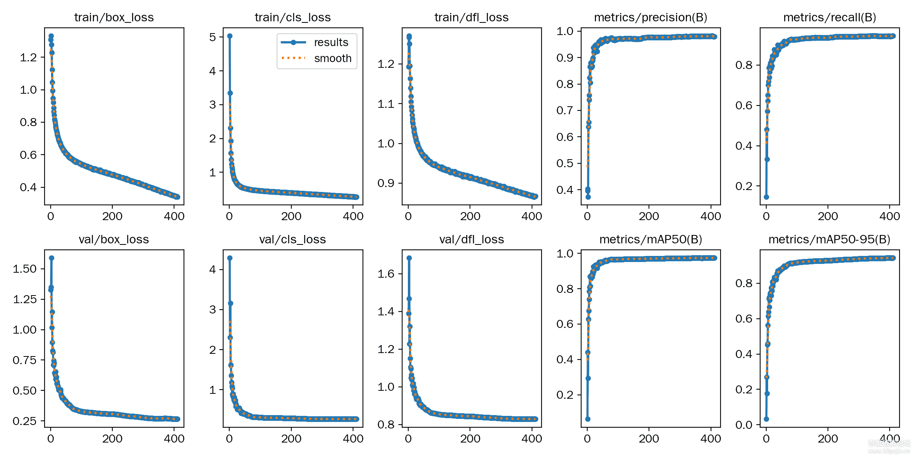

原图识别效果

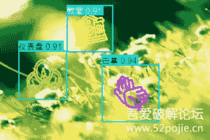

## 使用方式

参考 `main.py` 的使用方式。

最终数据集会保存在 `save_path` 里，已经分好 `images` 和 `labels`。训练集和测试集的话可以修改 `save_path`，分两次运行。这样最终效果可以直接在 `Yolo` 里训练。

## 结论

像类似下面这些验证码都可以使用以上方式进行，主要在于图标去重部分，图标解决了后续就简单了。

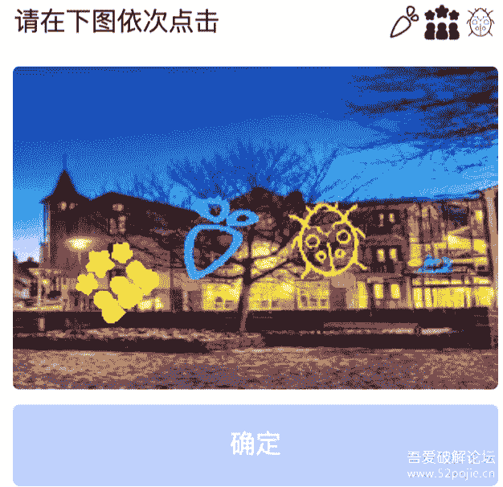

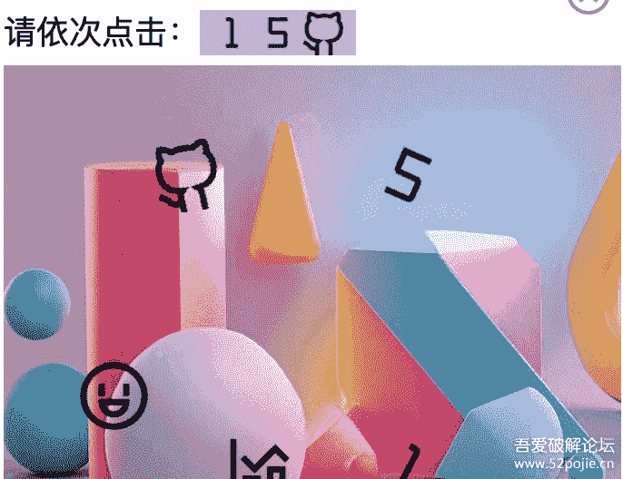

## 最后

代码已放在 github 上，仅供参考，其它类型也有其对应的方案：[universal_icon_click_captcha](https://github.com/lulufubin/universal_icon_click_captcha)。

仅提供思路，不提供任何解决办法。代码问题请自行参考修改。

如果对你有用的话，点个 star 支持一下。

如有侵权，请联系我～

转载请声明来源！！！
