# [CTF] 2025-6月Solar应急响应月赛WP！

- 原帖: https://www.52pojie.cn/forum.php?mod=viewthread&tid=2047518
- 抓取时间: 2026-11-01T22:06:50

## 6月月赛WP

### RSA_LOCK

题目文件结构：


`7.png` (1.37 KB, 下载次数: 1) [附件下载](https://www.52pojie.cn/forum.php?mod=attachment&aid=Mjc5MDM5NnxjYTY3Y2YxN3wxNzkzNTcwODA4fDE2ODA4NnwyMDQ3NTE4&nothumb=yes) 2025-7-22 11:09 上传

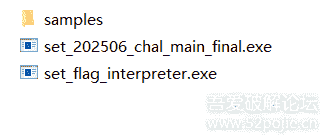
`8.png` (9.64 KB, 下载次数: 1) [附件下载](https://www.52pojie.cn/forum.php?mod=attachment&aid=Mjc5MDM5N3w2NmE2ZWUyNHwxNzkzNTcwODA4fDE2ODA4NnwyMDQ3NTE4&nothumb=yes) 2025-7-22 11:09 上传

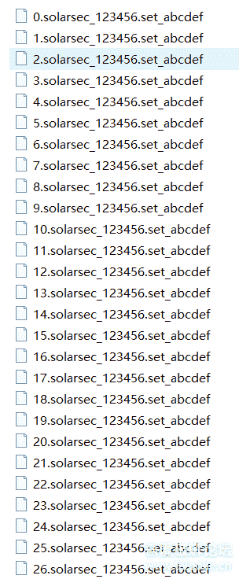
`9.png` (49.43 KB, 下载次数: 0) [附件下载](https://www.52pojie.cn/forum.php?mod=attachment&aid=Mjc5MDM5OHw2NDZmMTBlMHwxNzkzNTcwODA4fDE2ODA4NnwyMDQ3NTE4&nothumb=yes) 2025-7-22 11:09 上传

ida 打开 `set_202506_chal_main_final.exe`。

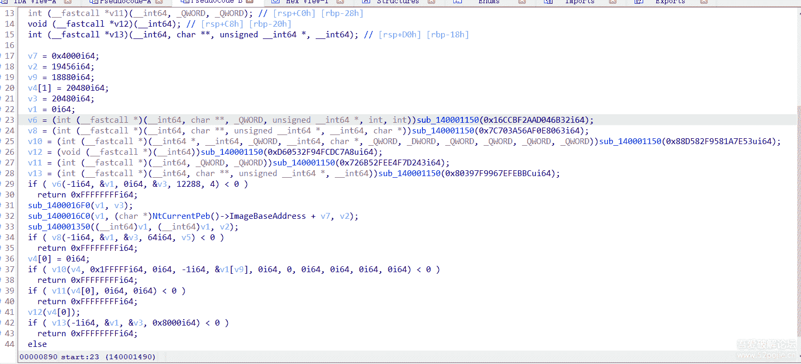
`10.png` (99.66 KB, 下载次数: 1) [附件下载](https://www.52pojie.cn/forum.php?mod=attachment&aid=Mjc5MDM5OXwxMGIyYWRlNXwxNzkzNTcwODA4fDE2ODA4NnwyMDQ3NTE4&nothumb=yes) 2025-7-22 11:09 上传

没有发现导入表，说明导入方式是动态获取地址。

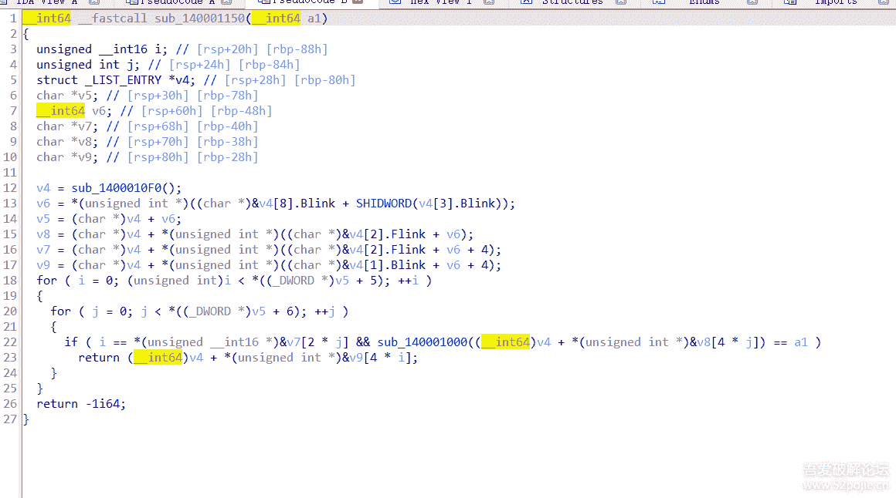
`11.png` (67.6 KB, 下载次数: 0) [附件下载](https://www.52pojie.cn/forum.php?mod=attachment&aid=Mjc5MDQwMHwxNGU1MzI3Y3wxNzkzNTcwODA4fDE2ODA4NnwyMDQ3NTE4&nothumb=yes) 2025-7-22 11:09 上传

跟进 `140001150` 函数。

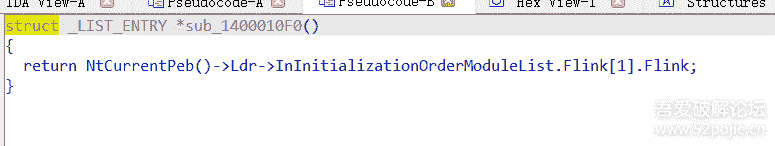
`12.png` (14.54 KB, 下载次数: 1) [附件下载](https://www.52pojie.cn/forum.php?mod=attachment&aid=Mjc5MDQwMXw0OWUzMDdjZnwxNzkzNTcwODA4fDE2ODA4NnwyMDQ3NTE4&nothumb=yes) 2025-7-22 11:09 上传

再跟进 `1400010f0` 函数，可以发现读取了 `peb` 中的 `ldr` 中的第一项。

由此可得，`140001150` 从 `ntdll.dll` 模块获取了一些东西。

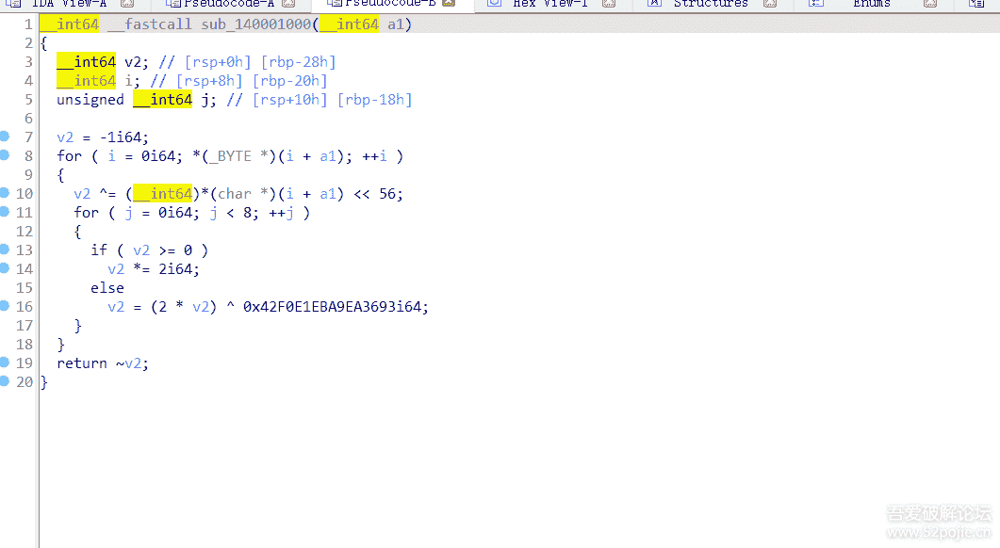
`13.png` (40.97 KB, 下载次数: 2) [附件下载](https://www.52pojie.cn/forum.php?mod=attachment&aid=Mjc5MDQwMnw0NjdhOTA5Y3wxNzkzNTcwODA4fDE2ODA4NnwyMDQ3NTE4&nothumb=yes) 2025-7-22 11:09 上传

根据魔术数字可得，`140001000` 为 `crc64`，输入字符串，返回一个 qword。

直接根据 pe 结构一个个去找程序获取的东西是很费时间的。所以开始动调，目标是判断 `140001150` 做了什么。


`14.png` (21.52 KB, 下载次数: 0) [附件下载](https://www.52pojie.cn/forum.php?mod=attachment&aid=Mjc5MDQwM3xiZmY4ZmMzYXwxNzkzNTcwODA4fDE2ODA4NnwyMDQ3NTE4&nothumb=yes) 2025-7-22 11:09 上传

可以看到该函数只有一个输入，为 qword。

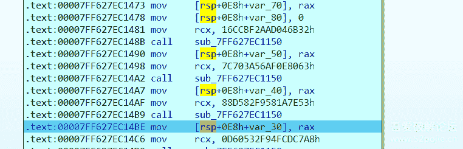
`15.png` (47.26 KB, 下载次数: 1) [附件下载](https://www.52pojie.cn/forum.php?mod=attachment&aid=Mjc5MDQwNHw0NTBlMjM3NHwxNzkzNTcwODA4fDE2ODA4NnwyMDQ3NTE4&nothumb=yes) 2025-7-22 11:09 上传


`16.png` (4.22 KB, 下载次数: 1) [附件下载](https://www.52pojie.cn/forum.php?mod=attachment&aid=Mjc5MDQwNXw5NGI3ZjkxY3wxNzkzNTcwODA4fDE2ODA4NnwyMDQ3NTE4&nothumb=yes) 2025-7-22 11:09 上传


`17.png` (3.93 KB, 下载次数: 1) [附件下载](https://www.52pojie.cn/forum.php?mod=attachment&aid=Mjc5MDQwNnwwNmYxZmNkOHwxNzkzNTcwODA4fDE2ODA4NnwyMDQ3NTE4&nothumb=yes) 2025-7-22 11:09 上传

随着输入的 qword 的变化，返回不同的值，都是函数的地址，都为 Nt 函数。结合前面对函数的操作是获取 `ntdll` 中的内容和字符串 `crc64`，可以合理地判断，输入的是 `crc64` 值，输出的是 `ntdll` 中对应函数名的函数地址。


`18.png` (50.52 KB, 下载次数: 1) [附件下载](https://www.52pojie.cn/forum.php?mod=attachment&aid=Mjc5MDQwN3w3YTBkMDFiMHwxNzkzNTcwODA4fDE2ODA4NnwyMDQ3NTE4&nothumb=yes) 2025-7-22 11:09 上传

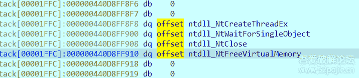
`19.png` (29.72 KB, 下载次数: 1) [附件下载](https://www.52pojie.cn/forum.php?mod=attachment&aid=Mjc5MDQwOHw0NDZjMTMxN3wxNzkzNTcwODA4fDE2ODA4NnwyMDQ3NTE4&nothumb=yes) 2025-7-22 11:09 上传

获取了一些 nt 函数。

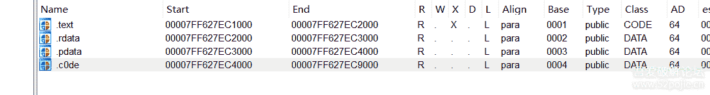
`20.png` (23.66 KB, 下载次数: 0) [附件下载](https://www.52pojie.cn/forum.php?mod=attachment&aid=Mjc5MDQwOXw3MzNhMGZhYXwxNzkzNTcwODA4fDE2ODA4NnwyMDQ3NTE4&nothumb=yes) 2025-7-22 11:09 上传

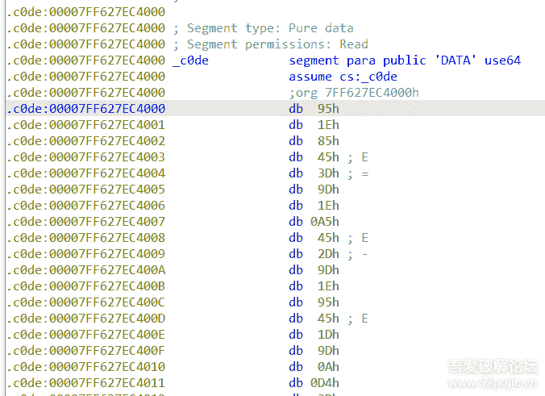
`21.png` (55.22 KB, 下载次数: 0) [附件下载](https://www.52pojie.cn/forum.php?mod=attachment&aid=Mjc5MDQxMHxhNzUzMzQyNHwxNzkzNTcwODA4fDE2ODA4NnwyMDQ3NTE4&nothumb=yes) 2025-7-22 11:09 上传

观察区段表，发现可疑区段，看到他的名字和数据分布，此时应该把这些函数的获取、这段数据和加载 shellcode 联系起来。

再次看向主函数，可以重命名一些函数。

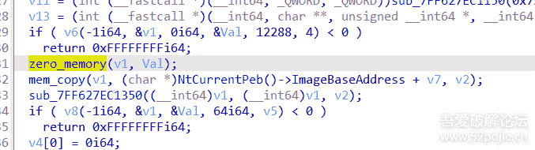
`22.png` (27.55 KB, 下载次数: 1) [附件下载](https://www.52pojie.cn/forum.php?mod=attachment&aid=Mjc5MDQxMXw0NGVkZmRiZnwxNzkzNTcwODA4fDE2ODA4NnwyMDQ3NTE4&nothumb=yes) 2025-7-22 11:09 上传

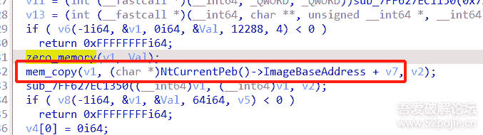
`23.png` (27.16 KB, 下载次数: 0) [附件下载](https://www.52pojie.cn/forum.php?mod=attachment&aid=Mjc5MDQxMnw2NDFjM2JiNXwxNzkzNTcwODA4fDE2ODA4NnwyMDQ3NTE4&nothumb=yes) 2025-7-22 11:09 上传

注意到 `memcpy()` 函数，发现疑似读取区段内容的代码。

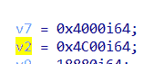
`24.png` (1.84 KB, 下载次数: 1) [附件下载](https://www.52pojie.cn/forum.php?mod=attachment&aid=Mjc5MDQxM3w0YjZmZmFkMXwxNzkzNTcwODA4fDE2ODA4NnwyMDQ3NTE4&nothumb=yes) 2025-7-22 11:09 上传

找到 `v7` 和 `v2` 的定义。

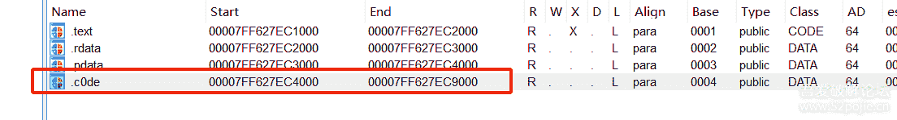
`25.png` (23.67 KB, 下载次数: 1) [附件下载](https://www.52pojie.cn/forum.php?mod=attachment&aid=Mjc5MDQxNHw4OWEyYzhjZHwxNzkzNTcwODA4fDE2ODA4NnwyMDQ3NTE4&nothumb=yes) 2025-7-22 11:09 上传

根据区段表，发现读取的为 `.c0de` 中的数据，拷贝了 0x4c00 字节。


`26.png` (3.3 KB, 下载次数: 1)


[href="forum.php?mod=attachment&aid=Mjc5MDQxNXw4YjgzMDIyNnwxNzkzNTcwODA4fDE2ODA4NnwyMDQ3NTE4&nothumb=yes" target="_blank"](https://www.52pojie.cn/forum.php?mod=attachment&aid=Mjc5MDQxNXw4YjgzMDIyNnwxNzkzNTcwODA4fDE2ODA4NnwyMDQ3NTE4&nothumb=yes)

2025-7-22 11:10 上传

将拷贝结果传入`1350`函数.

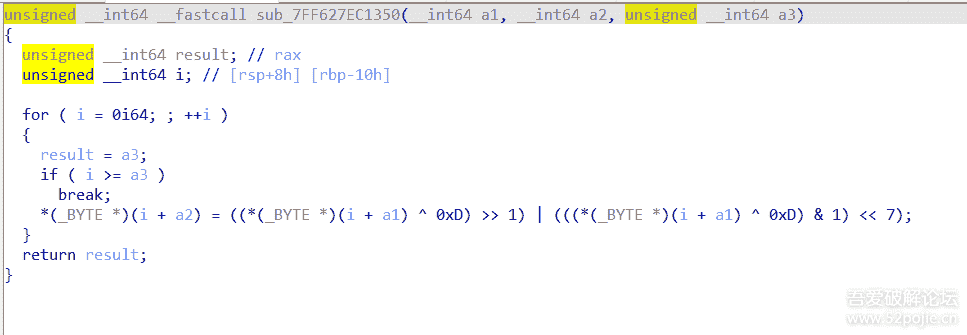

27.png (23.61 KB, 下载次数: 1)

[href="forum.php?mod=attachment&aid=Mjc5MDQxNnxkNDcyNjZhZHwxNzkzNTcwODA4fDE2ODA4NnwyMDQ3NTE4&nothumb=yes" target="_blank"](https://www.52pojie.cn/forum.php?mod=attachment&aid=Mjc5MDQxNnxkNDcyNjZhZHwxNzkzNTcwODA4fDE2ODA4NnwyMDQ3NTE4&nothumb=yes)

2025-7-22 11:10 上传

简单的单字节异或并循环右移解密.

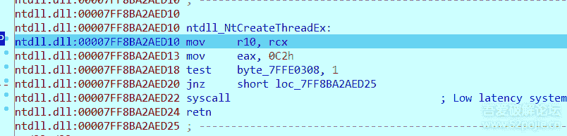

28.png (30.84 KB, 下载次数: 0)

[href="forum.php?mod=attachment&aid=Mjc5MDQxN3xmZWI4NmYwZXwxNzkzNTcwODA4fDE2ODA4NnwyMDQ3NTE4&nothumb=yes" target="_blank"](https://www.52pojie.cn/forum.php?mod=attachment&aid=Mjc5MDQxN3xmZWI4NmYwZXwxNzkzNTcwODA4fDE2ODA4NnwyMDQ3NTE4&nothumb=yes)

2025-7-22 11:10 上传

动调断在线程创建函数,得到解密后的`shellcode`及其入口点.


29.png (13.34 KB, 下载次数: 1)

[href="forum.php?mod=attachment&aid=Mjc5MDQxOHw0NGE2YzZiMXwxNzkzNTcwODA4fDE2ODA4NnwyMDQ3NTE4&nothumb=yes" target="_blank"](https://www.52pojie.cn/forum.php?mod=attachment&aid=Mjc5MDQxOHw0NGE2YzZiMXwxNzkzNTcwODA4fDE2ODA4NnwyMDQ3NTE4&nothumb=yes)

2025-7-22 11:10 上传

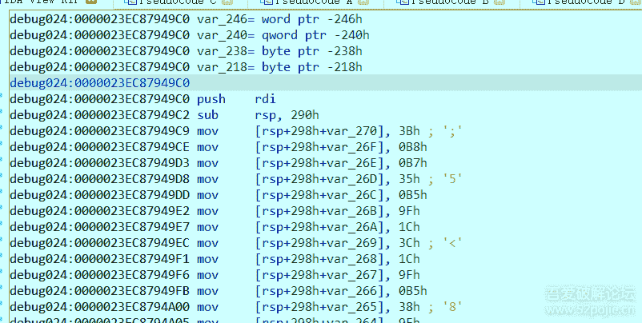

30.png (75.17 KB, 下载次数: 1)

[href="forum.php?mod=attachment&aid=Mjc5MDQxOXw4OWNmMTBiOHwxNzkzNTcwODA4fDE2ODA4NnwyMDQ3NTE4&nothumb=yes" target="_blank"](https://www.52pojie.cn/forum.php?mod=attachment&aid=Mjc5MDQxOXw4OWNmMTBiOHwxNzkzNTcwODA4fDE2ODA4NnwyMDQ3NTE4&nothumb=yes)

2025-7-22 11:10 上传

得到其入口函数,偏移值`0x49c0`(相对于`shellcode`头部).

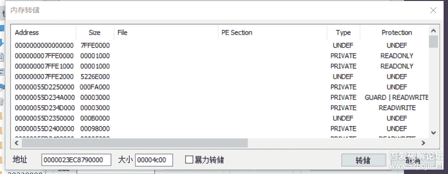

31.png (79.76 KB, 下载次数: 2)

[href="forum.php?mod=attachment&aid=Mjc5MDQyMHwxYmE4MWNmMXwxNzkzNTcwODA4fDE2ODA4NnwyMDQ3NTE4&nothumb=yes" target="_blank"](https://www.52pojie.cn/forum.php?mod=attachment&aid=Mjc5MDQyMHwxYmE4MWNmMXwxNzkzNTcwODA4fDE2ODA4NnwyMDQ3NTE4&nothumb=yes)

2025-7-22 11:10 上传

`dump`出来,大小为`0x4c00`(上文有说明).

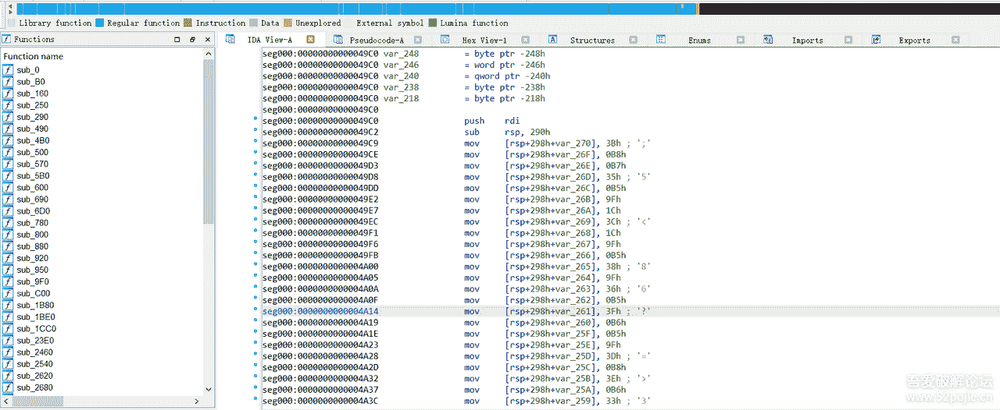

32.png (410.67 KB, 下载次数: 1)

[href="forum.php?mod=attachment&aid=Mjc5MDQyMXw5YjhkZDFmM3wxNzkzNTcwODA4fDE2ODA4NnwyMDQ3NTE4&nothumb=yes" target="_blank"](https://www.52pojie.cn/forum.php?mod=attachment&aid=Mjc5MDQyMXw5YjhkZDFmM3wxNzkzNTcwODA4fDE2ODA4NnwyMDQ3NTE4&nothumb=yes)

2025-7-22 11:10 上传

拖入`ida`,选择`x64`,建立好所有函数,找到入口点.

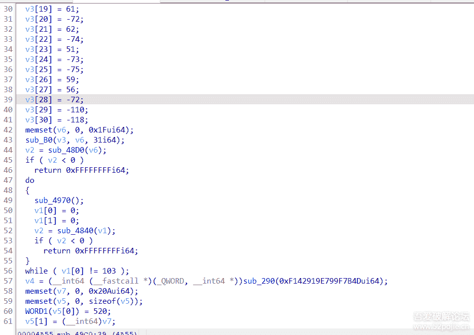

33.png (56.27 KB, 下载次数: 1)

[href="forum.php?mod=attachment&aid=Mjc5MDQyMnw1Y2EzOThjZnwxNzkzNTcwODA4fDE2ODA4NnwyMDQ3NTE4&nothumb=yes" target="_blank"](https://www.52pojie.cn/forum.php?mod=attachment&aid=Mjc5MDQyMnw1Y2EzOThjZnwxNzkzNTcwODA4fDE2ODA4NnwyMDQ3NTE4&nothumb=yes)

2025-7-22 11:10 上传

动调,解密了字符串.

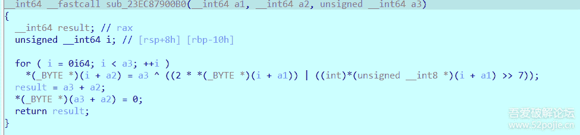

34.png (24.79 KB, 下载次数: 0)

[href="forum.php?mod=attachment&aid=Mjc5MDQyM3w0ZThlYjEwYXwxNzkzNTcwODA4fDE2ODA4NnwyMDQ3NTE4&nothumb=yes" target="_blank"](https://www.52pojie.cn/forum.php?mod=attachment&aid=Mjc5MDQyM3w0ZThlYjEwYXwxNzkzNTcwODA4fDE2ODA4NnwyMDQ3NTE4&nothumb=yes)

2025-7-22 11:10 上传

解密算法为循环左移`+`异或输入长度.

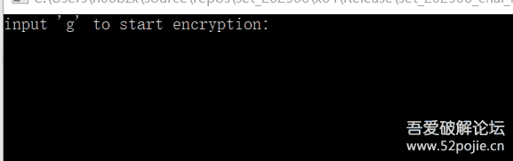

35.png (9.24 KB, 下载次数: 0)

[href="forum.php?mod=attachment&aid=Mjc5MDQyNHwwZTAzYTc5ZHwxNzkzNTcwODA4fDE2ODA4NnwyMDQ3NTE4&nothumb=yes" target="_blank"](https://www.52pojie.cn/forum.php?mod=attachment&aid=Mjc5MDQyNHwwZTAzYTc5ZHwxNzkzNTcwODA4fDE2ODA4NnwyMDQ3NTE4&nothumb=yes)

2025-7-22 11:10 上传

解密结果即为开始时输出的说明文字.


36.png (24.82 KB, 下载次数: 1)

[href="forum.php?mod=attachment&aid=Mjc5MDQyNXxhOWFhMWUwM3wxNzkzNTcwODA4fDE2ODA4NnwyMDQ3NTE4&nothumb=yes" target="_blank"](https://www.52pojie.cn/forum.php?mod=attachment&aid=Mjc5MDQyNXxhOWFhMWUwM3wxNzkzNTcwODA4fDE2ODA4NnwyMDQ3NTE4&nothumb=yes)

2025-7-22 11:10 上传

还可以发现和加载器一样的`api`获取方法,只是多项式常数有变化.

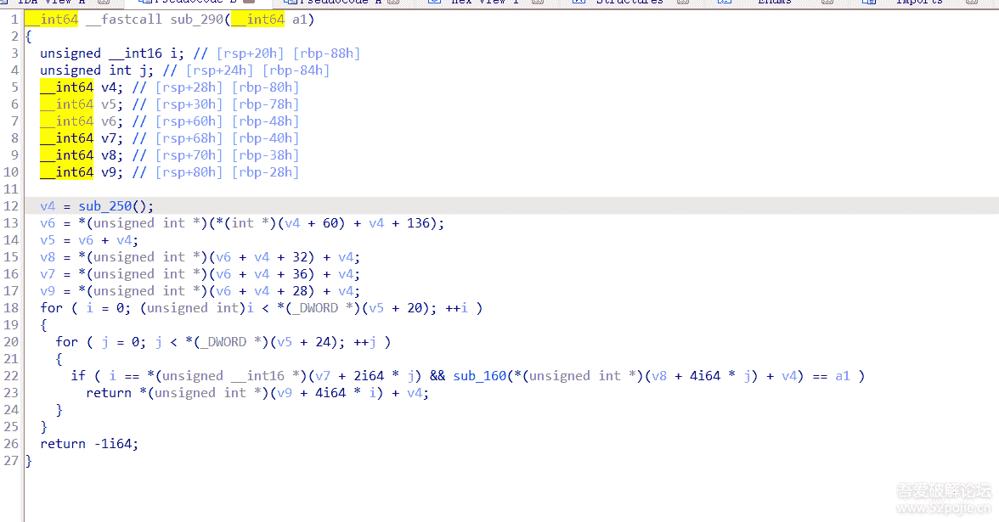

37.png (61.64 KB, 下载次数: 1)

[href="forum.php?mod=attachment&aid=Mjc5MDQyNnxjZjE1M2NlNHwxNzkzNTcwODA4fDE2ODA4NnwyMDQ3NTE4&nothumb=yes" target="_blank"](https://www.52pojie.cn/forum.php?mod=attachment&aid=Mjc5MDQyNnxjZjE1M2NlNHwxNzkzNTcwODA4fDE2ODA4NnwyMDQ3NTE4&nothumb=yes)

2025-7-22 11:10 上传

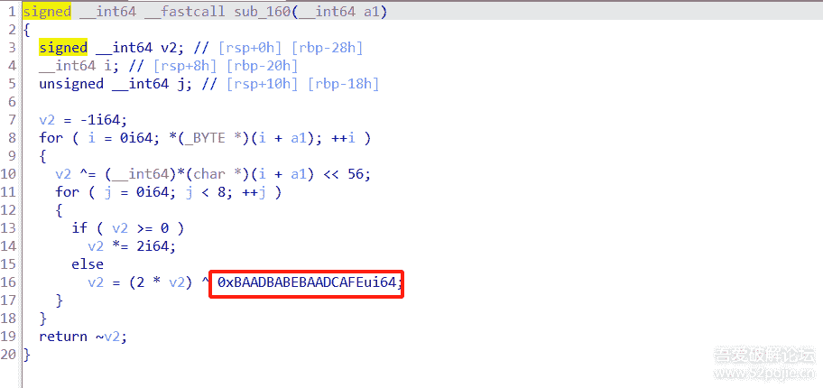

38.png (34.59 KB, 下载次数: 1)

[href="forum.php?mod=attachment&aid=Mjc5MDQyN3w2Y2FmYzAzOHwxNzkzNTcwODA4fDE2ODA4NnwyMDQ3NTE4&nothumb=yes" target="_blank"](https://www.52pojie.cn/forum.php?mod=attachment&aid=Mjc5MDQyN3w2Y2FmYzAzOHwxNzkzNTcwODA4fDE2ODA4NnwyMDQ3NTE4&nothumb=yes)

2025-7-22 11:10 上传

跟进下一个函数.

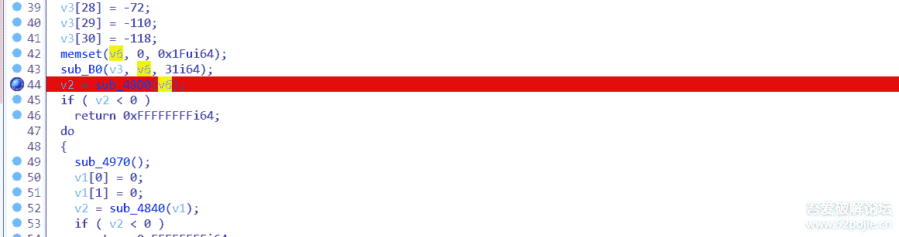

39.png (34.81 KB, 下载次数: 1)

[href="forum.php?mod=attachment&aid=Mjc5MDQyOHwxY2M0MGEyOHwxNzkzNTcwODA4fDE2ODA4NnwyMDQ3NTE4&nothumb=yes" target="_blank"](https://www.52pojie.cn/forum.php?mod=attachment&aid=Mjc5MDQyOHwxY2M0MGEyOHwxNzkzNTcwODA4fDE2ODA4NnwyMDQ3NTE4&nothumb=yes)

2025-7-22 11:10 上传

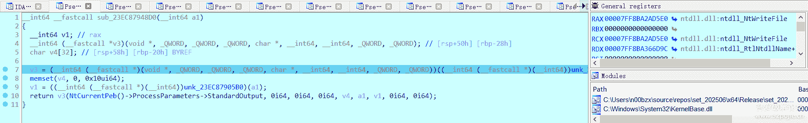

40.png (63.58 KB, 下载次数: 1)

[href="forum.php?mod=attachment&aid=Mjc5MDQyOXxlMmI4M2FhNnwxNzkzNTcwODA4fDE2ODA4NnwyMDQ3NTE4&nothumb=yes" target="_blank"](https://www.52pojie.cn/forum.php?mod=attachment&aid=Mjc5MDQyOXxlMmI4M2FhNnwxNzkzNTcwODA4fDE2ODA4NnwyMDQ3NTE4&nothumb=yes)

2025-7-22 11:10 上传

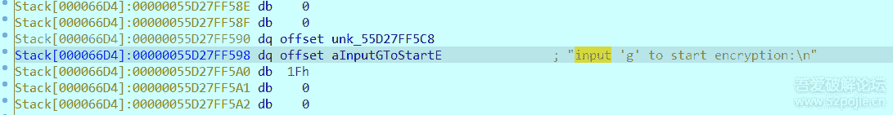

41.png (29.32 KB, 下载次数: 1)

[href="forum.php?mod=attachment&aid=Mjc5MDQzMHwzN2NiMjcwY3wxNzkzNTcwODA4fDE2ODA4NnwyMDQ3NTE4&nothumb=yes" target="_blank"](https://www.52pojie.cn/forum.php?mod=attachment&aid=Mjc5MDQzMHwzN2NiMjcwY3wxNzkzNTcwODA4fDE2ODA4NnwyMDQ3NTE4&nothumb=yes)

2025-7-22 11:10 上传

该函数获取`peb`中的标准输出句柄,传入`writefile`,输入参数为解密后的字符串和长度.

可以猜测该函数为使`NtWriteFile`写入标准输出,即为打印说明字符串.

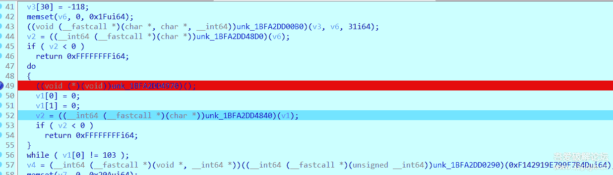

42.png (49.11 KB, 下载次数: 0)

[href="forum.php?mod=attachment&aid=Mjc5MDQzMXwxYWQ0MTAwZHwxNzkzNTcwODA4fDE2ODA4NnwyMDQ3NTE4&nothumb=yes" target="_blank"](https://www.52pojie.cn/forum.php?mod=attachment&aid=Mjc5MDQzMXwxYWQ0MTAwZHwxNzkzNTcwODA4fDE2ODA4NnwyMDQ3NTE4&nothumb=yes)

2025-7-22 11:10 上传

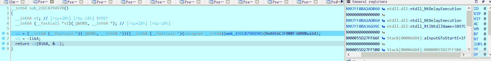

43.png (59.37 KB, 下载次数: 1)

[href="forum.php?mod=attachment&aid=Mjc5MDQzMnxkZDRjMGNjZXwxNzkzNTcwODA4fDE2ODA4NnwyMDQ3NTE4&nothumb=yes" target="_blank"](https://www.52pojie.cn/forum.php?mod=attachment&aid=Mjc5MDQzMnxkZDRjMGNjZXwxNzkzNTcwODA4fDE2ODA4NnwyMDQ3NTE4&nothumb=yes)

2025-7-22 11:10 上传

下一个函数在循环体内,调用了`NtDelayExecution`,并传入了-1.根据参数规则,可判断该函数为用`Nt`函数实现的`Sleep`.

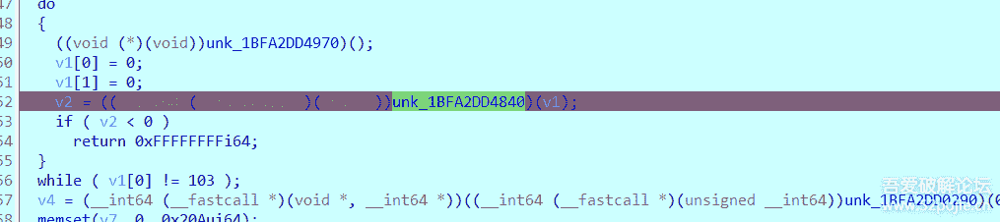

44.png (29.72 KB, 下载次数: 1)

[href="forum.php?mod=attachment&aid=Mjc5MDUyNXw1OTQxNjdiZHwxNzkzNTcwODA4fDE2ODA4NnwyMDQ3NTE4&nothumb=yes" target="_blank"](https://www.52pojie.cn/forum.php?mod=attachment&aid=Mjc5MDUyNXw1OTQxNjdiZHwxNzkzNTcwODA4fDE2ODA4NnwyMDQ3NTE4&nothumb=yes)

2025-7-22 11:21 上传

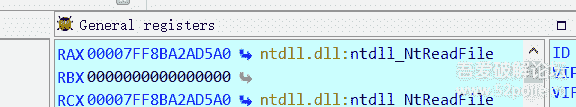

45.png (17.51 KB, 下载次数: 1)

[href="forum.php?mod=attachment&aid=Mjc5MDQzNHxlYmFhMmZjMXwxNzkzNTcwODA4fDE2ODA4NnwyMDQ3NTE4&nothumb=yes" target="_blank"](https://www.52pojie.cn/forum.php?mod=attachment&aid=Mjc5MDQzNHxlYmFhMmZjMXwxNzkzNTcwODA4fDE2ODA4NnwyMDQ3NTE4&nothumb=yes)

2025-7-22 11:10 上传

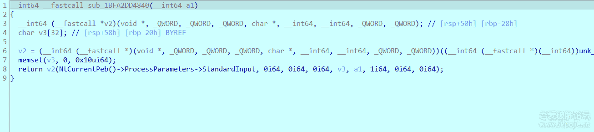

46.png (30.34 KB, 下载次数: 1)


[href="forum.php?mod=attachment&aid=Mjc5MDQzNXw0N2YwZjkwYXwxNzkzNTcwODA4fDE2ODA4NnwyMDQ3NTE4&nothumb=yes" target="_blank"](https://www.52pojie.cn/forum.php?mod=attachment&aid=Mjc5MDQzNXw0N2YwZjkwYXwxNzkzNTcwODA4fDE2ODA4NnwyMDQ3NTE4&nothumb=yes)

2025-7-22 11:10 上传

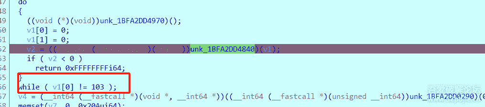

`47.png` (29.92 KB, 下载次数: 1)

[href="forum.php?mod=attachment&aid=Mjc5MDQzNnxkNjI4MWUxM3wxNzkzNTcwODA4fDE2ODA4NnwyMDQ3NTE4&nothumb=yes" target="_blank"](https://www.52pojie.cn/forum.php?mod=attachment&aid=Mjc5MDQzNnxkNjI4MWUxM3wxNzkzNTcwODA4fDE2ODA4NnwyMDQ3NTE4&nothumb=yes)

2025-7-22 11:10 上传

该函数读取了`stdin`句柄,再使用`ReadFile`函数读取该句柄内数据.可判断为`Nt`函数实现的`getchar`.获取字符`ascii`为103时结束循环.根据前面的输入`g`继续加密可以得出,这个循环等待输入字符`g`(`ascii==103`)之后继续执行.

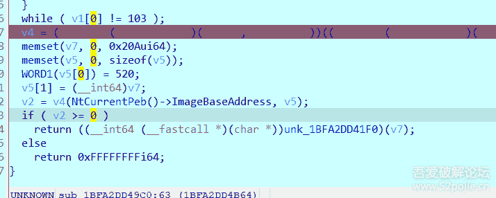

`48.png` (33.18 KB, 下载次数: 1)

[href="forum.php?mod=attachment&aid=Mjc5MDQzN3wyNDgyODUwMnwxNzkzNTcwODA4fDE2ODA4NnwyMDQ3NTE4&nothumb=yes" target="_blank"](https://www.52pojie.cn/forum.php?mod=attachment&aid=Mjc5MDQzN3wyNDgyODUwMnwxNzkzNTcwODA4fDE2ODA4NnwyMDQ3NTE4&nothumb=yes)

2025-7-22 11:10 上传

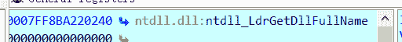

`49.png` (3.97 KB, 下载次数: 0)

[href="forum.php?mod=attachment&aid=Mjc5MDQzOHxiZGRjYzdjMnwxNzkzNTcwODA4fDE2ODA4NnwyMDQ3NTE4&nothumb=yes" target="_blank"](https://www.52pojie.cn/forum.php?mod=attachment&aid=Mjc5MDQzOHxiZGRjYzdjMnwxNzkzNTcwODA4fDE2ODA4NnwyMDQ3NTE4&nothumb=yes)

2025-7-22 11:10 上传

输入`g`之后,根据基址获取`dll`模块的绝对路径.

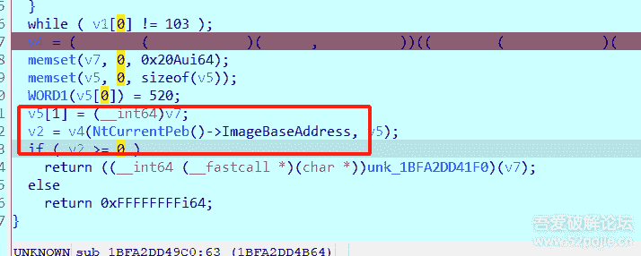

`50.png` (33.14 KB, 下载次数: 1)

[href="forum.php?mod=attachment&aid=Mjc5MDQzOXxlMjE0NDYzMnwxNzkzNTcwODA4fDE2ODA4NnwyMDQ3NTE4&nothumb=yes" target="_blank"](https://www.52pojie.cn/forum.php?mod=attachment&aid=Mjc5MDQzOXxlMjE0NDYzMnwxNzkzNTcwODA4fDE2ODA4NnwyMDQ3NTE4&nothumb=yes)

2025-7-22 11:10 上传


`51.png` (30.08 KB, 下载次数: 2)

[href="forum.php?mod=attachment&aid=Mjc5MDQ0MHwzZjgxOWU1ZHwxNzkzNTcwODA4fDE2ODA4NnwyMDQ3NTE4&nothumb=yes" target="_blank"](https://www.52pojie.cn/forum.php?mod=attachment&aid=Mjc5MDQ0MHwzZjgxOWU1ZHwxNzkzNTcwODA4fDE2ODA4NnwyMDQ3NTE4&nothumb=yes)

2025-7-22 11:10 上传


`52.png` (23.9 KB, 下载次数: 1)

[href="forum.php?mod=attachment&aid=Mjc5MDQ0MXw2MDEyYjcwMnwxNzkzNTcwODA4fDE2ODA4NnwyMDQ3NTE4&nothumb=yes" target="_blank"](https://www.52pojie.cn/forum.php?mod=attachment&aid=Mjc5MDQ0MXw2MDEyYjcwMnwxNzkzNTcwODA4fDE2ODA4NnwyMDQ3NTE4&nothumb=yes)

2025-7-22 11:11 上传

传入本程序基址,则获得的绝对路径为本程序的运行路径,传入`41f0`函数,跟进.

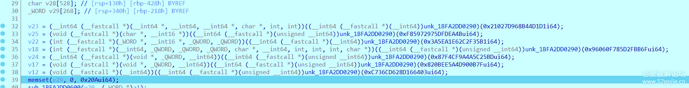

`53.png` (67.58 KB, 下载次数: 2)

[href="forum.php?mod=attachment&aid=Mjc5MDQ0Mnw2YzRiMTgyNnwxNzkzNTcwODA4fDE2ODA4NnwyMDQ3NTE4&nothumb=yes" target="_blank"](https://www.52pojie.cn/forum.php?mod=attachment&aid=Mjc5MDQ0Mnw2YzRiMTgyNnwxNzkzNTcwODA4fDE2ODA4NnwyMDQ3NTE4&nothumb=yes)

2025-7-22 11:11 上传


`54.png` (32.26 KB, 下载次数: 1)

[href="forum.php?mod=attachment&aid=Mjc5MDQ0M3xjNTcyMzZjMnwxNzkzNTcwODA4fDE2ODA4NnwyMDQ3NTE4&nothumb=yes" target="_blank"](https://www.52pojie.cn/forum.php?mod=attachment&aid=Mjc5MDQ0M3xjNTcyMzZjMnwxNzkzNTcwODA4fDE2ODA4NnwyMDQ3NTE4&nothumb=yes)

2025-7-22 11:11 上传


`55.png` (16.94 KB, 下载次数: 1)

[href="forum.php?mod=attachment&aid=Mjc5MDQ0NHw1YTNkNjdhNXwxNzkzNTcwODA4fDE2ODA4NnwyMDQ3NTE4&nothumb=yes" target="_blank"](https://www.52pojie.cn/forum.php?mod=attachment&aid=Mjc5MDQ0NHw1YTNkNjdhNXwxNzkzNTcwODA4fDE2ODA4NnwyMDQ3NTE4&nothumb=yes)

2025-7-22 11:11 上传


`56.png` (7.35 KB, 下载次数: 1)

[href="forum.php?mod=attachment&aid=Mjc5MDQ0NXw1NjAzNTVkNXwxNzkzNTcwODA4fDE2ODA4NnwyMDQ3NTE4&nothumb=yes" target="_blank"](https://www.52pojie.cn/forum.php?mod=attachment&aid=Mjc5MDQ0NXw1NjAzNTVkNXwxNzkzNTcwODA4fDE2ODA4NnwyMDQ3NTE4&nothumb=yes)

2025-7-22 11:11 上传

获取了几个`Nt`函数,使用前文(`shellcode`中的魔术数字)的方法.

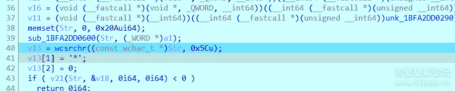

`57.png` (30.96 KB, 下载次数: 1)

[href="forum.php?mod=attachment&aid=Mjc5MDQ0NnxmMTc0YjVhYXwxNzkzNTcwODA4fDE2ODA4NnwyMDQ3NTE4&nothumb=yes" target="_blank"](https://www.52pojie.cn/forum.php?mod=attachment&aid=Mjc5MDQ0NnxmMTc0YjVhYXwxNzkzNTcwODA4fDE2ODA4NnwyMDQ3NTE4&nothumb=yes)

2025-7-22 11:11 上传

截掉路径中的文件名,用一个通配符'`*`'替换.以寻找同目录下的所有文件.


`58.png` (24.03 KB, 下载次数: 0)

[href="forum.php?mod=attachment&aid=Mjc5MDQ0N3w0YTZmMmE2ZHwxNzkzNTcwODA4fDE2ODA4NnwyMDQ3NTE4&nothumb=yes" target="_blank"](https://www.52pojie.cn/forum.php?mod=attachment&aid=Mjc5MDQ0N3w0YTZmMmE2ZHwxNzkzNTcwODA4fDE2ODA4NnwyMDQ3NTE4&nothumb=yes)

2025-7-22 11:11 上传

调用`Nt`函数将绝对路径转为`Nt`路径.

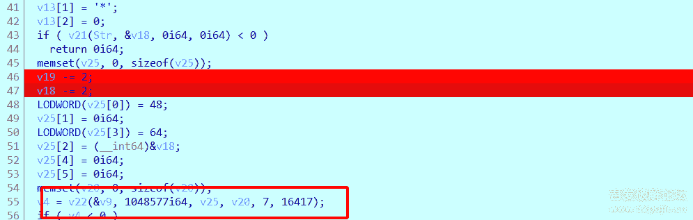

`59.png` (35.89 KB, 下载次数: 1)

[href="forum.php?mod=attachment&aid=Mjc5MDQ0OHw3NTkyODNiOXwxNzkzNTcwODA4fDE2ODA4NnwyMDQ3NTE4&nothumb=yes" target="_blank"](https://www.52pojie.cn/forum.php?mod=attachment&aid=Mjc5MDQ0OHw3NTkyODNiOXwxNzkzNTcwODA4fDE2ODA4NnwyMDQ3NTE4&nothumb=yes)

2025-7-22 11:11 上传

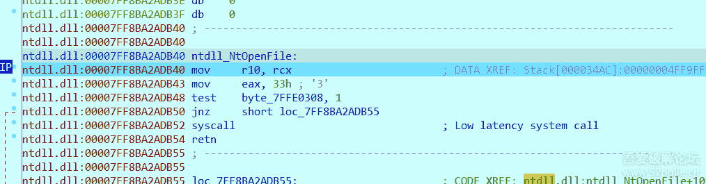

`60.png` (44.45 KB, 下载次数: 0)

[href="forum.php?mod=attachment&aid=Mjc5MDQ0OXw2NDhjZmI3ZHwxNzkzNTcwODA4fDE2ODA4NnwyMDQ3NTE4&nothumb=yes" target="_blank"](https://www.52pojie.cn/forum.php?mod=attachment&aid=Mjc5MDQ0OXw2NDhjZmI3ZHwxNzkzNTcwODA4fDE2ODA4NnwyMDQ3NTE4&nothumb=yes)

2025-7-22 11:11 上传

红框调用为打开路径对象.打开路径对象之前需要将字符串末尾的通配符截去,但是后面还有使用这个通配符,所以只在`unicode_string`对象中的长度字段上截断.


`61.png` (25.47 KB, 下载次数: 1)

[href="forum.php?mod=attachment&aid=Mjc5MDQ1MHw2NGNmNjFkN3wxNzkzNTcwODA4fDE2ODA4NnwyMDQ3NTE4&nothumb=yes" target="_blank"](https://www.52pojie.cn/forum.php?mod=attachment&aid=Mjc5MDQ1MHw2NGNmNjFkN3wxNzkzNTcwODA4fDE2ODA4NnwyMDQ3NTE4&nothumb=yes)

2025-7-22 11:11 上传

获取程序堆地址,分配`0x10000`字节并清零,用于储存`NtQueryDirectoryFileEx`函数返回的路径信息.

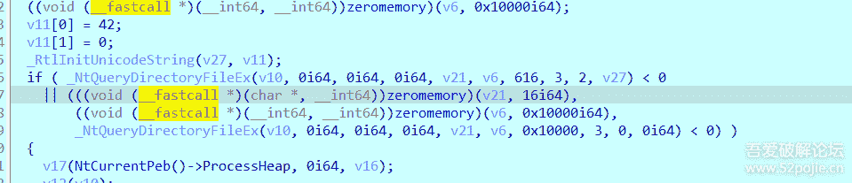

`62.png` (35.25 KB, 下载次数: 0)

[href="forum.php?mod=attachment&aid=Mjc5MDQ1MXwyYWNiMWY1ZHwxNzkzNTcwODA4fDE2ODA4NnwyMDQ3NTE4&nothumb=yes" target="_blank"](https://www.52pojie.cn/forum.php?mod=attachment&aid=Mjc5MDQ1MXwyYWNiMWY1ZHwxNzkzNTcwODA4fDE2ODA4NnwyMDQ3NTE4&nothumb=yes)

2025-7-22 11:11 上传

调用两次`NtQueryDirectoryFileEx`.第一次调用`NtQueryDirectoryFileEx`,传入通配符'`*`',相当于`FindFirstFile`.其实就是获取所有文件信息.第二次调用检查是否还有未被遍历过的文件需要遍历获取信息,如果有且第一次的缓冲区大小足够容纳这些信息,就可以开始遍历读取第一次调用时获得的信息,获取目录下所有的文件名,相当于`FindNextFile`.

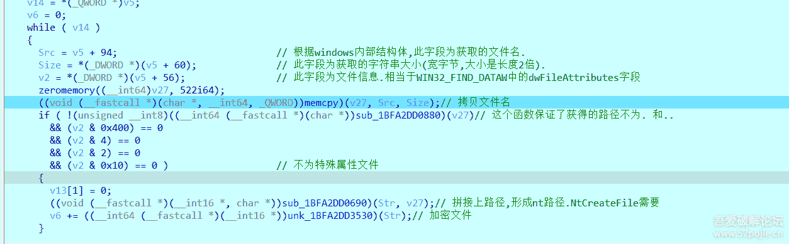

`63.png` (55.73 KB, 下载次数: 0)

[href="forum.php?mod=attachment&aid=Mjc5MDQ1MnwyMzQ1YTJkY3wxNzkzNTcwODA4fDE2ODA4NnwyMDQ3NTE4&nothumb=yes" target="_blank"](https://www.52pojie.cn/forum.php?mod=attachment&aid=Mjc5MDQ1MnwyMzQ1YTJkY3wxNzkzNTcwODA4fDE2ODA4NnwyMDQ3NTE4&nothumb=yes)

2025-7-22 11:11 上传

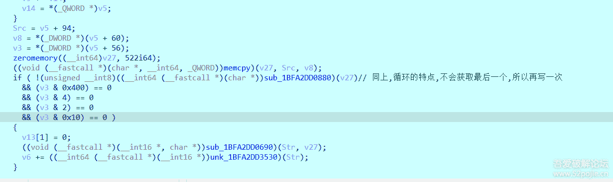

`64.png` (43.39 KB, 下载次数: 1)

[href="forum.php?mod=attachment&aid=Mjc5MDQ1M3wwODk2YjFkM3wxNzkzNTcwODA4fDE2ODA4NnwyMDQ3NTE4&nothumb=yes" target="_blank"](https://www.52pojie.cn/forum.php?mod=attachment&aid=Mjc5MDQ1M3wwODk2YjFkM3wxNzkzNTcwODA4fDE2ODA4NnwyMDQ3NTE4&nothumb=yes)

2025-7-22 11:11 上传

根据信息结构体读取对应信息,判断文件是否有隐藏只读等特殊属性,然后进入函数`3530`加密文件.

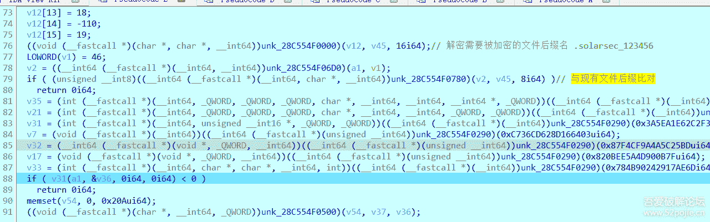

`65.png` (83.19 KB, 下载次数: 1)

[href="forum.php?mod=attachment&aid=Mjc5MDQ1NHw0MTJjYzRmMnwxNzkzNTcwODA4fDE2ODA4NnwyMDQ3NTE4&nothumb=yes" target="_blank"](https://www.52pojie.cn/forum.php?mod=attachment&aid=Mjc5MDQ1NHw0MTJjYzRmMnwxNzkzNTcwODA4fDE2ODA4NnwyMDQ3NTE4&nothumb=yes)

2025-7-22 11:11 上传

解密需要被加密的文件后缀名,与输入文件的后缀比对.


## 文件加密流程分析

  
`66.png`（25.18 KB，下载次数：1）  
[href="forum.php?mod=attachment&aid=Mjc5MDQ1NXxiOTI0NDAwN3wxNzkzNTcwODA4fDE2ODA4NnwyMDQ3NTE4&nothumb=yes" target="_blank"](https://www.52pojie.cn/forum.php?mod=attachment&aid=Mjc5MDQ1NXxiOTI0NDAwN3wxNzkzNTcwODA4fDE2ODA4NnwyMDQ3NTE4&nothumb=yes)  
2025-7-22 11:11 上传

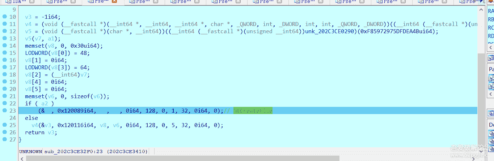  
`67.png`（66.46 KB，下载次数：1）  
[href="forum.php?mod=attachment&aid=Mjc5MDQ1Nnw5OGM1ZDM0ZHwxNzkzNTcwODA4fDE2ODA4NnwyMDQ3NTE4&nothumb=yes" target="_blank"](https://www.52pojie.cn/forum.php?mod=attachment&aid=Mjc5MDQ1Nnw5OGM1ZDM0ZHwxNzkzNTcwODA4fDE2ODA4NnwyMDQ3NTE4&nothumb=yes)  
2025-7-22 11:11 上传

  
`68.png`（22.51 KB，下载次数：0）  
[href="forum.php?mod=attachment&aid=Mjc5MDQ1N3w3MGU0MDU5OHwxNzkzNTcwODA4fDE2ODA4NnwyMDQ3NTE4&nothumb=yes" target="_blank"](https://www.52pojie.cn/forum.php?mod=attachment&aid=Mjc5MDQ1N3w3MGU0MDU5OHwxNzkzNTcwODA4fDE2ODA4NnwyMDQ3NTE4&nothumb=yes)  
2025-7-22 11:11 上传

跟进`32f0`，获取了`NtCreateFile`函数并调用。根据参数可得，第二个参数输入`1`为以读取模式打开文件对象，输入`0`为写入模式。

此处以读取模式打开。

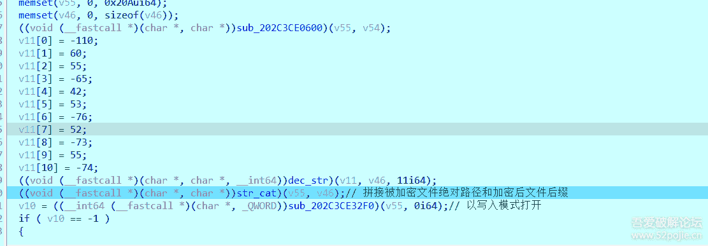  
`69.png`（41.91 KB，下载次数：1）  
[href="forum.php?mod=attachment&aid=Mjc5MDQ1OHwwOTYyMjEzYnwxNzkzNTcwODA4fDE2ODA4NnwyMDQ3NTE4&nothumb=yes" target="_blank"](https://www.52pojie.cn/forum.php?mod=attachment&aid=Mjc5MDQ1OHwwOTYyMjEzYnwxNzkzNTcwODA4fDE2ODA4NnwyMDQ3NTE4&nothumb=yes)  
2025-7-22 11:11 上传

写入模式打开加密后文件路径。

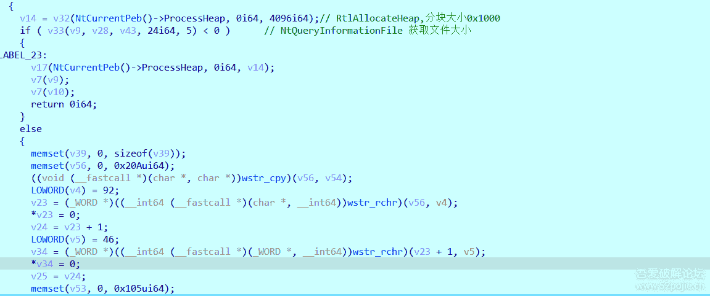  
`70.png`（50.14 KB，下载次数：2）  
[href="forum.php?mod=attachment&aid=Mjc5MDQ2NHw0OTA5N2IzM3wxNzkzNTcwODA4fDE2ODA4NnwyMDQ3NTE4&nothumb=yes" target="_blank"](https://www.52pojie.cn/forum.php?mod=attachment&aid=Mjc5MDQ2NHw0OTA5N2IzM3wxNzkzNTcwODA4fDE2ODA4NnwyMDQ3NTE4&nothumb=yes)  
2025-7-22 11:11 上传

  
`71.png`（1.59 KB，下载次数：1）  
[href="forum.php?mod=attachment&aid=Mjc5MDUzM3xmNjYyMzhkYnwxNzkzNTcwODA4fDE2ODA4NnwyMDQ3NTE4&nothumb=yes" target="_blank"](https://www.52pojie.cn/forum.php?mod=attachment&aid=Mjc5MDUzM3xmNjYyMzhkYnwxNzkzNTcwODA4fDE2ODA4NnwyMDQ3NTE4&nothumb=yes)  
2025-7-22 11:53 上传

  
`98.png`（36.09 KB，下载次数：2）  
[href="forum.php?mod=attachment&aid=Mjc5MDQ3OHxjNDkxNTY2OXwxNzkzNTcwODA4fDE2ODA4NnwyMDQ3NTE4&nothumb=yes" target="_blank"](https://www.52pojie.cn/forum.php?mod=attachment&aid=Mjc5MDQ3OHxjNDkxNTY2OXwxNzkzNTcwODA4fDE2ODA4NnwyMDQ3NTE4&nothumb=yes)  
2025-7-22 11:12 上传

分配加密临时内存，截取获得文件名（去掉后缀）。

  
`73.png`（5.78 KB，下载次数：1）  
[href="forum.php?mod=attachment&aid=Mjc5MDQ2N3xiNzYzMDVhNHwxNzkzNTcwODA4fDE2ODA4NnwyMDQ3NTE4&nothumb=yes" target="_blank"](https://www.52pojie.cn/forum.php?mod=attachment&aid=Mjc5MDQ2N3xiNzYzMDVhNHwxNzkzNTcwODA4fDE2ODA4NnwyMDQ3NTE4&nothumb=yes)  
2025-7-22 11:11 上传

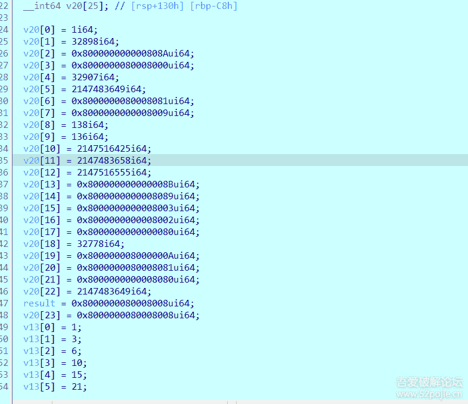  
`74.png`（63.15 KB，下载次数：1）  
[href="forum.php?mod=attachment&aid=Mjc5MDQ2OHxlZTRmNTJiM3wxNzkzNTcwODA4fDE2ODA4NnwyMDQ3NTE4&nothumb=yes" target="_blank"](https://www.52pojie.cn/forum.php?mod=attachment&aid=Mjc5MDQ2OHxlZTRmNTJiM3wxNzkzNTcwODA4fDE2ODA4NnwyMDQ3NTE4&nothumb=yes)  
2025-7-22 11:12 上传

  
`75.png`（129.61 KB，下载次数：0）  
[href="forum.php?mod=attachment&aid=Mjc5MDQ1OXw1YzU3YzEyOHwxNzkzNTcwODA4fDE2ODA4NnwyMDQ3NTE4&nothumb=yes" target="_blank"](https://www.52pojie.cn/forum.php?mod=attachment&aid=Mjc5MDQ1OXw1YzU3YzEyOHwxNzkzNTcwODA4fDE2ODA4NnwyMDQ3NTE4&nothumb=yes)  
2025-7-22 11:11 上传

将前文获得的文件名进行`sha3` hash。从`1cc0`函数中的常量特征能够发现该算法。

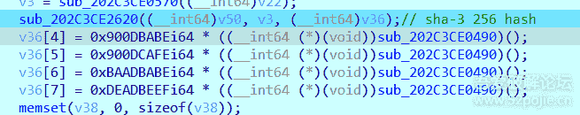  
`76.png`（33.06 KB，下载次数：1）  
[href="forum.php?mod=attachment&aid=Mjc5MDQ2MHwyNGUzZmQ3NXwxNzkzNTcwODA4fDE2ODA4NnwyMDQ3NTE4&nothumb=yes" target="_blank"](https://www.52pojie.cn/forum.php?mod=attachment&aid=Mjc5MDQ2MHwyNGUzZmQ3NXwxNzkzNTcwODA4fDE2ODA4NnwyMDQ3NTE4&nothumb=yes)  
2025-7-22 11:11 上传

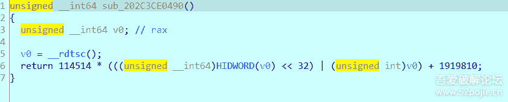  
`77.png`（20.14 KB，下载次数：1）  
[href="forum.php?mod=attachment&aid=Mjc5MDQ2MXw1MjI0OWUxMnwxNzkzNTcwODA4fDE2ODA4NnwyMDQ3NTE4&nothumb=yes" target="_blank"](https://www.52pojie.cn/forum.php?mod=attachment&aid=Mjc5MDQ2MXw1MjI0OWUxMnwxNzkzNTcwODA4fDE2ODA4NnwyMDQ3NTE4&nothumb=yes)  
2025-7-22 11:11 上传

跟进`0490`，发现该函数是生成随机数的函数。生成四个随机数，分别与四个不同的`magic number`相乘，结果存入数组偏移`32`的位置。可以发现，该数组为前面计算的文件名 hash，此次随机数和前面的 hash 结果一共 64 字节。

  
`78.png`（18.79 KB，下载次数：1）  
[href="forum.php?mod=attachment&aid=Mjc5MDQ2Mnw2MzlmZDRlNnwxNzkzNTcwODA4fDE2ODA4NnwyMDQ3NTE4&nothumb=yes" target="_blank"](https://www.52pojie.cn/forum.php?mod=attachment&aid=Mjc5MDQ2Mnw2MzlmZDRlNnwxNzkzNTcwODA4fDE2ODA4NnwyMDQ3NTE4&nothumb=yes)  
2025-7-22 11:11 上传

再以同样的方法生成两个随机数，乘以对应`magic number`。大小 12 字节。

  
`79.png`（3.29 KB，下载次数：1）  
[href="forum.php?mod=attachment&aid=Mjc5MDQ2M3xkY2RiNjhhMXwxNzkzNTcwODA4fDE2ODA4NnwyMDQ3NTE4&nothumb=yes" target="_blank"](https://www.52pojie.cn/forum.php?mod=attachment&aid=Mjc5MDQ2M3xkY2RiNjhhMXwxNzkzNTcwODA4fDE2ODA4NnwyMDQ3NTE4&nothumb=yes)  
2025-7-22 11:11 上传

再次调用`sha3`，计算前文 64 字节数据的 hash。

  
`80.png`（19.6 KB，下载次数：1）  
[href="forum.php?mod=attachment&aid=Mjc5MDQ2NXxlM2U3MDA2N3wxNzkzNTcwODA4fDE2ODA4NnwyMDQ3NTE4&nothumb=yes" target="_blank"](https://www.52pojie.cn/forum.php?mod=attachment&aid=Mjc5MDQ2NXxlM2U3MDA2N3wxNzkzNTcwODA4fDE2ODA4NnwyMDQ3NTE4&nothumb=yes)  
2025-7-22 11:11 上传

将此次 hash 的结果和前面生成的 12 字节随机数放在一起，形成 44 字节数据。

  
`81.png`（37.69 KB，下载次数：2）  
[href="forum.php?mod=attachment&aid=Mjc5MDUzNXwyMmU2ZDhjMnwxNzkzNTcwODA4fDE2ODA4NnwyMDQ3NTE4&nothumb=yes" target="_blank"](https://www.52pojie.cn/forum.php?mod=attachment&aid=Mjc5MDUzNXwyMmU2ZDhjMnwxNzkzNTcwODA4fDE2ODA4NnwyMDQ3NTE4&nothumb=yes)  
2025-7-22 11:55 上传

  
`82.png`（35.6 KB，下载次数：1）  
[href="forum.php?mod=attachment&aid=Mjc5MDUzNnxlNWQwY2ZmMnwxNzkzNTcwODA4fDE2ODA4NnwyMDQ3NTE4&nothumb=yes" target="_blank"](https://www.52pojie.cn/forum.php?mod=attachment&aid=Mjc5MDUzNnxlNWQwY2ZmMnwxNzkzNTcwODA4fDE2ODA4NnwyMDQ3NTE4&nothumb=yes)  
2025-7-22 11:55 上传

将 32 字节 hash 最终结果和 12 字节随机数分开传入函数`1b80`。

  
`83.png`（26.63 KB，下载次数：1）  
[href="forum.php?mod=attachment&aid=Mjc5MDQ2OXxlNGVkYzNmY3wxNzkzNTcwODA4fDE2ODA4NnwyMDQ3NTE4&nothumb=yes" target="_blank"](https://www.52pojie.cn/forum.php?mod=attachment&aid=Mjc5MDQ2OXxlNGVkYzNmY3wxNzkzNTcwODA4fDE2ODA4NnwyMDQ3NTE4&nothumb=yes)  
2025-7-22 11:12 上传

  
`84.png`（59.25 KB，下载次数：0）  
[href="forum.php?mod=attachment&aid=Mjc5MDU0MXw5NmI1ZWIyZXwxNzkzNTcwODA4fDE2ODA4NnwyMDQ3NTE4&nothumb=yes" target="_blank"](https://www.52pojie.cn/forum.php?mod=attachment&aid=Mjc5MDU0MXw5NmI1ZWIyZXwxNzkzNTcwODA4fDE2ODA4NnwyMDQ3NTE4&nothumb=yes)  
2025-7-22 11:56 上传

跟进`1b80`，进而跟进`09f0`。发现`chacha20/salsa20`的常量字符串。猜测使用了这两种算法的其中之一。可以得知，12 字节数据为`nonce`，32 字节数据为`key`，`counter`初始值为`1`。

  
`85.png`（64.44 KB，下载次数：1）  
[href="forum.php?mod=attachment&aid=Mjc5MDU0M3wwZjdiOGIwZXwxNzkzNTcwODA4fDE2ODA4NnwyMDQ3NTE4&nothumb=yes" target="_blank"](https://www.52pojie.cn/forum.php?mod=attachment&aid=Mjc5MDU0M3wwZjdiOGIwZXwxNzkzNTcwODA4fDE2ODA4NnwyMDQ3NTE4&nothumb=yes)  
2025-7-22 11:57 上传

返回加密单个文件主函数，发现一个 64 字节常量字符串，而且有函数传入了之前的 44 字节数据，即为`key`和`nonce`。


发现常量`0x10001`，结合题目名猜想可能与 RSA 有关。


跟进`2680`、`26c0`、`27b0`，容易发现三个函数分别是初始化缓冲区、拷贝字节数据到缓冲区、拷贝常量。


发现有一个大函数，传入了拷贝到缓冲区的常量数据（`v44`）。


随意跟进，发现有大数加法、乘法等运算。根据题目名，还有后面遇到的疑似分块加密算法，大胆猜测为模幂运算。


用`idapython`提取参数并计算模幂。脚本如下：


```
s=0x59C69FE620
m=0x59C69FE520
mh=[]
ms=[]
for i in range(128):
  mh.append(ida_bytes.get_byte(s+i))
for i in range(128):
  ms.append(ida_bytes.get_byte(m+i))
a=int.from_bytes(bytes(mh),"little")
b=int.from_bytes(bytes(ms),"little")
print(hex(pow(a,0x10001,b)))
```


99.png (5.73 KB, 下载次数: 0)
[href="forum.php?mod=attachment&aid=Mjc5MDQ3OXw4MWJkMDNlYXwxNzkzNTcwODA4fDE2ODA4NnwyMDQ3NTE4&nothumb=yes" target="_blank"](https://www.52pojie.cn/forum.php?mod=attachment&aid=Mjc5MDQ3OXw4MWJkMDNlYXwxNzkzNTcwODA4fDE2ODA4NnwyMDQ3NTE4&nothumb=yes)
2025-7-22 11:12 上传


100.png (11.55 KB, 下载次数: 0)
[href="forum.php?mod=attachment&aid=Mjc5MDQ4MHxmMjFjMTQyZHwxNzkzNTcwODA4fDE2ODA4NnwyMDQ3NTE4&nothumb=yes" target="_blank"](https://www.52pojie.cn/forum.php?mod=attachment&aid=Mjc5MDQ4MHxmMjFjMTQyZHwxNzkzNTcwODA4fDE2ODA4NnwyMDQ3NTE4&nothumb=yes)
2025-7-22 11:12 上传

得到结果,说明猜想正确.


101.png (39.58 KB, 下载次数: 1)
[href="forum.php?mod=attachment&aid=Mjc5MDQ4MXw3MjAwZjQ1MnwxNzkzNTcwODA4fDE2ODA4NnwyMDQ3NTE4&nothumb=yes" target="_blank"](https://www.52pojie.cn/forum.php?mod=attachment&aid=Mjc5MDQ4MXw3MjAwZjQ1MnwxNzkzNTcwODA4fDE2ODA4NnwyMDQ3NTE4&nothumb=yes)
2025-7-22 11:12 上传

分块加密.根据输入输出可得,`1be0`为加密函数.


103.png (59.4 KB, 下载次数: 1)
[href="forum.php?mod=attachment&aid=Mjc5MDY2NHwzM2ZkNTk0N3wxNzkzNTcwODA4fDE2ODA4NnwyMDQ3NTE4&nothumb=yes" target="_blank"](https://www.52pojie.cn/forum.php?mod=attachment&aid=Mjc5MDY2NHwzM2ZkNTk0N3wxNzkzNTcwODA4fDE2ODA4NnwyMDQ3NTE4&nothumb=yes)
2025-7-22 15:11 上传

跟进,根据轮函数可判断为`chacha20`.由于是流加密,所以只要将明文异或即为密文,长度不变.加密后即写入文件.


104.png (23.73 KB, 下载次数: 1)
[href="forum.php?mod=attachment&aid=Mjc5MDUwNHxjODYxMjhlMXwxNzkzNTcwODA4fDE2ODA4NnwyMDQ3NTE4&nothumb=yes" target="_blank"](https://www.52pojie.cn/forum.php?mod=attachment&aid=Mjc5MDUwNHxjODYxMjhlMXwxNzkzNTcwODA4fDE2ODA4NnwyMDQ3NTE4&nothumb=yes)
2025-7-22 11:13 上传

写入加密数据到文件后,再次生成三个随机数,组成24字节数据,计算第一个随机数模24的值,作为长度传入`NtWriteFile`写入文件.后文对此有解释.


105.png (21.58 KB, 下载次数: 1)
[href="forum.php?mod=attachment&aid=Mjc5MDY2NXwxMTc4ZDVmNHwxNzkzNTcwODA4fDE2ODA4NnwyMDQ3NTE4&nothumb=yes" target="_blank"](https://www.52pojie.cn/forum.php?mod=attachment&aid=Mjc5MDY2NXwxMTc4ZDVmNHwxNzkzNTcwODA4fDE2ODA4NnwyMDQ3NTE4&nothumb=yes)
2025-7-22 15:12 上传


106.png (28.78 KB, 下载次数: 1)
[href="forum.php?mod=attachment&aid=Mjc5MDUwNXw3NTlmNjRiZHwxNzkzNTcwODA4fDE2ODA4NnwyMDQ3NTE4&nothumb=yes" target="_blank"](https://www.52pojie.cn/forum.php?mod=attachment&aid=Mjc5MDUwNXw3NTlmNjRiZHwxNzkzNTcwODA4fDE2ODA4NnwyMDQ3NTE4&nothumb=yes)
2025-7-22 11:13 上传

解密6字节魔术字符串.可以发现,在被加密文件的尾部有该字符串.


107.png (20.54 KB, 下载次数: 1)
[href="forum.php?mod=attachment&aid=Mjc5MDUwNnxkNjgwNGYwZHwxNzkzNTcwODA4fDE2ODA4NnwyMDQ3NTE4&nothumb=yes" target="_blank"](https://www.52pojie.cn/forum.php?mod=attachment&aid=Mjc5MDUwNnxkNjgwNGYwZHwxNzkzNTcwODA4fDE2ODA4NnwyMDQ3NTE4&nothumb=yes)
2025-7-22 11:13 上传

拷贝`v17`到一个缓冲区的头部.`v17`为前文获得的原文件大小.所以,解密的时候根据这个值计算大小,即可忽略在加密数据之后,文件信息之前加入的垃圾数据.垃圾数据使得文件大小得到使用,而且让加密后文件大小每次都不一样.


108.png (23.74 KB, 下载次数: 0)
[href="forum.php?mod=attachment&aid=Mjc5MDY2OHw2NTgyNTc4NHwxNzkzNTcwODA4fDE2ODA4NnwyMDQ3NTE4&nothumb=yes" target="_blank"](https://www.52pojie.cn/forum.php?mod=attachment&aid=Mjc5MDY2OHw2NTgyNTc4NHwxNzkzNTcwODA4fDE2ODA4NnwyMDQ3NTE4&nothumb=yes)
2025-7-22 15:13 上传

跟进`2740`,发现拷贝了之前模幂的结果.将结果拼接在文件大小的后面,再拼接上这个魔术字符串,将头部文件大小与`rsa`加密后的64字节密钥数据(加密前44字节)的第一个`qword`异或,写入文件末尾.

释放资源.


111.png (4.73 KB, 下载次数: 0)
[href="forum.php?mod=attachment&aid=Mjc5MDY3MXw0ZjEwOTIyYnwxNzkzNTcwODA4fDE2ODA4NnwyMDQ3NTE4&nothumb=yes" target="_blank"](https://www.52pojie.cn/forum.php?mod=attachment&aid=Mjc5MDY3MXw0ZjEwOTIyYnwxNzkzNTcwODA4fDE2ODA4NnwyMDQ3NTE4&nothumb=yes)
2025-7-22 15:13 上传

可以看到,加密表面上并没有什么漏洞,也使用了非对称加密.所以问题应该就出在`rsa`算法的使用上.提取`n`,尝试分解,成功.所以漏洞就在此.计算出私钥,就可以解密了.私钥计算代码如下:

```
import gmpy2

from Crypto.Util.number import long_to_bytes

p = 33181439397036208526873371281094347304315910469546899478574685327220453068623

q = 33181439397036208526873371281094347304315910469546899478574685327220453068539

e = 65537

n = q*p

d = gmpy2.invert(e, (p - 1) * (q - 1))

print(list(long_to_bytes(d)))

#[18, 194, 136, 240, 17, 86, 207, 217, 37, 12, 248, 163, 28, 7, 228, 151, 159, 228, 128, 54, 21, 110, 162, 164, 43, 104, 235, 118, 63, 44, 99, 32, 46, 218, 156, 29, 178, 135, 155, 220, 180, 229, 243, 76, 101, 127, 82, 45, 176, 15, 201, 195, 248, 197, 24, 187, 226, 22, 23, 182, 202, 161, 242, 29]
```

求出私钥(`d`),提取模数(`n`),就可以解密了.下面是一个c语言写的自带扫描的解密器源码(带注释)和编译好的exe文件:

编写解密脚本后,解密`samples`中所有文件,运行`set_flag_interpreter.exe`,即可获得`flag`.


113.png (27.65 KB, 下载次数: 1)
[href="forum.php?mod=attachment&aid=Mjc5MDQ4NHxmNjYyN2I5YnwxNzkzNTcwODA4fDE2ODA4NnwyMDQ3NTE4&nothumb=yes" target="_blank"](https://www.52pojie.cn/forum.php?mod=attachment&aid=Mjc5MDQ4NHxmNjYyN2I5YnwxNzkzNTcwODA4fDE2ODA4NnwyMDQ3NTE4&nothumb=yes)
2025-7-22 11:12 上传

文件未解密前


114.png (13.34 KB, 下载次数: 1)
[href="forum.php?mod=attachment&aid=Mjc5MDQ4NXwyYzAzYmNhNHwxNzkzNTcwODA4fDE2ODA4NnwyMDQ3NTE4&nothumb=yes" target="_blank"](https://www.52pojie.cn/forum.php?mod=attachment&aid=Mjc5MDQ4NXwyYzAzYmNhNHwxNzkzNTcwODA4fDE2ODA4NnwyMDQ3NTE4&nothumb=yes)
2025-7-22 11:12 上传

文件解密后


```
flag{y0u_kn0w_RSA_f4ct0r1ng!!!|www.sierting.com}
```

## 3> nginx-proxy

题目描述：粗心的技术从第三方网站下载了开源环境，但是这个好像是被投毒了，容器中的后门文件是哪个？请寻找后门，并找到后门文件的函数名称提交。(FLAG无需`flag{}`包裹，如`function abc()` 提交`abc`即可。）


115.png (68.17 KB, 下载次数: 1)

[href="forum.php?mod=attachment&aid=Mjc5MDQ4Nnw5ZWViNTA3OXwxNzkzNTcwODA4fDE2ODA4NnwyMDQ3NTE4&nothumb=yes" target="_blank"](https://www.52pojie.cn/forum.php?mod=attachment&aid=Mjc5MDQ4Nnw5ZWViNTA3OXwxNzkzNTcwODA4fDE2ODA4NnwyMDQ3NTE4&nothumb=yes)

2025-7-22 11:12 上传

在`app/docker-entrypoint.sh`发现有一段后门代码，功能是把本地bash shell暴露到 9999 端口，供外部访问，对应的函数名称就是该代码所在函数：`_setup_monitoring`

## 4> nginx-proxy-1

题目描述：经过你细心的排查，粗心的技术成功去除掉后门后哪个文件中配置对安全存在隐患？请提交存在隐患的文件名称。(FLAG无需`flag{}`包裹，如`abc.txt`提交`abc.txt`即可。）


116.png (36.32 KB, 下载次数: 0)

[href="forum.php?mod=attachment&aid=Mjc5MDQ4N3wyYjdlNDAyZnwxNzkzNTcwODA4fDE2ODA4NnwyMDQ3NTE4&nothumb=yes" target="_blank"](https://www.52pojie.cn/forum.php?mod=attachment&aid=Mjc5MDQ4N3wyYjdlNDAyZnwxNzkzNTcwODA4fDE2ODA4NnwyMDQ3NTE4&nothumb=yes)

2025-7-22 11:12 上传

可以看到`docker-compose.yml`的配置
它将9999 端口暴露在外面，让隐藏的后门得以从外部访问，因此存在隐患的文件名称为`docker-compose.yml`

## 3> 恶意进程与连接分析

### 4> B01.1


117.png (249.09 KB, 下载次数: 1)

[href="forum.php?mod=attachment&aid=Mjc5MDQ4OHwwMDI2MTM0MnwxNzkzNTcwODA4fDE2ODA4NnwyMDQ3NTE4&nothumb=yes" target="_blank"](https://www.52pojie.cn/forum.php?mod=attachment&aid=Mjc5MDQ4OHwwMDI2MTM0MnwxNzkzNTcwODA4fDE2ODA4NnwyMDQ3NTE4&nothumb=yes)

2025-7-22 11:12 上传

提示需要提交后门文件进程的名称。
下发赛题后，使用WebVNC连接题目，使用提供的默认密码qsnctf进行登录。


118.png (276.92 KB, 下载次数: 0)

[href="forum.php?mod=attachment&aid=Mjc5MDQ4OXw1NDFhNzAyMXwxNzkzNTcwODA4fDE2ODA4NnwyMDQ3NTE4&nothumb=yes" target="_blank"](https://www.52pojie.cn/forum.php?mod=attachment&aid=Mjc5MDQ4OXw1NDFhNzAyMXwxNzkzNTcwODA4fDE2ODA4NnwyMDQ3NTE4&nothumb=yes)

2025-7-22 11:12 上传


119.png (42.03 KB, 下载次数: 1)

[href="forum.php?mod=attachment&aid=Mjc5MDQ5MHw2ZWU2ZDNjOXwxNzkzNTcwODA4fDE2ODA4NnwyMDQ3NTE4&nothumb=yes" target="_blank"](https://www.52pojie.cn/forum.php?mod=attachment&aid=Mjc5MDQ5MHw2ZWU2ZDNjOXwxNzkzNTcwODA4fDE2ODA4NnwyMDQ3NTE4&nothumb=yes)

2025-7-22 11:12 上传

系统还是比较干净的，熟悉Windows Server 2008的一定能看到一个`WinHelper.exe`进程，提交值为`WinHelper.exe`


120.png (9.16 KB, 下载次数: 1)

[href="forum.php?mod=attachment&aid=Mjc5MDQ5MXwyZTMxZjU2YXwxNzkzNTcwODA4fDE2ODA4NnwyMDQ3NTE4&nothumb=yes" target="_blank"](https://www.52pojie.cn/forum.php?mod=attachment&aid=Mjc5MDQ5MXwyZTMxZjU2YXwxNzkzNTcwODA4fDE2ODA4NnwyMDQ3NTE4&nothumb=yes)

2025-7-22 11:13 上传


121.png (299.51 KB, 下载次数: 1)

[href="forum.php?mod=attachment&aid=Mjc5MDQ5Mnw0Y2Y3ODk1ZnwxNzkzNTcwODA4fDE2ODA4NnwyMDQ3NTE4&nothumb=yes" target="_blank"](https://www.52pojie.cn/forum.php?mod=attachment&aid=Mjc5MDQ5Mnw0Y2Y3ODk1ZnwxNzkzNTcwODA4fDE2ODA4NnwyMDQ3NTE4&nothumb=yes)

2025-7-22 11:13 上传

### 4> B01.2


122.png (325.27 KB, 下载次数: 0)

[href="forum.php?mod=attachment&aid=Mjc5MDQ5M3xjZmRiODNhMnwxNzkzNTcwODA4fDE2ODA4NnwyMDQ3NTE4&nothumb=yes" target="_blank"](https://www.52pojie.cn/forum.php?mod=attachment&aid=Mjc5MDQ5M3xjZmRiODNhMnwxNzkzNTcwODA4fDE2ODA4NnwyMDQ3NTE4&nothumb=yes)

2025-7-22 11:13 上传

题目提示我们需要提交链接地址


123.png (50.62 KB, 下载次数: 2)

[href="forum.php?mod=attachment&aid=Mjc5MDQ5NHwwYWYzZmQ5MXwxNzkzNTcwODA4fDE2ODA4NnwyMDQ3NTE4&nothumb=yes" target="_blank"](https://www.52pojie.cn/forum.php?mod=attachment&aid=Mjc5MDQ5NHwwYWYzZmQ5MXwxNzkzNTcwODA4fDE2ODA4NnwyMDQ3NTE4&nothumb=yes)

2025-7-22 11:13 上传

如上图所示，10.66.66.66:8080很奇怪，所以此处flag为10.66.66.66:8080。

### 4> B01.3


124.png (302.51 KB, 下载次数: 1)

[href="forum.php?mod=attachment&aid=Mjc5MDQ5NXw2MjBjOWYyZXwxNzkzNTcwODA4fDE2ODA4NnwyMDQ3NTE4&nothumb=yes" target="_blank"](https://www.52pojie.cn/forum.php?mod=attachment&aid=Mjc5MDQ5NXw2MjBjOWYyZXwxNzkzNTcwODA4fDE2ODA4NnwyMDQ3NTE4&nothumb=yes)

2025-7-22 11:13 上传

提交后门文件路径的小写MD5


125.png (30.46 KB, 下载次数: 1)

[href="forum.php?mod=attachment&aid=Mjc5MDQ5NnxmMGFjNThlZnwxNzkzNTcwODA4fDE2ODA4NnwyMDQ3NTE4&nothumb=yes" target="_blank"](https://www.52pojie.cn/forum.php?mod=attachment&aid=Mjc5MDQ5NnxmMGFjNThlZnwxNzkzNTcwODA4fDE2ODA4NnwyMDQ3NTE4&nothumb=yes)

2025-7-22 11:13 上传

右键找到文件位置


126.png (69.9 KB, 下载次数: 0)

[href="forum.php?mod=attachment&aid=Mjc5MDQ5N3wwNjJkYzg1YXwxNzkzNTcwODA4fDE2ODA4NnwyMDQ3NTE4&nothumb=yes" target="_blank"](https://www.52pojie.cn/forum.php?mod=attachment&aid=Mjc5MDQ5N3wwNjJkYzg1YXwxNzkzNTcwODA4fDE2ODA4NnwyMDQ3NTE4&nothumb=yes)

2025-7-22 11:13 上传

具体路径为：`C:\Program Files (x86)\Internet Explorer\WinHelper.exe`

MD5值为： 8ae371220481af5322f17c4003a8e0ce


127.png (76.53 KB, 下载次数: 1)

[href="forum.php?mod=attachment&aid=Mjc5MDUwM3xmMTRiNTU0NnwxNzkzNTcwODA4fDE2ODA4NnwyMDQ3NTE4&nothumb=yes" target="_blank"](https://www.52pojie.cn/forum.php?mod=attachment&aid=Mjc5MDUwM3xmMTRiNTU0NnwxNzkzNTcwODA4fDE2ODA4NnwyMDQ3NTE4&nothumb=yes)

2025-7-22 11:13 上传

### 4> B01.4

此题目可以直接在服务器中进行计算。


128.png (51.28 KB, 下载次数: 1)

[href="forum.php?mod=attachment&aid=Mjc5MDY5NnwzZTgzM2ZjZHwxNzkzNTcwODA4fDE2ODA4NnwyMDQ3NTE4&nothumb=yes" target="_blank"](https://www.52pojie.cn/forum.php?mod=attachment&aid=Mjc5MDY5NnwzZTgzM2ZjZHwxNzkzNTcwODA4fDE2ODA4NnwyMDQ3NTE4&nothumb=yes)

2025-7-22 15:32 上传

```
certutil -hashfile WinHelper.exe MD5
```

得到的结果是82C94C28E2AC71179C57D42CE388D1CC

如果觉得不方便，可以参照赛前文档使用`nas.qsnctf.com`进行移动到本机计算。
