# [Web逆向] JS逆向实战案例之———x日头条【a-bogus】分析

- 原帖: https://www.52pojie.cn/forum.php?mod=viewthread&tid=2048032
- 抓取时间: 2026-11-01T22:06:37

目标：获取当前页面的内容

网站：aHR0cHM6Ly93d3cudG91dGlhby5jb20v

## 一. 分析

### 1.
我们搜索关键字可以看到内容都是在这个`feed`请求里面

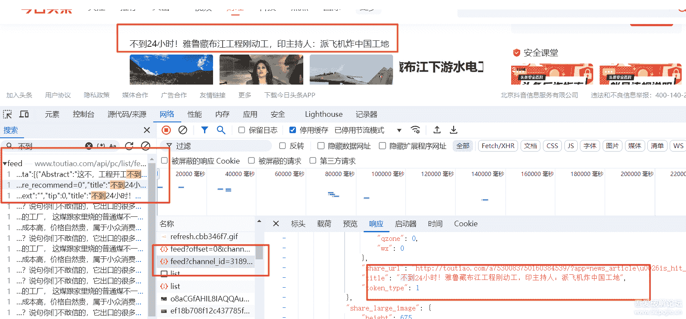

image.png (270.15 KB, 下载次数: 1)

[href="forum.php?mod=attachment&aid=Mjc5MTQzM3w3OTc2YzNkYnwxNzkzNTcwNzk1fDE2ODA4NnwyMDQ4MDMy&nothumb=yes" target="_blank"](https://www.52pojie.cn/forum.php?mod=attachment&aid=Mjc5MTQzM3w3OTc2YzNkYnwxNzkzNTcwNzk1fDE2ODA4NnwyMDQ4MDMy&nothumb=yes)

2025-7-23 20:02 上传

### 2.
载荷里面有一个`a-bogus`参数,长度为168位，`a-bogus`在字节系的加密里面几乎都有

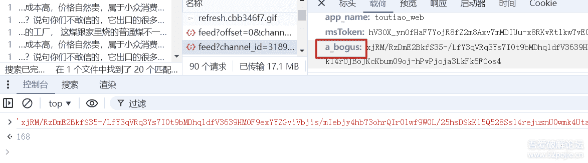

image.png (57.09 KB, 下载次数: 1)

[href="forum.php?mod=attachment&aid=Mjc5MTQzN3w5NGY4NWU1Y3wxNzkzNTcwNzk1fDE2ODA4NnwyMDQ4MDMy&nothumb=yes" target="_blank"](https://www.52pojie.cn/forum.php?mod=attachment&aid=Mjc5MTQzN3w5NGY4NWU1Y3wxNzkzNTcwNzk1fDE2ODA4NnwyMDQ4MDMy&nothumb=yes)

2025-7-23 20:04 上传

### 3.
搜关键字是搜不到的，我们可以用`xhr`断点试一下，看看能不能断住

image.png (16.54 KB, 下载次数: 2)

[href="forum.php?mod=attachment&aid=Mjc5MTQzOHw3NWJkYzQ5NnwxNzkzNTcwNzk1fDE2ODA4NnwyMDQ4MDMy&nothumb=yes" target="_blank"](https://www.52pojie.cn/forum.php?mod=attachment&aid=Mjc5MTQzOHw3NWJkYzQ5NnwxNzkzNTcwNzk1fDE2ODA4NnwyMDQ4MDMy&nothumb=yes)

2025-7-23 20:05 上传

### 4.
还是可以断住的，接下来我们跟栈分析一下

image.png (19.1 KB, 下载次数: 0)

[href="forum.php?mod=attachment&aid=Mjc5MTQzOXwwNmNiMWM4YnwxNzkzNTcwNzk1fDE2ODA4NnwyMDQ4MDMy&nothumb=yes" target="_blank"](https://www.52pojie.cn/forum.php?mod=attachment&aid=Mjc5MTQzOXwwNmNiMWM4YnwxNzkzNTcwNzk1fDE2ODA4NnwyMDQ4MDMy&nothumb=yes)

2025-7-23 20:06 上传

### 5.
发现最终的加密逻辑都是在这个`bdms`文件里面，我们打一个日志断点这里可以看见，下面也输出了`a-bogus`的加密内容了，所有可以确定这里就是入口了，我们可以下一个条件断点看一下长度为168的时候会不会断在这里【注意！！`a-bogus`的长度不是固定的】

### 6.
断住了兄弟们，接下来我们就可以进去分析了，下面输出的就是`a-bogus`

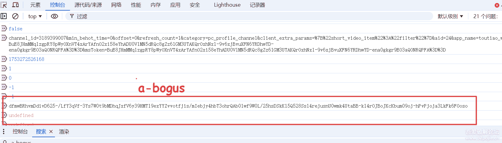

image.png (53.11 KB, 下载次数: 0)

[href="forum.php?mod=attachment&aid=Mjc5MTQ0MHxhYmViNWM2ZHwxNzkzNTcwNzk1fDE2ODA4NnwyMDQ4MDMy&nothumb=yes" target="_blank"](https://www.52pojie.cn/forum.php?mod=attachment&aid=Mjc5MTQ0MHxhYmViNWM2ZHwxNzkzNTcwNzk1fDE2ODA4NnwyMDQ4MDMy&nothumb=yes)

2025-7-23 20:11 上传

### 7.
我们再打个条件断点，当长度大于168的时候，我们就断住，再控制台输出来看一下,可以看到输出了`a-bogus`

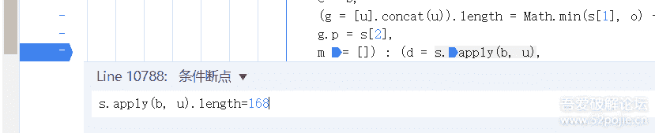

image.png (13.16 KB, 下载次数: 1)

[href="forum.php?mod=attachment&aid=Mjc5MTQ0M3xmNDY0YzNmMHwxNzkzNTcwNzk1fDE2ODA4NnwyMDQ4MDMy&nothumb=yes" target="_blank"](https://www.52pojie.cn/forum.php?mod=attachment&aid=Mjc5MTQ0M3xmNDY0YzNmMHwxNzkzNTcwNzk1fDE2ODA4NnwyMDQ4MDMy&nothumb=yes)

2025-7-23 20:14 上传

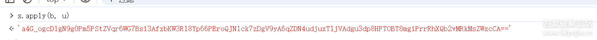

image.png (12.24 KB, 下载次数: 1)

[href="forum.php?mod=attachment&aid=Mjc5MTQ0NHw3NDgyNzNhMnwxNzkzNTcwNzk1fDE2ODA4NnwyMDQ4MDMy&nothumb=yes" target="_blank"](https://www.52pojie.cn/forum.php?mod=attachment&aid=Mjc5MTQ0NHw3NDgyNzNhMnwxNzkzNTcwNzk1fDE2ODA4NnwyMDQ4MDMy&nothumb=yes)

2025-7-23 20:17 上传

进来`s`这个方法里面可以看到，核心加密逻辑就是这个`U`方法，所以我们要做的就是把这个`U`方法导出，然后输出`return`里面的东西，这个就是我们要的东西

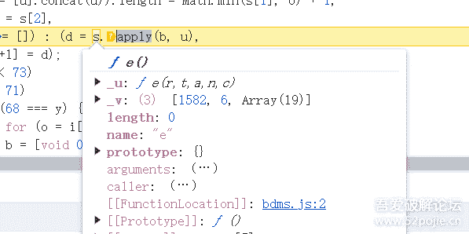

image.png (18.19 KB, 下载次数: 0)

[href="forum.php?mod=attachment&aid=Mjc5MTQ0Nnw0MzU0YTc0M3wxNzkzNTcwNzk1fDE2ODA4NnwyMDQ4MDMy&nothumb=yes" target="_blank"](https://www.52pojie.cn/forum.php?mod=attachment&aid=Mjc5MTQ0Nnw0MzU0YTc0M3wxNzkzNTcwNzk1fDE2ODA4NnwyMDQ4MDMy&nothumb=yes)

2025-7-23 20:43 上传

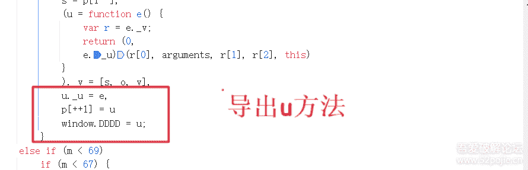

image.png (19.77 KB, 下载次数: 1)

[href="forum.php?mod=attachment&aid=Mjc5MTQ0OHwzZTRhYWQ4ZHwxNzkzNTcwNzk1fDE2ODA4NnwyMDQ4MDMy&nothumb=yes" target="_blank"](https://www.52pojie.cn/forum.php?mod=attachment&aid=Mjc5MTQ0OHwzZTRhYWQ4ZHwxNzkzNTcwNzk1fDE2ODA4NnwyMDQ4MDMy&nothumb=yes)

2025-7-23 20:46 上传

### 8.
所以我们怎么办，使用全扣大法，全部扣下来大概一万行代码,单独放到一个文件里面

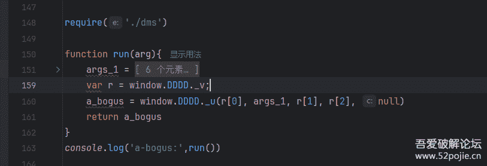

image.png (37.7 KB, 下载次数: 1)

[href="forum.php?mod=attachment&aid=Mjc5MTQ1MnxkNTMzYWE3M3wxNzkzNTcwNzk1fDE2ODA4NnwyMDQ4MDMy&nothumb=yes" target="_blank"](https://www.52pojie.cn/forum.php?mod=attachment&aid=Mjc5MTQ1MnxkNTMzYWE3M3wxNzkzNTcwNzk1fDE2ODA4NnwyMDQ4MDMy&nothumb=yes)

2025-7-23 20:52 上传

### 9.
最后处理下来大概就是这个样子，然后我们就可以开始补环境了，就是挂上代理一直补就行了

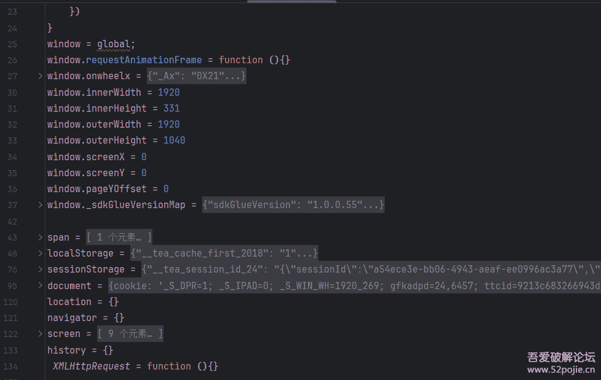

image.png (99.17 KB, 下载次数: 0)

[href="forum.php?mod=attachment&aid=Mjc5MTQ1NHxiYjI0Yzk4ZHwxNzkzNTcwNzk1fDE2ODA4NnwyMDQ4MDMy&nothumb=yes" target="_blank"](https://www.52pojie.cn/forum.php?mod=attachment&aid=Mjc5MTQ1NHxiYjI0Yzk4ZHwxNzkzNTcwNzk1fDE2ODA4NnwyMDQ4MDMy&nothumb=yes)

2025-7-23 21:04 上传

### 10.
环境补完就是最后这么多，补的差不多就会出值了，长度160

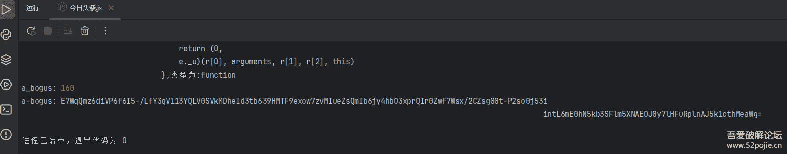

image.png (49.48 KB, 下载次数: 1)

[href="forum.php?mod=attachment&aid=Mjc5MTQ1M3wyYmJkNWRmNXwxNzkzNTcwNzk1fDE2ODA4NnwyMDQ4MDMy&nothumb=yes" target="_blank"](https://www.52pojie.cn/forum.php?mod=attachment&aid=Mjc5MTQ1M3wyYmJkNWRmNXwxNzkzNTcwNzk1fDE2ODA4NnwyMDQ4MDMy&nothumb=yes)

2025-7-23 21:03 上传

### 11.
最后我们验证一下，看看能不能拿到数据

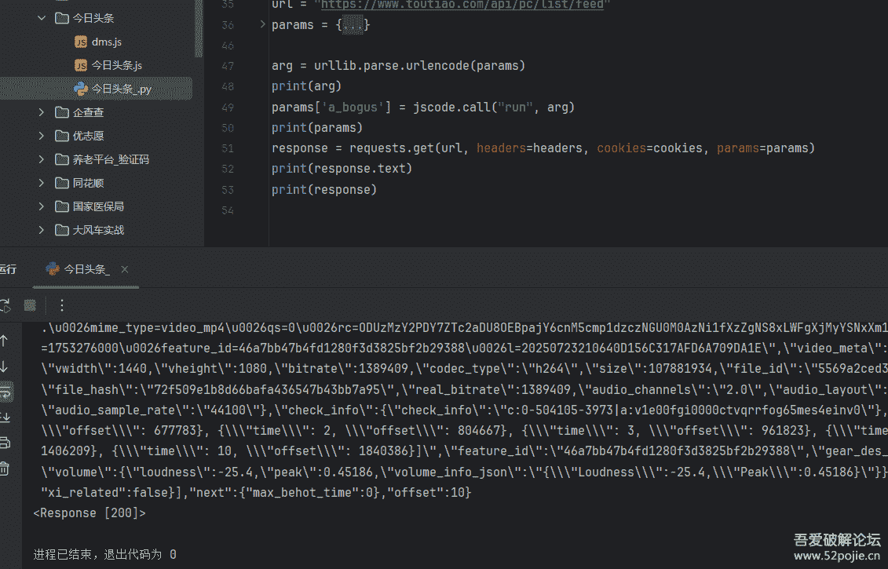

image.png (137.95 KB, 下载次数: 0)

[href="forum.php?mod=attachment&aid=Mjc5MTQ1NXxjN2EzNTg4MXwxNzkzNTcwNzk1fDE2ODA4NnwyMDQ4MDMy&nothumb=yes" target="_blank"](https://www.52pojie.cn/forum.php?mod=attachment&aid=Mjc5MTQ1NXxjN2EzNTg4MXwxNzkzNTcwNzk1fDE2ODA4NnwyMDQ4MDMy&nothumb=yes)

2025-7-23 21:07 上传

最后我们也是响应为200，成功拿到数据了，请求模拟成功
