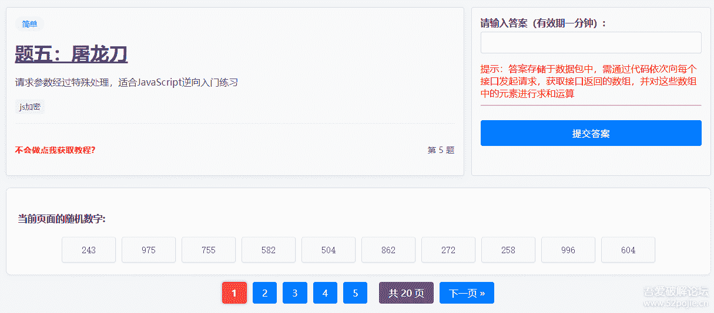
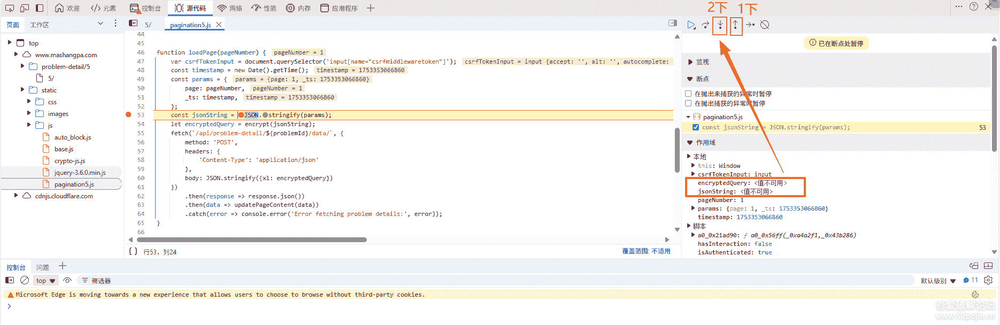
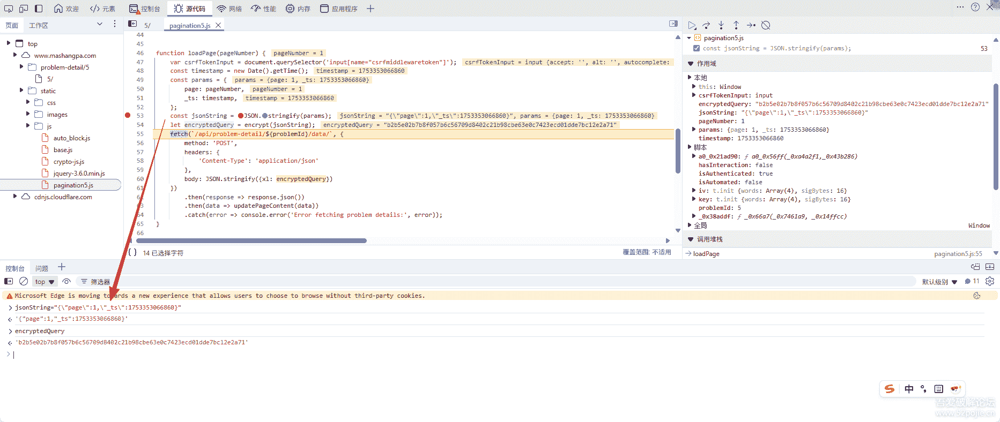
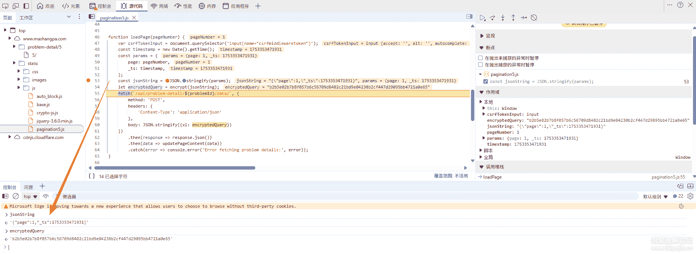
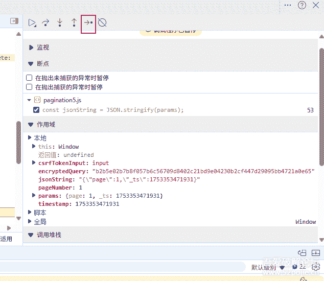
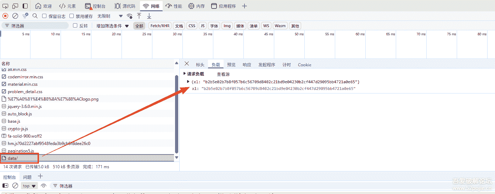
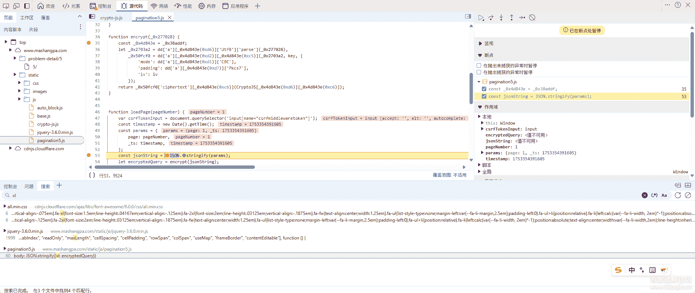

# [Web逆向] 码上爬-题五：屠龙刀（JS加密-请求参数经过特殊处理）

- 原帖: https://www.52pojie.cn/forum.php?mod=viewthread&tid=2048339
- 抓取时间: 2026-11-01T22:06:35

感谢论坛友友们的鼓励，今天有点时间又做个题，继续记录一下解题过程。欢迎各位大佬多多指教


分析地址：aHR0cHM6Ly93d3cubWFzaGFuZ3BhLmNvbS9wcm9ibGVtLWRldGFpbC81Lw==



## ① 断点调试，发现请求数据中有个加密的载荷`xl`，定位调试

先给小白白留个友好的提示：

这里如果`jsonString`、`encryptedQuery`的值显示，记得跟着我图示操作



然后就能正常显示值了



## ② 刷新网页后继续

这里为了截图演示，网页不小心卡住了，我刷新了网页，重新又做了一遍。现在值是刷新后的，前面步骤截图我就不重复了。在此继续：



到这里，记得调试到下一步



## ③ 找到加密载荷`xl`

然后，这里才会出`data`这个请求数据，找到这个加密的载荷`xl`



## ④ 定位`encrypt`加密函数

找到`encrypt`的加密函数的位置，经过ob混淆，AES算法+CBC模式+Pkcs7填充，可以通过解混淆更容易看出来。



## ⑤ 复制`loadpage`函数和`encrypt`代码块

复制`loadpage`函数，以及加密的`encrypt`代码块到`js`文件中，使用`execjs`调用`js`文件，缺什么就找到对应的代码复制进来即可。

## ⑥ 构造请求

实现代码如下：

```python
import execjs
import requests
 
headers = {
    'User-Agent':'Mozilla/5.0 (Windows NT 10.0; Win64; x64) AppleWebKit/537.36 (KHTML, like Gecko) Chrome/137.0.0.0 Safari/537.36 Edg/137.0.0.0',
    'referer':'https://www.mashangpa.com/problem-detail/5/'
}
 
# 需要登录，请先登录，获取cookie并完善参数
cookies = {
    'xxx':'xxxx',
    ......
}
 
final_sum = 0
for page in range(1,21):
    with open('./js/5.js', 'r', encoding='utf-8') as f:
        js_code = f.read()
    xl = execjs.compile(js_code).call('loadPage',page)
    json_data = {
        'xl':xl
    }
    response = requests.post('https://www.mashangpa.com/api/problem-detail/5/data/', headers=headers, cookies=cookies, json=json_data)
    print(f"第{page}页数组：{response.json()['current_array']}")
    final_sum += sum(response.json()['current_array'])
print(f"最终的和为: {final_sum}")
```

欢迎各位大佬批评指正，下次见


