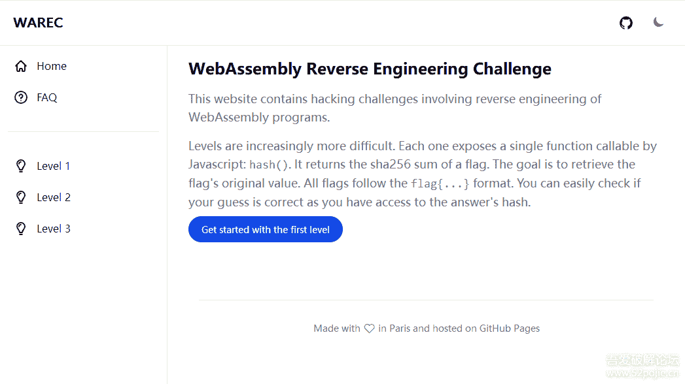
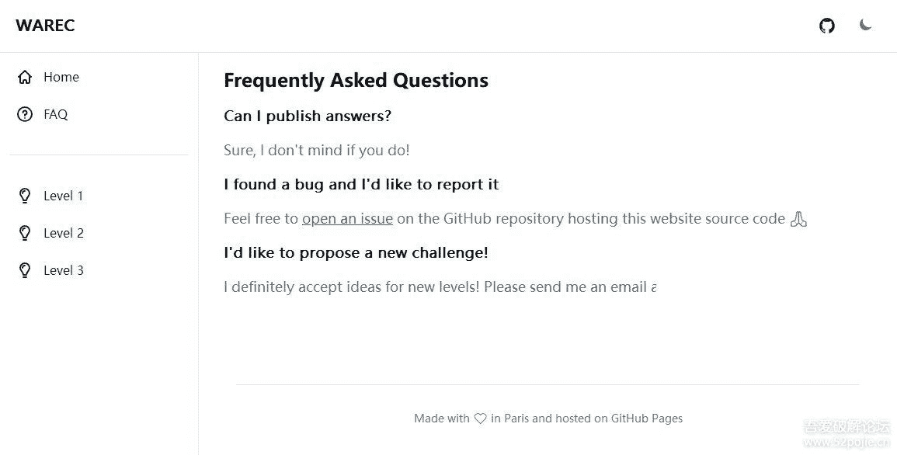
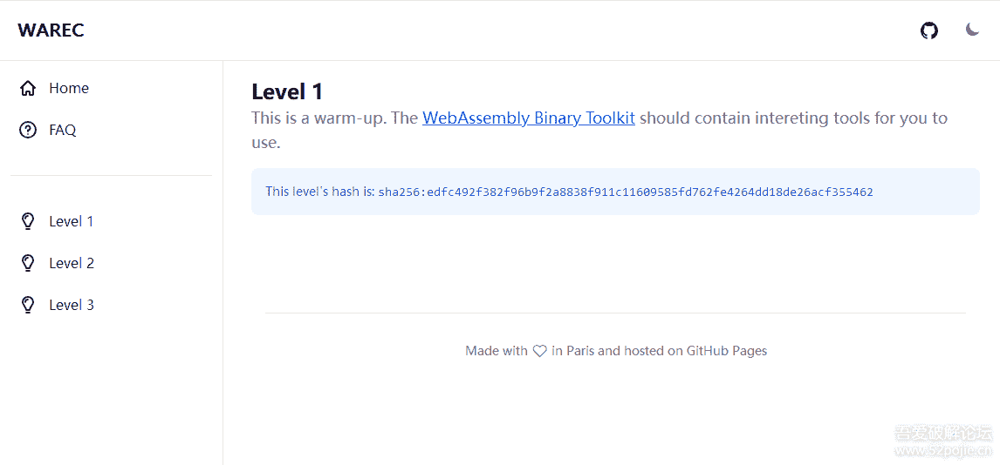
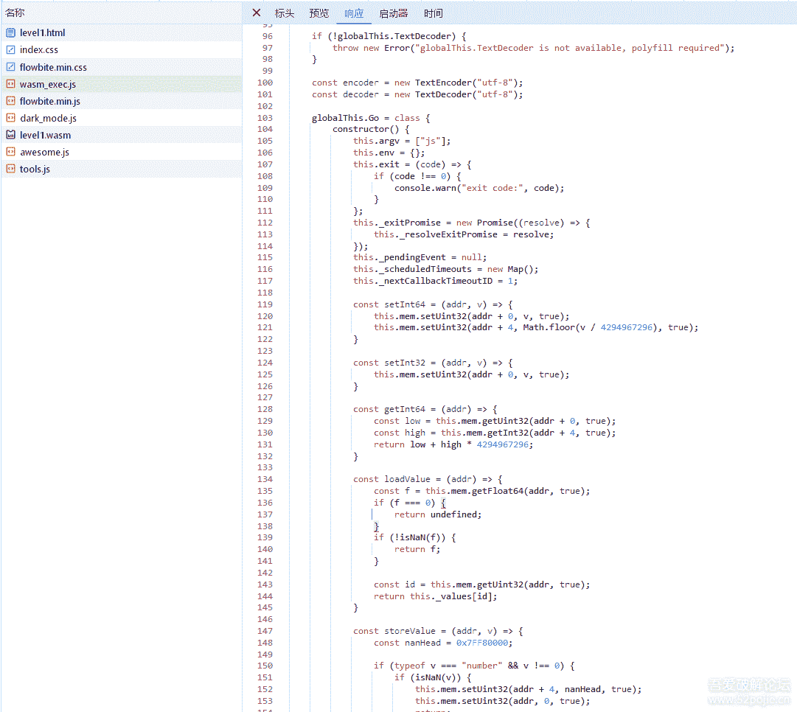
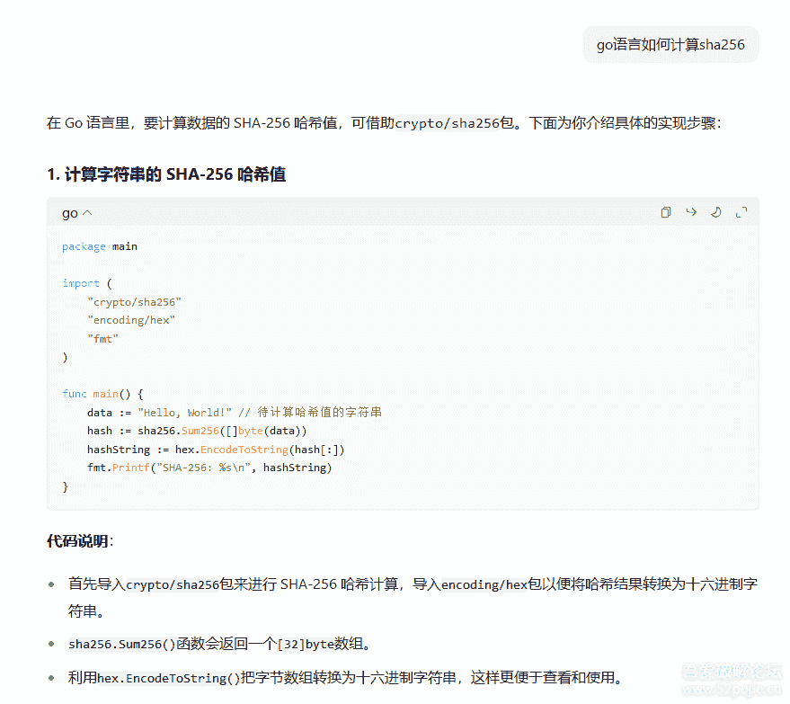
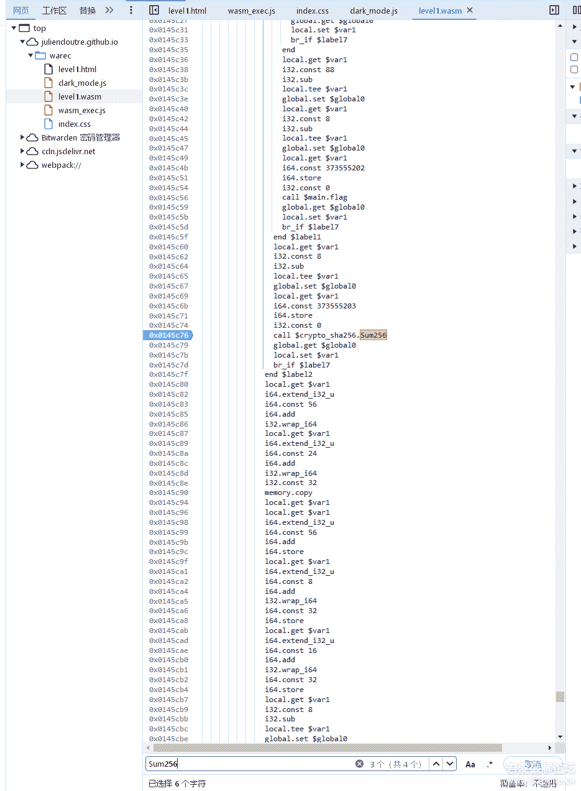
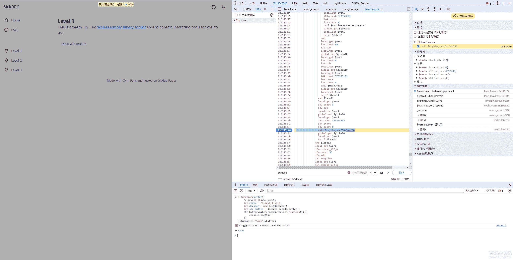
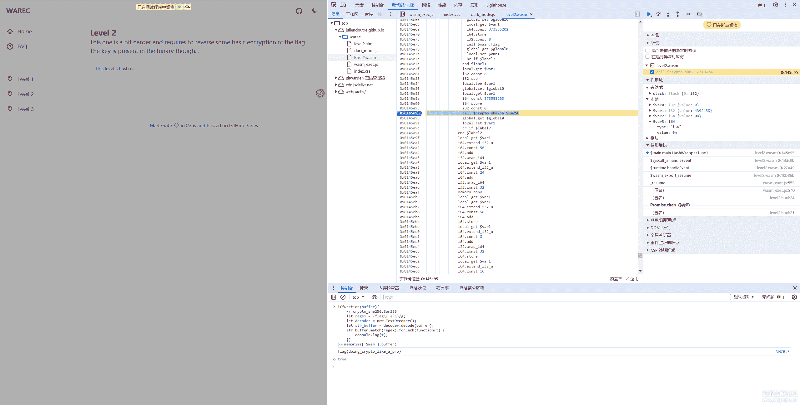
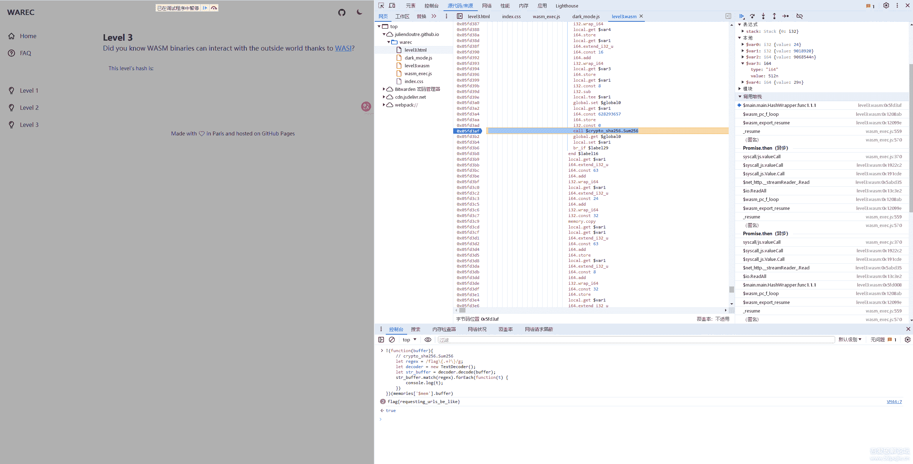
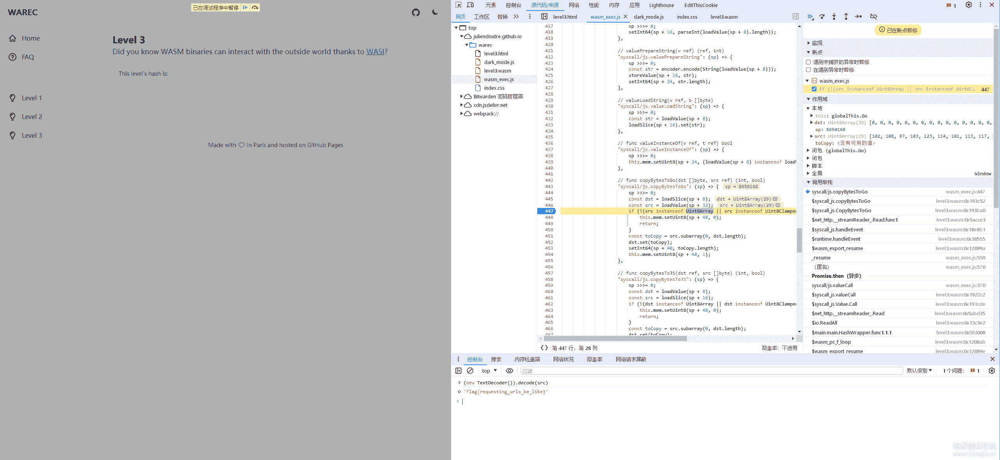

# WebAssembly 逆向工程挑战赛

- 原帖：`https://www.52pojie.cn/forum.php?mod=viewthread&tid=2048465`
- 抓取时间：2026-11-01T22:06:33

## 前言

最近在群聊中有群友分享了一条连接，是 GitHub 上创建的一个挑战页面：`https://juliendoutre.github.io/warec/index.html`。

从主页中可以看到，题目全都是通过 `hash` 函数计算出了一个 `sha256` 的值，需要找到它的原始值，并且原始值都是 `flag{...}` 的格式，这是比较常规的格式。

再查看一下网站的 FAQ。

可以看到作者允许公开发布答案，所以有了这一份水贴。

## 第一题

打开 `f12`，进入到第一题中，可以看到直接显示了 `sha256` 的结果。

从网络请求中可以看到加载了一个 `wasm` 文件 `level1.wasm` 和对应的胶水代码 `wasm_exec.js`。

根据胶水代码可以看出是使用 `go` 语言编写的。

然后多次刷新页面可以发现，得出的结果是不变的，同时在网页中也没有明确的提示为动态的 `flag`，那么可以暂且认为这是一个静态的 `flag`。

既然题目是从摘要算法中找到原文，那么使用的摘要算法大概率也是标准算法，虽然不认识 `go`，但是可以问问豆包 `go` 怎么计算 `sha256`。

豆包给出了使用 `crypto/sha256` 这个包下的 `Sum256()` 方法，那么在 `wasm` 中搜索这个方法。

可以搜索到 4 处，说明符号名没有被去除，直接在调用处下一个断点，然后刷新，可以成功在断点中断下。

此时骚操作就来了，接下来就开始计算 `sha256` 了，那么明文基本就已经存在内存中，那么尝试直接从内存中查找 `flag`。

非常轻松的就找到 `flag` 为 `flag{plaintext_secrets_are_the_best}`。

此时计算一下找到的这个 `flag` 的 `sha256` 为 `edfc492f382f96b9f2a8838f911c11609585fd762fe4264dd18de26acf355462`，与网页的一致，说明成功了。

## 第二题

第二题的方法和第一题一模一样。

可以直接通过内存查找到 `flag` 为 `flag{doing_crypto_like_a_pro}`，经过 `sha256` 后也与网页中的一致。

## 第三题

第三题依然可以使用相同的方法，就是 `wasm` 文件比较大，等待时间会久一点。

找到的 `flag` 为 `flag{requesting_urls_be_like}`，经过 `sha256` 后也与网页中的一致。

那么第三题有没有没那么卡的方法呢？那也是有的。

在 `wasm_exec.js` 的 `syscall/js.copyBytesToGo()` 方法内下一个断点，刷新后很快就断下来了，此时的 `src` 就是原文 `flag`。

也可以直接看到 `flag`。

三题都水完了，结束！！！
