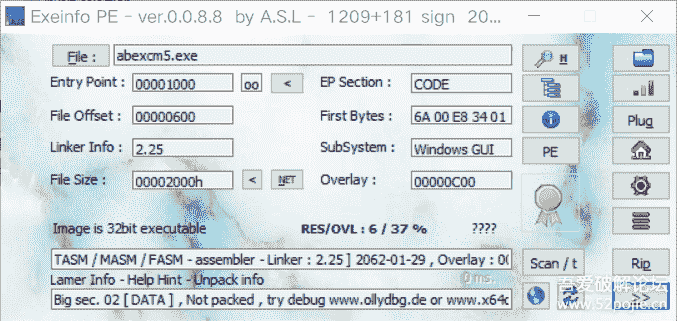
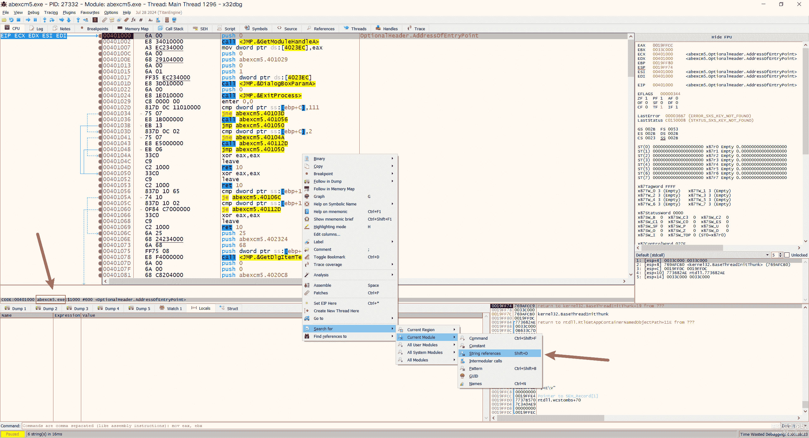
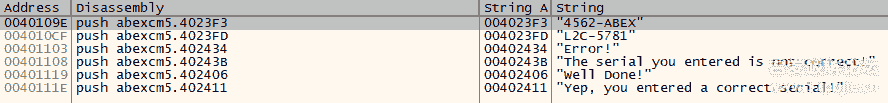
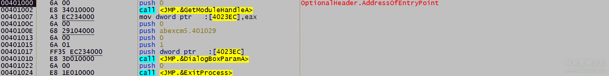
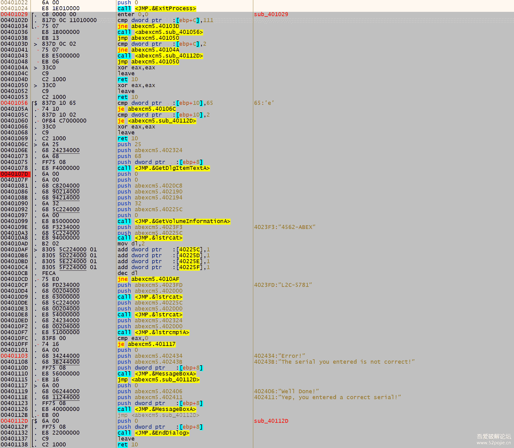

# [原创] NewCrackMe 002 - abexcm5

- 原帖: https://www.52pojie.cn/forum.php?mod=viewthread&tid=2049062
- 抓取时间: 2026-11-01T22:06:23

## info
1、软件名称：abex' 5th crackme
2、压缩包名：`abexcm5.rar`
3、编程语言：`TASM` / `MASM` / `FASM` - assembler
4、星级评定：算 法：★ 爆 破：★

## 查壳
没有壳，汇编编写的程序，32bit

Pasted image 20250723141334.png (183.2 KB, 下载次数: 3)
[href="forum.php?mod=attachment&aid=Mjc5MjUxNHxiNDg2YzgyOXwxNzkzNTcwNzgxfDE2ODA4NnwyMDQ5MDYy&nothumb=yes" target="_blank"](https://www.52pojie.cn/forum.php?mod=attachment&aid=Mjc5MjUxNHxiNDg2YzgyOXwxNzkzNTcwNzgxfDE2ODA4NnwyMDQ5MDYy&nothumb=yes)
1
2025-7-27 22:33 上传

## 界面

Pasted image 20250723141507.png (10.85 KB, 下载次数: 0)
[href="forum.php?mod=attachment&aid=Mjc5MjUxNXw5MzdjN2MxZHwxNzkzNTcwNzgxfDE2ODA4NnwyMDQ5MDYy&nothumb=yes" target="_blank"](https://www.52pojie.cn/forum.php?mod=attachment&aid=Mjc5MjUxNXw5MzdjN2MxZHwxNzkzNTcwNzgxfDE2ODA4NnwyMDQ5MDYy&nothumb=yes)
2
2025-7-27 22:33 上传

## 逆向
点击 `Check` 后出现 Error

Pasted image 20250723141533.png (26.08 KB, 下载次数: 2)
[href="forum.php?mod=attachment&aid=Mjc5MjUxNnwwNGUwZWU0MXwxNzkzNTcwNzgxfDE2ODA4NnwyMDQ5MDYy&nothumb=yes" target="_blank"](https://www.52pojie.cn/forum.php?mod=attachment&aid=Mjc5MjUxNnwwNGUwZWU0MXwxNzkzNTcwNzgxfDE2ODA4NnwyMDQ5MDYy&nothumb=yes)
3
2025-7-27 22:33 上传
搜索字符串

Pasted image 20250723145926.png (370.5 KB, 下载次数: 2)
[href="forum.php?mod=attachment&aid=Mjc5MjUyM3xlMDRhMGI0YXwxNzkzNTcwNzgxfDE2ODA4NnwyMDQ5MDYy&nothumb=yes" target="_blank"](https://www.52pojie.cn/forum.php?mod=attachment&aid=Mjc5MjUyM3xlMDRhMGI0YXwxNzkzNTcwNzgxfDE2ODA4NnwyMDQ5MDYy&nothumb=yes)
2025-7-27 22:40 上传
找到了这个

Pasted image 20250723150014.png (25.64 KB, 下载次数: 2)
[href="forum.php?mod=attachment&aid=Mjc5MjUxN3xlOTY1ZjVjOXwxNzkzNTcwNzgxfDE2ODA4NnwyMDQ5MDYy&nothumb=yes" target="_blank"](https://www.52pojie.cn/forum.php?mod=attachment&aid=Mjc5MjUxN3xlOTY1ZjVjOXwxNzkzNTcwNzgxfDE2ODA4NnwyMDQ5MDYy&nothumb=yes)
4
2025-7-27 22:33 上传
这一块是主函数区

Pasted image 20250723170945.png (43.47 KB, 下载次数: 1)
[href="forum.php?mod=attachment&aid=Mjc5MjUxOHxiZjI2MzM1NXwxNzkzNTcwNzgxfDE2ODA4NnwyMDQ5MDYy&nothumb=yes" target="_blank"](https://www.52pojie.cn/forum.php?mod=attachment&aid=Mjc5MjUxOHxiZjI2MzM1NXwxNzkzNTcwNzgxfDE2ODA4NnwyMDQ5MDYy&nothumb=yes)
5
2025-7-27 22:34 上传
这是 `DialogProc` 回调函数

Pasted image 20250724174011.png (265.57 KB, 下载次数: 2)
[href="forum.php?mod=attachment&aid=Mjc5MjUxOXw5ZThkNmI5ZXwxNzkzNTcwNzgxfDE2ODA4NnwyMDQ5MDYy&nothumb=yes" target="_blank"](https://www.52pojie.cn/forum.php?mod=attachment&aid=Mjc5MjUxOXw5ZThkNmI5ZXwxNzkzNTcwNzgxfDE2ODA4NnwyMDQ5MDYy&nothumb=yes)
6
2025-7-27 22:34 上传

## 注册机
```
#include 
#include 

LPSTR salt1 = (LPSTR)"4562-ABEX";
LPSTR salt2 = (LPSTR)"L2C-5781";
char key[255];

char GetText[0x25];
char lpVolumeNameBuffer[255];
LPDWORD lpVolumeSerialNumber;
LPDWORD lpMaximumComponentLength;
LPDWORD lpFileSystemFlags;

int main() {
  std::cout > GetText;

  if (!GetVolumeInformationA(NULL, lpVolumeNameBuffer, 0x32,
                             lpVolumeSerialNumber, lpMaximumComponentLength,
                             lpFileSystemFlags, NULL, NULL)) {
    std::cerr 
```
