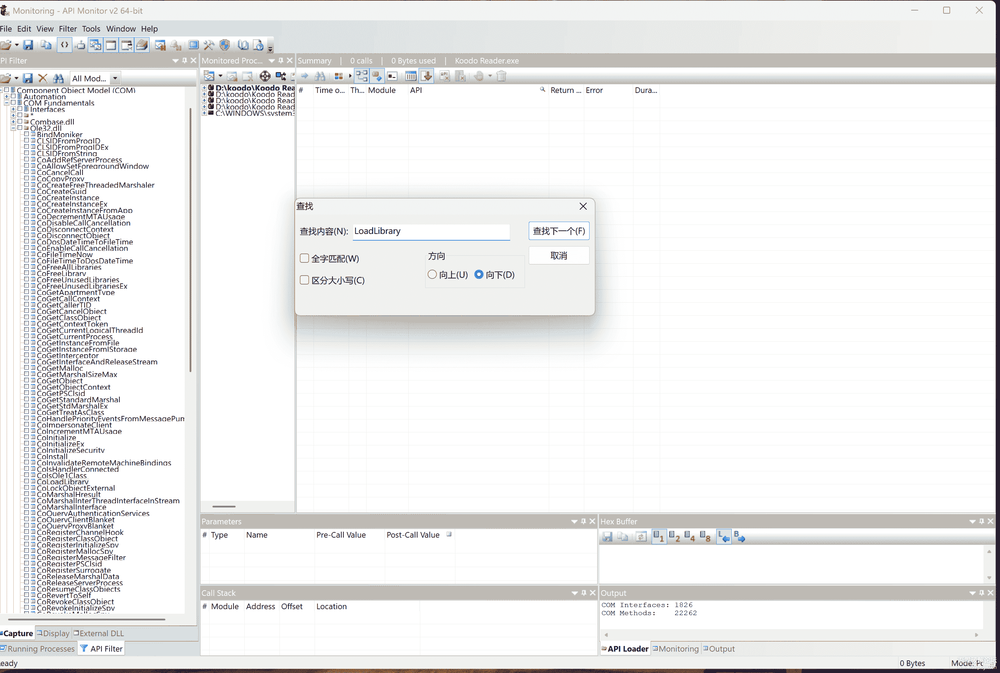
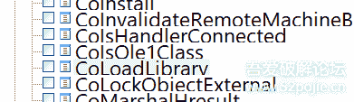
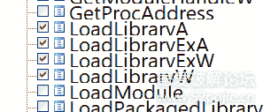
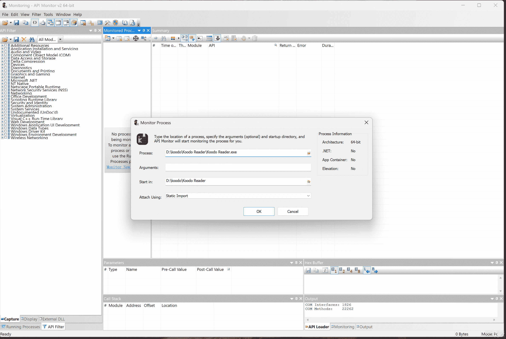
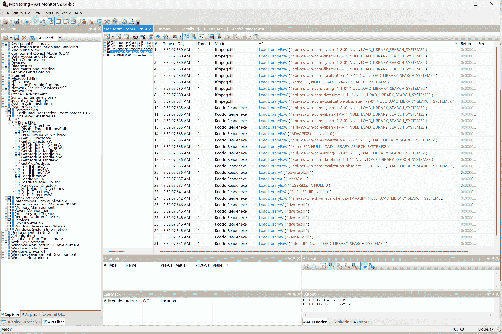

# [分享] APImonitor 监控 dll 文件加载（新手向）

- 原帖：<https://www.52pojie.cn/forum.php?mod=viewthread&tid=2049928>
- 抓取时间：2026-11-01T22:06:09

动态加载 dll 文件的最普遍使用的即为 `loadlibrary` 系列函数，这里介绍 APImonitor 监控 dll 文件加载的流程。

首先安装 APImonitor，这个可以去别的技术帖找包或者直接去官网 <http://www.rohitab.com> 上下，这个不难。

接下来就是打开 APImonitor。

这里我是调整了一下左边显示栏，所以界面有所不同，不过不影响。

在那一堆组件的最上方有一个竖放的望远镜图标，点击它，它的功能是 `find`，即搜索。

在里面键入你想找到 API 名称（注意区分大小写，点全字搜索只会让你什么都搜不到，大家可以试试，自己严谨一些还是更快），这里我们输入的是 `LoadLibrary`。

`屏幕截图 2025-07-31 082847.png` (494.42 KB, 下载次数: 1)

[附件](https://www.52pojie.cn/forum.php?mod=attachment&aid=Mjc5MzQ0OHwxMzA1Nzk0OXwxNzkzNTcwNzY3fDE2ODA4NnwyMDQ5OTI4&nothumb=yes)

2025-7-31 08:33 上传

回车，左边栏目会展开，仔细观察可以看到展开部分里面有一行是变灰的，这就是它的搜索结果。

`屏幕截图 2025-07-31 082859.png` (15.34 KB, 下载次数: 1)

[附件](https://www.52pojie.cn/forum.php?mod=attachment&aid=Mjc5MzQ0OXw1MGEwYjBlZXwxNzkzNTcwNzY3fDE2ODA4NnwyMDQ5OTI4&nothumb=yes)

2025-7-31 08:33 上传

但这并不是我们想要的，为什么呢？因为这里 `find` 的搜索功能本质上和大家大学计算机基础课上学的 python 里 `find()` 函数类似，都是返回第一个，所以多敲几次回车就好了。

`屏幕截图 2025-07-31 082929.png` (13.44 KB, 下载次数: 1)

[附件](https://www.52pojie.cn/forum.php?mod=attachment&aid=Mjc5MzQ1MXwxZTFhYjQyMXwxNzkzNTcwNzY3fDE2ODA4NnwyMDQ5OTI4&nothumb=yes)

2025-7-31 08:33 上传

第二次出来的是这个，还不是。敲到第四回的时候终于找到了，我们把它左边的方框给勾上。

`屏幕截图 2025-07-31 083047.png` (14.39 KB, 下载次数: 0)

[附件](https://www.52pojie.cn/forum.php?mod=attachment&aid=Mjc5MzQ1MnxlY2E1OTI3ZXwxNzkzNTcwNzY3fDE2ODA4NnwyMDQ5OTI4&nothumb=yes)

2025-7-31 08:33 上传

可以看到有一行很显眼的蓝色字体 `Monitor New Process`，点它。

在 `Process` 那一栏右边的文件夹标志那里面浏览你要监控的程序文件。

`屏幕截图 2025-07-31 082756.png` (393.7 KB, 下载次数: 1)

[附件](https://www.52pojie.cn/forum.php?mod=attachment&aid=Mjc5MzQ0N3xmYjYwYWYyZnwxNzkzNTcwNzY3fDE2ODA4NnwyMDQ5OTI4&nothumb=yes)

2025-7-31 08:33 上传

点 OK，这个时候会触发程序自动开始运行，

`image.png` (758.01 KB, 下载次数: 2)

[附件](https://www.52pojie.cn/forum.php?mod=attachment&aid=Mjc5MzQ1Nnw0OGMxNTU5NXwxNzkzNTcwNzY3fDE2ODA4NnwyMDQ5OTI4&nothumb=yes)

2025-7-31 08:54 上传

可以在右边寻找你想要知道的信息。

PS：实际我图里面的是错误示范哈。

图里面虽然各步操作没问题（大家可以放心操作），但是大家可以看出来我是先选 `monitor new process` 再点 API 的。一开始你要先选好 API 再选 `monitor new process`，否则后面就算你重启程序 APImonitor 都没有反应的。可能是因为自动启动的原因，当我关闭自启动的程序去选 API 的时候监控程序也结束了。有大佬知道原因的话拜托评论教我。

