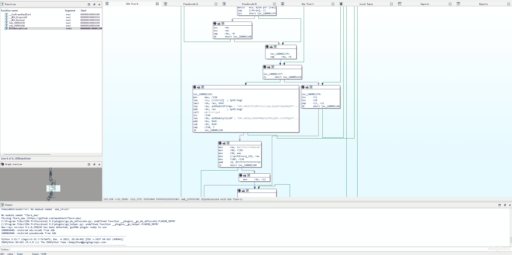
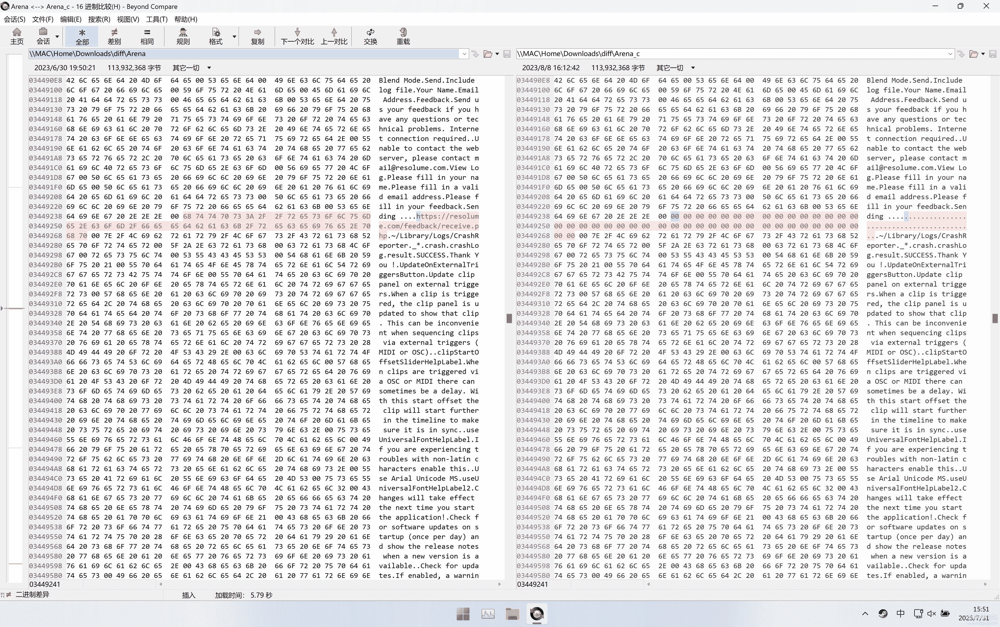
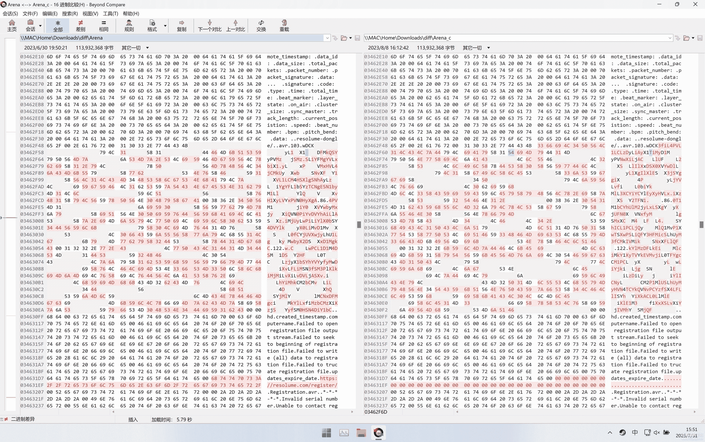
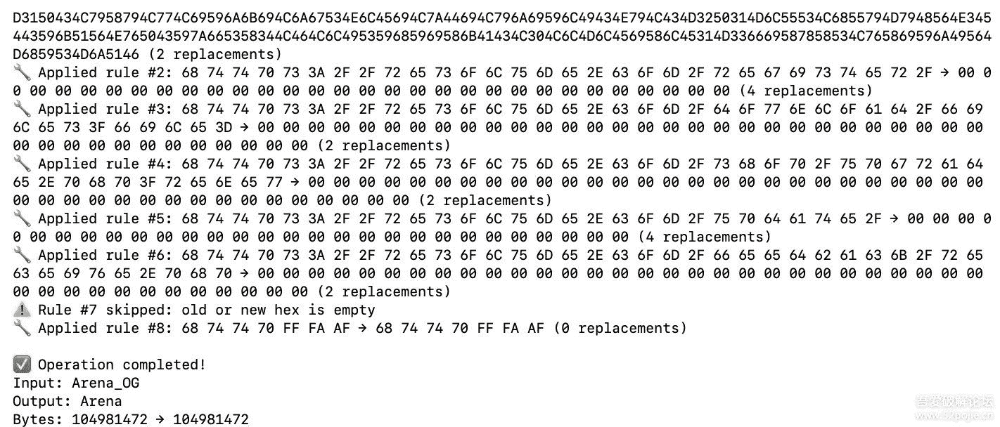
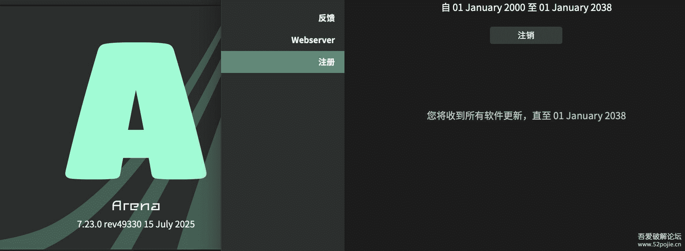

# [MacOS逆向] [resolume arena] Mac版 7.23.0 偷懒破解法

- 原帖: https://www.52pojie.cn/forum.php?mod=viewthread&tid=2050080
- 抓取时间: 2026-11-01T22:06:07

## 前言

最近因为工作需要，要整一个resolume arena。
但找不到资源。
Windows版好说，能到最新，但mac只到7.16，就很坏了。

## 开始研究！

既然windows版有[//www.52pojie.cn" target="_blank" class="relatedlink"](https://www.52pojie.cn:href="https)，那同理，mac应该也不难破。
于是下了个windows版，发现在流传的破解版中，有一个“其他文件”，叫`VCRUNTIME140_1.dll`。然而复制的过程中并没有进行任何替换操作。很可疑偶！
于是灵机一动，把它丢进IDA，果然，动态替换！

QQ20250731-154837.png (122.84 KB, 下载次数: 3)
[href="forum.php?mod=attachment&aid=Mjc5MzU3NnxhOWRlMDNjOXwxNzkzNTcwNzY1fDE2ODA4NnwyMDUwMDgw&nothumb=yes" target="_blank"](https://www.52pojie.cn/forum.php?mod=attachment&aid=Mjc5MzU3NnxhOWRlMDNjOXwxNzkzNTcwNzY1fDE2ODA4NnwyMDUwMDgw&nothumb=yes)
2025-7-31 15:49 上传
那既然是这样，mac版大概率也是同理。
mac，启动！
立刻下了一个7.16版本进行对比。

Jietu20250731-155146@2x.jpg (1.87 MB, 下载次数: 2)
[href="forum.php?mod=attachment&aid=Mjc5MzU3N3wwZWNhZjRiY3wxNzkzNTcwNzY1fDE2ODA4NnwyMDUwMDgw&nothumb=yes" target="_blank"](https://www.52pojie.cn/forum.php?mod=attachment&aid=Mjc5MzU3N3wwZWNhZjRiY3wxNzkzNTcwNzY1fDE2ODA4NnwyMDUwMDgw&nothumb=yes)
2025-7-31 15:52 上传

Jietu20250731-155159@2x.jpg (1.99 MB, 下载次数: 4)
[href="forum.php?mod=attachment&aid=Mjc5MzU3OHw0MTJlODczNXwxNzkzNTcwNzY1fDE2ODA4NnwyMDUwMDgw&nothumb=yes" target="_blank"](https://www.52pojie.cn/forum.php?mod=attachment&aid=Mjc5MzU3OHw0MTJlODczNXwxNzkzNTcwNzY1fDE2ODA4NnwyMDUwMDgw&nothumb=yes)
2025-7-31 15:52 上传
果不其然，也是主要替换掉了联网的部分和内置的证书部分。这就简单多了。

Jietu20250731-160001@2x.jpg (235.44 KB, 下载次数: 2)
[href="forum.php?mod=attachment&aid=Mjc5MzU4MXwzYTViMjZiNHwxNzkzNTcwNzY1fDE2ODA4NnwyMDUwMDgw&nothumb=yes" target="_blank"](https://www.52pojie.cn/forum.php?mod=attachment&aid=Mjc5MzU4MXwzYTViMjZiNHwxNzkzNTcwNzY1fDE2ODA4NnwyMDUwMDgw&nothumb=yes)
2025-7-31 16:00 上传
对比7.16的破解内容，直接AI写一个替换程序。把7.23的文件拷贝出来进行替换。程序源码放在https://github.com/ShigemoriHakura/go_bin_patcher这里了。
这是我使用的配置文件：

[href="forum.php?mod=attachment&aid=Mjc5MzU4MHw0OGZmYjcxZXwxNzkzNTcwNzY1fDE2ODA4NnwyMDUwMDgw" target="_blank"](https://www.52pojie.cn/forum.php?mod=attachment&aid=Mjc5MzU4MHw0OGZmYjcxZXwxNzkzNTcwNzY1fDE2ODA4NnwyMDUwMDgw)
(2.47 KB, 下载次数: 87)
2025-7-31 15:54 上传
点击文件名下载附件
下载积分: 吾爱币 -1 CB

## mac，重签名！

众所周知，mac的程序有签名，所以破解完的app需要重新sign一下。
```
xcode-select --install
sudo codesign --force --deep --sign - /Applications/Resolume\ Arena/Arena.app
sudo codesign --force --deep --sign - /Applications/Resolume\ Wire/Wire.app
```
进行完签名，app就可以正常打开了。打开注册机，生成注册文件，离线激活。

Jietu20250731-160046@2x.jpg (56.57 KB, 下载次数: 2)
[href="forum.php?mod=attachment&aid=Mjc5MzU4MnxhOTA2MGYyMHwxNzkzNTcwNzY1fDE2ODA4NnwyMDUwMDgw&nothumb=yes" target="_blank"](https://www.52pojie.cn/forum.php?mod=attachment&aid=Mjc5MzU4MnxhOTA2MGYyMHwxNzkzNTcwNzY1fDE2ODA4NnwyMDUwMDgw&nothumb=yes)
2025-7-31 16:00 上传
完美！

## 后文

PS: 注册机我用cff删掉了音乐，方便上传。。。其他没有改动。
我自己的sign就不分享了，其实sign不麻烦，有xcode就基本一键了。
wire也是一样的方法就可以。

[href="forum.php?mod=attachment&aid=Mjc5MzU4M3xjMWM2MjVmOXwxNzkzNTcwNzY1fDE2ODA4NnwyMDUwMDgw" target="_blank"](https://www.52pojie.cn/forum.php?mod=attachment&aid=Mjc5MzU4M3xjMWM2MjVmOXwxNzkzNTcwNzY1fDE2ODA4NnwyMDUwMDgw)
(476.62 KB, 下载次数: 139)
2025-7-31 16:09 上传
点击文件名下载附件
下载积分: 吾爱币 -1 CB
