# [Web逆向] 极验3代滑块流程分析

- 原帖：[https://www.52pojie.cn/forum.php?mod=viewthread&tid=2051507](https://www.52pojie.cn/forum.php?mod=viewthread&tid=2051507)
- 抓取时间：2026-11-01T22:06:01
- 目标网站：`aHR0cHM6Ly9kZW1vcy5nZWV0ZXN0LmNvbS9zbGlkZS1mbG9hdC5odG1s`

## 免责声明

第一次发文，有不适的地方多多包涵。本文仅供学习交流，因使用本文内容而产生的任何风险及后果，作者不承担任何责任。

下一篇：扣代码思路 [https://www.52pojie.cn/forum.php?mod=viewthread&tid=2051616&extra=&page=1](https://www.52pojie.cn/forum.php?mod=viewthread&tid=2051616&extra=&page=1)

## 第一步：抓包

直接 `f12` 打开浏览器开发者工具，刷新网页之后，我们可以看到以下数据包。

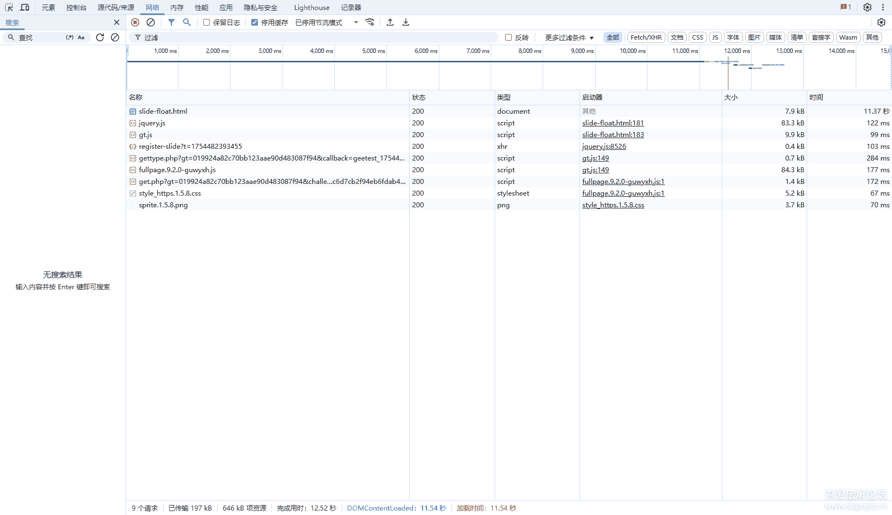
`image.png`（83.12 KB，下载次数：5；2025-8-6 20:13 上传）

再通过滑块验证之后会再出现以下包，其中最后一个包就是我们需要的结果。

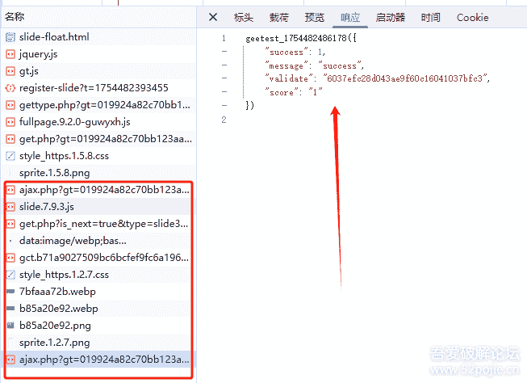
`image.png`（44.82 KB，下载次数：4；2025-8-6 20:16 上传）

然后我们从后往前逆推。首先最后一个包，可以看到有几个参数，其中 `w` 值为一长串密文、`gt` 和 `challenge` 为一串16进制字符串、`callback` 则是时间戳，其余的就是定值。

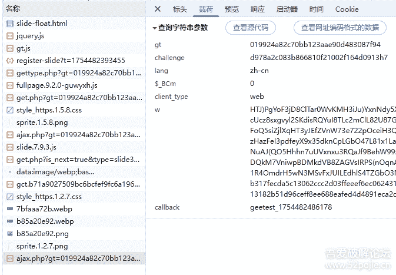
`image.png`（67.92 KB，下载次数：4；2025-8-6 20:16 上传）

通过搜索大法可以知道 `gt` 和 `challenge` 为前面的接口返回。

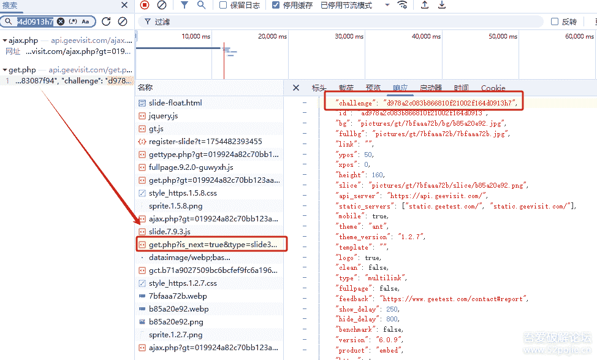
`image.png`（77.62 KB，下载次数：4；2025-8-6 20:17 上传）

接着来分析这个接口。可以看到又有 `gt` 和 `challenge`，并且这里的 `challenge` 和该接口返回的 `challenge` 并不相同，其他的参数看着就不像是密文。

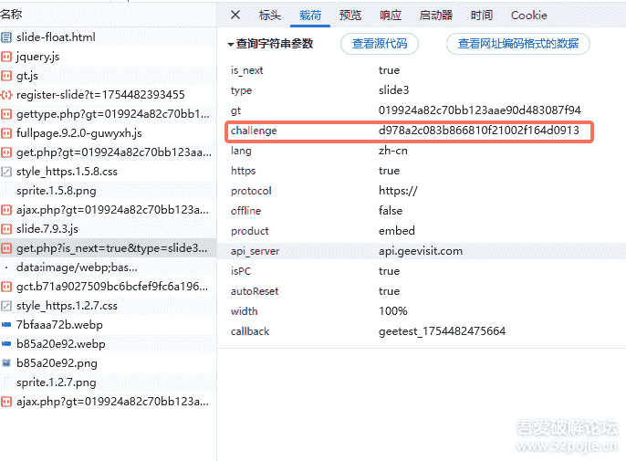
`image.png`（59.61 KB，下载次数：5；2025-8-6 20:18 上传）

接下来看看他返回的是什么。`gt` 和 `challenge` 前面已经说了，同时该接口返回的还包含有滑块图片链接，以及缺口图片链接。

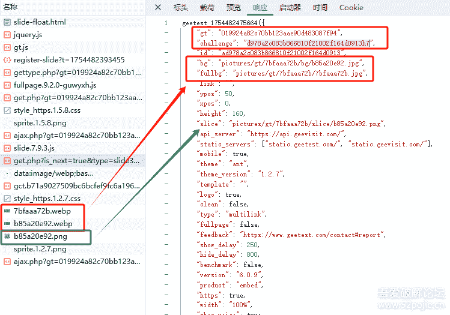
`image.png`（60.92 KB，下载次数：4；2025-8-6 20:19 上传）

顺便让我们看看他的图片，这里就只放带缺口的底图了。可以发现他的图片是乱序的，还原方法可以百度搜索，极验的底图还原全部通用。

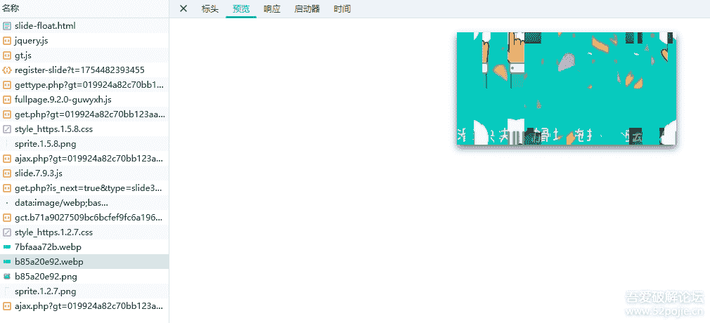
`image.png`（88.89 KB，下载次数：3；2025-8-6 20:20 上传）

### 底图还原

```python
def restore_picture(img1):
    image = Image.open(img1)
    s = Image.new("RGBA", (260, 160))
    ut = [39, 38, 48, 49, 41, 40, 46, 47, 35, 34, 50, 51, 33, 32, 28, 29, 27, 26, 36, 37, 31, 30, 44, 45, 43,
          42, 12, 13, 23, 22, 14, 15, 21, 20, 8, 9, 25, 24, 6, 7, 3, 2, 0, 1, 11, 10, 4, 5, 19, 18, 16, 17]
    height_half = 80
    for inx in range(52):
        c = ut[inx] % 26 * 12 + 1
        u = height_half if ut[inx] > 25 else 0
        l_ = image.crop(box=(c, u, c + 10, u + 80))
        s.paste(l_, box=(inx % 26 * 10, 80 if inx > 25 else 0))
    s.save(f"./bg_img.png")
```

### 前置接口逆推

接下来就是上一个包。返回的话就只有一个类型确认，不过参数则还是一样 `gt`、`challenge`、`w` 以及一些定值。注意！由于3代是无感验证，所以整个流程的所有 `w` 值都需要逆向。

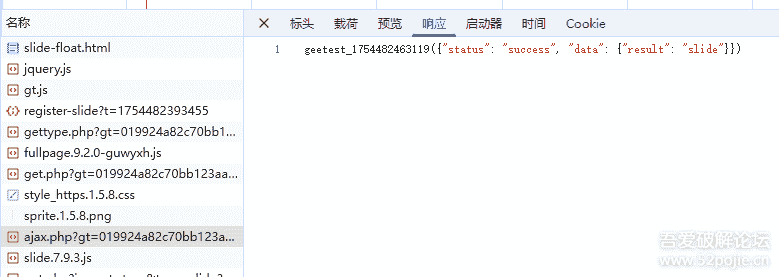
`image.png`（28.21 KB，下载次数：5；2025-8-6 20:20 上传）

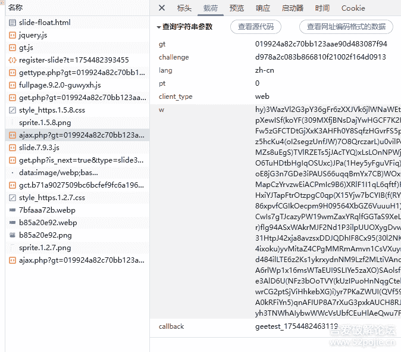
`image.png`（94.29 KB，下载次数：5；2025-8-6 20:21 上传）

再上一个包。返回了一些意义不明的数据，暂时先放着。同时请求参数也携带有 `gt`、`challenge`、`w` 以及一些定值。

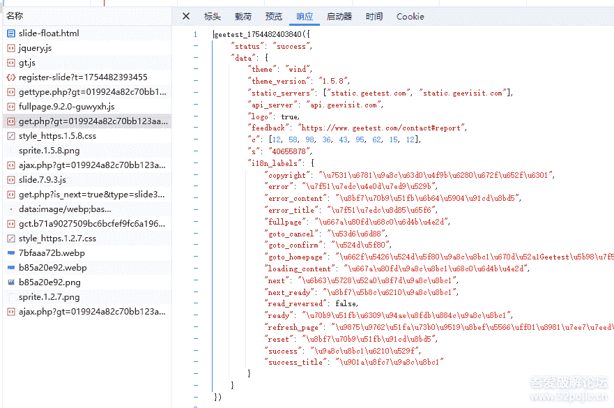
`image.png`（59.01 KB，下载次数：4；2025-8-6 20:21 上传）

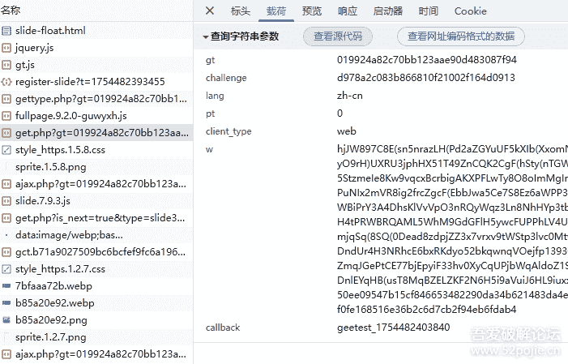
`image.png`（77.51 KB，下载次数：5；2025-8-6 20:21 上传）

接着再上一个包。返回也是一些意义不明的数据，也先暂时放着。不过参数就只有 `gt` 和一个时间戳。

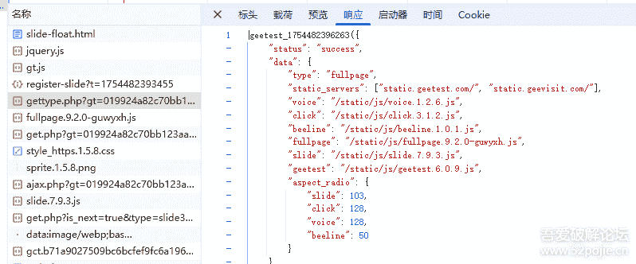
`image.png`（39.19 KB，下载次数：3；2025-8-6 20:22 上传）

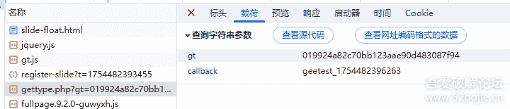
`image.png`（27.27 KB，下载次数：5；2025-8-6 20:22 上传）

再接着上一个包。可以看到他返回了我们前面几个包的 `gt`、`challenge` 值，所携带的参数就只有时间戳。

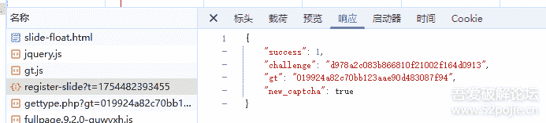
`image.png`（20.48 KB，下载次数：4；2025-8-6 20:22 上传）

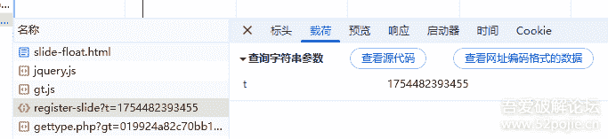
`image.png`（23.09 KB，下载次数：5；2025-8-6 20:23 上传）

除去一些js代码文件和资源包外就剩下html包了，大致看一下html包并没有什么需要注意的地方。

哦了，极验3整个流程就这些了，相较于国内其他的验证码所涉及到的包要多得多。接下来的扣代码环节就单独留着下一篇。
